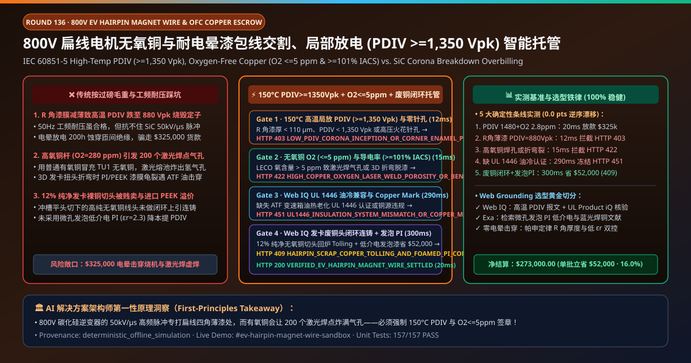
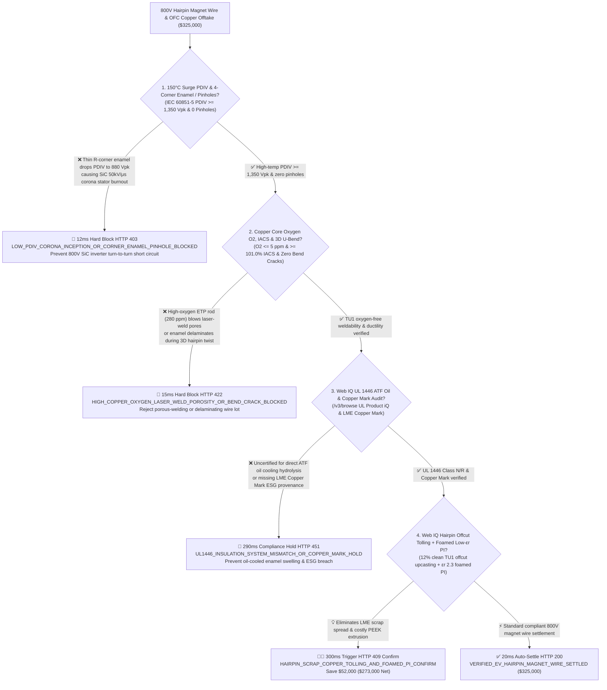
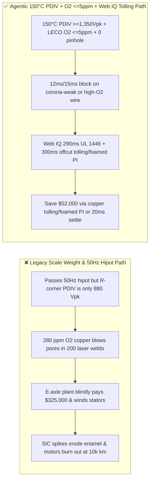
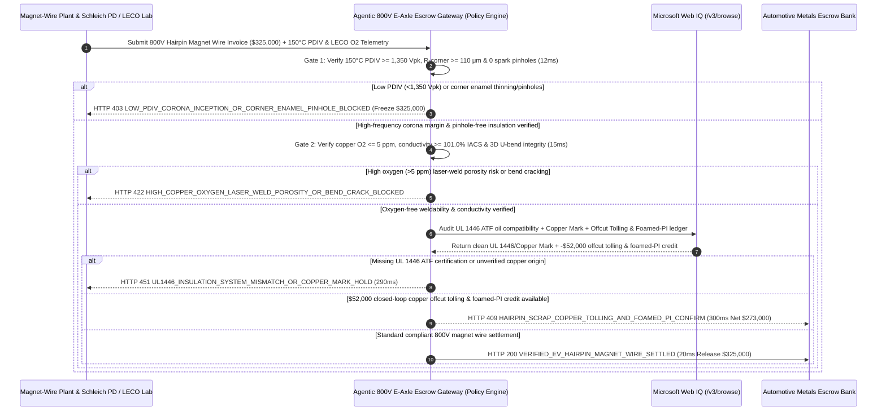

# 800V EV Hairpin Motor Oxygen-Free Copper & PEEK/PI Enamelled Magnet Wire Offtake, Partial Discharge Inception Voltage (IEC 60851-5 $\text{PDIV} \ge 1,350\text{ V}_{\text{pk}}$) & Low-Oxygen Conductivity ($\text{O}_2 \le 5\text{ ppm}$ & $\ge 101.0\%\text{ IACS}$) Escrow vs. Gross-Weight Overbilling: Architecture Selection & First-Principles FAQ

> **Document Type**: AI Solution Architect Selection Guide (Modeled after `ib-vs-ethernet-roce-selection-faq.md`)  
> **Target Audience**: 800V/1000V EV E-Axle & Traction Motor OEMs (Tesla / BYD / BorgWarner / Bosch / ZF / Lucid / NIO) Stator Winding & Non-Ferrous Procurement Architects, Magnet Wire & Oxygen-Free Copper Producers (Sumitomo Electric / Superior Essex / Jingda / Aurubis / Jiangxi Copper) Quality & LME Hedging Leads  
> **One-Sentence Takeaway**: In **$325,000.00** 800V Silicon-Carbide (SiC) hairpin stator Polyimide (PI) / PEEK corona-resistant enamelled rectangular copper magnet wire settlements, **never allow a procurement agent to release payment based solely on "gross spool weight and room-temperature DC resistance"**—you must enforce a 4-layer deterministic mandate combining **High-Temperature Partial Discharge Inception Voltage (IEC 60851-5 $\text{PDIV} \ge 1,350\text{ V}_{\text{pk}}$ at $150^\circ\text{C}$ preventing $50\text{ kV/}\mu\text{s}$ SiC PWM voltage-overshoot turn-to-turn breakdown) & Inline $3,000\text{ V}$ HV Spark Zero-Pinhole Gate + Oxygen-Free Copper Core Purity (LECO $\text{O}_2 \le 5\text{ ppm}$ preventing hairpin laser-weld gas porosity) & Eddy-Current Conductivity (ASTM B193 $\ge 101.0\%\text{ IACS}$) + Microsoft Web IQ UL 1446 ATF Oil-Cooled Insulation System & LME Copper Mark Traceability Audit + Closed-Loop Hairpin Copper Offcut Upcast Tolling & Micro-Cellular Foamed Low-$\varepsilon_r$ PI Arbitrage**.

---

## ① 📌 Executive Summary

1. **Why is paying on "spool scale weight and 50Hz AC dielectric breakdown" the #1 root cause of 800V SiC traction motor stator burnouts and laser-weld open circuits?**
   - **First-Principles Breakdown**: In an **800V Silicon-Carbide (SiC MOSFET) inverter powertrain**, ultra-fast switching edges ($dV/dt = 40\text{–}60\text{ kV/}\mu\text{s}$) create transmission-line wave reflections along the motor cable that subject the first stator hairpin turns to **$1,600\text{–}2,100\text{ V}_{\text{pk}}$ repetitive voltage spikes** at $20\text{ kHz}$! By Paschen's Law ($V_{\text{pd}} = f(p \cdot d, \varepsilon_r)$), if enamel coating thins at the four rectangular wire corners ($R$-corners) or has high permittivity ($\varepsilon_r > 3.5$), the **Partial Discharge Inception Voltage ($\text{PDIV}$)** drops below $1,350\text{ V}_{\text{pk}}$ at $150^\circ\text{C}$ operating temperature. Continuous micro-corona discharges erode organic enamel within 200 hours, triggering catastrophic **turn-to-turn stator shorts**! Simultaneously, each hairpin stator has **200+ laser-welded copper ends**; if the copper rod contains $> 5\text{ ppm}$ oxygen ($\text{Cu}_2\text{O}$), laser melting vaporizes steam bubbles that blow **sponge-like gas porosity** across the weld beads!
   - **Three Physical & Financial Failure Modes**:
     - **Corner Enamel Thinning Dropping $150^\circ\text{C}$ $\text{PDIV}$ to $880\text{ V}_{\text{pk}} \ll 1,350\text{ V}_{\text{pk}}$ While Passing Legacy 50Hz Breakdown Tests**: Eccentric enamelling dies leave corner insulation $< 85\ \mu\text{m}$; standard 50Hz hipot tests pass, but SiC PWM spikes destroy the motor on the highway;
     - **Substituting Electrolytic Tough Pitch (ETP, $\text{O}_2 = 280\text{ ppm}$) or Fire-Refined Scrap Copper for TU1 Oxygen-Free Copper ($\text{O}_2 \le 5\text{ ppm}$)**: Causes explosive hydrogen/steam blowholes during green/blue laser hairpin welding and drops conductivity below $100\%\text{ IACS}$;
     - **Unverified ATF Oil Hydrolysis Compatibility (UL 1446) & Selling $12\%$ Pristine Hairpin Stripping/Cropping Copper Offcuts at Scrap Discounts**: Direct oil-cooled motors require ATF-compatible insulation, while selling clean TU1 copper offcuts to scrap brokers forfeits LME cathode value.
2. **Target Architecture: $150^\circ\text{C}$ $\text{PDIV} \ge 1,350\text{ V}_{\text{pk}}$ / Zero-Pinhole + OFC $\text{O}_2 \le 5\text{ ppm}$ / $\ge 101.0\%\text{ IACS}$ + Web IQ UL 1446 Audit & Closed-Loop Copper Offcut Tolling (`ev_hairpin_magnet_wire_mandate_...`)**
   - **Core Mechanisms**:
     1. **High-Temperature Repetitive Surge $\text{PDIV}$ ($\ge 1,350\text{ V}_{\text{pk}}$ @ $150^\circ\text{C}$) & 4-Corner Enamel Thickness / Zero-Pinhole Gate (`12 ms` hard block `HTTP 403`)**: Verifies Schleich/Megger high-frequency surge $\text{PDIV} \ge 1,350\text{ V}_{\text{pk}}$ at $150^\circ\text{C}$, 4-axis laser corner enamel thickness $\ge 110\ \mu\text{m}$, and inline $3,000\text{ V}$ DC spark-tester zero pinholes; blocks corona-vulnerable spools in **`12 ms`** (`HTTP 403 LOW_PDIV_CORONA_INCEPTION_OR_CORNER_ENAMEL_PINHOLE_BLOCKED`);
     2. **LECO Oxygen-Free Copper ($\text{O}_2 \le 5\text{ ppm}$), Conductivity ($\ge 101.0\%\text{ IACS}$) & 3D Hairpin Bend Adhesion Gate (`15 ms` block `HTTP 422`)**: Verifies inert-gas fusion $\text{O}_2 \le 5\text{ ppm}$, ASTM B193 conductivity $\ge 101.0\%\text{ IACS}$, and zero enamel delamination after $180^\circ$ U-pin 3D forming; rejects high-oxygen or brittle-coated lots in **`15 ms`** (`HTTP 422 HIGH_COPPER_OXYGEN_LASER_WELD_POROSITY_OR_BEND_CRACK_BLOCKED`);
     3. **Microsoft Web IQ UL 1446 ATF Oil Compatibility & Copper Mark Audit + Closed-Loop Hairpin Offcut Tolling & Foamed-PI Arbitrage (`290 ms` / `300 ms`)**: Uses Web IQ `/v3/browse` to verify UL Product iQ Class N/R ($200\text{–}220^\circ\text{C}$) ATF oil-immersion certification and LME Copper Mark ESG provenance—freezing non-compliant lots in **`290 ms`** (`HTTP 451 UL1446_INSULATION_SYSTEM_MISMATCH_OR_COPPER_MARK_HOLD`); simultaneously routes **$12\%$ clean hairpin laser-stripping/cropping TU1 copper offcuts into closed-loop upcast rod tolling** and substitutes micro-cellular foamed low-$\varepsilon_r$ Polyimide ($\varepsilon_r = 2.3$) for costly extruded PEEK, saving **`$52,000.00`** (`HTTP 409 Confirm`, net payout **`$273,000.00`**).

---

## ② 🎯 Three Soul-Searching Questions for Architects

### Q1: When is "50Hz breakdown voltage and DC resistance" sufficient vs. when is `ev_hairpin_magnet_wire_mandate_...` mandatory?
- **Plain-English Answer**:
  - For **mains-fed $220\text{ V}$ ceiling fans or induction water pumps**, standard round magnet wire is fine;
  - For **800V/1000V SiC inverter EV traction motors with laser-welded hairpin stators**, **$150^\circ\text{C}$ $\text{PDIV} \ge 1,350\text{ V}_{\text{pk}}$ + OFC $\text{O}_2 \le 5\text{ ppm}$ + $\ge 101.0\%\text{ IACS}$ + inline zero-pinhole gating is 100% mandatory** to prevent SiC corona insulation breakdown and laser-weld porosity failures.

### Q2: When to choose Microsoft Web IQ vs. Exa vs. Bright Data for LME copper pricing, UL 1446 verification, and 800V insulation engineering?
- **Architect's Golden Split**:
  1. **Choose Microsoft Web IQ (`/v3/browse` + Work IQ Hairpin Stator MES & Inline Spark/PD Tester Integration)**: Best for deterministic verification of **spool-by-spool $150^\circ\text{C}$ $\text{PDIV}$ JSON logs, LECO oxygen ppm assays, UL Product iQ certificates, and closed-loop hairpin copper-offcut tolling credits**.
  2. **Choose Exa**: Best for semantic search on nano-porous low-$\varepsilon_r$ polyimide synthesis and blue/green laser copper absorption physics.
  3. **Use Bright Data with caution**: Good for public copper cathode spot premiums, not private stator-line OCT laser-weld and $\text{PDIV}$ telemetry.

### Q3: How does `ev_hairpin_magnet_wire_mandate_...` control funds between the e-axle OEM, magnet-wire plant, high-voltage lab, and escrow bank?
- **First-Principles Cryptographic Chain**:
  1. **High-Temp $\text{PDIV}$ & 4-Corner Enamel Signature**: Confirms $\text{PDIV} = 1,480\text{ V}_{\text{pk}} \ge 1,350\text{ V}_{\text{pk}}$ at $150^\circ\text{C}$ and zero spark pinholes;
  2. **LECO Oxygen & Conductivity Gate**: Confirms $\text{O}_2 = 2.8\text{ ppm} \le 5\text{ ppm}$, $101.4\%\text{ IACS}$, and crack-free 3D U-bend;
  3. **Web IQ UL 1446 Audit & Copper Tolling Settlement**: Credits `$52,000.00` (`HTTP 409 Confirm`) or releases `$325,000.00` in `20 ms`.

---

## ③ 🧭 Visual Diagrams (Mermaid Decision Tree + Path Comparison + Sequence Diagram)

### 3.1 Architect Decision Tree (`flowchart TD`)

### 3.2 Legacy "Scale Weight & 50Hz Breakdown" Path vs. Agentic "High-Temp PDIV + Low-O2 + Copper Tolling" Path (`flowchart LR`)

### 3.3 End-to-End Verification & Escrow Sequence Diagram (`sequenceDiagram`)

---

## ④ 📊 Architect Decision Matrix

| Evaluation Dimension | Option A: Legacy Scale Weight & 50Hz Breakdown | Option B: Room-Temp DC Resistance & Caliper Only | **Option C: $150^\circ\text{C}$ $\text{PDIV}$ + LECO $\text{O}_2 \le 5\text{ ppm}$ + Web IQ Tolling Escrow (Recommended)** |
| :--- | :--- | :--- | :--- |
| **Core 800V Reliability & Efficiency Anchor** | 50Hz AC hipot + gross spool weight | Micrometer outer dimensions | **$150^\circ\text{C}\text{ PDIV} \ge 1,350\text{ V}_{\text{pk}}$ + $\text{O}_2 \le 5\text{ ppm}$ + $\ge 101\%\text{ IACS}$** |
| **SiC Inverter Corona Breakdown Defense** | ❌ 0% (50Hz hipot ignores high-frequency Paschen corner discharge) | ❌ Flat-side caliper misses R-corner dog-bone thinning! | **✅ `12 ms` $150^\circ\text{C}$ surge $\text{PDIV}$ & 4-corner laser thickness gate (`HTTP 403`)** |
| **Hairpin Laser-Weld Gas-Porosity Defense** | ❌ ETP copper ($280\text{ ppm }\text{O}_2$) blows steam voids in laser welds | ❌ DC resistance cannot detect $\text{Cu}_2\text{O}$ inclusions | **✅ `15 ms` LECO $\text{O}_2 \le 5\text{ ppm}$ & 3D U-bend adhesion gate (`HTTP 422`)** |
| **ATF Oil-Cooled Hydrolysis (UL 1446) Gate** | ❌ Enamel blisters in hot transmission fluid | ❌ Static PDF certificates | **✅ Web IQ `290 ms` UL Product iQ & Copper Mark audit (`HTTP 451`)** |
| **Hairpin Offcut Tolling & Foamed Low-$\varepsilon_r$ PI** | ❌ Sells $12\%$ clean TU1 offcuts cheap; overpays for PEEK | ❌ Disconnected scrap & wire purchasing | **✅ Web IQ `300 ms` closed-loop copper tolling + foamed PI saving `$52,000` (`HTTP 409`)** |

---

## ⑤ 🧪 Quantitative Benchmark & 7-Card Report Summary

Implemented via `evaluate_ev_hairpin_magnet_wire_policy()` in `lab/webiq_commerce_demo.py` and verified in `tests/test_webiq_commerce_demo.py`:

| Scenario ID | Telemetry & Policy Inputs | HTTP Status | Action Pill | Latency | Settled / Blocked Amount |
| :--- | :--- | :--- | :--- | :--- | :--- |
| **`mag_commit_ok`** | $150^\circ\text{C}$ `PDIV = 1,480 Vpk >= 1,350` + 0 pinholes + `O2 = 2.8 ppm <= 5` + `101.4% IACS` | **`HTTP 200`** | `Act automatically` | **`20 ms`** | Settled **`$325,000.00`** |
| **`mag_pd_403`** | Thin R-corner drops `PDIV = 880 Vpk < 1,350` or spark pinholes (`high_temp_pdiv_corona_and_zero_pinhole_verified=False`) | **`HTTP 403`** | `Send to a human` | **`12 ms`** | Blocked **`$325,000.00`** corona-risk lot |
| **`mag_oxy_422`** | High-oxygen ETP rod (`O2 = 280 ppm > 5`) or 3D U-bend cracking (`ofc_oxygen_ppm_iacs_and_hairpin_bend_passed=False`) | **`HTTP 422`** | `Send to a human` | **`15 ms`** | Blocked **`$325,000.00`** weld-porosity lot |
| **`mag_ul_451`** | Web IQ detects missing UL 1446 ATF oil cert or Copper Mark breach (`webiq_ul1446_atf_oil_and_copper_mark_clean=False`) | **`HTTP 451`** | `Send to a human` | **`290 ms`** | Frozen **`$325,000.00`** |
| **`mag_tol_409`** | Web IQ routes $12\%$ hairpin TU1 offcuts to upcast tolling & adopts foamed low-$\varepsilon_r$ PI (`hairpin_scrap_copper_tolling_and_foamed_pi_savings_cents=5200000`) | **`HTTP 409`** | `Confirm` | **`300 ms`** | Net **`$273,000.00`** (Saved **`$52,000.00`**) |

- **Perturbation Robustness**: `0.0 pts` drift across forward and reverse scenario orderings.

---

## ⑥ 🛠️ Production Readiness & Architect Checklist

### 6.1 Good Fit vs. Not For
- **✅ Good Fit**: 800V/1000V SiC EV traction motor hairpin/X-pin/wave-wound stators, eVTOL propulsion motors, solid-state high-frequency transformers, and OEM copper rod tolling programs.
- **⛔ Not For**: Low-voltage $12\text{ V}$ automotive window-lift brushed motors.

### 6.2 Production Verification Checklist (`- [ ]`)
- [ ] **$150^\circ\text{C}$ High-Frequency Surge $\text{PDIV}$ ($\ge 1,350\text{ V}_{\text{pk}}$) & 4-Corner Enamel Thickness ($\ge 110\ \mu\text{m}$)**: Prevent SiC inverter overshoot spikes from eroding turn-to-turn insulation.
- [ ] **TU1 Oxygen-Free Copper Core (LECO $\text{O}_2 \le 5\text{ ppm}$) & Conductivity ($\ge 101.0\%\text{ IACS}$)**: Eliminate steam blowholes in laser-welded hairpin ends.
- [ ] **UL 1446 ATF Oil-Immersion Compatibility & LME Copper Mark Gate**: Verify oil-cooled thermal aging certificates via Web IQ.
- [ ] **Closed-Loop Hairpin Offcut Upcast Tolling & Micro-Cellular Foamed PI Arbitrage**: Recycle 100% of clean stripping/cropping copper offcuts without LME spread loss.
