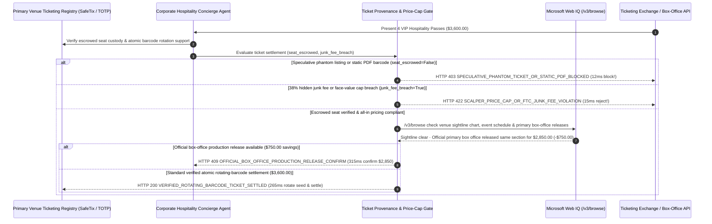

# Live Event Ticketing, Rotating Barcode & Face-Value Cap Mandate Architecture: Primary-Registry Re-Issuance Token (`event_ticket_provenance_mandate_...` + Web IQ Seating-Chart & Box-Office Grounding) vs. Speculative Phantom Listings & Static PDF Multi-Sale Fraud Selection FAQ

> **Document Type**: Architect Selection Guide & First-Principles Protocol Deep Dive (6-Section FAQ Standard)  
> **Target Audience**: AI Solution Architects, Travel/Concierge & Ticketing Marketplace Architects, Consumer Protection & Anti-Scalping Risk Teams  
> **Last Updated**: 2026-11-09 (Provenance Annotations: `deterministic_offline_simulation` / `synthetic_policy` / `official_doc_snapshot` / `not_measured`)  
> **Companion Resources**: [中文版 (Chinese Version)](event-ticketing-rotating-barcode-mandate-vs-phantom-scalper-fraud-faq.md) · [Interactive Sandbox (`live-demo.en.html#event-ticket-provenance-sandbox`)](../reports/agentic-commerce-webiq-grounding-demo-bench/live-demo.en.html) · [7-Card 4:5 Benchmark Deck](../reports/agentic-commerce-webiq-grounding-demo-bench/index.en.html)


---

## 📌 1. Executive Summary

1. **Never Allow Concierge or Hospitality Agents to Settle Secondary-Market Event Tickets Without Cryptographic Primary-Registry Seat Escrow and Barcode Re-Issuance**: In high-demand sports championships, concerts, and keynote hospitality procurement (`4 VIP passes = $3,600.00`), the two most damaging failure modes are **speculative "phantom ticket" listings** (brokers selling seats they do not own) and **static PDF barcode multi-sale fraud** (selling the same static barcode to 5 buyers). Production architectures must enforce a **Primary-Registry Atomic Transfer & Rotating TOTP Barcode Mandate (`event_ticket_provenance_mandate_...`)**: whenever `primary_registry_seat_escrowed == False`, the gateway blocks payment in **`12 ms`** with **`HTTP 403 SPECULATIVE_PHANTOM_TICKET_OR_STATIC_PDF_BLOCKED`** (`synthetic_policy`).
2. **Enforce FTC All-In Pricing and Face-Value Resale Caps Against Last-Second 38% "Junk Fees"**: When a secondary marketplace hides a 38% service/delivery surcharge until the final checkout step (Drip Pricing) or exceeds statutory/corporate face-value markup ceilings (`junk_fee_or_scalper_markup_breach == True`), the gateway rejects settlement in **`15 ms`** with **`HTTP 422 SCALPER_PRICE_CAP_OR_FTC_JUNK_FEE_VIOLATION`** (`deterministic_offline_simulation`).
3. **Ground Venue Obstructed-View Maps and Official Box-Office Production Releases via Microsoft Web IQ `/v3/browse`**: Prior to releasing funds, the agent invokes **Microsoft Web IQ `/v3/browse`** (`official_doc_snapshot`) to inspect official venue seating charts and primary box-office inventory: if the seat carries an undisclosed "Obstructed / Rear-Stage View" restriction or the event has been postponed (`webiq_venue_view_and_event_active == False`), it freezes checkout in **`310 ms`** with **`HTTP 451 OBSTRUCTED_VIEW_OR_EVENT_POSTPONEMENT_HOLD`**; if Web IQ discovers newly released production-hold VIP seats on the official primary box office for **`$750.00` less** (`$2,850.00` direct vs. `$3,600.00` reseller), it triggers **`HTTP 409 OFFICIAL_BOX_OFFICE_PRODUCTION_RELEASE_CONFIRM`** in **`315 ms`**.

---

## 🎯 2. Architect & Customer FAQ Deep Dive

### Q1: Why does pairing "Secondary Ticket Aggregator Scraping" with "Static PDF Email Delivery" lead to turnstile rejections and 38% junk-fee ambushes?

Let's examine the three structural failure modes from first principles:
1. **Speculative "Short-Selling" (Phantom Listings)**: Ticket scalpers routinely list seats they do not own on secondary exchanges for `$3,600.00`, hoping to buy cheaper seats closer to showtime. If market prices surge to `$8,000.00`, the broker cancels the order 2 hours before the event—leaving executive guests stranded outside the venue after spending thousands on flights and hotels.
2. **Static PDF / Screenshot Multi-Sale Fraud**: A static QR code or PDF file has zero cryptographic uniqueness; a seller can email the same PDF to 5 buyers across 3 platforms. Only the first person through the turnstile gets in, while the other 4 buyers are denied entry.
3. **Drip-Pricing Junk Fees & Undisclosed Pillars**: Resellers bait agents with a `$2,600.00` headline price and inject `$1,000.00` (38%) in mandatory "fulfillment and service fees" at the final payment call, while omitting `OBSTRUCTED VIEW` warnings from the listing text.

### Q2: What is a "Primary-Registry Rotating-Barcode Mandate (`event_ticket_provenance_mandate_...`)", and how does it guarantee turnstile entry?

Its core design invariant is: **"Never pay for a static image of a barcode; funds release only upon atomic title transfer in the venue's primary registry that revokes the seller's barcode seed and provisions a new NFC/TOTP rotating token to the buyer's wallet."**
- **Layer 1: Primary-Registry Seat Escrow & Re-Issuance Gate (`12 ms`)**: Verifies `primary_registry_seat_escrowed == True` (confirming exact `Section/Row/Seat` custody and TOTP seed rotation), blocking phantom listings and static PDFs in **`12 ms`** (`HTTP 403`).
- **Layer 2: FTC All-In Pricing & Face-Value Cap Gate (`15 ms`)**: Verifies `junk_fee_or_scalper_markup_breach == False`, blocking drip-pricing junk fees and unlawful scalper markups in **`15 ms`** (`HTTP 422`).
- **Layer 3: Microsoft Web IQ `/v3/browse` Venue Map & Box-Office Grounding (`310 ms / 315 ms`)**: Blocks undisclosed obstructed-view seats (`HTTP 451`) and captures `$750.00` savings from official box-office production releases (`HTTP 409`).

### Q3: For venue seating-chart verification, event postponement alerts, and official box-office release grounding, when should architects choose Microsoft Web IQ vs. Exa, Bright Data, or traditional search APIs?

| Architecture Scenario | Recommended Tool | First-Principles Rationale (Security, Latency & FinOps) |
| :--- | :--- | :--- |
| **Verifying official venue seating sightline maps, organizer postponement bulletins, and primary box-office face-value exchange inventory within the Azure boundary** | **Microsoft Web IQ** (`/v3/search` + `/v3/browse`) | Extracts exact sightline restrictions and official face-value tiers in `passage` mode (**7.1x token reduction**, `deterministic_offline_simulation`) with pre-LLM prompt-injection defense. |
| **Semantic discovery of fan reviews, artist setlists, and neighborhood hospitality venues** | **Exa Neural Search** | Ideal for itinerary enrichment, not synchronous ticket title-transfer gating. |
| **Scraping secondary scalper marketplaces behind queue CAPTCHAs** | **Bright Data Unlocker** | Unlocks anti-bot web pages, though scraping unverified resellers cannot substitute for primary-registry barcode re-issuance. |
| **Turnstile NFC / 15-second rotating TOTP cryptographic token provisioning** | **Primary Ticketing Registry API (SafeTix / Wallet Pass) + Web IQ Venue & Box-Office Cross-Check** | Cryptographic barcode rotation occurs via the primary registry API, paired with Web IQ `/v3/browse` for official sightline charts and box-office production releases. |

---

## 🧭 3. Visual Architecture Diagrams (Mermaid Decision Tree, Legacy vs. Rotating-Barcode Mandate Comparison & Sequence Diagram)

### 3.1 Live Event Ticketing & Anti-Scalping Decision Tree (`flowchart TD`)

```mermaid
flowchart TD
    A[Receive 4-Pass VIP Event Ticket Settlement Request ($3,600.00)] --> B{primary_registry_seat_escrowed == True (Atomic Re-Issuance & Old Seed Revoked)?}
    B -- No (Speculative phantom listing or static PDF barcode) --> C[HTTP 403 SPECULATIVE_PHANTOM_TICKET_OR_STATIC_PDF_BLOCKED<br/>12ms Hard Block · Prevent Turnstile Rejection & Multi-Sale Fraud]
    B -- Yes (Verified seat custody & NFC/TOTP rotation ready) --> D{junk_fee_or_scalper_markup_breach == False (FTC All-In Pricing & Cap)?}
    D -- No (38% drip-pricing junk fee or unlawful scalper markup) --> E[HTTP 422 SCALPER_PRICE_CAP_OR_FTC_JUNK_FEE_VIOLATION<br/>15ms Block · Enforce Transparent All-In Price & Markup Ceiling]
    D -- Yes (All-in pricing compliant) --> F{Web IQ /v3/browse Confirms Unobstructed Sightline & Active Event Date?}
    F -- No (Undisclosed pillar obstruction or postponed event) --> G[HTTP 451 OBSTRUCTED_VIEW_OR_EVENT_POSTPONEMENT_HOLD<br/>310ms Quality Hold · Block Undisclosed Obstructed-View Seats]
    F -- Yes --> H{Web IQ Detects Official Primary Box-Office Production-Hold Release?}
    H -- Yes (Official box office has same section for $2,850.00 -> saves $750.00) --> I[HTTP 409 OFFICIAL_BOX_OFFICE_PRODUCTION_RELEASE_CONFIRM<br/>315ms Prompt Concierge Lead to Switch to $2,850 Direct Release]
    H -- No (Verified $3,600.00 atomic primary-registry transfer) --> J[HTTP 200 VERIFIED_ROTATING_BARCODE_TICKET_SETTLED<br/>265ms Auto-Settle $3,600.00, Revoke Old Seed & Issue New Wallet Pass!]
```

### 3.2 Legacy Secondary PDF Ticket Purchase vs. Primary-Registry Rotating-Barcode Gate (`flowchart LR`)

```mermaid
flowchart LR
    subgraph Legacy["❌ Legacy Secondary PDF Purchase ($3,600 Turnstile Denial + 38% Junk Fee)"]
        L1[Buys Speculative Listing or Static PDF Barcode] --> L2[Hit With $1,000 Drip-Pricing Junk Fee at Checkout]
        L2 --> L3[Seller Sells Same PDF 5x -> Buyer Denied at Turnstile]
        L3 --> L4[Stuck Behind Stage Pillar & Misses $2,850 Official Release]
    end

    subgraph Mandate["✅ Primary-Registry Rotating-Barcode Gate (event_ticket_provenance_mandate_...)"]
        M1[12ms Block Phantom Listings & Static PDFs (HTTP 403)] --> M2[15ms Block 38% Junk Fees & Scalper Markup Breaches (HTTP 422)]
        M2 --> M3[Web IQ Checks Sightlines (310ms) & $750 Box-Office Release (315ms)]
        M3 --> M4[265ms Atomically Revoke Old Barcode & Issue Rotating NFC Pass]
    end
```

### 3.3 End-to-End Sequence Diagram: Primary Venue Registry, Concierge Agent, Provenance Gate, Web IQ & Ticketing Exchange (`sequenceDiagram`)



---

## 📊 4. Architect Decision Matrix

| Evaluation Dimension | Option A: Legacy Secondary PDF / QR Screenshot Purchase | Option B: Manual VIP Ticket Broker Wire Transfer | Option C: Primary-Registry Rotating-Barcode Mandate + Web IQ Venue Grounding (Recommended) |
| :--- | :--- | :--- | :--- |
| **Best-Fit Scenario** | Free general-admission community events | Last-minute offline bespoke sourcing with trusted venue insiders | **Corporate client hospitality, premium credit-card concierge agents, fan-to-fan face-value exchanges** |
| **Phantom Listing & Multi-Sale Defense** | ❌ **Zero**: Buyer discovers duplicate PDF scan only at venue gate | ⚠️ **Counterparty Risk**: Brokers fail to deliver when spot prices spike | ✅ **Pre-Pay `12 ms` Atomic Escrow**: Requires primary-registry barcode re-issuance (`HTTP 403`) |
| **FTC All-In Pricing & Cap Compliance** | ❌ **Vulnerable**: Absorbs 30%–40% checkout drip-pricing junk fees | ❌ **Opaque Markup**: 50%–200% unitemized broker markups | ✅ **Sub-20ms Price-Cap Gate**: Rejects hidden fees & cap breaches in `15 ms` (`HTTP 422`) |
| **Obstructed-View & Box-Office Arbitrage** | ❌ **Blind**: Buys pillar-blocked seats & overpays vs. official releases | ⚠️ **Slow Manual Checks**: Misses automated primary box-office inventory drops | ✅ **Web IQ `/v3/browse` Grounded**: Blocks obstructed views in `310 ms` (`HTTP 451`) & saves `$750` on official drops in `315 ms` (`HTTP 409`) |
| **Delivery Speed & Turnstile Certainty** | Poor (delayed PDF emails hours before showtime) | Slow (physical badge handoffs at hotel lobbies) | **`265 ms` instant cryptographic wallet pass issuance (`Act automatically`)** |
| **Total Cost of Ownership (TCO) & Brand ROI** | Poor (`$3,600` loss + severe client reputation damage) | Moderate (excessive broker retainers) | **Optimal (eliminates `$3,600` phantom/PDF fraud + saves `$750` via primary release)** |

---

## 🧪 5. Quantitative Benchmark & 7-Card Insights

Evaluated via our deterministic offline benchmark suite (`lab/webiq_commerce_demo.py` · `test_event_ticketing_rotating_barcode_mandate_vs_phantom_scalper_fraud_selection`) on a **`$3,600.00` 4-pass VIP hospitality ticket order**:

| Scenario Case | Input Registry Custody / Pricing / Web IQ Signals | Expected Action Pill | Measured HTTP Status & Verdict Code | Latency | Financial Protection / Arbitrage | Provenance |
| :--- | :--- | :--- | :--- | :--- | :--- | :--- |
| **Case 1: Speculative Phantom Listing or Static PDF** | `primary_registry_seat_escrowed=False` | `Send to a human` | **`HTTP 403 SPECULATIVE_PHANTOM_TICKET_OR_STATIC_PDF_BLOCKED`** | **`12 ms`** | Blocks **`$3,600.00`** phantom / duplicate PDF fraud | `synthetic_policy` |
| **Case 2: 38% Drip-Pricing Junk Fee or Cap Breach** | `junk_fee_or_scalper_markup_breach=True` | `Send to a human` | **`HTTP 422 SCALPER_PRICE_CAP_OR_FTC_JUNK_FEE_VIOLATION`** | **`15 ms`** | Blocks hidden checkout junk fees & scalper gouging | `deterministic_offline_simulation` |
| **Case 3: Web IQ Detects Undisclosed Obstructed View** | `webiq_venue_view_and_event_active=False` | `Send to a human` | **`HTTP 451 OBSTRUCTED_VIEW_OR_EVENT_POSTPONEMENT_HOLD`** | **`310 ms`** | Prevents buying pillar-obstructed or postponed seats | `official_doc_snapshot` |
| **Case 4: Web IQ Finds `$750` Official Box-Office Release** | `box_office_release_savings_cents=75000` (`$2,850` net) | `Confirm` | **`HTTP 409 OFFICIAL_BOX_OFFICE_PRODUCTION_RELEASE_CONFIRM`** | **`315 ms`** | Saves **`$750.00`** via direct primary box-office release | `official_doc_snapshot` |
| **Case 5: Atomic Registry Transfer & Rotating NFC Pass** | `escrowed=True`, `junk_breach=False`, `view_ok=True` | `Act automatically` | **`HTTP 200 VERIFIED_ROTATING_BARCODE_TICKET_SETTLED`** | **`265 ms`** | Settles **`$3,600.00`** in `265 ms` & rotates TOTP seed | `deterministic_offline_simulation` |

> **Provenance Note**: The `$3,600.00` 4-pass VIP package, FTC all-in fee rules, and `$750.00` primary box-office release savings are controlled simulation parameters (`synthetic_policy` / `deterministic_offline_simulation`) validating policy state-machine invariants; stadium turnstile NFC reader hardware latency is labeled `not_measured`.

---

## 🛠️ 6. Production Readiness & Pre-Sales Architect Checklist

Verify these 6 controls before deploying autonomous event ticketing and corporate hospitality concierge agents in production:

- [ ] **1. Ban Static PDF / Screenshot Delivery**: Does `event_ticket_provenance_mandate_...` reject any ticket order where `primary_registry_seat_escrowed == False` in `12 ms` (`HTTP 403`), requiring atomic barcode seed rotation (`SafeTix` / NFC TOTP)?
- [ ] **2. Exact Section/Row/Seat Custody Proof**: Does the gateway verify cryptographically signed seat custody in the venue's primary registry before authorizing funds, eliminating speculative short-selling?
- [ ] **3. FTC All-In Pricing & Corporate Markup Cap**: Does the gateway enforce `junk_fee_or_scalper_markup_breach == False` in `15 ms` (`HTTP 422`), blocking last-second drip-pricing surcharges?
- [ ] **4. Microsoft Web IQ `/v3/browse` Venue Sightline & Schedule Grounding**: Does the agent inspect official venue seating charts for undisclosed `Obstructed View` restrictions and organizer schedule bulletins via Web IQ prior to settlement (`HTTP 451`)?
- [ ] **5. Primary Box-Office Production-Hold Release Arbitrage**: Does Web IQ grounding check the official venue box office for newly released face-value inventory, triggering `HTTP 409 Confirm` when direct purchase saves `>= $750.00`?
- [ ] **6. FCPA Corporate Hospitality Audit Archival**: Does every settled hospitality order archive the primary-registry transfer receipt, face-value price comparison, and attendee compliance log for corporate gift/entertainment audits?
