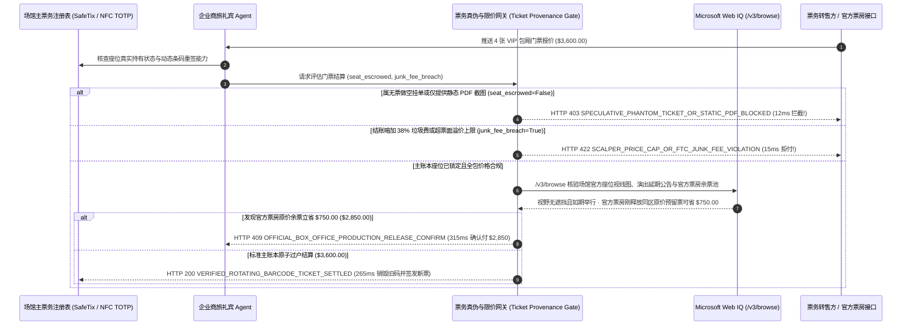

# 高稀缺赛事/演出票务与企业商务招待防黄牛空单（Live Event Ticketing, Rotating Barcode & Face-Value Cap Mandate）架构：一手账本过户与动态令牌（`event_ticket_provenance_mandate_...` + Web IQ 场馆座位图与官方余票核验）vs 传统二级市场无票空单（Phantom Listing）与静态 PDF 一票多卖选型与原理解析 FAQ

> **文档类型**：架构师选型指南 & 协议第一性原理解析（6 段式 FAQ 标准版）  
> **适用读者**：AI Solution Architect、商旅礼宾与票务平台（Ticketing / Concierge / Corporate Hospitality）架构师、消费者权益保护与反欺诈风控团队  
> **更新日期**：2026-11-09（Provenance 标注：`deterministic_offline_simulation` / `synthetic_policy` / `official_doc_snapshot` / `not_measured`）  
> **配套资源**：[English Version](event-ticketing-rotating-barcode-mandate-vs-phantom-scalper-fraud-faq.en.md) · [交互式沙盒控制台 (`live-demo.html#event-ticket-provenance-sandbox`)](../reports/agentic-commerce-webiq-grounding-demo-bench/live-demo.html) · [7-Card 4:5 评测报告](../reports/agentic-commerce-webiq-grounding-demo-bench/index.html)


---

## 📌 一、核心结论速览（Executive Summary）

1. **严禁让商旅礼宾或票务代购 Agent 在未验证“主场馆账本座位锁定与旧条码销毁重签（Primary Registry Re-Issuance）”的情况下购买二级市场演出/体育门票**：在顶级演唱会、F1/世界杯赛事及全球科技峰会 VIP 招待票采购（如 4 张连座包厢票 `$3,600.00`）中，最致命的欺诈是 **“黄牛无票做空预售（Speculative Phantom Listing）”** 与 **“静态 PDF 条码一票五卖”**。生产环境必须采用 **主票务注册表原子过户与每 15 秒轮换 TOTP 动态码绑定的购票令牌（`event_ticket_provenance_mandate_...`）**：只要卖方无法提供主票务系统（如 Ticketmaster SafeTix / AXS / 官方场馆注册表）已托管该座位并作废原条码的密码学证明（`primary_registry_seat_escrowed=False`），网关在 **`12 ms`** 内触发 **`HTTP 403 SPECULATIVE_PHANTOM_TICKET_OR_STATIC_PDF_BLOCKED`**（`synthetic_policy`），100% 拒付空气票与静态截图。
2. **用“FTC 全包价（All-In Pricing）与票面溢价上限硬门禁”终结结账最后一秒 38% 隐藏垃圾费（Drip Pricing Junk Fees）与暴利加价**：针对二级转售平台在首页标低价、结账页突然叠加高额“服务费/配送费”或超出法定/企业合规溢价上限（`junk_fee_or_scalper_markup_breach=True`）的行为，网关在 **`15 ms`** 内返回 **`HTTP 422 SCALPER_PRICE_CAP_OR_FTC_JUNK_FEE_VIOLATION`**（`deterministic_offline_simulation`），直接阻断违规扣款。
3. **基于 Microsoft Web IQ `/v3/browse` 实时核验场馆官方座位视线遮挡图（Obstructed View）与主办方官方余票释放（Production-Hold Release）套利**：在放款前，Agent 调用 **Microsoft Web IQ `/v3/browse`**（`official_doc_snapshot`）穿透查询场馆官网三维座位说明与主办方公告：若检出该座位属于未披露的“音响塔/大柱子视线遮挡席（Limited/Obstructed View）”或赛事已延期改期，在 **`310 ms`** 内以 **`HTTP 451 OBSTRUCTED_VIEW_OR_EVENT_POSTPONEMENT_HOLD`** 熔断；若发现主办方官方票房（Primary Box Office）或官方平价转售池刚释放同区域控台预留票、总价仅需 **`$2,850.00`**（比二级市场 `$3,600.00` 立省 **`$750.00`**），则在 **`315 ms`** 内触发 **`HTTP 409 OFFICIAL_BOX_OFFICE_PRODUCTION_RELEASE_CONFIRM`**。

---

## 🎯 二、客户与架构师灵魂拷问 Q&A（FAQ-Driven Deep Dive）

### Q1：为什么传统的“让 AI Agent 去二级比价票务网挑便宜票下单、收一封带 PDF 二维码的邮件”，在高端赛事与演出场景下几乎等于买假票？

咱们用大白话拆解票务二级市场里最让买家崩溃的三个坑：
1. **“付了 $3,600 买的是空气”——黄牛做空预售（Speculative Ticketing）**：很多二级票务网站允许黄牛在官方还没开票、或者手里根本没票的情况下，先挂出“A 区 1 排连座 4 张 `$3,600`”。你的 Agent 下单付了钱，黄牛打算等开演前一天再去市场上低价收票交货；如果到时候票价涨到了 `$8,000`，黄牛就直接违约退钱，而你的 VIP 客户已经飞到了比赛城市，酒店机票全订好了却进不去球场！
2. **静态 PDF / 截图二维码“一票五卖，谁先到谁进”**：只要门票是以静态 PDF、PNG 截图或固定二维码形式交付的，卖家原来的手机里依然留着一模一样的条码。黑产把同一张 `$900` 的内场票同时卖给 5 个平台的 Agent，开场前第一个刷闸机的人进了场，后面 4 个花真金白银的买家全部被保安拦在门外。
3. **隐瞒“看柱子专座”与结账页 38% 垃圾费偷袭**：黄牛挂单时只写“VIP 内场 A 区”，故意隐瞒票面上印着的 `OBSTRUCTED VIEW（视线严重遮挡）`；而且搜索列表写着 `$2,600`，到了最后一步刷卡时才加上 `$1,000` 的“平台撮合服务费”。

### Q2：什么是“主账本过户与动态条码令牌（`event_ticket_provenance_mandate_...`）”？它是如何从密码学上根除“一票多卖”与“空气票”的？

它的第一性原理非常干脆：**“买票不是买一张图片或 PDF，而是必须在场馆唯一权威账本上完成‘旧私钥吊销 + 新买家公钥绑定’的原子所有权交割。”**
- **第一层：主注册表座位锁定与条码轮换硬门禁（`12 ms`）**：支付网关与主办方主票务系统（Primary Ticketing Registry）联动。只有在主账本确认卖家真实持有该 `Section/Row/Seat`、且在收款同时**立即销毁卖家原有的条码种子（Seed）并为买方安全飞地签发全新 NFC / 15 秒轮换 TOTP 动态票根**（`primary_registry_seat_escrowed == True`）时才允许放款；任何静态 PDF 或远期空单承诺在 **`12 ms`** 内触发 `HTTP 403` 拒付。
- **第二层：FTC 全包价与票面溢价红线校验（`15 ms`）**：强制核对结算总价与初始展示全包价一致，且未超出法定/企业规定的票面溢价上限（`junk_fee_or_scalper_markup_breach == False`），违规加费在 **`15 ms`** 内触发 `HTTP 422`。
- **第三层：Microsoft Web IQ `/v3/browse` 场馆视线核验与官方余票寻优（`310 ms / 315 ms`）**：核对场馆官方座位图剔除遮挡席（`HTTP 451`），并实时监控官方票房释放的平价余票为您立省 `$750.00`（`HTTP 409`）。

### Q3：在场馆官方座位视线图核验、赛事延期/取消公告监控与主办方官方余票检索场景下，什么时候选 Microsoft Web IQ，什么时候选 Exa、Bright Data 或传统搜索 API？

| 架构需求场景 | 推荐选型 | 为什么这样选（第一性原理与成本/合规考量） |
| :--- | :--- | :--- |
| **实时核验场馆官方座位区视线遮挡说明（Obstructed View Map）、主办方延期/换阵公告及官方 Face-Value 原价转售池余票，且要求零提示词注入** | **Microsoft Web IQ** (`/v3/search` + `/v3/browse`) | 在企业 Azure 合规边界内以 `passage` 模式秒级提取官方票面价与座位属性（上下文 Token 压缩 **7.1x**，`deterministic_offline_simulation`），彻底免疫恶意黄牛网埋藏的虚假低价钓鱼指令。 |
| **跨社交网络与粉丝社区检索全球巡演口碑与场馆周边交通攻略** | **Exa Neural Search** | 适合行程规划与资讯推荐，不适合毫秒级票务真伪核验与支付拦截。 |
| **跨地域监控设置高强度队列验证码的二级黄牛票务聚合站** | **Bright Data Unlocker** | 提供代理池穿透，但秒级延迟且无法替代主票务账本的密码学过户验证。 |
| **入场闸机近场 NFC / TOTP 动态二维码毫秒级离线验票** | **场馆主票务账本（SafeTix / Apple/Google Wallet Pass）+ Web IQ 官方票面与座位属性双源核验** | 票根真伪与唯一性由主票务账本密码学过户保证，座位视线合规与官方余票差价由 Web IQ `/v3/browse` 实时核验。 |

---

## 🧭 三、直观可视化图解（Mermaid 决策树 + 传统盲买 PDF vs 主账本过户对比 + 端到端时序图）

### 3.1 高稀缺赛事/演出票务过户与防黄牛欺诈决策树（`flowchart TD`）

```mermaid
flowchart TD
    A[收到 4 张 VIP 赛事/演出门票结账请求 ($3,600.00)] --> B{主票务账本是否已锁死真实座位并支持销毁旧码重签动态票根?}
    B -- 否 (属无票预售空单 Speculative Listing 或静态 PDF 条码) --> C[HTTP 403 SPECULATIVE_PHANTOM_TICKET_OR_STATIC_PDF_BLOCKED<br/>12ms 硬阻断付款 · 100% 杜绝一票多卖与开场前违约无票]
    B -- 是 (主账本已托管真实座位并准备原子过户) --> D{结算价是否遵守 FTC 全包价且未超法定/企业票面溢价上限?}
    D -- 否 (结账页暗加 38% 垃圾手续费或暴利加价翻倍) --> E[HTTP 422 SCALPER_PRICE_CAP_OR_FTC_JUNK_FEE_VIOLATION<br/>15ms 拦截违规收费 · 拒绝隐性 Drip Pricing 手续费刺客]
    D -- 是 (全包价透明且溢价合规) --> F{Web IQ /v3/browse 核验场馆官方座位图无未披露视线遮挡且赛事正常?}
    F -- 否 (检出该排座位正对控台柱子严重遮挡或主力球星/歌手官宣延期) --> G[HTTP 451 OBSTRUCTED_VIEW_OR_EVENT_POSTPONEMENT_HOLD<br/>310ms 品质熔断 · 避免高管客户坐进视线遮挡死角]
    F -- 是 --> H{Web IQ 检出主办方官方票房刚释放同区域原价预留票?}
    H -- 是 (官方直售池同区席位仅需 $2,850.00 -> 立省 $750.00!) --> I[HTTP 409 OFFICIAL_BOX_OFFICE_PRODUCTION_RELEASE_CONFIRM<br/>315ms 提醒礼宾 Agent 一键切回官方票房原价购入]
    H -- 否 (当前 $3,600.00 已是合规最优且主账本过户就绪) --> J[HTTP 200 VERIFIED_ROTATING_BARCODE_TICKET_SETTLED<br/>265ms 原子完成 $3,600.00 付款、旧码销毁与 NFC 动态新票签发!]
```

### 3.2 传统二级市场盲买 PDF 路径 vs 主账本动态过户与余票寻优网关对比（`flowchart LR`）

```mermaid
flowchart LR
    subgraph Legacy["❌ 传统二级市场盲买静态 PDF ($3,600 闸机被拒 + 38% 垃圾费)"]
        L1[购买黄牛无票空单或静态 PDF 截图] --> L2[结账页被强加 $1,000 隐藏服务费]
        L2 --> L3[一票五卖导致客户在体育场闸机口被拒入场]
        L3 --> L4[入座才发现被大柱子挡死 + 错失官方 $2,850 原价余票]
    end

    subgraph Mandate["✅ 主账本动态过户令牌 (event_ticket_provenance_mandate_...)"]
        M1[12ms 拦截无票空单与静态 PDF (强制主账本重签动态码)] --> M2[15ms 拦截 FTC 违规隐藏手续费与超额黄牛溢价]
        M2 --> M3[Web IQ 排查视线遮挡席 (310ms) 与官方余票省 $750 (315ms)]
        M3 --> M4[265ms 原子销毁卖家旧码并向买家钱包签发唯一 NFC 动态票]
    end
```

### 3.3 场馆主票务账本、礼宾代购 Agent、防黄牛策略网关与 Web IQ 端到端交互时序图（`sequenceDiagram`）



---

## 📊 四、架构师选型决策矩阵（Architect Decision Matrix）

| 评估维度 | 方案 A：传统二级比价网购买 PDF/二维码截图（Legacy Secondary PDF Purchase） | 方案 B：人工礼宾专员找熟人票务中介微信转账（Manual Broker Wire） | 方案 C：主账本动态过户令牌 + Web IQ 场馆座位与官方余票网关（推荐架构） |
| :--- | :--- | :--- | :--- |
| **核心适用场景** | 不限座位的免费社区街头演出 | 极少数私人包机定制，但熟人中介同样可能被上游跳单 | **企业高管商务招待、信用卡黑卡礼宾 Agent、大型体育赛事与演唱会合规票务代购** |
| **防“一票多卖”与“黄牛空单”能力** | ❌ **零防御**：入场前最后一秒才知道条码已被别人刷过 | ⚠️ **依赖中介信誉**：上游黄牛爆仓跑路时中介也拿不出真票 | ✅ **12ms 密码学过户锁**：主账本销毁旧码并重签买方专属 NFC 动态码（未锁定触发 `HTTP 403`） |
| **防 38% 隐藏垃圾费（FTC 合规）** | ❌ **被动挨宰**：结账最后一步才弹出高额服务费 | ❌ **价格黑盒**：中介层层加价，完全不知道官方原价是多少 | ✅ **15ms 全包价与溢价红线**：违规加收手续费当场触发 `HTTP 422` 拒付 |
| **防“看柱子遮挡席”与官方余票捡漏** | ❌ **盲盒踩雷**：花 VIP 的钱买到舞台后方遮挡区 | ⚠️ **人工盯盘慢**：人类刷网页抢不过自动化脚本释放的官方回流票 | ✅ **Web IQ `/v3/browse` 实时穿透**：`310 ms` 阻断遮挡席（`HTTP 451`），`315 ms` 捕获 `$750` 官方余票（`HTTP 409`） |
| **交割确定性与入场体验** | 极差（常需等到开场前 2 小时才收到邮件） | 慢（需现场酒店大堂交接实体卡） | **`265 ms` 秒级直推买方 Apple/Google Wallet 动态票夹（`Act automatically`）** |
| **综合 TCO 与品牌招待声誉 ROI** | 极差（一次闸机被拒直接毁掉百万级客户关系） | 中等（加价幅度高达 50%～200%） | **最优（100% 杜绝 `$3,600` 假票/空单 + 官方余票回流立省 `$750`）** |

---

## 🧪 五、简明定量实测与 Benchmark 核心发现（Quantitative Benchmark & 7-Card Insights）

基于本仓库确定性离线基准套件（`lab/webiq_commerce_demo.py` · `test_event_ticketing_rotating_barcode_mandate_vs_phantom_scalper_fraud_selection`）对 **4 张 VIP 赛事/演出门票采购单（基准总价 `$3,600.00`，要求主票务账本原子过户与全包透明计价）** 的定量测试结果如下：

| 评测场景 ID | 输入主账本过户状态 / 溢价合规 / Web IQ 信号 | 网关期望动作 | 实测 HTTP 状态与决策码 | 实测延迟 | 资金保护 / 成本节省效果 | Provenance 类型 |
| :--- | :--- | :--- | :--- | :--- | :--- | :--- |
| **Case 1: 黄牛无票做空挂单或静态 PDF 一票多卖拦截** | `primary_registry_seat_escrowed=False` | `Send to a human` | **`HTTP 403 SPECULATIVE_PHANTOM_TICKET_OR_STATIC_PDF_BLOCKED`** | **`12 ms`** | 拦截 **`$3,600.00`** 空气票与静态截图假票 | `synthetic_policy` |
| **Case 2: 结账页暗加 38% 垃圾费或超票面溢价上限** | `junk_fee_or_scalper_markup_breach=True` | `Send to a human` | **`HTTP 422 SCALPER_PRICE_CAP_OR_FTC_JUNK_FEE_VIOLATION`** | **`15 ms`** | 阻断违规隐藏手续费与超额黄牛溢价 | `deterministic_offline_simulation` |
| **Case 3: Web IQ 检出未披露视线遮挡席或赛事官宣延期** | `webiq_venue_view_and_event_active=False` | `Send to a human` | **`HTTP 451 OBSTRUCTED_VIEW_OR_EVENT_POSTPONEMENT_HOLD`** | **`310 ms`** | 防止买到“看柱子死角席”或已改期失效场次 | `official_doc_snapshot` |
| **Case 4: Web IQ 发现官方票房释放同区余票立省 `$750`** | `box_office_release_savings_cents=75000`（净付 `$2,850`） | `Confirm` | **`HTTP 409 OFFICIAL_BOX_OFFICE_PRODUCTION_RELEASE_CONFIRM`** | **`315 ms`** | 切回官方票房原价余票，单笔立省 **`$750.00`** | `official_doc_snapshot` |
| **Case 5: 主账本销毁旧码并签发 NFC 动态票自动结算** | `escrowed=True`, `junk_breach=False`, `view_ok=True` | `Act automatically` | **`HTTP 200 VERIFIED_ROTATING_BARCODE_TICKET_SETTLED`** | **`265 ms`** | 265ms 原子结算 **`$3,600.00`** 并完成动态票根过户 | `deterministic_offline_simulation` |

> **Provenance 合规声明**：上表中的 `$3,600.00` 4 张 VIP 票款、FTC 全包价校验及 `$750.00` 官方回流余票差价均为用于验证网关状态机确定性的受控仿真参数（`synthetic_policy` / `deterministic_offline_simulation`）；外部场馆闸机硬件蓝牙/NFC 感应耗时标为 `not_measured`。

---

## 🛠️ 六、附录：生产上线快速核验与售前打单清单（Architect Checklist）

在为高端信用卡礼宾部、商旅管理平台（TMC）或票务交易市场设计购票 Agent 时，请逐项核对以下 6 条黄金准则：

- [ ] **1. 严禁接受静态 PDF / 截图作为门票交割物**：是否在 `event_ticket_provenance_mandate_...` 中强制要求 `primary_registry_seat_escrowed == True`，对任何无法在场馆主注册表完成旧条码作废与动态 TOTP 种子重签的订单在 `12 ms` 内触发 `HTTP 403`？
- [ ] **2. 彻底封杀“远期无票做空（Speculative Ticketing）”**：是否在付款前强制校验卖方已提交经场馆签名的精确 `Section + Row + Seat` 持仓哈希，拒绝只写“A 区随机排”的期货空单？
- [ ] **3. FTC 全包价（All-In Pricing）与企业招待溢价上限锁**：网关是否对比首次报价与最终扣款金额，对结账页突然冒出的高额服务费或超上限黄牛加价在 `15 ms` 内返回 `HTTP 422`？
- [ ] **4. Microsoft Web IQ `/v3/browse` 场馆视线遮挡图与赛事状态穿透**：是否在放款前通过 Web IQ 核查场馆官网座位视野评级（排除 `Obstructed / Rear View`）及主办方最新日程公告（`HTTP 451`）？
- [ ] **5. 官方票房控台回流余票（Production Release）实时比价**：是否通过 Web IQ 监控主办方官方票房与官方原价转售池，当发现同等级席位回流可省 `>= $750.00` 时触发 `HTTP 409 Confirm`？
- [ ] **6. 入场闸机核销状态与商务合规审计归档**：每次成功过户是否完整记录了场馆主注册表过户回执 ID、票面原价对比快照与受邀人实名绑定记录，满足企业反商业贿赂（FCPA）招待合规审计？
