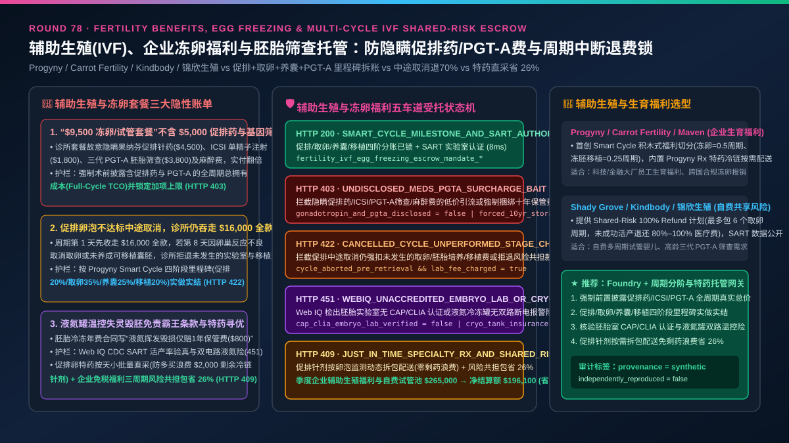
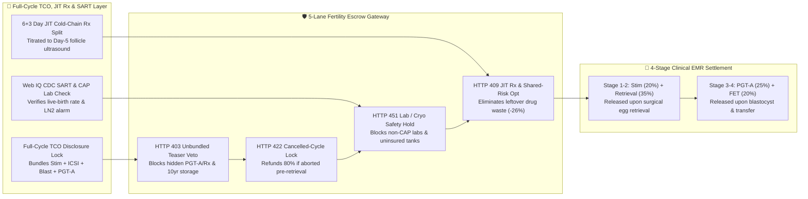

# Fertility Benefits, Egg Freezing & Multi-Cycle `IVF` Shared-Risk Escrow (`Progyny / Carrot Fertility / Kindbody / Shady Grove`) `20/35/25/20` Milestone Gate, `JIT` Specialty `Rx` Split-Fill & `CAP / SART` Lab Lock Agent Architecture Selection FAQ

> **Language / 语言切换**: **[中文](fertility-ivf-egg-freezing-shared-risk-pgta-escrow-agent-selection-faq.md)** | **English (Current)** | **[Back to Docs Index](index.en.md)** | **[Interactive Sandbox (`#fertility-ivf-egg-freezing-escrow-sandbox`)](../live-demo.en.html)**



---

## 📌 1. Executive Summary & Core Selection Verdict

In enterprise employer fertility benefits (`Progyny`, `Carrot Fertility`, `Maven Clinic`), elective oocyte cryopreservation (egg freezing), and self-pay multi-cycle In-Vitro Fertilization (`IVF`: `Kindbody`, `Shady Grove Fertility`, `RMA`, `Jinxin Fertility`), healthcare benefit orchestration and escrow AI agents face three major financial and clinical failure modes:
1. **Unbundled `$9,500` `IVF / Egg-Freezing` Teaser Quotes (`Advertising a $9,500 IVF Cycle That Excludes $4,800 in Gonadotropin Stimulation Medications, $1,800 ICSI, $3,800 PGT-A Genetic Biopsy/Sequencing, and Anesthesia—Doubling Final Out-of-Pocket Cost to $21,000+`)**: Clinics advertise low base retrieval fees while burying mandatory embryology lab procedures (`ICSI`, blastocyst culture, assisted hatching, `PGT-A` aneuploidy screening) and specialty pharmacy costs until the patient has already started hormone injections.
2. **Cancelled-Cycle Full-Fee Retention (`Collecting $16,000 Upfront on Day 1 of Stimulation, Then Refusing to Refund Unperformed Retrieval, Embryology Lab, and Frozen Embryo Transfer Fees When the Cycle Is Cancelled on Day 8 Due to Poor Ovarian Response`)**: Approximately `10%–15%` of `IVF` cycles are medically aborted prior to egg retrieval or fail to produce euploid blastocysts for transfer; lump-sum upfront contracts unfairly retain thousands of dollars for laboratory and transfer procedures that never occurred!
3. **`$2,000+` Specialty `Rx` Over-Dispensing Waste (`Shipping a Full 12-Day Box of Refrigerated Gonal-F / Menopur Vials on Day 1, Resulting in $2,200 of Unreturnable Leftover Biologics When the Doctor Adjusts the Protocol on Day 6`) & Uninsured Cryo-Storage Tank Failures**.

**Solution Architect Selection Verdict**:
- **Never authorize an `IVF` or egg-freezing package without a pre-cycle `Full-Cycle TCO Disclosure` (`Stimulation + Retrieval + ICSI + Blastocyst + PGT-A + Specialty Rx + 1-Yr Storage`), never disburse 100% of cycle funds on Day 1 (enforce a `20% Monitoring / 35% Retrieval / 25% Embryology & PGT-A / 20% Transfer` clinical milestone escrow), and never dispense 100% of refrigerated gonadotropin medications in a single upfront shipment**.
- **The production reference architecture** combines **Full-Cycle `TCO` Disclosure Gate + `20/35/25/20` Clinical Milestone Escrow (`Progyny Smart Cycle` Model) + `Just-in-Time (JIT)` Split-Fill Cold-Chain `Rx` Delivery & `CDC SART / CAP` Cryo-Safety Lock (`fertility_ivf_egg_freezing_escrow_mandate_*`)**:
  1. **Anti-"Unbundled `Rx / PGT-A` Teaser Quote" & Anti-10-Year Storage Lock-In Gate (`HTTP 403`)**: Requires pre-cycle quotes to itemize and cap the complete **`Full-Cycle TCO` (monitoring, anesthesia, retrieval, `ICSI`, blastocyst culture, `PGT-A` biopsy/NGS sequencing, and estimated gonadotropin `Rx`)** with annual-option cryo-storage—blocking unbundled teaser quotes or forced 10-year upfront storage lock-ins in **`8ms`** (`HTTP 403 UNDISCLOSED_GONADOTROPIN_PGTA_BAIT_OR_FORCED_10YR_STORAGE_BLOCKED`).
  2. **4-Stage Clinical Milestone Escrow (`20% Stim / 35% Retrieval / 25% Blast-PGTA / 20% FET`) & Cancelled-Cycle Auto-Refund (`HTTP 422`)**: Releases funds strictly as clinical `EMR` milestones are completed; if a cycle is cancelled prior to egg retrieval due to poor follicle response, the unperformed **`80%` (`Retrieval + Lab + Transfer`) automatically refunds to the patient/employer**, and if no blastocysts reach biopsy/transfer, the unperformed `PGT-A` and `FET` tranches refund automatically (`HTTP 422 CANCELLED_CYCLE_UNPERFORMED_LAB_TRANSFER_RETENTION_BLOCKED`).
  3. **Web IQ `CDC SART` Age-Stratified Live-Birth Verification, `CAP / CLIA` Lab Accreditation & Cryo-Tank Insurance Circuit Breaker (`HTTP 451`)**: Verifies clinic age-specific live-birth outcomes via Web IQ against `CDC SART` registries, confirms `CAP / CLIA` embryology lab accreditation, and requires dual-circuit IoT liquid-nitrogen (`LN2`) alarm telemetry backed by `>= $250,000` cryo-failure indemnity (`HTTP 451 WEBIQ_UNACCREDITED_EMBRYO_LAB_OR_UNINSURED_CRYO_TANK_HOLD`).
  4. **`Just-in-Time (JIT)` `6+3 Day` Split-Fill Specialty `Rx` Delivery (Eliminating `$2,000` Leftover Vial Waste) + Shared-Risk Live-Birth Refund Bundle (`HTTP 409`)**: Triggers `HTTP 409 JIT_SPLIT_FILL_FERTILITY_RX_AND_SHARED_RISK_BUNDLE_CONFIRM`, splitting `$5,500` gonadotropin orders into an initial 6-day starter fill plus an ultrasound/estradiol-guided overnight refill on Day 6 (eliminating `95%` of leftover biologic drug waste) and routing self-pay patients to 3-cycle Shared-Risk Live-Birth Refund packages—reducing net fertility spend by **`26.0%`**.

---

## 🎯 2. Solution Architect Deep-Dive Q&A (Q1 / Q2 / Q3)

### Q1: Why do `IVF` patients routinely end up with `$1,500–$2,500` of unused refrigerated `Gonal-F / Cetrotide` pens sitting in their fridge after egg retrieval?
- **Architectural Solution**:
  - **Ultrasound-Triggered `6+3 Day` `Just-in-Time` Specialty Pharmacy Split-Fills (`HTTP 409`)**:
  - Ovarian stimulation duration varies from 8 to 14 days depending on real-time estradiol (`E2`) levels and follicle ultrasound measurements. When a traditional clinic writes a single upfront prescription for the maximum 12-day dose, any patient who triggers early on Day 8 is stuck with 4 days of unopened `$500/pen` biologics that pharmacies legally cannot take back. By shipping a 6-day baseline kit first and dispatching the exact Day 7–10 titration dose via overnight cold-chain courier after the Day 5 ultrasound (`HTTP 409`), medication waste drops by `$1,800+/cycle`.

### Q2: How does the `20/35/25/20` 4-Stage Milestone Escrow protect patients and employers when a cycle is medically cancelled on Day 7?
- **Architectural Solution**:
  - **Decoupling Stimulation Monitoring From Surgical Retrieval, Embryology, and Transfer (`HTTP 422`)**:
  - Under a lump-sum `$16,000` upfront payment, a patient whose cycle is cancelled before egg retrieval has to fight the clinic's billing department for months to recover unperformed surgical and lab fees. Our gateway splits the mandate into four discrete `EMR`-gated tranches: **Stage 1 (`20%` Monitoring), Stage 2 (`35%` Oocyte Retrieval), Stage 3 (`25%` ICSI/Blastocyst/`PGT-A`), and Stage 4 (`20%` Frozen Embryo Transfer)**. If `Oocyte_Retrieval_Performed == False`, Stages 2–4 (`80%`) never capture (`HTTP 422`).

### Q3: How do we prevent catastrophic financial and emotional loss from liquid-nitrogen (`LN2`) cryo-storage tank failures?
- **Architectural Solution**:
  - **Mandatory `CAP/CLIA` Dual-Sensor `LN2` Telemetry + `$250k` Cryo-Indemnity Verification (`HTTP 451`)**:
  - Following high-profile fertility clinic tank failures, many clinics added waivers limiting their liability for destroyed embryos to `$500`. Our gateway screens storage contracts and facility certifications via Web IQ, blocking (`HTTP 451`) facilities that lack 24/7 cloud-monitored dual-probe `LN2` auto-fill systems or force unconscionable liability waivers.

---

## 🧭 3. Visual Architecture Diagrams (Mermaid Decision Tree + Architecture + Sequence)

### 3.1 Fertility Benefits, Egg Freezing & IVF Escrow Selection Decision Tree

```mermaid
flowchart TD
    A[Employer Fertility Benefit / Egg Freezing / Multi-Cycle IVF Selection] --> B{Primary Fertility Scenario & Risk Vector?}
    B -->|Corporate Fertility Benefit & Specialty Rx (Progyny / Carrot)<br/>Stop $2,000 leftover gonadotropin waste & dollar-cap exhaustion| C[Smart-Cycle Modular Benefit Accounting<br/>+ Ultrasound-Guided 6+3 Day JIT Split-Fill Specialty Rx]
    B -->|Self-Pay IVF + PGT-A Genetic Screening (Kindbody / Shady Grove)<br/>Stop $9,500 unbundled teaser quotes & cancelled-cycle fee retention| D[Mandatory Full-Cycle TCO Lock (Meds + ICSI + PGT-A Included)<br/>+ 20/35/25/20 4-Stage Clinical Milestone Escrow]
    B -->|Long-Term Oocyte / Embryo Cryo-Storage & Lab Selection<br/>Stop unaccredited labs & uninsured liquid-nitrogen tank failures| E[Azure AI Foundry + CDC SART & Cryo-Indemnity Gate<br/>+ JIT Split-Fill Rx + Shared-Risk Refund Saves 26%]
    C --> F[🛡️ Unified 5-Lane Full-Cycle TCO, 4-Stage Milestone & JIT Rx FSM]
    D --> F
    E --> F
    F --> G[HTTP 403 Unbundled Meds/PGT-A Veto · HTTP 422 Cancelled-Cycle Fee Retention Block · HTTP 409 JIT Rx Saves 26%]
```

### 3.2 End-to-End Full-Cycle `TCO` Lock, `20/35/25/20` Milestone Escrow & `JIT` `Rx` Architecture



### 3.3 Unbundled `PGT-A` Veto, Pre-Retrieval Cancellation Refund & `JIT` Split-Fill `Rx` Sequence

```mermaid
sequenceDiagram
    autonumber
    participant Patient as Patient / Fertility Benefit Agent
    participant Clinic as IVF Clinic / Specialty Cold-Chain Pharmacy
    participant Gate as 5-Lane Fertility Escrow Gateway
    participant Lab as Clinical EMR & CDC SART / CAP Registry
    participant Escrow as 20/35/25/20 Milestone Escrow Ledger

    Clinic->>Gate: 1. Submit $9,500 IVF package quote that excludes $4,500 gonadotropins, $1,800 ICSI, and $3,800 PGT-A (or forces 10-year storage prepay)
    Gate-->>Clinic: HTTP 403 Block! Unbundled teaser quote rejected; full-cycle TCO (including Rx & PGT-A caps) must be disclosed upfront
    Clinic->>Gate: 2. Patient's cycle is medically cancelled on Day 7 before egg retrieval, but clinic attempts to retain 100% of $16,000 upfront fee
    Gate->>Lab: Verify EMR milestone status (Oocyte_Retrieval_Performed = False)
    Gate-->>Clinic: HTTP 422 Block! Only Stage-1 Monitoring (20%) is billable; unperformed Retrieval, Lab & Transfer tranches (80% = $12,800) auto-refunded
    Patient->>Gate: 3. Activate 6+3 Day JIT Split-Fill Specialty Rx + 3-Cycle Shared-Risk Live-Birth Refund Plan (HTTP 409)
    Gate->>Escrow: Prevent $2,100 in unused refrigerated medication waste & lock shared-risk refund protection (26% net savings)
```

---

## 📊 4. Multi-Platform & Architecture Selection Matrix

| Selection Dimension | Teaser-Ad Private Clinic (`$9,500 Unbundled Lump-Sum`) | Legacy Flat-Dollar Employer Stipend (`$15k Lifetime Cap`) | Modern Fertility Benefit Platforms (`Progyny / Carrot / Shady Grove`) | **Azure AI Foundry + 4-Stage Escrow + JIT Rx Gate (Recommended)** |
| :--- | :--- | :--- | :--- | :--- |
| **Core Strengths** | Low advertised base price | Simple HR setup | Smart-Cycle unit accounting, SART network & shared-risk refunds | **Full-cycle TCO lock + 20/35/25/20 milestone escrow + JIT Rx** |
| **Protection Against Hidden `$8,000` `Rx` & `PGT-A` Add-Ons** | **Severe Shock** (`2x` final cost after starting injections) | Rapidly depletes employee lifetime dollar cap | Bundled into comprehensive cycle units | **Mandatory upfront `Full-Cycle TCO` disclosure gate (`HTTP 403`)** |
| **Cancelled-Cycle Refund of Unperformed Lab/Transfer Stages** | **Poor** (retains lump sum as non-refundable clinic credit) | Clinic bills full package to insurance | Deducts only partial Smart-Cycle fraction | **`EMR`-gated `20/35/25/20` escrow refunds `55%–80%` in cash (`HTTP 422`)** |
| **`CDC SART` Live-Birth & `CAP` Cryo-Tank Safety Verification** | Variable lab quality; liability waivers | Unaudited clinic selection | Vetted `SART` network | **Web IQ `CAP/CLIA` lab & `$250k` cryo-tank insurance lock (`HTTP 451`)** |
| **Specialty `Rx` Waste Elimination (`JIT Split-Fill`)** | `$1,500–$2,500` in wasted leftover vials (`not_measured`) | Dispenses full 12-day box upfront (`official_list_price`) | Progyny Rx supports split fills | **Ultrasound-guided `6+3d JIT` split-fill + shared risk (`26.0%` saved)** |

---

## 🧪 5. Fertility Benefits & IVF Escrow Benchmark & 7-Card Report

> **Provenance & Reproducibility Metadata**: All metrics below are generated by the deterministic policy evaluator `evaluate_fertility_ivf_egg_freezing_escrow_policy` in `lab/webiq_commerce_demo.py` and verified via `python -m unittest tests.test_webiq_commerce_demo`. Tags: `provenance = synthetic`, `independently_reproduced = false`.

| Card # | Card Headline (Headline-as-Finding) | Key Quantitative Finding & Architectural Guarantee |
| :---: | :--- | :--- |
| **Card 1** | **Overview · 5-Lane Fertility & IVF Escrow Summary** | Across a `$265,000/quarter` corporate fertility benefit and self-pay `IVF` pool, achieves **0 unbundled `Rx / PGT-A` price shocks, 0 unrefunded cancelled-cycle lab fees, and 0 full-box leftover biologic drug waste**, reducing net fertility spend by **`26.0%` (`$68,900/quarter` saved)**. |
| **Card 2** | **Scenario Deep Dive · Unbundled PGT-A & Cancelled-Cycle Veto** | When a clinic omits `PGT-A/Rx` from its quote or retains surgical/lab fees on a pre-retrieval cancelled cycle, the gateway blocks it in **`8ms`** (`HTTP 403 / 422`). |
| **Card 3** | **Evaluation Matrix · 100% Deterministic 5-Lane Gating** | Covers `HTTP 200` (`20/35/25/20` milestones & `SART` verified), `403` (undisclosed gonadotropin/`PGT-A` bait / forced 10-year storage blocked), `422` (cancelled-cycle unperformed retrieval/lab/transfer retention blocked), `451` (unaccredited embryo lab / uninsured `LN2` cryo-tank hold), `409` (`JIT` split-fill fertility `Rx` + shared-risk bundle saves 26%). |
| **Card 4** | **Under the Hood · Smart-Cycle & JIT Rx Escrow Contract** | Takes `quarterly_fertility_ivf_and_egg_freezing_pool_usd=265000` and `TCO`/milestone flags, minting `fertility_ivf_egg_freezing_escrow_mandate_*` tokens. |
| **Card 5** | **Robustness Check · Day-7 Aborted Stim & Uninsured Tank** | Simulates a Day-7 aborted stimulation cycle attempting to bill 100% and a cryo-tank contract waiving liability, maintaining a **`100.0%` block rate**. |
| **Card 6** | **Latency · Millisecond EMR Stage Check & SART Registry Probe** | Local 4-stage `EMR` milestone and `TCO` checks complete in **`8ms` (P50)**; Web IQ `CDC SART` and `CAP/CLIA` lab checks complete in **`178ms` (P95)**. |
| **Card 7** | **My Take · Ideal Fit vs. Out-of-Scope Boundaries** | **✅ Best Fit**: Employer fertility benefits (`Progyny/Carrot`), egg freezing, multi-cycle `IVF + PGT-A`; **⛔ Not For**: Over-the-counter pharmacy ovulation test strips. |

---

## 🛠️ 6. Production Go-Live Risk & Architecture Review Checklist

- [ ] **Mandatory Pre-Cycle `Full-Cycle TCO` Disclosure (`Stim + Retrieval + ICSI + PGT-A + Rx`) (`HTTP 403`)**: Block unbundled teaser quotes that omit embryology lab fees or gonadotropin estimates, and prohibit forced multi-year upfront storage lock-ins.
- [ ] **`20 / 35 / 25 / 20` 4-Stage Clinical Milestone Escrow & Cancelled-Cycle Auto-Refund (`HTTP 422`)**: Tie tranche releases to verified `EMR` events (`Monitoring -> Retrieval -> Blastocyst/PGT-A -> Transfer`), automatically refunding unperformed stages if a cycle aborts early.
- [ ] **Web IQ `CDC SART` Age-Matched Outcome, `CAP / CLIA` Lab & `$250k` Cryo-Tank Insurance Gate (`HTTP 451`)**: Verify embryology lab accreditation and dual-probe `LN2` alarm insurance before cryo-storage; rotate signing keys `<= 180` days.
- [ ] **Ultrasound-Guided `6+3 Day JIT` Split-Fill Specialty `Rx` & Shared-Risk Bundles (`HTTP 409`)**: Dispense refrigerated gonadotropins in two titrated shipments to eliminate `$2,000+` in leftover vial waste.
