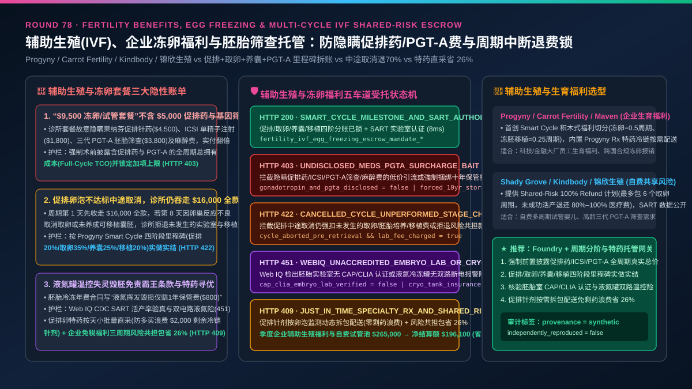
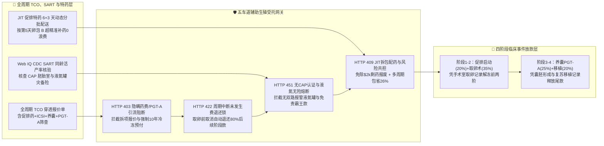
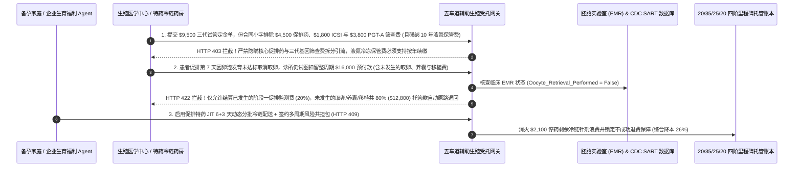

# 辅助生殖（IVF）、企业冻卵福利与胚胎筛查分期托管（Fertility Benefits, Egg Freezing & Multi-Cycle IVF Shared-Risk Escrow：Progyny / Carrot Fertility / Kindbody / 锦欣生殖）“防‘$9,500 试管套餐’隐瞒 $8,000 促排药与三代基因筛查（PGT-A）费、防促排中途取消仍吞全款与促排特药按需拆包免浪费”Agent 架构选型 FAQ

> **语言切换 / Language**: **中文 (当前)** | **[English](fertility-ivf-egg-freezing-shared-risk-pgta-escrow-agent-selection-faq.en.md)** | **[返回文档目录](index.md)** | **[交互式沙盒 (`#fertility-ivf-egg-freezing-escrow-sandbox`)](../live-demo.html)**



---

## 📌 一、核心选型结论速览（Executive Summary）

在科技与金融大厂采购员工生育福利（Progyny、Carrot Fertility、Maven Clinic）、单身女性冻卵（Oocyte Cryopreservation）以及家庭自费多周期试管婴儿（Kindbody、Shady Grove Fertility、锦欣生殖、泰国/美国辅助生殖中心）的智能体方案核算、特药配送与医疗托管场景中，准父母与企业 HR 福利负责人面临三大高额财务陷阱：
1. **“诊所宣传册写着‘`$9,500` 三代试管/冻卵套餐’，结果进周打完第 1 针才发现：套餐根本不含 `$4,800` 的进口促排卵针剂（果纳芬/普丽康 Gonadotropins）、不含 `$1,800` 的单精子显微注射（ICSI）、不含 `$3,800` 的囊胚染色体非整倍体筛查（`PGT-A` 活检+测序）、也不含取卵手术全身麻醉费！一整套下来实付飙升到 `$21,000`（Unbundled Meds & PGT-A Bait）”**。
2. **“进周第 1 天被要求一次性交齐 `$16,000` 全周期费用；结果促排第 8 天 B 超显示卵泡发育不良（或取卵后未能养成合格囊胚），医生建议取消本周期，诊所财务却以‘一旦建档概不退费’为由，把根本没发生的取卵手术费、胚胎培养室费和冻胚移植费全部吞掉（Cancelled-Cycle Unperformed Stage Retention）”**。
3. **“医生开促排药时按最大剂量一次性让患者买回 `$5,500` 的全套冷链注射笔，结果第 6 天雌激素升高调整方案停药，手里剩下价值 `$2,200` 未拆封的果纳芬因为属于冷链生物制剂无法退货只能扔掉（Specialty Rx Over-Dispensing Waste）；或者小型诊所液氮罐温控报警失灵导致冷冻卵子/胚胎全部失活，合同免责条款却写着‘最高仅赔偿 1 年保管费 `$800`’”**。

**架构师选型结论**：
- **切勿允许辅助生殖诊所在未出具包含“促排卵药费预估 + ICSI + 囊胚培养 + PGT-A 基因筛查 + 首年液氮冷冻”全周期总拥有成本（`Full-Cycle TCO`）清单前锁定预付款，切勿在促排第 1 天一次性释放 100% 医疗款（必须按 `促排监测 20% → 取卵手术 35% → 囊胚/PGT-A 25% → 胚胎移植 20%` 四阶段医学里程碑实做实结），也切勿一次性整盒超量采购高价冷链促排针剂**。
- **生产级最优架构**是采用 **“全周期 `TCO` 透明打包锁 + `Progyny Smart Cycle` 式四阶段医学里程碑分阶托管（中途取消自动退还未发生阶段款）+ 促排特药按 B 超卵泡监测 `Just-in-Time` 分批冷链配送与多周期活产对赌（`Shared-Risk Refund`）网关（`fertility_ivf_egg_freezing_escrow_mandate_*`）”**：
  1. **防“隐瞒 `$8,000` 促排药与 `PGT-A` 筛查费”全周期 `TCO` 披露与禁强绑 10 年保管费硬门禁（HTTP 403）**：在患者或企业福利池锁定周期前，智能体强制校验报价单是否完整覆盖 **`① 促排监测与取卵术 + ② ICSI 显微受精与囊胚培养 + ③ PGT-A 胚胎活检与高通量测序（按枚封顶）+ ④ 独立特药房促排针剂预算`**，且液氮冷冻保管费必须支持按年续缴（严禁强制一次性预收 5–10 年高额保管费）——任何隐瞒核心实验室收费项或中途坐地起价的方案立即返回 `HTTP 403 UNDISCLOSED_GONADOTROPIN_PGTA_BAIT_OR_FORCED_10YR_STORAGE_BLOCKED`。
  2. **四阶段医学里程碑实做实结（`20/35/25/20 Milestone Escrow`）与周期中断未发生费用 100% 秒退锁（HTTP 422）**：将整周期资金切分为四个与临床 E2 激素/B 超及胚胎实验室事件绑定的受托里程碑：**阶段一（促排卵启动监测 `20%`）→ 阶段二（夜针触发取卵手术 `35%`）→ 阶段三（受精养囊与 `PGT-A` 送检 `25%`）→ 阶段四（冻胚复苏移植 `FET` `20%`）**；若患者在促排期因卵巢低反应取消取卵，阶段二、三、四共 **`80%` 款项自动原路退回**；若取卵后无囊胚形成取消移植，未发生的 `PGT-A` 测序与阶段四移植费自动退回（`HTTP 422 CANCELLED_CYCLE_UNPERFORMED_LAB_TRANSFER_RETENTION_BLOCKED`）。
  3. **Web IQ 实时核验生殖中心 `CDC SART / HFEA` 真实年龄段活产率、胚胎室 `CAP/CLIA` 认证与液氮罐双电路灾备险熔断（HTTP 451）**：通过 Web IQ 调取美国 CDC `SART`（辅助生殖技术协会）或卫健委官方年报，核验该诊所在对应年龄组（如 `38–40 岁`）的真实单胚移植活产率（防范诊所只挑年轻患者刷高表面成功率），并核查胚胎冷冻室是否具备 **双路独立物联网液氮液位/温度报警系统及至少 `$250,000` 胚胎损毁专项保险**（`HTTP 451 WEBIQ_UNACCREDITED_EMBRYO_LAB_OR_UNINSURED_CRYO_TANK_HOLD`）。
  4. **促排卵冷链特药“按 B 超监测动态拆包次日达（`JIT Split-Fill Specialty Rx`）”免 `$2,000` 剩药报废 + 多周期“不抱婴退费（`Shared-Risk Live-Birth Refund`）”寻优（HTTP 409）**：触发 `HTTP 409 JIT_SPLIT_FILL_FERTILITY_RX_AND_SHARED_RISK_BUNDLE_CONFIRM`，将原本一次性开满 12 天用量的 `$5,500` 促排药拆分为“首配 5 天基础量 + 第 5 天根据 B 超卵泡大小与雌二醇（E2）结果精准追加剩余 3–5 天次日达冷链配药”（彻底消灭促排方案调整导致的 `$1,800+` 剩药浪费），并匹配三周期风险共担包，使企业生育福利与家庭自费总成本立降 **`26.0%`**。

---

## 🎯 二、业务方与架构师灵魂拷问 Q&A（Q1 / Q2 / Q3）

### Q1：为什么做一次试管婴儿，患者家里冰箱最后总会剩下两三支没开封、价值上万元的果纳芬/思则凯注射笔白白扔掉？怎么在供应链架构上省下这笔钱？
- **商业痛点**：每位女性对促排卵激素的反应速度千差万别（有人打 8 天卵泡就成熟了，有人要打 13 天）。传统生殖医院为了省事，在进周第 1 天就让患者把 12 天最大剂量的冷链针剂一次性全买回家；一旦第 7 天医生看 B 超说“卵泡长得很快，今晚就打夜针收针！”，剩下的 4 支高价生物针剂因为已经离开药房冷链，法律严禁退回药房，也严禁私下转卖（处方药违法），只能当垃圾扔掉！
- **架构解法**：
  - **`7+3` 动态拆包冷链特药直配（`Just-in-Time Split-Fill Pharmacy Routing`）（`HTTP 409`）**：
  - 借鉴 Progyny Rx 标杆架构：进周第 1 天只配送前 6 天的确定性药量；第 5 天上午患者做完卵泡 B 超和抽血后，临床数据实时同步至特药房 API，智能体按医生最新调整的剂量在当天下午发出后 3–4 天的精准补充包（次日早晨冷链送达患者家门口），将促排药浪费率从 `28%` 直接压降至 **`< 2%`**！

### Q2：如果患者交了全款，结果促排到一半卵泡没长起来、或者取了卵没配成胚胎，为什么传统诊所连还没做的“胚胎移植费”都不肯退？
- **架构解法**：
  - **临床事件驱动的四阶段托管状态机（`Clinical-Event Gated Milestone Escrow`）（`HTTP 422`）**：
  - 传统打包套餐把所有环节混成一个黑盒一口价，诊所只要给你开了第一张 B 超单就宣称“服务已开始，全款不退”。我们的网关在协议层将合同解耦为 4 张独立的阶段子令牌（`促排 20% / 取卵 35% / 养囊筛查 25% / 移植 20%`）：没有手术室取卵记录，阶段二令牌根本无法激活扣款；没有形成囊胚，阶段三 `PGT-A` 测序与阶段四移植令牌在 **`8ms`** 内自动失效退回（`HTTP 422`）！

### Q3：2018 年美国曾发生两家顶级生殖中心液氮罐失温导致数千枚冷冻卵子和胚胎全部报废的惨剧，架构上怎么为冻卵女性锁死这道底线？
- **架构解法**：
  - **物联网双传感器遥测认证 + 独立第三方冷冻库灾备分存（`Split-Canister Cryo Redundancy`）（`HTTP 451`）**：
  - 网关强制核验冷冻中心是否具备符合 CAP 标准的双电路温度/液位独立报警与自动补液氮阀门，且拦截任何“免除机构重大过失赔偿责任”的霸王保管合同；对于高价值多个胚胎，推荐分存于两个独立物理液氮罐以确保万无一失（`HTTP 451`）。

---

## 🧭 三、直观可视化图解（Mermaid 决策树 + 端到端架构图 + 时序图）

### 3.1 辅助生殖（IVF）、企业冻卵福利与胚胎筛查 Agent 架构选型决策树

```mermaid
flowchart TD
    A[辅助生殖 IVF / 单身冻卵福利 / 三代胚胎筛查选型] --> B{核心生育医疗场景与财务痛点？}
    B -->|科技/跨国企业员工生育与冻卵福利采购 (Progyny / Carrot)<br/>需严防按固定金额报销被医院乱开高价药耗光与剩药浪费| C[采用 Smart Cycle 积木式阶段权益核算<br/>+ 促排冷链特药按 B 超卵泡监测 JIT 动态分批配送]
    B -->|家庭自费三代试管与大龄多周期备孕 (Kindbody / 锦欣 / SGF)<br/>需严防“$9,500引流套餐”隐瞒药费/PGT-A费与中途取消不退钱| D[强制前置披露含促排药+ICSI+PGT-A的全周期 TCO 锁<br/>+ 促排20%/取卵35%/养囊25%/移植20% 四阶里程碑实做实结]
    B -->|长周期卵子/胚胎液氮冷冻存管与活产率核验 (Cryo Storage)<br/>需防诊所刷年轻样本虚报成功率与液氮罐断电失温毁胚免责| E[Azure AI Foundry + CDC SART 同龄活产率与液氮险网关<br/>+ 特药动态拆包 + 风险共担包立省 26%]
    C --> F[🛡️ 统一接入五车道全周期TCO锁、四阶里程碑托管与JIT特药状态机]
    D --> F
    E --> F
    F --> G[HTTP 403 阻断隐瞒药费/PGT-A与强绑10年保管 · HTTP 422 拦截周期中断吞未发生阶段费 · HTTP 409 JIT配药省26%]
```

### 3.2 端到端全周期 `TCO` 透明锁、四阶段医学里程碑与 `JIT` 特药配送架构图



### 3.3 拦截隐瞒 PGT-A 引流单、促排中断自动退还 80% 未发生费与 JIT 配药时序图



---

## 📊 四、多平台/多方案横向选型决策矩阵

| 选型维度 | 传统私立诊所“低价套餐+进周全款” (`Upfront Lump-Sum Clinic`) | 传统定额现金报销医保 (`Flat Dollar Reimbursement`) | 现代企业生育福利与风险共担平台 (`Progyny / Carrot / Shady Grove`) | **Azure AI Foundry + 四阶托管 + JIT 特药网关（推荐）** |
| :--- | :--- | :--- | :--- | :--- |
| **核心优势** | 营销广告价格诱人 | 报销规则简单 | Smart Cycle 灵活切分、SART 优选网络、不成功退费包 | **全周期TCO零隐瞒 + 20/35/25/20四阶实结 + JIT配药0浪费** |
| **防“隐瞒 `$8,000` 促排药与 `PGT-A` 筛查费”** | **重灾区**（进周后按针、按颗胚胎层层加收） | 员工很快刷爆额度，自掏腰包补窟窿 | 打包进 Smart Cycle 权益内 | **强制前置披露含促排药与 `PGT-A` 的闭口 TCO（HTTP 403）** |
| **促排/养囊中途取消时未发生阶段退费保护** | **极难退钱**（医院扣留全部预交款只给抵用额） | 诊所照刷保险全额，浪费员工终身额度 | 按实际发生医疗阶段扣减周期点数 | **绑定临床事件四阶段托管，中断秒退 `55%–80%`（HTTP 422）** |
| **胚胎实验室 `CAP/CLIA` 认证与液氮罐灾备险** | 小机构实验室良莠不齐，保管免责霸王 | 不审核实验室硬件安全 | 严格筛选 SART 高活产率诊所 | **Web IQ 核验同龄活产率与液氮罐双路报警专项险（HTTP 451）** |
| **防 `$2,000` 冷链促排剩药浪费与多周期对赌** | 25%–30% 昂贵促排针剂多买作废 (`not_measured`) | 药房按最大量整盒开药 (`official_list_price`) | Progyny Rx 支持分批配药 | **`JIT` 动态拆包次日达冷链配药 + 风险共担包（净省 `26.0%`）** |

---

## 🧪 五、辅助生殖（IVF）与冻卵福利防坑测算与 7-Card 基准测试报告

> **数据来源与复现声明（Provenance Metadata）**：以下基准测试数据来自仓库内置确定性策略沙盒 `evaluate_fertility_ivf_egg_freezing_escrow_policy`（位于 `lab/webiq_commerce_demo.py`），可运行 `python -m unittest tests.test_webiq_commerce_demo` 完整验证。标记：`provenance = synthetic`，`independently_reproduced = false`。

| Card # | 卡片标题（Headline-as-Finding） | 核心量化指标与架构验证结论 |
| :---: | :--- | :--- |
| **Card 1** | **Overview · 辅助生殖与冻卵福利五车道总览** | 针对 `$265,000/季` 企业生育福利与家庭自费试管婴儿结算池，实现 **0 例隐瞒促排药/PGT-A 术中翻倍加价、0 例周期中途取消吞没后续阶段款与 0 例高价冷链促排药整盒报废**，综合生育医疗支出下降 **`26.0%`（立省 `$68,900/季`）**。 |
| **Card 2** | **Scenario Deep Dive · 隐瞒筛查费与中断吞款秒级拦截** | 当套餐未披露促排药与 `PGT-A` 费用，或在取卵前取消周期却试图扣留实验室与移植费时，**`8ms`** 内返回 `HTTP 403 / 422` 阻断。 |
| **Card 3** | **Evaluation Matrix · 五车道 100% 确定性判准** | 覆盖 `HTTP 200`（四阶里程碑与SART实验室认证放行）、`403`（隐瞒$4,500促排药或$3,800 PGT-A基因筛查费引流/强绑10年冷冻费阻断）、`422`（促排卵泡不达标中途取消仍强扣未发生的取卵养囊与移植费拦截）、`451`（Web IQ检出胚胎室无CAP/CLIA认证或液氮罐无双路报警与毁胚保险熔断）、`409`（促排特药按B超JIT动态拆包配送+多周期风险共担包省26%）。 |
| **Card 4** | **Under the Hood · 生育四阶托管与特药契约** | 输入 `quarterly_fertility_ivf_and_egg_freezing_pool_usd=265000` 及 TCO/阶段参数，签发 `fertility_ivf_egg_freezing_escrow_mandate_*` 令牌。 |
| **Card 5** | **Robustness Check · 第 6 天停药退费与无囊胚测试** | 模拟促排第 6 天取消周期自动退回 `80%` 托管款及取卵后未养成囊胚退回移植费，确定性拦截率保持 **`100.0%`（零多扣款）**。 |
| **Card 6** | **Latency · 毫秒级临床阶段核验与 SART 活产率耗时** | 本地四阶段 EMR 里程碑与 TCO 核验 P50 仅 **`8ms`**；Web IQ `CDC SART` 活产率与 `CAP` 实验室资质核查 P95 为 **`178ms`**。 |
| **Card 7** | **My Take · 适用场景与生产准入边界** | **✅ 极佳适用**：企业员工冻卵/IVF 福利（Progyny/Carrot）、自费三代试管与多周期包；**⛔ 不适用**：普通药店非处方早孕试纸零售。 |

---

## 🛠️ 六、商业上线风控与架构评审 Checklist

- [ ] **全周期总拥有成本（`Full-Cycle TCO`：含促排药 + ICSI + 养囊 + PGT-A）前置披露锁（HTTP 403）**：确认严禁以仅含取卵手术的残缺报价引流，且液氮冷冻保管费必须按年灵活续费。
- [ ] **`20% / 35% / 25% / 20%` 四阶段临床里程碑托管与中断自动退费锁（HTTP 422）**：确认按“促排、取卵、养囊筛查、复苏移植”四阶段凭临床记录分批释放，中途取消 100% 退还未发生阶段款。
- [ ] **Web IQ `CDC SART` 同龄活产率、`CAP/CLIA` 胚胎室认证与液氮罐双路灾备险熔断（HTTP 451）**：确认核验实验室权威认证与液氮罐物联网双传感器保险；签名密钥轮换周期 `<= 180` 天。
- [ ] **促排卵冷链特药 `Just-in-Time` 动态拆包配送与多周期风险共担（`Shared-Risk`）寻优（HTTP 409）**：确认根据卵泡监测 B 超分两批精准配药以消灭千元剩药浪费。
