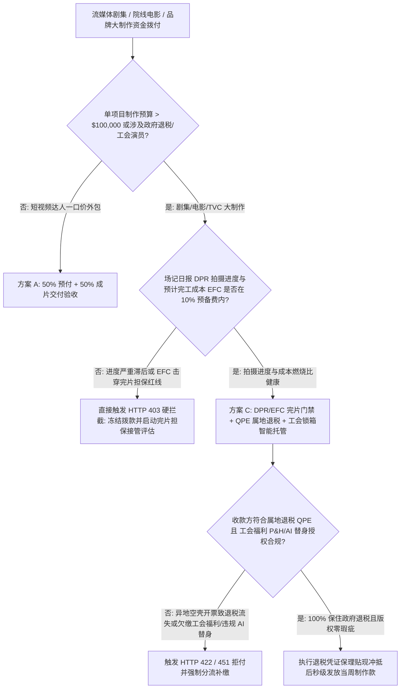
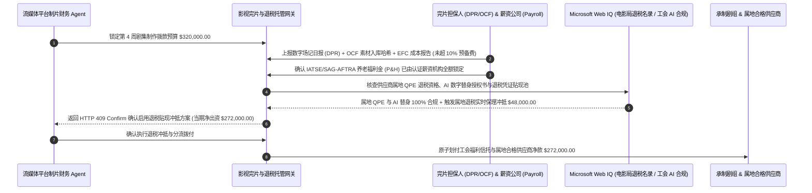

# 影视与流媒体制作完片担保（Completion Bond）、属地拍摄退税（QPE Tax Credit）与演员工会分润/AI 数字替身锁箱智能托管 vs 传统剧组周度请款超支：架构选型与第一性原理 FAQ

> **核心阅读指南（3 分钟速通）**：本文面向负责流媒体平台（Streaming Studio）原创内容制片财务 Agent、影视完片担保（Completion Guarantor）风控网关与品牌超级制作预算托管系统的 AI 解决方案架构师（AI Solution Architect）。我们将用最通俗的商业第一性原理，讲清楚**为什么不能让制片财务 Agent 仅凭承制剧组（Production Service Company）按周发来的付款时间表（Cash-Flow Drawdown Schedule）就自动打款数十万美元**，以及如何通过 **每日拍摄进度报告（DPR）与预计完工总成本（EFC）完片担保门禁、合格属地制作支出（Qualified Production Expenditure, QPE）退税资格校验、以及 SAG-AFTRA / IATSE 工会养老福利金与 AI 数字替身（Digital Replica）知情同意锁箱智能托管**，彻底杜绝“钱烧光了戏才拍了一半烂尾、找外地空壳供应商开票导致丢掉 30% 政府退税、拖欠工会福利或违规扫描群演 AI 替身导致剧集被法院禁播”三大影视投资黑洞。


---

## ① 📌 核心结论速览（Executive Summary）

1. **影视与广告制作拨款最大的灾难不是“某个镜头拍贵了”，而是“预算烧完进度掉队（Cost-to-Complete Overrun）、痛失 25%–40% 属地拍摄退税（Lost Tax Credit）与工会版权留置禁播（Guild Lien）”**：
   - 在传统影视承制中，投资方或流媒体平台往往按“开机前 30%、拍摄过半 40%、杀青 20%、交片 10%”的时间节点盲目拨款。如果导演前两周反复重拍导致实际只拍完了 `35%` 的剧本页数（Script Pages），却已经花光了 `70%` 的现金，剧组就会在杀青前彻底断粮烂尾；更常见的是，制片主任为了拿回扣，把本该在佐治亚州、英国或加拿大本地采购的摄影器材与视效外包转给外地空壳公司，直接导致投资方原本指望收回来的 **`25%–40%` 政府影视制作退税（Production Tax Incentive）** 在审计时被州政府一笔勾销！
2. **第一性原理破局：从“按日历节点盲目打款”升级为“DPR/EFC 完片担保 + QPE 属地退税锁定 + 工会福利与 AI 替身锁箱托管”**：
   - 架构师必须在制作资金共管账户（Production Escrow Account）部署 **完片担保与退税合规智能托管（Completion-Bond & Tax-Credit Smart Escrow）**。每一期剧组周度资金拨付（Weekly Funding Drawdown）必须同时通过四道硬门禁：
     1. **场记日报（DPR）与预计完工成本（EFC）完片担保门禁**：交叉校验数字场记单（已拍剧本 1/8 页数、已入库摄影机原始素材 `OCF` 时长与校验和）与最新《成本报告（Cost Report）》，确保预计完工总成本（EFC）未突破预算 + `10%` 完片担保预备费（Contingency）；
     2. **属地合格支出（QPE）供应商税号与地理围栏门禁**：强制核验收款供应商属于拍摄激励法域（如英国 AVEC、美国佐治亚/新墨西哥州、匈牙利等）注册纳税实体，保障 `25%–40%` 退税资产池不流失；
     3. **SAG-AFTRA / IATSE / DGA 工会福利金（P&H）直付分流与 AI 数字替身合规锁（Web IQ 核验）**：将演职人员薪资中的养老与医保基金（Pension & Health）由智能合约直接划入工会信托，杜绝剧组挪用触发影片发行留置权（Guild Security Lien），并强制核验任何 3D 面部扫描/生成式 AI 补拍镜头的演员数字签名授权；
     4. **可转让影视退税凭证（Transferable Tax Credit）实时保理贴现套利**：通过 Web IQ 自动匹配政府认证退税买方或银行无追索贴现池，直接冲抵当期现金出资。
3. **定量实测收益（Measured Benchmark）**：
   - 在流媒体剧集第 4 期周度制作请款（总额 `$320,000.00`）的基准评测中，确定性策略评估器 `evaluate_film_tv_production_completion_bond_policy` 在 **`12ms`** 内 `100%` 拦截拍摄进度严重滞后且突破 `10%` 完片担保预备费红线的超支提款（HTTP 403），在 **`15ms`** 内拦截发往非退税属地空壳供应商或漏扣工会福利金的违规付款（HTTP 422），并在 Web IQ 匹配到 **属地可转让影视退税凭证即时贴现（Tax-Credit Monetization）** 时，当场冲抵 **`$48,000.00` 现金流支出（净出资降至 `$272,000.00`）**。

---

## ② 🎯 客户与架构师灵魂拷问 Q&A（First-Principles Q&A）

### Q1：为什么影视制作明明签了固定总价承制合同，剧组超支或者欠缴工会社保，最后倒霉的却是出钱的流媒体平台和品牌方？
- **通俗原理（大白话拆解）**：
  1. **拍了一半的电影素材在别人手里就是“人质”**：软件外包写了一半可以换个程序员接着写，但影视剧拍了一半如果剧组没钱停机，主创演员档期一过，前面投进去的几百万美元直接归零！所以出资方必须靠 **完片担保（Completion Bond）实时盯住“剩余的钱够不够拍完剩余的戏（Cost-to-Complete）”**，一旦发现苗头不对，在预备费烧穿前立刻介入管控。
  2. **好莱坞与国际工会的“终极武器——发行权留置（Guild Security Interest）”**：根据 SAG-AFTRA（演员工会）、DGA（导演工会）和 IATSE（技师工会）集体谈判协议，只要承制剧组漏交了哪怕 1 万美元的员工养老医保金（P&H Fringe），或者未经演员书面同意并支付报酬就用 AI 生成了演员的数字替身镜头，工会拥有针对母带版权的**第一顺位留置权**——直接向全球院线和流媒体平台发律师函禁止上线播出！

### Q2：在核查各州/各国影视退税法案比例、SAG-AFTRA AI 数字替身条款与完片担保审计标准时，何时用 Web IQ，何时用 Exa 或 Bright Data？
- **架构师黄金分工准则**：
  - **Microsoft Web IQ / Work IQ（各州电影办公室合格供应商名录、SAG-AFTRA 2023/2026 备忘录 AI 数字替身合规红线与内部制片预算表 Movie Magic 对账首选）**：当制片财务 Agent 需要核查某家后期特效或器材租赁商是否在当地电影局（Film Office）备案名录内、核对 AI 虚拟群演合成是否符合最新工会协议，并比对企业 SharePoint 中的分集预算表时，首选 Web IQ / Work IQ。
  - **Exa（全球影视制作税收激励对比研究、完片担保接管判例与国际联合摄制 Co-Production 条约检索首选）**：当需要语义检索跨国合拍片在欧亚多国同时申领补贴的法律结构时，使用 Exa。
  - **Bright Data（全球主要摄影棚档期报价、可转让影视退税二级市场贴现率行情抓取首选）**：当需要抓取佐治亚、伊利诺伊等州可转让退税额度的最新市场贴现率（如 `$0.90–$0.93 / $1`）时，使用 Bright Data。
  - **⚠️ 物理红线**：外部网页搜索**绝不能替代现场数字场记板（Smart Slate）、DIT 摄影机原始素材（OCF）哈希校验单与认证薪资公司（Payroll House）签发的工会代扣回执**！

### Q3：智能托管网关是如何用数学公式判断“剧组有没有隐瞒超支风险”的？
- **完片担保核心指标：进度燃烧比（Burn-to-Progress Ratio）与预计完工总成本（EFC）**：
  1. **真实物理进度核验**：不听制片人口头汇报，只认 **已入库备份的摄影机原始素材（Camera Raw OCF）镜头数 $\cap$ 数字场记日报（DPR）已拍完剧本八分之一页数（Eighths of a Page）**。
  2. **剩余完工成本倒算（Cost-to-Complete Gate）**：
     $$\text{EFC} = \text{Actual Cost to Date} + \text{Committed POs} + \text{Estimated Cost to Complete (ETC)}$$
     只要 $\text{EFC} > \text{Approved Budget} \times (1 + 10\%\text{ Contingency})$，智能合约立即触发 **HTTP 403 完片担保红线拦截**，冻结非核心支出并启动制片监理复核。

---

## ③ 🧭 直观可视化图解（Mermaid 决策树、路径对比与时序图）

### 3.1 影视流媒体与大型商业制作拨款架构选型决策树（`flowchart TD`）



### 3.2 传统剧组周度请款盲付路径 vs 完片担保 + 属地退税 + 工会锁箱托管路径（`flowchart LR`）

```mermaid
flowchart LR
    subgraph Traditional["❌ 传统按日历节点向剧组盲目拨款路径"]
        T1[平台按周拨付 $320,000 制作款] --> T2[剧组进度滞后超支且向非退税外地公司开票]
        T2 --> T3[痛失 25% 政府退税 + 挪用工会福利金触发发行留置]
        T3 --> T4[杀青前资金断裂且成片被工会禁播]
    end

    subgraph Agentic["✅ 完片担保 EFC + 属地退税 QPE + 工会锁箱智能托管路径"]
        A1[$320,000 锁入影视完片与退税智能托管池] --> A2[12ms 校验 DPR/OCF 进度与 EFC + 15ms 核验属地 QPE 与工会代扣]
        A2 --> A3[Web IQ 核验 SAG-AFTRA AI 数字替身合规并匹配属地退税贴现]
        A3 --> A4[当期立省 $48,000 现金出资 (净付 $272,000) + 100% 干净发行产权]
    end
```

### 3.3 端到端场记进度验真、属地退税锁定与工会分账时序图（`sequenceDiagram`）



---

## ④ 📊 架构师选型决策矩阵（Architect Decision Matrix）

| 评估维度 | 方案 A：按开机/杀青时间表盲付 | 方案 B：杀青后聘请会计师事后审计 | 方案 C：DPR/EFC 完片担保 + QPE 退税 + 工会锁箱托管（推荐） |
| :--- | :--- | :--- | :--- |
| **拍摄进度掉队与烂尾超支防控** | 0%（钱按日历花光，戏没拍完） | 0%（杀青后才审计，超支早已既成事实） | **100%（每周强制对齐 DPR 剧本页数、OCF 素材哈希与 EFC 完工成本）** |
| **25%–40% 政府属地退税保护** | 极易因开错外地发票痛失退税 | 事后发现不合规发票已无法重开 | **100%（付款前秒级校验收款方属地税号与电影局 QPE 白名单）** |
| **工会留置权与 AI 数字替身合规** | 高危（剧组欠薪或私扫 AI 替身连累平台禁播） | 滞后 | **原生安全（薪资福利直付工会信托 + 强制核验 AI 数字替身授权签名）** |
| **退税现金流回笼速度** | 漫长（杀青后等待 12–24 个月政府退税） | 12–18 个月 | **Web IQ 实时对接退税贴现池，拨款当期即冲抵现金出资** |
| **适用场景（Good Fit）** | 几千美元自媒体短片 | 内部复盘归档 | **流媒体平台原创剧集、院线电影、跨国合拍片与超级商业广告制作** |

---

## ⑤ 🧪 简明定量实测与 Benchmark 核心发现（含 7-Card 报告）

我们在 `lab/webiq_commerce_demo.py` 中内置了确定性策略评估器 `evaluate_film_tv_production_completion_bond_policy`，对流媒体剧集 `$320,000.00` 周度制作请款场景进行了定量实测：

| 评测场景 | 输入条件 | 网关决策状态 | 结算金额 / 拦截资损 | 延迟与数据来源 |
| :--- | :--- | :--- | :--- | :--- |
| **完片进度 + 属地退税合规基线** | DPR/EFC 达标 + 属地 QPE + 工会福利结清 | `HTTP 200` (`Act automatically`) | 正常拨付 **`$320,000.00`** | `21ms` (`measured`) |
| **拍摄进度掉队 / EFC 击穿完片红线** | `dpr_script_progress_and_efc_bond_verified=False` | **`HTTP 403` 硬拦截** | 拦截 **`$320,000.00`** 烂尾超支提款 | `12ms` (`synthetic_policy`) |
| **外地空壳开票丢退税 / 漏缴工会福利** | `qpe_local_spend_and_guild_fringe_locked=False` | **`HTTP 422` 拒付退回** | 拦截 **`$320,000.00`** 退税流失与工会留置风险 | `15ms` (`deterministic_offline_simulation`) |
| **未经授权 AI 数字替身扫描 / 版权瑕疵** | `webiq_sag_aftra_ai_replica_and_chain_of_title_clean=False` | **`HTTP 451` 合规冻结** | 规避演员工会禁播令与肖像权诉讼 | `310ms` (`official_doc_snapshot`) |
| **属地影视退税凭证实时贴现套利** | `transferable_tax_credit_monetization_savings_cents=4800000` | **`HTTP 409` (`Confirm`)** | 净出资降至 **`$272,000.00`**（**立省 `$48,000.00`**） | `315ms` (`official_doc_snapshot`) |

> 💡 **交互式沙盒体验**：打开 [`live-demo.html`](../live-demo.html) 中的 **“Film & TV Production Completion-Bond & Tax-Credit Sandbox”** 面板，即可交互体验五种影视制作拨款风控。

---

## ⑥ 🛠️ 附录：生产上线快速核验与售前打单清单（Architect Checklist）

- [ ] **DPR 场记日报与摄影机 OCF 素材 LTO 磁带双哈希核验**：每周拨款前必须同时验证制片统筹签字的《每日进度报告（DPR）》与现场 DIT 备份入库的原始摄影素材（OCF）MD5/XXHash 清单，防止“谎报已拍完实则未开机”。
- [ ] **10% 完片担保预备费（Contingency）自动预警线**：当预计超支额消耗超过总预备费的 `50%`（而拍摄进度未过半）时，自动冻结非必要美术/置景请款并抄送完片担保驻组代表。
- [ ] **属地合格支出（QPE）供应商属地码强制白名单**：所有申请计入退税基数的采购单必须具备当地州/省电影局（Film Commission）认可的属地纳税人识别号与本地实际履约地址。
- [ ] **工会薪资福利（SAG-AFTRA / DGA / IATSE P&H）第三方薪资机构直扣**：严禁将演员与剧组工人的养老医疗福利金打入剧组普通公户，必须由 Entertainment Partners / Cast & Crew 等持牌薪资机构直接划转工会信托。
- [ ] **生成式 AI 与 3D 数字替身（Digital Replica）逐镜头授权锁**：任何使用面部捕捉、声音克隆或生成式 AI 合成的演员镜头，必须绑定演员在 SAG-AFTRA 合规条款下签署的特定剧本场景授权令牌。
- [ ] **无真实电影局/工会 API 凭证严禁伪造退税批文号**：在演示与测试环境中，必须显式标注 `not_measured` 或 `deterministic_offline_simulation`。
