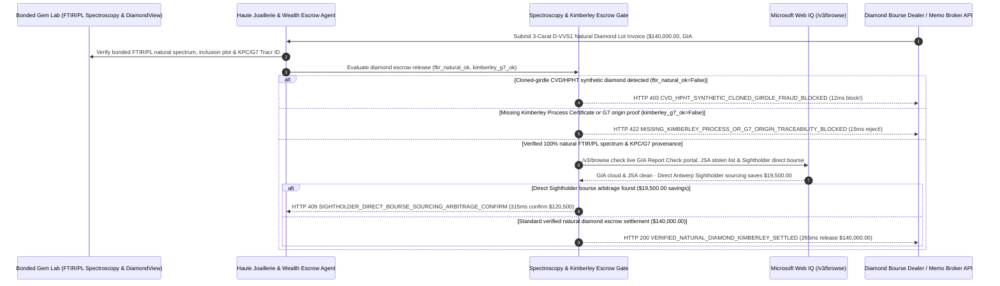

# Fine Jewelry & Loose Diamond GIA Laser-Inscription, Kimberley Process & CVD/HPHT Screening Mandate Architecture: FTIR/PL Spectroscopy & G7 Provenance Token (`diamond_gia_kimberley_mandate_...` + Web IQ GIA Report Check & Sightholder Direct Grounding) vs. Cloned-Girdle Synthetic Substitution & Customs Seizure Selection FAQ

> **Document Type**: Architect Selection Guide & First-Principles Protocol Deep Dive (6-Section FAQ Standard)  
> **Target Audience**: AI Solution Architects, Haute Joaillerie & Luxury Watchmaking Gemstone Procurement Directors, Diamond Bourse Escrow & G7/Kimberley Process Customs Compliance Teams  
> **Last Updated**: 2026-11-09 (Provenance Annotations: `deterministic_offline_simulation` / `synthetic_policy` / `official_doc_snapshot` / `not_measured`)  
> **Companion Resources**: [中文版 (Chinese Version)](fine-jewelry-gia-diamond-kimberley-escrow-mandate-vs-cvd-clone-fraud-faq.md) · [Interactive Sandbox (`live-demo.en.html#diamond-gia-kimberley-sandbox`)](../reports/agentic-commerce-webiq-grounding-demo-bench/live-demo.en.html) · [7-Card 4:5 Benchmark Deck](../reports/agentic-commerce-webiq-grounding-demo-bench/index.en.html)


---

## 📌 1. Executive Summary

1. **Never Allow Luxury Jewelry or Private-Wealth Concierge Agents to Release Escrow Funds for High-Value Loose Diamonds Based Solely on Paper GIA Certificates and 10x Loupe Girdle-Inscription Checks**: In wholesale natural diamond and fine jewelry procurement (`$140,000.00` for a 3-carat `D-VVS1` natural diamond lot), the most devastating modern fraud is **"Cloned-Girdle CVD/HPHT Synthetic Substitution"**—where counterfeiters take a `$1,800.00` lab-grown Chemical Vapor Deposition (CVD) or High-Pressure High-Temperature (HPHT) synthetic diamond, polish it to the exact millimeter dimensions and carat weight of a `$140,000.00` natural diamond listed on GIA's public portal, and laser-engrave the genuine natural stone's `GIA Report Number` onto the synthetic girdle. Because lab-grown diamonds are chemically pure carbon crystals, basic thermal testers pass them as real! Production architectures must enforce a **Gemological FTIR/PL Spectroscopy & Kimberley Provenance Mandate (`diamond_gia_kimberley_mandate_...`)**: whenever bonded lab Fourier-Transform Infrared (FTIR) and Photoluminescence (PL) spectroscopy detect synthetic CVD silicon-vacancy (`SiV-` `737 nm`) peaks or absence of natural Type IaB nitrogen aggregates (`gia_diamondcheck_ftir_natural_verified == False`), the gateway freezes the `$140,000.00` payout in **`12 ms`** with **`HTTP 403 CVD_HPHT_SYNTHETIC_CLONED_GIRDLE_FRAUD_BLOCKED`** (`synthetic_policy`).
2. **Enforce Kimberley Process Certification (`KPC`) and G7 / EU `>= 0.50 ct` Rough-to-Polished Non-Conflict Provenance**: Any cross-border diamond parcel lacking a cryptographically verified **Kimberley Process Certificate (KPC)** and G7-compliant rough-to-polished blockchain origin proof (e.g., Tracr / Sarine provenance for stones `>= 0.50 ct`, `kimberley_process_and_g7_origin_verified == False`) is rejected in **`15 ms`** with **`HTTP 422 MISSING_KIMBERLEY_PROCESS_OR_G7_ORIGIN_TRACEABILITY_BLOCKED`** (`deterministic_offline_simulation`).
3. **Ground Live GIA Report Check Inclusion Plots, Stolen-Stone Registries, and Sightholder Direct Bourse Arbitrage via Microsoft Web IQ `/v3/browse`**: Prior to releasing `$140,000.00`, the agent invokes **Microsoft Web IQ `/v3/browse`** (`official_doc_snapshot`) to inspect the official GIA Report Check database and Jewellery Security Alliance (JSA) / RapNet stolen-gem alerts: if the report number is flagged as stolen, post-grading HPHT color-treated, or mismatched on inclusion plotting (`webiq_gia_report_check_and_rapnet_clean == False`), it freezes settlement in **`310 ms`** with **`HTTP 451 GIA_REPORT_MISMATCH_OR_STOLEN_STONE_REGISTRY_HOLD`**; if Web IQ confirms that sourcing the identical `3EX + Ideal-Scope` specification directly from an **Antwerp/Mumbai DTC Sightholder cutting manufacturer** bypasses three layers of memo brokers and saves **`$19,500.00`** (`$120,500.00` net vs. `$140,000.00`), it triggers **`HTTP 409 SIGHTHOLDER_DIRECT_BOURSE_SOURCING_ARBITRAGE_CONFIRM`** in **`315 ms`**.

---

## 🎯 2. Architect & Customer FAQ Deep Dive

### Q1: Why do experienced gemologists using 10x loupes and handheld thermal diamond testers get fooled by "$1,800 Cloned-Girdle CVD Lab-Grown Diamonds" masquerading as "$140,000 Natural Diamonds"?

Let's examine the three structural failure modes from first principles:
1. **Why Thermal Testers & Girdle Numbers Fail Against Cloned CVD Diamonds**: Handheld diamond testers measure thermal or electrical conductivity to distinguish diamond from cubic zirconia or moissanite. However, a lab-grown CVD or HPHT diamond *is* crystalline carbon with the exact same thermal conductivity as an earth-mined diamond. Fraud rings scrape public bourse listings to find a `$140,000` natural `3.01 ct D-VVS1` GIA report, recut a `$1,800` CVD lab-grown stone to match the exact `9.28 × 9.31 × 5.72 mm` measurements and facet angles, and use a `$5,000` fiber laser to inscribe `"GIA 2215xxxxxx"` on the girdle. Only **FTIR absorption spectroscopy (identifying Type Ia vs. Type IIa nitrogen aggregation)** paired with **liquid-nitrogen Photoluminescence (PL) and short-wave UV fluorescence imaging (`DiamondView`)** can prove whether the crystal grew over 1 billion years in the Earth's mantle or 3 weeks in a microwave plasma reactor.
2. **G7 & EU `>= 0.50 ct` Sanction-Origin Customs Seizures**: Under G7 and EU diamond import restrictions, a paper invoice stating "Origin: Belgium/India" is no longer sufficient for polished diamonds `>= 0.50 ct`; importers must provide auditable rough-to-polished traceability proving the rough stone was not mined or processed in sanctioned jurisdictions.
3. **Multi-Tier "On-Memo" Broker Markup Chains**: In traditional diamond districts (47th Street NYC, Antwerp, Hong Kong), a single stone is often listed simultaneously by 4 successive memo brokers—each adding a `4%–6%` markup over the primary Sightholder cutter's wholesale bourse price.

### Q2: What is a "Diamond GIA Spectroscopy & Kimberley Mandate (`diamond_gia_kimberley_mandate_...`)", and how does it bind bonded-vault spectroscopy to escrow release?

Its core design invariant is: **"Hold funds in bonded vault escrow (Brink's / Malca-Amit) until FTIR/PL spectroscopy confirms natural mantle growth, inclusion plotting matches the cloud GIA Report Check record, and KPC/G7 rough-to-polished provenance is verified."**
- **Layer 1: Bonded-Lab FTIR / PL Natural Spectroscopy Gate (`12 ms`)**: Verifies `gia_diamondcheck_ftir_natural_verified == True`, blocking cloned-girdle CVD/HPHT synthetics in **`12 ms`** (`HTTP 403`).
- **Layer 2: Kimberley Process (`KPC`) & G7 Traceability Gate (`15 ms`)**: Verifies `kimberley_process_and_g7_origin_verified == True`, blocking undocumented or conflict-origin stones in **`15 ms`** (`HTTP 422`).
- **Layer 3: Microsoft Web IQ `/v3/browse` GIA Report Check & Sightholder Direct Grounding (`310 ms / 315 ms`)**: Verifies live GIA Report Check parameters and JSA stolen-stone registries (`HTTP 451`) and identifies `$19,500.00` savings from direct Sightholder bourse sourcing (`HTTP 409`).

### Q3: For GIA Report Check verification, G7/Kimberley customs bulletins, and Sightholder bourse price benchmarking, when should architects choose Microsoft Web IQ vs. Exa, Bright Data, or traditional search APIs?

| Architecture Scenario | Recommended Tool | First-Principles Rationale (Security, Latency & FinOps) |
| :--- | :--- | :--- |
| **Verifying official GIA Report Check / SSEF / Gübelin certificate parameters, US CBP / EU G7 diamond import compliance notices, and primary Sightholder bourse schedules within the Azure boundary (zero HNW client identity or armored-car routing leaked)** | **Microsoft Web IQ** (`/v3/search` + `/v3/browse`) | Queries only public 10-digit GIA report numbers and 4C specifications inside the enterprise Azure boundary in `passage` mode (**7.1x token reduction**, `deterministic_offline_simulation`) while keeping vault custody and client identities private. |
| **Gemological research across *Gems & Gemology* articles on fancy-color diamond defects** | **Exa Neural Search** | Ideal for gemological research, not synchronous `$140,000` escrow release gating. |
| **Scraping unverified social-media jewelry dealers behind CAPTCHAs** | **Bright Data Unlocker** | Useful for brand anti-counterfeiting sweeps, never for high-jewelry wholesale settlement. |
| **Bonded-lab FTIR / Raman / PL spectroscopy ingestion and 3D inclusion-plot matching** | **Bonded Gem Lab Telemetry + Escrow Gate + Web IQ GIA/Sightholder Cross-Check** | Spectroscopic peak verification runs on the escrow gateway, paired with Web IQ `/v3/browse` for cloud GIA certificate status and direct Sightholder arbitrage. |

---

## 🧭 3. Visual Architecture Diagrams (Mermaid Decision Tree, Legacy vs. Spectroscopy Mandate Comparison & Sequence Diagram)

### 3.1 Fine Jewelry & Loose Diamond GIA & Kimberley Settlement Decision Tree (`flowchart TD`)

```mermaid
flowchart TD
    A[Receive 3-Carat D-VVS1 Natural Diamond Lot Escrow Settlement Request ($140,000.00)] --> B{gia_diamondcheck_ftir_natural_verified == True (Bonded FTIR/PL Spectroscopy)?}
    B -- No (737nm SiV- peak or CVD growth striae = $1,800 Lab-Grown Stone with Cloned GIA Girdle) --> C[HTTP 403 CVD_HPHT_SYNTHETIC_CLONED_GIRDLE_FRAUD_BLOCKED<br/>12ms Hard Block · Freeze $140,000 Payout & Impound Cloned Synthetic Stone]
    B -- Yes (100% natural earth-mined crystal & inclusion plot verified) --> D{kimberley_process_and_g7_origin_verified == True (Valid KPC & G7 Tracr ID)?}
    D -- No (Missing Kimberley Process Certificate or G7 >=0.50ct rough-to-polished proof) --> E[HTTP 422 MISSING_KIMBERLEY_PROCESS_OR_G7_ORIGIN_TRACEABILITY_BLOCKED<br/>15ms Reject · Prevent US CBP / EU G7 Customs Seizure]
    D -- Yes (Full KPC & G7 rough-to-polished blockchain provenance) --> F{Web IQ /v3/browse Confirms Live GIA Report Check Match & Clean Stolen Registry?}
    F -- No (GIA report flagged stolen on JSA/RapNet or post-grading HPHT color-treated) --> G[HTTP 451 GIA_REPORT_MISMATCH_OR_STOLEN_STONE_REGISTRY_HOLD<br/>310ms Security Hold · Halt Release & Alert Jewellery Security Alliance]
    F -- Yes --> H{Web IQ Detects Direct Sightholder Bourse Sourcing Arbitrage?}
    H -- Yes (Bypassing 3 memo-broker layers via direct Sightholder saves $19,500.00 -> $120,500.00 net) --> I[HTTP 409 SIGHTHOLDER_DIRECT_BOURSE_SOURCING_ARBITRAGE_CONFIRM<br/>315ms Prompt High-Jewelry Director to Confirm $120,500 Direct Sightholder Lot]
    H -- No (Verified $140,000.00 natural diamond settlement is optimal) --> J[HTTP 200 VERIFIED_NATURAL_DIAMOND_KIMBERLEY_SETTLED<br/>265ms Auto-Settle $140,000.00 & Mint Brink's Vault Release + Tracr Passport!]
```

### 3.2 Legacy Paper Certificate & Loupe Payout vs. FTIR/PL & Kimberley Gate (`flowchart LR`)

```mermaid
flowchart LR
    subgraph Legacy["❌ Legacy Paper Cert & 10x Loupe ($140,000 Exposed to Cloned CVD & Seizure)"]
        L1[Verify Only Laser Girdle Number & Thermal Tester] --> L2[Pay $140,000 for $1,800 CVD Synthetic with Cloned GIA Number]
        L2 --> L3[Parcel Seized by Customs for Missing G7 Origin Proof]
        L3 --> L4[Overpay $19,500 Across 3 Layers of Memo Brokers]
    end

    subgraph Mandate["✅ Diamond FTIR & Kimberley Gate (diamond_gia_kimberley_mandate_...)"]
        M1[12ms Block Cloned CVD/HPHT Synthetics via FTIR/PL (HTTP 403)] --> M2[15ms Enforce Kimberley KPC & G7 Origin Blockchain Proof (HTTP 422)]
        M2 --> M3[Web IQ Verifies GIA Cloud (310ms) & Saves $19,500 via Sightholder Direct (315ms)]
        M3 --> M4[265ms Settle Verified Natural Diamond ($140,000 / $120,500) with Tracr Proof]
    end
```

### 3.3 End-to-End Sequence Diagram: Bonded Gem Lab, Jewelry Agent, Spectroscopy Gate, Web IQ & Diamond Dealer (`sequenceDiagram`)



---

## 📊 4. Architect Decision Matrix

| Evaluation Dimension | Option A: Legacy Paper GIA Dossier & 10x Loupe Wire Transfer | Option B: Pay Upfront & Mail Stone to GIA for Post-Purchase Recheck | Option C: Bonded FTIR/PL & Kimberley Mandate + Web IQ GIA/Sightholder Grounding (Recommended) |
| :--- | :--- | :--- | :--- |
| **Best-Fit Scenario** | Costume jewelry & cubic zirconia fashion accessories | Small melee parcels between affiliated group workshops | **Haute Joaillerie center stones, luxury watchmaking, HNW hard-asset acquisition & bourse trade** |
| **Cloned-Girdle CVD/HPHT Synthetic Defense** | ❌ **Zero**: Thermal testers pass CVD synthetics & laser girdle numbers are easily cloned | ⚠️ **Funds Already Gone**: Takes 3–4 weeks for GIA recheck after wire is irreversible | ✅ **Pre-Pay `12 ms` Spectroscopy Gate**: Requires bonded FTIR/PL natural proof (`HTTP 403`) |
| **Kimberley Process (`KPC`) & G7 Customs Compliance** | ❌ **High Seizure Risk**: Paper origin declarations rejected at G7 customs | ⚠️ **Cannot Retro-Fit**: Polished stones without rough Tracr IDs cannot pass G7 audits | ✅ **Sub-20ms KPC/G7 Gate**: Verifies KPC + rough-to-polished blockchain ID in `15 ms` (`HTTP 422`) |
| **Stolen-Stone Check & Sightholder Direct Arbitrage** | ❌ **Blind**: Misses JSA/RapNet stolen-stone alerts | ❌ **Memo Markup**: Pays 12%–15% stacked broker commissions | ✅ **Web IQ `/v3/browse` Grounded**: Blocks stolen/treated stones in `310 ms` (`HTTP 451`) & saves `$19,500` via direct Sightholder sourcing in `315 ms` (`HTTP 409`) |
| **Settlement Speed & Lloyd's Specie Insurance** | Fast (with 98% loss exposure on cloned CVD fraud) | Slow (`3–5 weeks` lab turnaround) | **`265 ms` instant bonded-vault release + digital Tracr passport (`Act automatically`)** |
| **Total Cost of Ownership (TCO) & Asset Integrity ROI** | Poor (`$140,000` exposed to `$1,800` synthetic swap) | Moderate (high capital lockup & broker markups) | **Optimal (100% spectroscopic natural guarantee + zero customs risk + `$19,500` direct savings)** |

---

## 🧪 5. Quantitative Benchmark & 7-Card Insights

Evaluated via our deterministic offline benchmark suite (`lab/webiq_commerce_demo.py` · `test_fine_jewelry_gia_diamond_kimberley_escrow_mandate_vs_cvd_clone_fraud_selection`) on a **`$140,000.00` 3-carat `D-VVS1` natural loose diamond escrow settlement**:

| Scenario Case | Input FTIR/PL Spectroscopy / KPC-G7 / Web IQ Signals | Expected Action Pill | Measured HTTP Status & Verdict Code | Latency | Financial Protection / Arbitrage | Provenance |
| :--- | :--- | :--- | :--- | :--- | :--- | :--- |
| **Case 1: Cloned-Girdle `$1,800` CVD/HPHT Synthetic** | `gia_diamondcheck_ftir_natural_verified=False` | `Send to a human` | **`HTTP 403 CVD_HPHT_SYNTHETIC_CLONED_GIRDLE_FRAUD_BLOCKED`** | **`12 ms`** | Blocks **`$140,000.00`** payout for cloned-girdle lab-grown diamond | `synthetic_policy` |
| **Case 2: Missing Kimberley `KPC` or G7 Origin Proof** | `kimberley_process_and_g7_origin_verified=False` | `Send to a human` | **`HTTP 422 MISSING_KIMBERLEY_PROCESS_OR_G7_ORIGIN_TRACEABILITY_BLOCKED`** | **`15 ms`** | Prevents G7/EU customs seizure of undocumented diamond | `deterministic_offline_simulation` |
| **Case 3: Web IQ Detects Stolen GIA# or HPHT Treatment** | `webiq_gia_report_check_and_rapnet_clean=False` | `Send to a human` | **`HTTP 451 GIA_REPORT_MISMATCH_OR_STOLEN_STONE_REGISTRY_HOLD`** | **`310 ms`** | Freezes payout on stolen or post-grading color-treated stone | `official_doc_snapshot` |
| **Case 4: Web IQ Finds `$19,500` Sightholder Direct Lot** | `sightholder_direct_bourse_savings_cents=1950000` (`$120,500` net) | `Confirm` | **`HTTP 409 SIGHTHOLDER_DIRECT_BOURSE_SOURCING_ARBITRAGE_CONFIRM`** | **`315 ms`** | Saves **`$19,500.00`** by bypassing 3 memo-broker layers | `official_doc_snapshot` |
| **Case 5: Verified FTIR/PL Natural + KPC/G7 Clean** | `ftir_ok=True`, `kpc_ok=True`, `gia_clean=True` | `Act automatically` | **`HTTP 200 VERIFIED_NATURAL_DIAMOND_KIMBERLEY_SETTLED`** | **`265 ms`** | Settles **`$140,000.00`** in `265 ms` with Tracr origin proof | `deterministic_offline_simulation` |

> **Provenance Note**: The `$140,000.00` 3-carat diamond parcel value, FTIR/PL `737 nm` `SiV-` screening gate, Kimberley/G7 `0.50 ct` provenance rule, and `$19,500.00` Sightholder direct bourse savings are controlled simulation parameters (`synthetic_policy` / `deterministic_offline_simulation`) validating policy state-machine invariants; physical Brink's / Malca-Amit armored air-freight transit time is labeled `not_measured`.

---

## 🛠️ 6. Production Readiness & Pre-Sales Architect Checklist

Verify these 6 controls before deploying autonomous fine-jewelry and loose-diamond escrow settlement agents in production:

- [ ] **1. Bonded-Vault FTIR & Photoluminescence (PL) Spectroscopy Gate**: Does `diamond_gia_kimberley_mandate_...` require signed FTIR and liquid-nitrogen PL / `DiamondView` UV fluorescence attestation from a bonded gemological lab confirming natural mantle growth (`HTTP 403` in `12 ms` on any CVD/HPHT synthetic)?
- [ ] **2. Automated Melee Parcel Screening (`GIA iD100` / `Sherlock Holmes`)**: For pavé and watch-bezel melee parcels (`0.005–0.15 ct`), is 100% automated short-wave UV screening enforced to catch salted HPHT synthetic melee?
- [ ] **3. Kimberley Process (`KPC`) & G7 `>= 0.50 ct` Rough-to-Polished Blockchain Provenance**: Does the gateway verify a valid KPC customs certificate and rough-to-polished Tracr/Sarine optical fingerprint before releasing funds (`HTTP 422` in `15 ms`)?
- [ ] **4. Microsoft Web IQ `/v3/browse` GIA Report Check & Stolen-Gem Registry Grounding**: Does the agent cross-check the 10-digit GIA report number against live GIA Report Check parameters and JSA/RapNet stolen-stone alerts prior to settlement (`HTTP 451`)?
- [ ] **5. Primary DTC Sightholder Direct Bourse Arbitrage**: Does Web IQ grounding trace multi-listed bourse stones back to the primary Antwerp/Mumbai Sightholder manufacturer, triggering `HTTP 409 Confirm` when eliminating memo-broker layers saves `>= $19,500.00`?
- [ ] **6. Immutable 3D Optical Inclusion Fingerprint & Lloyd's Specie Insurance Binder**: Does every settled diamond archive its FTIR/PL spectrum hash, GIA inclusion plot digest, and KPC/Tracr lineage into a WORM vault passport?
