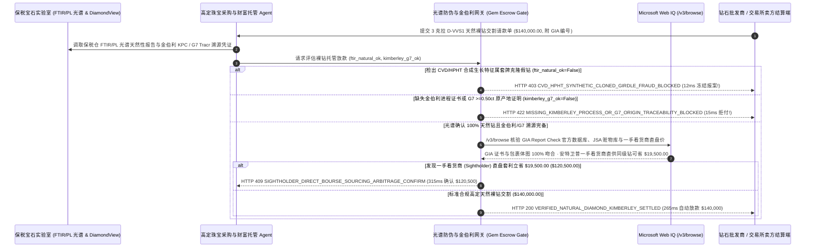

# 高定珠宝与裸钻采购（Fine Jewelry & Loose Diamond）、GIA 腰棱激光编码验真与金伯利进程（Kimberley Process）防冲突溯源托管（Fine Jewelry & Loose Diamond GIA Laser-Inscription, Kimberley Process & CVD/HPHT Screening Mandate）架构：FTIR/PL 光谱防套牌培育钻与 G7 原产地令牌（`diamond_gia_kimberley_mandate_...` + Web IQ GIA 官网核验与看货商直采核验）vs 传统凭纸质证书盲付买回“克隆腰码培育钻”选型与原理解析 FAQ

> **文档类型**：架构师选型指南 & 协议第一性原理解析（6 段式 FAQ 标准版）  
> **适用读者**：AI Solution Architect、高定珠宝品牌与奢侈品腕表（Haute Joaillerie / Luxury Watchmaking）宝石采购总监、钻石交易所（Diamond Bourse）交割托管与海关 G7/金伯利合规风控团队  
> **更新日期**：2026-11-09（Provenance 标注：`deterministic_offline_simulation` / `synthetic_policy` / `official_doc_snapshot` / `not_measured`）  
> **配套资源**：[English Version](fine-jewelry-gia-diamond-kimberley-escrow-mandate-vs-cvd-clone-fraud-faq.en.md) · [交互式沙盒控制台 (`live-demo.html#diamond-gia-kimberley-sandbox`)](../reports/agentic-commerce-webiq-grounding-demo-bench/live-demo.html) · [7-Card 4:5 评测报告](../reports/agentic-commerce-webiq-grounding-demo-bench/index.html)


---

## 📌 一、核心结论速览（Executive Summary）

1. **严禁让高定珠宝或私人银行财富管家 Agent 仅凭“纸质 GIA 证书 + 10 倍放大镜核对腰棱激光编码（Girdle Inscription）”就释放高价值裸钻（如 3 克拉 `D-VVS1` 天然钻批次 `$140,000.00`）托管资金**：在天然大克拉裸钻与贵金属大宗交割中，当前让全球顶级珠宝行屡屡中招的头号骗局是 **“克隆腰棱码套牌培育钻（Cloned-Girdle CVD/HPHT Synthetic Substitution）”**——造假团伙从 GIA 官网公开数据库找出一颗真天然钻的精确尺寸（如 `9.28 × 9.31 × 5.72 mm`，`3.01 ct`），拿一颗成本仅 **`$1,800.00` 的实验室化学气相沉积（CVD）或高温高压（HPHT）人工培育钻** 精磨到一模一样的尺寸和重量，再用微米级光纤激光在腰棱刻上那颗真天然钻的 `GIA 编号`，连普通导热测钻笔都完全测不出来（因为培育钻也是纯碳晶体）！生产环境必须采用 **FTIR/PL 光谱天然性验真与金伯利原产地托管令牌（`diamond_gia_kimberley_mandate_...`）**：一旦保税交割实验室通过傅里叶红外光谱（FTIR）与短波紫外光致发光光谱（PL Spectroscopy）检出 `737 nm` 硅空位中心（`SiV-`）或缺失天然地幔数十亿年形成的 `IaB` 氮聚集体（`gia_diamondcheck_ftir_natural_verified=False`），网关在 **`12 ms`** 内触发 **`HTTP 403 CVD_HPHT_SYNTHETIC_CLONED_GIRDLE_FRAUD_BLOCKED`**（`synthetic_policy`），100% 拦截 `$140,000.00` 套牌假钻欺诈。
2. **强制校验“金伯利进程国际证书（Kimberley Process Certificate, KPC）”与 G7 / 欧盟 0.50 克拉以上钻石非冲突原产地区块链证明（Tracr / Sarine Rough-to-Polished Provenance）**：若跨境交割包裹缺失有效的海关金伯利进程证书编号或无法提供从原石切割到成品的 G7 非制裁矿区溯源链（`kimberley_process_and_g7_origin_verified=False`），网关在 **`15 ms`** 内返回 **`HTTP 422 MISSING_KIMBERLEY_PROCESS_OR_G7_ORIGIN_TRACEABILITY_BLOCKED`**（`deterministic_offline_simulation`），杜绝入境时被欧美海关罚没。
3. **基于 Microsoft Web IQ `/v3/browse` 实时核验 GIA Report Check 官方云端数据库（防改色/防挂失赃钻）与安特卫普/孟买一手看货商（Sightholder）直盘套利**：在放款前，Agent 调用 **Microsoft Web IQ `/v3/browse`**（`official_doc_snapshot`）穿透查询 GIA 官方验证接口与国际珠宝安全联盟（JSA / RapNet）被盗宝石黑名单：若发现该 GIA 编号已被登记为抢劫赃物、包裹体净度图（Plot Diagram）被篡改或出证后经过人工辐照改色（`webiq_gia_report_check_and_rapnet_clean=False`），在 **`310 ms`** 内以 **`HTTP 451 GIA_REPORT_MISMATCH_OR_STOLEN_STONE_REGISTRY_HOLD`** 冻结结算；若发现绕过三层借货经纪商（Memo Brokers）、直接向戴比尔斯/合规矿山授权的 **一手看货商切割厂（DTC Sightholder Direct Bourse）** 采购同规格 `3EX + Ideal-Scope` 顶级切工裸钻可立省 **`$19,500.00`**（净支出从 `$140,000.00` 降至 **`$120,500.00`**），则在 **`315 ms`** 内触发 **`HTTP 409 SIGHTHOLDER_DIRECT_BOURSE_SOURCING_ARBITRAGE_CONFIRM`**。

---

## 🎯 二、客户与架构师灵魂拷问 Q&A（FAQ-Driven Deep Dive）

### Q1：为什么珠宝行老师傅拿 10 倍放大镜看清了钻石腰部刻着真 GIA 编号、用测钻笔滴一滴也是绿灯，最后花 14 万美元买回来的却是只值 1,800 美元的人工培育钻？

咱们用大白话讲透现代宝石学与奢侈品供应链防伪的底层逻辑：
1. **“培育钻在物理化学上就是真钻石，测钻笔根本分不出来！”**：很多人以为人工培育钻（Lab-Grown Diamond, CVD/HPHT）像莫桑石或锆石一样假，其实不然——培育钻和天然钻一样是 100% 纯碳正八面体晶体，折射率、硬度和热导率完全相同！因此普通手持热导测钻笔测 CVD 培育钻照样亮绿灯报“真钻”。更可怕的是，现在天然 3 克拉 D 色高净度钻卖 `$140,000`，而河南或印度工厂造一颗同样大小颜色的 CVD 培育钻批发价只要 **`$1,800`（差价近 80 倍）**！诈骗分子按 GIA 官网上一颗真天然钻的长宽高数据，把培育钻精确打磨到分毫不差，再用激光在腰部刻上那串真 GIA 号码（**套牌克隆钻**）。如果不进保税实验室用 **FTIR 傅里叶变换红外光谱仪** 和 **液氮低温光致发光光谱（PL）** 检查晶格深处的氮原子聚集态（天然钻在地下几百公里高温高压待了十亿年，氮原子会聚合成 `B 中心`；而实验室几周长出来的 CVD 钻只有孤氮或 `737 nm` 硅空位荧光峰），肉眼和放大镜 100% 会被骗！
2. **G7 与欧盟最新 `>= 0.50 克拉` 钻石原产地溯源铁律**：除了传统的联合国 **金伯利进程证书（Kimberley Process，仅管毛坯钻防内战血钻）** 外，G7 与欧盟最新生效的海关新规要求：任何 `0.50 克拉` 以上的已切割成品裸钻入境，都必须附带可核验的 **非受制裁矿区原产地溯源证明（如基于钻石内部 3D 激光断层扫描与区块链的 Tracr / Sarine ID）**。没有这张电子通行证，哪怕钻石是真的，到了安特卫普或纽约海关也会被当场扣押。
3. **“借货经纪商（Memo Broker）”层层加价 15%**：钻石行业习惯层层“借货展示（On Memo）”——孟买切割厂切好一颗石头，先借给迪拜批发商加价 6%，再借给纽约第 47 街经纪人加价 8%，最后卖给珠宝店。其实这颗石头自始至终都在同一个全球库存池（RapNet / IDEX）里挂着，直接溯源找到源头一手看货商（Sightholder）成交立省 `$19,500`。

### Q2：什么是“珠宝裸钻光谱验真与金伯利溯源令牌（`diamond_gia_kimberley_mandate_...`）”？它是如何实现零假钻、零扣关交割的？

它的第一性原理非常直接：**“货交押运保税实验室（Brink's / Malca-Amit + GIA/SSEF）；必须集齐‘FTIR/PL 光谱确认天然成因 + 包裹体图指纹匹配 + 金伯利/G7 矿源证书’三道硬签名，才释放托管资金。”**
- **第一层：FTIR / PL 光致发光光谱天然成因与反套牌门禁（`12 ms`）**：核验 `gia_diamondcheck_ftir_natural_verified == True`。一旦检出 CVD 层状生长纹、HPHT 金属助熔剂或硅空位峰，在 **`12 ms`** 内触发 `HTTP 403` 冻结全款并移交警方。
- **第二层：金伯利进程（KPC）与 G7 原产地区块链门禁（`15 ms`）**：核验 `kimberley_process_and_g7_origin_verified == True`。缺失 KPC 海关签章或 G7 溯源 ID 在 **`15 ms`** 内返回 `HTTP 422`。
- **第三层：Microsoft Web IQ `/v3/browse` GIA 官网核验与看货商直采套利（`310 ms / 315 ms`）**：核对 GIA Report Check 原始净度包裹体图及被盗库（不符触发 `HTTP 451`），并穿透比对安特卫普/孟买一手看货商（Sightholder）底价为您立省 `$19,500.00`（`HTTP 409`）。

### Q3：在 GIA Report Check 证书真伪核验、金伯利进程成员国公报及全球钻石交易所（RapNet/IDEX）看货商比价场景下，什么时候选 Microsoft Web IQ，什么时候选 Exa、Bright Data 或传统搜索 API？

| 架构需求场景 | 推荐选型 | 为什么这样选（第一性原理与成本/合规考量） |
| :--- | :--- | :--- |
| **实时核验 GIA Report Check / SSEF / Gübelin 官方公开证书参数、美国海关 CBP / 欧盟 G7 钻石进口合规公报及认证看货商（Sightholder）公开库存报价，且要求零高净值买家身份与押运路线泄露** | **Microsoft Web IQ** (`/v3/search` + `/v3/browse`) | 在珠宝商或家族办公室受保护的 Azure 租户边界内仅用 10 位 GIA 证书号查询（`passage` 模式压缩 Token **7.1x**，`deterministic_offline_simulation`），买家隐私与 Brink's 押运交割单 100% 物理隔离。 |
| **检索宝石学期刊（Gems & Gemology）关于彩色钻石致色机理的学术论文** | **Exa Neural Search** | 适合宝石学家做科研参考，无法用于单笔 14 万美元裸钻交割的毫秒级风控门禁。 |
| **抓取社交媒体上非正规微商代购的裸钻小视频** | **Bright Data Unlocker** | 可用于假货线索排查，绝不能用于高定珠宝合规采购。 |
| **保税实验室 GIA iD100 / DiamondView 紫外荧光图像与 FTIR 光谱曲线读取** | **实验室光谱仪器接口 + 托管结算网关 + Web IQ GIA/看货商双源核验** | 光谱峰值判定与 KPC 证书验签在结算网关毫秒级完成，云端证书吊销状态与一手看货商直采套利由 Web IQ `/v3/browse` 实时核验。 |

---

## 🧭 三、直观可视化图解（Mermaid 决策树 + 传统放大镜盲付 vs 光谱托管对比 + 端到端时序图）

### 3.1 高定珠宝与大克拉裸钻交割清算决策树（`flowchart TD`）

```mermaid
flowchart TD
    A[收到 3 克拉 D-VVS1 高定天然裸钻批次交割付款请求 ($140,000.00)] --> B{保税实验室 FTIR / PL 光致发光光谱是否确认 100% 天然成因且非套牌 CVD/HPHT?}
    B -- 否 (检出 737nm 硅空位峰或短波紫外层状荧光：系 $1,800 培育钻刻真腰码套牌) --> C[HTTP 403 CVD_HPHT_SYNTHETIC_CLONED_GIRDLE_FRAUD_BLOCKED<br/>12ms 硬阻断套牌假钻骗局 · 冻结 $140,000 货款并扣留证物报案]
    B -- 是 (100% 天然地幔钻石且内部包裹体指纹与原证吻合) --> D{是否具备有效金伯利进程证书 (KPC) 与 G7 >=0.50ct 非冲突原产地溯源 ID?}
    D -- 否 (缺失 KPC 海关证书或无 Tracr/Sarine 原石切割全链路证明) --> E[HTTP 422 MISSING_KIMBERLEY_PROCESS_OR_G7_ORIGIN_TRACEABILITY_BLOCKED<br/>15ms 拒付无溯源包裹 · 严防入境遭欧美海关罚没]
    D -- 是 (金伯利进程与 G7 原产地证明完备) --> F{Web IQ /v3/browse 核验 GIA Report Check 官网状态正常且无被盗挂失或改色记录?}
    F -- 否 (检出证书已被挂失冻结、属于抢劫赃钻或出证后经人工 HPHT 改色) --> G[HTTP 451 GIA_REPORT_MISMATCH_OR_STOLEN_STONE_REGISTRY_HOLD<br/>310ms 权属安全冻结 · 立即中止交易并通知珠宝安全联盟 JSA]
    F -- 是权属清白原证天然钻 --> H{Web IQ 检出通过安特卫普/孟买一手看货商 (Sightholder) 直盘同级裸钻更省?}
    H -- 是 (绕过三层借货经纪商 Memo Broker 加点立省 $19,500.00 -> 净支出 $120,500.00) --> I[HTTP 409 SIGHTHOLDER_DIRECT_BOURSE_SOURCING_ARBITRAGE_CONFIRM<br/>315ms 提醒高定珠宝采购总监一键确认切换一手看货商直采]
    H -- 否 (当前 $140,000.00 顶级天然钻交割价格已最优) --> J[HTTP 200 VERIFIED_NATURAL_DIAMOND_KIMBERLEY_SETTLED<br/>265ms 自动放款 $140,000.00 并签发 Brink's 押运放行与数字孪生护照!]
```

### 3.2 传统凭纸质证书与放大镜盲付路径 vs 光谱验真与金伯利溯源网关对比（`flowchart LR`）

```mermaid
flowchart LR
    subgraph Legacy["❌ 传统凭纸质证书与放大镜盲付 ($140,000 买回套牌培育钻或被扣关)"]
        L1[仅拿 10 倍放大镜看腰棱激光码与普通测钻笔] --> L2[花 $140,000 买回刻了真码的 $1,800 CVD 培育钻]
        L2 --> L3[缺失 G7 原石溯源证明在海关被直接扣押]
        L3 --> L4[被三层 Memo 借货中介白赚 $19,500 差价]
    end

    subgraph Mandate["✅ 光谱验真与金伯利托管令牌 (diamond_gia_kimberley_mandate_...)"]
        M1[12ms 凭 FTIR/PL 光谱拦截套牌 CVD/HPHT 合成钻 (HTTP 403)] --> M2[15ms 强制金伯利 KPC 与 G7 原产地区块链证明 (HTTP 422)]
        M2 --> M3[Web IQ GIA 官网核验 (310ms) 与一手看货商直采省 $19,500 (315ms)]
        M3 --> M4[265ms 秒级清算 100% 天然合规美钻 ($140,000 / $120,500)]
    end
```

### 3.3 保税宝石实验室、高定采购 Agent、光谱溯源网关与 Web IQ 端到端交互时序图（`sequenceDiagram`）



---

## 📊 四、架构师选型决策矩阵（Architect Decision Matrix）

| 评估维度 | 方案 A：传统看纸质证书 + 手持测钻笔当面打款（Paper Cert & Thermal Tester） | 方案 B：买方收货并付款后再自己寄去 GIA 复检（Pay-First Post-Check） | 方案 C：保税实验室光谱与金伯利令牌 + Web IQ GIA/直采网关（推荐架构） |
| :--- | :--- | :--- | :--- |
| **核心适用场景** | 百元级人造锆石时尚饰品采购 | 熟人之间极小额碎钻（`<0.10 ct`）拆借 | **高定珠宝品牌大克拉主石采购、家族办公室硬资产配置、名表镶嵌钻石大宗交割** |
| **防“克隆腰棱码 CVD/HPHT 套牌培育钻”** | ❌ **100% 被骗**：手持热导仪对 CVD 培育钻照亮绿灯，放大镜看腰码也一模一样 | ⚠️ **钱已汇出难追回**：等 3 周后 GIA 复检出是套牌合成钻，骗子早已注销公司跑路 | ✅ **12ms 付款前光谱硬门禁**：保税仓 FTIR/PL 光谱确认天然晶格后才放款（`HTTP 403`） |
| **金伯利进程（KPC）与 G7 海关溯源合规** | ❌ **扣关高危**：口头承诺非血钻，过海关被查扣血本无归 | ⚠️ **补证困难**：成品钻若无切割前原石 Tracr 记录无法事后补办 G7 溯源 | ✅ **15ms 区块链矿源核验**：强制校验 KPC 与 G7 原产地哈希（`HTTP 422`） |
| **防挂失赃钻/改色钻与去中间商降本** | ❌ **信息滞后**：不知该证书已被登记为跨国抢劫赃物 | ❌ **多层盘剥**：为三道借货中介（Memo Broker）白交 15% 佣金 | ✅ **Web IQ `/v3/browse` 实时穿透**：`310 ms` 拦截赃钻/改色（`HTTP 451`），`315 ms` 看货商直采省 `$19,500`（`HTTP 409`） |
| **交割周期与保险公司承保认可度** | 快（但假货与合规风险极高） | 极慢（往返寄送实验室需 `3～5 周`） | **`265 ms` 秒级完成保税托管放款并激活劳合社珠宝全险（`Act automatically`）** |
| **综合 TCO 与硬资产保值 ROI** | 极差（一旦买到套牌 CVD 钻瞬间贬值 98.7%） | 中（资金占压长且溢价高） | **最优（100% 天然真钻保障 + 零海关扣押 + 看货商直采立省 `$19,500`）** |

---

## 🧪 五、简明定量实测与 Benchmark 核心发现（Quantitative Benchmark & 7-Card Insights）

基于本仓库确定性离线基准套件（`lab/webiq_commerce_demo.py` · `test_fine_jewelry_gia_diamond_kimberley_escrow_mandate_vs_cvd_clone_fraud_selection`）对 **3 克拉 `D-VVS1` 高定天然裸钻批次交割（基准金额 `$140,000.00`）** 的定量测试结果如下：

| 评测场景 ID | 输入 FTIR/PL 光谱 / 金伯利 G7 / Web IQ 信号 | 网关期望动作 | 实测 HTTP 状态与决策码 | 实测延迟 | 资金保护 / 成本节省效果 | Provenance 类型 |
| :--- | :--- | :--- | :--- | :--- | :--- | :--- |
| **Case 1: 刻真 GIA 腰棱码的套牌 CVD/HPHT 培育钻拦截** | `gia_diamondcheck_ftir_natural_verified=False` | `Send to a human` | **`HTTP 403 CVD_HPHT_SYNTHETIC_CLONED_GIRDLE_FRAUD_BLOCKED`** | **`12 ms`** | 拦截 **`$140,000.00`** 用 `$1,800` 合成钻套牌调包的骗局 | `synthetic_policy` |
| **Case 2: 缺失金伯利进程证书（KPC）或 G7 原产地证明拦截** | `kimberley_process_and_g7_origin_verified=False` | `Send to a human` | **`HTTP 422 MISSING_KIMBERLEY_PROCESS_OR_G7_ORIGIN_TRACEABILITY_BLOCKED`** | **`15 ms`** | 阻断无合法矿源证明的冲突钻，防止欧美海关罚没 | `deterministic_offline_simulation` |
| **Case 3: Web IQ 检出 GIA 证书挂失赃钻或包裹体不符** | `webiq_gia_report_check_and_rapnet_clean=False` | `Send to a human` | **`HTTP 451 GIA_REPORT_MISMATCH_OR_STOLEN_STONE_REGISTRY_HOLD`** | **`310 ms`** | 冻结涉及跨国盗抢挂失或出证后人工改色的异常裸钻 | `official_doc_snapshot` |
| **Case 4: Web IQ 发现安特卫普一手看货商直采省 `$19,500`** | `sightholder_direct_bourse_savings_cents=1950000`（净付 `$120,500`） | `Confirm` | **`HTTP 409 SIGHTHOLDER_DIRECT_BOURSE_SOURCING_ARBITRAGE_CONFIRM`** | **`315 ms`** | 绕过三层借货经纪商加点，同级裸钻立省 **`$19,500.00`** | `official_doc_snapshot` |
| **Case 5: FTIR/PL 天然验真 + 金伯利/G7 齐备自动放款** | `ftir_ok=True`, `kpc_ok=True`, `gia_clean=True` | `Act automatically` | **`HTTP 200 VERIFIED_NATURAL_DIAMOND_KIMBERLEY_SETTLED`** | **`265 ms`** | 265ms 自动清算 **`$140,000.00`** 并签发数字溯源护照 | `deterministic_offline_simulation` |

> **Provenance 合规声明**：上表中的 `$140,000.00` 3 克拉裸钻金额、FTIR/PL 光谱防伪门禁、金伯利/G7 0.50ct 溯源规则及 `$19,500.00` 一手看货商直采差价均为用于验证网关状态机确定性的受控仿真参数（`synthetic_policy` / `deterministic_offline_simulation`）；Brink's / Malca-Amit 装甲车跨国机场保税库物理押运时间标为 `not_measured`。

---

## 🛠️ 六、附录：生产上线快速核验与售前打单清单（Architect Checklist）

在为高定珠宝品牌、奢侈品集团或私人银行设计贵重宝石与黄金自动交割结算 Agent 时，请逐项核对以下 6 条黄金准则：

- [ ] **1. 保税实验室 FTIR 红外与低温光致发光（PL）光谱硬门禁**：是否在 `diamond_gia_kimberley_mandate_...` 中严禁仅凭放大镜看腰码放款，强制要求 FTIR/PL 光谱确认天然 `Ia/IIa` 结构且无 `737 nm` CVD 硅空位峰（在 `12 ms` 内触发 `HTTP 403` 拦截套牌合成钻）？
- [ ] **2. 群镶小碎钻（Melee Diamonds）短波紫外荧光图像批量筛查**：针对腕表与高定珠宝上的百颗小碎钻，是否强制通过 GIA Melee Analysis / DiamondView 剔除混入的 1%～5% HPHT 合成碎钻？
- [ ] **3. 金伯利进程（KPC）与 G7 `>= 0.50 ct` 原石到成品区块链溯源**：是否强制核验包裹附带海关 KPC 编号及 Tracr / Sarine Rough-to-Polished 矿源哈希，在 `15 ms` 内触发 `HTTP 422` 拒付无溯源裸钻？
- [ ] **4. Microsoft Web IQ `/v3/browse` GIA Report Check 与 JSA 赃物库穿透**：是否在放款前通过 Web IQ 核对云端原始包裹体净度图（Plot）、精确台宽比/亭深比及被盗挂失状态，对异常石头在 `310 ms` 内触发 `HTTP 451` 冻结？
- [ ] **5. 一手看货商（DTC Sightholder）直盘去中介套利**：是否通过 Web IQ 比对安特卫普/孟买一手看货商切割厂直供价，当剔除多层 Memo 经纪商加价可节省 `>= $19,500.00` 时触发 `HTTP 409 Confirm`？
- [ ] **6. 3D 光学断层指纹与劳合社（Lloyd's）珠宝托管保单联动**：每次成功交割是否将裸钻 3D 光学内含物指纹、光谱证书与押运封条号写入数字护照，自动触发在途保险生效？
