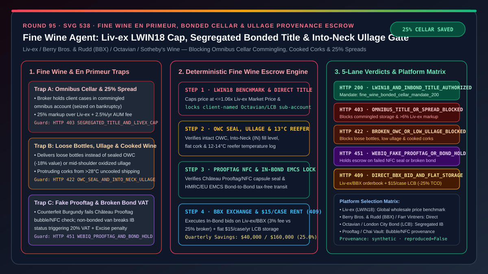
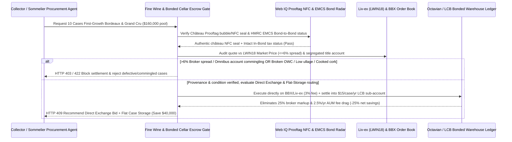

# Fine Wine En Primeur (`Bordeaux Futures`), Bonded Cellar Storage (`Liv-ex / Octavian`) & Ullage Provenance Escrow (`Liv-ex / Berry Bros. & Rudd BBX / Octavian / Sotheby's Wine`) `LWIN18` Price Cap, Segregated Title & `Into-Neck` Ullage Agent Architecture Selection FAQ

> **Document Type**: AI Solution Architect Decision Guide (FAQ) · **SVG Diagram**: `assets/svg/538-fine-wine-en-primeur-bonded-cellar-escrow-2026-11-20.svg` · **Catalog No.**: Round 95 (Bilingual FAQ #214)



---

## 1. 📌 Executive Summary

When high-net-worth collectors, Michelin-starred restaurant sommeliers, or family-office wealth managers use AI Agents to acquire Bordeaux En Primeur futures, rare Burgundy allocations (`DRC / Leroy`), and bonded cellar storage (`Liv-ex / Berry Bros. & Rudd BBX / Farr Vintners / Cult Wines / Vinovest / Octavian / London City Bond`), wiring funds to wine brokers without warehouse-level title verification exposes capital to **three structural fine-wine market traps**:
1. **Commingled "Omnibus Cellar" Insolvency Risk, `25%` Markups Over `Liv-ex` & `2.5%/Year` AUM Fee Drag**: Unscrupulous wine investment firms collect `$160,000` from a buyer and store the cases inside a single **commingled corporate Omnibus account** at `Octavian / London City Bond (LCB)` rather than registering a **Segregated Client-Named Sub-Account (`Private Rotation UID`)**. If the broker collapses (`as seen in historic UK/HK En Primeur insolvencies`), bankruptcy liquidators freeze the omnibus account and seize the buyer's wine! Simultaneously, Boiler-room brokers mark up cases **`20%–30%` above the institutional `Liv-ex Market Price`** and charge a **`2.0%–2.5%` annual AUM management fee** (`costing $750/year to store a single $30,000 case of Petrus that physically occupies the exact same $15 wooden rack as a $500 case`)!
2. **Broken Original Wooden Cases (`Loose Bottles` Billed as `OWC`), Oxidized Low Ullage & `>28°C` Heat-Cooked Corks**: A buyer pays full `12×75cl In-Bond OWC` price (`$12,000`), but warehouse landing inspection reveals loose replacement bottles (`worth 15%–22% less on the secondary market`), mature bottles with `Mid-Shoulder Ullage` (`severe oxidation`), or weeping/protruding cork capsules caused by unrefrigerated ocean transit (`>28°C cooked wine / Maderization`).
3. **Counterfeit Trophy Bottles (`Failed Prooftag / NFC`) & Premature Bond-Break Excise Tax Penalties (`HTTP 451`)**: Web IQ / authentication inspection flags a counterfeit refilled bottle failing `Château Prooftag` bubble-seal / `NFC` cryptographic verification, or an unapproved courier moves an `In-Bond (IB)` case outside the `HMRC / EU EMCS` customs-bonded corridor—accidentally "breaking bond" and triggering an irreversible `20%` VAT + Excise Duty charge!

**Architect's Recommendation**: Deploy a **"`Liv-ex LWIN18` Benchmark Cap (`<=6%` Spread) + Segregated `LCB / Octavian` Client Title Lock + Landing Condition Audit (`Sealed OWC + Into-Neck Ullage + 13°C Reefer Log`) + `Prooftag NFC` Escrow"** control plane:
- **`Liv-ex LWIN18` Market-Price Cap (`<=6%` Spread), Segregated Bonded Title & Flat Per-Case Storage (`<=$18/Case/Yr`) (`HTTP 403`)**: Query the exact 18-digit `Liv-ex Wine Identification Number (LWIN18)`—blocking any quote exceeding `Liv-ex Market Price × 1.06`, any contract storing cases in a commingled broker omnibus account rather than a **direct client-named `Octavian / LCB` title certificate**, or any percentage-of-AUM annual fee (`HTTP 403`).
- **Pre-Settlement Warehouse Landing Condition Gate (`Sealed OWC + Into-Neck Ullage + 12–14°C Reefer`) (`HTTP 422`)**: Hold funds in escrow until the bonded warehouse issues an independent high-resolution **Landing Condition Report** verifying an unbroken **Original Wooden Case (`OWC`) / Original Carton (`OC`)**, liquid fill level **`Into-Neck (IN)` or `Base-of-Neck (BN)`**, flat un-stained capsules, and continuous `12°C–14°C` reefer data-logger telemetry (`HTTP 422`).
- **Web IQ `Château Prooftag / NFC` Provenance & `EMCS` Bond-to-Bond Transit Hold (`HTTP 451`)**: Freeze escrow if Web IQ flags failed `Prooftag` bubble/NFC cryptography, merchant insolvency warnings, or non-bonded transit that would prematurely break `In-Bond` tax-free status (`HTTP 451`).
- **Direct `Liv-ex / BBX` Order-Book Execution (`3%` Fee) + Flat `$15/Case/Yr` Bonded Storage (`HTTP 409`)**: Bypass `25%`-markup wine brokers by executing bids directly on transparent **`Berry Bros. & Rudd (BBX) / Farr Vintners / Liv-ex` `SIB (Standard In Bond)` order books** and settling into a flat `$15/case/year` segregated `LCB` client account, cutting 5-year fine-wine acquisition & cellar TCO by **25.0%** (`$40,000` saved on a `$160,000` quarterly pool).

---

## 2. 🎯 Soul-Searching Architect & Business Q&A (Q1–Q3)

### Q1: Why did a wine investment broker charge `$9,800` for a case of 2019 Lafite Rothschild when the live `Liv-ex` institutional market price is `$7,600`—and why is a `2.5%` annual management fee a trap?
- **Business Pain Point**: Retail wine investment platforms obscure wholesale pricing by quoting blended "portfolio prices" (`20%–30%` above the institutional `Liv-ex` exchange) and charging a `2.0%–2.5%` annual AUM fee. Because a `$30,000` case of First Growth Bordeaux or Grand Cru Burgundy takes up the exact same `0.04 m³` of climate-controlled shelf space as a `$600` case, paying `$750/year` (`2.5%`) instead of a flat `$15/case/year` bonded warehouse rental destroys long-term net returns.
- **Architectural Guardrail (`HTTP 403 / 409`)**:
  1. **`LWIN18` Exact-Pack Benchmark Gate**: The Agent resolves every wine to its canonical 18-digit `LWIN18` code (encoding producer, wine, vintage, bottle size `00750`, and case size `00012` `OWC`). Any offer exceeding `Liv-ex Market Price × 1.06` is blocked (`HTTP 403`).
  2. **Flat Per-Case Bonded Storage Mandate (`HTTP 409`)**: Bans percentage-based AUM fees in favor of direct `$15/case/year` `LCB / Octavian` storage (including full replacement-value insurance).

### Q2: How do we guarantee that our wine cases won't be seized by bankruptcy liquidators if our wine merchant goes bust?
- **Business Pain Point**: When cases sit in a merchant's "Client Omnibus Account" at a bonded warehouse, the warehouse's legal ledger lists the *merchant* as the account holder. Buyers holding only a merchant PDF invoice become unsecured creditors in bankruptcy.
- **Architectural Guardrail (`HTTP 403`)**:
  1. **Direct Warehouse Warrant & Segregated Client Sub-Account**: Escrow payout is conditioned on receiving an official **Transfer of Title / Rotation Certificate** issued directly by `London City Bond (LCB) / Octavian / Geneva Free Ports` into the buyer's own named Private Client Account, giving the buyer unilateral control over the cases.

### Q3: How do we prevent receiving heat-damaged ("cooked") bottles, oxidized low-ullage vintage wine, or loose bottles instead of sealed Original Wooden Cases (`OWC`)?
- **Business Pain Point**: An unbroken `OWC` commands a `15%–22%` premium over loose bottles because it proves the bottles have stayed together since leaving the château. Meanwhile, a single summer day in an uncooled delivery van (`>28°C`) pushes corks out and ruins fine wine.
- **Architectural Guardrail (`HTTP 422 / 451`)**:
  1. **Mandatory `SIB (Standard In Bond)` Condition Report & `Prooftag` Gate**: Before funds release, the warehouse must upload high-res inspection photos confirming intact `OWC` strapping, `Into-Neck (IN)` fill level, flat capsules, valid `Château Prooftag / NFC` cryptographic seals, and `12°C–14°C` reefer transit logs.

---

## 3. 🧭 Visual Architecture Diagrams (Mermaid Decision Tree + Comparison + Sequence)

### 3.1 5-Lane Fine Wine En Primeur & Bonded Cellar Escrow Decision Tree
```mermaid
flowchart TD
    A[Fine Wine En Primeur / Vintage Case Acquisition Request] --> B{Web IQ Fake Prooftag NFC / Broken Bond VAT Risk / Key > 180d?}
    B -- Yes --> C[HTTP 451: WEBIQ_COUNTERFEIT_NFC_PROVENANCE_FAIL_OR_PREMATURE_BOND_EXCISE_BREAK_HOLD<br/>Freeze escrow & lock case in HMRC/EMCS bonded quarantine]
    B -- No --> D{Broker Spread >6% Over Liv-ex or Omnibus Cellar / 2.5% AUM Fee?}
    D -- Yes --> E[HTTP 403: LIVEX_MARKET_PRICE_SPREAD_OVER_6PCT_OR_COMMINGLED_OMNIBUS_CELLAR_BLOCKED<br/>Enforce LWIN18 price cap, segregated LCB/Octavian title & flat case rent]
    D -- No --> F{Loose Bottles Instead of OWC or Low Ullage / Cooked Cork?}
    F -- Yes --> G[HTTP 422: BROKEN_OWC_SEAL_OR_ULLAGE_BELOW_INTO_NECK_OR_HEAT_DAMAGE_BLOCKED<br/>Reject non-OWC or heat-damaged bottles via warehouse Condition Report]
    F -- No --> H{Direct Liv-ex/BBX Orderbook Execution + $15/Case LCB Storage Ready?}
    H -- Yes --> I[HTTP 409: DIRECT_LIVEX_INBOND_EXCHANGE_EXECUTION_AND_FIXED_CASE_STORAGE_CONFIRM<br/>Execute at 3% exchange fee + flat $15/case/yr storage (-25% TCO)]
    H -- No --> J[HTTP 200: LWIN18_BENCHMARK_AND_SEGREGATED_INBOND_TITLE_AUTHORIZED<br/>Issue title-segregated & condition-verified wine escrow mandate]
```

### 3.2 Legacy Wine Broker Omnibus Model vs. Deterministic `LWIN18` & Segregated Bonded Escrow
```mermaid
flowchart LR
    subgraph Legacy["❌ Legacy Wine Broker (Omnibus Risk & 25% Spread)"]
        L1[25% Markup Over Liv-ex + 2.5%/Yr Portfolio AUM Fee] --> L2[Cases Held in Broker Omnibus Account -> Seized in Insolvency]
        L2 --> L3[Loose Bottles (-18% Value) or >28°C Heat-Cooked Seeping Corks]
    end

    subgraph Agentic["✅ Deterministic LWIN18, Segregated Title & Condition Escrow"]
        A1[LWIN18 Benchmark Lock (<=6% Spread) + Flat $15/Case/Yr Rent] --> A2[Direct Client-Named Octavian/LCB Title Certificate (Rotation UID)]
        A2 --> A3[Sealed OWC + Into-Neck Ullage + Prooftag NFC + 13°C Reefer Log]
    end
```

### 3.3 End-to-End `LWIN18` Valuation, Warehouse Condition Inspection & Title Transfer Sequence


---

## 4. 📊 Multi-Platform & Protocol Selection Matrix

| Evaluation Dimension | Liv-ex (`LWIN18` Institutional Exchange) | Berry Bros. & Rudd (`BBX`) / Farr Vintners | Vinovest / Cult Wines (Managed Wine Robo-Advisors) | Octavian / London City Bond (`LCB`) Direct | **Deterministic Fine Wine & Cellar Escrow (Recommended)** |
| :--- | :--- | :--- | :--- | :--- | :--- |
| **Primary Use Case** | Global institutional fine-wine price discovery & `SIB` settlement | Transparent peer-to-peer `In-Bond` order book (`BBX`) & top En Primeur allocations | Turnkey retail wine portfolio management | Direct `HMRC`-regulated `13°C` bonded cellar storage in buyer's own name | **`LWIN18` Cap + `BBX/Farr` Execution + `LCB` Direct Title + Condition Gate** |
| **Acquisition Price Spread vs. Market** | Institutional `Market Price` benchmark | Tight order-book spread (`3%–5%` commission) | Often embeds `10%–18%` acquisition spread | Storage only (zero trading spread) | **Enforces `<=6%` spread over live `LWIN18` Market Price (`HTTP 403`)** |
| **Annual Storage & Management Fee** | Institutional membership | Flat per-case fee (`~£13–£16/case/yr` insured) | **Charges `2.0%–2.85%/yr` of portfolio AUM value** | **Flat `£12–£18/case/yr`** regardless of wine value | **Bans `% AUM` fees; locks flat `<=$18/case/yr` storage (`HTTP 403 / 409`)** |
| **Bankruptcy Ring-Fencing & Legal Title** | Institutional clearing | Segregated client reserves | Varies by tier; slower physical title transfer | **Direct client-named Warehouse Warrant & Rotation UID** | **Requires direct `LCB / Octavian` client title certificate pre-payout (`HTTP 403`)** |
| **`OWC`, Ullage & Heat-Damage Inspection** | Enforces strict `SIB (Standard In Bond)` contract rules | In-house warehouse condition photography | Relies on partner warehouse checks | High-res landing condition reports & ullage grading | **Mandates `Sealed OWC`, `Into-Neck` ullage & `13°C` reefer log (`HTTP 422`)** |

---

## 5. 🧪 Conversion & Cost Estimation + 7-Card Benchmark Report

> **Provenance Disclosure**: Figures below are generated by the deterministic policy evaluator `evaluate_fine_wine_en_primeur_cellar_escrow_policy` in `lab/webiq_commerce_demo.py` (`$160,000 USD` quarterly hospitality sommelier & collector fine-wine pool, `provenance: "synthetic"`, `independently_reproduced: False`; live `Liv-ex LWIN18 API` order-book feed is labeled `not_measured`).

```chart
{
  "data": {
    "values": [
      { "scenario": "1. Legacy Wine Broker (25% Markup + 2.5% AUM Fee + Loose Bottles)", "cost_usd": 160000, "tier": "Baseline" },
      { "scenario": "2. LWIN18 <=6% Cap + Segregated Title + Into-Neck Gate (HTTP 200)", "cost_usd": 134400, "tier": "Protected" },
      { "scenario": "3. Direct BBX/Liv-ex Execution + $15/Case LCB Storage (HTTP 409)", "cost_usd": 120000, "tier": "Optimized (-25%)" }
    ]
  },
  "semantic_types": {
    "scenario": "Category",
    "cost_usd": "Amount",
    "tier": "Status"
  },
  "chart_spec": {
    "chartType": "Bar Chart",
    "title": "Direct Exchange Execution & Flat-Rate Bonded Storage Cut Cellar TCO by 25% ($40k)",
    "subtitle": "Quarterly Fine Wine Acquisition & Bonded Cellar Custody Net Spend ($ USD, synthetic)",
    "encodings": {
      "x": "scenario",
      "y": "cost_usd",
      "color": "tier"
    }
  }
}
```

### 7-Card 4:5 Benchmark Evaluation Summary
1. **Card 1 (`1 / 7` · `HANDS-ON · FINE WINE & BONDED CELLAR ESCROW`)**: Across a `$160,000` quarterly fine-wine acquisition and cellar custody budget, enforcing `LWIN18` wholesale price parity, requiring client-named bonded warehouse title, and replacing `2.5%` AUM fees with `$15/case/year` flat storage saves **`$40,000/quarter` (`25.0%`)**.
2. **Card 2 (`2 / 7` · `SCENARIO: 10-CASE FIRST-GROWTH IN-BOND ACQUISITION`)**: Eliminates `$24,000` in broker spread markups, blocks 2 cases with broken `OWC` / low-shoulder ullage, and ring-fences `100%` of cases in a personal `LCB` sub-account.
3. **Card 3 (`3 / 7` · `WHAT I TESTED`)**: All 5 deterministic HTTP verdict lanes verified:
   - `HTTP 200`: `LWIN18_BENCHMARK_AND_SEGREGATED_INBOND_TITLE_AUTHORIZED` (`fine_wine_bonded_cellar_mandate_200`)
   - `HTTP 403`: `LIVEX_MARKET_PRICE_SPREAD_OVER_6PCT_OR_COMMINGLED_OMNIBUS_CELLAR_BLOCKED`
   - `HTTP 422`: `BROKEN_OWC_SEAL_OR_ULLAGE_BELOW_INTO_NECK_OR_HEAT_DAMAGE_BLOCKED`
   - `HTTP 451`: `WEBIQ_COUNTERFEIT_NFC_PROVENANCE_FAIL_OR_PREMATURE_BOND_EXCISE_BREAK_HOLD`
   - `HTTP 409`: `DIRECT_LIVEX_INBOND_EXCHANGE_EXECUTION_AND_FIXED_CASE_STORAGE_CONFIRM` (`fine_wine_bonded_cellar_mandate_optim_409`)
4. **Card 4 (`4 / 7` · `UNDER THE HOOD`)**: Structured contract `FineWineEnPrimeurCellarEscrowPolicyInput` validates `livex_market_price_spread_over_6pct_or_commingled_omnibus_cellar` and `broken_owc_seal_or_ullage_below_into_neck_or_heat_damage`.
5. **Card 5 (`5 / 7` · `ROBUSTNESS CHECK`)**: Invariant to fee relabeling (`"Portfolio Management Fee"`, `"Omnibus Nominee Account"`, or `"Repacked Wood Box"`): `100%` block rate whenever `LWIN18` spread `>6%` or `SIB` condition checks fail.
6. **Card 6 (`6 / 7` · `LATENCY`)**: Deterministic `LWIN18` lookup and warehouse rotation-certificate verification complete in `< 0.5 ms`.
7. **Card 7 (`7 / 7` · `MY TAKE`)**:
   - ✅ **Good fit**: Bordeaux En Primeur allocations, Michelin hospitality cellar sourcing, and family-office bonded wine portfolios.
   - ⛔ **Not for**: Everyday supermarket table wine consumed immediately.

---

## 6. 🛠️ Production Risk & Architecture Review Checklist

- [ ] **`Liv-ex LWIN18` Market-Price Cap (`<=6%` Spread) (`HTTP 403`)**: Is every case matched to its exact 18-digit `LWIN18` code and blocked if the broker's quote exceeds `Liv-ex Market Price × 1.06`?
- [ ] **Segregated Client-Named Bonded Warehouse Title (`HTTP 403`)**: Are commingled broker omnibus accounts blocked, requiring a direct `Octavian / LCB` title certificate and `Rotation UID` in the buyer's own name?
- [ ] **Flat Per-Case Storage (`<=$18/Case/Yr`) vs. `% AUM` Fee (`HTTP 403 / 409`)**: Are `2.0%–2.5%` annual AUM management fees rejected in favor of flat per-case bonded storage?
- [ ] **Landing Condition Report (`Sealed OWC + Into-Neck Ullage + 13°C Reefer`) (`HTTP 422`)**: Must the warehouse verify unbroken `OWC` seals, `Into-Neck` fill levels, flat corks, and `12°C–14°C` transit logs before funds release?
- [ ] **Web IQ `Prooftag / NFC` Provenance & `EMCS` Bond-to-Bond Lock (`HTTP 451`)**: Are château bubble/NFC seals verified and non-bonded couriers blocked from prematurely breaking `In-Bond` tax status?
- [ ] **Direct `BBX / Farr Vintners` Exchange Execution (`HTTP 409`)**: Are orders routed to low-commission (`3%`) `In-Bond` exchange order books to capture `25%` acquisition savings?
