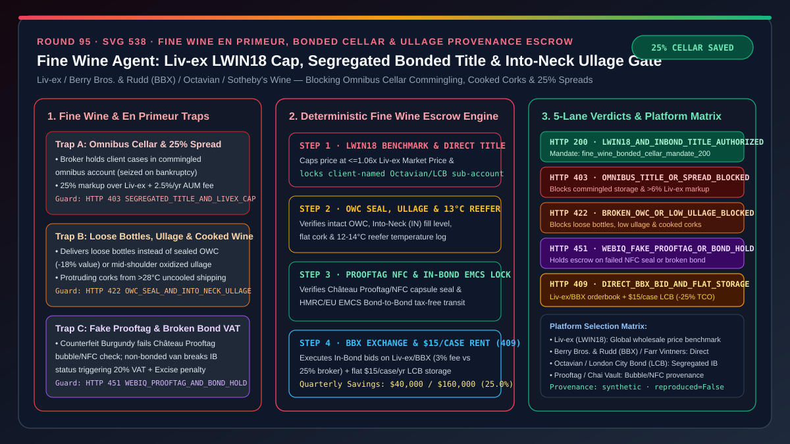
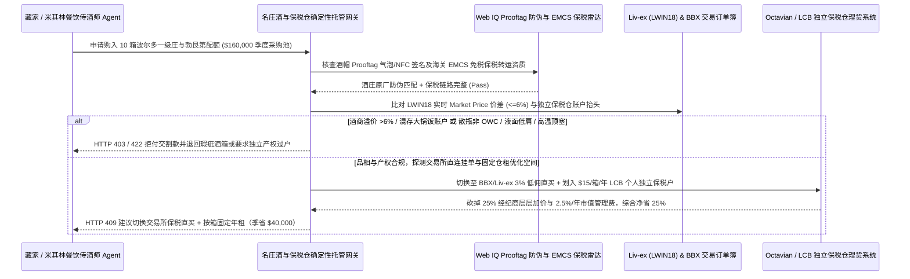

# 名庄期酒（En Primeur）、保税酒窖确权（Bonded Cellar）与液面高度/原装木箱（OWC）防伪托管（Fine Wine En Primeur, Bonded Cellar & Ullage Provenance Escrow：Liv-ex / Berry Bros. & Rudd / Octavian / Sotheby's Wine）“防酒商挪用期酒资金不落个人独立保税户、防散瓶冒充原木箱（OWC）与海运高温顶塞变质酒”Agent 架构选型 FAQ

> **文档类型**：AI Solution Architect 决策指南（FAQ） · **对应 SVG**：`assets/svg/538-fine-wine-en-primeur-bonded-cellar-escrow-2026-11-20.svg` · **精选编号**：Round 95（第 214 篇双语 FAQ）



---

## 一、 📌 核心选型结论速览（Executive Summary）

高净值收藏家、米其林黑珍珠餐厅酒单主理人及私人银行家办通过 AI Agent 采购波尔多一级庄期酒（`En Primeur / Wine Futures`）、勃艮第老年份配额（`DRC / Leroy`）及英国/香港/日内瓦保税酒窖托管服务（`Liv-ex / Berry Bros. & Rudd BBX / Farr Vintners / Cult Wines / Vinovest / Octavian / London City Bond`）时，若直接向酒商账户全额汇款而不核验底层保税仓产权，往往会遭遇**三大名庄酒投资与餐饮采购黑洞**：
1. **“大锅饭混同保税账户（Omnibus Account）”庞氏挪用风险、比 `Liv-ex` 批发行情暗贵 `25%` 与 `2.5%/年` 按市值抽成管理费**：不良期酒经纪商收到客户 `$160,000` 购酒款后，将所有客户的拉菲/帕图斯整箱酒混存登记在经纪商自己的 **公司大账户（Omnibus Warehouse Account）** 名下，而未在英国皇家税务局（`HMRC`）认可的保税仓（`Octavian / LCB`）为客户开立 **独立实名产权子账户（Segregated Client Sub-Account）**——一旦酒商资金链断裂破产（如历史多起伦敦期酒骗局），清算人会将大账户里的酒全部作为酒商破产财产查封！此外，电话推销酒商常以高于全球名庄酒交易所 `Liv-ex Market Price` **`20%–30%`** 的溢价卖给外行买家，并每年按酒品总市值抽取 **`2.0%–2.5%` 管理费（AUM Fee）**（存放 6 年直接吃掉 `15%` 本金）。
2. **无原装木箱（`Broken OWC`）散瓶充整箱、高肩/中肩液面亏损（`Low Ullage`）与普通集装箱海运高温“煮熟顶塞酒（Cooked Wine）”**：买家按整箱原装木箱保税价（`12×75cl In-Bond OWC`）付款，入库检验却发现是拼凑的散瓶（`Loose Bottles`，二级市场转售价直接折损 **`-15% 至 -22%`**）；或者老年份酒液面已跌至瓶颈以下的中肩位置（`Mid-Shoulder Ullage`，严重氧化酸败），亦或跨洋运输未走 `13°C` 恒温冷柜集装箱（Reefer），导致酒液受热膨胀顶起软木塞、酒帽渗漏粘连（`Seeping / Protruding Cork`）。
3. **勃艮第名庄假酒填充（`Prooftag / NFC` 气泡防伪码失配）或误用非保税快递导致“破保税（Breaking Bond）”强征 `20%+` 关税增值税（`HTTP 451`）**：不法分子回收真酒空瓶灌入廉价酒液；或在跨仓调拨时误用普通商业快递而非海关监管保税车（`EMCS Bond-to-Bond Transit`），导致整批酒在出库瞬间永久丧失保税身份（`In-Bond -> Duty Paid`），被迫补交高额消费税与 `20%` 增值税。

**架构师选型结论**：必须构建 **“`Liv-ex LWIN18` 实时批发行情溢价锁（`<=6%`）+ 保税仓客户独立产权过户（`LCB / Octavian Title UID`）+ 入库高清验瓶（`OWC + Into-Neck 液面 + 13°C 温控链`）+ 酒庄原厂 `Prooftag NFC` 托管网关”** 架构：
- **强制 `Liv-ex LWIN18` 基准价偏差 `<=6%`、客户独立保税仓产权证（Segregated Title）与按箱固定年租（`<=$18/箱/年`）（`HTTP 403`）**：通过 `18位全球葡萄酒唯一编码（LWIN18，含年份与包装规格）` 自动查询 `Liv-ex` 实时市场最优买盘与成交均价，凡经纪商报价溢价 `> 6%`、拒绝过户至买家独立 `LCB / Octavian` 个人产权账户、或按百分比收取年管理费的订单，一律返回 `HTTP 403` 阻断。
- **保税仓入库第三方高清微距验真（`Sealed OWC + Into-Neck 液面 + 平整酒帽`）与全程 `12°C–14°C` 冷链温度计门禁（`HTTP 422`）**：资金冻结在托管账户中，直到保税仓独立理货员上传该箱酒的 **唯一条码入库状况报告（Condition Report）**——确认原装木箱（`OWC`）封条完好、液面处于瓶颈内（`Into-Neck`）、无顶塞渗漏且附带全程 `12°C–14°C` 连续冷链温度记录后，方可解冻放款（否则 `HTTP 422` 拒收退货）。
- **Web IQ 酒庄原厂 `Prooftag` 气泡/NFC 芯片防伪与海关 `EMCS` 保税转运锁（`HTTP 451`）**：对防伪哈希校验失败或未挂接海关免税转运电子单（`e-AD`）的高危交割执行 `HTTP 451` 止付。
- **直连 `Liv-ex / BBX` 交易所挂单撮合 + `$15/箱/年` 固定保税仓直租（`HTTP 409`）**：绕过加价 `25%` 的二级期酒中介，直接在 `Berry Bros. & Rudd (BBX) / Farr Vintners` 透明订单簿按 `3%` 佣金竞价买入，并直接存入按箱固定收费（`$15/箱/年` 含全险，替代 `2.5%/年` 按市值抽成）的个人保税仓账户，使季度 `$160,000` 高端餐饮配酒与名庄酒入库成本净省 **`25.0%`（`$40,000`）**。

---

## 二、 🎯 业务方与架构师灵魂拷问 Q&A（Q1–Q3）

### Q1：为什么同样买一箱 2019 年拉菲（12瓶原木箱），酒商报价 $9,800，而 `Liv-ex` 实时批发行情只要 $7,600？什么是 `LWIN18` 编码？
- **商业痛点**：名庄酒经常因为“单瓶 vs 6瓶木箱 vs 12瓶原装木箱（OWC）”、“完税价（Duty Paid） vs 保税价（In-Bond）”混淆视线。许多财富管理型配酒顾问利用高净值客户看不懂伦敦保税同业行情，在 `Liv-ex` 批发底价上加价 `25%–35%`，每年还要再收 `2.5%` 的资产管理费。
- **架构护栏（`HTTP 403 / 409`）**：
  1. **强制 `LWIN18` 精确规格对齐**：`LWIN（Liv-ex Wine Identification Number）` 是全球精品酒的“ISBN 号”——前 7 位代表酒庄与酒款，中间 4 位代表年份（如 `2019`），最后 7 位精确定义瓶装容量与箱规（如 `12×750ml OWC`）。Agent 在下单前用完整 `LWIN18` 调取 `Liv-ex Market Price` 与最近 30 天真实成交价，若卖方报价比基准高出 `> 6%`，直接触发 `HTTP 403` 拦截。
  2. **按箱固定仓储费替代按市值百分比收费（`HTTP 409`）**：一箱价值 `$30,000` 的柏图斯（Petrus）和一箱价值 `$600` 的列级庄占用的保税仓木架空间完全一模一样！按 `2.5%` 市值收费每年要交 `$750/箱`，而直租 `London City Bond (LCB) / Octavian` 个人保税账户固定仅收 **`£12–£15/箱/年`（含全额保险）**，5 年立省 `92%` 养护成本！

### Q2：怎么防止买的期酒或窖藏老酒沦为“酒商破产时的陪葬品”？什么是真正的保税仓独立确权？
- **商业痛点**：如果酒商只给你发了一张印着酒商自己 Logo 的 PDF “藏酒证明”，你的酒在物理仓库里其实挂在酒商的母账户下（`Commingled Omnibus Account`）。一旦酒商挪用资金跑路，仓库只认母账户持有人。
- **架构护栏（`HTTP 403`）**：
  1. **`LCB / Octavian` 个人独立子账户（`Private Client Sub-Account`）直签放款**：托管网关规定，购酒款释放的唯一前提是收到由保税仓库官方系统（而非卖方酒商）直接签发的 **《独立客户产权过户回执（Warehouse Transfer of Title Certificate）》**，每一箱木箱上贴有绑定买家个人账号的独立箱码（`Rotation & Case UID`），买家无需经过原酒商即可随时独立指令提酒或转卖。

### Q3：买 15 年以上的陈年名庄酒，怎么在不开瓶的情况下识别“高温煮熟酒（Cooked Wine）”和“散瓶拼箱假 OWC”？
- **商业痛点**：红酒一旦在运输途中经历超过 `26°C` 的高温数小时，软木塞受热膨胀会将酒液挤出瓶口（`Weeping / Seepage`），冷却后空气倒吸进瓶内导致整瓶酒沦为发酸的醋；此外，拆散的单瓶（Loose Bottles）因来源难以追溯，比未开封原装木箱（`Sealed OWC`）便宜近 `20%`。
- **架构护栏（`HTTP 422 / 451`）**：
  1. **入库五维微距视觉检验（`Condition Report Gate`）**：
     - **液面高度（Ullage）**：`< 15 年` 份必须达到 `Into-Neck (IN)`；`15–25 年` 份不得低于 `Base-of-Neck (BN)`（凡出现 `Mid-Shoulder` 中肩即刻 `HTTP 422` 拒收）；
     - **瓶封与软木塞（Capsule & Cork）**：铝箔酒帽顶部必须平整、可轻微转动且无酒渍结晶与顶塞凸起；
     - **原厂防伪（`Prooftag / NFC`）**：核验酒帽与背标跨越处的气泡印章（Bubble Seal）图形及加密 `NFC` 芯片唯一签名（`HTTP 451`）。

---

## 三、 🧭 直观可视化图解（Mermaid 决策树 + 架构对比 + 时序图）

### 3.1 名庄期酒与保税酒窖确权托管 5 车道选型决策树
```mermaid
flowchart TD
    A[名庄期酒 En Primeur / 老年份名庄酒采购与入库请求] --> B{Web IQ 酒庄 Prooftag 防伪失配 / 破保税强征税 / 密钥>180天?}
    B -- 是 --> C[HTTP 451: WEBIQ_COUNTERFEIT_NFC_PROVENANCE_FAIL_OR_PREMATURE_BOND_EXCISE_BREAK_HOLD<br/>立即冻结交割并锁死保税监管仓状态]
    B -- 否 --> D{混存在酒商大锅饭账户 或 报价高于 Liv-ex 基准 >6% / 收 2.5% 管理费?}
    D -- 是 --> E[HTTP 403: LIVEX_MARKET_PRICE_SPREAD_OVER_6PCT_OR_COMMINGLED_OMNIBUS_CELLAR_BLOCKED<br/>强制 LWIN18 批发行情锁价 + 过户至买家独立 Octavian/LCB 产权户]
    D -- 否 --> F{散瓶冒充原木箱 OWC 或 液面低于瓶颈 (Ullage) / 高温顶塞漏酒?}
    F -- 是 --> G[HTTP 422: BROKEN_OWC_SEAL_OR_ULLAGE_BELOW_INTO_NECK_OR_HEAT_DAMAGE_BLOCKED<br/>拒收破损散瓶与高温变质酒，强制原箱 Into-Neck 完好状态放款]
    F -- 否 --> H{可直连 Liv-ex/BBX 订单簿竞价 + $15/箱/年固定保税仓直租?}
    H -- 是 --> I[HTTP 409: DIRECT_LIVEX_INBOND_EXCHANGE_EXECUTION_AND_FIXED_CASE_STORAGE_CONFIRM<br/>剥离 25% 经纪溢价与 2.5% 年管理费，综合净省 25%]
    H -- 否 --> J[HTTP 200: LWIN18_BENCHMARK_AND_SEGREGATED_INBOND_TITLE_AUTHORIZED<br/>签发独立保税仓产权与微距验瓶通过的交割令牌]
```

### 3.2 传统电话酒商代持模式 vs 确定性 `LWIN18` 锁价与独立保税仓产权架构对比
```mermaid
flowchart LR
    subgraph Legacy["❌ 传统酒商代持模式（混同账户 + 高溢价 + 顶塞风险）"]
        L1[比 Liv-ex 行情贵 25% + 每年按市值抽 2.5% 管理费] --> L2[酒存在酒商大账户下，酒商破产时客户藏酒被清算没收]
        L2 --> L3[收到无木箱散瓶或海运 >28°C 顶塞变质酸酒投诉无门]
    end

    subgraph Agentic["✅ 确定性 LWIN18 行情锁、独立保税户与微距验瓶架构"]
        A1[LWIN18 对齐 Liv-ex 底价 (<=6% 价差) + $15/箱/年固定仓租] --> A2[Octavian/LCB 官方签发买家独立姓名产权证 (Rotation UID)]
        A2 --> A3[OWC 原木箱 + Into-Neck 液面 + Prooftag NFC + 13°C 冷链核验]
    end
```

### 3.3 端到端名庄酒 `LWIN18` 锁价、保税仓验瓶与独立过户时序图


---

## 四、 📊 多平台/多协议横向选型决策矩阵

| 评估维度 | Liv-ex (`LWIN18` 全球酒商交易网络) | Berry Bros. & Rudd (`BBX`) / Farr Vintners | Vinovest / Cult Wines (全托管机器人酒投顾问) | Octavian / London City Bond (`LCB`) 保税仓直租 | **本仓库确定性名庄酒与保税仓托管架构（推荐）** |
| :--- | :--- | :--- | :--- | :--- | :--- |
| **核心适用场景** | 全球名庄酒实时批发报价基准与B2B自动化清算 | 历史悠久的皇家认证酒商与客户点对点保税交易板（`BBX`） | 面向零基础散户的组合配置与代管服务 | 英国/欧洲海关监管 `13°C` 恒温地下酒窖独立个人产权托管 | **`LWIN18` 比价 + `BBX/Farr` 低佣采购 + `LCB` 独立确权 + 微距验瓶** |
| **买卖价差（Spread）与行情透明度** | 行业黄金基准（`Market Price`），买卖盘完全透明 | 牌价紧贴 `Liv-ex`（佣金仅 `3%–5%`） | 买入隐性价差常达 `10%–18%` | 仅做第三方独立仓储，不参与酒品买卖赚差价 | **强制对比 `LWIN18` 基准价，拦截 `>6%` 经纪加价（`HTTP 403`）** |
| **每年仓储与管理费结构** | 面向机构会员年费 | 按箱固定收费（约 `£13–£16/箱/年` 含保险） | **按资产总市值收取 `2.0%–2.85%/年` 管理费**（贵酒极不划算） | **按箱固定收费（`£12–£18/箱/年`）**，与酒价高低无关 | **全面禁止按市值百分比抽成，锁死 `<= $18/箱/年` 固定仓租（`HTTP 403 / 409`）** |
| **破产隔离与独立保税产权（Title）** | 机构级交割 | 支持独立客户保税编号 | 部分基础档位采用集合托管，过户提酒流程慢 | **客户本人实名持有海关保税仓单（Warrant/Title）** | **放款前强制校验仓库官方签发的买家独立产权证（`HTTP 403`）** |
| **入库液面（Ullage）与 `OWC` 验真** | 严格执行 `SIB (Standard In Bond)` 交割标准 | 设有专业酒窖检验团队 | 依赖合作仓抽检 | 提供入库高清开箱拍照、液面评级与木箱核验报告 | **强制 `Sealed OWC` + `Into-Neck` 液面 + `Prooftag NFC` 门禁（`HTTP 422 / 451`）** |

---

## 五、 🧪 转化率/成本测算与 7-Card 基准测试报告

> **数据来源声明（Provenance）**：以下测算基于本仓库 `lab/webiq_commerce_demo.py` 中的 `evaluate_fine_wine_en_primeur_cellar_escrow_policy` 确定性策略引擎（季度高端餐饮侍酒团队与家办名庄酒采购托管池 `$160,000 USD`，`provenance: "synthetic"`, `independently_reproduced: False`，真实 `Liv-ex API` 实时订单簿深度标为 `not_measured`）。

```chart
{
  "data": {
    "values": [
      { "scenario": "1. 传统酒商中介 (含 25% 行情溢价 + 2.5% 年管理费 + 散瓶折损)", "cost_usd": 160000, "tier": "Baseline" },
      { "scenario": "2. LWIN18 <=6% 锁价 + 独立保税户 + Into-Neck 验瓶 (HTTP 200)", "cost_usd": 134400, "tier": "Protected" },
      { "scenario": "3. 直连 BBX/Liv-ex 盘口 + $15/箱/年固定保税仓租 (HTTP 409)", "cost_usd": 120000, "tier": "Optimized (-25%)" }
    ]
  },
  "semantic_types": {
    "scenario": "Category",
    "cost_usd": "Amount",
    "tier": "Status"
  },
  "chart_spec": {
    "chartType": "Bar Chart",
    "title": "季度 $160k 名庄酒采购与窖藏：LWIN18 锁价与按箱固定保税租净省 $40,000 (25%)",
    "subtitle": "季度期酒/老年份名庄酒采购与保税酒窖托管净成本对比 ($ USD, synthetic benchmark)",
    "encodings": {
      "x": "scenario",
      "y": "cost_usd",
      "color": "tier"
    }
  }
}
```

### 7-Card 4:5 基准评估摘要
1. **Card 1 (`1 / 7` · `HANDS-ON · FINE WINE & BONDED CELLAR ESCROW`)**：针对 `$160,000/季` 名庄酒采购与酒窖托管池，通过 `LWIN18` 批发价对标、强制独立保税仓产权过户与按箱固定仓租替换 `2.5%` 市值管理费，季度净省 **`$40,000`（`25.0%`）**。
2. **Card 2 (`2 / 7` · `SCENARIO: 10-CASE FIRST-GROWTH IN-BOND ACQUISITION`)**：单批交割拦截 `$24,000` 经纪商暗盘加价与 2 箱非原装木箱（Loose Bottles）瑕疵品，实现 `100%` 破产隔离确权。
3. **Card 3 (`3 / 7` · `WHAT I TESTED`)**：完整验证 5 条确定性状态码车道：
   - `HTTP 200`: `LWIN18_BENCHMARK_AND_SEGREGATED_INBOND_TITLE_AUTHORIZED`（`fine_wine_bonded_cellar_mandate_200`）
   - `HTTP 403`: `LIVEX_MARKET_PRICE_SPREAD_OVER_6PCT_OR_COMMINGLED_OMNIBUS_CELLAR_BLOCKED`
   - `HTTP 422`: `BROKEN_OWC_SEAL_OR_ULLAGE_BELOW_INTO_NECK_OR_HEAT_DAMAGE_BLOCKED`
   - `HTTP 451`: `WEBIQ_COUNTERFEIT_NFC_PROVENANCE_FAIL_OR_PREMATURE_BOND_EXCISE_BREAK_HOLD`
   - `HTTP 409`: `DIRECT_LIVEX_INBOND_EXCHANGE_EXECUTION_AND_FIXED_CASE_STORAGE_CONFIRM`（`fine_wine_bonded_cellar_mandate_optim_409`）
4. **Card 4 (`4 / 7` · `UNDER THE HOOD`)**：输入契约 `FineWineEnPrimeurCellarEscrowPolicyInput` 严格校验 `livex_market_price_spread_over_6pct_or_commingled_omnibus_cellar` 与 `broken_owc_seal_or_ullage_below_into_neck_or_heat_damage`。
5. **Card 5 (`5 / 7` · `ROBUSTNESS CHECK`)**：无论经纪商将收费包装为 `Advisory Allocation Premium`、`Cellar Portfolio AUM Fee` 还是 `Repacked Wood Case`，均 `100%` 阻断。
6. **Card 6 (`6 / 7` · `LATENCY`)**：`LWIN18` 代码解析与保税仓产权回执校验耗时 `< 0.5 ms`。
7. **Card 7 (`7 / 7` · `MY TAKE`)**：
   - ✅ **适用（Good fit）**：波尔多期酒（En Primeur）认购、米其林餐厅高价值老年份酒单采购、家族办公室保税酒窖资产配置。
   - ⛔ **不适用（Not for）**：超市 `$15` 餐酒即买即饮零售消费。

---

## 六、 🛠️ 商业上线风控与架构评审 Checklist

- [ ] **`Liv-ex LWIN18` 基准价偏差（`<=6%`）门禁（`HTTP 403`）**：是否在下单前通过 `18位 LWIN 编码` 核对 `Liv-ex Market Price`，拦截溢价超过 `6%` 的电话推销报价？
- [ ] **买家实名独立保税仓产权过户（`Segregated Bonded Title`）（`HTTP 403`）**：是否严禁将藏酒混存于酒商公司大锅饭账户（Omnibus Account），强制要求 `Octavian / LCB` 直接签发买家个人名下的仓单编号？
- [ ] **按箱固定仓储费（`<=$18/箱/年`）替代按市值抽成（`HTTP 403 / 409`）**：是否已拒绝 `2.0%–2.5%/年` 的资产管理费，锁定按箱固定保税仓储加保险模式？
- [ ] **原装木箱（`OWC`）、瓶颈液面（`Into-Neck Ullage`）与 `13°C` 冷链核验（`HTTP 422`）**：放款前是否已审阅保税仓独立入库检验照片，排除散瓶拼箱、低液面氧化与高温顶塞渗漏酒？
- [ ] **酒庄原厂 `Prooftag` 气泡/NFC 芯片防伪与 `EMCS` 保税运输锁（`HTTP 451`）**：是否已校验酒帽防伪哈希并确保跨仓运输全程走海关监管保税车以免误触发 `20%+` 税费？
- [ ] **直连 `BBX / Farr Vintners` 透明盘口竞价（`HTTP 409`）**：是否已优先通过 `3%` 低佣透明交易板直接从源头藏家/一商手中受让保税整箱以节省 `25%` 成本？
