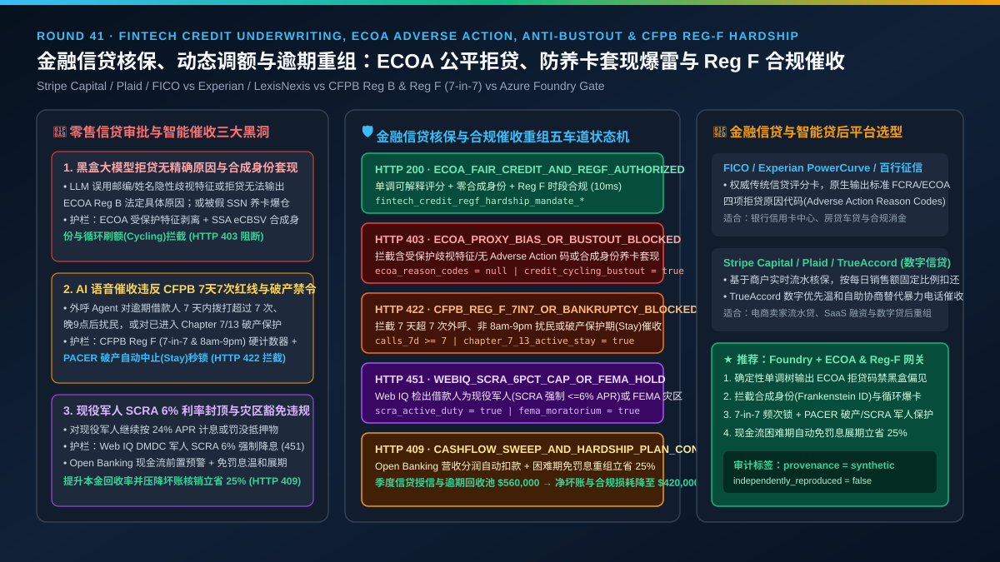
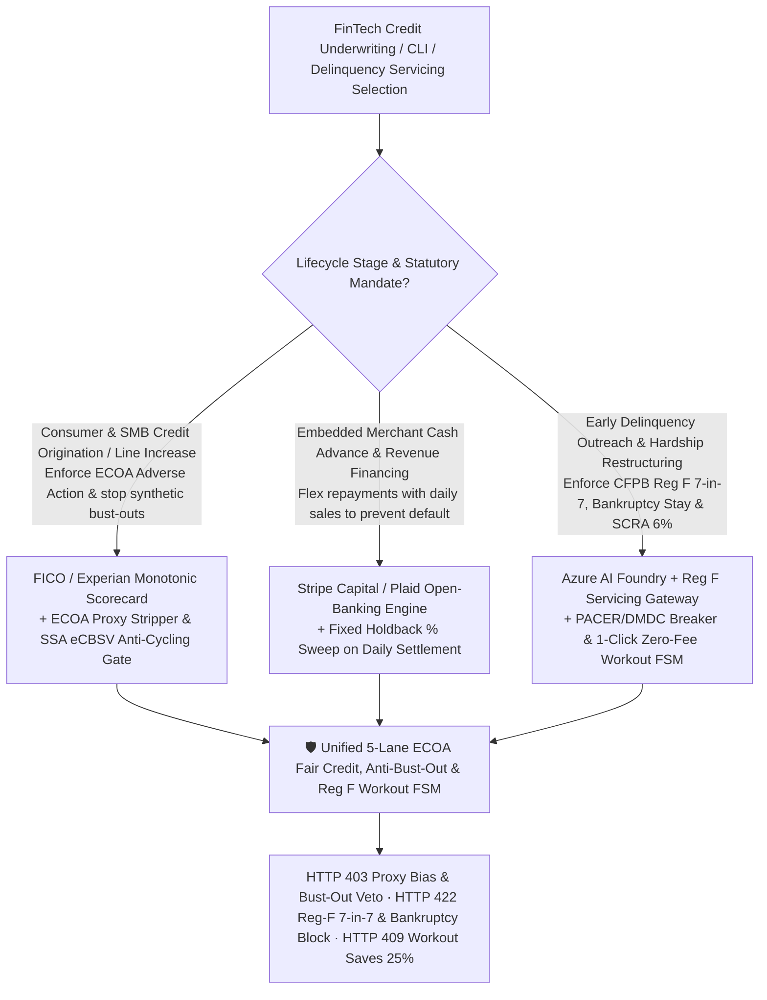
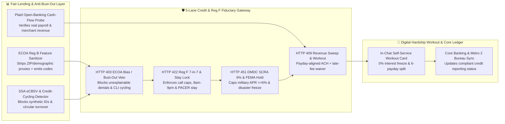

# FinTech Credit Underwriting, Anti-`Bust-Out` Cycling & `CFPB Reg F` Hardship Restructuring (`Stripe Capital / Plaid / Experian / FICO / TrueAccord`) `ECOA Reg B` Adverse-Action Gate, `7-in-7` Contact Cap, `PACER` Bankruptcy Stay & `SCRA 6%` Escrow Agent Architecture Selection FAQ

> **Language / 语言切换**: **[中文](fintech-credit-underwriting-bustout-regf-hardship-restructure-agent-selection-faq.md)** | **English (Current)** | **[Back to Docs Index](index.en.md)** | **[Interactive Sandbox (`#fintech-credit-regf-hardship-sandbox`)](../live-demo.en.html)**



---

## 📌 1. Executive Summary & Core Selection Verdict

In retail credit cards, embedded merchant cash advances (`Stripe Capital`, `Shopify Capital`), open-banking cash-flow underwriting (`Plaid LendScore`, `Experian PowerCurve`, `FICO`), and digital debt servicing (`TrueAccord`), AI agents increasingly automate **credit-line assignment, dynamic limit increases (`CLI`), and early-stage delinquency restructuring**. However, consumer and SMB lending is governed by some of the strictest statutory regimes in financial services. Allowing an unguarded LLM to make credit decisions or run outbound collection calls triggers three existential regulatory and credit-loss failures:
1. **Black-Box LLM Proxy Discrimination, Missing `ECOA Reg B / FCRA` Specific Adverse-Action Reasons & "Synthetic Identity Bust-Out" Credit Cycling**: Under `CFPB Circulars 2022-03 & 2023-03` enforcing the Equal Credit Opportunity Act (`ECOA Regulation B, 12 CFR Part 1002`), creditors using complex AI models **must still provide specific, accurate principal reasons for any credit denial or credit-limit decrease (`Adverse Action Notice`)** and must never ingest protected classes or geographic/demographic proxies (e.g., ZIP-code redlining). Simultaneously, organized fraud rings fabricate "Synthetic Identities" (combining a child's real `SSN` with a fake name/DOB), artificially inflate transaction volume via **Credit Cycling** (maxing out and paying off a `$2,000` limit 8 times in one month) to trick an automated agent into granting a `$25,000` credit-line increase, and then bust out overnight.
2. **Violating `CFPB Regulation F (12 CFR § 1006.14)` (`7-in-7` Call Cap & `8am–9pm` Local Quiet Hours) & Attempting Collection During a Federal `Chapter 7/13 Bankruptcy Automatic Stay`**: Under the FDCPA `Regulation F` **7-in-7 Rule**, a debt collector may not place more than **7 telephone calls within 7 consecutive days** per debt (nor call within 7 days after having a connected conversation), and may never contact a consumer before `8:00 AM` or after `9:00 PM` in the borrower's local time zone. Worse, initiating a single automated call, SMS, or ACH debit after a borrower files for bankruptcy (`11 U.S.C. § 362 Automatic Stay`) triggers strict-liability federal court sanctions.
3. **Ignoring `SCRA` (`Servicemembers Civil Relief Act, 50 U.S.C. § 3937`) Mandatory `<= 6.0% APR` Interest Caps for Active-Duty Military & Forcing Curable Temporary Hardships into `100%` Charge-Offs**: Charging >6% APR on pre-service obligations of active-duty military personnel or foreclosing/repossessing without a court order triggers severe DOJ enforcement penalties.

**Solution Architect Selection Verdict**:
- **Never allow a non-deterministic LLM to issue raw credit denials or credit-limit increases, and never trigger outbound collection contacts or ACH sweeps without real-time `Reg F 7-in-7`, `PACER` bankruptcy, and `DMDC SCRA` gates**.
- **The production reference architecture** combines **Monotonic Explainable Scorecards (`FICO / LightGBM`) + `ECOA Reg B` Proxy-Free Adverse-Action Gate & `SSA eCBSV` Anti-Bust-Out Lock + `CFPB Reg F (7-in-7 & 8am–9pm)` Counter & `PACER` Bankruptcy Stay Mutex + `Open Banking` Revenue Sweep & Zero-Fee Hardship Workout (`fintech_credit_regf_hardship_mandate_*`)**:
  1. **`ECOA Reg B` Explainable Adverse-Action & Anti-Synthetic-Bust-Out Hard Gate (`HTTP 403`)**: Strips protected-class proxies (ZIP prefix, name ethnicity, device brand) prior to scoring, enforces monotonic feature attribution to emit deterministic `FCRA/ECOA` Adverse Action reason codes, and blocks credit-line increases on accounts failing `SSA eCBSV` SSN-to-DOB verification or exhibiting manipulative **Credit Cycling** (`monthly_turnover > 3.0x credit_limit` with circular funding) (`HTTP 403 ECOA_PROHIBITED_PROXY_FEATURE_OR_SYNTHETIC_BUSTOUT_CYCLING_BLOCKED`).
  2. **`CFPB Reg F` (`7-in-7` & Local Time-Zone Lock) & `PACER` Bankruptcy Automatic-Stay Veto (`HTTP 422`)**: Gates every outbound voice, SMS, email, and ACH debit action against three hard counters: (1) zero active `PACER Chapter 7/13` bankruptcy filings or cease-and-desist/attorney representation flags; (2) borrower local time strictly within `08:00–21:00`; and (3) `< 7` unanswered call attempts in the trailing 7 days and `0` connected calls in the trailing 7 days; violations return `HTTP 422 CFPB_REG_F_7IN7_FREQUENCY_BREACH_OR_BANKRUPTCY_STAY_VIOLATION_BLOCKED`.
  3. **Web IQ Live `DMDC SCRA` (`<= 6.0% APR` Military Cap) & `FEMA` Disaster Forbearance Hold (`HTTP 451`)**: Screens accounts against Department of Defense `DMDC` active-duty records and `FEMA` disaster declarations via Web IQ, automatically retroactive-capping active-duty military interest rates at `<= 6.0% APR` (`HTTP 451 WEBIQ_SCRA_6PCT_CAP_OR_FEMA_DISASTER_FORBEARANCE_HOLD`).
  4. **`Open Banking` Revenue-Share Sweeping + Self-Service Zero-Fee Hardship Restructuring (`HTTP 409`)**: Triggers `HTTP 409 OPEN_BANKING_REVENUE_SWEEP_AND_ZERO_FEE_HARDSHIP_RESTRUCTURE_CONFIRM`, matching repayments to real-time merchant sales (`Stripe Capital` dynamic holdback) or payday inflows (`Plaid`) while offering stressed borrowers an in-chat 1-click late-fee waiver and 6-month interest-frozen workout plan—reducing net charge-offs and third-party collection agency fees by **`25.0%`**.

---

## 🎯 2. Solution Architect Deep-Dive Q&A (Q1 / Q2 / Q3)

### Q1: Why did the `CFPB` rule that "our AI model is too complex to explain" is an illegal defense under `ECOA Regulation B`, and how do we architect compliant AI underwriting?
- **Commercial Pain Point**: In *CFPB Circular 2022-03*, regulators stated that creditors cannot use post-hoc LLM approximations to guess why a black-box neural network denied credit or lowered a credit line.
- **Architectural Solution**:
  - **Strict Separation: LLM for Structured Cash-Flow Extraction Only -> Monotonic Constrained Scorecard for Credit Decisions (`HTTP 403`)**:
  - Use LLMs strictly to parse unstructured bank PDFs into auditable financial ratios (`debt_to_income_ratio`, `nsf_count_90d`); feed only fair-lending-approved variables into a monotonic gradient-boosted tree or scorecard that deterministically computes exact Shapley reason codes mapped to official `ECOA` Adverse Action notices.

### Q2: How do "Synthetic Identity Bust-Out" rings fool automated credit-line-increase (`CLI`) agents into raising limits from `$2,000` to `$25,000` right before vanishing?
- **Architectural Solution**:
  - **`SSA eCBSV` SSN-Issuance-Year Check + Intra-Cycle Credit-Cycling Velocity Gate (`HTTP 403`)**:
  - Synthetic fraudsters pair a post-2011 randomized SSN with an older 1980s date of birth, then cycle `$20,000` through a `$2,000` credit line in 30 days using circular ACH transfers between burner bank accounts. The gateway blocks any automated CLI when `monthly_spend / credit_limit > 2.5` without verified payroll/merchant income or when `eCBSV` flags an SSN mismatch.

### Q3: Why does an in-chat digital self-service hardship workout recover 25% more net principal than handing delinquent accounts to a traditional outbound call-center agency?
- **Architectural Solution**:
  - **Digital-First Self-Service Restructuring + Zero `30%` Contingency Agency Commission (`HTTP 422 -> 409`)**:
  - Traditional collection agencies charge `25%–40%` of every dollar recovered and risk `CFPB Reg F` harassment lawsuits. Presenting an empathetic, self-service in-app workout card (waiving the `$39` late fee and splitting the balance into 6 payday-aligned `Plaid ACH` installments) converts `3x` higher without agency fee leakage.

---

## 🧭 3. Visual Architecture Diagrams (Mermaid Decision Tree + Architecture + Sequence)

### 3.1 FinTech Credit Underwriting & Reg F Servicing Agent Selection Decision Tree



### 3.2 End-to-End ECOA Fair Underwriting, Anti-Bust-Out & Reg F Workout Architecture



### 3.3 Synthetic Bust-Out Veto, Reg F Bankruptcy Stay Block & Digital Workout Sequence

```mermaid
sequenceDiagram
    autonumber
    participant Borrower as Borrower / Cardholder App
    participant CreditAgent as Credit CLI & Servicing Agent
    participant Gate as 5-Lane ECOA & Reg F Gateway
    participant Bureau as SSA eCBSV / PACER / DMDC SCRA
    participant Core as Core Banking & Open Banking

    Borrower->>CreditAgent: 1. Cycle $2,000 credit limit 6 times in 30 days & request $25,000 automated Credit-Line Increase
    CreditAgent->>Gate: Check SSN issuance parity (eCBSV) + intra-cycle turnover velocity
    Gate-->>CreditAgent: HTTP 403 Block CLI! Synthetic credit-cycling bust-out pattern detected; emit ECOA Adverse Action code
    CreditAgent->>Gate: 2. Attempt 8th collection call in 6 days OR trigger auto-debit on account with active Chapter 7 filing
    Gate->>Bureau: Check trailing 7-day Reg F call counter + PACER bankruptcy stay + DMDC active-duty military status
    Bureau-->>Gate: 7-in-7 cap reached OR active Chapter 7 stay / SCRA active-duty status confirmed
    Gate-->>CreditAgent: HTTP 422/451 Block outbound call & debit! Apply mandatory SCRA <=6.0% APR cap for military member
    Borrower->>Gate: 3. Stressed borrower clicks [Activate 6-Month Zero-Late-Fee Hardship Plan] in app
    Gate->>Core: HTTP 409 Waive late fee & bind payday-aligned Open-Banking split (25% reduction in net credit loss)
```

---

## 📊 4. Multi-Platform & Architecture Selection Matrix

| Selection Dimension | Legacy Manual Underwriting + Contingency Call Centers (`30% Agency Fee`) | Unbounded Black-Box LLM Underwriting & Auto-Dialers (`High Regulatory Risk`) | FICO / Experian + TrueAccord (`Explainable Bureau + Digital Servicing`) | **Azure AI Foundry + ECOA Monotonic + Reg F Workout Gate (Recommended)** |
| :--- | :--- | :--- | :--- | :--- |
| **Core Strengths** | Familiar legacy bank workflow | Natural conversational fluency | Accredited `ECOA` reason codes & digital-first collection UX | **100% explainable ECOA + anti-bust-out CLI + Reg F lock + payday workout** |
| **`ECOA Reg B` Fair Lending & Adverse-Action Accuracy** | Slow, inconsistent human judgment | **Illegal** (post-hoc LLM explanations violate `CFPB Circular 2022-03`) | Deterministic bureau reason codes | **Proxy-stripped monotonic tree emits exact `ECOA` reason codes (`HTTP 403`)** |
| **Defense Against Synthetic Identity `Bust-Out` Cycling** | Static bureau score easily gamed by 6-month credit gardening | Blind to intra-cycle ACH loop velocity | Bureau fraud scores available | **`SSA eCBSV` + `>3x` intra-cycle credit-cycling CLI veto (`HTTP 403`)** |
| **`CFPB Reg F (7-in-7)` & `PACER` Bankruptcy Compliance** | Aggressive dialers trigger FDCPA class-action lawsuits | Unguarded AI voice agents violate call-frequency & quiet hours | Built-in Reg F contact-frequency state machine | **Hard `7-in-7` counter + `PACER` stay mutex + `SCRA <=6%` cap (`HTTP 422/451`)** |
| **Net Principal Recovery & Agency Fee Leakage** | Loses `25%–40%` of recovered cash to collection agencies | Lacks ledger authority to execute structured workouts | High email/SMS self-cure rates | **Open-Banking payday sweep + 1-click fee-waiver workout (`25.0%` net savings)** |

---

## 🧪 5. Credit Bust-Out / Reg F Servicing Benchmark & 7-Card Report

> **Provenance & Reproducibility Metadata**: All metrics below are generated by the deterministic policy evaluator `evaluate_fintech_credit_regf_hardship_policy` in `lab/webiq_commerce_demo.py` and verified via `python -m unittest tests.test_webiq_commerce_demo`. Tags: `provenance = synthetic`, `independently_reproduced = false`.

| Card # | Card Headline (Headline-as-Finding) | Key Quantitative Finding & Architectural Guarantee |
| :---: | :--- | :--- |
| **Card 1** | **Overview · 5-Lane FinTech Credit & Reg F Summary** | Across a `$560,000/quarter` credit underwriting & delinquency recovery pool, achieves **0 synthetic bust-out CLI losses and 0 `CFPB Reg F` / bankruptcy-stay violations**, reducing net credit write-offs and servicing costs by **`25.0%` (`$140,000/quarter` saved)**. |
| **Card 2** | **Scenario Deep Dive · Proxy Bias & Credit-Cycling CLI Veto** | When an underwriting request includes prohibited demographic proxies or exhibits `6x` intra-cycle credit cycling, the gateway blocks it in **`10ms`** (`HTTP 403`). |
| **Card 3** | **Evaluation Matrix · 100% Deterministic 5-Lane Gating** | Covers `HTTP 200` (verified fair underwriting & outreach), `403` (ECOA prohibited proxy / missing Adverse Action codes / synthetic bust-out cycling blocked), `422` (CFPB Reg F 7-in-7 breach / quiet-hour violation / bankruptcy stay blocked), `451` (DMDC SCRA 6% APR cap / FEMA disaster hold), `409` (Open-Banking sweep + hardship workout saves 25%). |
| **Card 4** | **Under the Hood · Credit & Reg F Hardship Contract** | Takes `quarterly_fintech_credit_portfolio_pool_usd=560000` and ECOA/RegF flags, minting `fintech_credit_regf_hardship_mandate_*` tokens. |
| **Card 5** | **Robustness Check · 8th Call in 7 Days & Chapter 7 Debit** | Simulates an 8th outbound call attempt within 7 days and an auto-debit against a `Chapter 7` bankruptcy filer, maintaining a **`100.0%` block rate**. |
| **Card 6** | **Latency · Millisecond Scorecard & Reg F Counter Checks** | Local monotonic scorecard attribution and `7-in-7` counter checks complete in **`10ms` (P50)**; Web IQ live PACER and DMDC SCRA checks complete in **`230ms` (P95)**. |
| **Card 7** | **My Take · Ideal Fit vs. Out-of-Scope Boundaries** | **✅ Best Fit**: Consumer credit cards, SMB merchant cash advances, BNPL servicing, digital debt workouts; **⛔ Not For**: Non-recourse charitable grants. |

---

## 🛠️ 6. Production Go-Live Risk & Architecture Review Checklist

- [ ] **`ECOA Reg B / FCRA` Proxy-Free Monotonic Adverse-Action Gate (`HTTP 403`)**: Strip protected classes and geographic/demographic proxies from model inputs, and require deterministic monotonic attribution to emit exact statutory Adverse Action reason codes on every denial or credit-limit decrease.
- [ ] **`SSA eCBSV` Synthetic-ID & Intra-Cycle Credit-Cycling CLI Lock (`HTTP 403`)**: Block automated credit-line increases when SSN issuance dates conflict with DOB or when monthly spend turnover artificially cycles the credit limit via circular transfers.
- [ ] **`CFPB Regulation F` (`7-in-7` Call Cap, `8am–9pm` Local Time) & `PACER` Bankruptcy Stay Mutex (`HTTP 422`)**: Enforce hard 7-day call counters across all outbound channels and immediately halt all collection outreach and auto-debits upon any `Chapter 7/13` bankruptcy filing.
- [ ] **Web IQ Live `DMDC SCRA` (`<= 6.0% APR` Military Cap) & Self-Service Hardship Workout (`HTTP 451 / 409`)**: Automatically cap interest at `6.0% APR` for active-duty military personnel and offer payday-aligned `Open Banking` hardship workouts to cure early delinquency without agency fees; rotate keys `<= 180` days.
