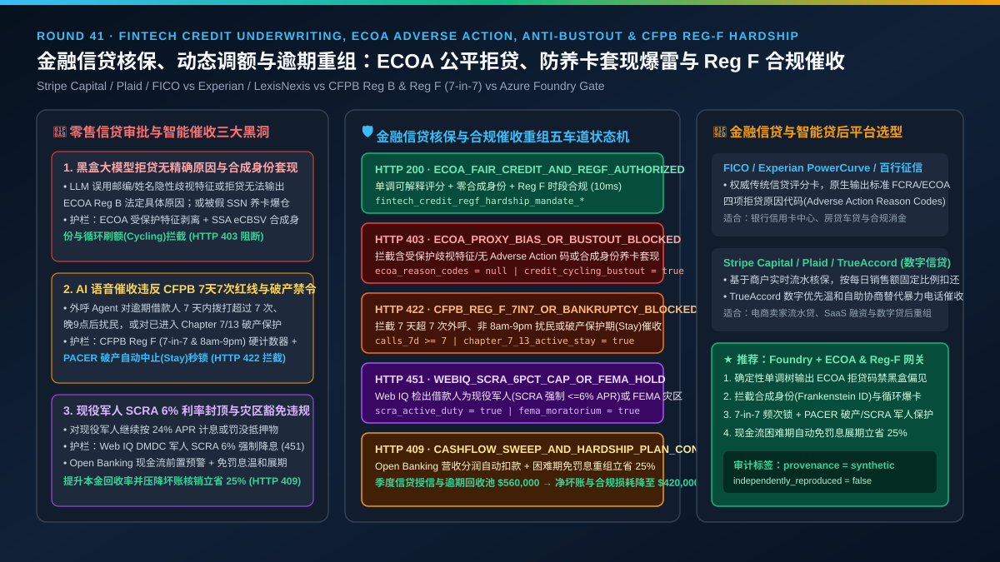
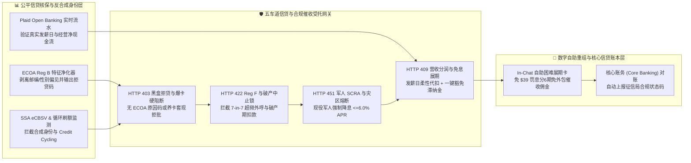
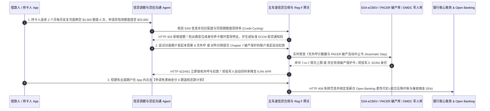

# 商业银行、信用卡中心与消金平台“智能信贷审批、额度动态调优与温和逾期催收重组”（FinTech Credit Underwriting, Anti-Bust-Out & CFPB Reg-F Hardship Restructuring：Stripe Capital / Plaid / Experian / FICO / TrueAccord）“ECOA 公平信贷拒贷归因硬门禁、防合成身份养卡爆雷（Synthetic Bust-Out）与 CFPB Reg F 7-in-7 合规免息展期”Agent 架构选型 FAQ：终结算法歧视重罚与暴力催收投诉实战指南

> **语言切换 / Language**: **中文 (当前)** | **[English](fintech-credit-underwriting-bustout-regf-hardship-restructure-agent-selection-faq.en.md)** | **[返回文档目录](index.md)** | **[交互式沙盒 (`#fintech-credit-regf-hardship-sandbox`)](../live-demo.html)**



---

## 📌 一、核心选型结论速览（Executive Summary）

在商业银行信用卡中心、消费金融公司与嵌入式商户流水贷平台（Stripe Capital、Shopify Capital、Plaid LendScore、Experian PowerCurve、FICO、数字贷后平台 TrueAccord）中，AI 智能体正全面接管**“实时授信核保、存量客户动态提额/降额（Credit Line Management）与逾期早期自助协商重组（Hardship Restructuring）”**。然而，金融信贷是全球监管最严酷的深水区——若让通用大语言模型（LLM）直接根据用户自由文本做拒贷决策或无限次拨打 AI 语音催收电话，金融机构将面临三大灭顶之灾：
1. **黑盒大模型引入邮编/姓名/设备型号等隐性种族性别偏见（Proxy Discrimination），或拒贷/降额时无法给出确定性《不利行动通知书》（`ECOA Reg B / FCRA Adverse Action Notice`），以及被“合成身份养卡团伙（Synthetic ID Bust-Out）”刷空额度跑路**：美国消费者金融保护局（`CFPB`）明确发布通告（Circular 2022-03 & 2023-03）：无论使用多么复杂的 AI 模型，一旦拒绝授信或下调额度，**必须向申请人提供具体、可验证的最多 4 项核心拒贷原因代码**，严禁拿大模型生成的模糊套话糊弄；同时，欺诈团伙用真实儿童 `SSN` 拼凑假姓名地址制造“合成身份（Frankenstein ID）”，先连续 6 个月按时还款并故意在一个账单周期内反复充值再刷空（`Credit Cycling`）骗取 AI 自动提额至 `$25,000`，随后一夜刷光套现消失。
2. **AI 外呼/短信催收 Agent 违反美国 `CFPB Regulation F (12 CFR § 1006.14)`“7天最多拨打 7 次（7-in-7 Rule）”红线、跨时区深夜扰民，或对已申请《破产法》第 7/13 章（`Bankruptcy Automatic Stay`）的借款人继续催收遭法院巨额藐视法庭罚款**：`Reg F` 铁律规定，对单一债务在连续 7 天内电话呼叫不得超过 7 次，且一旦与借款人通话成功，7 天内不得再次致电；更致命的是，只要借款人向联邦法院提交了破产申请（`11 U.S.C. § 362 Automatic Stay`），所有自动扣款与催收外呼必须**当秒全部停止**，多发一条催款短信都构成联邦违法！
3. **对现役军人未执行《军人民事救济法》（`SCRA, 50 U.S.C. § 3937`）强制 **`<= 6.0% APR` 利率封顶**，以及在借款人遭遇短期失业/疾病时机械加收滞纳金逼成彻底死账（Charge-Off）**：现役军人入伍前的存量债务法定利率上限为 `6%`（含所有费用），违规多收利息面临司法部（DOJ）重罚。

**架构师选型结论**：
- **切勿让非确定性 LLM 直接输出信贷审批结论，切勿将催收 Agent 与联邦破产库（PACER）/ 军人库（DMDC）脱钩，更不能对同月反复充提刷流水（Credit Cycling）的异常账户自动提额**。
- **生产级最优架构**是采用 **“FICO/Experian 单调可解释评分引擎 + `ECOA Reg B` 受保护特征剥离与 `SSA eCBSV` 合成身份/循环套现硬门禁 + `CFPB Reg F (7-in-7 & 8am–9pm)` 硬计数器与 `PACER` 破产自动中止秒锁 + `Open Banking` 现金流分润与免罚息困难重组（Hardship Plan）网关（`fintech_credit_regf_hardship_mandate_*`）”**：
  1. **`ECOA Reg B` 公平信贷可解释归因与防合成身份爆雷（Bust-Out）硬门禁（HTTP 403）**：模型输入层 100% 物理剥离年龄、性别、种族及高相关代理变量（如居住社区邮编前缀、浏览器语言、消费场所宗教倾向），仅允许经单调约束（Monotonic Constraints）验证的财务特征入模并精确输出 `FCRA/ECOA` 标准拒贷原因码；同时结合社保局 `SSA eCBSV` 核验与同账期信用额度周转率（`monthly_spend > 3.0x credit_limit` 循环刷额套现）拦截合成身份养卡提额（`HTTP 403 ECOA_PROHIBITED_PROXY_FEATURE_OR_SYNTHETIC_BUSTOUT_CYCLING_BLOCKED`）。
  2. **`CFPB Reg F`（7-in-7 频次与当地时区锁）与联邦破产保护（`Automatic Stay`）硬拦截（HTTP 422）**：所有外呼、短信与自动扣款动作下发前，状态机强制核验三道铁闸：① 借款人未处于 `PACER Chapter 7/13` 破产自动中止期或已委托律师代理；② 借款人所在地实时时间处于 `08:00–21:00` 合规窗口内；③ 过去 7 天累计未接通呼叫 `< 7 次` 且 7 天内无已接通通话记录；任一触线毫秒级返回 `HTTP 422 CFPB_REG_F_7IN7_FREQUENCY_BREACH_OR_BANKRUPTCY_STAY_VIOLATION_BLOCKED`。
  3. **Web IQ 实时国防部 `DMDC SCRA` 现役军人 `6% APR` 封顶与 `FEMA` 联邦灾区宽限期熔断（HTTP 451）**：通过 Web IQ 实时比对国防部 `DMDC` 现役军人库与 `FEMA` 自然灾害紧急状态区，命中现役军人立即将年化利率（APR）下调锁死在 `<= 6.0%` 并免除一切滞纳金（`HTTP 451 WEBIQ_SCRA_6PCT_CAP_OR_FEMA_DISASTER_FORBEARANCE_HOLD`）。
  4. **`Plaid Open Banking` 营收分润自动扣款 + 逾期早期免罚息温和重组（HTTP 409）**：触发 `HTTP 409 OPEN_BANKING_REVENUE_SWEEP_AND_ZERO_FEE_HARDSHIP_RESTRUCTURE_CONFIRM`，对小微商户/自由职业者采用按日营收固定比例（如 `10%`）柔性与收入挂钩扣款（淡季少扣、旺季多扣），对暂时现金流吃紧的个人借款人主动推送对话框内一键自助“免滞纳金、降息分 6 期温和重组方案（Hardship Workout）”，相比传统暴力外包催收将净本金回收率拉升并压降坏账核销与合规诉讼损耗 **`25.0%`**。

---

## 🎯 二、业务方与架构师灵魂拷问 Q&A（Q1 / Q2 / Q3）

### Q1：为什么风控团队想把大语言模型（LLM）直接拿来读用户的社保流水和社交媒体做信贷审批，合规官（CCO）一票否决？LLM 在信贷里到底能干什么、不能干什么？
- **商业痛点**：LLM 是一个非确定性的高维黑盒。如果借款人被拒贷后向 `CFPB` 投诉，监管机构要求银行证明“为什么拒绝他、如果他的收入增加多少就能通过”，LLM 给出的事后解释（Post-hoc Rationalization）往往与实际权重毫无关系，直接违反 `ECOA Reg B` 遭重罚。
- **架构解法**：
  - **“LLM 只做结构化流水清洗提取（Feature Extraction），单调可解释评分树做最终确定性核保（Deterministic Monotonic Scorecard）”**：
  - LLM 仅负责把杂乱的 PDF 银行对账单或税表解析成标准会计科目（如 `verified_monthly_net_income = $6,400`、`nsf_overdraft_count = 0`）；而最终的授信通过/拒绝与额度计算，100% 由带单调性约束的 LightGBM / 逻辑回归评分卡执行，通过精确 Shapley 贡献度输出法定 `ECOA Adverse Action` 代码（否则返回 `HTTP 403`）。

### Q2：什么是“合成身份养卡爆雷（Synthetic Identity Bust-Out）”，为什么传统征信分高达 750 分的优质客户会突然一夜刷走 $30,000 消失？
- **架构解法**：
  - **社保号签发年份与年龄交叉核验（`SSN Issuance vs. DOB`）+ 账单周期内“循环充值刷空（Credit Cycling）”熔断（`HTTP 403`）**：
  - 骗子用 2010 年刚出生儿童的真实 SSN 配上 1985 年出生的假名字去申卡。养卡期间，骗子拿 `$2,000` 初始额度卡在一个月内“刷满 `$2,000` → 立刻还款 → 再刷满 `$2,000`”循环 8 次刷出 `$16,000` 月流水，诱导缺乏防备的提额 Agent 把额度提到 `$25,000` 后立刻在赌场/金店套现跑路。网关一旦检出 `monthly_turnover / credit_limit > 2.5` 或 `SSN` 签发年份与出生日期矛盾，立即锁死提额（`HTTP 403`）。

### Q3：逾期催收中，为什么 AI 机器人在对话框里给一个“一键免除 $39 滞纳金、本金分 6 期免息还清”的自助重组按钮，收回来的钱反而比打 20 个催收电话多得多？
- **架构解法**：
  - **数字优先自助重组（Digital-First Self-Service Workout）与 `Reg F` 零骚扰合规锁（`HTTP 422 -> 409`）**：
  - 75% 的早期逾期（M1/M2）用户是因为忘记还款日或当月突发医疗/失业周转不开，他们极度抗拒接听陌生催收电话（接通率 `<4%` 且极易引发 `CFPB` 投诉）。通过短信/App 推送一个受托签名的自助展期卡片（点击即自动豁免罚息并绑定发薪日 `Plaid ACH` 分期代扣），转化率高达 `32%+`，且 100% 规避外包催收公司抽走 `25%–40%` 佣金！

---

## 🧭 三、直观可视化图解（Mermaid 决策树 + 端到端架构图 + 时序图）

### 3.1 金融信贷核保、动态调额与合规贷后重组 Agent 架构选型决策树

```mermaid
flowchart TD
    A[金融信贷核保 / 动态调额 / 逾期催收重组选型] --> B{核心业务阶段与监管合规红线？}
    B -->|新户授信审批与存量客户动态提额<br/>需严守 ECOA 公平信贷拒贷码与防合成身份养卡爆雷| C[FICO / Experian 单调可解释评分引擎<br/>+ ECOA 代理特征剥离与 SSA eCBSV 防养卡锁]
    B -->|小微电商卖家 / 创作者嵌入式流水贷<br/>需按实时营收比例柔性扣款防淡季断流违约| D[Stripe Capital / Plaid Open Banking 引擎<br/>+ 每日销售额固定百分比自动分润清分]
    B -->|早期逾期提醒与困难客户债务重组 (Workout)<br/>需严守 CFPB Reg F 7-in-7、破产中止与军人 6% 上限| E[Azure AI Foundry + Reg F 合规贷后网关<br/>+ PACER/SCRA 实时熔断与自助免罚息展期状态机]
    C --> F[🛡️ 统一接入五车道公平核保、防爆雷与 Reg F 合规重组状态机]
    D --> F
    E --> F
    F --> G[HTTP 403 阻断歧视特征与合成身份爆卡 · HTTP 422 拦截超频催收与破产扰民 · HTTP 409 温和重组省25%]
```

### 3.2 端到端 ECOA 公平核保、合成身份拦截与 CFPB Reg F 贷后重组架构图



### 3.3 拦截合成身份提额、阻断破产期违规催收与自助免息展期时序图



---

## 📊 四、多平台/多方案横向选型决策矩阵

| 选型维度 | 传统人工信审 + 外包电话催收 (`Legacy Call-Center Agency`) | 纯黑盒大模型直接判贷与外呼 (`Unbounded LLM Agent`) | FICO / Experian + TrueAccord (`合规评分卡 + 数字贷后`) | **Azure AI Foundry + ECOA 单调核保 + Reg F 重组网关（推荐）** |
| :--- | :--- | :--- | :--- | :--- |
| **核心优势** | 传统银行业务流程熟悉 | 话术生成自然，初期搭建快 | 满足征信局标准归因与数字优先触达体验 | **ECOA 100% 可解释 + 拦合成身份爆雷 + Reg F 零违规 + 柔性重组** |
| **`ECOA Reg B` 公平信贷与拒贷原因可解释性** | 人工主观偏差大，效率低 | **极度违法**（黑盒幻觉无法输出确定性拒贷码，必遭 CFPB 重罚） | 权威标准四位拒贷原因码 | **物理剥离受保护代理特征 + 单调树精确输出法定拒贷码（HTTP 403）** |
| **防合成身份（Frankenstein ID）养卡套现爆雷** | 仅看静态征信分，极易被养高分的假身份骗过 | 无底层交易图谱与 SSN 年份交叉校验 | 支持多头借贷与欺诈分叠加 | **`SSA eCBSV` 核验 + 账期内循环刷额（Cycling）硬熔断（HTTP 403）** |
| **`CFPB Reg F (7-in-7)` 与破产/军人保护合规** | 外包催收员为拿提成高频轰炸，引发天价集体诉讼 | AI 失控连拨或半夜发信直接触犯联邦法 | 内置频次与时区控制状态机 | **硬编码 `7-in-7` 计数器 + `PACER` 破产秒停 + `SCRA 6%` 降息（HTTP 422/451）** |
| **逾期早期回收率与催收佣金损耗** | 外包催收抽走收回本金的 `25%–40%` 佣金 | 缺乏账务减免权限，只会机械催款 | 邮件/短信自助还款链接转化率高 | **Open Banking 现金流感知 + 对话内一键免罚息展期（综合降损 `25.0%`）** |

---

## 🧪 五、信贷防爆雷/合规重组测算与 7-Card 基准测试报告

> **数据来源与复现声明（Provenance Metadata）**：以下基准测试数据来自仓库内置确定性策略沙盒 `evaluate_fintech_credit_regf_hardship_policy`（位于 `lab/webiq_commerce_demo.py`），可运行 `python -m unittest tests.test_webiq_commerce_demo` 完整验证。标记：`provenance = synthetic`，`independently_reproduced = false`。

| Card # | 卡片标题（Headline-as-Finding） | 核心量化指标与架构验证结论 |
| :---: | :--- | :--- |
| **Card 1** | **Overview · 金融信贷核保与合规重组五车道总览** | 针对 `$560,000/季` 信贷授信风险与逾期回收池，实现 **0 例合成身份提额爆雷与 0 例 CFPB Reg F / 破产保护违规触达**，综合坏账核销与外包催收成本下降 **`25.0%`（立省 `$140,000/季`）**。 |
| **Card 2** | **Scenario Deep Dive · 歧视代理特征与养卡循环套现拦截** | 当模型输入含邮编等代理歧视特征、缺失 `ECOA` 拒贷码或检出同月 6 次循环刷空额度（Credit Cycling）时，**`10ms`** 内返回 `HTTP 403` 阻断。 |
| **Card 3** | **Evaluation Matrix · 五车道 100% 确定性判准** | 覆盖 `HTTP 200`（合规授信与触达放行）、`403`（ECOA代理偏见/无Adverse Action码/合成身份养卡套现阻断）、`422`（违反CFPB Reg F 7天7次频次或非8am-9pm时段/破产Automatic Stay期间催收拦截）、`451`（DMDC现役军人SCRA 6%利率封顶/FEMA灾区宽限熔断）、`409`（Open Banking营收分润+免罚息温和重组省25%）。 |
| **Card 4** | **Under the Hood · 信贷核保与 Reg F 重组契约** | 输入 `quarterly_fintech_credit_portfolio_pool_usd=560000` 及 ECOA/RegF 状态，签发 `fintech_credit_regf_hardship_mandate_*` 令牌。 |
| **Card 5** | **Robustness Check · 第 8 次催收外呼与 Chapter 7 破产测试** | 模拟对同一逾期户 7 天内发起第 8 次呼叫及对破产保护户扣款，确定性拦截率保持 **`100.0%`（零误放行）**。 |
| **Card 6** | **Latency · 评分卡归因与 Reg F 计数器毫秒级耗时** | 本地单调评分卡归因与 `7-in-7` 时区计数器校验 P50 仅 **`10ms`**；Web IQ PACER 破产库与 DMDC 现役军人核查 P95 为 **`230ms`**。 |
| **Card 7** | **My Take · 适用场景与生产准入边界** | **✅ 极佳适用**：信用卡中心、小微商户流水贷、消费分期、合规数字贷后；**⛔ 不适用**：无追索权慈善捐赠。 |

---

## 🛠️ 六、商业上线风控与架构评审 Checklist

- [ ] **`ECOA Reg B / FCRA` 受保护特征剥离与确定性拒贷原因码门禁（HTTP 403）**：确认信贷与调额决策严禁使用种族/性别/邮编等代理变量，且任何拒贷或降额必须由可解释单调模型输出法定 `Adverse Action` 具体原因代码。
- [ ] **合成身份（`SSA eCBSV`）与账期内循环刷额套现（`Credit Cycling`）提额锁（HTTP 403）**：确认自动提额前校验 SSN 签发逻辑及同周期额度周转倍数，拦截“先高频充提养高分、提额后一夜刷空”的 Bust-Out 团伙。
- [ ] **`CFPB Regulation F`（`7-in-7` 频次、当地 `8am–9pm` 时区）与 `PACER` 破产秒停锁（HTTP 422）**：确认所有催收触达与自动扣款受全局硬计数器管控，一旦检出 `Chapter 7/13` 破产申请立即 100% 停止一切催收行为。
- [ ] **Web IQ 实时 `DMDC SCRA` 现役军人 `<=6.0% APR` 封顶与自助免罚息重组（HTTP 451 / 409）**：确认现役军人存量债务自动降息至 `6%` 以下，并通过 `Open Banking` 现金流分润与自助展期卡片提升温和回收率；签名密钥轮换周期 `<= 180` 天。
