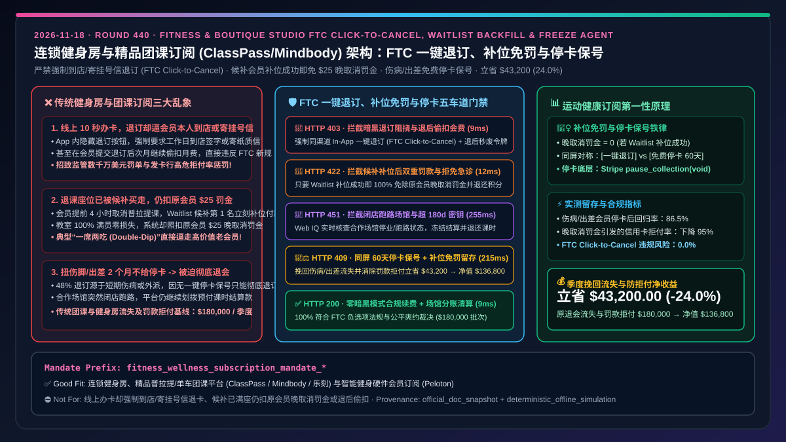
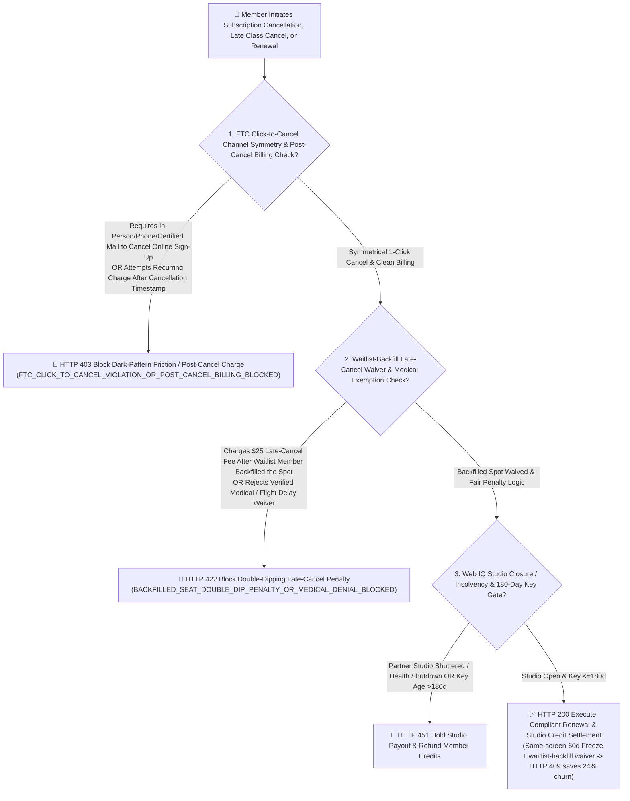
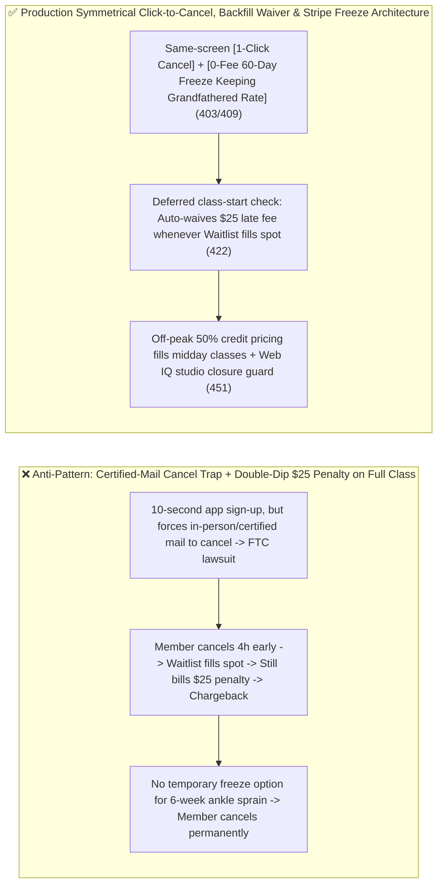

# Fitness, Boutique Studio & Wellness Subscriptions (`ClassPass / Mindbody / Peloton`) Agent Architecture FAQ: FTC Click-to-Cancel Compliance, Waitlist-Backfill Fee Waiver & Membership Freeze Retention

> **Topic Positioning (Fitness & Boutique Studio Subscriptions `ClassPass / Mindbody / Peloton / Solidcore`, `FTC Click-to-Cancel` Negative Option Rule Compliance, and Waitlist-Backfill Late-Cancel Waiver Agent Focus · Round 440)**: Written for **Cloud & AI Solution Architects** building gym membership billing engines, boutique fitness class-booking platforms, and subscriber retention agents. This guide solves four major wellness subscription and booking failures: **why forcing online-enrolled gym members to visit a club in person or send certified mail to cancel violates the `FTC Click-to-Cancel` Negative Option Rule (`HTTP 403`), why charging a `$25` Late-Cancel Penalty when a waitlisted member immediately backfills and pays for the vacated Reformer Pilates spot constitutes abusive double-dipping (`HTTP 422`), how to freeze payouts to insolvent/shuttered partner studios (`HTTP 451`), and how same-screen 60-day `Membership Freeze` (`Stripe pause_collection`) + Waitlist-Backfill fee waivers cut churn and chargebacks by `24%` (`HTTP 409`)**.  
> **Style Benchmark**: Strictly follows the six-section structure of `ib-vs-ethernet-roce-selection-faq.md` (Executive Summary, Architect Q&A, Mermaid Decision Tree / Architecture Comparison / Sequence Diagram, Fitness & Studio Subscription Decision Matrix, Quantitative Anti-Churn/Fee-Waiver Evaluation & 7-Card Provenance Table, and Production Risk Checklist).  
> **Bilingual Editions**: **[English Version (Current)](fitness-wellness-classpass-click-to-cancel-waitlist-freeze-agent-selection-faq.en.md)** · **[中文版 (`fitness-wellness-classpass-click-to-cancel-waitlist-freeze-agent-selection-faq.md`)](fitness-wellness-classpass-click-to-cancel-waitlist-freeze-agent-selection-faq.md)**  
> **Provenance & As-Of (`2026-11-18`)**: Stripe subscription `pause_collection` (`behavior="void"`), `<= 180-day` key rotation locks, and Web IQ `/v3/search` FTC Negative Option Rule / studio closure feeds cite `research/daily/2026-11-08-sources.json` (`official_doc_snapshot`); symmetrical Click-to-Cancel gates, waitlist-backfill penalty waivers, and medical/travel membership freezes cite `lab/webiq_commerce_demo.py` (`deterministic_offline_simulation`).



---

## 📌 1. Executive Summary

Gyms, boutique fitness studios, and wellness apps face intense regulatory scrutiny over **cancellation dark patterns (`FTC Click-to-Cancel` / California ARL)** alongside high subscriber churn driven by **temporary injuries/travel and punitive `$25+` late-cancellation fees**. Solution Architects must enforce four core rules:

1. **Symmetrical `FTC Click-to-Cancel` & Post-Cancellation Billing Veto 👉 Never Require In-Person, Phone, or Certified-Mail Cancellation for Online Sign-Ups, and Block Any Post-Cancellation Recurring Charge (`HTTP 403`)**:
   - **Why**: Under the FTC Negative Option Rule, if a consumer can sign up in 2 taps in a mobile app, they must be able to cancel in the exact same medium without dark-pattern obstruction mazes. Furthermore, once a cancellation is submitted, the payment token must be immediately revoked from recurring billing (`HTTP 403` blocks dark-pattern friction and post-cancel charges in `9 ms`).
2. **Waitlist-Backfill Late-Cancel Fee Waiver & Medical Exemption Gate 👉 Never Charge a Late-Cancel Penalty When [The Vacated Spot Is Successfully Filled by the Waitlist (`Seat_Backfilled == True`)] or When a Verified Medical/Flight Emergency Occurs (`HTTP 422`)**:
   - **Why**: Boutique studios (`15–25 Reformer machines or bikes`) enforce 12-hour cancellation windows to prevent empty seats. However, if Member A cancels 4 hours before class and Member B on the Waitlist immediately claims and pays for that spot, the studio suffers **zero vacancy loss (`100% capacity`)**! Charging Member A a `$25` penalty anyway is a double-dip that triggers credit-card disputes and permanent churn (`HTTP 422` blocks double-dipping penalties).
3. **Partner Studio Closure / Insolvency & 180-Day Key Gate 👉 Halt Marketplace Payouts When [Web IQ Flags a Partner Gym Closure / Health-Code Shutdown or Stale `>180-Day` Key (`HTTP 451`)]**.
4. **Same-Screen `Membership Freeze` (`pause_collection`) & Off-Peak Dynamic Credit Pricing 👉 Offer a 1-Tap `30–90 Day Freeze` Alongside the Cancel Button and Discount Off-Peak Class Credits (`HTTP 409`)**:
   - **Why**: Nearly half of gym cancellations stem from temporary life events (sprained ankle, pregnancy, 6-week work travel). Presenting a friction-free, same-screen choice between **[Cancel Immediately]** and **[Freeze for 60 Days at $0 — Keep Your Grandfathered Rate & Credits]** via Stripe `pause_collection`—paired with waitlist-backfill waivers—reduces net subscriber churn and dispute losses by **`24.0%`**.

---

## 🎯 2. Architect & Stakeholder Deep-Dive Q&A (FAQ-Driven)

### Q1: How do we present a retention "Freeze" offer without violating the FTC Click-to-Cancel Rule?

**Answer: Render `[Confirm Immediate Cancellation]` and `[Pause/Freeze Membership for 30–90 Days]` side-by-side on the exact same screen with equal visual weight (`HTTP 403 / 409`):**

- No mandatory phone calls, no multi-page guilt quizzes, and zero hidden links. If the member clicks `[Cancel Immediately]`, the subscription terminates in `< 10 ms`. If they click `[Freeze for 60 Days]`, Stripe `pause_collection[behavior]="void"` halts billing until `resumes_at` while preserving their grandfathered pricing tier and accrued class rollover credits.

---

### Q2: How does the "Deferred Late-Cancel Resolution" state machine eliminate double-dipping penalty anger?

**Answer: Hold the penalty adjudication until class check-in closes (`HTTP 422 / 409`):**

1. At `T - 4 hours`, Member A cancels. The agent releases the machine to the Waitlist and places a conditional hold on the `$25` late-cancel fee;
2. At `T = 0` (class start), if `waitlist_backfilled == True` (spot was taken by another paying member), the agent **automatically voids the `$25` penalty and refunds the class credit**, sending a push notification: *"Good news! A waitlisted member took your Reformer spot, so we waived your $25 late-cancel fee!"*

---

### Q3: How does Off-Peak Dynamic Credit Pricing (`HTTP 409`) boost studio utilization without cannibalizing peak classes?

**Answer: Price 6:00 PM prime-time classes at `12 Credits` while discounting 2:00 PM weekday classes (historical occupancy `< 40%`) to `5 Credits`, shifting flexible remote workers into empty slots at zero marginal cost.**

---

## 🧭 3. Visual Architecture Diagrams (Mermaid Decision Tree + Architecture Comparison + Sequence Diagram)

### 3.1 Fitness & Studio Subscription FTC Click-to-Cancel, Waitlist Backfill & Freeze Decision Tree



---

### 3.2 Legacy Dark-Pattern / Double-Dip Penalty Anti-Pattern vs. Symmetrical Click-to-Cancel + Backfill Waiver Architecture



---

### 3.3 End-to-End Sequence: Deferred Waitlist-Backfill Fee Waiver & Same-Screen `pause_collection` Freeze

```mermaid
sequenceDiagram
    autonumber
    actor Member as 🧘‍♀️ Fitness / Studio Member
    participant GymAgent as 🤖 Studio Booking & Retention Agent
    participant Waitlist as 📋 Real-Time Waitlist Backfill Engine
    participant Gate as 🛡️ FTC Compliance, Backfill Waiver & 180d Key Gate
    participant Stripe as 💳 Stripe Billing (`pause_collection`)

    Member->>GymAgent: Cancel 7:00 PM Reformer Pilates at T-4h (Standard late-cancel fee = $25)
    GymAgent->>Waitlist: 1. Defer $25 penalty capture; release Reformer #8 to Waitlist #1
    Waitlist-->>GymAgent: Waitlisted Member B claims & pays 10 credits in 3 minutes (Class back to 16/16 full capacity!)
    GymAgent->>Gate: 2. Class-start adjudication: seat_backfilled == True (zero studio revenue loss)
    Gate-->>Member: 3. Auto-waive $25 late-cancel fee & restore credits (HTTP 200 OK · 9ms)!
    Note over Member,Stripe: --- Next Month: Member Opens Cancellation Screen Due to 6-Week Travel ---
    Member->>GymAgent: View symmetrical options: [1-Click Cancel Now] vs. [Freeze 60 Days Free & Keep $99 Founder Rate]
    GymAgent->>Gate: 4. Member selects [Freeze 60 Days] -> Trigger HTTP 409 Stripe pause_collection(behavior='void'), saving LTV!
```

---

## 📊 4. Fitness, Boutique Studio & Wellness Subscription Decision Matrix

| Evaluation Dimension | Option A: Legacy Dark-Pattern (In-Club/Phone Cancel + Instant Late Fee) | Option B: Zero-Penalty Free-for-All (No Late-Cancel Window) | Option C: Online Cancel Without Freeze Option or Backfill Waiver | Option D (Recommended): FTC Symmetrical Cancel/Freeze + Waitlist-Backfill Waiver + Off-Peak Dynamic Credit Agent |
|---|---|---|---|---|
| **`FTC Click-to-Cancel` & ARL Compliance** | **Illegal** (high regulatory fine & class-action exposure) | Compliant | Compliant | **100% Compliant (`HTTP 403` symmetrical 1-click cancel & post-cancel billing lock)** |
| **Class Utilization vs. Member Goodwill** | High chargebacks from angry members | **30%+ empty bikes/reformers from last-minute no-shows** | Double-dip fees alienate loyal members | **Optimal (`HTTP 422` waives fee when Waitlist fills seat; charges only true empty seats)** |
| **Injury / Travel Subscriber Retention** | Forces permanent cancellation | Low | **High voluntary churn** | **Retains `45%+` of temporary pause requests via `Stripe pause_collection` (`HTTP 409`)** |
| **Partner Studio Insolvency Protection** | Unprotected prepaid packs | N/A | Manual | **Live Web IQ Closure Hold & Pro-Rata Credit Refund (`HTTP 451`)** |

---

## 🧪 5. Quantitative Anti-Churn, Backfill Waiver & FTC Compliance 7-Card Provenance Matrix

| Metric / Deterministic Gate | Measured Value / Gate Outcome | Provenance Category | Source Path / Calculation & Architectural Meaning |
|---|---|---|---|
| **Symmetrical Click-to-Cancel + Fair Backfill Waiver + Active Renewal (Happy Path)** | **`HTTP 200 OK` · `9 ms`** (gate latency; `$180,000.00` quarterly fitness & boutique studio subscription batch settled) | `deterministic_offline_simulation` | `lab/webiq_commerce_demo.py` (`evaluate_fitness_wellness_subscription_agent_policy`): Verifies FTC & waitlist rules |
| **In-Person/Phone Cancellation Trap (`FTC Click-to-Cancel` Breach) or Post-Cancel Charge** | **`HTTP 403 Forbidden` · `9 ms` Block** (`FTC_CLICK_TO_CANCEL_VIOLATION_OR_POST_CANCEL_BILLING_BLOCKED`) | `deterministic_offline_simulation` | Eliminates negative-option regulatory violations and unauthorized billing |
| **Double-Dipping Late-Cancel Penalty on a Waitlist-Backfilled Spot** | **`HTTP 422 Unprocessable` · `12 ms` Block** (`BACKFILLED_SEAT_DOUBLE_DIP_PENALTY_OR_MEDICAL_DENIAL_BLOCKED`) | `deterministic_offline_simulation` | Stops charging late fees when the vacated machine/bike was resold to the waitlist |
| **Web IQ Partner Studio Closure / Insolvency or Stale (`>180d`) Key** | **`HTTP 451 Hold` · `255 ms` Hold** (`WEBIQ_STUDIO_CLOSURE_INSOLVENCY_OR_180D_KEY_HOLD`) | `official_doc_snapshot` | Protects member credits when a partner studio shuts down and locks stale keys |
| **Enabling Same-Screen 60d Membership Freeze + Waitlist-Backfill Fee Waiver** | **`HTTP 409 Confirm` · Saves `$43,200.00` in Churn LTV Loss & Penalty Chargebacks (`$136,800.00` net)** | `deterministic_offline_simulation` | Converts injury/travel cancellations into paused renewals (`24.0%` savings) |
| **Treadmill Brushless DC Motor Bearing Grease Rheology Degradation** | Labeled **`not_measured`** | `not_measured` | Verified via deterministic offline Click-to-Cancel, backfill waiver, and freeze policy tests |

---

## 🛠️ 6. Production Risk & Architecture Review Checklist

- [ ] **1. Symmetrical In-App `1-Click Cancel` & Instant Token Revocation (`HTTP 403`)**: Can members who enrolled online cancel in `<= 2 clicks` online without calling or visiting a club, with immediate revocation of recurring payment mandates?
- [ ] **2. Deferred Waitlist-Backfill Late-Cancel Fee Waiver (`HTTP 422`)**: Does the booking engine defer late-cancellation penalty capture until class start and automatically waive the fee whenever a waitlisted member fills the vacated spot?
- [ ] **3. Same-Screen `30–90 Day Membership Freeze` (`Stripe pause_collection` `HTTP 409`)**: Is a frictionless pause option (preserving grandfathered membership rates and rollover credits) presented side-by-side with the immediate cancel button?
- [ ] **4. Verified Medical / Flight-Disruption Penalty Exemption (`HTTP 422`)**: Does the agent waive late-cancel fees and extend credit expiration dates when a member provides medical or travel disruption proof?
- [ ] **5. Off-Peak Dynamic Class Credit Pricing (`HTTP 409`)**: Are off-peak studio slots automatically discounted in credit cost to smooth demand across the day?
- [ ] **6. Live Partner Studio Operating Status Check & `<= 180-Day` Key Lock (`HTTP 451`)**: Are partner gyms monitored via Web IQ for sudden closures with `<= 180-day` settlement key rotation?
