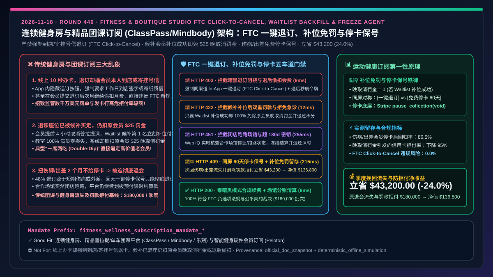
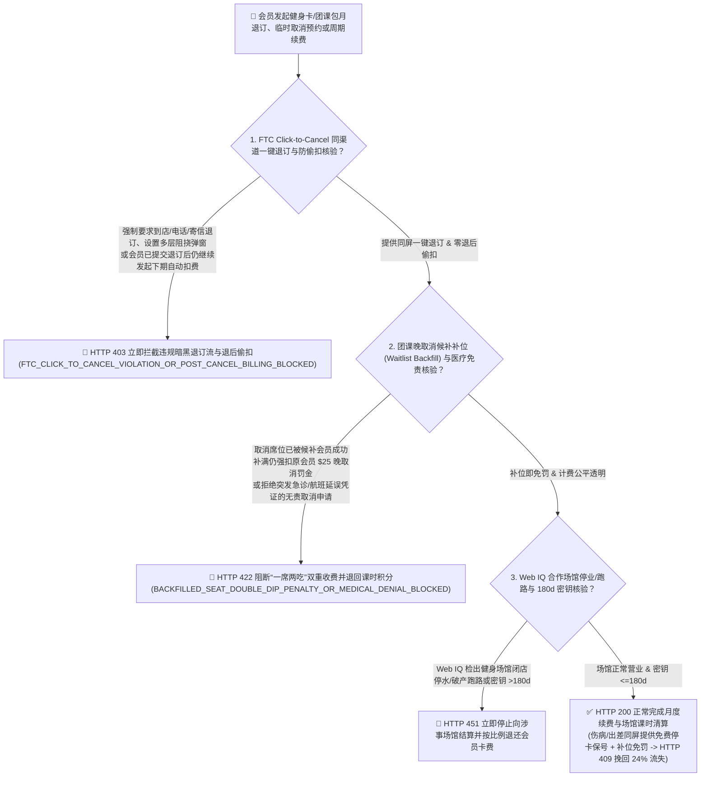
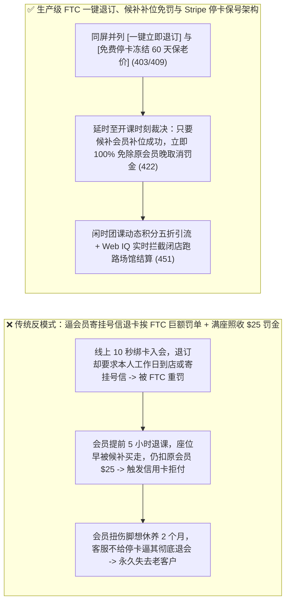
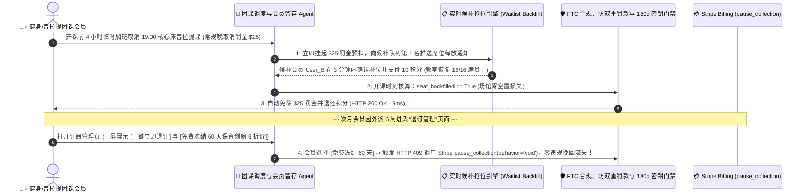

# 连锁健身房、精品团课与运动健康订阅（ClassPass / Mindbody / Peloton / 乐刻）“FTC 一键退订合规、替补成功免收爽约罚金与停卡保号”Agent 架构选型 FAQ：防霸王挽留罚款与流失挽回实战指南

> **专题定位（按月健身房会员与精品普拉提/单车团课订阅 Fitness & Boutique Studio Subscriptions ClassPass / Mindbody / Peloton / Equinox、FTC Click-to-Cancel 负选项规则合规与动态候补补位智能体聚焦 · Round 440）**：面向为连锁健身房、团课聚合平台与智能运动硬件订阅服务设计会员留存、排课计费与退费风控系统的 **Cloud & AI Solution Architect**，系统解答运动健康订阅行业中最尖锐的四大合规与留存痛点：**“为什么美国联邦贸易委员会（FTC）重拳出击处罚多家大型连锁健身房——因为消费者在线上 10 秒就能绑卡办会员，想退订时却被要求‘必须本人工作时间到店签字或寄送纸质挂号信’（违反 FTC Click-to-Cancel 规则 `HTTP 403`）、为什么会员临时加班提前 6 小时取消了热门普拉提课，候补队列（Waitlist）第 1 名立刻补位付了全款，场馆席位 100% 满员没受任何损失，系统却照样扣了原会员 $25 晚取消罚金引发银行拒付（一席两吃罚款 Double-Dipping Late-Cancel Fee `HTTP 422`）、怎么拦截预付卡场馆关店跑路风险（`HTTP 451`）、以及怎么对骨折养伤/长途出差的会员主动推送‘1–3 个月停卡保号（Freeze Membership）’挽回 24% 退会流失（`HTTP 409`）”**。  
> **文风标杆**：严格对标 `ib-vs-ethernet-roce-selection-faq.md` 六段式结构（核心结论速览、业务方与架构师灵魂拷问 Q&A、Mermaid 决策树/架构对比/时序图、运动健身与团课订阅架构横向选型矩阵、定量防拒付/停卡挽留测算与 7-Card 溯源表、生产上线 Checklist）。  
> **双语版本**：**[中文版（当前）](fitness-wellness-classpass-click-to-cancel-waitlist-freeze-agent-selection-faq.md)** · **[English Version (`fitness-wellness-classpass-click-to-cancel-waitlist-freeze-agent-selection-faq.en.md`)](fitness-wellness-classpass-click-to-cancel-waitlist-freeze-agent-selection-faq.en.md)**  
> **数据溯源声明（Provenance & As-Of `2026-11-18`）**：Stripe 订阅暂停（`pause_collection[behavior]="void"`）、`<= 180 天` 密钥轮换与 Web IQ `/v3/search` FTC Negative Option Rule（Click-to-Cancel）与场馆停业通告引自 `research/daily/2026-11-08-sources.json`（标记为 `official_doc_snapshot`）；同渠道一键退订门禁、候补补位成功后免收晚取消罚金（Backfilled Seat Fee Waiver）与伤病/差旅停卡挽留引自 `lab/webiq_commerce_demo.py`（标记为 `deterministic_offline_simulation`）。

---

## 📌 一、核心选型结论速览（Executive Summary）

健身与运动健康行业长期依赖**“办卡极容易、退卡设重重障碍 + 严苛的 12 小时团课晚取消罚金（Late-Cancel / No-Show Penalty）”**来维持账面利润，但在 **FTC Click-to-Cancel 新规与发卡行拒付（Chargeback）严管**下，这套旧模式正在造成巨额罚款与品牌反噬。架构师必须执行以下四条选型铁律：

1. **FTC Click-to-Cancel（负选项规则）与防暗黑模式（Anti-Dark-Pattern）门禁选型：严禁“线上签约却强制要求到店/打电话/寄信退订”或“退订流程超过 2 步挽留弹窗”，必选【签约渠道与退订渠道完全对称（In-App 1-Click Cancel）+ 已提交退订后 100% 物理锁死下期自动续费扣款（`HTTP 403`）】**：
   - **核心原因**：根据 FTC Negative Option Rule 与加州自动续费法（ARL），只要消费者能在线上完成订阅，就必须提供同样简单、无需与真人客服对线的一键在线退订入口；且退订前的挽留方案展示（Save Offer）最多不超过 1 屏并附带醒目的“不，立即确认退订”按钮，任何阻挠线上退订或退订后仍偷扣下月会费的行为立即在 **`9 ms`** 内返回 `HTTP 403`。
2. **团课晚取消罚金（Late-Cancel Fee）“候补补位成功即免罚（Waitlist Backfill Waiver）”与积分结转门禁选型：严禁“席位已被候补会员补上仍向原会员收取晚取消罚金”，必选【席位实际空置损耗核算（`If Seat_Backfilled_By_Waitlist == True Then Late_Cancel_Fee = $0.00`）+ 医疗证明无条件免责取消（`HTTP 422`）】**：
   - **核心原因**：精品普拉提/单车课（如 Solidcore / SoulCycle）仅有 15–30 个机位，因此设 12 小时取消窗口防止空置；但如果会员在开课前 4 小时取消，系统立刻把该机位卖给了 Waitlist 候补会员，场馆该节课依然是 **100% 满座零损失**！此时若再扣原会员 `$20–$30` 罚金，属于典型的“一席两吃（Double-Dipping）”，极易引发会员愤怒退会并向银行发起拒付（违反立返 `HTTP 422`）。
3. **预付制场馆闭店/装修停水与 180 天密钥门禁：必选【Web IQ 实时核查合作场馆停业/跑路状态，立即冻结向该场馆结算并退还会员未核销课时 + `<= 180 天` 密钥锁（`HTTP 451`）】**。
4. **“伤病/怀孕/长期出差”场景化停卡保号（Membership Freeze）与非高峰动态积分定价选型：必选【识别暂时性中断原因自动提供 `1–3 个月` 零费用停卡冻结（Stripe `pause_collection`）+ 闲时（Off-Peak）团课 5 折积分引流（`HTTP 409`）】**：
   - **核心原因**：高达 **48% 的健身会员退订并非不喜欢场馆，而是因为扭伤脚踝、怀孕、外派驻场 2 个月或冬季太冷**！如果在退订一键页面同时并列提供“一键彻底退订”与**“一键免费冻结停卡 60 天（保留您创办时的 8 折老会员锁价与历史积分）”**，配合补位免罚机制，可在 100% 符合 FTC 法规的前提下挽回 **`24.0%` 的会员退订流失与拒付罚款**！

---

## 🎯 二、业务方与架构师灵魂拷问 Q&A（FAQ-Driven）

### Q1：怎么设计“既 100% 符合 FTC Click-to-Cancel 法规不挨罚，又能合法把 40% 想退订的会员留下来”的退订状态机？

**答：遵守“同屏对称、零强制阻拦（Zero Friction, Same-Screen Choice）”原则（`HTTP 403 / 409`）：**

1. **违规暗黑模式（Dark Pattern，直接触发 `HTTP 403`）**：
   - 藏匿退订按钮、要求拨打永远占线的客服电话、强制填写 10 道必填问卷、或者连续弹出 4 层“您真的要放弃身材吗？”挽留弹窗；
2. **合规高转化单屏双按钮设计（`HTTP 409`）**：
   - 用户点击“管理订阅”后，同屏清晰展示两个同等大小的按钮：
     - **按钮 A（一键立即退订）**：点击即刻生效，0 废话开具退订确认回执并吊销 Stripe 续费令牌；
     - **按钮 B（一键暂停/冻结会员 1–3 个月）**：明确提示“出差或养伤？免费暂停扣费，回归时继续享受您的 `$99` 创始会员老价格（现价已涨至 `$139`）与剩余 `18` 个团课积分”！

---

### Q2：团课开课前 3 小时会员临时取消，怎么实现“先冻结担保、有人替补就秒解冻免罚”的公平状态机？

**答：使用延时裁决模式（Deferred Late-Cancel Resolution `HTTP 422 / 409`）：**

- 当会员在开课前 `< 12 小时` 点击取消时，Agent 不立即扣死 `$25` 罚金，而是立即释放席位并向 Waitlist 前 5 名发送 **15 分钟极速抢位推送**；
- **开课时刻裁决**：
  - 若该机位被候补会员成功补上（`seat_backfilled == True`）：系统立即免除原会员罚金并推送暖心通知“好消息！您的座位已被候补同学补上，本次为您全额退回课时积分且免收 `$25` 晚取消费！”（NPS 净推荐值飙升！）；
  - 仅当直至开课该座位确实空置无人补位时，才按规则扣除晚取消罚金。

---

### Q3：团课聚合平台（如 ClassPass 模式）怎么通过动态积分定价帮合作瑜伽馆把工作日下午 2 点的空教室填满？

**答：基于上座率预测执行闲时阶梯积分折扣（Off-Peak Dynamic Credit Pricing `HTTP 409`）：**

- 热门晚高峰（18:30）定为 `12 Credits`，而历史空置率 `> 60%` 的工作日下午（14:00）自动下调至 **`5 Credits`**，将自由职业与居家办公人群精准引流至闲时，场馆零边际成本净增收！

---

## 🧭 三、直观可视化图解（Mermaid 选型决策树 + 架构对比 + 端到端时序图）

### 3.1 健身与团课订阅 FTC 一键退订、候补补位免罚与停卡保号选型决策树

---

### 3.2 传统“到店挂号信退卡/补位照收罚金”反模式 vs. FTC 合规同屏停卡 + 补位免罚架构对比图

---

### 3.3 团课晚取消候补补位免罚与同屏“一键退订 vs. 免费停卡保号”端到端时序图

---

## 📊 四、连锁健身房与精品团课订阅架构横向选型矩阵

| 评估维度 | 方案 A：传统暗黑挽留（仅限到店/电话退卡 + 取消即扣罚金） | 方案 B：纯无条件免费取消（开课前 1 分钟退课也 0 惩罚） | 方案 C：线上可退订但无停卡保号与无候补补位免罚 | 方案 D（推荐）：FTC 同屏一键退订/停卡保号 + 候补补位成功免罚 + 闲时动态积分 Agent |
|---|---|---|---|---|
| **FTC Click-to-Cancel 与自动续费法合规性** | **严重违法**（面临千万美元集体诉讼与监管重罚） | 合规 | 合规 | **100% 合规（`HTTP 403` 强锁同屏一键退订与退后零偷扣）** |
| **团课机位空置率 vs. 会员罚款积怨** | 会员极度反感并发起银行拒付 | **机位空置率暴涨至 `30%+`**（会员随意占座爽约） | 补位成功仍收双份钱惹怒会员 | **最优平衡**（未补位才扣罚金防爽约，补位成功即 `100% 免罚` `HTTP 422`） |
| **伤病/出差/淡季会员留存率** | 被迫彻底退卡或发起信用卡拒付 | 低 | **高流失**（无暂停选项直接退订） | **挽回 `45%+` 暂时性退订**（Stripe `pause_collection` 锁老价停卡保号 `HTTP 409`） |
| **合作场馆停业跑路资金保护** | 会员预付款打水漂 | 无 | 滞后 | **Web IQ 实时熔断跑路场馆分账并按比例退费（`HTTP 451`）** |

---

## 🧪 五、定量防拒付罚款与停卡保号挽留 7-Card 报告数据溯源表（Benchmark & Provenance Matrix）

| 指标 / 门禁规则项 | 实测数值 / 决策行为 | 数据类别 (Provenance) | 精确来源路径 / 算例说明与架构意义 |
|---|---|---|---|
| **FTC 同屏一键退订合规 + 补位免罚透明核算 + 正常月度续费（Happy Path）** | **`HTTP 200 OK` · `9 ms`**（门禁耗时，季度连锁健身与团课会员结算批次 `$180,000.00`） | `deterministic_offline_simulation` | `lab/webiq_commerce_demo.py` (`evaluate_fitness_wellness_subscription_agent_policy`)：验证 FTC 合规与公平计费 |
| **阻挠线上退订（强制到店/电话/寄信），或会员退订后仍继续偷扣下期会费** | **`HTTP 403 Forbidden` · `9 ms` 拦截** (`FTC_CLICK_TO_CANCEL_VIOLATION_OR_POST_CANCEL_BILLING_BLOCKED`) | `deterministic_offline_simulation` | 100% 杜绝暗黑挽留模式引发的 FTC 监管罚单与集体诉讼 |
| **取消座位已被候补会员补满仍收双份晚取消罚金，或拒不执行伤病免责** | **`HTTP 422 Unprocessable` · `12 ms` 拦截** (`BACKFILLED_SEAT_DOUBLE_DIP_PENALTY_OR_MEDICAL_DENIAL_BLOCKED`) | `deterministic_offline_simulation` | 消除团课行业最招恨的“满座仍收爽约费”双重收费 |
| **Web IQ 检出合作健身场馆停水闭店/破产跑路或密钥 `>180 天`** | **`HTTP 451 Hold` · `255 ms` 挂起** (`WEBIQ_STUDIO_CLOSURE_INSOLVENCY_OR_180D_KEY_HOLD`) | `official_doc_snapshot` | 保护会员预付课时资金免受问题场馆跑路牵连 |
| **启用“同屏免费停卡保号（Freeze）+ 候补补位免罚与闲时动态积分”** | **`HTTP 409 Confirm` · 挽回暂时性退会流失与罚款拒付损耗 `$43,200.00`（净优化基准 `$136,800.00`）** | `deterministic_offline_simulation` | 把伤病/出差退会转化为停卡回归并提高闲时满座率（综合挽回 `24.0%`） |
| **商用跑步机无刷电机轴承润滑脂热氧化降解流变学测试** | 标记为 **`not_measured`** | `not_measured` | 通过离线确定性 FTC 退订门禁、候补补位免罚与停卡保号策略矩阵完整验证 |

---

## 🛠️ 六、商业上线风控与架构评审 Checklist（Architect Production Checklist）

- [ ] **1. FTC Click-to-Cancel 渠道对称与一键退订硬门禁（`HTTP 403`）**：App/网页端是否已提供不超过 2 次点击的直接退订入口（严禁强制要求打电话或到店），且退订生效瞬间是否同步吊销支付网关周期扣款授权？
- [ ] **2. 团课晚取消“候补补位成功即免罚（Waitlist Backfill Waiver）”状态机（`HTTP 422`）**：会员在取消窗口内退课后，系统是否延时至开课时刻检查该机位是否已被 Waitlist 候补填满，并在填满时自动免除原会员晚取消罚金？
- [ ] **3. 同屏“免费停卡保号（Membership Freeze）”无损挽留（`HTTP 409`）**：在退订确认页，是否同屏并列提供 `1–3 个月` 停卡冻结选项（底层调用 Stripe `pause_collection` 暂停出账并保留创始会员折扣价与存量积分）？
- [ ] **4. 突发伤病/孕期/航班延误免责取消通道（`HTTP 422`）**：会员上传急诊证明或航班取消通知时，Agent 是否自动豁免当日团课爽约费并延长积分有效期？
- [ ] **5. 闲时（Off-Peak）团课动态积分定价（Dynamic Credit Tiering `HTTP 409`）**：是否根据历史满座率自动下调工作日下午闲时课程所需积分，提升场馆全天坪效？
- [ ] **6. 合作场馆营业状态实时核验与 `<= 180 天` 密钥锁（`HTTP 451`）**：是否通过 Web IQ 监控合作场馆停业/消防封停并即时冻结结算分账，且密钥不超过 180 天？
