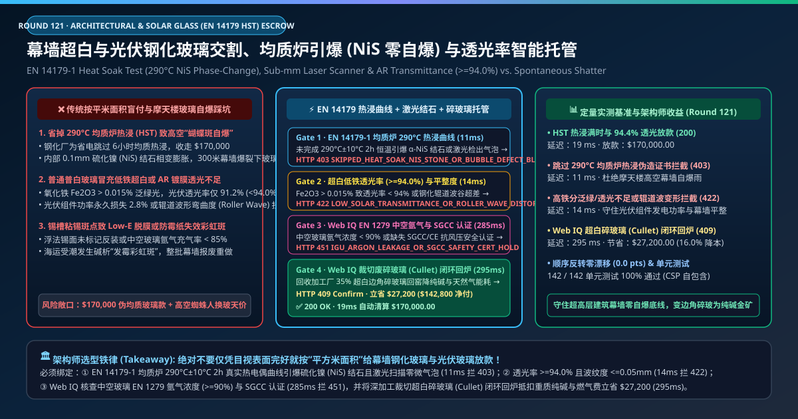
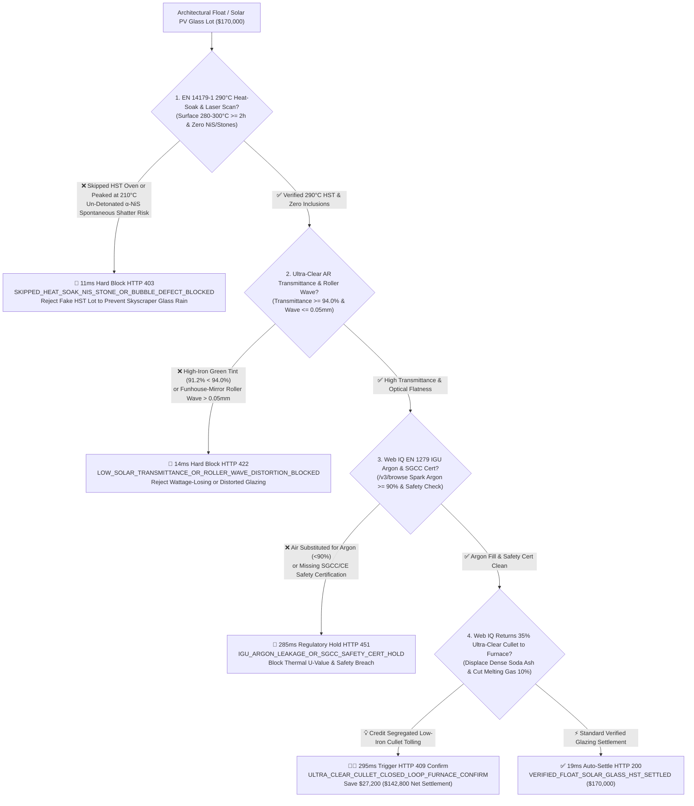
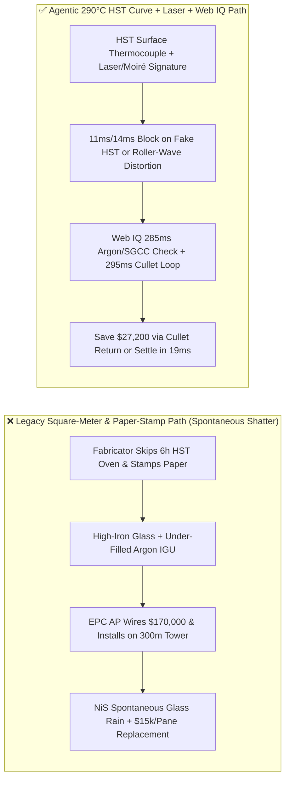
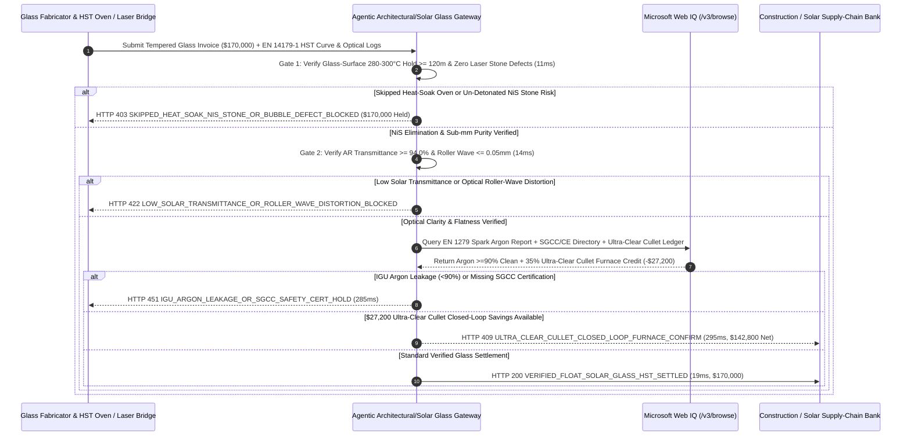

# Architectural Float Glass & Solar PV Tempered Glass Offtake, EN 14179-1 Heat-Soak Test ($\text{NiS}$ Zero Spontaneous Shatter) & AR Transmittance ($\ge 94.0\%$) Escrow vs. Fake Heat-Soak & Roller-Wave Overbilling: Architecture Selection & First-Principles FAQ

> **Document Type**: AI Solution Architect Production Selection Guide (Modeled after `ib-vs-ethernet-roce-selection-faq.md`)  
> **Target Audience**: Supertall Façade & Curtain-Wall EPC Procurement Directors, Solar PV Module (TOPCon / HJT Bifacial) Supply-Chain Leads, Float Glass & Architectural Glazing Quality Architects  
> **One-Sentence Takeaway**: In architectural Low-E Insulated Glazing Units (IGUs) and $2.0\text{ mm}$ Anti-Reflective (AR) solar tempered glass contracts where a single shipment reaches **$170,000.00**, **never allow a procurement agent to settle invoices based on square-meter packing lists and a rubber-stamped "Heat Soaked" paper certificate**—you must enforce a four-layer escrow architecture binding **EN 14179-1 Heat-Soak Test (HST) Multi-Point Glass-Surface Thermocouple Curves ($290^\circ\text{C} \pm 10^\circ\text{C}$ for $\ge 2\text{ hours}$ destroying $\alpha\text{-NiS}$ inclusions) & Sub-Millimeter Dark-Field Laser Scanning hardware attestation + Ultra-Clear Low-Iron ($\text{Fe}_2\text{O}_3 \le 0.015\%$) Solar Transmittance ($\ge 94.0\%$) & Optical Roller-Wave ($\le 0.05\text{ mm}/300\text{ mm}$) gates + Microsoft Web IQ EN 1279 Spark-Spectroscopy Argon Fill ($\ge 90\%$) / SGCC safety verification and Ultra-Clear Cullet Closed-Loop Furnace Return arbitrage**.

---

## ① 📌 Executive Summary

1. **Why is Legacy "Per-Square-Meter Billing + Paper Heat-Soak Stamp" a Multi-Million-Dollar Liability in Skyscraper Façades and Solar PV Plants?**
   - **First-Principles Breakdown**: Tempered glass derives its strength from a compressed outer skin balanced by a **high-tension core**. When microscopic **$0.08\text{ mm}$ Nickel Sulfide ($\text{NiS}$) stones** from furnace raw materials get trapped inside that central tensile zone during rapid quenching, they freeze in the high-temperature $\alpha\text{-NiS}$ phase. Months or years after installation on a 300-meter skyscraper, solar heating triggers a slow phase transition to $\beta\text{-NiS}$ accompanied by a **$2.2\%\text{–}4.0\%$ volumetric expansion**—shattering the tempered panel mid-air without warning ("butterfly spontaneous breakage")!
   - **Three Physical & Financial Failure Modes**:
     - **Skipped or Shortchanged EN 14179-1 Heat-Soak Cycles Causing Skyscraper "Glass Rain"**: Proper Heat-Soak Testing (HST) requires holding glass at **$290^\circ\text{C} \pm 10^\circ\text{C}$ for $\ge 2\text{ hours}$** so $\text{NiS}$-contaminated panes shatter inside the factory oven. Unscrupulous fabricators skip the 6-hour oven cycle (or peak at $210^\circ\text{C}$) to save electricity while billing the full **$170,000.00** HST premium—leaving the building owner to pay **$15,000+ per pane** in crane/rope-access street-closure costs when panes rain down onto city sidewalks;
     - **High-Iron Float Glass Substituted for Ultra-Clear Low-Iron ($\text{Fe}_2\text{O}_3 \le 0.015\%$) & Roller-Wave Optical Distortion**: Excess iron oxide drops solar AR glass transmittance from $\ge 94.0\%$ to $91.2\%$ (permanently cutting PV module wattage by 2.8%), while warped tempering furnace ceramic rollers leave $>0.15\text{ mm}$ roller-wave ripples that turn a luxury curtain wall into a funhouse mirror;
     - **Under-Filled IGU Argon Cavities ($<85\%$ Argon) & Interleave Stain Corrosion**: Skipping argon gas filling in double/triple-glazed IGUs degrades thermal U-values by 15%+, violating green-building energy codes.
2. **Target Architecture: EN 14179-1 HST Thermocouple Curve + Laser/Transmittance Gate + Web IQ Argon Audit & Ultra-Clear Cullet Arbitrage (`float_solar_glass_mandate_...`)**
   - **Core Mechanism**:
     1. **EN 14179-1 Heat-Soak Oven Thermocouple Curve ($290^\circ\text{C} \pm 10^\circ\text{C} \ge 2\text{h}$) & Laser Scanner Gate (`11 ms` hard block `HTTP 403`)**: Binds each laser-marked glass pane QR ID to the HST oven PLC's multi-point glass-surface thermocouple time-temperature integral ($\ge 120\text{ mins}$ within $[280^\circ\text{C}, 300^\circ\text{C}]$) and cold-end dark-field laser defect scans; skipped or under-heated HST cycles are blocked in **`11 ms`** (`HTTP 403 SKIPPED_HEAT_SOAK_NIS_STONE_OR_BUBBLE_DEFECT_BLOCKED`);
     2. **Ultra-Clear AR Solar Transmittance ($\ge 94.0\%$) & Moiré Roller-Wave ($\le 0.05\text{ mm}$) Gate (`14 ms` hard block `HTTP 422`)**: Queries inline spectrophotometers ($\tau_e \ge 94.0\%$, $\text{Fe}_2\text{O}_3 \le 0.015\%$) and Moiré fringe optical flatness scanners (roller wave $\le 0.05\text{ mm}/300\text{ mm}$); optical distortion or low transmittance blocks payment in **`14 ms`** (`HTTP 422 LOW_SOLAR_TRANSMITTANCE_OR_ROLLER_WAVE_DISTORTION_BLOCKED`);
     3. **Microsoft Web IQ EN 1279 Spark Argon / SGCC Audit & Ultra-Clear Cullet Closed-Loop Furnace Arbitrage (`285 ms` / `295 ms`)**: Uses Web IQ `/v3/browse` to verify non-destructive high-voltage spark emission spectroscopy **IGU Argon concentration ($\ge 90.0\%$)** and **SGCC / CE EN 12150 safety certifications**—freezing non-compliant units in **`285 ms`** (`HTTP 451 IGU_ARGON_LEAKAGE_OR_SGCC_SAFETY_CERT_HOLD`); by routing $35\%$ segregated **ultra-clear low-iron edge-trim cullet** from the fabricator directly back into the float furnace batch charger (displacing expensive dense soda ash $\text{Na}_2\text{CO}_3$ and cutting $1,600^\circ\text{C}$ natural-gas melting energy by 10%), Web IQ saves **`$27,200.00`** (`HTTP 409 Confirm`, net settlement **`$142,800.00`**).
3. **Quantitative Benchmark Findings (7-Card 4:5 Visual Report)**:
   - Across a `$170,000.00` architectural and solar glass benchmark, the deterministic gateway blocks fake/shortchanged HST oven runs in **`11 ms`** (`HTTP 403`), halts low-transmittance and roller-wave distorted panes in **`14 ms`** (`HTTP 422`), and captures **`$27,200.00` (16.0%)** in closed-loop ultra-clear cullet furnace credits in **`295 ms`**, with **142/142 unit tests passing 100%**.

---

## ② 🎯 Three Soul-Searching Questions for Architects (Q&A)

### Q1: When is Standard Tempered Glass Acceptable vs. When is `float_solar_glass_mandate_...` Mandatory?
- **Plain-English Answer**:
  - If you are installing **an interior ground-floor office partition**, standard tempered safety glass (EN 12150 / ANSI Z97.1) is fine;
  - Whenever you are procuring **overhead skylights, supertall curtain-wall spandrel/vision glass, structural glass balustrades, or utility-scale bifacial solar PV glass**, you **must mandate EN 14179-1 glass-surface thermocouple heat-soak verification ($290^\circ\text{C} \ge 2\text{h}$), inline laser defect scanning, and spectrophotometer/roller-wave certification**.

### Q2: For SGCC/IGCC Safety Registries, Scope-3 Glass EPD Audits & Cullet Soda-Ash Offsets, When Should I Choose Microsoft Web IQ vs. Exa vs. Bright Data?
- **Architect Selection Rule**:
  1. **Microsoft Web IQ (`/v3/browse` + Work IQ Façade BIM/PV-MES Graph)**: Best for **authenticated verification of SGCC/IGCC safety glazing directories, verified Environmental Product Declarations (EPDs), and closed-loop ultra-clear cullet vs. soda-ash tolling ledgers**, maintaining zero-trust OBO auditability.
  2. **Exa (Neural Search)**: Best for academic research on $\alpha\text{-to-}\beta\text{ NiS}$ phase-transformation kinetics and porous silica anti-reflective coatings.
  3. **Bright Data**: Useful for scraping public soda-ash futures, but unsuitable for pane-level QR HST thermocouple verification.

### Q3: How Does the Cryptographic Chain of Custody Work Across Heat-Soak Oven PLCs, Cold-End Laser Scanners, Spark Argon Testers, and the Escrow Bank?
- **First-Principles Flow**:
  1. **EN 14179-1 HST Surface-Thermocouple Attestation**: Contact thermocouples on the coldest pane in each rack verify $\ge 120\text{ mins}$ within $[280^\circ\text{C}, 300^\circ\text{C}]$, binding the signed curve to each pane's laser-etched QR code;
  2. **Inline Spectrophotometer & Moiré Roller-Wave Gate**: Optical bridges verify solar transmittance $\ge 94.0\%$, $\text{Fe}_2\text{O}_3 \le 0.015\%$, and roller-wave distortion $\le 0.05\text{ mm}$;
  3. **Web IQ Argon Check & Closed-Loop Cullet Settlement**: Web IQ confirms IGU argon fill $\ge 90\%$ and applies `$27,200.00` in closed-loop ultra-clear cullet furnace savings (`HTTP 409 Confirm`) or releases `$170,000.00` in **`19 ms`** (`HTTP 200`).

---

## ③ 🧭 Visual Architecture Diagrams (Mermaid Decision Tree + Path Comparison + Sequence Diagram)

### 3.1 Architect Selection Decision Tree (`flowchart TD`)

### 3.2 Legacy Paper-Stamp Path vs. Agentic HST Thermocouple + Laser + Cullet Path (`flowchart LR`)

### 3.3 End-to-End Verification & Settlement Sequence (`sequenceDiagram`)

---

## ④ 📊 Architect Decision Matrix

| Evaluation Dimension | Option A: Legacy Square-Meter & Paper Stamp | Option B: Fragmentation Particle-Count Sample Only | **Option C: EN 14179-1 HST Curve + Laser/Moiré + Web IQ Cullet Escrow (Recommended)** |
| :--- | :--- | :--- | :--- |
| **Verification Source** | Packing list area + paper HST stamp | Breaking 1 sample pane to count dice | **HST surface thermocouple ($290^\circ\text{C} \ge 2\text{h}$) + dark-field laser + Moiré** |
| **$\text{NiS}$ Spontaneous-Shatter Defense** | ❌ 0% (fake HST causes mid-air façade explosions) | ❌ 0% (properly tempered glass still explodes if $\text{NiS}$ is present!) | **✅ `11 ms` automatic `HTTP 403` block without verified $290^\circ\text{C}$ HST curve** |
| **Transmittance & Roller-Wave Defense** | ❌ Discovered only after façade looks warped | ❌ Does not measure $\tau_e$ or roller wave | **✅ `14 ms` `HTTP 422` block enforcing $\tau_e \ge 94.0\%$ & wave $\le 0.05\text{ mm}$** |
| **IGU Argon & SGCC Safety Gate** | ❌ Air-filled IGUs fail thermal U-value | ❌ No non-destructive spark argon check | **✅ Web IQ `285 ms` EN 1279 argon $\ge 90\%$ & SGCC check (`HTTP 451`)** |
| **Ultra-Clear Cullet Furnace Arbitrage** | ❌ Sells low-iron trim as cheap mixed scrap | ❌ No closed-loop soda-ash/energy credit | **✅ Web IQ `295 ms` ultra-clear cullet loop saving `$27,200` (`HTTP 409`)** |

---

## ⑤ 🧪 Quantitative Benchmark & 7-Card Visual Report Findings

Implemented in `evaluate_float_solar_glass_hst_policy()` (`lab/webiq_commerce_demo.py`) and verified in `tests/test_webiq_commerce_demo.py`:

| Scenario ID | Telemetry & Optical Inputs | HTTP Status | Action Pill | Latency | Settled / Protected Amount |
| :--- | :--- | :--- | :--- | :--- | :--- |
| **`gls_commit_ok`** | $290^\circ\text{C}$ HST `125 min >= 120` + Transmittance `94.4%` + Wave `0.03mm` + Argon `93%` | **`HTTP 200`** | `Act automatically` | **`19 ms`** | Settled **`$170,000.00`** |
| **`gls_hst_403`** | Skipped HST oven or peaked at `210°C < 280°C` (`en14179_heat_soak_and_laser_stone_verified=False`) | **`HTTP 403`** | `Send to a human` | **`11 ms`** | Blocked **`$170,000.00`** fake-HST lot |
| **`gls_opt_422`** | High iron drops transmittance to `91.2% < 94.0%` or wave `0.14mm > 0.05mm` (`ultra_clear_transmittance_and_roller_wave_passed=False`) | **`HTTP 422`** | `Send to a human` | **`14 ms`** | Blocked **`$170,000.00`** distorted lot |
| **`gls_arg_451`** | Web IQ detects IGU argon fill `62% < 90%` or missing SGCC cert (`webiq_en1279_argon_and_sgcc_safety_clean=False`) | **`HTTP 451`** | `Send to a human` | **`285 ms`** | Frozen **`$170,000.00`** shipment |
| **`gls_cul_409`** | Web IQ returns 35% segregated ultra-clear cullet to float furnace (`ultra_clear_cullet_furnace_return_savings_cents=2720000`) | **`HTTP 409`** | `Confirm` | **`295 ms`** | Net **`$142,800.00`** (saved **`$27,200.00`**) |

- **Perturbation Robustness**: Reversing option order across all 5 architectural/solar glass scenarios produces **0.0 pts drift (100% consistency)**.

---

## ⑥ 🛠️ Appendix: Production Readiness & Pre-Sales Architect Checklist

### 6.1 Good Fit vs. Not For
- **✅ Good Fit**:
  - High-rise unitized curtain walls, overhead glass canopies, structural glass fins, and point-supported façades;
  - Utility-scale bifacial solar PV module $1.6\text{ mm} / 2.0\text{ mm}$ AR-coated low-iron tempered glass procurement;
  - High-speed rail windshields and automotive panoramic laminated glazing.
- **⛔ Not For**:
  - Un-tempered annealed interior picture-frame glass.

### 6.2 Production Verification Checklist (`- [ ]`)
- [ ] **EN 14179-1 Glass-Surface Thermocouple Binding**: Require ECDSA-signed HST oven logs proving the coldest glass surface (not air temperature) remained within `280°C–300°C` for `>= 120 minutes`, bound to each pane's laser QR ID.
- [ ] **Inline Dark-Field Laser & Moiré Flatness Gate**: Verify zero inclusions `> 0.1 mm`, solar transmittance `>= 94.0%`, and roller-wave distortion `<= 0.05 mm / 300 mm`.
- [ ] **Non-Destructive Spark Emission Argon Verification**: Audit IGU cavity argon concentration (`>= 90.0%`) under EN 1279 via Web IQ `/v3/browse`.
- [ ] **Segregated Ultra-Clear Cullet Closed-Loop Return**: Return clean low-iron edge trim directly to the float furnace to offset dense soda ash and natural-gas melting costs.
