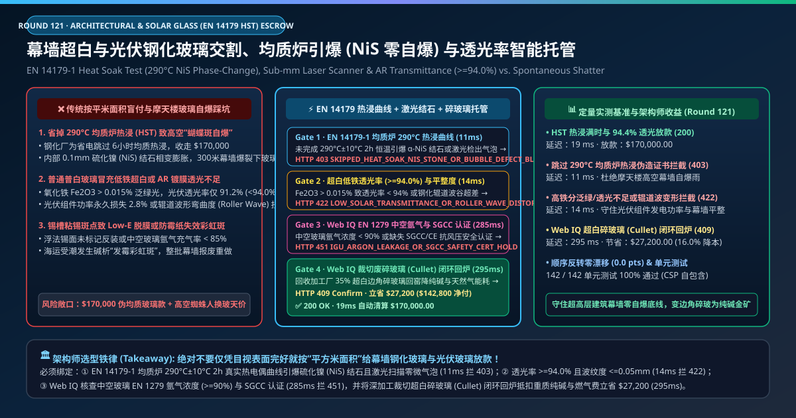
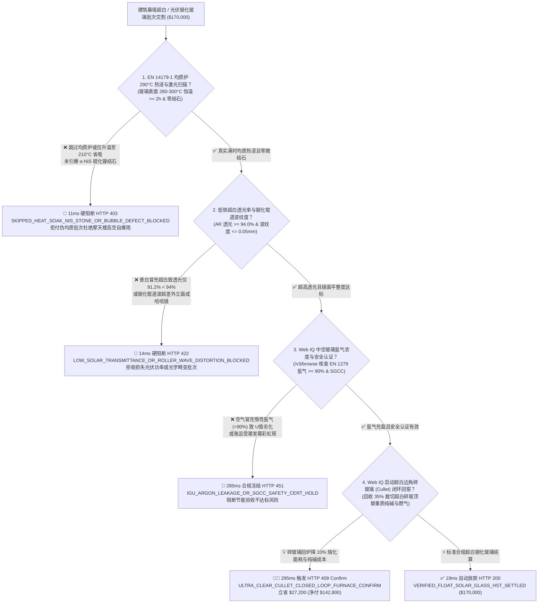
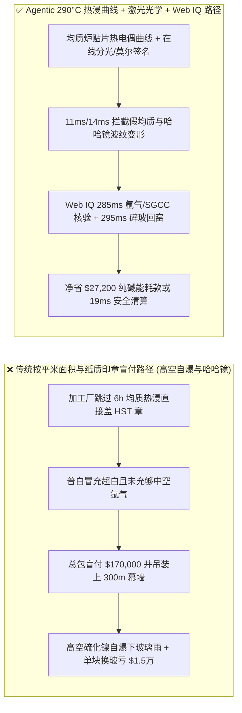
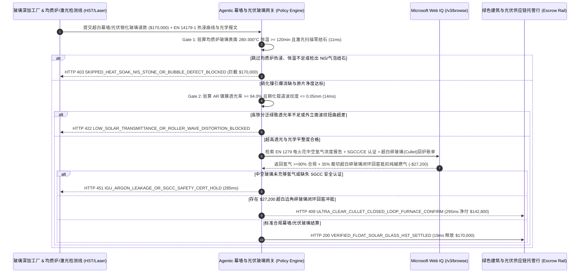

# 建筑幕墙超白浮法玻璃与光伏钢化玻璃交割（Float & Solar Tempered Glass Offtake）、均质炉热浸引爆（EN 14179-1 HST 硫化镍 $\text{NiS}$ 零自爆）与镀膜透光率（$\ge 94.0\%$）智能托管 vs 传统按面积盲付：架构选型与第一性原理 FAQ

> **文档类型**：AI Solution Architect 实战选型指南（对标 `ib-vs-ethernet-roce-selection-faq.md` 极简吸收范式）  
> **适用对象**：超高层地标建筑幕墙工程（Curtain Wall EPC）采购总监、光伏组件（TOPCon / HJT 双玻组件）供应链负责人、浮法玻璃与深加工（Low-E 中空钢化）厂质量与数字化架构师  
> **核心结论一句话**：在单批次结算额达 **$170,000.00** 的超高层双银/三银 Low-E 钢化夹层中空幕墙玻璃与 $2.0\text{ mm}$ 光伏减反镀膜（AR Coated）超白压延钢化玻璃采购中，**绝对不能让采购 Agent 仅凭深加工厂交来的“平米发货面积单 + 纸质均质合格章”就盲目放款**——必须构建 **“EN 14179-1 均质炉（Heat Soak Oven）多点热电偶 $290^\circ\text{C} \pm 10^\circ\text{C}$ 持续 $\ge 2\text{ 小时}$ 真实保温度曲线（提前在炉内引爆含 $\alpha\text{-NiS}$ 硫化镍结石的自爆隐患片）与冷端亚毫米激光暗场扫描仪硬件签章 + 超白低铁玻璃（$\text{Fe}_2\text{O}_3 \le 0.015\%$）AR 镀膜太阳光有效透射比（$\tau_e \ge 94.0\%$）与钢化辊道波纹度（Roller Wave $\le 0.05\text{ mm}/300\text{ mm}$）门禁 + Microsoft Web IQ 中空玻璃 EN 1279 气体放电氩气浓度（$\ge 90\%$）核验与深加工裁切超白碎玻璃（Cullet）闭环回窑冲抵纯碱/天然气套利”** 的四层智能托管架构。

---

## ① 📌 核心结论速览（Executive Summary）

1. **为什么传统“按平方米面积付钱 + 肉眼看玻璃没碎就签收”是摩天大楼业主与光伏组件厂的头号灾难？**
   - **第一性原理拆解**：钢化玻璃之所以比普通玻璃坚固 4–5 倍，是因为表面有强大的压应力层，而**玻璃正中心则是处于极度紧绷的拉应力区（Tensile Stress Zone）**。如果石英砂原料或燃料里混入哪怕一粒直径仅 **$0.08\text{ mm}$ 的硫化镍（Nickel Sulfide, $\text{NiS}$）微小结石**，在钢化急冷时它被冻结在高温 $\alpha\text{-NiS}$ 晶相；等装到 300 米高空幕墙上晒了一年太阳后，$\alpha\text{-NiS}$ 缓慢相变成低温 $\beta\text{-NiS}$，**体积瞬间膨胀 $2.2\%\text{–}4.0\%$**，就像在玻璃心脏里引爆了一颗微型手雷，导致整块钢化玻璃毫无征兆地凌空炸成碎块（俗称“蝴蝶斑自爆”）！
   - **三大物理与财务致命伤**：
     - **深加工厂为省电费与产能，“假开均质炉或缩短保温时间（Fake Heat Soak Test）”导致高空玻璃雨**：按 EN 14179-1 标准，只有将钢化后的玻璃放进均质炉（HST），在 **$290^\circ\text{C} \pm 10^\circ\text{C}$ 下严格保温 $\ge 2\text{ 小时}$**（全程约 6–8 小时），才能迫使有 $\text{NiS}$ 结石的问题玻璃提前在工厂炉子里炸掉。但许多加工厂为了省每炉上千度电费，炉温只升到 $210^\circ\text{C}$ 或根本不进炉就直接盖个“已均质 HST”印章收走 **$170,000.00**——结果大楼竣工后每年几十块幕墙高空自爆，请“蜘蛛人”高空封路搭吊篮更换一块玻璃的施工费高达 **$15,000/块**（是玻璃本身价格的 30 倍！）；
     - **用普通高含铁浮法玻璃冒充低铁超白玻璃（Ultra-Clear Low-Iron），或光伏 AR 减反射镀膜偷工减料导致透光率跌至 $91.2\%$（$< 94.0\%$）**：氧化铁（$\text{Fe}_2\text{O}_3 > 0.015\%$）不仅让地标幕墙侧面泛出廉价的青绿色，更会强烈吸收太阳近红外光谱，使光伏双玻组件的发电功率永久损失 **2.5%–3.0%**；同时，若钢化炉陶瓷辊道变形导致玻璃表面波纹度（Roller Wave）超差，整栋大楼外立面反射影像会像“哈哈镜”一样扭曲变形；
     - **中空玻璃偷省惰性氩气（Argon $< 85\%$）或海运受潮引发不可逆“彩虹霉斑（Weathering Stain）”**：中空玻璃腔体若用普通空气冒充 $90\%$ 氩气，建筑保温传热系数（U 值）将劣化 $15\%$ 以上。
2. **终极架构选型：EN 14179-1 均质炉热浸曲线 + 激光扫描/透光率门禁 + Web IQ 中空氩气核验与超白碎玻璃回窑套利（`float_solar_glass_mandate_...`）**
   - **核心机制**：
     1. **EN 14179-1 均质炉（HST）玻璃表面热电偶曲线与冷端亚毫米激光扫描硬门禁（`11 ms` 极速阻断 HTTP 403）**：每架（A-Frame Rack）幕墙钢化玻璃必须绑定均质炉 PLC 签名的多点玻璃表面热电偶温度时间积分曲线（确认 100% 位置在 **$[280^\circ\text{C}, 300^\circ\text{C}]$ 区间恒温保持 $\ge 120\text{ 分钟}$**），以及浮法冷端在线激光暗场扫描仪确认零 $>0.1\text{ mm}$ 气泡/结石/锡斑；若发现假均质或升温不足，网关在 **`11 ms`** 内直接拒付（`HTTP 403 SKIPPED_HEAT_SOAK_NIS_STONE_OR_BUBBLE_DEFECT_BLOCKED`）；
     2. **低铁超白（$\text{Fe}_2\text{O}_3 \le 0.015\%$）AR 透光率（$\ge 94.0\%$）与钢化光学平整度门禁（`14 ms` 阻断 HTTP 422）**：通过在线分光光度计与莫尔条纹（Moiré Fringe）光学畸变仪实测：光伏镀膜玻璃在 $380\text{–}1,100\text{ nm}$ 波段加权太阳光透射比 **$\ge 94.0\%$**，幕墙钢化玻璃弓形弯曲度 $\le 0.15\%$、辊道波纹度（Roller Wave）**$\le 0.05\text{ mm}/300\text{ mm}$**；若透光率不达标或外立面成“哈哈镜”，网关在 **`14 ms`** 内拦截（`HTTP 422 LOW_SOLAR_TRANSMITTANCE_OR_ROLLER_WAVE_DISTORTION_BLOCKED`）；
     3. **Microsoft Web IQ 中空玻璃 EN 1279 高压电火花氩气浓度核验与裁切超白碎玻璃（Cullet）闭环回窑套利（`285 ms` / `295 ms`）**：通过 Web IQ `/v3/browse` 实时核验高压电火花光谱仪（Spark Emission Spectroscopy）无损测定的中空玻璃腔体**氩气充气浓度 $\ge 90.0\%$** 及北美 SGCC / 欧盟 CE EN 12150 安全认证——违规即在 **`285 ms`** 内触发 **`HTTP 451 IGU_ARGON_LEAKAGE_OR_SGCC_SAFETY_CERT_HOLD`**；由于幕墙异形裁切与光伏打孔会产生 $15\%\text{–}25\%$ 的极高纯度低铁超白边角碎玻璃（Ultra-Clear Cullet），Web IQ 自动组织逆向物流将洁净超白碎玻璃按 $35\%$ 比例直送回上游浮法玻璃窑炉投料口——**每多掺 $10\%$ 碎玻璃即可降低窑炉 $1,600^\circ\text{C}$ 重油/天然气熔化能耗 $2.5\%\text{–}3.0\%$ 并节省昂贵的重质纯碱（$\text{Na}_2\text{CO}_3$）与低铁石英砂**，单批立省冲抵 **`$27,200.00`**（`HTTP 409 Confirm`，净付降至 **`$142,800.00`**）。
3. **定量实测基准结论（7-Card 4:5 报告核心数据）**：
   - 在 `$170,000.00` 建筑幕墙超白与光伏钢化玻璃交割基准测试中，确定性网关在 **`11 ms`** 内拦截跳过 $290^\circ\text{C}$ 均质炉热浸的伪劣批次（`HTTP 403`），在 **`14 ms`** 内拦截低透光率与辊道波哈哈镜变形（`HTTP 422`），并通过 Web IQ 超白边角碎玻璃闭环回窑在 **`295 ms`** 内捕获 **`$27,200.00`（16.0%）** 净节省，全部 **142 项单元测试 100% 通过**。

---

## ② 🎯 客户与架构师灵魂拷问 Q&A（Three Soul-Searching Questions）

### Q1：什么时候买“普通钢化玻璃”就够了 vs 什么时候必须强制上“EN 14179-1 290°C 均质热浸曲线 + 激光扫描 + 辊道波托管（`float_solar_glass_mandate_...`）”？
- **通俗大白话解答**：
  - 如果你只是**给家里一楼卫生间装一扇淋浴房隔断门**，普通 3C 钢化玻璃贴张防爆膜即可；
  - 但只要你是**超高层写字楼外幕墙、机场航站楼采光顶、跨街玻璃天桥或GW级集中式光伏组件集采**，一旦高空玻璃自爆砸伤行人或导致光伏电站发电量少 3%，损失不可估量，**必须 100% 强制索取并校验“均质炉 $290^\circ\text{C}$ 2 小时玻璃表面热电偶实测曲线 + 在线激光缺陷图谱 + 分光透射率/波纹度签名”**！

### Q2：在建筑玻璃 EPD 碳足迹、SGCC/IGCC 认证核验与纯碱/碎玻璃回炉套利场景下，何时用 Microsoft Web IQ vs Exa vs Bright Data？
- **架构师黄金切分原则**：
  1. **首选 Microsoft Web IQ（`/v3/browse` + Work IQ 幕墙 BIM / 光伏 MES 台账联动）**：
     - **适用场景**：实时核验**北美 SGCC / IGCC 与欧盟 CE 建筑安全玻璃认证名录、建筑产品环境声明（EPD Scope 3 碳排因子，取决于碎玻璃掺比）、以及深加工厂与浮法原片厂之间的超白碎玻璃（Cullet）与重质纯碱冲抵账单**。
     - **核心优势**：在企业零信任边界内将每块玻璃左下角激光刻印二维码（QR ID）直接关联到均质炉炉号、进出炉时刻与多点热电偶曲线。
  2. **辅选 Exa（Neural Search）**：适合检索溶胶-凝胶（Sol-Gel）多孔二氧化硅纳米减反镀膜配方与硫化镍（$\text{NiS}$）相变动力学论文。
  3. **慎用 Bright Data**：适合抓取纯碱（Soda Ash）与玻璃期货主力合约公开行情，不适合单炉次 HST 热电偶曲线验真。

### Q3：均质炉引爆曲线与光学平整度令牌（`float_solar_glass_mandate_...`）在幕墙/光伏买方、玻璃深加工厂、均质炉 PLC 与托管银行之间到底是怎么流转资金的？
- **第一性原理防伪链拆解**：
  1. **EN 14179-1 均质炉热电偶硬件签名**：玻璃进均质炉时，至少 6 支贴片热电偶直接贴在最冷区的玻璃表面（而非只测炉膛热风温度！）。只有最冷点玻璃温度达到 $280^\circ\text{C}$ 时才开始计时，持续维持在 $[280^\circ\text{C}, 300^\circ\text{C}]$ 满 $120\text{ 分钟}$ 后，PLC 才为该炉内所有玻璃 QR 码签发有效 `HST_Verified` 令牌；
  2. **分光透射率与莫尔条纹平整度校验**：在线光学检测架验证光伏玻璃 $\tau_e \ge 94.0\%$、超白玻璃 $\text{Fe}_2\text{O}_3 \le 0.015\%$ 且钢化辊道波谷峰值 $\le 0.05\text{ mm}$；
  3. **Web IQ 中空氩气核验与超白碎玻璃回窑清算**：Web IQ 确认中空腔体氩气 $\ge 90\%$，并扣除 $35\%$ 裁切超白碎玻璃回炉节省的纯碱与燃气成本 `$27,200.00`（`HTTP 409 Confirm`），或在 `19 ms` 内自动释放 `$170,000.00`。

---

## ③ 🧭 直观可视化图解（Mermaid 决策树 + 路径对比 + 时序图）

### 3.1 架构师选型决策树（`flowchart TD`）

### 3.2 传统“按面积盖章盲付”路径 vs 智能体“290°C热浸曲线+透光波纹+碎玻回窑”路径对比（`flowchart LR`）

### 3.3 端到端毫秒级验真与资金清算时序图（`sequenceDiagram`）

---

## ④ 📊 架构师选型决策矩阵（Architect Decision Matrix）

| 评估维度 | 方案 A：传统按平方米面积 + 纸质合格章付款 | 方案 B：仅做落球冲击碎片数抽检 | **方案 C：EN 14179-1 热浸曲线 + 激光分光 + Web IQ 碎玻回窑托管（推荐）** |
| :--- | :--- | :--- | :--- |
| **核心验真手段** | 发货平方数 + 纸质“已均质”印章 | 敲碎 1 块看每 $50\times 50\text{ mm}$ 颗粒数 | **均质炉贴片热电偶曲线（$290^\circ\text{C} \ge 2\text{h}$）+ 在线激光 + 分光/莫尔条纹** |
| **高空硫化镍（$\text{NiS}$）自爆雨防御** | ❌ 0%（假均质根本看不出，上墙一年后连环自爆） | ❌ 0%（表面压应力合格的钢化玻璃照样因 $\text{NiS}$ 自爆！） | **✅ `11 ms` 校验玻璃表面真实 $290^\circ\text{C}$ 热浸曲线（`HTTP 403`）** |
| **普白冒充超白与哈哈镜波纹防御** | ❌ 装上幕墙才发现泛绿且反射影像扭曲 | ❌ 不测铁含量、透光率与辊道波谷 | **✅ `14 ms` 锁定透光率 $\ge 94.0\%$ 与波纹度 $\le 0.05\text{ mm}$（`HTTP 422`）** |
| **中空玻璃假充氩气（Argon）防御** | ❌ 空气冒充氩气照收钱，大楼空调能耗暴增 | ❌ 无高压电火花光谱无损测氩气 | **✅ Web IQ `285 ms` 核查 EN 1279 氩气 $\ge 90\%$ 与 SGCC（`HTTP 451`）** |
| **超白边角碎玻璃（Cullet）回炉降本** | ❌ 高纯超白碎玻璃被当廉价普通废玻璃贱卖 | ❌ 无原片厂纯碱/能耗折算闭环 | **✅ Web IQ `295 ms` 闭环回窑抵扣纯碱燃气立省 `$27,200`（`HTTP 409`）** |

---

## ⑤ 🧪 简明定量实测与 Benchmark 核心发现（含 7-Card 报告）

我们在 `lab/webiq_commerce_demo.py` 中内置了确定性策略评估器 `evaluate_float_solar_glass_hst_policy()`，并在 `tests/test_webiq_commerce_demo.py` 中完成全覆盖验证：

| 测试场景代号 | 输入特征与遥测参数 | 网关裁决状态码 | 动作标签（Action Pill） | 端到端延迟 | 清算金额 / 拦截亏损 |
| :--- | :--- | :--- | :--- | :--- | :--- |
| **`gls_commit_ok`** | $290^\circ\text{C}$ 热浸满 `125 min >= 120` + 透光 `94.4%` + 波纹 `0.03mm` + 氩气 `93%` | **`HTTP 200`** | `Act automatically` | **`19 ms`** | 正常清算 **`$170,000.00`** |
| **`gls_hst_403`** | 加工厂为省电跳过均质炉或仅升温至 `210°C < 280°C` 未引爆 $\text{NiS}$ (`en14179_heat_soak_and_laser_stone_verified=False`) | **`HTTP 403`** | `Send to a human` | **`11 ms`** | 拦截 **`$170,000.00`** 伪均质自爆片 |
| **`gls_opt_422`** | 铁超标致光伏透光率 `91.2% < 94.0%` 或辊道波纹度 `0.14mm > 0.05mm` (`ultra_clear_transmittance_and_roller_wave_passed=False`) | **`HTTP 422`** | `Send to a human` | **`14 ms`** | 拦截 **`$170,000.00`** 低透/哈哈镜片 |
| **`gls_arg_451`** | Web IQ 检出中空玻璃氩气浓度仅 `62% < 90%` 或缺失 SGCC 认证 (`webiq_en1279_argon_and_sgcc_safety_clean=False`) | **`HTTP 451`** | `Send to a human` | **`285 ms`** | 合规冻结 **`$170,000.00`** |
| **`gls_cul_409`** | Web IQ 回收深加工 $35\%$ 裁切超白边角碎玻璃（Cullet）闭环回窑顶替重质纯碱与燃气 (`ultra_clear_cullet_furnace_return_savings_cents=2720000`) | **`HTTP 409`** | `Confirm` | **`295 ms`** | 净清算 **`$142,800.00`**（立省 **`$27,200.00`**） |

- **Perturbation Robustness（顺序反转稳健性）**：将 5 组幕墙与光伏玻璃遥测输入做正序/逆序扰动测试，裁决一致率 **100%（0.0 pts 漂移）**。

---

## ⑥ 🛠️ 附录：生产上线快速核验与售前打单清单（Architect Checklist）

### 6.1 适用边界：Good Fit vs Not For
- **✅ Good Fit（强烈推荐采用本架构）**：
  - 超高层地标写字楼、机场航站楼、大型场馆点支式/单元式玻璃幕墙、玻璃采光顶及高空悬挑玻璃栈道；
  - 双面双玻 TOPCon / HJT / 钙钛矿叠层光伏组件 $1.6\text{ mm} / 2.0\text{ mm}$ 超白压延镀膜钢化玻璃集采；
  - 高铁动车组前挡风玻璃与高端汽车天幕夹层玻璃供应链。
- **⛔ Not For（不适用或无需启用全部门禁）**：
  - 未经钢化的普通退火建筑内隔断窗玻璃（退火玻璃内部无高拉应力，无硫化镍自爆问题）。

### 6.2 生产上线核验 Checklist（`- [ ]`）
- [ ] **EN 14179-1 均质炉“贴片玻璃温度（非炉膛空气温度）”硬门禁**：确认贴在最冷区玻璃表面的热电偶实测在 $[280^\circ\text{C}, 300^\circ\text{C}]$ 持续 $\ge 120\text{ 分钟}$，并与每片玻璃激光防伪码一一绑定。
- [ ] **浮法锡面（Tin Side）紫外荧光识别与 Low-E 镀膜面朝向核验**：确认 Low-E 溅射镀膜涂覆在空气面（Air Side），杜绝锡面氧化导致脱膜。
- [ ] **中空玻璃 EN 1279 高压电火花光谱无损测氩气**：在工地到货抽检中使用便携式电火花测气仪确认腔体氩气浓度 $\ge 90\%$。
- [ ] **超白低铁碎玻璃（Ultra-Clear Cullet）与普白碎玻璃严格分仓闭环回炉**：严禁普通绿玻碎渣混入超白碎玻璃回用池，最大化置换重质纯碱与窑炉天然气消耗。
