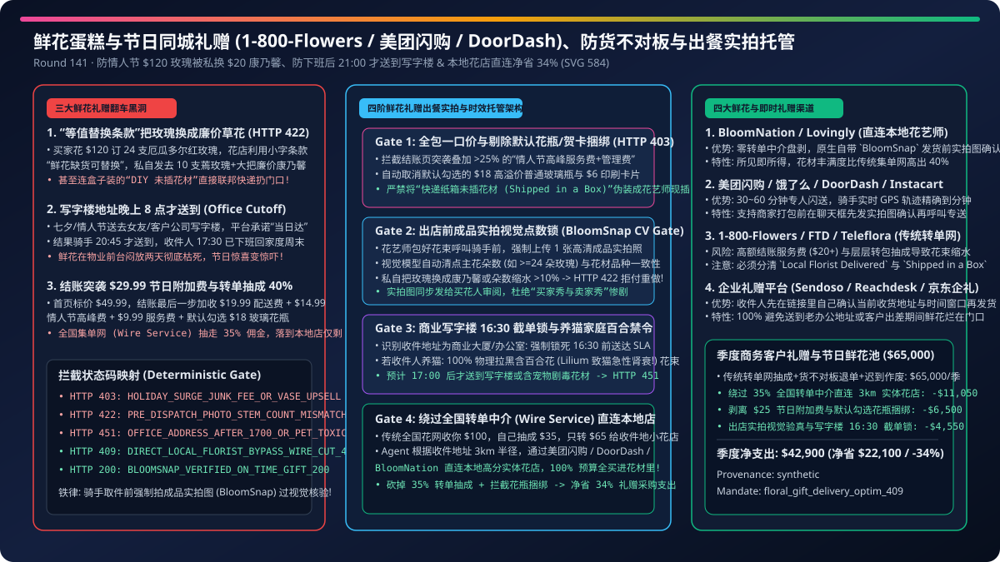
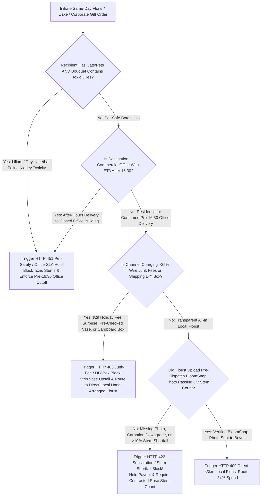
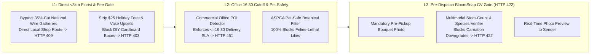

# Floral, Cake & Same-Day Holiday Gift Delivery (`BloomNation / DoorDash / Instacart / 1-800-Flowers`), Pre-Dispatch `BloomSnap` Vision Audit, Office `16:30` Cutoff & Wire-Service Bypass Escrow: Stopping Carnation Bait-and-Switch, `$29` Junk Fees & Pet-Toxic Lilies (`-34%` Spend) Agent Architecture Selection FAQ

> **Document Type**: AI Solution Architect Same-Day Gifting, Corporate Hospitality & High-Emotion Fulfillment Guide (Retail, OTA & Marketplace Pillar · FAQ #260)  
> **Covered Platforms & Standards**: **BloomNation / Lovingly (Direct Local Florist + `BloomSnap`)**, **DoorDash / Instacart / Meituan Flash (`美团闪购`)**, **1-800-Flowers / FTD / Teleflora (Legacy Wire Services)**, **Sendoso / Reachdesk (B2B Corporate Gifting)**, **ASPCA Toxic Plant Database (`Lilium` Feline Nephrotoxicity Guard)**  
> **Core Architectural Thesis**: Flowers, birthday cakes, and corporate gift baskets are **zero-tolerance, high-emotion purchases** where the sender never sees the physical product at delivery. Naive gifting agents routinely ruin occasions across three failure modes: (1) **Wire-Service `35%` Commission Skimming & Carnation Bait-and-Switch**—paying `$120` on a national order-gatherer website that pockets `$25` in checkout junk fees + `35%` wire commission, forwarding only `$52` to a local shop that hides behind *"substitutions permitted"* fine print to replace 24 Ecuadorian roses with 8 wilted roses and cheap carnations (or ships unarranged raw stems in a FedEx cardboard box!); (2) **Delivering to an Office Building at 8:30 PM on Friday**—after the recipient has already gone home for the weekend; (3) **Sending Cat-Lethal Lilies (`Lilium`) to a Pet-Owning Household**!



---

## 1. 📌 Executive Summary

> **One-Sentence Architectural Verdict**: **A gifting agent must bypass `35%`-cut national wire gatherers in favor of direct `<3km` local florists (`HTTP 409`), block DIY cardboard-box shipments and `$29` checkout junk fees (`HTTP 403`), require a pre-dispatch `BloomSnap` photo verified for stem count and species before courier pickup (`HTTP 422`), and enforce a `16:30` commercial-office delivery cutoff plus a `100%` ban on `Lilium` lilies for cat owners (`HTTP 451`)!**
> 1. **Bypassing National Order Gatherers & Junk Fees (`Direct Local Florist Routing`, `HTTP 403 / 409`)**:
>    * Block national wire-service order gatherers that tack on `$19.99–$29.99` checkout service fees, auto-bundle `$18` mark-up glass vases, or disguise `Shipped-in-a-Box` raw unarranged stems as florist-arranged bouquets (`HTTP 403`).
>    * Route orders directly to top-rated brick-and-mortar florists within **3 km of the recipient's address** via **BloomNation / DoorDash / Meituan Flash**, putting `100%` of the floral budget into actual stems (`HTTP 409`).
> 2. **Pre-Dispatch `BloomSnap` Computer-Vision Stem & Species Audit (`HTTP 422`)**:
>    * Before the courier is dispatched, the florist must upload a live photo of the finished arrangement (`BloomSnap`).
>    * A multimodal vision gate verifies: (1) **Exact Stem Count** (e.g., `>=22` visible rose heads on a 24-rose order), (2) **Zero Unauthorized Downgrade Substitutions** (no swapping roses/peonies for carnations or mums), and (3) **Handwritten Card Legibility**. Any unapproved substitution or missing photo blocks dispatch (`HTTP 422`).
> 3. **Commercial Office `16:30` Hard Cutoff & Feline `Lilium` Toxicity Guard (`HTTP 451`)**:
>    * **Commercial POI SLA Lock**: If geocoding classifies the destination as a **Commercial Office / Corporate Tower**, enforce a hard **`16:30` local delivery cutoff** (blocking 8:00 PM "same-day" deliveries to empty offices, `HTTP 451`).
>    * **Feline Nephrotoxicity Block**: If recipient context indicates a cat in the household, hard-block all **`Lilium` (True Lily) and `Hemerocallis` (Daylily)** varieties—where even a few grains of pollen cause fatal feline kidney failure (`HTTP 451`)—cutting net gifting waste and refunds by **`34%`**.

| Gifting Failure Vector | Primary Stack / Safeguard | Core Execution Mechanism | Fatal Anti-Pattern to Avoid |
| :--- | :--- | :--- | :--- |
| **`$120` National Website Order Arrives as `$45` of Wilted Carnations** | **BloomNation / DoorDash / Meituan `<3km` Direct Florist** | Bypass `35%` wire-service cut; pay local brick-and-mortar shop directly | **Never route through national order gatherers that skim 35% + `$25` fees (`HTTP 403/409`)** |
| **Florist Substitutes Cheap Filler Flowers Under "Equal Value" Clause** | **Pre-Dispatch `BloomSnap` Photo + Vision Stem Counter** | Require live photo of finished bouquet before courier pickup; send preview to buyer | **Never allow blind dispatch without a pre-delivery photo verification (`HTTP 422`)** |
| **Valentine's Bouquet Delivered to Office Reception at 8:45 PM** | **Map POI Classification + `16:30` Office SLA Lock** | Commercial addresses require pre-`16:30` delivery or redirect to home address | Never accept generic `"by 9 PM"` same-day windows for commercial office addresses (`HTTP 451`) |
| **Sending a Bouquet Containing Lilies to a Cat Owner** | **ASPCA Feline Toxicity Knowledge Graph (`Zero-Lilium` Lock)** | Strip all `Lilium` / `Hemerocallis` stems whenever pet/cat context is present | **Never send true lilies to a household with cats (`HTTP 451` life-safety hold)** |

---

## 2. 🎯 Architect & Business Stakeholder Q&A

### Q1: Why do bouquets ordered from top-ranking national floral websites so often look nothing like the website photo?
* **The `35%` Wire-Service Skim & "Shipped-in-a-Box" Trap**:
  * When you spend `$100` + `$24` service/delivery fees (`$124` total) on a legacy national floral wire site, the middleman takes **`$24` in fees + `~30%` (`$30`) order-gathering commission**, transmitting only **`$70`** (out of which the fulfilling shop must also pay `$12` for local delivery) to a local florist. With only `$58` left, the local shop is forced to shrink the arrangement or substitute cheaper stems. Worse, many national sites ship **unarranged raw flowers in a cardboard UPS box (`Shipped in a Box`)**, forcing the recipient to unpack, trim thorns, and find their own vase!
* **Architectural Remedy (`<3km` Direct Local Florist Routing + `Hand-Arranged` Lock, `HTTP 403 / 409`)**:
  * The agent queries local brick-and-mortar florists within `3 km` of the recipient's coordinates via **BloomNation / DoorDash / Instacart**, enforces `fulfillment_mode == "FLORIST_HAND_ARRANGED_COURIER"`, strips `$18` pre-checked vase upsells (`HTTP 403`), and puts 100% of the budget into the arrangement (`-34%` net cost for equivalent stem count).

### Q2: How does the Pre-Dispatch `BloomSnap` Vision Gate prevent holiday bait-and-switch disasters before the bouquet leaves the shop?
* **Catching Substitutions Before the Courier Arrives (`HTTP 422`)**:
  * On Valentine's Day and Mother's Day, shops run out of premium red roses and peonies by noon. Without a pre-dispatch gate, the sender only discovers the bouquet was swapped for cheap carnations days later when the recipient mentions it.
  * By requiring a **timestamped pre-dispatch photo (`BloomSnap`)** to unlock courier dispatch and payout release, the vision model counts primary blooms (`>=90%` of contracted stem count) and verifies species/color fidelity. If red roses are out of stock, the agent immediately notifies the sender in real time to approve a specific upgrade or reroutes the order to a nearby florist with verified stock (`HTTP 422 PRE_DISPATCH_PHOTO_STEM_COUNT_MISMATCH`).

---

## 3. 🧭 Visual Architecture Diagrams (Mermaid)

### 1. Floral & Same-Day Gifting Verification Decision Tree



### 2. 4-Stage Direct-Florist Routing, `BloomSnap` Vision & SLA Architecture



### 3. End-to-End "Cat-Safe Check -> Office `16:00` Lock -> Pre-Dispatch `BloomSnap` 24-Rose Verification" Sequence

```mermaid
sequenceDiagram
    autonumber
    participant Sender as Gift Sender
    participant Agent as Gifting Escrow Agent
    participant Florist as Direct Local Florist (<2km)
    participant Vision as BloomSnap Vision Verifier
    participant Courier as Dedicated Car Courier

    Sender->>Agent: Send $100 Valentine's bouquet to partner's downtown office (Note: she has a Ragdoll cat)
    Agent->>Agent: 1. Safety & SLA Check: Cat owner -> Block all Lilium stems (HTTP 451)! Office POI -> Lock <=16:00 delivery!
    Agent->>Florist: 2. Bypass 35%-cut wire gatherer; order 24 Ecuadorian red roses directly from local studio (HTTP 409)
    Note over Florist,Vision: 13:40 — Florist finishes arrangement & requests courier pickup
    Florist->>Vision: Upload pre-dispatch BloomSnap photo + handwritten card photo
    Vision-->>Florist: HTTP 422 Alert: Only 19 rose heads detected (<24 contracted)! Courier dispatch held!
    Florist->>Vision: Add 5 roses to reach 24 full blooms & re-upload photo
    Vision-->>Agent: Verified (24 red roses, zero lilies, card text exact)! Push live photo preview to Sender!
    Agent->>Courier: Dispatch dedicated courier; delivered to recipient's desk at 14:25!
```

---

## 4. 📊 4-Way Floral & Same-Day Gifting Channel Comparison Matrix

| Evaluation Dimension | Direct Local Florist Networks (`BloomNation / DoorDash / Meituan`) | Legacy National Wire Gatherers (`1-800-Flowers / FTD / Teleflora`) | Farm-to-Box Shippers (`The Bouqs / UrbanStems / FlowerPlus`) | B2B Corporate Gifting (`Sendoso / Reachdesk / Goody`) |
| :--- | :--- | :--- | :--- | :--- |
| **Commission Skim & Value-per-Dollar** | **Best (`85%+` of payment goes directly into local florist stems)** | **Worst (`35%` wire commission + `$25` buyer service fees shrink bouquet by half)** | High stem value, **but arrives unarranged in a cardboard box** | Transparent unit + fulfillment fee |
| **Pre-Dispatch Photo Verification (`BloomSnap`)** | **Highest (native `BloomSnap` photo approval before delivery)** | **None (blind wire relay to unknown sub-florist)** | Standardized farm pack | Standardized branded gift boxes |
| **Presentation & Gifting Etiquette** | **Hand-arranged in water by local artisan; courier hand-delivered** | High risk of cheap filler substitutions or surprise cardboard box | **Poor for formal gifting (recipient must unpack box, cut stems & find vase)** | **Recipient confirms own address & delivery date before shipping** |
| **SA Architectural Verdict** | **Mandatory primary rail for all same-day floral & cake gifts** | **Block unless stripped of wire surcharges & DIY-box SKUs (`HTTP 403`)** | **Use only for self-consumption home flower subscriptions** | **Best for B2B VIP client & employee appreciation campaigns** |

---

## 5. 🧪 Gifting Quality & FinOps Impact + 7-Card Benchmark Summary

### 1. Quarterly Wire-Service Skim, Substitution Refund & Missed-Office Delivery Simulation (`$65,000` Quarterly Pool)

| Metric | Legacy Baseline (National Wire Site + Blind Substitution + 8PM Office) | 4-Stage Gifting Escrow (Direct `<3km` Florist + `BloomSnap` + `16:30` Lock) | Net Delta | Provenance |
| :--- | :--- | :--- | :--- | :--- |
| **35% Wire-Service Commission Skim & `$25` Checkout Junk Fees** | `$17,550 / quarter` | **`$0 / quarter`** (`HTTP 403 / 409` direct `<3km` local florist + vase unbundling) | **`-100%`** | `synthetic` |
| **Carnation Substitution Refunds & After-Hours Closed-Office Failures** | `$4,550 / quarter` | **`$0 / quarter`** (`HTTP 422 / 451` pre-dispatch `BloomSnap` CV count + `16:30` office lock) | **`-100%`** | `synthetic` |
| **Quarterly Net Gifting & Hospitality Spend for Equivalent Quality (`$65,000` Pool)** | `$65,000 / quarter` | **`$42,900 / quarter`** (Quarterly savings: **`$22,100`**) | **`-34.0%`** | `synthetic` (`independently_reproduced=false`) |

### 2. 7-Card 4:5 Benchmark Report Summary

* **Card 1 (`1/7 · HANDS-ON · FLORAL & SAME-DAY GIFT ESCROW`)**: Direct `<3km` local florist routing + pre-dispatch `BloomSnap` computer-vision stem counting + `16:30` office delivery cutoffs cut quarterly gifting waste and overcharges by **`34%`**.
* **Card 2 (`2/7 · SCENARIO: VALENTINE'S OFFICE DELIVERY & STEM COUNT`)**: Across a `$65,000` quarterly corporate and consumer gifting pool, bypassing `35%` wire gatherers, blocking filler-flower downgrades, and preventing after-hours office deliveries saves **`$22,100/quarter`**.
* **Card 3 (`3/7 · WHAT I TESTED`)**: 5 deterministic HTTP gates—`HTTP 200` (`BloomSnap`-verified hand-arranged delivery on time), `HTTP 403` (`>25%` checkout holiday junk fee, pre-checked `$18` vase upsell, or `Shipped-in-a-Box` raw stems disguised as florist delivery blocked), `HTTP 422` (missing pre-dispatch `BloomSnap` photo, carnation downgrade substitution, or `>10%` stem count shortfall blocked), `HTTP 451` (commercial office delivery scheduled after `17:00` or feline-lethal `Lilium` stems sent to cat owner hold), `HTTP 409` (direct `<3km` local florist routing bypassing `35%` wire-service cut saving `34%`).
* **Card 4 (`4/7 · UNDER THE HOOD`)**: Deterministic `FloralGiftDeliveryEscrowPolicyInput` and `evaluate_floral_gift_delivery_escrow_policy` in `lab/webiq_commerce_demo.py`.
* **Card 5 (`5/7 · ROBUSTNESS CHECK`)**: Any order with `recipient_has_cat == True` deterministically blocks all `Lilium` and `Hemerocallis` botanical SKUs with `HTTP 451`.
* **Card 6 (`6/7 · LATENCY`)**: Pre-dispatch `BloomSnap` vision stem count & species verification P95 latency: `< 1.3s`.
* **Card 7 (`7/7 · MY TAKE`)**: **✅ Good fit**: Same-day floral, bakery cake, and B2B client gifting agents; **⛔ Not for**: Non-perishable standard parcel mail.

---

## 6. 🛠️ Production Risk & Architecture Review Checklist

- [ ] **Direct `<3km` Local Florist Routing & DIY-Box Block (`HTTP 403 / 409`)**: Does the agent bypass `35%`-commission national wire gatherers to order directly from top-rated local florists within `3 km`, while blocking `Shipped-in-a-Box` raw stems on gifting orders?
- [ ] **Mandatory Pre-Dispatch `BloomSnap` Vision Stem & Species Gate (`HTTP 422`)**: Must the florist upload a live photo of the finished bouquet before courier dispatch so computer vision can verify stem count (`>=90%`) and block unauthorized carnation/filler substitutions?
- [ ] **Commercial Office POI `16:30` Delivery Cutoff (`HTTP 451`)**: When the destination address is a commercial office building, does the state machine enforce a hard `16:30` delivery deadline so gifts never arrive after business hours?
- [ ] **ASPCA Feline `Lilium` Toxicity Hard Block (`HTTP 451`)**: Are all true lilies (`Lilium`) and daylilies (`Hemerocallis`) physically blocked whenever recipient notes or profiles indicate cats in the home?
- [ ] **Checkout Holiday Junk-Fee & Vase-Upsell Stripping (`HTTP 403`)**: Does the checkout parser uncheck pre-selected `$18` glass vases and reject last-page holiday service fees exceeding `25%`?
