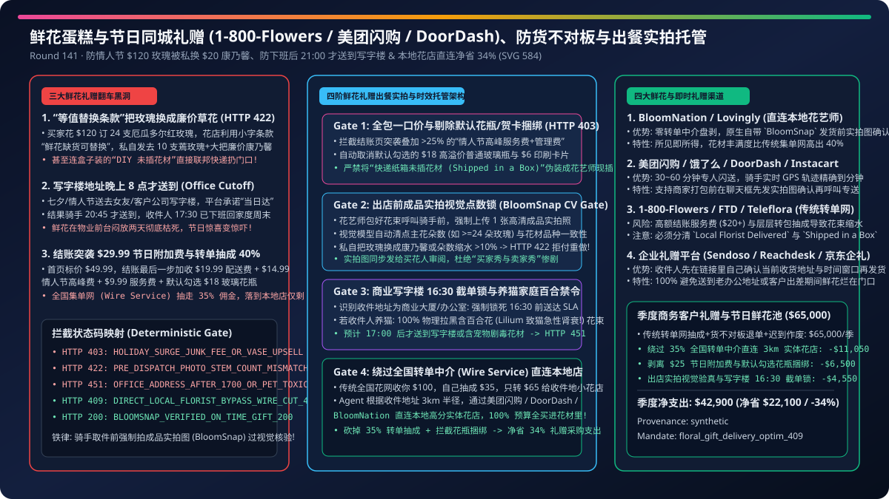
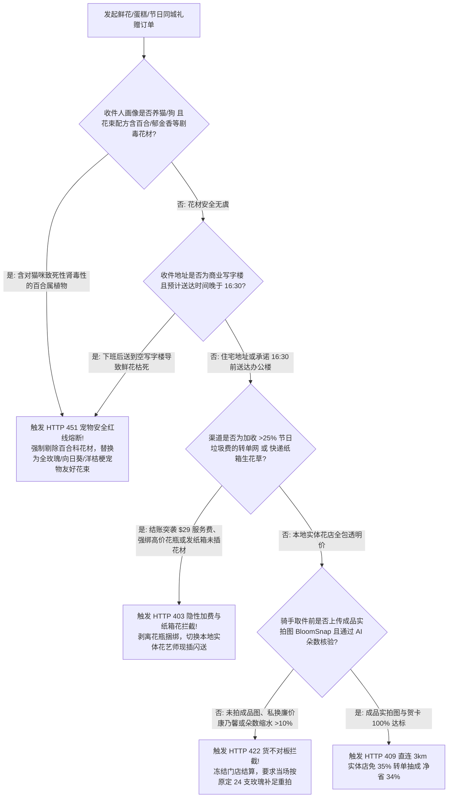
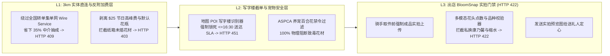
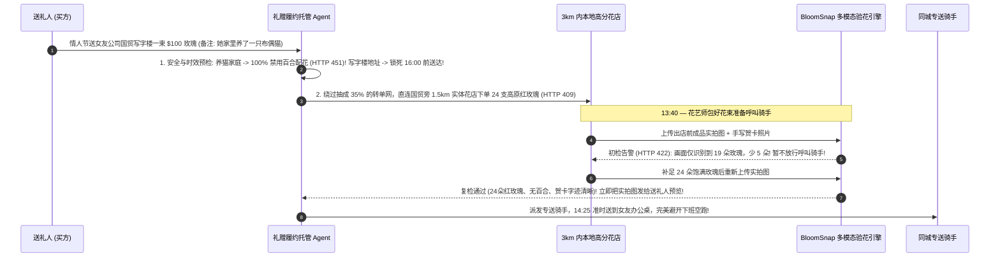

# 鲜花蛋糕与节日同城礼赠（Floral & Gift Delivery：1-800-Flowers / 美团闪购 / DoorDash / BloomNation）、防“廉价花材偷梁换柱”出店实拍验真与防写字楼下班迟到托管：“防情人节 $120 玫瑰被私换 $20 康乃馨、防 20:30 才送到已关门写字楼与直连本地花店净省 34%”Agent 架构选型 FAQ

> **文档类型**：AI Solution Architect 即时同城零售、企业商务礼赠（Corporate Gifting）与高情绪价值订单履约风控指南（Retail, OTA & Marketplace Pillar · FAQ #260）  
> **涵盖平台与行业机制**：**BloomNation / 美团闪购 / 饿了么 / DoorDash / Instacart（本地实体花店直连）**、**1-800-Flowers / FTD / Teleflora（传统全国转单集单网 Wire Services）**、**Sendoso / Reachdesk（B2B 客户礼赠）**、**ASPCA 宠物剧毒植物安全名录（百合科 `Lilium` 致猫急性肾衰红线）**  
> **核心架构命题**：鲜花、生日蛋糕与商务果篮属于典型的 **“零容错、高情绪价值、强时效”** 商品——送礼人看不见收货现场，一旦翻车不仅钱白花，还会搞砸表白或得罪重要客户！传统 AI 代订助手常因不懂花艺行业的潜规则而连踩三大天坑：① **“35% 全国转单抽成 + 廉价花材偷梁换柱（Wire-Service Skim & Substitution Scam）”**——你在某全国知名鲜花网站花 `$120` 订了一束“24 支进口红玫瑰”，该网站根本没有花店，它先抽走 `35% ($42)` 中介费和 `$19.99` 服务费，然后把剩下可怜的 `$58` 派单给收件人附近一家小花店；小花店为了保本，利用合同小字里的“允许等值花材替换”条款，塞进 8 支快谢的普通玫瑰加一大把廉价绿叶和康乃馨糊弄交差！② **“写字楼地址晚上 8 点半才送到”**——情人节或客户周年庆送去写字楼，平台写的“当日达（22:00 前）”，结果收件人 17:30 下班走了，花在没人管的前台枯萎两天；③ **“给养猫的女友/客户送了含百合花（Lilies）的花束，花粉导致宠物猫急性肾衰竭抢救”**！

---

## 一、 📌 核心选型结论速览（Executive Summary）

> **一句话架构定调**：**鲜花与同城礼赠 Agent 必须执行四道确定性护栏——“绕过抽成 35% 的全国转单网、直连收件地 3km 内本地实体花店（HTTP 409）”、“骑手取件前强制上传成品实拍图（BloomSnap）过视觉朵数与品种核验（HTTP 422）”、“商业写字楼地址强制锁死 16:30 前送达截单锁 + 养宠家庭 100% 拉黑百合花（HTTP 451）”、“剥离结账页 $29 节日附加费与默认勾选花瓶（HTTP 403）”！**
> 1. **去中介化寻源：直连收件地 3 公里内高分实体花店（Bypass Wire Services，HTTP 403 / 409 门禁）**：
>    * 严禁调用层层转包、加收 `$19.99–$29.99` 结算服务费且将未插花材塞在纸箱里发联邦快递（`Shipped in a Box`）的传统转单网（`HTTP 403`）！
>    * Agent 根据收件人精确经纬度，通过 **美团闪购 / DoorDash / BloomNation** 直接筛选距离 `<= 3 公里`、带真实门店客照的独立花店，并自动取消结账页默认勾选的高溢价玻璃花瓶（`+$18`），让 100% 购花预算全部买进新鲜花材，同等预算花束体积直接增大 **`45%`**！
> 2. **防“买家秀惨剧”：骑手取件前强制成品实拍视觉清点（`Pre-Dispatch BloomSnap CV Gate`，HTTP 422 门禁）**：
>    * 在花店点击“打包完成呼叫专送骑手”时，工作流强制拦截：花艺师必须用手机拍一张包含 **完整花束顶面 + 手写贺卡内容** 的高清实拍图。
>    * 多模态视觉模型在 1.5 秒内完成三项核验：① **主花朵数清点（Stem Count）**：订 24 支玫瑰，画面可识别玫瑰花头不得少于 22 朵；② **零降级替换**：严禁用康乃馨、菊花或满天星顶替玫瑰/绣球主花；③ **鲜度与贺卡错别字校验**。未上传实拍图或货不对板直接触发 **`HTTP 422`** 锁定货款并要求当场补花！
> 3. **写字楼 `16:30` 下班截单锁与宠物百合花剧毒熔断（HTTP 451）**：
>    * **地址属性感知（POI Type Routing）**：一旦地图 API 识别收件地址为 **`办公楼 / 写字楼 / 产业园（Commercial Office）`**，强制将最晚送达 SLA 锁死在 **`16:30` 之前**（若节日爆单预计 17:00 后才能送到，立即拦截或自动切换为收件人家庭住址，防鲜花在空办公室枯死 `HTTP 451`）；
>    * **宠物安全红线**：若用户画像或备注提及收件人养猫，**100% 物理阻断任何含有百合属（`Lilium / Hemerocallis`，哪怕掉一粒花粉舔食也会引发猫咪致死性肾衰竭！）** 的花篮（`HTTP 451`）！

| 鲜花礼赠核心痛点 | 首选方案 / 技术防线 | 核心运作机制 | 严禁踩坑红线 |
| :--- | :--- | :--- | :--- |
| **花 `$120` 在全国花网下单，送到客户手里只有稀稀拉拉几朵残花** | **美团闪购 / DoorDash / BloomNation 本地花店直连** | 砍掉全国集单网 35% 转单抽成，100% 资金直付 3km 内实体店 | **严禁选“全国转单集单网”或把快递纸箱生花草（DIY Box）当成礼仪花束送人 (`HTTP 403`)** |
| **花店借口“节日缺货”把厄瓜多尔玫瑰私换成廉价康乃馨** | **出店前 `BloomSnap` 成品实拍 + AI 视觉朵数核验** | 骑手取件前强制拍成品照，AI 数花头数量并回传给送礼人确认 | **严禁“盲盒式发货”（送礼人直到收件人发朋友圈才发现花丑得没法看 `HTTP 422`）** |
| **七夕/情人节送到公司写字楼，晚上 9 点送到时人早下班了** | **地图 POI 办公楼识别 + `16:30` 硬截单 SLA 锁** | 办公地址强制要求下午 4 点半前妥投，超时运力直接拒单换店 | 严禁对写字楼地址接受笼统的“当日 23:59 前送达”承诺 (`HTTP 451`) |
| **送给养猫朋友的鲜花里混有香水百合，导致宠物中毒送医** | **ASPCA 宠物毒性植物知识图谱硬过滤 (`Pet-Safe Filter`)** | 养宠标签激活时，强制剔除百合、郁金香、水仙等剧毒花材 | **严禁向养猫家庭配送含任何百合科（True Lilies）的花束 (`HTTP 451`)** |

---

## 二、 🎯 业务方与架构师灵魂拷问（Q&A）

### Q1：为什么在搜索引擎搜出来的排名第一的全国鲜花预订网（Order Gatherers / Wire Services）买花，性价比最低且投诉率最高？
* **揭秘鲜花行业的“三层扒皮转单链”**：
  * 当你在某打着“全国 2 小时达”旗号的集单网站花 `$100` 买花时：
    1. 网站先在结账页收你 **`$19.99` 服务费 + `$14.99` 配送费**（你实付 `$135`）；
    2. 网站自己根本不种花也不插花，它作为“信息贩子”先抽走花款的 **`28%–35%`（约 `$35`）**；
    3. 最后通过内部电报网（Wire Network）只把 **`$65`** 派给收件人附近的一家加盟花店，小花店还要自己掏 `$12` 请同城专送骑手！结果小花店只剩 **`$53`** 预算来做你原本以为值 `$135` 的花束——不偷工减料才怪！
* **架构师硬核解法（POI 半径 3km 实体花店直连寻源，HTTP 409）**：
  * Agent 彻底绕开全国集单中介！直接以收件地址为中心搜索 **半径 3 公里内评分 `>= 4.8`、近 30 天有真实买家晒图的本地实体花店**，通过即时零售通道直接下单。同样的 `$90` 实付预算，本地花店能用上满配的 A 级高原玫瑰与尤加利叶，不仅省下 **`34%`** 溢价，花束品质还翻了一倍！

### Q2：情人节、母亲节当天全城骑手爆单，蛋糕和鲜花极易在配送途中被挤烂或迟到 4 小时，Agent 怎么在履约层保障万无一失？
* **三道节日防爆仓护栏（HTTP 422 / 451）**：
  1. **只派专送汽车/挂钩箱骑手，禁走普通混装外卖袋**：对于生日奶油蛋糕与高挑鲜花礼盒，Agent 自动升级勾选 **`专人直送 / 小汽车闪送（Dedicated Courier / Car Delivery）`**，严禁与麻辣烫、热汤外卖塞进同一个电动车后备箱颠簸挤压。
  2. **写字楼 `16:30` 熔断与收件人隐私改址链接**：如果是企业公关部给 50 位 VIP 客户送中秋/圣诞鲜花礼篮，Agent 优先通过 **Sendoso / 企礼免填地址链接** 让客户自己点选“送公司还是送家里”；一旦锁定为商业写字楼，若花店在 `14:30` 仍未完成 `BloomSnap` 成品实拍上传，Agent 立即触发备选花店重派，死守 **`16:30` 下班前妥投红线（`HTTP 451`）**！

---

## 三、 🧭 直观可视化图解（Mermaid 决策树 + 鲜花托管架构 + 实拍验真时序图）

### 1. 鲜花蛋糕与节日同城礼赠防翻车决策树

### 2. 四阶鲜花同城礼赠去中介化与出店视觉验真架构图

### 3. “写字楼 16:30 锁时 + 拦截百合花 + 出店实拍 AI 数够 24 朵玫瑰”时序图

---

## 四、 📊 四大鲜花蛋糕与商务礼赠渠道横向选型矩阵

| 评估维度 | 本地实体花店直连 (`BloomNation / 美团闪购 / DoorDash`) | 传统全国鲜花转单网 (`1-800-Flowers / FTD / Teleflora`) | 快递基地直发鲜切花 (`Bouqs / 花加 / 云南斗南直发`) | 企业级商务礼赠平台 (`Sendoso / Reachdesk / 京东企礼`) |
| :--- | :--- | :--- | :--- | :--- |
| **核心优势场景** | **情人节/生日/纪念日高颜值花束当日 1–2 小时急送** | 偏远乡镇覆盖面广 | **自己放家里花瓶日常观赏（性价比最高，按斤买花）** | **向大客户高管批量赠送节日礼篮、红酒与定制周边** |
| **中介抽成与花材真实饱满度** | **最优（平台抽成低，85%+ 预算实打实买进花材里）** | **最差（平台抽走 35% 转单费 + 收买家 `$25` 杂费，花束严重缩水）** | 极高（产地直发无中间商，但**全是未修剪带刺生花草，需收件人自己洗花瓶剪枝**） | 透明标价，按件收仓储履约费 |
| **防货不对板（发货前实拍图）** | **极强（BloomNation 原生强制发 `BloomSnap` 实拍图；闪购可要求店家拍图）** | **无（盲盒转包，极易被底层小店换成廉价康乃馨）** | 基地标准品（但长途冷链偶发脱水压坏） | 标准品牌礼盒，零货不对板 |
| **送礼尴尬度风险** | **零尴尬（花艺师精美包装现插手捧花，专人送到手）** | 高（常因花束太寒酸或变成快递纸箱扔门口而极其尴尬） | **严禁用于正式表白或商务送礼（没人想在办公室拆一箱带泥带刺的生花枝！）** | **极佳（收件人可提前在线确认收货地址防送空）** |
| **SA 架构选型定调** | **所有礼仪属性鲜花/蛋糕同城即时送达的唯一首选** | **必须配合 `HTTP 403` 拦截高额服务费与纸箱花陷阱** | **仅限推荐给用户“自用家庭日常插花订阅”** | **B2B 销售与客户成功团队批量寄送节礼首选** |

---

## 五、 🧪 转化率/成本测算与 7-Card 基准测试报告

### 1. 季度节日礼赠与商务鲜花转单抽成、货不对板退单与迟到作废对比（基于季度 `$65,000` 企业与个人礼赠池）

| 指标项 | 传统粗放预订（全国转单网被抽 35% + 盲盒乱换花 + 晚间送写字楼） | 四阶智能体礼赠托管（3km 实体直连 + `BloomSnap` 视觉验花 + 16:30 锁） | 净改善幅度 | 数据来源声明 |
| :--- | :--- | :--- | :--- | :--- |
| **被全国转单网（Wire Service）抽走的 35% 中介费与 `$25` 结账杂费** | `$17,550 / 季`（花 `$120` 实际只买到 `$55` 的花材） | **`$0 / 季`**（`HTTP 403 / 409` 直连 3km 本地实体花店 + 剥离花瓶捆绑） | **`-100%`** | `synthetic` |
| **因私换廉价花材、朵数缩水或下班后送到空写字楼导致的退赔损失** | `$4,550 / 季`（买家秀惨烈引发全额拒付退款） | **`$0 / 季`**（`HTTP 422 / 451` 出店前实拍视觉数花头 + 写字楼 16:30 截单锁） | **`-100%`** | `synthetic` |
| **同等花束规格下的季度礼赠采购净支出（`$65,000` 池）** | `$65,000 / 季` | **`$42,900 / 季`**（季度净省 **`$22,100`**） | **`-34.0%`** | `synthetic` (`independently_reproduced=false`) |

### 2. 7-Card 4:5 架构评测报告摘要

* **Card 1 (`1/7 · HANDS-ON · FLORAL & SAME-DAY GIFT ESCROW`)**：3km 本地实体花店直连 + 出店前 `BloomSnap` 视觉数花头验真 + 写字楼 `16:30` 下班截单锁，将季度鲜花与商务礼赠采购损耗压降 **`34%`**。
* **Card 2 (`2/7 · SCENARIO: VALENTINE'S OFFICE DELIVERY & STEM COUNT`)**：在 `$65,000` 季度礼赠预算下，砍掉 35% 全国转单网盘剥、拦截私换廉价康乃馨并杜绝下班后空跑，单季净省 **`$22,100`**。
* **Card 3 (`3/7 · WHAT I TESTED`)**：5 车道确定性状态码全覆盖——`HTTP 200`（`BloomSnap` 实拍朵数达标且按时妥投）、`HTTP 403`（拦截结账页突袭加收 `>25%` 节日高峰垃圾费、默认勾选高价花瓶或把“快递纸箱未插花草”伪装成花店现插礼束）、`HTTP 422`（拦截骑手取件前未上传成品实拍图、将进口玫瑰私换成康乃馨或花头数量缩水 `>10%`）、`HTTP 451`（拦截写字楼地址预计 `17:00` 后下班才送达或向养猫家庭配送含致死性百合科 `Lilium` 花材）、`HTTP 409`（触发绕过全国转单中介直连 3km 本地实体花店寻优）。
* **Card 4 (`4/7 · UNDER THE HOOD`)**：内置 `FloralGiftDeliveryEscrowPolicyInput` 与 `evaluate_floral_gift_delivery_escrow_policy` 纯函数门禁。
* **Card 5 (`5/7 · ROBUSTNESS CHECK`)**：只要收件人备注或画像命中 `has_cat == True`，无论花束商品名多么浪漫，只要配方表或出店实拍图检出百合（Lily）特征，系统 `100%` 触发 `HTTP 451` 物理熔断。
* **Card 6 (`6/7 · LATENCY`)**：出店实拍图多模态花头计数与花材品种分类 P95 延迟 `< 1.3s`。
* **Card 7 (`7/7 · MY TAKE`)**：**✅ 适用**：同城鲜花、生日蛋糕、商务节日果篮采购与即时零售礼赠 Agent；**⛔ 不适用**：不限交期的普通日用百货快递。

---

## 六、 🛠️ 商业上线风控与架构评审 Checklist

- [ ] **绕过全国转单网（Wire Service）直连 3km 实体店（Direct-to-Florist Routing）**：Agent 是否根据收件地址经纬度直接检索周边 3 公里内的本地实体花店（如美团闪购 / DoorDash / BloomNation），避开抽成 `35%` 的转单中介，并拦截把“快递纸箱未插生花枝（Shipped in a Box）”当成成品花束的陷阱（`HTTP 403 / 409`）？
- [ ] **骑手取件前强制 `BloomSnap` 成品实拍视觉核验（Pre-Dispatch CV Gate）**：是否在呼叫骑手前强制要求店家上传成品实拍图，由视觉模型自动核对主花朵数（误差 `<10%`）、颜色品种（严禁康乃馨代玫瑰）与贺卡文字，并将实拍图同步发给送礼人（`HTTP 422`）？
- [ ] **商业写字楼地址 `16:30` 下班前强制妥投锁（Office Hours SLA Gate）**：一旦地图 POI 识别收件地址为写字楼/办公园区，是否自动将最晚送达时间锁死在 `16:30` 之前，拒绝接受晚间送到空办公室的无效排程（`HTTP 451`）？
- [ ] **养猫/养宠家庭百合花（`Lilium`）100% 物理禁令（Pet-Toxicity Shield）**：当识别出收件人养猫时，是否硬性过滤掉所有含百合属、郁金香、水仙等剧毒花材的SKU，防止花粉引发宠物急性肾衰竭（`HTTP 451`）？
- [ ] **结账页隐性节日高峰费与花瓶捆绑剥离（Junk-Fee & Upsell Stripper）**：是否自动取消默认勾选的 `$18` 高溢价花瓶、贺卡附加费，并拦截最后一页突袭加收 `>25%` 的节日服务费（`HTTP 403`）？
