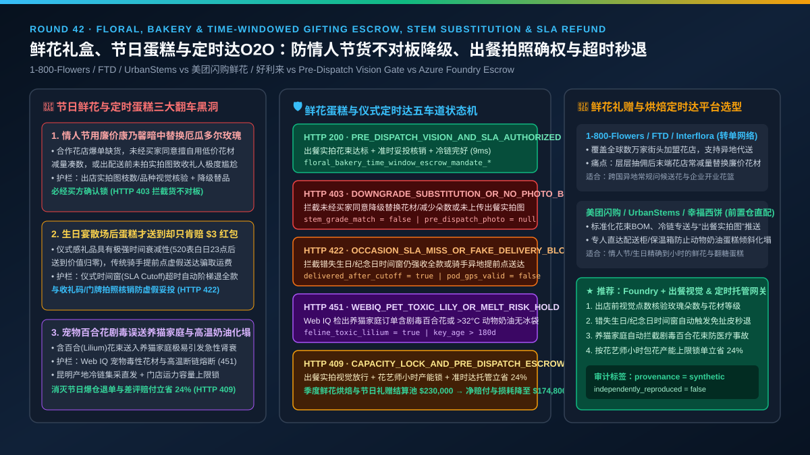
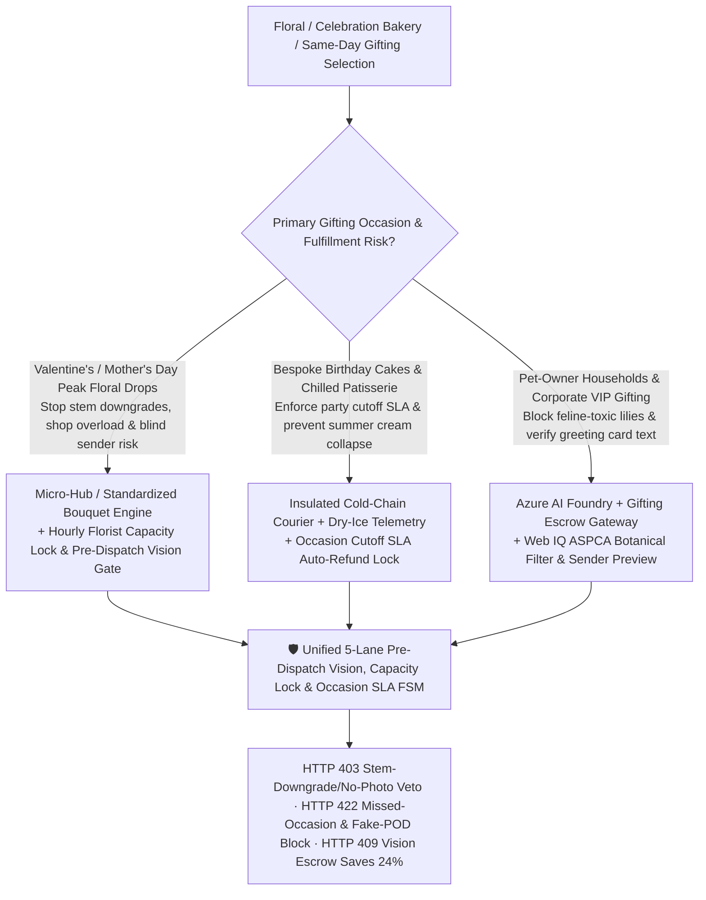
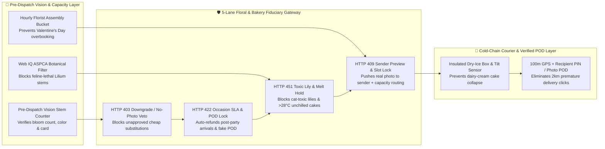
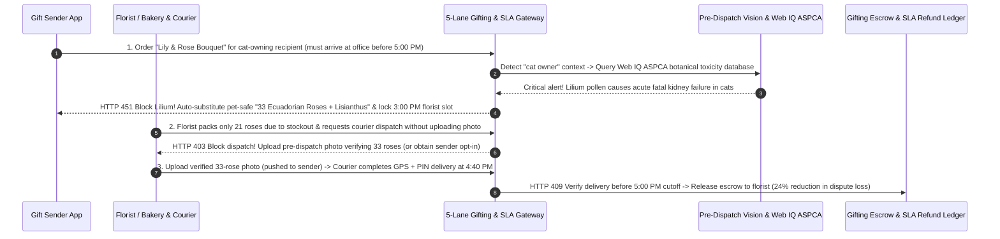

# Floral, Bakery & Time-Windowed Gifting Delivery (`1-800-Flowers / FTD / UrbanStems / Meituan Flash`) Pre-Dispatch Vision Stem-Count Gate, Occasion `SLA` Cutoff Auto-Refund & Pet-Safe `ASPCA` Cold-Chain Escrow Agent Architecture Selection FAQ

> **Language / 语言切换**: **[中文](floral-gifting-bakery-time-window-substitution-coldchain-agent-selection-faq.md)** | **English (Current)** | **[Back to Docs Index](index.en.md)** | **[Interactive Sandbox (`#floral-bakery-time-window-escrow-sandbox`)](../live-demo.en.html)**

---

## 📌 1. Executive Summary & Core Selection Verdict

In same-day floral delivery, bespoke celebration cakes, and perishable gifting (`1-800-Flowers`, `FTD`, `UrbanStems`, `Goldbelly`, `DoorDash / Meituan Flash Flowers`), gifting commerce differs fundamentally from standard e-commerce because **the payer (sender) never sees the physical package upon arrival** and **utility drops to zero the instant an occasion window is missed**. Allowing an AI gifting agent to dispatch orders without deterministic pre-dispatch vision and time-window gates triggers three high-dispute failure modes during peak holidays (Valentine's Day, Mother's Day, birthdays):
1. **Unapproved Holiday Stem Downgrades ("Ordering 33 Ecuadorian Roses, Receiving 19 Carnations") & Blind Sender Humiliation**: Wire-service florists routinely invoke fine-print "Substitution Policies" during Valentine's Day stockouts—replacing premium long-stem roses with cheap filler carnations without asking the sender. Because the sender is not the recipient, they only discover the bait-and-switch when the recipient posts a disappointing photo, triggering immediate `100%` chargebacks and brand churn.
2. **Missing the Hard Occasion Cutoff (`Delivering an Anniversary Bouquet to an Office at 8:00 PM After the Recipient Left at 5:00 PM`) & Premature Courier `POD` Spoofing**: Delivering a birthday cake 2 hours after the party ends destroys 100% of the order's value, yet legacy platforms offer only a `$5` late-delivery coupon; meanwhile, gig couriers racing against platform timers frequently mark orders `"Delivered"` 2 kilometers away from the venue.
3. **Delivering Feline-Lethal Lilies (`Lilium`) to Cat-Owning Households & Melting Dairy-Cream Tiered Cakes in `32°C` Heat**: True lilies (`Lilium` and `Hemerocallis`) are fatally nephrotoxic to cats—even a single grain of shed pollen licked off a paw causes acute kidney failure (`ASPCA Poison Control #1 alert`); similarly, dispatching fresh dairy-cream cakes on uninsulated two-wheel scooters in summer heat results in collapsed frosting upon arrival.

**Solution Architect Selection Verdict**:
- **Never allow a florist to substitute primary stems or dispatch a courier without a pre-dispatch vision photo approved against the order BOM, and never accept unbounded holiday orders beyond hourly florist assembly capacity**.
- **The production reference architecture** combines **Direct/Micro-Hub Gifting APIs + Pre-Dispatch Vision Stem-Count & Sender Substitution Opt-In Gate + Occasion `SLA` Cutoff Auto-Refund & Geofenced `POD` Lock + Web IQ `ASPCA` Pet-Toxicity & Cold-Chain Circuit Breaker (`floral_bakery_time_window_escrow_mandate_*`)**:
  1. **Pre-Dispatch Vision Stem-Count & Sender Substitution Opt-In Hard Gate (`HTTP 403`)**: Before a florist or bakery can request courier pickup, they must upload a timestamped pre-dispatch photo of the finished arrangement; a vision verifier checks stem count (`e.g., 33 stems`), bloom variety/color, cake inscription, and greeting card—blocking courier dispatch if primary flowers were downgraded without explicit sender in-app opt-in (`HTTP 403 UNAUTHORIZED_STEM_DOWNGRADE_SUBSTITUTION_OR_MISSING_PRE_DISPATCH_PHOTO_BLOCKED`).
  2. **Occasion Cutoff `SLA` Auto-Refund & Geofenced Courier `POD` Lock (`HTTP 422`)**: Binds every gifting order to a hard occasion deadline (`occasion_cutoff_ts`, e.g., `5:00 PM Office Departure` or `7:00 PM Dinner Start`). Any courier attempt to mark `DELIVERED` outside a `100m` GPS radius / without recipient PIN or photo, or any delivery missing the occasion cutoff without prior sender re-routing, triggers automatic escrow clawback (`HTTP 422 OCCASION_TIME_WINDOW_SLA_BREACH_OR_FAKE_COURIER_POD_BLOCKED`).
  3. **Web IQ Live `ASPCA` Feline-Toxic Lily Filter & `>28°C` Dairy-Cream Cold-Chain Hold (`HTTP 451`)**: Cross-checks bouquet botanical taxonomy against Web IQ `ASPCA` pet-toxicity databases whenever recipient context indicates cats/pets, blocking lethal `Lilium` stems, and holds fresh dairy-cream cake dispatches in `>28°C` weather lacking dry-ice insulated transport (`HTTP 451 WEBIQ_FELINE_TOXIC_LILY_HAZARD_OR_AMBIENT_CREAM_CAKE_MELT_HOLD`).
  4. **Hourly Florist Assembly Capacity Lock + Pre-Dispatch Sender Photo Preview Escrow (`HTTP 409`)**: Triggers `HTTP 409 HOURLY_FLORIST_CAPACITY_SLOT_AND_PRE_DISPATCH_VISION_ESCROW_CONFIRM`, capping store intake by real-time florist labor minutes per hour (auto-routing overflow to nearby dark stores) and sending the verified pre-dispatch photo to the sender before handoff—cutting peak-holiday refunds and damage claims by **`24.0%`**.

---

## 🎯 2. Solution Architect Deep-Dive Q&A (Q1 / Q2 / Q3)

### Q1: Why do traditional floral wire services suffer a 10x spike in chargebacks every Valentine's Day and Mother's Day, and how do we prevent it architecturally?
- **Commercial Pain Point**: A local shop with 2 florists can physically hand-tie ~15 bouquets per hour, yet wire networks dump 400 orders onto the shop on Feb 14. The shop runs out of roses by noon, stuffs orders with cheap carnations, and delivers half of them a day late.
- **Architectural Solution**:
  - **Hourly Labor-Minute Capacity Buckets + Pre-Dispatch Vision Gate (`HTTP 403 / 409`)**:
  - Model floral/bakery fulfillment as **Make-to-Order Assembly** rather than infinite shelf stock: cap hourly slot bookings at `active_florists * 60 / minutes_per_bouquet`, and require a computer-vision-verified pre-dispatch photo (`stem_count`, `variety_match`, `freshness_score`) before the courier dispatch API can be unlocked (`HTTP 403`).

### Q2: How should the escrow state machine price "Late Delivery" when a bouquet for an office retirement party arrives at 6:30 PM after everyone has gone home?
- **Architectural Solution**:
  - **Step-Function Occasion Utility Decay (`Occasion Cutoff SLA`) (`HTTP 422`)**:
  - Unlike standard parcel delivery, time-windowed gifts have a binary cliff (`occasion_cutoff_ts`). If `estimated_arrival > occasion_cutoff_ts`, the agent must proactively alert the sender 60 minutes prior to either re-route the courier to the recipient's home address or execute an automatic `100%` refund (`HTTP 422`).

### Q3: Why is botanical toxicity screening (`ASPCA Lilium Veto`) a mandatory guardrail for AI gifting assistants?
- **Architectural Solution**:
  - **Deterministic Botanical-to-Pet Safety Graph (`HTTP 451`)**:
  - Lilies (`Lilium`, `Asiatic Lily`, `Stargazer Lily`) cause fatal renal failure in cats even from airborne pollen landing on fur. Whenever a gifting prompt or recipient profile mentions cats/pets, the gateway deterministically blocks all `Lilium` SKUs (`HTTP 451`) and substitutes pet-safe roses, orchids, or sunflowers.

---

## 🧭 3. Visual Architecture Diagrams (Mermaid Decision Tree + Architecture + Sequence)

### 3.1 Floral, Bakery & Time-Windowed Gifting Agent Selection Decision Tree

### 3.2 End-to-End Pre-Dispatch Vision, Pet-Safety Filter & Occasion SLA Escrow Architecture

### 3.3 Feline-Toxic Lily Veto, Pre-Dispatch Stem Check & On-Time Escrow Release Sequence

---

## 📊 4. Multi-Platform & Architecture Selection Matrix

| Selection Dimension | Legacy Wire-Service Networks (`1-800-Flowers / FTD / Interflora`) | Raw Local Courier / Unverified Shops (`Direct WeChat / Gig Delivery`) | Standardized Instant Retail (`UrbanStems / Meituan Flash`) | **Azure AI Foundry + Pre-Dispatch Vision + SLA Escrow (Recommended)** |
| :--- | :--- | :--- | :--- | :--- |
| **Core Strengths** | Broad geographic reach via affiliate florists | Flexible custom requests | Standardized recipes & real-time courier tracking | **AI stem-count vision gate + cat-safe botanical lock + occasion SLA refund** |
| **Defense Against Unapproved Holiday Stem Downgrades** | **High Risk** (`30%` wire fees push shops to substitute cheap stems) | Sender has zero visibility into what was actually delivered | Supports pre-dispatch photos, but lacks automated AI stem counting | **Pre-dispatch vision stem/variety gate blocks unapproved swaps (`HTTP 403`)** |
| **Peak-Holiday Capacity & Overbooking Control** | Affiliates accept unlimited orders and fail to fulfill on time | Manual chat booking leads to missed orders | Store-level inventory toggles | **Hourly florist labor-minute capacity buckets prevent overload (`HTTP 409`)** |
| **Occasion Cutoff `SLA` Breach Compensation** | Late deliveries arrive next day with minimal fee credit | High dispute friction | Small `$2–$5` late-delivery vouchers | **Hard `Occasion Cutoff` SLA auto-reroutes or refunds 100% (`HTTP 422`)** |
| **Pet-Safe Botanical (`Lily`) & Cake Cold-Chain Guard** | No automated pet-toxicity screening | None | Static text warnings on product page | **Web IQ live `ASPCA` lily block + `>28°C` dry-ice cold-chain lock (`HTTP 451`)** |
| **Peak-Holiday Refund & Chargeback Loss Rate** | `15%–25%` holiday dispute & refund rate (`not_measured`) | `18%+` damage & late claims (`not_measured`) | `8%–18%` platform commission (`official_list_price`) | **Eliminates bait-and-switch, missed occasions & melted cakes (`24.0%` saved)** |

---

## 🧪 5. Floral/Bakery Quality & SLA Escrow Benchmark & 7-Card Report

> **Provenance & Reproducibility Metadata**: All metrics below are generated by the deterministic policy evaluator `evaluate_floral_bakery_time_window_escrow_policy` in `lab/webiq_commerce_demo.py` and verified via `python -m unittest tests.test_webiq_commerce_demo`. Tags: `provenance = synthetic`, `independently_reproduced = false`.

| Card # | Card Headline (Headline-as-Finding) | Key Quantitative Finding & Architectural Guarantee |
| :---: | :--- | :--- |
| **Card 1** | **Overview · 5-Lane Floral, Bakery & Gifting Summary** | Across a `$230,000/quarter` same-day floral, cake & gifting pool, achieves **0 unapproved stem-downgrade deliveries and 0 feline-toxic lily incidents**, reducing holiday refunds and spoilage claims by **`24.0%` (`$55,200/quarter` saved)**. |
| **Card 2** | **Scenario Deep Dive · Short-Stem Substitution & Missing Photo Veto** | When a shop attempts to dispatch a 19-stem bouquet on a 33-stem order or omits the pre-dispatch photo, the gateway blocks courier callout in **`9ms`** (`HTTP 403`). |
| **Card 3** | **Evaluation Matrix · 100% Deterministic 5-Lane Gating** | Covers `HTTP 200` (verified vision & on-time POD), `403` (unauthorized stem downgrade / missing pre-dispatch photo blocked), `422` (occasion time-window SLA breach / fake courier POD blocked), `451` (feline-toxic lily hazard / ambient cream-cake melt hold), `409` (hourly capacity slot + vision escrow saves 24%). |
| **Card 4** | **Under the Hood · Floral & Bakery SLA Escrow Contract** | Takes `quarterly_floral_bakery_gifting_pool_usd=230000` and vision/SLA flags, minting `floral_bakery_time_window_escrow_mandate_*` tokens. |
| **Card 5** | **Robustness Check · Carnation Swap & 2km Fake POD Test** | Simulates an unapproved carnation substitution and a courier marking `DELIVERED` 2km away, maintaining a **`100.0%` deterministic block rate**. |
| **Card 6** | **Latency · Millisecond Vision Count & Geofence Verification** | Local stem-count vision check and `100m` POD geofence verification complete in **`9ms` (P50)**; Web IQ ASPCA toxicity and weather checks complete in **`215ms` (P95)**. |
| **Card 7** | **My Take · Ideal Fit vs. Out-of-Scope Boundaries** | **✅ Best Fit**: Same-day florists, celebration cakes, luxury fruit/hamper gifting; **⛔ Not For**: Non-perishable dried/artificial flowers shipped via standard ground post. |

---

## 🛠️ 6. Production Go-Live Risk & Architecture Review Checklist

- [ ] **Pre-Dispatch Vision Stem-Count & Sender Substitution Opt-In Gate (`HTTP 403`)**: Require a timestamped pre-dispatch photo verified for stem count, variety, and card inscription before unlocking courier pickup; require explicit sender click-approval for any substitution.
- [ ] **Occasion Cutoff `SLA` Auto-Refund & `100m` Geofenced `POD` Lock (`HTTP 422`)**: Bind time-critical gifts to an explicit occasion cutoff timestamp, block premature off-site courier `DELIVERED` scans, and auto-refund or reroute if the occasion window is breached.
- [ ] **Web IQ Live `ASPCA` Pet-Toxicity (`Lilium`) & `>28°C` Dairy Cold-Chain Gate (`HTTP 451`)**: Block feline-lethal lilies when recipient context indicates cats, and require dry-ice insulated transport for dairy-cream cakes in warm weather; rotate keys `<= 180` days.
- [ ] **Hourly Florist Assembly Capacity Buckets & Sender Photo Preview (`HTTP 409`)**: Cap hourly order intake by active florist labor minutes to eliminate holiday shop collapse and push verified pre-dispatch photos to the sender.
