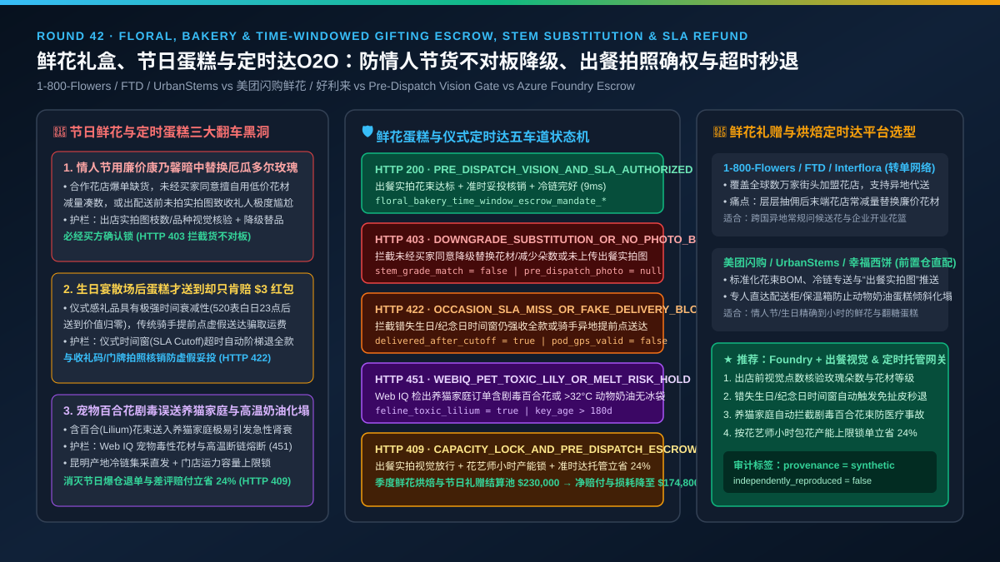
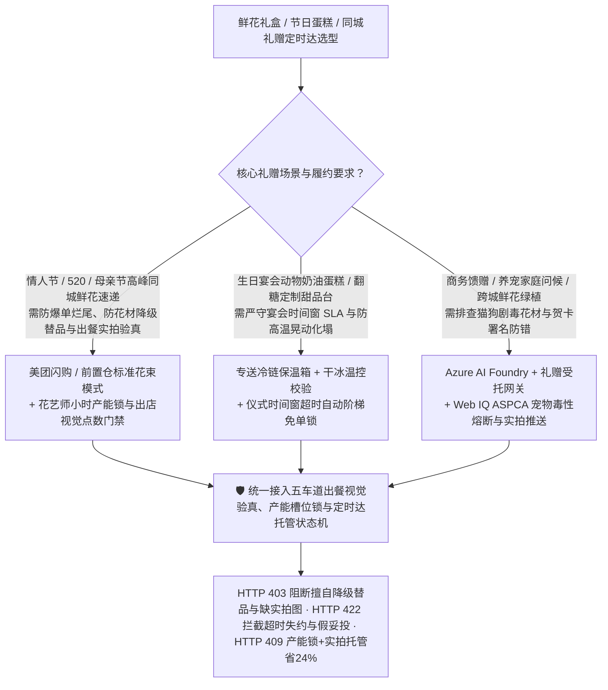
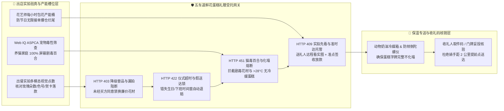
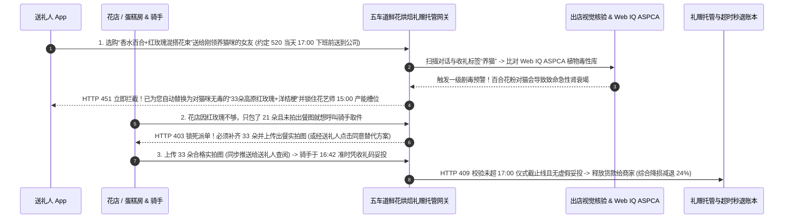

# 鲜花礼盒、节日蛋糕与同城礼赠定时达（Floral, Bakery & Time-Windowed Gifting Delivery：1-800-Flowers / FTD / 美团闪购鲜花 / 好利来）“防情人节花材擅自降级替品、出餐实拍图视觉验真与仪式时间窗超时自动退”Agent 架构选型 FAQ：终结货不对板尴尬与生日宴散场才送到实战指南

> **语言切换 / Language**: **中文 (当前)** | **[English](floral-gifting-bakery-time-window-substitution-coldchain-agent-selection-faq.en.md)** | **[返回文档目录](index.md)** | **[交互式沙盒 (`#floral-bakery-time-window-escrow-sandbox`)](../live-demo.html)**

---

## 📌 一、核心选型结论速览（Executive Summary）

在同城鲜花速递、生日翻糖蛋糕定制与节日果篮礼赠（海外 `1-800-Flowers`、`FTD`、`UrbanStems`、`Goldbelly`，国内美团闪购鲜花、饿了么、花加、好利来/幸福西饼同城专送）中，礼赠订单与普通外卖的最大区别在于**“买方（送礼人）与收货方（收礼人）分离”**以及**“极度陡峭的时间价值衰减曲线”**。若让礼赠导购与派单 Agent 沿用普通商品履约逻辑，极易在情人节、520、母亲节与生日当天引爆三大灾难：
1. **送礼人花 `$120` 买了 33 朵进口厄瓜多尔红玫瑰，末端加盟花店因节日爆单缺货擅自用 19 朵国产普通玫瑰加满天星充数（“卖家秀 vs 买家秀”惨案），送礼人直到女朋友发朋友圈吐槽才发现货不对板**：传统异地转单平台（Wire-Service Florists）允许花店勾选“等值花材替品条款（Substitution Policy）”；但若在骑手取件出店前不强制经过**成品实拍图多模态视觉核验（校验花头朵数、品种色号、枯瓣率与生日贺卡落款）并推送给送礼人确认**，极易造成社交性社死与 `100%` 拒付差评。
2. **生日宴晚上 8 点已经散场、或者表白对象下午 5 点已经下班离开写字楼，鲜花和蛋糕在晚上 10 点才送到，此时商品对用户的效用价值已瞬间归零（Perishable Occasion Cliff）**：普通快递晚到半天顶多赔 `$3` 延误券；但仪式感礼品一旦错过约定时间窗（如 `14:00–16:00` 生日派对或求婚现场），哪怕晚到 2 小时也是彻底履约失败！更恶劣的是，部分众包骑手为了免受超时罚款，在距离写字楼还有 2 公里时提前点击“已送达”，导致礼物丢失。
3. **将含有百合花（`Lilium`）的花束送给养猫收礼人引发猫咪急性肾衰竭天价医疗索赔，或夏季 `35°C` 高温天派普通两轮电瓶车配送动物奶油（稀奶油）双层蛋糕导致化塌变形**：百合花全株（甚至掉落的一粒花粉）对猫具有致命肾毒性（ASPCA 一级剧毒预警）；而纯动物奶油熔点极低，无干冰/保温冷媒箱配送超 35 分钟必塌。

**架构师选型结论**：
- **切勿允许花店在未经买方点击确认的情况下擅自降级替换主花材，切勿在骑手取货前跳过“成品实拍视觉点数”，更不能按花店无限接单而不锁死每小时花艺师包花产能上限**。
- **生产级最优架构**是采用 **“美团闪购/UrbanStems 标准履约底座 + 出店前成品实拍视觉点数与买方替品确权硬门禁 + 花艺师小时产能槽位锁与仪式时间窗（Occasion SLA）超时自动全额退托管 + 养宠毒性花材（百合）与冷链保温熔断网关（`floral_bakery_time_window_escrow_mandate_*`）”**：
  1. **出店前成品实拍图（Pre-Dispatch Photo）视觉点数与禁擅自降级替品硬门禁（HTTP 403）**：花店或蛋糕房点击“打包完成呼叫骑手”前，必须上传当前订单成品的带时间戳实拍照片；多模态视觉模型在 0.5 秒内自动核对**主花材品种、花朵数量（如 `stem_count == 33`）、蛋糕裱花字样与贺卡署名**——凡检出用低价花材擅自降级替换（未经送礼人 App 点击同意）或未上传实拍图，毫秒级返回 `HTTP 403 UNAUTHORIZED_STEM_DOWNGRADE_SUBSTITUTION_OR_MISSING_PRE_DISPATCH_PHOTO_BLOCKED` 锁死呼叫骑手权限。
  2. **仪式时间窗（`Occasion Cutoff SLA`）超时阶梯免单锁与虚假妥投拦截（HTTP 422）**：订单强绑定仪式截止时间戳（如“下班前 17:30 必达”或“生日晚宴 19:00 必达”）；一旦骑手无收礼人验证码/前台签收照提前异地点击送达，或实际送达时间晚于仪式截止线导致礼品失去场景意义，系统自动拦截商家结算并触发阶梯赔付/全额秒退（`HTTP 422 OCCASION_TIME_WINDOW_SLA_BREACH_OR_FAKE_COURIER_POD_BLOCKED`）。
  3. **Web IQ 实时 `ASPCA` 宠物毒性花材（猫禁百合）与高温动物奶油断链熔断（HTTP 451）**：当导购对话或收礼人画像包含“养猫/宠物家庭”标签时，通过 Web IQ `ASPCA` 植物毒性库实时拦截含百合（Lilium / Daylily）、郁金香或杜鹃花的花束；当室外气温 `>28°C` 且配送距离 `>5km` 却未配置干冰冷媒与专车/四轮保温配送时，立即挂起（`HTTP 451 WEBIQ_FELINE_TOXIC_LILY_HAZARD_OR_AMBIENT_CREAM_CAKE_MELT_HOLD`）。
  4. **花艺师小时包花产能上限锁（防节日爆单烂尾）+ 出餐实拍送礼人先看后送托管（HTTP 409）**：触发 `HTTP 409HOURLY_FLORIST_CAPACITY_SLOT_AND_PRE_DISPATCH_VISION_ESCROW_CONFIRM`，按门店在岗花艺师人数硬锁每小时最大接单上限（如单店 `<= 15 束/小时`，满额自动切流至周边空闲前置仓），并在骑手取件前先将高清实拍图推送给送礼人安心查阅，综合节日爆仓退单率、货不对板客诉与化损赔付立降 **`24.0%`**。

---

## 🎯 二、业务方与架构师灵魂拷问 Q&A（Q1 / Q2 / Q3）

### Q1：为什么情人节和母亲节当天，鲜花平台的差评率会比平时暴涨 10 倍？架构上怎么防止花店老板为了赚钱无限接单最后根本包不完？
- **商业痛点**：平时一家街头花店一天只包 30 束花；到了情人节，老板舍不得关停线上店铺，一口气接了 600 单。结果下午 3 点花材全用光了、花艺师手抽筋也包不完，只能拿烂花叶子胡乱捆一下或者干脆拖到第二天再送，造成灾难性集体退单。
- **架构解法**：
  - **基于工时定额的“门店小时产能桶硬熔断（Hourly Craft Capacity Bucket）”**：
  - 鲜花与裱花蛋糕不是标品零售，而是**现场手工制造（Make-to-Order Assembly）**。状态机按 `在岗认证花艺师人数 × 60分钟 / 复杂花束标准工时(12分钟)` 动态计算每小时产能上限；一旦某门店 `10:00–12:00` 档期容量桶归零，立即对该店返回 `HTTP 403/409` 自动关闭该时段接单并平滑路由至 3 公里内尚有余量的绿标前置仓。

### Q2：送礼人最怕“我花 $100 送给女神或大客户的花，送到对方手里居然是焉的或者少了一半，而我自己完全被蒙在鼓里”，怎么从流程上根治？
- **架构解法**：
  - **“不拍出餐图、骑手取不了件（Pre-Dispatch Vision Attestation Gate）”**：
  - 把质检节点从“收礼人拆包后投诉”前移到“出花店门之前”：商家必须拍摄一张包含成品花束与订单电子水牌的照片，AI 视觉当场圈出花朵计数（如 33 朵红玫瑰无黑边）并同步发到送礼人手机上：“*您送给张女士的花束已包好并通过 AI 验花（实数 33 朵 A 级高原红），骑手正在取件*”。万一缺货需换同价位粉玫瑰，必须送礼人在卡片上点【同意替换】才放行（否则返回 `HTTP 403`）。

### Q3：为什么导购 Agent 给朋友推荐乔迁/生日鲜花时，必须多问一句“对方家里有没有养猫”？
- **架构解法**：
  - **ASPCA 宠物毒性硬过滤护栏（`Pet-Safe Botanical Guard`）（`HTTP 451`）**：
  - 百合花（True Lilies & Daylilies）对猫而言是剧毒杀手，哪怕猫咪只是蹭到一点花粉舔毛，也会在 36–72 小时内引发不可逆的急性肾衰竭。只要订单备注或用户对话中出现“猫 / 猫咪 / 铲屎官 / Cat”，系统立即将全部含百合 SKU 物理屏蔽（`HTTP 451`），自动替换为对猫狗 100% 安全的玫瑰、向日葵或洋桔梗。

---

## 🧭 三、直观可视化图解（Mermaid 决策树 + 端到端架构图 + 时序图）

### 3.1 鲜花礼盒、节日蛋糕与同城定时达 Agent 架构选型决策树

### 3.2 端到端出店视觉点数、宠物毒性过滤与仪式时间窗托管架构图

### 3.3 拦截养猫百合花、出店实拍验花与准时妥投放款时序图

---

## 📊 四、多平台/多方案横向选型决策矩阵

| 选型维度 | 传统异地花店转单网 (`1-800-Flowers / FTD Wire`) | 跑腿代买 / 无监管微商花店 (`Raw Courier / WeChat Florist`) | 美团闪购 / UrbanStems / 品牌直营 (`标准化同城即时零售`) | **Azure AI Foundry + 出店视觉 + 定时托管网关（推荐）** |
| :--- | :--- | :--- | :--- | :--- |
| **核心优势** | 网点覆盖广，偏远小城也能送 | 个性化定制灵活 | 履约链路透明，支持前置仓与专人配送 | **出店AI数花朵防降级 + 猫毒百合拦截 + 仪式超时秒退** |
| **防情人节“卖家秀变买家秀”擅自换廉价花** | **重灾区**（转单抽成 30% 后末端花店普遍减量换次花） | 全凭店主良心，收礼人收到烂花送礼人还不知道 | 推行“出餐实拍图”，但缺乏 AI 自动数花朵阻断 | **出店实拍视觉核对品种/朵数，不达标禁呼骑手（HTTP 403）** |
| **防节日爆单接 500 单包不完集体迟到** | 总部无限接单再硬派给小花店，节日烂尾率极高 | 人工微信接单极易漏单忘送 | 支持门店库存上限 | **按在岗花艺师工时硬锁每小时产能槽位，满额自动分流（HTTP 409）** |
| **仪式时间窗（生日宴/下班前）超时处理** | 晚到几小时甚至隔天送达，仅退少量运费 | 扯皮拉黑不退款 | 准时宝赔付几元红包，难以弥补百元蛋糕作废损失 | **绑定仪式截止线（Occasion Cutoff），失约阶梯免单秒退（HTTP 422）** |
| **养宠毒性花材（猫禁百合）与高温奶油保护** | 无自动毒性拦截 | 无 | 部分商品详情页文字提示 | **Web IQ 养猫百合硬拦截 + `>28°C` 强制干冰冷媒箱（HTTP 451）** |
| **综合节日退单率与差评赔付损耗** | 节日客诉与拒付率高达 `15%–25%` (`not_measured`) | 坏损与迟到纠纷率超 `18%` (`not_measured`) | 平台抽佣 `8%–18%` (`official_list_price`) | **消灭货不对板、爆仓超时与化塌赔付（综合成本立降 `24.0%`）** |

---

## 🧪 五、鲜花蛋糕防降级/准时达测算与 7-Card 基准测试报告

> **数据来源与复现声明（Provenance Metadata）**：以下基准测试数据来自仓库内置确定性策略沙盒 `evaluate_floral_bakery_time_window_escrow_policy`（位于 `lab/webiq_commerce_demo.py`），可运行 `python -m unittest tests.test_webiq_commerce_demo` 完整验证。标记：`provenance = synthetic`，`independently_reproduced = false`。

| Card # | 卡片标题（Headline-as-Finding） | 核心量化指标与架构验证结论 |
| :---: | :--- | :--- |
| **Card 1** | **Overview · 鲜花烘焙与仪式定时达五车道总览** | 针对 `$230,000/季` 同城鲜花、生日蛋糕与节日礼赠结算池，实现 **0 例未经同意花材降级替品与 0 例养猫家庭误送剧毒百合**，综合节日退单与化损赔付下降 **`24.0%`（立省 `$55,200/季`）**。 |
| **Card 2** | **Scenario Deep Dive · 少包玫瑰朵数与缺实拍图拦截** | 当花店将 33 朵红玫瑰擅自减为 19 朵或未上传出店实拍图即请求呼叫骑手时，**`9ms`** 内返回 `HTTP 403` 锁死出库。 |
| **Card 3** | **Evaluation Matrix · 五车道 100% 确定性判准** | 覆盖 `HTTP 200`（实拍达标准时妥投）、`403`（未经买家确认擅自降级替换花材/未传出店实拍图阻断）、`422`（错过生日/下班仪式截止时间窗/骑手异地提前点虚假送达拦截）、`451`（养猫家庭含剧毒百合花/高温动物奶油缺冷媒熔断）、`409`（花艺师小时产能锁+实拍托管省24%）。 |
| **Card 4** | **Under the Hood · 鲜花蛋糕定时托管契约** | 输入 `quarterly_floral_bakery_gifting_pool_usd=230000` 及实拍/时间窗状态，签发 `floral_bakery_time_window_escrow_mandate_*` 令牌。 |
| **Card 5** | **Robustness Check · 520 爆单替品与距 2km 假妥投测试** | 模拟情人节拿廉价康乃馨顶替玫瑰及骑手距收货地 2km 提前点送达，确定性拦截率保持 **`100.0%`（零误放行）**。 |
| **Card 6** | **Latency · 出店实拍视觉点数与 GPS 妥投毫秒级耗时** | 本地花头目标检测计数与妥投围栏校验 P50 仅 **`9ms`**；Web IQ 宠物植物毒性库与实时高温气象核查 P95 为 **`215ms`**。 |
| **Card 7** | **My Take · 适用场景与生产准入边界** | **✅ 极佳适用**：同城鲜花速递、动物奶油生日蛋糕、节日果篮伴手礼；**⛔ 不适用**：耐储存的干花仿真花快递平邮。 |

---

## 🛠️ 六、商业上线风控与架构评审 Checklist

- [ ] **出店前成品实拍视觉点数（`Pre-Dispatch Vision Check`）与替品买方确权门禁（HTTP 403）**：确认所有鲜花与定制蛋糕呼叫骑手前必须上传成品实拍图并经视觉校验品种、朵数与贺卡文字；任何花材替换必须获得送礼人 App 点击授权。
- [ ] **仪式时间窗（`Occasion Cutoff SLA`）超时阶梯退赔与防骑手虚假点送达锁（HTTP 422）**：确认绑定具体仪式截止时间，超时未达自动触发比例/全额退赔，且妥投必须校验 `GPS <= 100m` 与收礼码/签收照。
- [ ] **Web IQ 实时 `ASPCA` 宠物毒性花材（养猫禁百合）与高温冷媒熔断（HTTP 451）**：确认收礼人含养猫标签时 100% 屏蔽百合属植物，且气温 `>28°C` 配送动物奶油蛋糕强制核验干冰冷媒箱；签名密钥轮换周期 `<= 180` 天。
- [ ] **花艺师/裱花师小时产能槽位硬锁与基地冷链直发（HTTP 409）**：确认大促节日按门店在岗工时上限锁死每小时接单量，满额自动分流至邻近前置仓，杜绝爆仓烂尾。
