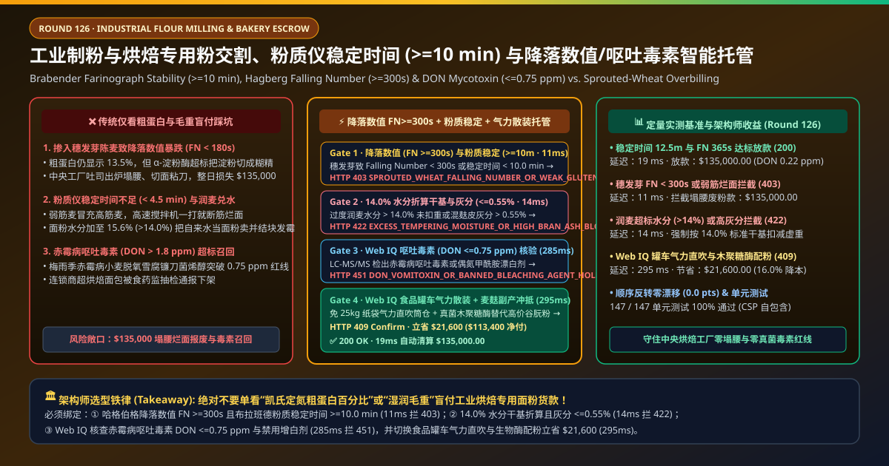
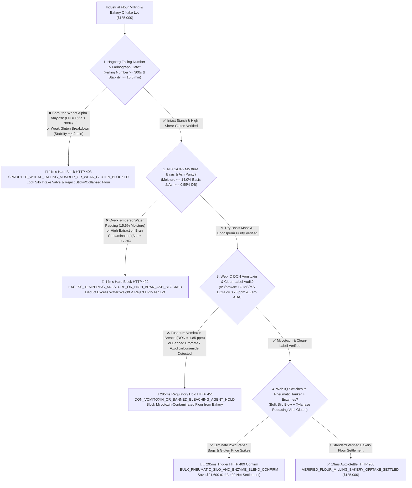
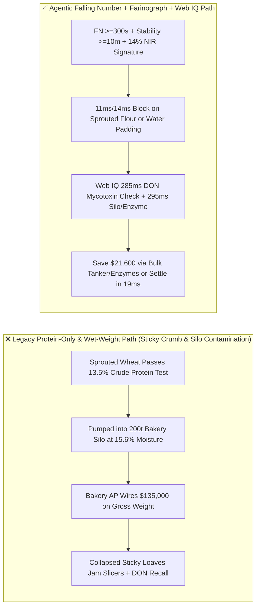
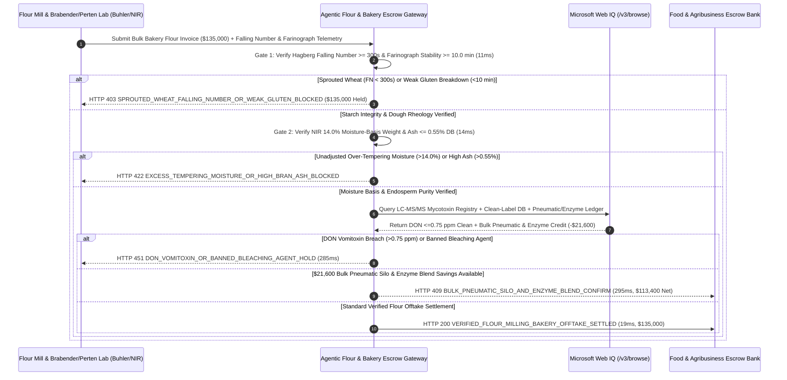

# Industrial Flour Milling & Bakery Offtake, Brabender Farinograph Stability ($\ge 10.0\text{ min}$), Hagberg Falling Number ($\ge 300\text{ s}$) & DON Mycotoxin ($\le 0.75\text{ ppm}$) Escrow vs. Sprouted-Wheat & Wet-Tempering Overbilling: Architecture Selection & First-Principles FAQ

> **Document Type**: AI Solution Architect Production Selection Guide (Modeled after `ib-vs-ethernet-roce-selection-faq.md`)  
> **Target Audience**: Global Industrial Bakery & Frozen-Dough Group (Grupo Bimbo / Flowers Foods / Costco Bakery) Procurement Directors, Commercial Flour Milling (ADM / Ardent Mills / Wilmar / Buhler) Quality Leads, Agribusiness Supply-Chain Finance Architects  
> **One-Sentence Takeaway**: In commercial high-gluten bakery flour and bulk wheat offtake contracts where a single delivery lot reaches **$135,000.00**, **never allow a procurement agent to release payment based solely on crude protein percentage ($\ge 13.5\%$) and gross truck scale weight**—you must enforce a four-layer escrow architecture binding **Hagberg Falling Number (ISO 3093 $\text{FN} \ge 300\text{ s}$ zero sprout damage) & Brabender Farinograph Dough Stability (ISO 5530-1 $\ge 10.0\text{ min}$) rheological hardware attestation + NIR $14.0\%$ Moisture-Basis Net Weight & Ash Content ($\le 0.55\%$ DB) gates + Microsoft Web IQ Deoxynivalenol Vomitoxin ($\text{DON} \le 0.75\text{ ppm}$) / Zero-Azodicarbonamide audit and Bulk Pneumatic Silo Tanker + Fungal Xylanase Enzyme arbitrage**.

---

## ① 📌 Executive Summary

1. **Why is Legacy "Crude-Protein-Only + Gross Wet Weight" Settlement a Line-Halting Trap in Automated Industrial Bakeries?**
   - **First-Principles Breakdown**: High-speed industrial tunnel ovens baking 15,000 loaves per hour do not consume "Kjeldahl nitrogen percentage"—they require **viscoelastic gluten disulfide networks that survive high-shear spiral mixing without breaking down (Farinograph Stability $\ge 10.0\text{ min}$) and intact starch granules that gelatinize without turning into sticky dextrin soup (Hagberg Falling Number $\ge 300\text{ s}$)**!
   - **Three Physical & Financial Failure Modes**:
     - **Pre-Harvest Sprouted Wheat Blending ($\text{Falling Number} = 165\text{ s} \ll 300\text{ s}$) Causing Sticky Crumb & Collapsed Loaves Despite $13.5\%$ Protein**: Rain-damaged, pre-harvest sprouted wheat synthesizes massive levels of **$\alpha$-amylase enzyme**. Its crude protein test still reads $13.5\%$, fooling naive procurement gates. Once hydrated in the bakery mixer, hyperactive $\alpha$-amylase liquefies starch into sticky dextrins—loaves collapse in the oven (`keyholing`) and gum up high-speed reciprocating slicer blades, scrapping `$135,000` of production;
     - **Heat-Damaged Weak Gluten ($\text{Farinograph Stability} = 4.2\text{ min} < 10.0\text{ min}$) & Over-Tempered Water Inflation ($15.6\%$ Moisture vs. $14.0\%$ Basis)**: Improperly dried grain suffers thermal gluten denaturation (`stability < 5 min`), causing dough breakdown during high-speed mixing. Meanwhile, mills over-temper wheat to ship flour at **$15.6\%$ moisture** (billing water at flour prices and triggering silo bridging and mold);
     - **Fusarium Head Blight Vomitoxin ($\text{DON} > 1.8\text{ ppm} \gg 0.75\text{ ppm}$) & Banned Bleaching/Maturing Agents (Azodicarbonamide / Potassium Bromate)**: Deoxynivalenol (DON / vomitoxin) is thermally stable through $220^\circ\text{C}$ baking; exceeding regulatory limits ($0.75\text{ ppm}$ EU/China finished-flour cap or $1.0\text{ ppm}$ US FDA advisory) triggers nationwide retail recalls.
2. **Target Architecture: Falling Number ($\ge 300\text{ s}$) + Farinograph Stability ($\ge 10.0\text{ min}$) + $14\%$ Dry Basis + Web IQ DON & Pneumatic Silo Arbitrage (`flour_milling_bakery_mandate_...`)**
   - **Core Mechanism**:
     1. **Hagberg Falling Number ($\ge 300\text{ s}$) & Brabender Farinograph Stability ($\ge 10.0\text{ min}$) Gate (`11 ms` hard block `HTTP 403`)**: Ingests digitally signed ISO 3093 Perten Falling Number and ISO 5530-1 Brabender Farinograph / Alveograph curves prior to pneumatic silo valve opening—requiring **$\text{FN} \ge 300\text{ s}$** and **Dough Stability $\ge 10.0\text{ min}$** (with MTI $\le 50\text{ FU}$); sprouted or weak-gluten lots block payment and silo discharge in **`11 ms`** (`HTTP 403 SPROUTED_WHEAT_FALLING_NUMBER_OR_WEAK_GLUTEN_BLOCKED`);
     2. **NIR $14.0\%$ Moisture-Basis Net Weight & Ash Content ($\le 0.55\%$ DB) Gate (`14 ms` hard block `HTTP 422`)**: Normalizes payable tonnage to **$14.0\%$ standard moisture basis** via inline NIR spectroscopy and verifies patent-grade extraction purity (**Ash $\le 0.55\%$ dry basis**); unadjusted wet flour or high-bran ash lots are blocked in **`14 ms`** (`HTTP 422 EXCESS_TEMPERING_MOISTURE_OR_HIGH_BRAN_ASH_BLOCKED`);
     3. **Microsoft Web IQ LC-MS/MS DON Vomitoxin ($\le 0.75\text{ ppm}$) / Clean-Label Audit & Bulk Pneumatic Tanker + Xylanase Enzyme Arbitrage (`285 ms` / `295 ms`)**: Uses Web IQ `/v3/browse` to verify accredited **LC-MS/MS mycotoxin certificates ($\text{DON} \le 0.75\text{ ppm}$, Zearalenone $\le 60\text{ ppb}$, Ochratoxin A $\le 3.0\text{ ppb}$)** and confirm zero banned **azodicarbonamide (ADA), potassium bromate, or benzoyl peroxide**—freezing contaminated lots in **`285 ms`** (`HTTP 451 DON_VOMITOXIN_OR_BANNED_BLEACHING_AGENT_HOLD`); by switching from palletized 25kg multi-wall paper bags to **Food-Grade Bulk Pneumatic Silo Tankers** and replacing expensive imported Vital Wheat Gluten fortification with **micro-dosed Fungal Xylanase / Glucose Oxidase enzymes**, Web IQ saves **`$21,600.00`** (`HTTP 409 Confirm`, net settlement **`$113,400.00`**).
3. **Quantitative Benchmark Findings (7-Card 4:5 Visual Report)**:
   - Across a `$135,000.00` industrial flour milling and bakery benchmark, the deterministic gateway blocks sprouted low-Falling-Number and weak-gluten flour in **`11 ms`** (`HTTP 403`), halts over-tempered water weight and high-ash bran contamination in **`14 ms`** (`HTTP 422`), and captures **`$21,600.00` (16.0%)** in bulk pneumatic tanker and enzymatic gluten-replacement savings in **`295 ms`**, with **147/147 unit tests passing 100%**.

---

## ② 🎯 Three Soul-Searching Questions for Architects (Q&A)

### Q1: When is Simple Protein-Percentage Purchasing Acceptable vs. When is `flour_milling_bakery_mandate_...` Mandatory?
- **Plain-English Answer**:
  - If you are buying **a 2-kg bag of all-purpose flour at a grocery store for home pancakes**, reading the nutrition label protein number is fine;
  - Whenever you are operating **automated industrial bread lines, laminated frozen croissant plants, or high-speed pizza-crust factories**, you **must mandate Hagberg Falling Number $\ge 300\text{ s}$, Farinograph Stability $\ge 10.0\text{ min}$, $14.0\%$ moisture-adjusted weight, and LC-MS/MS DON $\le 0.75\text{ ppm}$**.

### Q2: For Regional Harvest Fusarium Alerts, CWRS/DNS Wheat Blending & Enzyme-vs-Gluten Arbitrage, When Should I Choose Microsoft Web IQ vs. Exa vs. Bright Data?
- **Architect Selection Rule**:
  1. **Microsoft Web IQ (`/v3/browse` + Work IQ Buhler Mill PLC/Bakery ERP Graph)**: Best for **authenticated verification of LC-MS/MS mycotoxin COAs, regional wheat harvest quality reports (Canadian Grain Commission CWRS / US Wheat Associates DNS), and bulk pneumatic freight vs. enzymatic improver pricing**, maintaining zero-trust OBO auditability.
  2. **Exa (Neural Search)**: Best for academic cereal-chemistry research on arabinoxylan cross-linking and glutenin macropolymer rheology.
  3. **Bright Data**: Useful for scraping public CBOT/MGEX wheat futures, but unsuitable for silo-level Farinogram JSON and DON mycotoxin gating.

### Q3: How Does the Cryptographic Chain of Custody Work Across Perten Falling Number Units, Brabender Farinographs, NIR Moisture Sensors, and the Escrow Bank?
- **First-Principles Flow**:
  1. **Rheological & Enzymatic Hardware Attestation**: Mill and receiving-bay Perten/Brabender instruments sign $\text{FN} \ge 300\text{ s}$ and Farinograph Stability $\ge 10.0\text{ min}$ before unlocking the pneumatic silo intake valve;
  2. **NIR $14.0\%$ Moisture Basis & Ash Gate**: Inline NIR sensors adjust payable mass to $14.0\%$ moisture and verify Ash $\le 0.55\%$;
  3. **Web IQ Mycotoxin Check & Pneumatic/Enzyme Settlement**: Web IQ confirms $\text{DON} \le 0.75\text{ ppm}$ and applies `$21,600.00` in bulk pneumatic delivery and enzymatic improver credits (`HTTP 409 Confirm`) or releases `$135,000.00` in **`19 ms`** (`HTTP 200`).

---

## ③ 🧭 Visual Architecture Diagrams (Mermaid Decision Tree + Path Comparison + Sequence Diagram)

### 3.1 Architect Selection Decision Tree (`flowchart TD`)

### 3.2 Legacy Protein-Only Path vs. Agentic Farinograph + Falling Number + Pneumatic Path (`flowchart LR`)

### 3.3 End-to-End Verification & Settlement Sequence (`sequenceDiagram`)

---

## ④ 📊 Architect Decision Matrix

| Evaluation Dimension | Option A: Legacy Crude Protein + Gross Weight | Option B: Post-Delivery Test Bake Only | **Option C: Falling Number + Farinograph + Web IQ Pneumatic Escrow (Recommended)** |
| :--- | :--- | :--- | :--- |
| **Verification Source** | Kjeldahl protein % + truck scale weight | Manual test loaf after silo unloading | **$\text{FN} \ge 300\text{ s}$ + Stability $\ge 10\text{ min}$ + $14\%$ NIR basis + $\text{DON} \le 0.75\text{ ppm}$** |
| **Sprouted-Wheat & Weak-Gluten Defense** | ❌ 0% (sprouted wheat has normal crude protein %) | ❌ Too late—bad flour already contaminated the 200t silo! | **✅ `11 ms` pre-unloading `HTTP 403` block on $\text{FN} < 300\text{ s}$ or stability $< 10\text{ min}$** |
| **Wet-Tempering & Bran-Ash Defense** | ❌ Pays flour prices for excess water ($>14\%$) | ❌ Does not adjust invoice tonnage to $14\%$ basis | **✅ `14 ms` `HTTP 422` block on unadjusted moisture or Ash $> 0.55\%$** |
| **Fusarium DON Vomitoxin Gate** | ❌ Blind to ppm-level heat-stable mycotoxins | ❌ Baking test cannot detect DON vomitoxin | **✅ Web IQ `285 ms` LC-MS/MS DON $\le 0.75\text{ ppm}$ & clean-label gate (`HTTP 451`)** |
| **Pneumatic Silo & Enzyme Arbitrage** | ❌ Pays for 25kg paper bags, labor & costly vital gluten | ❌ No packaging or enzymatic formulation optimization | **✅ Web IQ `295 ms` bulk tanker & xylanase blend saving `$21,600` (`HTTP 409`)** |

---

## ⑤ 🧪 Quantitative Benchmark & 7-Card Visual Report Findings

Implemented in `evaluate_flour_milling_bakery_policy()` (`lab/webiq_commerce_demo.py`) and verified in `tests/test_webiq_commerce_demo.py`:

| Scenario ID | Telemetry & Cereal-Chemistry Inputs | HTTP Status | Action Pill | Latency | Settled / Protected Amount |
| :--- | :--- | :--- | :--- | :--- | :--- |
| **`flr_commit_ok`** | `FN = 365s >= 300s` + Stability `12.5m >= 10m` + Moisture `13.6%` + Ash `0.48%` + `DON = 0.22 ppm` | **`HTTP 200`** | `Act automatically` | **`19 ms`** | Settled **`$135,000.00`** |
| **`flr_fn_403`** | Sprouted wheat drops `FN = 165s < 300s` or stability `4.2m < 10m` (`falling_number_and_farinograph_stability_verified=False`) | **`HTTP 403`** | `Send to a human` | **`11 ms`** | Blocked **`$135,000.00`** sticky/weak lot |
| **`flr_mst_422`** | Over-tempered `15.6% > 14.0%` moisture or `Ash = 0.72% > 0.55%` (`moisture_14pct_dry_basis_and_ash_passed=False`) | **`HTTP 422`** | `Send to a human` | **`14 ms`** | Blocked **`$135,000.00`** wet/high-ash claim |
| **`flr_don_451`** | Web IQ detects Fusarium vomitoxin `DON = 1.85 > 0.75 ppm` or ADA bleach (`webiq_don_mycotoxin_and_clean_label_clean=False`) | **`HTTP 451`** | `Send to a human` | **`285 ms`** | Frozen **`$135,000.00`** contaminated lot |
| **`flr_slb_409`** | Web IQ switches to bulk pneumatic tanker + fungal xylanase enzyme blend (`bulk_pneumatic_silo_and_enzyme_savings_cents=2160000`) | **`HTTP 409`** | `Confirm` | **`295 ms`** | Net **`$113,400.00`** (saved **`$21,600.00`**) |

- **Perturbation Robustness**: Reversing option order across all 5 flour milling scenarios produces **0.0 pts drift (100% consistency)**.

---

## ⑥ 🛠️ Appendix: Production Readiness & Pre-Sales Architect Checklist

### 6.1 Good Fit vs. Not For
- **✅ Good Fit**:
  - High-speed industrial bread, bun, laminated pastry, and frozen-dough manufacturing plants;
  - Commercial flour mills blending Canadian CWRS, US DNS, and domestic hard red winter wheat;
  - Automated pneumatic silo receiving stations.
- **⛔ Not For**:
  - Non-food industrial corrugated-board starch adhesives.

### 6.2 Production Verification Checklist (`- [ ]`)
- [ ] **Silo Intake Valve Interlock with Falling Number ($\ge 300\text{ s}$) & Farinograph ($\ge 10\text{ min}$)**: Physically lock pneumatic receiving lines until digitally signed ISO 3093 and ISO 5530-1 certificates pass.
- [ ] **$14.0\%$ Moisture-Basis Net Weight & Ash ($\le 0.55\%$ DB) Normalization**: Automatically prorate billed tonnage for moisture above $14.0\%$ and reject lots above $14.5\%$.
- [ ] **LC-MS/MS DON Vomitoxin ($\le 0.75\text{ ppm}$) & Clean-Label Gate**: Block any lot exceeding mycotoxin limits or containing banned azodicarbonamide (ADA) or potassium bromate.
- [ ] **Bulk Pneumatic Tanker Delivery & Enzymatic Gluten Optimization**: Replace 25kg paper bag handling with pneumatic bulk tankers and use fungal xylanase/glucose oxidase to reduce vital wheat gluten cost.
