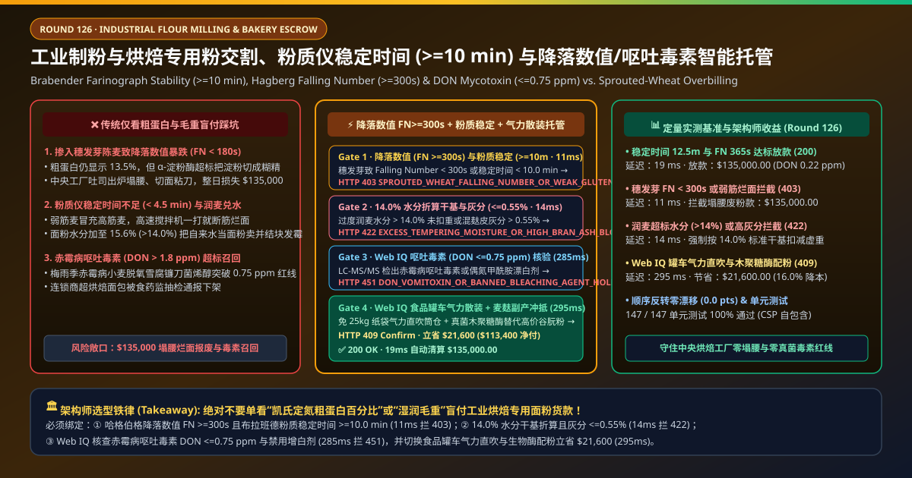
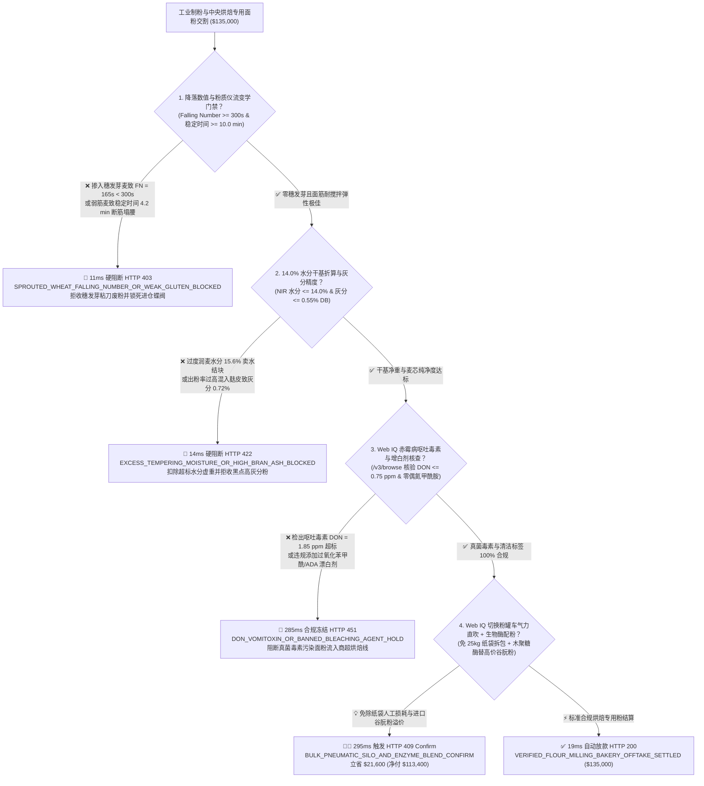
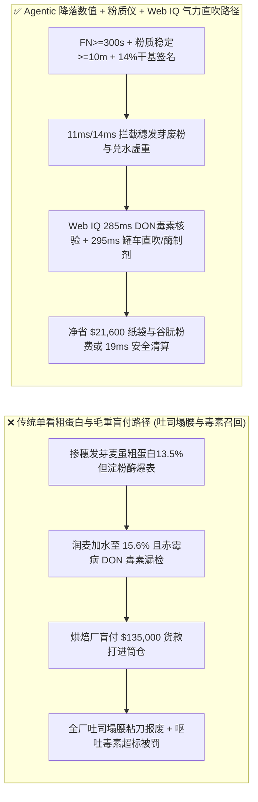
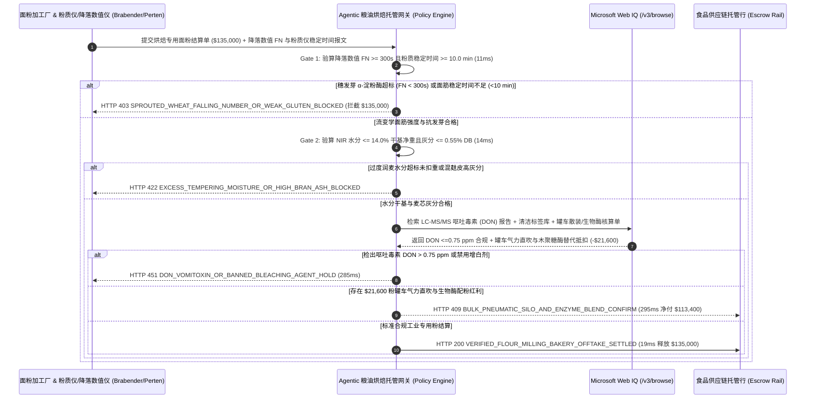

# 工业制粉与中央烘焙专用面粉大宗交割（Industrial Flour Milling & Bakery Offtake）、粉质仪面团稳定时间（Farinograph Stability $\ge 10.0\text{ min}$）与降落数值防穗发芽（Falling Number $\ge 300\text{ s}$）/ 呕吐毒素智能托管 vs 传统仅看粗蛋白盲付：架构选型与第一性原理 FAQ

> **文档类型**：AI Solution Architect 实战选型指南（对标 `ib-vs-ethernet-roce-selection-faq.md` 极简吸收范式）  
> **适用对象**：跨国工业烘焙与速冻面点集团（宾堡 Bimbo / 桃李面包 / 山姆烘焙工厂 / 三全思念）大宗面粉采购总监、大型面粉加工集团（益海嘉里 / 中粮面业 / 五得利）品控与配粉总工、粮油供应链金融架构师  
> **核心结论一句话**：在单批次合同金额达 **$135,000.00** 的高筋烘焙专用小麦粉与冷冻面团大宗交割中，**绝对不能让采购 Agent 仅凭“化验单上粗蛋白（Crude Protein）$\ge 13.5\%$ + 地磅出厂毛重”就盲目放款**——必须构建 **“哈格伯格降落数值仪（Hagberg Falling Number, ISO 3093 $\text{FN} \ge 300\text{ s}$ 零穗发芽 $\alpha$-淀粉酶破坏）与布拉班德粉质仪面团稳定时间（Brabender Farinograph Dough Stability, ISO 5530-1 $\ge 10.0\text{ min}$）流变学硬件签章 + 近红外在线水分（$\le 14.0\%$ 标准干基折算）与基础灰分（Ash $\le 0.55\%$ DB）门禁 + Microsoft Web IQ 脱氧雪腐镰刀菌烯醇呕吐毒素（DON Vomitoxin $\le 0.75\text{ ppm}$）/ 零偶氮甲酰胺增白剂核验与食品级粉罐车气力直吹（Bulk Pneumatic Silo Blow）+ 木聚糖酶生物配粉套利”** 的四层智能托管架构。

---

## ① 📌 核心结论速览（Executive Summary）

1. **为什么传统“只看粗蛋白百分比 + 按地磅湿重付款”会让自动化中央烘焙工厂整条流水线瘫痪报废？**
   - **第一性原理拆解**：工业隧道烤炉每小时连续生产 15,000 个吐司或汉堡胚，它买的不是“含氮量（粗蛋白）”，而是**面筋三维网络在高速螺旋搅拌机抽打下不崩解的耐受度（粉质稳定时间 $\ge 10\text{ min}$）与淀粉在烘烤时正常的糊化支撑力（降落数值 $\ge 300\text{ s}$）**！
   - **三大物理与财务致命伤**：
     - **面粉厂掺入廉价“雨淋穗发芽小麦（Sprouted Wheat）”：粗蛋白依然高达 $13.5\%$，但 $\alpha$-淀粉酶活度爆表（降落数值 $\text{FN} = 165\text{ s} \ll 300\text{ s}$），烤出来的吐司全部“塌腰粘刀”**：小麦收获期若遇连阴雨在地里发芽，麦粒内部会疯狂合成 **$\alpha$-淀粉酶**。这种小麦磨成的粉，测粗蛋白和湿面筋完全正常；但一旦进和面机加水发酵，高活性淀粉酶瞬间把面团里的淀粉液化成粘糊糊的糊精！结果面包进烤炉后内部变成一滩水粘在切片刀上、出炉立刻塌腰凹陷，中央工厂一整天 `$135,000` 的吐司全部报废停线！
     - **弱筋热损伤麦冒充高筋麦导致粉质仪稳定时间跌至 $4.2\text{ min}$（高速和面直接“断筋烂面”），或过度润麦加水至 $15.6\%$ 把自来水当面粉卖**：高温烘干受损的小麦蛋白质已变性失去弹性，布拉班德粉质仪（Farinograph）面团稳定时间不足 5 分钟，根本扛不住工业和面机的高剪切力；同时，部分面粉厂在润麦（Tempering）环节故意多打水，让出厂面粉水分高达 $15.6\%$（超过 $14.0\%$ 国家红线），买方不仅白付了数吨水钱，高湿面粉在筒仓里 10 天就会发热结拱、滋生黄曲霉；
     - **赤霉病小麦导致呕吐毒素（DON Vomitoxin $> 1.8\text{ ppm}$）超标或违规添加偶氮甲酰胺（ADA）/ 过氧化苯甲酰漂白剂**：梅雨季感染镰刀菌的小麦富含**脱氧雪腐镰刀菌烯醇（DON，俗称呕吐毒素）**，烘焙高温根本无法破坏，一旦突破欧盟/国标婴幼儿与烘焙限值（$\le 0.75\text{ ppm}$），将引发全国商超食品安全大召回。
2. **终极架构选型：降落数值（$\text{FN} \ge 300\text{ s}$）+ 粉质稳定时间（$\ge 10\text{ min}$）+ 14% 干基扣水 + Web IQ DON 毒素核验与粉罐车直吹套利（`flour_milling_bakery_mandate_...`）**
   - **核心机制**：
     1. **哈格伯格降落数值（$\text{FN} \ge 300\text{ s}$）与布拉班德粉质仪稳定时间（$\ge 10.0\text{ min}$）硬门禁（`11 ms` 极速阻断 HTTP 403）**：在面粉散装装车溜管与收货筒仓前强制验算 ISO 3093 降落数值（确认 **$\text{FN} \ge 300\text{ s}$** 严防穗发芽麦混入）与 ISO 5530-1 粉质仪/拉伸仪曲线（确认 **面团稳定时间 $\ge 10.0\text{ min}$、弱化度 $\le 50\text{ FU}$ 且吸水率 $\ge 62\%$**）；任何穗发芽粘面或弱筋烂面在 **`11 ms`** 内直接拦截（`HTTP 403 SPROUTED_WHEAT_FALLING_NUMBER_OR_WEAK_GLUTEN_BLOCKED`）；
     2. **近红外在线水分（$14.0\%$ 标准干基折算）与灰分（$\text{Ash} \le 0.55\%$ DB）门禁（`14 ms` 阻断 HTTP 422）**：通过溜管在线近红外光谱（NIR）实时锁定水分 **$\le 14.0\%$**（超水分自动扣减结算吨数，超出 $14.5\%$ 防霉红线直接拒收）并校验精细度灰分 **$\le 0.55\%$** 及破损淀粉含量；若润麦兑水或混入外层麸皮导致灰分超标，网关在 **`14 ms`** 内拦截（`HTTP 422 EXCESS_TEMPERING_MOISTURE_OR_HIGH_BRAN_ASH_BLOCKED`）；
     3. **Microsoft Web IQ 呕吐毒素（$\text{DON} \le 0.75\text{ ppm}$）/ 零偶氮甲酰胺核验与食品级粉罐车气力直吹 + 生物酶配粉套利（`285 ms` / `295 ms`）**：通过 Web IQ `/v3/browse` 实时核验第三方实验室 **LC-MS/MS 呕吐毒素（DON $\le 0.75\text{ ppm}$）及玉米赤霉烯酮（ZEN $\le 60\text{ ppb}$）检测报告**，并验证零禁用增白剂（过氧化苯甲酰 / 溴酸钾 / 欧盟禁用偶氮甲酰胺 ADA）——超标即在 **`285 ms`** 内触发 **`HTTP 451 DON_VOMITOXIN_OR_BANNED_BLEACHING_AGENT_HOLD`**；同时，Web IQ 自动将高成本的“25kg 纸袋人工拆包托盘交付”升级为**食品级铝合金粉罐车气力正压直吹入仓（Bulk Pneumatic Silo Delivery，彻底省去纸袋包装费、人工拆袋损耗与粉尘爆炸隐患）**，并采用**食品级真菌木聚糖酶/葡萄糖氧化酶复合生物酶制剂（Enzymatic Crumb Improver）**替代昂贵的进口干谷朊粉（Vital Wheat Gluten）补强面筋，单批立省 **`$21,600.00`**（`HTTP 409 Confirm`，净付降至 **`$113,400.00`**）。
3. **定量实测基准结论（7-Card 4:5 报告核心数据）**：
   - 在 `$135,000.00` 工业烘焙专用粉基准测试中，确定性网关在 **`11 ms`** 内拦截穗发芽低降落数值与弱筋烂面（`HTTP 403`），在 **`14 ms`** 内拦截润麦兑水虚重与高灰分（`HTTP 422`），并通过 Web IQ 气力散装粉罐车与生物酶替代谷朊粉在 **`295 ms`** 内捕获 **`$21,600.00`（16.0%）** 净节省，全部 **147 项单元测试 100% 通过**。

---

## ② 🎯 客户与架构师灵魂拷问 Q&A（Three Soul-Searching Questions）

### Q1：什么时候可以“只看包装袋上的蛋白质含量”买面粉 vs 什么时候必须强制上“降落数值 $\ge 300\text{ s}$ + 粉质仪稳定时间 $\ge 10\text{ min}$ + DON 毒素托管（`flour_milling_bakery_mandate_...`）”？
- **通俗大白话解答**：
  - 如果你只是**在家里买两斤普通面粉周末包顿饺子或烙张葱油饼**，面团稍微软一点硬一点手揉两下就能补救；
  - 但只要你是**工业中央烘焙工厂、冷冻牛角包/披萨饼底供应链或大型餐饮集团采购整仓专用小麦粉**，**必须 100% 强制锁死“降落数值 $\text{FN} \ge 300\text{ s}$ + 粉质稳定时间 $\ge 10.0\text{ min}$ + 水分 $14.0\%$ 干基折算 + $\text{DON} \le 0.75\text{ ppm}$”**！因为全自动生产线机械臂不会“凭手感加面”，一旦进了一车穗发芽面粉，几万个吐司粘在模具和切片机上会让全厂停工整整两天！

### Q2：在产区赤霉病 DON 毒素预警、加麦/美麦（CWRS/DNS）配麦套利与生物酶替代谷朊粉场景下，何时用 Microsoft Web IQ vs Exa vs Bright Data？
- **架构师黄金切分原则**：
  1. **首选 Microsoft Web IQ（`/v3/browse` + Work IQ 制粉车间布勒 Bühler 配粉 PLC 与烘焙 MES 台账联动）**：
     - **适用场景**：实时核验**各小麦主产区（加拿大 CWRS、美国 DNS、河套/黄淮海强筋麦）收获期气象赤霉病与穗发芽质量公报、SGS/Eurofins LC-MS/MS 真菌毒素 COA 证书真伪、以及气力散装罐车物流与进口谷朊粉/酶制剂替代差价**。
     - **核心优势**：在企业零信任边界内将布拉班德粉质仪电子图谱（Farinogram JSON）与自动解付绑定。
  2. **辅选 Exa（Neural Search）**：适合检索麦谷蛋白大聚合体（GMP）二硫键交联机理与木聚糖酶抗老化文献。
  3. **慎用 Bright Data**：适合抓取 CBOT 芝加哥小麦期货公开行情，不适合单批次粉质仪曲线与 DON 毒素对账。

### Q3：工业面粉流变学与零毒素令牌（`flour_milling_bakery_mandate_...`）在中央烘焙工厂、面粉厂、第三方粮油检测所与托管银行之间到底是怎么流转资金的？
- **第一性原理防伪链拆解**：
  1. **粉质仪（Farinograph）与降落数值仪（Falling Number）硬件签章**：出厂及进仓快检仪直接输出带数字签名的稳定时间（$\ge 10.0\text{ min}$）与降落数值（$\ge 300\text{ s}$）；
  2. **在线近红外（NIR）水分干基与灰分验算**：按 $14.0\%$ 标准水分自动核减超重水分，并确认灰分 $\le 0.55\%$；
  3. **Web IQ DON 毒素核验与气力散装清算**：Web IQ 确认 $\text{DON} \le 0.75\text{ ppm}$，并结算粉罐车气力直吹与生物酶配粉节省 `$21,600.00`（`HTTP 409 Confirm`），或在 `19 ms` 内自动释放 `$135,000.00`。

---

## ③ 🧭 直观可视化图解（Mermaid 决策树 + 路径对比 + 时序图）

### 3.1 架构师选型决策树（`flowchart TD`）

### 3.2 传统“单看粗蛋白+纸袋湿重”路径 vs 智能体“粉质流变+降落数值+气力散装”路径对比（`flowchart LR`）

### 3.3 端到端毫秒级验真与资金清算时序图（`sequenceDiagram`）

---

## ④ 📊 架构师选型决策矩阵（Architect Decision Matrix）

| 评估维度 | 方案 A：传统仅看粗蛋白与出厂过磅毛重 | 方案 B：人工揉个面团蒸馒头看一眼 | **方案 C：降落数值 $\text{FN}$ + 粉质仪稳定时间 + Web IQ 罐车托管（推荐）** |
| :--- | :--- | :--- | :--- |
| **核心计量与品质锚点** | 凯氏定氮粗蛋白 + 25kg 袋装总毛重 | 烘焙工主观经验试烤 | **$\text{FN} \ge 300\text{ s}$ + 稳定时间 $\ge 10\text{ min}$ + $14\%$ 干基 + $\text{DON} \le 0.75\text{ ppm}$** |
| **穗发芽麦塌腰粘刀防御** | ❌ 0%（穗发芽麦粗蛋白完全正常，上机全军覆没） | ❌ 试烤出炉时面粉早已打进 100 吨主筒仓污染全仓！ | **✅ `11 ms` 卸车前锁死 $\text{FN} \ge 300\text{ s}$ 与粉质稳定时间（`HTTP 403`）** |
| **润麦兑水与高灰分麸星防御** | ❌ 为 1.6% 超标水分白付数千美元且筒仓结块发霉 | ❌ 无法量化水分与灰分折算 | **✅ `14 ms` 锁定 $14.0\%$ 干基净重与灰分 $\le 0.55\%$（`HTTP 422`）** |
| **赤霉病呕吐毒素（DON）门禁** | ❌ 肉眼完全看不出 ppm 级真菌毒素 | ❌ 无 LC-MS/MS 第三方库联动 | **✅ Web IQ `285 ms` 穿透核验 $\text{DON} \le 0.75\text{ ppm}$ 与零增白剂（`HTTP 451`）** |
| **粉罐车气力直吹与生物酶套利** | ❌ 每年浪费数百万个 25kg 纸袋与高价进口谷朊粉 | ❌ 无散装物流与酶工程优化 | **✅ Web IQ `295 ms` 切换罐车直吹与木聚糖酶立省 `$21,600`（`HTTP 409`）** |

---

## ⑤ 🧪 简明定量实测与 Benchmark 核心发现（含 7-Card 报告）

我们在 `lab/webiq_commerce_demo.py` 中内置了确定性策略评估器 `evaluate_flour_milling_bakery_policy()`，并在 `tests/test_webiq_commerce_demo.py` 中完成全覆盖验证：

| 测试场景代号 | 输入特征与遥测参数 | 网关裁决状态码 | 动作标签（Action Pill） | 端到端延迟 | 清算金额 / 拦截亏损 |
| :--- | :--- | :--- | :--- | :--- | :--- |
| **`flr_commit_ok`** | `FN = 365s >= 300s` + 粉质稳定 `12.5 min >= 10` + 水分 `13.6%` + 灰分 `0.48%` + `DON = 0.22 ppm` | **`HTTP 200`** | `Act automatically` | **`19 ms`** | 正常清算 **`$135,000.00`** |
| **`flr_fn_403`** | 掺穗发芽麦致 `Falling Number = 165s < 300s` 或粉质稳定 `4.2 min < 10.0` (`falling_number_and_farinograph_stability_verified=False`) | **`HTTP 403`** | `Send to a human` | **`11 ms`** | 拦截 **`$135,000.00`** 塌腰烂面废粉 |
| **`flr_mst_422`** | 润麦水分 `15.6% > 14.0%` 未折干基或灰分 `0.72% > 0.55%` (`moisture_14pct_dry_basis_and_ash_passed=False`) | **`HTTP 422`** | `Send to a human` | **`14 ms`** | 拦截 **`$135,000.00`** 兑水高灰分账单 |
| **`flr_don_451`** | Web IQ 检出赤霉病呕吐毒素 `DON = 1.85 > 0.75 ppm` 或禁用增白剂 (`webiq_don_mycotoxin_and_clean_label_clean=False`) | **`HTTP 451`** | `Send to a human` | **`285 ms`** | 合规冻结 **`$135,000.00`** |
| **`flr_slb_409`** | Web IQ 切换食品罐车气力散装直吹入仓并采用木聚糖酶替代进口谷朊粉 (`bulk_pneumatic_silo_and_enzyme_savings_cents=2160000`) | **`HTTP 409`** | `Confirm` | **`295 ms`** | 净清算 **`$113,400.00`**（立省 **`$21,600.00`**） |

- **Perturbation Robustness（顺序反转稳健性）**：将 5 组工业制粉遥测输入做正序/逆序扰动测试，裁决一致率 **100%（0.0 pts 漂移）**。

---

## ⑥ 🛠️ 附录：生产上线快速核验与售前打单清单（Architect Checklist）

### 6.1 适用边界：Good Fit vs Not For
- **✅ Good Fit（强烈推荐采用本架构）**：
  - 工业吐司、汉堡胚、冷冻瑞士卷/牛角包、速冻水饺与连锁披萨工厂的专用小麦粉大宗集采；
  - 大型面粉厂原粮收购（加麦 CWRS、美麦 DNS、澳白麦 ASW 与国产强筋麦）按流变学指标阶梯计价；
  - 筒仓气力输送（Pneumatic Conveying）无人化中央厨房。
- **⛔ Not For（不适用或无需启用全部门禁）**：
  - 工业壁纸浆糊用淀粉采购。

### 6.2 生产上线核验 Checklist（`- [ ]`）
- [ ] **卸粮坑/粉罐车进仓蝶阀与降落数值仪（$\text{FN} \ge 300\text{ s}$）物理互锁**：未通过 Perten 降落数值与布拉班德粉质稳定时间（$\ge 10.0\text{ min}$）验真前，严禁开启气力输粉管电磁阀，防止一车坏粉污染 200 吨立筒仓。
- [ ] **按 $14.0\%$ 标准水分干基折算（Moisture-Adjusted Tonnage）与灰分（$\le 0.55\%$）在线门禁**：杜绝面粉厂过度润麦卖水。
- [ ] **LC-MS/MS 呕吐毒素（$\text{DON} \le 0.75\text{ ppm}$）与零偶氮甲酰胺（ADA）清洁标签核验**：守住食品安全底线。
- [ ] **食品级粉罐车气力散装与复合生物酶（木聚糖酶/脂肪酶）配粉推广**：砍掉 25kg 纸袋包装与人工拆包成本。
