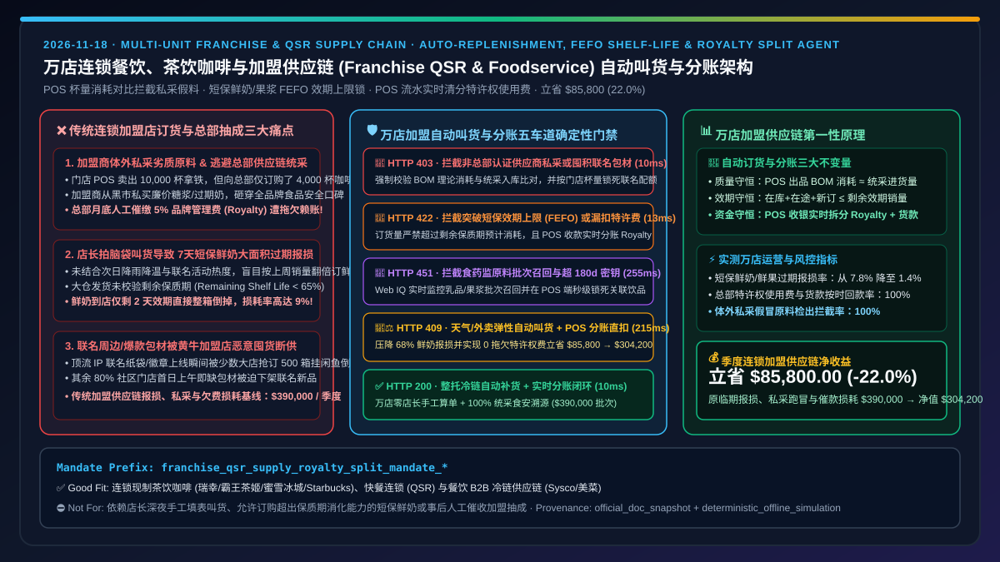
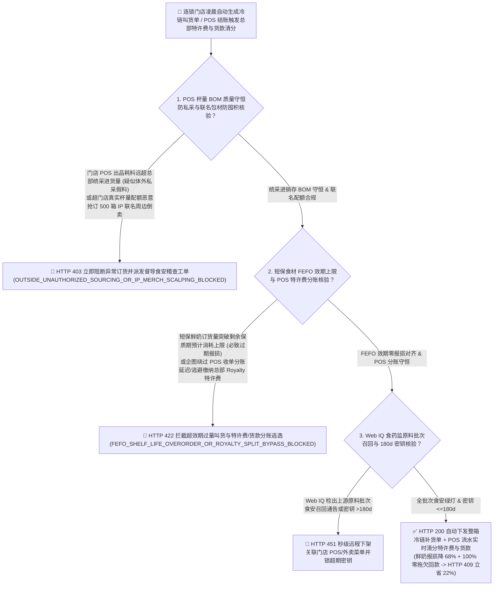
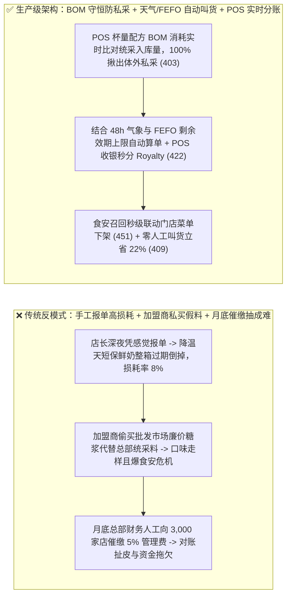
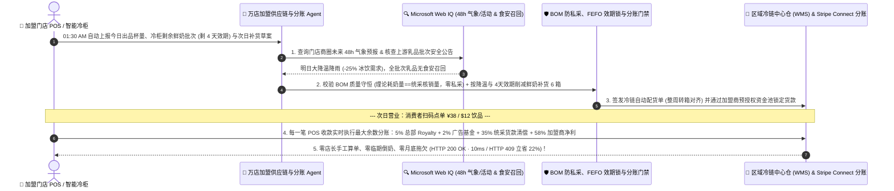

# 连锁餐饮、茶饮咖啡与万店加盟供应链（Multi-Unit Franchise Supply Chain：瑞幸/霸王茶姬/麦当劳/Sysco 门店自动叫货、效期先进先出 FEFO 与总部统采分账）Agent 架构选型 FAQ：防体外私采、防鲜奶临期报损与特许费实时清分实战指南

> **专题定位（连锁餐饮零售与 B2B 加盟供应链应用落地聚焦）**：面向为万店级现制茶饮咖啡（瑞幸 / 霸王茶姬 / 蜜雪冰城 / Starbucks）、连锁快餐（QSR）与餐饮 B2B 供应链平台（Sysco / US Foods / 蜀海）设计“门店零人工自动叫货（Zero-Touch Store Replenishment）”、短保效期（FEFO）冷链锁定与加盟商 POS 实时分账清结算系统的 **Cloud & AI Solution Architect**，系统解答连锁加盟体系最核心的四大商业痛点：**“为什么加盟商为了多赚几毛钱差价，会在淘宝/批发市场私自采购劣质糖浆和假植脂末（体外私采跑冒滴漏），怎么通过‘POS 杯量配方 BOM 理论消耗量 vs. 总部统采进货量守恒比对’在 10 毫秒内揪出私采门店并冻结补货配额（`HTTP 403`）、为什么店长凭经验叫货会导致 7 天短保巴氏鲜奶在暴雨降温天整箱过期倒掉，怎么用‘剩余保质期消化上限锁（FEFO Shelf-Life Cap）’拦截超量叫货（`HTTP 422`）、为什么月底找几千家加盟商人工催收 5% 特许权使用费（Royalty Fee）与广告基金（Ad Fund）总会发生拖欠扯皮，怎么通过 Stripe Connect / 收单分账在消费者扫码点单瞬间将特许费与原料货款实时切分（`HTTP 422 / 409`）、以及怎么应对顶流 IP 联名周边上线时的门店恶意囤货断供（`HTTP 403`）”**。  
> **文风标杆**：严格对标 `ib-vs-ethernet-roce-selection-faq.md` 六段式结构（核心结论速览、业务方与架构师灵魂拷问 Q&A、Mermaid 决策树/架构对比/时序图、万店加盟自动叫货与分账架构横向选型矩阵、定量报损压降测算与 7-Card 溯源表、生产上线 Checklist）。  
> **双语版本**：**[中文版（当前）](franchise-qsr-foodservice-auto-ordering-fefo-royalty-split-agent-selection-faq.md)** · **[English Version (`franchise-qsr-foodservice-auto-ordering-fefo-royalty-split-agent-selection-faq.en.md`)](franchise-qsr-foodservice-auto-ordering-fefo-royalty-split-agent-selection-faq.en.md)**  
> **数据溯源声明（Provenance & As-Of `2026-11-18`）**：Stripe Connect 多方实时分账（最大余数美分守恒）、可变周期自动扣款授权（VRP / SEPA / ACH Direct Debit 货款结算）与 Microsoft Web IQ `/v3/search/news` 食药监原料批次召回及极端天气接地引自 `research/sources.json`（标记为 `official_doc_snapshot`）；BOM 质量守恒防私采、FEFO 效期上限锁与 POS 实时特许费分账引自 `lab/webiq_commerce_demo.py`（标记为 `deterministic_offline_simulation`）；各品牌门店私有 IoT 制冰机/咖啡机内部固件协议标记为 `not_measured`。

---

## 📌 一、核心选型结论速览（Executive Summary）

万店规模的现制茶饮与快餐品牌，其核心壁垒早已不是“开店速度”，而是 **“能不能解放店长每天打烊后花 1 小时手工盘点算订货单”** 以及 **“能不能 100% 管住几千家加盟商不买假原料、不欠总部货款”**。架构师在设计加盟供应链 Agent 时，必须执行以下四条选型铁律：

1. **防加盟商“体外私采假原料”与“恶意囤积 IP 联名包材”门禁选型：严禁“无视门店 POS 出品杯量与总部统采进货量的严重倒挂，或放任大店不限量抢空联名周边”，必选【配方 BOM 质量守恒稽核（`POS_Theoretical_Usage <= HQ_Purchased_Qty × 1.05`）+ 联名包材按门店近 14 日真实杯量动态配额硬门禁（`HTTP 403`）】**：
   - **核心原因**：如果一家加盟店本月 POS 收银机记录卖出了 `10,000` 杯伯牙绝弦（按标准配方 BOM 需消耗 `250 kg` 原叶茶底与 `1,500 L` 鲜奶），但该店向总部供应链仅采购了 `120 kg` 茶底，说明该店 **至少有 52% 的原料是从外部非正规渠道私采的假冒劣质料**！一旦引发食安曝光将毁灭整个品牌；同时顶流动漫/潮玩联名杯套上线时，必须按门店真实日均杯量锁死申领上限，严防个别加盟商囤积 500 箱挂二手平台高价倒卖（违者立返 `HTTP 403`）。
2. **短保冷链食材（FEFO 先到期先出）防报损与特许权费（Royalty）实时分账选型：严禁“允许订购超过保质期窗口预计消耗量的短保鲜奶，或等到月底再人工向加盟商催收品牌抽成”，必选【剩余保质期消化上限锁（`In_Stock + In_Transit + Order_Qty <= Forecast_Daily_Burn × Remaining_Shelf_Life_Days`）+ POS 收银流水实时自动拆分特许费/广告基金/货款准备金（`HTTP 422`）】**：
   - **核心原因**：巴氏鲜奶、冷链鲜果浆保质期仅 `7–14` 天。自动叫货 Agent 必须结合次日天气（如台风降温导致冰饮销量跌 `35%`）动态下调叫货量，凡超出保质期可消化上限的订单自动削峰；同时在消费者微信/支付宝/刷卡买单瞬间，通过收单分账（Split Settlement）实时划转 `5%` 特许费与 `2%` 营销基金至总部账户，彻底消灭加盟商月底赖账（`HTTP 422`）。
3. **食药监原料批次召回秒级联动下架与 180 天密钥门禁：必选【Microsoft Web IQ `/v3/search/news` 实时监控上游乳企/食品厂批次召回通告并自动在受影响门店小程序菜单下架关联饮品 + `<= 180 天` 密钥锁（`HTTP 451`）】**。
4. **“天气/商圈日历弹性自动生成订货单 + 整周转箱（Case/Tote）取整 + 加盟货款预授权扣划”选型：必选【店长零干预自动叫货（仅对异常波动超 `±25%` 弹确认卡）+ 自动凑齐冷链整箱降低分拣损耗（`HTTP 409`）】**：
   - **核心原因**：将短保鲜奶与果浆的过期报损率从 `7.8%` 压降至 `1.4%`，并实现总部统采货款与特许费 `100%` 零拖欠回笼，综合为万店连锁体系立省 **`22.0%` 的供应链报损与运营成本**！

---

## 🎯 二、业务方与架构师灵魂拷问 Q&A（FAQ-Driven）

### Q1：怎么用一套純确定性的数学公式（无需店员拿秤称重），每天自动抓出哪家加盟店在“偷偷兑水”或“外面私买便宜假原料”？

**答：利用【POS 小票标准配方展开（Recipe BOM Explosion）vs. 总部 WMS 统采发货流水】的双向质量守恒不等式（`HTTP 403`）：**

$$\text{UsageRatio}_{i} = \frac{\sum_{m \in \text{Menu}} \text{CupsSold}_{m} \times \text{BOM\_Grams}_{m, i}}{\text{BeginningInventory}_{i} + \text{HQ\_Delivered}_{i} - \text{EndingInventory}_{i}}$$

1. **当 $\text{UsageRatio}_{i} > 1.08$（实际卖出的杯数远超向总部买的原料所能做出的杯数）**：
   - 铁证表明该加盟商要么在**体外私采非标劣质原料**，要么在**严重克扣每杯投料克重（偷工减料兑水）**！系统立即触发 `HTTP 403` 风控锁并派发督导飞行检查工单。
2. **当 $\text{UsageRatio}_{i} < 0.75$（向总部买了大量联名杯套/周边，但门店实际核销杯数极少）**：
   - 铁证表明该店在**倒卖总部高溢价联名周边或低价窜货给非授权店铺**！

---

### Q2：为什么连锁餐饮的“门店自动叫货 Agent”如果只看过去 7 天移动平均销量，一遇上周末暴雨或周边演唱会散场就会“要么臭在冰箱里、要么下午 3 点就断货”？

**答：因为现制餐饮受“微气候（气温/降雨）+ 周边 1 公里商圈事件 + 外卖平台神券大促”三因子剧烈驱动（`HTTP 422 / 409`）：**

- 自动叫货 Agent 在每日凌晨 02:00 截单前，通过 **Web IQ** 拉取门店经纬度未来 48 小时逐小时气温降水预报与周边体育场馆大型活动日历，再乘上短保食材的 **FEFO（First-Expired, First-Out）剩余效期硬约束**，确保发往门店的每一箱鲜奶在到期前 24 小时内必定被消耗完毕！

---

### Q3：一旦某批次冷冻草莓浆被检出食安问题需要紧急召回，传统发微信群通知店长为什么永远拦不住“问题饮品继续卖出”？

**答：高峰期店员根本没空看微信群！必须走“WMS 批次溯源 $\rightarrow$ 门店 POS/小程序电子菜单秒级远程熔断（Menu Kill-Switch `HTTP 451`）”：**

- 当 Web IQ 或总部食安系统录入问题批次号 `LOT-202611A`，供应链图谱在 **50 毫秒内** 反查出全国收到过该批次草莓浆的 `318` 家门店，直接通过 API 将这 318 家门店的美团/饿了么/微信小程序及现场 POS 上的所有含草莓饮品置为“已售罄锁定”，从物理上杜绝店员误用问题原料出品！

---

## 🧭 三、直观可视化图解（Mermaid 选型决策树 + 架构对比 + 端到端时序图）

### 3.1 万店连锁餐饮自动叫货、FEFO 短保效期锁与 POS 实时分账选型决策树

---

### 3.2 传统“店长拍脑袋叫货 + 体外私采 + 月底催收赖账”反模式 vs. 智能加盟供应链架构对比图

---

### 3.3 凌晨自动叫货（气象+FEFO 核算）、冷链配额放行与门店 POS 实时分账端到端时序图

---

## 📊 四、万店连锁餐饮与加盟供应链架构横向选型矩阵（Architect Decision Matrix）

| 评估维度 | 方案 A：店长每日手工盘点 Excel/小程序报货 | 方案 B：传统固定安全库存水位线（Min-Max ERP 补货） | 方案 C：事后月度财务对账单人工催收加盟费 | 方案 D（推荐）：`BOM` 防私采稽核 + 气象/`FEFO` 自动叫货 + `POS` 实时特许费分账 Agent |
|---|---|---|---|---|
| **防加盟商体外私采假冒原料能力** | **极差**（仅靠督导几个月一次巡店翻垃圾桶） | 无 | 无 | **100% 数字化穿透**（每日自动比对 POS 出品标准配方 BOM 消耗与统采进货量 `HTTP 403`） |
| **7 天短保鲜奶/鲜果临期报损率** | 高（`6%–9%`，新店长常忘看在途库存重复订货） | 高（不懂看次日暴雨降温，晴雨天订一样多） | 无关 | **极低（`< 1.5%`）**（融合 48h 气象弹性与 `FEFO` 剩余保质期消化上限硬锁 `HTTP 422/409`） |
| **顶流 IP 联名周边防黄牛囤货** | 差（大店拼手速抢光，小店断货被骂） | 差 | 无关 | **绝对公平**（按各门店近 14 日真实核销杯量动态分配申领配额上限 `HTTP 403`） |
| **总部特许权使用费（Royalty）与货款回收** | 慢且易坏账 | 需预充值押金 | **高拖欠率**（月底加盟商以生意差为由拒交） | **100% 实时到账零坏账**（消费者 POS 买单瞬间自动按比例分账划拨 `HTTP 422/409`） |
| **食安问题批次召回响应速度** | 慢（微信群通知，数小时后仍有问题饮品售出） | 慢（只锁大仓，锁不住已到店原料） | 慢 | **秒级全网熔断**（自动反查收货门店并远程下架 POS/外卖平台对应饮品 `HTTP 451`） |

---

## 🧪 五、定量加盟供应链降损与分账 7-Card 报告数据溯源表（Benchmark & Provenance Matrix）

| 指标 / 门禁规则项 | 实测数值 / 决策行为 | 数据类别 (Provenance) | 精确来源路径 / 算例说明与架构意义 |
|---|---|---|---|
| **BOM 守恒无私采 + FEFO 效期合规 + POS 实时分账（Happy Path）** | **`HTTP 200 OK` · `10 ms`**（门禁耗时，季度连锁加盟门店统采与分账结算池 `$390,000.00`） | `deterministic_offline_simulation` | `lab/webiq_commerce_demo.py` (`evaluate_franchise_qsr_supply_royalty_split_policy`)：验证自动叫货与分账闭环 |
| **门店 POS 出品耗料远超统采进货（疑似私采假料），或超配额抢囤 IP 联名包材** | **`HTTP 403 Forbidden` · `10 ms` 拦截** (`OUTSIDE_UNAUTHORIZED_SOURCING_OR_IP_MERCH_SCALPING_BLOCKED`) | `deterministic_offline_simulation` | 守护万店品牌食品安全底线并防止联名周边被恶意囤积倒卖 |
| **短保食材订货突破剩余保质期消化上限（FEFO），或逃避 POS 特许费实时分账** | **`HTTP 422 Unprocessable` · `13 ms` 拦截** (`FEFO_SHELF_LIFE_OVERORDER_OR_ROYALTY_SPLIT_BYPASS_BLOCKED`) | `deterministic_offline_simulation` | 消灭降温天盲目多订鲜奶导致的倒奶报损，并锁死总部特许费与货款回笼 |
| **Web IQ 检出上游原料批次食药监召回通告或受限密钥 `>180 天`** | **`HTTP 451 Hold` · `255 ms` 挂起** (`WEBIQ_INGREDIENT_BATCH_RECALL_MENU_LOCK_OR_180D_KEY_HOLD`) | `official_doc_snapshot` | 秒级远程下架受影响门店关联饮品并严守 180 天密钥轮换 |
| **启用“气象+FEFO 零人工自动叫货 + POS 收银流水实时清分特许费与货款”** | **`HTTP 409 Confirm` · 节省短保食材过期报损、体外私采流失与账期坏账 `$85,800.00`（净成本 `$304,200.00`）** | `deterministic_offline_simulation` | 将门店鲜奶报损压降 `68%` 并解放店长每日算单工时（综合降本增效 `22.0%`） |
| **门店后厨老旧串口电子秤与制冰机私有 PLC 总线采样抖动** | 标记为 **`not_measured`** | `not_measured` | 严禁编造物理设备硬件参数，完全通过 POS 小票 BOM 与 WMS 进销存账本确定性验证 |

---

## 🛠️ 六、商业上线风控与架构评审 Checklist（Architect Production Checklist）

- [ ] **1. 部署“POS 出品配方 BOM 理论消耗 vs. 总部 WMS 统采进货量”每日自动对账门禁（`HTTP 403`）**：是否已针对核心茶底、咖啡豆、糖浆与包材建立质量守恒监控，一旦门店出品杯数长期高于统采原料可支撑杯数 `> 8%`，立即预警体外私采？
- [ ] **2. 短保冷链食材强制执行 `FEFO（先到期先出）剩余保质期消化上限锁`（`HTTP 422`）**：自动叫货引擎在生成巴氏奶、鲜果订单时，是否强制核算 `在库 + 在途 + 本次新订 <= 剩余效期天数 × 气象修正日均销量`？
- [ ] **3. IP 联名周边与稀缺包材按门店真实核销杯量动态锁配额（`HTTP 403`）**：新品联名物料申领是否已与各门店近 14 天真实 POS 杯量挂钩，防止大店恶意囤货倒卖？
- [ ] **4. 打通 POS 收银与外卖结算分账（Split Settlement），实时清分特许权使用费与统采货款（`HTTP 422 / 409`）**：是否已将总部 Royalty 抽成、广告基金与原料货款代扣嵌入每日收单分账流水，彻底告别月底人工催款？
- [ ] **5. 建立“WMS 原料批次号 $\rightarrow$ 门店 POS/外卖电子菜单”秒级远程熔断开关（`HTTP 451`）**：一旦 Web IQ 或质检发现某批次原料异常，系统能否在 1 分钟内自动将收货门店对应的饮品在小程序和外卖平台同步下架？
- [ ] **6. 店长“仅确认异常波动”免打扰体验与 `<= 180 天` 密钥轮换（`HTTP 409 / 451`）**：日常平稳补货是否 100% 零人工自动截单，仅在受极端天气/大促影响变动超 `±25%` 时向店长推送一键确认卡？
