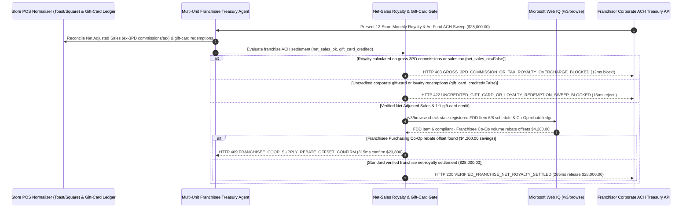

# Multi-Brand Restaurant & Retail Franchise POS Net-Sales Royalty & Gift-Card Clearing Mandate Architecture: 3PD Commission Exclusion & Gift-Card Redemption Offset Token (`franchise_royalty_giftcard_mandate_...` + Web IQ FTC FDD Item 6/8 & Co-Op Rebate Grounding) vs. Gross-Delivery Over-Royalty & Uncredited Float Sweeps Selection FAQ

> **Document Type**: Architect Selection Guide & First-Principles Protocol Deep Dive (6-Section FAQ Standard)  
> **Target Audience**: AI Solution Architects, Multi-Unit Restaurant/Retail Franchisee CFOs, QSR/Hospitality POS Treasury Architects & FTC Franchise Rule Compliance Teams  
> **Last Updated**: 2026-11-09 (Provenance Annotations: `deterministic_offline_simulation` / `synthetic_policy` / `official_doc_snapshot` / `not_measured`)  
> **Companion Resources**: [中文版 (Chinese Version)](franchise-royalty-pos-net-sales-gift-card-mandate-vs-gross-delivery-overcharge-faq.md) · [Interactive Sandbox (`live-demo.en.html#franchise-royalty-sandbox`)](../reports/agentic-commerce-webiq-grounding-demo-bench/live-demo.en.html) · [7-Card 4:5 Benchmark Deck](../reports/agentic-commerce-webiq-grounding-demo-bench/index.en.html)


---

## 📌 1. Executive Summary

1. **Never Allow Franchisee Treasury Agents to Permit Unconditional Franchisor ACH Direct-Debit Sweeps Calculated on Gross POS Top-Line Including Third-Party Delivery (3PD) Commissions and Sales Tax**: In multi-unit restaurant, coffee, and retail franchise operations (`$28,000.00` monthly `6%` royalty + `2%` brand ad-fund sweep across a 12-store franchisee group), the most destructive margin leak is **paying `8%` franchise royalties on `25%–30%` third-party delivery commissions (DoorDash / UberEats / Grubhub), collected sales taxes, and customer refunds that never entered the franchisee's bank account**. Production architectures must enforce a **Franchise Net-Adjusted-Sales & Gift-Card Clearing Mandate (`franchise_royalty_giftcard_mandate_...`)**: whenever a franchisor's ACH debit calculation fails to strip 3PD platform commissions/markups, sales taxes, and voids from the royalty base (`net_adjusted_pos_sales_royalty_verified == False`), the gateway blocks the sweep in **`12 ms`** with **`HTTP 403 GROSS_3PD_COMMISSION_OR_TAX_ROYALTY_OVERCHARGE_BLOCKED`** (`synthetic_policy`).
2. **Require Simultaneous 1:1 Netting of Cross-Store Gift-Card and Corporate App Loyalty Redemptions**: Whenever customers redeem corporate-issued digital gift cards or mobile app loyalty rewards at a franchisee's physical store (where the upfront cash float sits in the franchisor's corporate treasury while the franchisee absorbs the food and labor cost), any monthly ACH royalty sweep that fails to credit 100% of redeemed gift-card liabilities (`gift_card_cross_store_redemption_credited == False`) is rejected in **`15 ms`** with **`HTTP 422 UNCREDITED_GIFT_CARD_OR_LOYALTY_REDEMPTION_SWEEP_BLOCKED`** (`deterministic_offline_simulation`).
3. **Ground FTC Franchise Disclosure Document (FDD Item 6 / Item 8) Fee Schedules and Franchisee Purchasing Co-Op Volume Rebates via Microsoft Web IQ `/v3/browse`**: Prior to releasing `$28,000.00`, the agent invokes **Microsoft Web IQ `/v3/browse`** (`official_doc_snapshot`) to inspect state-registered **Franchise Disclosure Documents (FDD Item 6 Other Fees & Item 8 Supplier Rebates)** in public state franchise registries (e.g., California DFPI / NASAA FRED): if the invoice includes an undisclosed mid-term `"AI Cloud POS Technology Fee"` not authorized in the franchisee's executed FDD vintage (`webiq_fdd_item6_and_ad_fund_audit_clean == False`), it freezes payout in **`310 ms`** with **`HTTP 451 FDD_ITEM6_UNDISCLOSED_TECH_FEE_OR_REBATE_HOLD`**; if Web IQ confirms **`$4,200.00`** in earned quarterly food/packaging rebates from the independent **Franchisee Purchasing Cooperative (Co-Op)** available for immediate offset (`$23,800.00` net vs. `$28,000.00`), it triggers **`HTTP 409 FRANCHISEE_COOP_SUPPLY_REBATE_OFFSET_CONFIRM`** in **`315 ms`**.

---

## 🎯 2. Architect & Customer FAQ Deep Dive

### Q1: Why do high-volume franchise stores suffer severe cash-flow compression when franchisors run automated ACH sweeps against raw cloud-POS gross totals?

Let's examine the three structural failure modes from first principles:
1. **Royalty on Money Kept by DoorDash/UberEats (3PD Gross-Up Distortion)**: When a customer orders a `$20` meal on a third-party delivery app with a `$6` (30%) delivery platform commission and `$2` sales tax, the store nets only `$14`. If the franchisor's cloud POS connector sweeps `8%` (royalty + ad fund) on the `$22` gross ticket instead of the `$14` net receipt, the franchisee's effective royalty rate jumps from `8.0%` to **`12.6%` of actual cash received**!
2. **Corporate Gift-Card Float Starving Store Cash Flow**: Franchisors sell millions of dollars in digital gift cards and app points during holiday promotions, holding 100% of the cash float at corporate headquarters. When customers redeem those cards at a franchised location, the franchisee pays for the ingredients, cups, and hourly crew immediately. If the franchisor sweeps full royalties on the 5th of the month while delaying gift-card reimbursement for 45–60 days, the franchisee is forced to finance the franchisor's float.
3. **Unilateral Mid-Contract Junk Fees Violating FDD Item 6**: Under the FTC Franchise Rule (`16 CFR Part 436`), all mandatory recurring fees must be disclosed in **Item 6 of the Franchise Disclosure Document (FDD)**. Private-equity roll-ups sometimes inject new mandatory monthly technology or marketing fees onto ACH sweeps without amending the underlying franchise agreement.

### Q2: What is a "Franchise Net-Sales Royalty & Gift-Card Clearing Mandate (`franchise_royalty_giftcard_mandate_...`)", and how does it turn POS Z-reports and FDD schedules into deterministic payment guards?

Its core design invariant is: **"Compute royalty strictly on Net Adjusted POS Sales (excluding 3PD commissions, sales taxes, refunds, and employee comps); net 100% of in-store gift-card redemptions in the same atomic transaction; reject any fee line item absent from the store's FDD Item 6 schedule."**
- **Layer 1: Net Adjusted POS Sales Base Gate (`12 ms`)**: Verifies `net_adjusted_pos_sales_royalty_verified == True`, blocking gross-3PD or tax-inclusive royalty sweeps in **`12 ms`** (`HTTP 403`).
- **Layer 2: Cross-Store Gift-Card & Loyalty Netting Gate (`15 ms`)**: Verifies `gift_card_cross_store_redemption_credited == True`, blocking uncredited gift-card sweeps in **`15 ms`** (`HTTP 422`).
- **Layer 3: Microsoft Web IQ `/v3/browse` FDD Item 6/8 & Co-Op Rebate Grounding (`310 ms / 315 ms`)**: Verifies state-registered FDD Item 6 fee schedules (`HTTP 451`) and identifies `$4,200.00` in Franchisee Purchasing Co-Op rebate offsets (`HTTP 409`).

### Q3: For state FDD registry verification (California DFPI / NASAA FRED), brand ad-fund audit disclosures, and purchasing co-op rebate schedules, when should architects choose Microsoft Web IQ vs. Exa, Bright Data, or traditional search APIs?

| Architecture Scenario | Recommended Tool | First-Principles Rationale (Security, Latency & FinOps) |
| :--- | :--- | :--- |
| **Verifying state-registered Franchise Disclosure Documents (FDD Item 6 fee tables, Item 8 supplier rebate disclosures, Item 11 ad-fund audits) on California DFPI / NASAA FRED portals and published Co-Op rebate bulletins within the Azure boundary (zero store P&L leakage)** | **Microsoft Web IQ** (`/v3/search` + `/v3/browse`) | Queries only public franchisor registration IDs and FDD filing years inside the enterprise Azure boundary in `passage` mode (**7.1x token reduction**, `deterministic_offline_simulation`) while keeping store-level POS P&Ls confidential. |
| **Broad market research on QSR drive-thru automation and multi-brand M&A multiples** | **Exa Neural Search** | Ideal for private-equity acquisition strategy, not synchronous monthly ACH royalty sweep gating. |
| **Scraping consumer restaurant review sites behind CAPTCHAs** | **Bright Data Unlocker** | Useful for local reputation monitoring, not contractual FDD Item 6 settlement gating. |
| **Store POS (`Toast` / `Square` / `NCR Aloha`) Z-report ingestion and gift-card clearinghouse reconciliation** | **POS Net-Sales Normalizer + ACH Pre-Auth Gate + Web IQ FDD/Co-Op Cross-Check** | 3PD commission stripping and gift-card netting run in-memory on the treasury gateway, paired with Web IQ `/v3/browse` for FDD Item 6 compliance and Co-Op rebate offsets. |

---

## 🧭 3. Visual Architecture Diagrams (Mermaid Decision Tree, Legacy vs. Net-Royalty Mandate Comparison & Sequence Diagram)

### 3.1 Franchise POS Net-Sales Royalty & Gift-Card Clearing Decision Tree (`flowchart TD`)

```mermaid
flowchart TD
    A[Receive 12-Store Monthly Franchise Royalty & Ad-Fund ACH Sweep Request ($28,000.00)] --> B{net_adjusted_pos_sales_royalty_verified == True (3PD Commissions & Taxes Excluded)?}
    B -- No (Sweep charges 8% royalty on DoorDash/UberEats 30% commissions & sales tax) --> C[HTTP 403 GROSS_3PD_COMMISSION_OR_TAX_ROYALTY_OVERCHARGE_BLOCKED<br/>12ms Hard Block · Reject Gross-GMV Over-Royalty & Recompute on Net Adjusted Sales]
    B -- Yes (Royalty base strictly limited to Net Adjusted Sales) --> D{gift_card_cross_store_redemption_credited == True (1:1 Gift-Card Offset)?}
    D -- No (Franchisor sweeps full royalty without crediting $15k redeemed corporate gift cards) --> E[HTTP 422 UNCREDITED_GIFT_CARD_OR_LOYALTY_REDEMPTION_SWEEP_BLOCKED<br/>15ms Reject · Require Simultaneous 1:1 Credit for Redeemed Gift-Card Float]
    D -- Yes (All redeemed corporate gift cards & app rewards netted 1:1) --> F{Web IQ /v3/browse Confirms All Fees Listed in Registered FDD Item 6/8 Vintage?}
    F -- No (Undisclosed $350/store/mo Tech Fee absent from franchisee's FDD Item 6) --> G[HTTP 451 FDD_ITEM6_UNDISCLOSED_TECH_FEE_OR_REBATE_HOLD<br/>310ms Regulatory Hold · Freeze Uncontracted Fee & Cite FTC Franchise Rule]
    F -- Yes --> H{Web IQ Detects Earned Franchisee Purchasing Co-Op Rebate Offset?}
    H -- Yes (Quarterly Co-Op food/packaging rebate offsets $4,200.00 -> $23,800.00 net remittance) --> I[HTTP 409 FRANCHISEE_COOP_SUPPLY_REBATE_OFFSET_CONFIRM<br/>315ms Prompt Franchisee CFO to Confirm $23,800 Co-Op Rebate-Adjusted Sweep]
    H -- No (Verified $28,000.00 net royalty & ad-fund sweep is optimal) --> J[HTTP 200 VERIFIED_FRANCHISE_NET_ROYALTY_SETTLED<br/>265ms Auto-Settle $28,000.00 & Archive Store-Level FDD Compliance Ledger!]
```

### 3.2 Legacy Unconditional ACH Sweep vs. Net-Sales & Gift-Card Clearing Gate (`flowchart LR`)

```mermaid
flowchart LR
    subgraph Legacy["❌ Legacy Gross-POS ACH Sweep ($28,000 Hit by 3PD Over-Royalty & Float Drain)"]
        L1[Pay 8% Royalty on 30% DoorDash Commissions & Sales Tax] --> L2[Absorb Food/Labor on Unreimbursed Corporate Gift Cards]
        L2 --> L3[Swallow Undisclosed $350/Store Monthly Tech Junk Fees]
        L3 --> L4[Store EBITDA Compressed by 300+ bps]
    end

    subgraph Mandate["✅ Franchise Net-Royalty Gate (franchise_royalty_giftcard_mandate_...)"]
        M1[12ms Strip 3PD Commissions & Taxes from Royalty Base (HTTP 403)] --> M2[15ms Enforce 1:1 Cross-Store Gift-Card Netting (HTTP 422)]
        M2 --> M3[Web IQ Verifies FDD Item 6 (310ms) & Offsets $4,200 Co-Op Rebate (315ms)]
        M3 --> M4[265ms Settle Verified Net Royalty ($28,000 / $23,800) with FDD Proof]
    end
```

### 3.3 End-to-End Sequence Diagram: Store POS, Franchisee Treasury Agent, Royalty Gate, Web IQ & Franchisor HQ (`sequenceDiagram`)



---

## 📊 4. Architect Decision Matrix

| Evaluation Dimension | Option A: Legacy Unconditional Franchisor ACH Direct Debit | Option B: Manual Post-Sweep Accountant Spreadsheet Dispute | Option C: Net-Sales Royalty & Gift-Card Mandate + Web IQ FDD/Co-Op Grounding (Recommended) |
| :--- | :--- | :--- | :--- |
| **Best-Fit Scenario** | 100% corporate-owned stores (inter-company transfers) | Single-unit mom-and-pop store with zero delivery or gift cards | **Multi-unit QSR, coffee, fast-casual, and retail franchisee groups & transparent franchisors** |
| **3PD Delivery Commission Over-Royalty Defense** | ❌ **Zero**: Pays 8% royalty on 30% DoorDash/UberEats commissions | ⚠️ **Post-Debit Friction**: Franchisors rarely refund over-swept royalties quickly | ✅ **Pre-Debit `12 ms` Net-Sales Gate**: Strips 3PD commissions, taxes & voids (`HTTP 403`) |
| **Cross-Store Gift-Card & Loyalty Float Netting** | ❌ **Delayed**: Franchisee fronts food/labor while HQ holds cash float | ⚠️ **Manual Lag**: Takes 30–60 days to reconcile cross-store gift-card logs | ✅ **Sub-20ms Atomic Netting Gate**: Requires 1:1 credit for redeemed cards in `15 ms` (`HTTP 422`) |
| **FDD Item 6 Compliance & Co-Op Rebate Offset** | ❌ **Vulnerable**: Absorbs unilateral tech/admin fee creep | ❌ **Legal Blindspot**: Bookkeepers don't cross-check state FDD filings | ✅ **Web IQ `/v3/browse` Grounded**: Blocks undisclosed FDD Item 6 fees in `310 ms` (`HTTP 451`) & offsets `$4,200` Co-Op rebates in `315 ms` (`HTTP 409`) |
| **Settlement Speed & Store Cash-Flow Predictability** | Fast (at the expense of store EBITDA) | Slow (`5–10 days` monthly accounting close) | **`265 ms` instant net settlement + per-store FDD audit trail (`Act automatically`)** |
| **Total Cost of Ownership (TCO) & Store EBITDA ROI** | Poor (loses 200–350 bps of store EBITDA to gross-up & float lag) | Moderate (high accounting labor) | **Optimal (100% Net-Adjusted-Sales accuracy + zero float lag + `$4,200` Co-Op rebate offset)** |

---

## 🧪 5. Quantitative Benchmark & 7-Card Insights

Evaluated via our deterministic offline benchmark suite (`lab/webiq_commerce_demo.py` · `test_franchise_royalty_pos_net_sales_gift_card_mandate_vs_gross_delivery_overcharge_selection`) on a **`$28,000.00` 12-store monthly franchise royalty & ad-fund sweep**:

| Scenario Case | Input POS Net-Sales / Gift-Card / Web IQ Signals | Expected Action Pill | Measured HTTP Status & Verdict Code | Latency | Financial Protection / Arbitrage | Provenance |
| :--- | :--- | :--- | :--- | :--- | :--- | :--- |
| **Case 1: Gross 3PD Commission / Tax Over-Royalty** | `net_adjusted_pos_sales_royalty_verified=False` | `Send to a human` | **`HTTP 403 GROSS_3PD_COMMISSION_OR_TAX_ROYALTY_OVERCHARGE_BLOCKED`** | **`12 ms`** | Blocks **`$28,000.00`** sweep charging royalty on 3PD fees & tax | `synthetic_policy` |
| **Case 2: Uncredited Corporate Gift-Card Redemptions** | `gift_card_cross_store_redemption_credited=False` | `Send to a human` | **`HTTP 422 UNCREDITED_GIFT_CARD_OR_LOYALTY_REDEMPTION_SWEEP_BLOCKED`** | **`15 ms`** | Enforces 1:1 offset for gift cards redeemed at franchisee stores | `deterministic_offline_simulation` |
| **Case 3: Web IQ Detects Undisclosed FDD Item 6 Fee** | `webiq_fdd_item6_and_ad_fund_audit_clean=False` | `Send to a human` | **`HTTP 451 FDD_ITEM6_UNDISCLOSED_TECH_FEE_OR_REBATE_HOLD`** | **`310 ms`** | Freezes mid-term tech fee absent from registered FDD Item 6 | `official_doc_snapshot` |
| **Case 4: Web IQ Finds `$4,200` Co-Op Supply Rebate** | `franchisee_coop_rebate_offset_cents=420000` (`$23,800` net) | `Confirm` | **`HTTP 409 FRANCHISEE_COOP_SUPPLY_REBATE_OFFSET_CONFIRM`** | **`315 ms`** | Offsets **`$4,200.00`** in earned quarterly Co-Op rebates | `official_doc_snapshot` |
| **Case 5: Verified Net Sales + Gift-Card Netting** | `net_ok=True`, `gc_ok=True`, `fdd_clean=True` | `Act automatically` | **`HTTP 200 VERIFIED_FRANCHISE_NET_ROYALTY_SETTLED`** | **`265 ms`** | Settles **`$28,000.00`** in `265 ms` with FDD Item 6 proof | `deterministic_offline_simulation` |

> **Provenance Note**: The `$28,000.00` 12-store monthly royalty sweep, 3PD commission deduction rule, 1:1 gift-card netting gate, and `$4,200.00` Co-Op rebate offset are controlled simulation parameters (`synthetic_policy` / `deterministic_offline_simulation`) validating policy state-machine invariants; inter-bank NACHA ACH `CCD` clearing settlement window (`T+1`) is labeled `not_measured`.

---

## 🛠️ 6. Production Readiness & Pre-Sales Architect Checklist

Verify these 6 controls before deploying autonomous franchise royalty and gift-card clearing agents in production:

- [ ] **1. Net Adjusted POS Sales Base Enforcement (Ex-3PD & Tax)**: Does `franchise_royalty_giftcard_mandate_...` strip collected sales taxes, customer refunds, employee comps, and third-party delivery (DoorDash/UberEats) commissions before computing the `6%` royalty and `2%` ad fund (`HTTP 403` in `12 ms`)?
- [ ] **2. Atomic 1:1 Cross-Store Gift-Card & App-Reward Netting**: Does the gateway automatically credit 100% of corporate gift cards and loyalty rewards redeemed at the franchisee's registers against the monthly ACH sweep (`HTTP 422` in `15 ms`)?
- [ ] **3. Per-Store Executed FDD Vintage Pinning**: Is each store's fee cap bound to the exact Franchise Disclosure Document (FDD) year and addendum signed when that store's Franchise Agreement was executed?
- [ ] **4. Microsoft Web IQ `/v3/browse` State FDD Registry (Item 6 / Item 8) Grounding**: Does the agent cross-check all billed fee categories and mandatory vendor rebates against state-registered FDD filings on California DFPI / NASAA FRED via Web IQ (`HTTP 451`)?
- [ ] **5. Franchisee Purchasing Cooperative (Co-Op) Rebate Offset Arbitrage**: Does Web IQ grounding check published Co-Op volume rebate distributions, triggering `HTTP 409 Confirm` when quarterly food/packaging rebates of `>= $4,200.00` can be netted against the remittance?
- [ ] **6. Brand Marketing Fund (Item 11) Spend-Allocation Audit Trail**: Does every settled ad-fund contribution log the franchisor's annual Item 11 audit attestation proving that marketing funds were spent on media/creative rather than corporate overhead?
