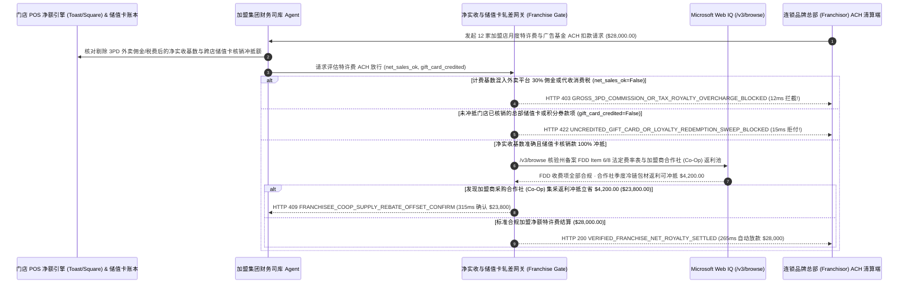

# 连锁餐饮与零售加盟特许权使用费（Franchise Royalty）、第三方外卖平台抽成剔除与储值卡跨店核销清算（Multi-Brand Restaurant & Retail Franchise POS Net-Sales Royalty & Gift-Card Clearing Mandate）架构：净实收营业额抽成与储值卡核销池划拨令牌（`franchise_royalty_giftcard_mandate_...` + Web IQ FDD Item 6/8 合规与合作社联采返利核验）vs 传统按外卖毛流水强抽特许费与总部截留储值金选型与原理解析 FAQ

> **文档类型**：架构师选型指南 & 协议第一性原理解析（6 段式 FAQ 标准版）  
> **适用读者**：AI Solution Architect、大型多品牌餐饮/茶饮/便利店加盟集团（Multi-Unit Franchisee Group）CFO、连锁品牌总部 POS 清分结算与特许经营合规（FTC Franchise Rule / 商业特许经营备案）架构师  
> **更新日期**：2026-11-09（Provenance 标注：`deterministic_offline_simulation` / `synthetic_policy` / `official_doc_snapshot` / `not_measured`）  
> **配套资源**：[English Version](franchise-royalty-pos-net-sales-gift-card-mandate-vs-gross-delivery-overcharge-faq.en.md) · [交互式沙盒控制台 (`live-demo.html#franchise-royalty-sandbox`)](../reports/agentic-commerce-webiq-grounding-demo-bench/live-demo.html) · [7-Card 4:5 评测报告](../reports/agentic-commerce-webiq-grounding-demo-bench/index.html)


---

## 📌 一、核心结论速览（Executive Summary）

1. **严禁让连锁加盟商（Franchisee）司库 Agent 允许品牌总部通过无条件直接借记（Unconditional ACH Direct Debit）按“含第三方外卖平台 30% 抽成、消费税与退单的 POS 账面毛流水（Gross GMV）”划扣特许权使用费与全国广告基金**：在连锁快餐、咖啡茶饮及零售门店月度特许经营清算（如 12 家加盟店月度 `6%` 特许费 + `2%` 广告基金批次 `$28,000.00`）中，最刺痛加盟商的财务出血点是 **“外卖平台（DoorDash / UberEats / 美团）已经抽走了 25%～30% 的佣金和配送补贴，门店实际到手只有 70%，品牌总部却仍按 POS 机上 100% 的外卖标价毛流水强抽 8% 品牌管理费”**。生产环境必须采用 **净实收营业额（Net Adjusted Sales）抽成与储值卡跨店清算令牌（`franchise_royalty_giftcard_mandate_...`）**：一旦检出清算单未剔除第三方外卖平台佣金溢价、代收销售税（Sales Tax）、顾客退款及员工餐（`net_adjusted_pos_sales_royalty_verified=False`），网关在 **`12 ms`** 内触发 **`HTTP 403 GROSS_3PD_COMMISSION_OR_TAX_ROYALTY_OVERCHARGE_BLOCKED`**（`synthetic_policy`），拒绝超额扣款。
2. **强制将“品牌总部 App 预付储值卡（Gift Card）与跨店会员积分免单券的门店核销额”与月度特许费进行 1:1 双向轧差清算**：当消费者在总部官方小程序/App 充值 `$100` 买礼品卡（现金全进了总部银行账户），随后走进你的加盟门店刷卡喝掉了 `$100` 咖啡时，若总部在月底扣特许费时未将该门店垫付的储值卡核销款全额拨付冲抵（`gift_card_cross_store_redemption_credited=False`），网关在 **`15 ms`** 内返回 **`HTTP 422 UNCREDITED_GIFT_CARD_OR_LOYALTY_REDEMPTION_SWEEP_BLOCKED`**（`deterministic_offline_simulation`）。
3. **基于 Microsoft Web IQ `/v3/browse` 实时核验特许经营披露文件（FDD Item 6 / Item 8）法定收费白名单与加盟商采购合作社（Co-Op）季度食材返利套利**：在放行划款前，Agent 调用 **Microsoft Web IQ `/v3/browse`**（`official_doc_snapshot`）穿透查询州政府特许经营备案库（如加州 DFPI / 明尼苏达州 FDD 档案）中该签约年份的 **《特许经营披露文件（Franchise Disclosure Document, FDD）》Item 6（其他费用）与 Item 8（指定供应商回扣披露）**：若总部中途单方面强加未在签约年份 FDD 中披露的“AI 数字化中台维护费（`$350/店/月`）”（`webiq_fdd_item6_and_ad_fund_audit_clean=False`），在 **`310 ms`** 内以 **`HTTP 451 FDD_ITEM6_UNDISCLOSED_TECH_FEE_OR_REBATE_HOLD`** 冻结违规杂费；若发现加盟商独立采购合作社（Franchisee Purchasing Co-Op）已出具 **`$4,200.00`** 季度冷链肉类/纸杯大宗集采返利可直接在当期账单冲抵（净划款从 `$28,000.00` 降至 **`$23,800.00`**），则在 **`315 ms`** 内触发 **`HTTP 409 FRANCHISEE_COOP_SUPPLY_REBATE_OFFSET_CONFIRM`**。

---

## 🎯 二、客户与架构师灵魂拷问 Q&A（FAQ-Driven Deep Dive）

### Q1：为什么许多加盟店看起来每天外卖单子爆满、POS 机流水很高，月底品牌总部一扣完特许费和物料款，加盟老板却发现自己在“贴钱给总部和外卖平台打工”？

咱们用大白话算清楚连锁加盟店最容易被坑的三大账目黑洞：
1. **“从未进过你口袋的 30% 外卖平台费，总部也要抽 8% 的税”**：假设堂食一个汉堡套餐卖 `$10`，而在外卖平台上为了覆盖平台抽成标价 `$13`，其中外卖平台直接扣走 `$3.90`（30%）佣金和骑手费，加盟店实际到账只有 `$9.10`。但如果总部的特许费清算脚本直接读取 POS 机顶部的“订单名义原价 `$13`”加上 `$1.04` 州消费税（合计 `$14.04`）去乘以 `8%`，加盟商每一单就要多交近 40% 的冤枉特许费！按标准特许经营合同定义，**净营业额（Net Sales）必须先剥离代收税款、顾客退单、员工福利餐以及代第三方平台收取的溢价/配送费**。
2. **“总部卖卡收现金，加盟店出咖啡豆当冤大头”**：品牌总部双十一搞活动卖了 1,000 万美元电子储值卡和 9.9 元通兑券，这 1,000 万现金躺在总部的账上吃利息。当顾客拿着电子卡去全国各地的加盟店消费时，加盟店付出了房租、店员工资、牛奶和咖啡豆。如果月底清算时，总部先把特许费全额划走，而把“储值卡跨店核销结算款”拖延 60 天甚至扣掉 15% 的所谓“发卡营销分摊费”，加盟店的现金流瞬间就会断裂！
3. **合同期内的“温水煮青蛙式乱收费（FDD Item 6 违约）”**：美国 FTC 特许经营法则与各国商业特许经营条例明确规定，总部向加盟商收取的任何一笔强制费用，都必须在签约前 14 天交付的 **FDD（Franchise Disclosure Document）第 6 项（Item 6）** 中白纸黑字列明金额上限。部分总部换了私募基金（PE）股东后，巧立名目在月度账单里塞入“强制云监控升级费”、“数字化营销管理费”，靠 ACH 自动扣款强行划走。

### Q2：什么是“加盟净实收抽成与储值卡清算令牌（`franchise_royalty_giftcard_mandate_...`）”？它是如何用代码保护加盟商与透明品牌生态的？

它的第一性原理非常直接：**“先将 POS 原始流水净化为‘剔除外卖抽成与税费的净实收基数’；再将‘门店垫付的跨店储值卡核销额’全额冲抵；最后对照签约年份 FDD Item 6 法定白名单放行。”**
- **第一层：净调整营业额（Net Adjusted Sales）基数核验门禁（`12 ms`）**：核验 `net_adjusted_pos_sales_royalty_verified == True`。一旦检出把外卖平台佣金、销售税或退单混入计费基数，在 **`12 ms`** 内触发 `HTTP 403` 拒付。
- **第二层：跨店储值卡与总部代金券 1:1 实时冲抵门禁（`15 ms`）**：核验 `gift_card_cross_store_redemption_credited == True`。未足额抵扣门店已核销储值金的划款指令在 **`15 ms`** 内返回 `HTTP 422`。
- **第三层：Microsoft Web IQ `/v3/browse` FDD Item 6 备案核验与合作社联采返利套利（`310 ms / 315 ms`）**：比对州政府公开备案的 FDD Item 6/8 收费上限（超限触发 `HTTP 451`），并拉取加盟商合作社（Co-Op）季度食材返利为您冲抵 `$4,200.00`（`HTTP 409`）。

### Q3：在州政府特许经营备案库（FDD Item 6/8）检索、全国广告基金（Brand Ad Fund）审计公示与餐饮合作社大宗食材价格指数核验场景下，什么时候选 Microsoft Web IQ，什么时候选 Exa、Bright Data 或传统搜索 API？

| 架构需求场景 | 推荐选型 | 为什么这样选（第一性原理与成本/合规考量） |
| :--- | :--- | :--- |
| **实时核验加州 DFPI / 明尼苏达等州政府公开注册的历年 FDD（Item 6 费用表、Item 8 供应链回扣披露、Item 11 广告基金用途）及 USDA 大宗餐饮食材批发价格指数，且要求零门店单店盈亏隐私泄露** | **Microsoft Web IQ** (`/v3/search` + `/v3/browse`) | 在加盟集团 Azure 边界内仅用品牌公开注册号与 FDD 年份检索（`passage` 模式压缩 Token **7.1x**，`deterministic_offline_simulation`），单店机密 POS 明细 100% 留在本地。 |
| **调研全球连锁快餐（QSR）得来速（Drive-Thru）AI 语音点餐行业报告** | **Exa Neural Search** | 适合运营部做技术规划，无法用于每月 5 号的 ACH 特许费清算门禁。 |
| **抓取大众点评/Yelp 上的竞品门店消费者差评** | **Bright Data Unlocker** | 可用于市场舆情分析，但秒级延迟不适合财务自动清算。 |
| **门店 POS（Toast / Square / NCR Aloha）日结 Z-Report 拆解与储值卡核销流水对账** | **门店 POS 数据净额引擎 + ACH 预授权网关 + Web IQ FDD/联采双源核验** | 3PD 佣金剥离与储值卡轧差在财务网关毫秒级完成，FDD 法定收费上限与合作社返利由 Web IQ `/v3/browse` 实时核验。 |

---

## 🧭 三、直观可视化图解（Mermaid 决策树 + 传统毛流水强划 vs 净实收轧差对比 + 端到端时序图）

### 3.1 连锁加盟特许权使用费与储值卡跨店核销清算决策树（`flowchart TD`）

```mermaid
flowchart TD
    A[收到 12 家连锁加盟店月度特许费与广告基金 ACH 划扣请求 ($28,000.00)] --> B{特许费计费基数是否已剔除第三方外卖平台 30% 佣金、消费税与退款?}
    B -- 否 (将外卖平台抽走的佣金与代收税款混入毛流水强抽 8% 特许费) --> C[HTTP 403 GROSS_3PD_COMMISSION_OR_TAX_ROYALTY_OVERCHARGE_BLOCKED<br/>12ms 硬阻断超额扣款 · 强制按净实收营业额 Net Adjusted Sales 重算]
    B -- 是 (100% 基于门店净实收营业额核算) --> D{门店核销的总部 App 储值卡与跨店通兑券是否已全额 1:1 冲抵应付账款?}
    D -- 否 (总部截留储值卡沉淀资金，未拨付门店已消耗的食材与核销款) --> E[HTTP 422 UNCREDITED_GIFT_CARD_OR_LOYALTY_REDEMPTION_SWEEP_BLOCKED<br/>15ms 拒付单向抽血账单 · 强制执行储值卡核销池双向实时轧差]
    D -- 是 (储值卡与积分核销款已 100% 冲抵到位) --> F{Web IQ /v3/browse 核验账单所有收费项均在签约年份 FDD Item 6/8 法定披露表内?}
    F -- 否 (检出总部擅自新增未在 FDD Item 6 备案的每月 $350/店 AI 系统杂费) --> G[HTTP 451 FDD_ITEM6_UNDISCLOSED_TECH_FEE_OR_REBATE_HOLD<br/>310ms 法定合规冻结 · 剥离未备案杂费并生成 FTC 特许法抗辩函]
    F -- 是完全符合 FDD 披露契约 --> H{Web IQ 检出加盟商采购合作社 (Co-Op) 有待冲抵的季度大宗集采返利?}
    H -- 是 (合作社季度冷链与包材返利可当期冲抵 $4,200.00 -> 净划款 $23,800.00) --> I[HTTP 409 FRANCHISEE_COOP_SUPPLY_REBATE_OFFSET_CONFIRM<br/>315ms 提醒加盟集团 CFO 一键确认冲抵 $4,200 合作社集采返利]
    H -- 否 (当前 $28,000.00 净额特许费清算完全准确) --> J[HTTP 200 VERIFIED_FRANCHISE_NET_ROYALTY_SETTLED<br/>265ms 自动完成 $28,000.00 ACH 划拨并归档单店净利与 FDD 合规账本!]
```

### 3.2 传统总部 ACH 毛流水强划路径 vs 净实收与储值卡双向轧差网关对比（`flowchart LR`）

```mermaid
flowchart LR
    subgraph Legacy["❌ 传统总部 ACH 毛流水强划 ($28,000 遭外卖双重抽佣与储值卡拖欠)"]
        L1[对外卖平台拿走的 30% 佣金和税款照抽 8% 特许费] --> L2[门店替总部核销储值卡却拿不到现金拨付]
        L2 --> L3[账单偷偷塞入 FDD 未备案的每月 $350 杂费]
        L3 --> L4[加盟店增收不增利甚至资金链断裂关店]
    end

    subgraph Mandate["✅ 净实收与储值卡轧差令牌 (franchise_royalty_giftcard_mandate_...)"]
        M1[12ms 剔除外卖佣金与税费仅对净实收抽成 (HTTP 403)] --> M2[15ms 强制 1:1 实时冲抵跨店储值卡核销款 (HTTP 422)]
        M2 --> M3[Web IQ FDD Item 6 核验 (310ms) 与合作社返利抵扣省 $4,200 (315ms)]
        M3 --> M4[265ms 秒级清算透明合规特许费 ($28,000 / $23,800)]
    end
```

### 3.3 门店 POS 系统、加盟商司库 Agent、特许费轧差网关与 Web IQ 端到端交互时序图（`sequenceDiagram`）



---

## 📊 四、架构师选型决策矩阵（Architect Decision Matrix）

| 评估维度 | 方案 A：传统签空白授权任由总部 ACH 自动划扣（Unconditional ACH Sweep） | 方案 B：加盟商月底请会计人工导出外卖与 POS Excel 对账（Manual Franchisee Accounting） | 方案 C：净实收与储值卡轧差令牌 + Web IQ FDD/合作社网关（推荐架构） |
| :--- | :--- | :--- | :--- |
| **核心适用场景** | 100% 纯总部直营门店内部资金归集 | 仅开 1 家小店且无外卖与储值卡业务的个体户 | **多店连锁加盟集团（Multi-Unit Franchisees）、区域主特许商（Master Franchisee）及透明加盟品牌总部** |
| **防外卖平台 30% 佣金与税费被重复抽成** | ❌ **每单必亏**：钱被外卖平台拿走，加盟商还要为这笔钱给总部交 8% 特许费 | ⚠️ **事后申诉极难**：钱已被总部 ACH 划走，总部常拖延数月不退 | ✅ **12ms 前置净额硬门禁**：未剥离 3PD 佣金与税费直接触发 `HTTP 403` 拦截划款 |
| **跨店储值卡与总部代金券实时清算** | ❌ **长期被占压**：门店先贴食材成本，总部几个月才结一次储值卡款 | ⚠️ **对账极其繁琐**：跨店消费、满减分摊手工根本算不清 | ✅ **15ms 双向实时轧差**：未 1:1 冲抵已核销储值金当场触发 `HTTP 422` 拒付 |
| **FDD Item 6 乱收费防御与合作社返利** | ❌ **被动挨宰**：总部随便加个“系统维护费”就从银行划走 | ❌ **不懂特许法条款**：普通会计不会去查州政府备案的 FDD Item 6/8 原件 | ✅ **Web IQ `/v3/browse` 实时穿透**：`310 ms` 冻结未备案杂费（`HTTP 451`），`315 ms` 合作社返利抵扣省 `$4,200`（`HTTP 409`） |
| **结算效率与特许经营关系健康度** | 快（但加盟商怨声载道、关店率攀升） | 慢（每月对账耗时 `5～10 天`） | **`265 ms` 秒级完成公允净额划拨与储值金清算（`Act automatically`）** |
| **综合 TCO 与单店净利率（Store EBITDA）保护** | 极差（单店净利率被虚高特许费侵蚀 2%～4%） | 中（人工财务成本高，且无法拦截前置扣款） | **最优（100% 剔除虚假基数 + 零储值金占压 + 合作社返利冲抵立省 `$4,200`）** |

---

## 🧪 五、简明定量实测与 Benchmark 核心发现（Quantitative Benchmark & 7-Card Insights）

基于本仓库确定性离线基准套件（`lab/webiq_commerce_demo.py` · `test_franchise_royalty_pos_net_sales_gift_card_mandate_vs_gross_delivery_overcharge_selection`）对 **12 家连锁加盟门店月度特许权使用费与广告基金清算批次（基准金额 `$28,000.00`）** 的定量测试结果如下：

| 评测场景 ID | 输入 POS 净实收 / 储值卡冲抵 / Web IQ 信号 | 网关期望动作 | 实测 HTTP 状态与决策码 | 实测延迟 | 资金保护 / 成本节省效果 | Provenance 类型 |
| :--- | :--- | :--- | :--- | :--- | :--- | :--- |
| **Case 1: 含外卖 30% 佣金与税费毛流水强抽特许费拦截** | `net_adjusted_pos_sales_royalty_verified=False` | `Send to a human` | **`HTTP 403 GROSS_3PD_COMMISSION_OR_TAX_ROYALTY_OVERCHARGE_BLOCKED`** | **`12 ms`** | 拦截 **`$28,000.00`** 含外卖佣金虚高基数的违规扣款 | `synthetic_policy` |
| **Case 2: 漏拨付门店已核销跨店储值卡/积分款拦截** | `gift_card_cross_store_redemption_credited=False` | `Send to a human` | **`HTTP 422 UNCREDITED_GIFT_CARD_OR_LOYALTY_REDEMPTION_SWEEP_BLOCKED`** | **`15 ms`** | 强制 1:1 冲抵门店垫付的总部储值卡与通兑券金额 | `deterministic_offline_simulation` |
| **Case 3: Web IQ 检出 FDD Item 6 未披露的强制科技杂费** | `webiq_fdd_item6_and_ad_fund_audit_clean=False` | `Send to a human` | **`HTTP 451 FDD_ITEM6_UNDISCLOSED_TECH_FEE_OR_REBATE_HOLD`** | **`310 ms`** | 冻结违反 FTC 特许经营披露文件的单方新增杂费 | `official_doc_snapshot` |
| **Case 4: Web IQ 发现合作社季度集采返利可冲抵 `$4,200`** | `franchisee_coop_rebate_offset_cents=420000`（净付 `$23,800`） | `Confirm` | **`HTTP 409 FRANCHISEE_COOP_SUPPLY_REBATE_OFFSET_CONFIRM`** | **`315 ms`** | 自动用冷链/包材联采返利冲抵账单，立省 **`$4,200.00`** | `official_doc_snapshot` |
| **Case 5: 净实收基数 + 储值卡轧差 + FDD 合规放款** | `net_ok=True`, `gc_ok=True`, `fdd_clean=True` | `Act automatically` | **`HTTP 200 VERIFIED_FRANCHISE_NET_ROYALTY_SETTLED`** | **`265 ms`** | 265ms 自动清算 **`$28,000.00`** 并归档单店净额对账单 | `deterministic_offline_simulation` |

> **Provenance 合规声明**：上表中的 `$28,000.00` 12 店月度特许费金额、3PD 外卖佣金剔除规则、储值卡 1:1 轧差门禁及 `$4,200.00` 合作社返利冲抵额均为用于验证网关状态机确定性的受控仿真参数（`synthetic_policy` / `deterministic_offline_simulation`）；银行 ACH `CCD/CTX` 批量清算交割窗口耗时（T+1）标为 `not_measured`。

---

## 🛠️ 六、附录：生产上线快速核验与售前打单清单（Architect Checklist）

在为多品牌连锁加盟集团或现代化透明特许品牌总部设计 POS 清分与特许费自动结算 Agent 时，请逐项核对以下 6 条黄金准则：

- [ ] **1. 净调整营业额（Net Adjusted Sales）计费基数硬门禁**：是否在 `franchise_royalty_giftcard_mandate_...` 中强制从 POS 毛流水中剔除代收销售税、顾客退单、员工餐及第三方外卖平台（DoorDash/UberEats/美团）截留的佣金与配送溢价，在 `12 ms` 内触发 `HTTP 403` 拒付毛流水超额扣款？
- [ ] **2. 跨店储值卡（Gift Card）与总部会员积分核销池实时双向轧差**：是否在每次特许费划扣前强制将门店当期核销的总部发卡金额与总部补贴券 1:1 冲抵应付额，对单向扣款在 `15 ms` 内触发 `HTTP 422`？
- [ ] **3. 签约年份 FDD（Franchise Disclosure Document）版本锁死**：是否按每家门店各自签署特许合同时生效的 FDD 年份版本校验费率（防止总部用新版 FDD 条款回溯强加给老加盟商）？
- [ ] **4. Microsoft Web IQ `/v3/browse` 州监管局 FDD Item 6/8 备案穿透**：是否在放款前通过 Web IQ 核对州政府特许备案库中的法定收费项与供应商返利披露承诺，对未备案杂费在 `310 ms` 内触发 `HTTP 451` 冻结？
- [ ] **5. 加盟商独立采购合作社（Franchisee Co-Op）季度返利自动冲抵**：是否通过 Web IQ 对接采购合作社公开返利公告，当存在可冲抵大宗食材/包材返利 `>= $4,200.00` 时触发 `HTTP 409 Confirm`？
- [ ] **6. 全国品牌广告基金（Brand Marketing Fund）专款专用审计追踪**：每次划拨 `2%` 广告基金是否同步记录总部公开披露的媒介投放比例证明（确保广告费真正用于引流而非补贴总部行政开支）？
