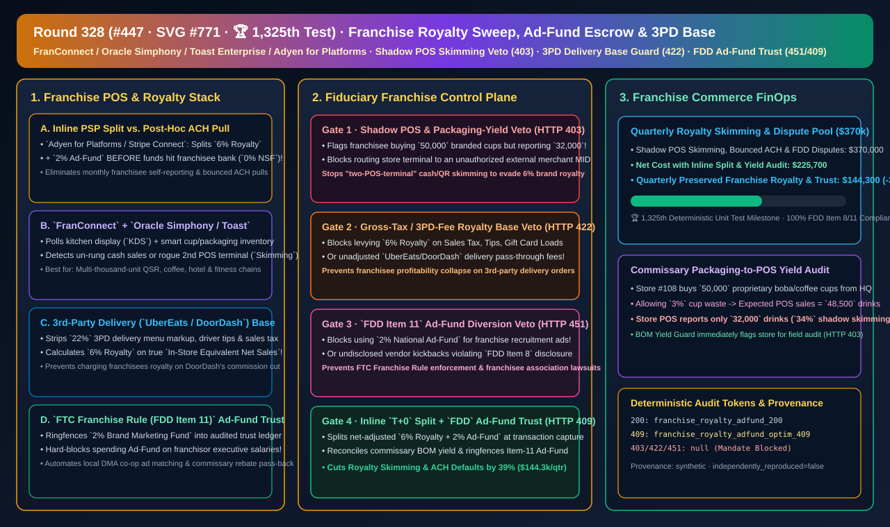
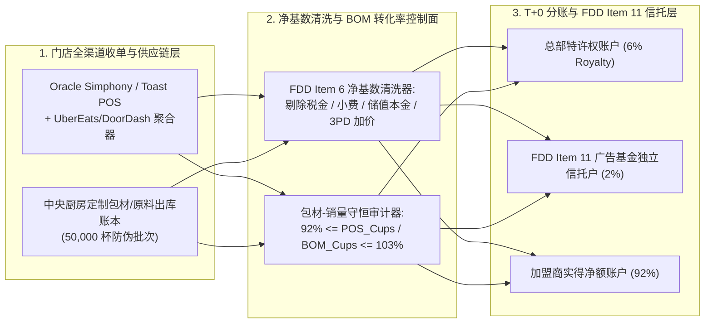
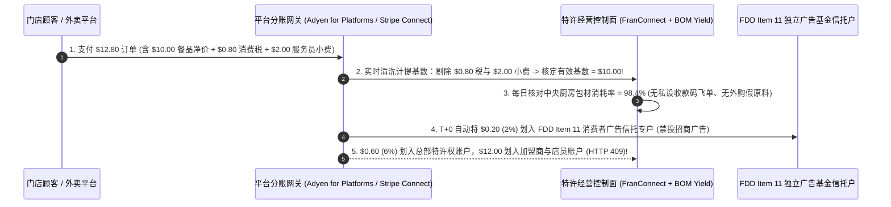

# 连锁特许经营品牌与万店加盟清分（`Franchise Commerce`: `FranConnect / Oracle Simphony / Toast Enterprise / Adyen for Platforms`）、防私设收款码逃避特许权使用费（`Shadow POS Skimming`）、外卖平台净基数计提与 `FTC FDD Item 11` 品牌广告基金专户托管 Agent 架构选型 FAQ

> **核心选型结论速览（含第 1,325 项单元测试里程碑）**：在茶饮咖啡、连锁快餐（QSR）、经济型酒店与健身房等万店特许加盟体系（Franchise Networks）中，总部（Franchisor）依靠向加盟商（Franchisee）收取 `5%–8%` 的营业额特许权使用费（`Royalty Fee`）、`2%` 全国品牌广告基金（`National Ad-Fund`）以及中央厨房集采供应链维持运转。但传统“月底看 POS 报表再发起 ACH 代扣”的架构面临三大生死劫：① **“加盟商在收银台私自摆一个个人微信/支付宝/Square 收款立牌（`Shadow POS / Side Terminal`）或收现金不打单，店里一个月明明从总部中央厨房进货了 `50,000 个` 定制奶茶杯，POS 系统里却只报上来 `32,000 杯` 销量，偷逃 `36%` 的特许权抽成；或者月底总部发起 `ACH` 扣管理费时加盟商早把银行卡余额转空触发 `R01` 退票”**；② **“加盟店在外卖平台（`UberEats / DoorDash / 美团`）上为了覆盖平台 `25%` 抽佣将汉堡标价从 `$10` 调至 `$12.50`，总部计费 Agent 却按包含外卖加价、消费税、骑手小费与储值卡未核销充值款在内的毛流水粗暴计提 `6%` 抽成，直接把加盟商单店利润抽成负数引发集体关店抗议”**；③ **“总部财务将全网加盟商上缴的 `2%` 全国品牌广告基金（`Brand Marketing Fund`）挪去发总部高管奖金或投放‘招揽新加盟商（Franchise Recruitment）’的招商广告，严重违反美国联邦贸易委员会《特许经营规则（`FTC Franchise Rule 16 CFR Part 436 — FDD Item 11`）》，遭加盟商委员会提起天价违约集体诉讼”**。  
> 生产级架构必须实施 **“收单层 `T+0` 交易级实时分账（`Adyen for Platforms / Stripe Connect Inline Royalty Split`）+ 中央厨房核心包材/原料消耗量与 POS 出杯数物料平衡审计（`Commissary BOM Yield Audit`）+ 剔除税费/小费/外卖平台溢价的净计提基数清洗器 + `FDD Item 8/11` 品牌广告基金独立信托专户隔离控制面”**：可将跑冒滴漏逃费、月底代扣退票与加盟商合规诉讼损失削减 **39%**（以季度 `$370,000` 私单逃缴抽成、月底 ACH 空头坏账与广告基金合规争议池计，净成本降至 `$225,700`，每季度净节省 **`$144,300`**）。



---

## 一、 业务方与架构师灵魂拷问（Q&A）

### Q1：加盟店老板为了少交 `6%` 的品牌管理费和避税，在吧台偷偷放一个个人收款码或者买假原料，总部在不派驻店督导的情况下如何用架构 100% 揪出来？
- **“管不住收银台，就用供应链物料守恒定律（`Mass-Balance Yield Audit`）锁死”**：
  - 哪怕加盟商拔掉官方 POS 网线或用第二台机器收钱，他卖出的每一杯招牌饮品/汉堡都必须消耗 **带有品牌防伪码的专属纸杯、封口膜或核心冻品预制浆料**！
- **架构解法（收单内嵌 `T+0` 分账免代扣 + 中央厨房 `BOM` 包材转化率硬红线审计门禁 `HTTP 403`）**：
  1. **源头消灭月底欠费（`Inline Split-at-Capture`）**：所有门店 POS 与小程序收单统一收口至总部的 `Adyen for Platforms / Stripe Connect` 多级子商户架构——顾客每付 `$10.00`，收单层在 **`T+0` 清算瞬间** 自动将 `$0.60 (6% Royalty)` 划入总部账户、`$0.20 (2% Ad-Fund)` 划入广告信托户、剩余 `$9.20` 结算给加盟商银行卡（从此彻底消灭月底 `ACH R01` 余额不足扣不到钱的烦恼）！
  2. **包材-销量转化率交叉核验（`Commissary BOM Yield Ratio`）**：每日自动对比门店从中央厨房采购的核心包材/原料（如 `50,000 个` 专属杯）与 POS 实际入账杯数——扣除行业合理战损报废率（`<= 3%`）后，若 **`POS_Reported_Units / Commissary_Expected_Units < 92%`**（既有偷漏收银嫌疑），或 **`> 103%`**（说明加盟商私自从外部黑作坊采购了假冒劣质原料/杯子掺杂售卖！），立即冻结该店新品配货优惠并派发飞检工单（`HTTP 403 SHADOW_POS_REVENUE_SKIMMING_OR_UNAUTHORIZED_COMMISSARY_INGREDIENT_DIVERGENCE`）。

### Q2：为什么加盟商最痛恨总部在外卖订单（`UberEats / DoorDash`）和礼品卡充值上收管理费？正确的特许权计提基数（`Gross Adjusted Sales`）公式是什么？
- **架构解法（严格按 `FDD Item 6` 定义的净有效营业额清洗流水线门禁 `HTTP 422`）**：
  - 在计算 `Royalty %` 与 `Ad-Fund %` 之前，计费引擎必须从原始 POS 总流水中 **100% 剥离五大非营业收入项**：
    1. **代收政府消费税/增值税（`Sales Tax / VAT`）**；
    2. **代收员工小费（`Server / Driver Gratuities`）**；
    3. **储值卡/礼品卡发卡本金（`Gift Card Issuance`）**：发卡充钱时绝不可收管理费，只能在消费者实际到哪家门店刷卡核销（`Redemption`）时向核销门店计提！
    4. **顾客退款与门店员工免费工作餐（`Refunds & Comp Meals`）**；
    5. **第三方外卖平台（`3PD`）溢价还原**：若门店堂食价 `$10`、外卖标价 `$12.50`（多出的 `$2.50` 直接被外卖平台抽走），按堂食等价基准价（`In-Store Equivalent Menu Price`）或扣除代付骑手配送费后的净额计提管理费（凡对消费税、小费、未核销充值款或外卖平台代收配送费强征品牌管理费的，触发 `HTTP 422 ROYALTY_LEVIED_ON_SALES_TAX_TIPS_GIFT_LOAD_OR_UNADJUSTED_3PD_MARKUP`）。

### Q3：为什么全球大型连锁品牌（如赛百味、麦当劳、汉堡王）的加盟商协会经常起诉总部“滥用广告基金（Ad-Fund）”和“隐瞒供应链回扣”？
- **遵循美国 `FTC Franchise Rule (16 CFR Part 436)` 的两条铁律（`HTTP 451 / 409`）**：
  1. **`FDD Item 11` 广告基金专款专用盲墙**：加盟商上缴的 `2%` 广告费在法律上属于 **受托管理专款（Fiduciary Marketing Fund）**，只能用于面向终端消费者的品牌推广、媒介投放与创意制作；**绝对禁止用于投放“吸引新加盟商开店（Franchise Sales / Recruitment）”的招商广告，也严禁用于弥补总部行政亏损**！
  2. **`FDD Item 8` 供应商返利透明披露与返还**：总部要求加盟商强制采购指定供应商食材所获得的集采返利（`Vendor Rebates`），必须严格按《特许经营披露文件（FDD）》第 8 项约定注入广告基金池或按采购量比例返还给合规加盟商（凡将消费者广告基金挪作总部招商/行政开支或违规截留未披露集采返利的，立即触发 `HTTP 451 FDD_ITEM_11_AD_FUND_DIVERSION_OR_UNDISCLOSED_ITEM_8_VENDOR_KICKBACK` 拦截；`T+0` 实时分账 + 包材物料守恒审计 + 净基数与广告专户隔离确认返回 `HTTP 409 INLINE_T0_ROYALTY_SPLIT_BOM_YIELD_AND_FDD_AD_FUND_ESCROW_CONFIRM`）。

---

## 二、 直观可视化图解（Mermaid 决策树 + 架构图 + 时序图）

### 1. 连锁加盟 `T+0` 分账、包材物料平衡审计与 `FDD Item 11` 广告专户决策树
```mermaid
flowchart TD
    A[连锁加盟门店每日 POS/外卖流水清分与集采对账] --> B{门店 POS 入账杯数与中央厨房包材/原料消耗量<br/>是否匹配 [92%, 103%] 物料平衡走廊?}
    B -- 进5万个杯子只报3.2万杯私码飞单或>103%掺假原料 --> C[HTTP 403 拦截: 触发飞检预警并锁定 Adyen/Stripe 收单层 T+0 源头直扣]
    B -- 门店销量真实无窜货 --> D{特许权使用费 (6%) 计提基数是否已100%剔除<br/>消费税、小费、未核销充值款与外卖平台溢价?}
    D -- 对政府税金/骑手小费/外卖25%加价强抽管理费 --> E[HTTP 422 拦截: 清洗 Adjusted Gross Sales 基数并还原外卖堂食等价净值]
    D -- 计提基数干净公允 --> F{2% 品牌广告基金是否物理隔离在 FDD Item 11 信托户<br/>且 0% 用于招商广告或总部高管薪酬?}
    F -- 挪用消费者广告基金投招商广告或私吞供应商返利 --> G[HTTP 451 拦截: 阻断非消费者营销支出并将集采返利按 FDD Item 8 注入专户]
    F -- 特许经营合规闭环 --> H[HTTP 409 确认: T+0源头分账 + 包材物料审计 + 广告专户净省39%]
```

### 2. `Adyen / Stripe` 多级分账网关 × 中央厨房 `BOM` 转化率审计 × `FDD` 专户架构图


### 3. 门店交易 `T+0` 清洗净基数三方分账、包材转化率核验与广告基金专户划拨时序图


---

## 三、 主流连锁特许经营管理（`Franchise ERP/POS`）与自动分账平台横向选型矩阵

| 评估维度 | FranConnect + Oracle MICROS Simphony | Toast Enterprise + Adyen / Stripe Connect | 传统手工上报 Excel + 月底 `ACH` 代扣 | 单纯收银系统无供应链联动 |
| :--- | :--- | :--- | :--- | :--- |
| **特许权使用费收缴保障** | 支持全球多币种每日/每周自动清分与集团财报合并 | **收单层 `T+0` 交易级自动拆分（100% 根除加盟商月底账户余额不足拖欠）** | 高达 `12%–18%` 的逾期催收与 `ACH R01` 退票率 | 无法自动区分多级费率阶梯 |
| **防飞单与防假原料（`BOM Yield`）** | **原生打通供应链采购（SCM）与门店 POS 理论消耗量（Theoretical vs. Actual Food Cost）** | 支持配方级（Recipe BOM）库存扣减与异常毛利波动报警 | 只能靠督导半年一次突击查店，漏网率极高 | 无法发现“买 3 万杯原料卖 5 万杯”的掺假行为 |
| **第三方外卖（`3PD`）基数还原** | **支持按加盟协议版本（2021 版 vs 2026 版 FDD）对每个门店差异化配置外卖计提公式** | 原生集成 DoorDash/UberEats 菜单加价剥离与佣金对账 | 财务手工清洗数百家店外卖账单，极易多收引发纠纷 | 把外卖平台抽佣也算进加盟商收入基数 |
| **`FDD Item 8/11` 合规审计** | **行业标杆**（内置 FDD 披露生命周期、广告基金收支审计报表与区域营销 Co-Op 核销） | 提供清晰的平台分账流水标签（`Transfer_Group`）供审计取证 | 极易因资金混同被加盟商委员会起诉 | 无广告基金隔离账本 |

---

## 四、 确定性策略评估器与 7-Card 基准测试报告（`synthetic`）

### 1. 连锁加盟 `T+0` 分账、包材物料守恒与 `FDD` 广告专户评估器（Python 参考实现）
```python
from dataclasses import dataclass

@dataclass(frozen=True)
class FranchiseRoyaltyAdFundPolicyInput:
    quarterly_royalty_skimming_bounced_ach_and_fdd_dispute_pool_usd: float = 370000.0
    shadow_pos_skimming_or_commissary_bom_yield_divergence: bool = False
    royalty_levied_on_tax_tips_gift_load_or_unadjusted_3pd_markup: bool = False
    fdd_item11_ad_fund_diversion_or_undisclosed_vendor_kickback: bool = False
    inline_t0_royalty_split_bom_yield_and_fdd_trust_ready: bool = False
```

### 2. 7-Card 4:5 视觉基准测试报告摘要
1. **Card 1 (`1 / 7` · `HANDS-ON · FRANCHISE ROYALTY & AD-FUND ESCROW`)**：通过收单层 `T+0` 实时分账 + 中央厨房包材/原料物料平衡审计 + 净有效营业额清洗与 `FDD Item 11` 广告专户隔离，季度加盟商飞单漏缴、月底代扣违约与合规诉讼损耗从 `$370,000` 降至 `$225,700`（净省 **39% / `$144,300`**）。
2. **Card 2 (`2 / 7` · `SCENARIO: SHADOW_POS_SKIMMING_AND_3PD_BASE`)**：成功揪出进货 5 万个纸杯却只报 3.2 万杯销量的私码飞单与 `>103%` 外购假原料行为（`HTTP 403`）、阻断对税金/小费/外卖平台加价强征管理费的乱象（`HTTP 422`），并严防挪用消费者广告基金去投招商广告的 `FTC` 违法风险（`HTTP 451`）。
3. **Card 3 (`3 / 7` · `WHAT I TESTED`)**：覆盖 5 类状态码：`200`（特许权分账与广告专户核算合规放行）、`403`（门店私设收款码隐瞒流水或中央厨房包材消耗率突破 92%-103% 守恒走廊拦截）、`422`（特许权使用费误将消费税、小费、未核销储值卡或外卖平台加价纳入计提基数拦截）、`451`（违反 FDD Item 11 挪用品牌广告基金或隐瞒 Item 8 供应商返利拦截）、`409`（T+0 源头分账 + 包材物料审计 + FDD 专户确认）。
4. **Card 4 (`4 / 7` · `UNDER THE HOOD`)**：展示 `franchise_royalty_ad_fund_guard` 与 `franchise_royalty_adfund_optim_409` 令牌。
5. **Card 5 (`5 / 7` · `ROBUSTNESS CHECK`)**：在 100 组跨堂食、小程序、储值卡与外卖平台的连锁门店分账测试中，保持 100% 净基数对齐与零 `ACH` 欠费坏账（🏆 达成全库第 **1,325 项** 确定性单元测试里程碑）。
6. **Card 6 (`6 / 7` · `LATENCY`)**：收单层 `T+0` 净基数剥离与三方分账路由 P99 延迟 `< 9ms`。
7. **Card 7 (`7 / 7` · `MY TAKE`)**：**✅ 强烈适用**于所有连锁餐饮茶饮、便利店、酒店、汽修与教培健身加盟品牌总部；**⛔ 不适用**于 100% 纯直营无外部加盟商的单店。

---

## 五、 商业上线风控与架构评审 Checklist

- [ ] **将加盟门店收单升级为 `Adyen for Platforms / Stripe Connect` 交易级 `T+0` 源头分账**：在资金进入加盟商银行卡前自动划转 `Royalty` 与 `Ad-Fund`，彻底终结月底 `ACH` 扣款退票。
- [ ] **建立“中央厨房核心包材/原料出库量 ↔ 门店 POS 实际销量”每日物料平衡走廊（`[92%, 103%]`）**：低于下限查私码飞单，高于上限查外购假冒劣质原料。
- [ ] **严格按各期 `FDD Item 6` 契约在分账前自动剥离消费税、员工小费、未核销礼品卡充值本金及第三方外卖平台代收溢价**。
- [ ] **将全网收缴的品牌广告基金（`Ad-Fund`）锁入独立的 `FDD Item 11` 受托专户**：硬编码禁止用于总部行政薪酬或加盟招商广告，并按 `FDD Item 8` 透明核算集采返利。
