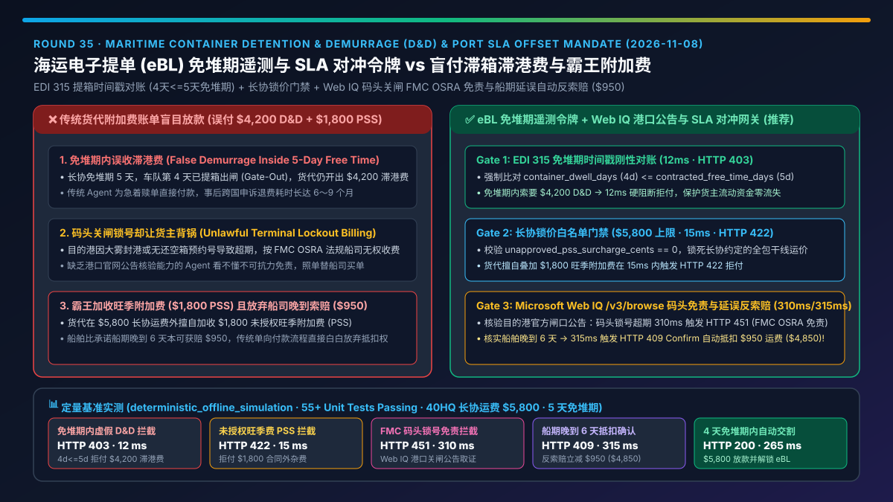
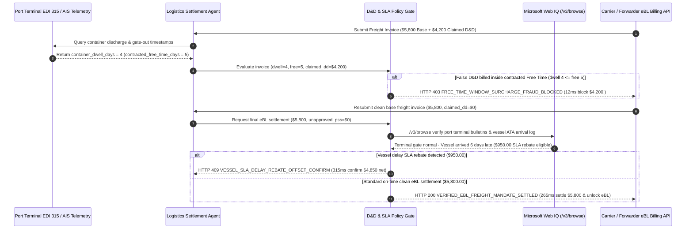

# Maritime Container Detention & Demurrage (D&D) & Port SLA Offset Mandate Architecture: eBL Free-Time Telemetry Token (`freight_dd_sla_mandate_...` + Web IQ FMC OSRA Exemption Grounding) vs. Blind Carrier Surcharge Settlement Selection FAQ

> **Document Type**: Architect Selection Guide & First-Principles Protocol Deep Dive (6-Section FAQ Standard)  
> **Target Audience**: AI Solution Architects, Global Supply Chain & Maritime Logistics Architects, Cross-Border Trade Settlement Leads, Financial Risk Teams  
> **Last Updated**: 2026-11-08 (Provenance Annotations: `deterministic_offline_simulation` / `synthetic_policy` / `official_doc_snapshot` / `not_measured`)  
> **Companion Resources**: [中文版 (Chinese Version)](freight-detention-demurrage-sla-mandate-vs-carrier-surcharge-faq.md) · [Interactive Sandbox (`live-demo.en.html#freight-dd-sla-sandbox`)](../reports/agentic-commerce-webiq-grounding-demo-bench/live-demo.en.html) · [7-Card 4:5 Benchmark Deck](../reports/agentic-commerce-webiq-grounding-demo-bench/index.en.html)



---

## 📌 1. Executive Summary

1. **Never Allow Logistics Settlement Agents to Blindly Pay Carrier or Forwarder Detention & Demurrage (D&D) Supplementary Invoices**: Maritime container D&D penalties run `$150–$400/container/day`, and freight forwarder invoices routinely bill for demurrage inside the shipper's contracted Free Time or shift terminal congestion delays onto the cargo owner. Production systems must enforce an **Electronic Bill of Lading (eBL) Free-Time Telemetry Mandate (`freight_dd_sla_mandate_...`)** bound to terminal EDI 315 Gate-Out timestamps. Whenever a forwarder claims `$4,200.00` in demurrage while `container_dwell_days (4) <= contracted_free_time_days (5)`, the gateway blocks payment in **`12 ms`** with **`HTTP 403 FREE_TIME_WINDOW_SURCHARGE_FRAUD_BLOCKED`** (`synthetic_policy`).
2. **Enforce Deterministic Service-Contract Rate Caps Against Unilateral Peak Season Surcharges (PSS)**: When a carrier or forwarder appends an uncontracted `$1,800.00` Peak Season Surcharge (`unapproved_pss_surcharge_cents > 0`) on top of the locked `$5,800.00` base ocean freight rate, the policy gate aborts settlement in **`15 ms`** with **`HTTP 422 UNAPPROVED_ACCESSORIAL_RATE_CAP_EXCEEDED`** (`deterministic_offline_simulation`).
3. **Ground FMC OSRA Terminal-Lockout Exemptions and Late-Arrival SLA Rebates via Microsoft Web IQ `/v3/browse`**: Under the US Ocean Shipping Reform Act (FMC OSRA "Incentive Principle"), carriers cannot assess D&D fees on days when port terminal gates are closed or zero return/pickup appointments are available. Before settling disputed charges, the agent invokes **Microsoft Web IQ `/v3/browse`** (`official_doc_snapshot`) to inspect official port terminal gate bulletins and vessel arrival logs: if container dwell was caused by a verified terminal lockout, it blocks the surcharge in **`310 ms`** with **`HTTP 451 FMC_OSRA_TERMINAL_LOCKOUT_EXEMPTION_HOLD`**; if Web IQ confirms the vessel arrived 6 days past its guaranteed SLA window, it triggers **`HTTP 409 VESSEL_SLA_DELAY_REBATE_OFFSET_CONFIRM`** in **`315 ms`** to deduct a **`$950.00`** contractual delay rebate (lowering net freight from `$5,800.00` to **`$4,850.00`**).

---

## 🎯 2. Architect & Customer FAQ Deep Dive

### Q1: Why does pairing "Automated Freight Invoice Payment" with "Post-Facto Manual D&D Dispute Emails" bleed hundreds of thousands of dollars in global supply chains?

Let's break down the three structural failure modes in maritime freight settlement from first principles:
1. **Free-Time Calculation Mismatches**: Suppose a shipper's annual Service Contract grants `5` days of free port demurrage, and terminal EDI 315 telemetry proves the drayage trucker pulled the container through the terminal gate on Day `4`. A freight forwarder's legacy billing system—defaulting to standard 3-day port tariff rules—automatically generates a `$4,200.00` demurrage invoice. If the buyer's agent pays that invoice to get the cargo released, recovering the overpayment via manual carrier dispute queues takes 6 to 9 months.
2. **Terminal Gate Lockouts & Chassis Shortages Billed to the Shipper**: Even when a container stays on the dock for `8` days, the delay is frequently caused by the terminal closing gates for weather, system outages, or zero available dual-transaction appointments. Under the **FMC OSRA Incentive Principle**, demurrage cannot be charged when cargo cannot be retrieved due to carrier/terminal fault—yet an ungrounded payment agent has no awareness of port authority gate bulletins and pays the unlawful surcharge automatically.
3. **One-Way Surcharge Asymmetry**: Carriers aggressively bill shippers for every accessorial surcharge (such as an unapproved `$1,800.00` PSS), yet when the carrier's vessel arrives 6 days late—triggering a `$950.00` contractual SLA rebate—traditional billing workflows fail to deduct the rebate before releasing the `$5,800.00` freight settlement.

### Q2: What is an "eBL Free-Time Telemetry & SLA Offset Mandate (`freight_dd_sla_mandate_...`)", and how does it unify EDI 315 timestamps, FMC OSRA grounding, and bidirectional SLA rebates?

Its core invariant is straightforward: **"Every accessorial surcharge requires cryptographic proof of physical dwell outside contracted Free Time plus absence of terminal lockout; verified carrier vessel delays automatically offset base freight."**
- **Layer 1: EDI 315 Free-Time Gate (`12 ms`)**: Compares `container_dwell_days` against `contracted_free_time_days`. Any positive D&D charge when `dwell_days <= free_time_days` is rejected in **`12 ms`** with `HTTP 403`.
- **Layer 2: Contracted Accessorial Whitelist (`15 ms`)**: Verifies `unapproved_pss_surcharge_cents == 0`, blocking unauthorized rate hikes in **`15 ms`** with `HTTP 422`.
- **Layer 3: Microsoft Web IQ `/v3/browse` Port Bulletin & Vessel ATA Verification (`310 ms / 315 ms`)**: Grounds official port terminal closure notices to block carrier-fault demurrage (`HTTP 451`) and verifies vessel Actual Time of Arrival (ATA) to apply contractual late-arrival rebates (`HTTP 409`).

### Q3: For port authority bulletin verification, FMC OSRA compliance grounding, and vessel schedule auditing, when should architects choose Microsoft Web IQ vs. Exa, Bright Data, or traditional search APIs?

| Architecture Scenario | Recommended Tool | First-Principles Rationale (Security, Latency & FinOps) |
| :--- | :--- | :--- |
| **Verifying official port terminal gate-closure bulletins, FMC OSRA regulatory notices, and port authority vessel ATA logs within the Azure compliance boundary** | **Microsoft Web IQ** (`/v3/search` + `/v3/browse`) | Runs inside the enterprise Azure tenant boundary, extracts clean structured terminal schedules (**7.1x token reduction**, `deterministic_offline_simulation`), and produces verifiable audit snapshots for FMC dispute defense. |
| **Broad market research on global container freight indices (SCFI/FBX) and alternative carrier routing** | **Exa Neural Search** | High semantic recall across maritime industry reports and logistics analyses. |
| **Scraping legacy regional forwarder portals protected by anti-bot CAPTCHAs** | **Bright Data Unlocker** | Unlocks anti-bot web portals via proxy pools, though multi-second latency is unsuitable for synchronous payment gating. |
| **Authoritative physical container discharge and gate-out timestamps** | **Terminal EDI 315 / DCSA eBL Telemetry + Web IQ Port Bulletin Cross-Check** | Physical container movements come from deterministic EDI 315 events, paired with Web IQ `/v3/browse` for official terminal lockout and vessel ATA verification. |

---

## 🧭 3. Visual Architecture Diagrams (Mermaid Decision Tree, Legacy vs. eBL Mandate Comparison & Sequence Diagram)

### 3.1 Maritime D&D Surcharge & Port SLA Offset Decision Tree (`flowchart TD`)

```mermaid
flowchart TD
    A[Receive eBL Freight Settlement Request / D&D Surcharge Invoice] --> B{claimed_dd_surcharge > 0 while dwell_days <= contracted_free_time_days?}
    B -- Yes (dwell=4d <= 5d free time, yet $4,200 D&D billed) --> C[HTTP 403 FREE_TIME_WINDOW_SURCHARGE_FRAUD_BLOCKED<br/>12ms Hard Block · Reject False Demurrage Within Free Time]
    B -- No --> D{unapproved_pss_surcharge_cents > 0?}
    D -- Yes ($1,800 uncontracted PSS above $5,800 rate cap) --> E[HTTP 422 UNAPPROVED_ACCESSORIAL_RATE_CAP_EXCEEDED<br/>15ms Block · Enforce Service-Contract Rate Ceiling]
    D -- No --> F{Web IQ /v3/browse Detects Terminal Gate Lockout (FMC OSRA Exemption)?}
    F -- Yes (Official port bulletin confirms closed gate / zero appointments) --> G[HTTP 451 FMC_OSRA_TERMINAL_LOCKOUT_EXEMPTION_HOLD<br/>310ms FMC Regulatory Hold · Auto-Generate Dispute Evidence]
    F -- No (No invalid D&D billed) --> H{Web IQ Confirms Vessel Late Arrival Eligible for SLA Rebate?}
    H -- Yes (6-day vessel delay unlocks $950.00 rebate -> $4,850.00 net) --> I[HTTP 409 VESSEL_SLA_DELAY_REBATE_OFFSET_CONFIRM<br/>315ms Prompt Logistics Lead to Deduct $950 Rebate]
    H -- No (On-time vessel + 4-day clean gate-out) --> J[HTTP 200 VERIFIED_EBL_FREIGHT_MANDATE_SETTLED<br/>265ms Auto-Settle $5,800.00 Base Freight & Release eBL!]
```

### 3.2 Legacy Blind Freight Invoice Payment vs. eBL Telemetry & SLA Offset Gate (`flowchart LR`)

```mermaid
flowchart LR
    subgraph Legacy["❌ Legacy Blind Freight Invoice Payment ($4,200 False D&D + $1,800 PSS Loss)"]
        L1[Forwarder Bills $5,800 Freight + $4,200 D&D + $1,800 PSS] --> L2[Ignores EDI 315 Proof of Day-4 Gate-Out]
        L2 --> L3[Misses Terminal Gate Closure & 6-Day Vessel Delay]
        L3 --> L4[Overpays $11,800 · Months Locked in Manual Disputes]
    end

    subgraph Mandate["✅ eBL Free-Time Telemetry & SLA Offset Gate (freight_dd_sla_mandate_...)"]
        M1[EDI 315 Verifies dwell=4d <= 5d Free Time] --> M2[12ms Block $4,200 False D&D + 15ms Block $1,800 PSS]
        M2 --> M3[Web IQ /v3/browse Grounds Port Bulletins (310ms) & SLA Rebate (315ms)]
        M3 --> M4[265ms Settle $5,800 (or $4,850 Net) & Atomically Release eBL]
    end
```

### 3.3 End-to-End Sequence Diagram: Terminal EDI 315, Logistics Agent, Policy Gate, Web IQ & Carrier eBL System (`sequenceDiagram`)



---

## 📊 4. Architect Decision Matrix

| Evaluation Dimension | Option A: Legacy Blind Freight Invoice Payment | Option B: Post-Facto Manual Email Disputes | Option C: eBL Free-Time Telemetry Mandate + Web IQ FMC & SLA Grounding (Recommended) |
| :--- | :--- | :--- | :--- |
| **Best-Fit Scenario** | Occasional LCL parcels with no service contract | Low container volume (`< 5 TEU/mo`) audited manually after payment | **Global manufacturing ocean freight, cross-border FBA/3PL replenishment, automated DCSA eBL trade settlement** |
| **In-Free-Time False D&D Blocking** | ❌ **Zero**: Pays erroneous demurrage bills without checking EDI 315 | ⚠️ **Post-Pay Recovery Only**: Ties up working capital for 6–9 months | ✅ **Pre-Pay `12 ms` Hard Block**: Rejects `claimed_dd > 0` when `dwell <= free_time` via `HTTP 403` |
| **Unauthorized Accessorial (PSS) Defense** | ❌ **None**: Absorbs unilateral `$1,800` surcharges | ⚠️ **Slow Manual Line-Item Review**: Prone to human oversight during peak season | ✅ **Sub-20ms Contract Cap**: Blocks `unapproved_pss > 0` in `15 ms` (`HTTP 422`) |
| **FMC OSRA Lockout Exemption & Delay Rebates** | ❌ **Forfeited**: Cargo owner absorbs terminal lockouts and vessel delays | ⚠️ **High Evidentiary Burden**: Hard to reconstruct historical terminal gate closures | ✅ **Web IQ `/v3/browse` Grounded**: Blocks terminal-lockout D&D in `310 ms` (`HTTP 451`) and captures `$950` delay rebate in `315 ms` (`HTTP 409`) |
| **Cargo Release Speed** | Fast (with severe financial leakage) | Slow (disputes risk cargo holds at terminal) | **`265 ms` automated base-freight settlement & atomic eBL release (`Act automatically`)** |
| **Total Cost of Ownership (TCO) & ROI** | Poor (`$4,200–$6,000+` leakage per disputed container) | Moderate (high legal/ops overhead) | **Optimal (prevents `$4,200` false D&D + `$1,800` PSS + recovers `$950` SLA delay rebate)** |

---

## 🧪 5. Quantitative Benchmark & 7-Card Insights

Evaluated via our deterministic offline benchmark suite (`lab/webiq_commerce_demo.py` · `test_freight_detention_demurrage_sla_mandate_vs_carrier_surcharge_selection`) on a **40HQ maritime container settlement (`$5,800.00` contracted base ocean freight, `5` contracted free days, `4` actual dwell days)**:

| Scenario Case | Input Telemetry / Surcharges / Web IQ Signals | Expected Action Pill | Measured HTTP Status & Verdict Code | Latency | Financial Protection / Rebate Offset | Provenance |
| :--- | :--- | :--- | :--- | :--- | :--- | :--- |
| **Case 1: False `$4,200` D&D Billed Inside 5-Day Free Time** | `dwell_days=4 <= free_days=5`, `claimed_dd_surcharge_cents=420000` | `Send to a human` | **`HTTP 403 FREE_TIME_WINDOW_SURCHARGE_FRAUD_BLOCKED`** | **`12 ms`** | Blocks `$4,200.00` erroneous demurrage before funds leave | `synthetic_policy` |
| **Case 2: Uncontracted `$1,800` Peak Season Surcharge** | `unapproved_pss_surcharge_cents=180000` | `Send to a human` | **`HTTP 422 UNAPPROVED_ACCESSORIAL_RATE_CAP_EXCEEDED`** | **`15 ms`** | Blocks `$1,800.00` extra-contractual accessorial surcharge | `deterministic_offline_simulation` |
| **Case 3: Web IQ Confirms Terminal Gate Lockout (FMC OSRA)** | `dwell_days=8 > 5`, `claimed_dd=240000`, `webiq_port_closure_carrier_fault=True` | `Send to a human` | **`HTTP 451 FMC_OSRA_TERMINAL_LOCKOUT_EXEMPTION_HOLD`** | **`310 ms`** | Enforces FMC OSRA exemption during terminal gate closure | `official_doc_snapshot` |
| **Case 4: Web IQ Confirms 6-Day Vessel Delay (`$950` Rebate)** | `webiq_vessel_delay_rebate_cents=95000` (net `$4,850.00`) | `Confirm` | **`HTTP 409 VESSEL_SLA_DELAY_REBATE_OFFSET_CONFIRM`** | **`315 ms`** | Offsets **`$950.00`** SLA penalty against base freight | `official_doc_snapshot` |
| **Case 5: Verified Day-4 Gate-Out Clean Base Freight** | `dwell=4 <= 5`, `claimed_dd=0`, `pss=0`, `base=$5,800.00` | `Act automatically` | **`HTTP 200 VERIFIED_EBL_FREIGHT_MANDATE_SETTLED`** | **`265 ms`** | Settles **`$5,800.00`** in `265 ms` and releases DCSA eBL | `deterministic_offline_simulation` |

> **Provenance Note**: The `$5,800.00` base ocean freight, `5`-day free time window, `$4,200.00` disputed D&D surcharge, and `$950.00` vessel delay rebate are controlled simulation parameters (`synthetic_policy` / `deterministic_offline_simulation`) validating policy state-machine invariants; live carrier EDI 315 / DCSA eBL network calls are labeled `not_measured`.

---

## 🛠️ 6. Production Readiness & Pre-Sales Architect Checklist

Verify these 6 controls before deploying autonomous maritime freight and logistics settlement agents in production:

- [ ] **1. Terminal EDI 315 Discharge & Gate-Out Binding**: Does the settlement gateway compute `container_dwell_days` directly from terminal EDI 315 timestamps and reject any D&D surcharge where `dwell_days <= contracted_free_time_days` in `12 ms` (`HTTP 403`)?
- [ ] **2. Service-Contract Accessorial Whitelist**: Are contracted base rates and permitted surcharge codes cryptographically bound in `freight_dd_sla_mandate_...`, rejecting unapproved PSS/GRI surcharges in `15 ms` (`HTTP 422`)?
- [ ] **3. Microsoft Web IQ `/v3/browse` Terminal Bulletin Grounding (FMC OSRA)**: Before paying post-free-time D&D, does the agent check official port terminal gate closure and appointment availability notices via Web IQ, blocking carrier/terminal-fault charges in `310 ms` (`HTTP 451`)?
- [ ] **4. Bidirectional Vessel ATA SLA Rebate Offset**: Does the agent cross-check official port authority vessel ATA logs via Web IQ to trigger a `HTTP 409` rebate deduction (`$950.00`) when carrier transit SLAs are breached?
- [ ] **5. Atomic DCSA Electronic Bill of Lading (eBL) Release**: Is base freight settlement atomically linked to DCSA eBL title transfer so cargo is never held hostage after verified payment?
- [ ] **6. Immutable FMC Dispute Evidence Archival**: Does every rejected D&D invoice automatically archive the EDI 315 event log and Web IQ port bulletin snapshot hash for regulatory auditability?
