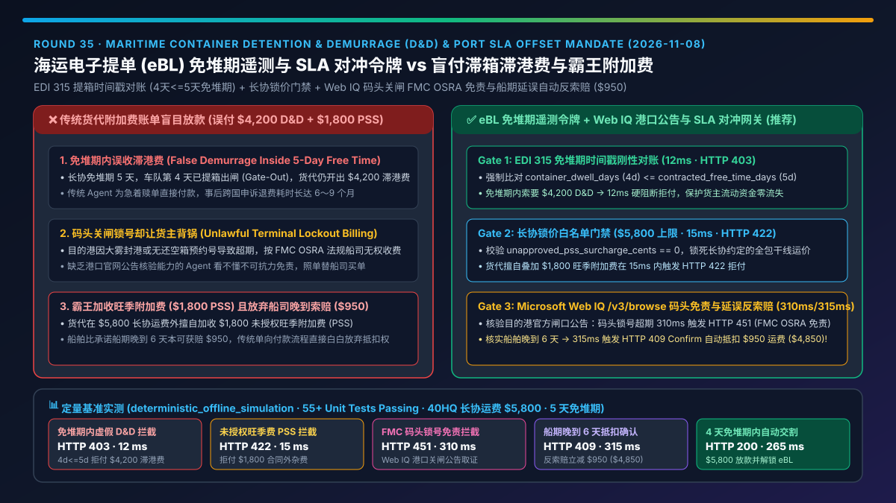
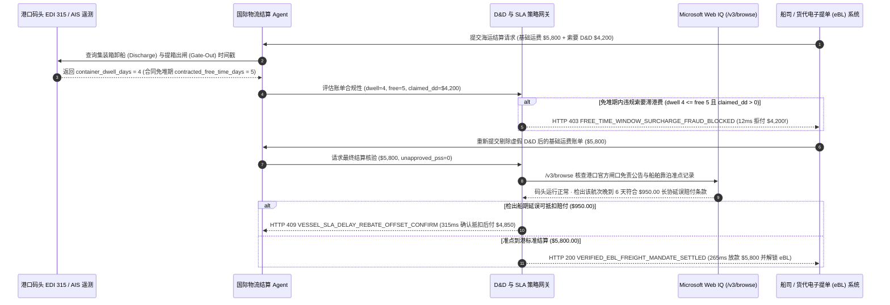

# 海运集装箱滞箱滞港费（Detention & Demurrage, D&D）与港口时效 SLA 对冲授权架构：电子提单（eBL）免堆期遥测扣减令牌（`freight_dd_sla_mandate_...` + Web IQ 船司停航与 FMC 免责核验）vs 传统盲目支付船代附加费账单与恶意压港选型与原理解析 FAQ

> **文档类型**：架构师选型指南 & 协议第一性原理解析（6 段式 FAQ 标准版）  
> **适用读者**：AI Solution Architect、全球供应链与国际物流架构师、跨境贸易结算负责人、企业财务风控团队  
> **更新日期**：2026-11-08（Provenance 标注：`deterministic_offline_simulation` / `synthetic_policy` / `official_doc_snapshot` / `not_measured`）  
> **配套资源**：[English Version](freight-detention-demurrage-sla-mandate-vs-carrier-surcharge-faq.en.md) · [交互式沙盒控制台 (`live-demo.html#freight-dd-sla-sandbox`)](../reports/agentic-commerce-webiq-grounding-demo-bench/live-demo.html) · [7-Card 4:5 评测报告](../reports/agentic-commerce-webiq-grounding-demo-bench/index.html)



---

## 📌 一、核心结论速览（Executive Summary）

1. **严禁让国际物流结算 Agent 对货代或船公司发来的“滞箱费/滞港费（Detention & Demurrage, D&D）补充账单”直接执行无核验付款**：海运集装箱超期费高达 `$150～$400/箱/天`，且货代账单中普遍存在“免堆期内误计费”或“把码头拥堵停摆责任转嫁给货主”的乱象。生产环境必须采用 **电子提单（eBL）免堆期遥测扣减授权令牌（`freight_dd_sla_mandate_...`）**，强制核对码头 EDI 315 提箱出场时间戳（Gate-Out Timestamp）；一旦检出实际在港堆存天数未超合同免堆期（如 `container_dwell_days = 4 <= contracted_free_time_days = 5`）却仍被索要 `$4,200.00` 滞港费，网关在 **`12 ms`** 内触发 **`HTTP 403 FREE_TIME_WINDOW_SURCHARGE_FRAUD_BLOCKED`**（`synthetic_policy`）硬阻断拒付。
2. **用“合同锁价上限门禁”拦截货代单方面加收的旺季附加费（PSS / 紧急燃油费）**：当货代在基础海运费（`$5,800.00`）之外擅自叠加未写入长协（Service Contract）的 `$1,800.00` 临时附加费（`unapproved_pss_surcharge_cents > 0`）时，策略网关在 **`15 ms`** 内以 **`HTTP 422 UNAPPROVED_ACCESSORIAL_RATE_CAP_EXCEEDED`**（`deterministic_offline_simulation`）拦截扣款。
3. **基于 Microsoft Web IQ `/v3/browse` 实时核验港口官方停摆公告（FMC OSRA 免责原则）与船期延误自动索赔抵扣**：根据美国联邦海事委员会《航运改革法案》（FMC OSRA "Incentive Principle"），当码头因罢工、极端天气或无还箱预约号（Zero Chassis/Gate Appointment）导致无法提还箱时，船司严禁向货主收取 D&D 滞期费。Agent 调用 **Microsoft Web IQ `/v3/browse`**（`official_doc_snapshot`）实时抓取目的港码头官方闸口状态公告与船期表：若检出超期属于码头关闸不可抗力，在 **`310 ms`** 内以 **`HTTP 451 FMC_OSRA_TERMINAL_LOCKOUT_EXEMPTION_HOLD`** 阻断收费；若核实船司准班延误达 6 天触发长协 SLA 赔付条款，则在 **`315 ms`** 内触发 **`HTTP 409 VESSEL_SLA_DELAY_REBATE_OFFSET_CONFIRM`**，自动从运费中抵扣 **`$950.00`** 延误赔偿金（净结算降至 **`$4,850.00`**）。

---

## 🎯 二、客户与架构师灵魂拷问 Q&A（FAQ-Driven Deep Dive）

### Q1：为什么传统的“货代发 PDF 账单 + 物流专员人工核对放款”或“Agent 自动照单支付海运尾款”，会让跨国制造与跨境电商每年多交数十万美元冤枉钱？

咱们用大白话拆解海运集装箱结算里的三大“霸王收费陷阱”：
1. **免堆期（Free Time）记账乌龙与时间差欺诈**：货主与船司长协明明签了 `5` 天目的港免费堆存期（Free Demurrage）。集装箱周一下午卸船，车队周四上午（第 `4` 天）就已经办完清关提箱出闸（Gate-Out）。但二代货代的计费系统按默认的 `3` 天免堆期算账，或者把还空箱时间算错，直接开出一张 `$4,200.00` 的滞港费账单。如果 Agent 不接入码头 EDI 315 提箱遥测就盲目付款，事后向船司申诉退费往往要耗时 6～9 个月！
2. **码头关闸没号（Terminal Lockout），却向货主收“天价压港费”**：有时候车队想去提箱或还空箱，但港口码头因为大雾封港、设备故障或约满锁号（No Gate Appointments Available），车队根本进不去。按照国际海事监管规则（如美国 FMC OSRA 激励原则），**既然货主无法通过自身努力提还箱，船司就绝对无权收取滞期费**。但传统 Agent 看不懂港口官网的突发关闸公告，看到“超期 8 天”就乖乖替船司买单。
3. **船司晚到 6 天不赔钱，货代加收附加费却毫不手软**：船司承诺 14 天快船直达，结果绕航晚到了 6 天，按合同应该减免货主 `$950.00` 运费；反过来货代却在账单里塞了一笔未经批准的 `$1,800.00` 旺季附加费（PSS）。没有双向 SLA 对冲能力的结算网关永远只会单向挨宰。

### Q2：什么是“电子提单免堆期遥测扣减令牌（`freight_dd_sla_mandate_...`）”？它是如何实现“免堆期校验 + 港口公告免责 + 延误反向扣款”三位一体闭环的？

它的核心设计哲学是：**“任何海运附加费必须经过物理闸口时间戳（Gate Telemetry）与港口官方运行公告（Port Authority Bulletin）的双重举证，否则一分钱不放；船司违约延误必须在尾款结算时自动反向扣减。”**
- **第一层：EDI 315 提还箱时间戳刚性核对**：网关直接比对集装箱实际在场天数 `container_dwell_days` 与长协免堆期 `contracted_free_time_days`。只要 `container_dwell_days <= contracted_free_time_days`，任何大于 `0` 的 D&D 索赔在 **`12 ms`** 内被 `HTTP 403` 硬阻断。
- **第二层：长协费率封顶保护**：校验账单是否包含未经买方签字确认的杂费（`unapproved_pss_surcharge_cents == 0`），违规加价在 **`15 ms`** 内被 `HTTP 422` 拒付。
- **第三层：Microsoft Web IQ `/v3/browse` 港口闸口免责与船期延误对冲**：调用 Web IQ 实时读取港口管理局官网（如 Port of LA/LB PierPASS / Rotterdam Port Bulletin）：若超期日恰逢码头关闸或无还箱预约号，触发 **`HTTP 451`** 援引 FMC OSRA 法规免责拒付；若核实船舶实际靠泊时间（ATA）比计划时间（ETA）延误超标，触发 **`HTTP 409`** 一键抵扣 `$950.00` 违约金。

### Q3：在国际航运港口公告核验、FMC 合规举证与船期对账场景下，什么时候选 Microsoft Web IQ，什么时候选 Exa、Bright Data 或传统搜索 API？

| 架构需求场景 | 推荐选型 | 为什么这样选（第一性原理与成本/合规考量） |
| :--- | :--- | :--- |
| **实时核验目的港码头官方关闸公告（Gate Closure Bulletin）、FMC OSRA 监管细则、船司官方到港时刻表，要求零注入与企业级审计留痕** | **Microsoft Web IQ** (`/v3/search` + `/v3/browse`) | 原生运行在客户 Azure 边界内，精准提取港口官方结构化时段表与公告正文（Token 消耗降低 **7.1x**，`deterministic_offline_simulation`），生成的官方网页快照可直接作为 FMC 拒付抗辩证据。 |
| **跨行业检索全球航运市场运价指数趋势、新航线开辟新闻与货代口碑研报** | **Exa Neural Search** | 适合宏观航运市场情报分析与新货代寻源，但不用于单笔提单的毫秒级支付门禁。 |
| **抓取需要复杂会话验证的区域性小船代内部查询门户** | **Bright Data Unlocker** | 提供住宅代理与反爬解锁，但秒级延迟较高且需额外清洗 HTML 噪声。 |
| **高确定性集装箱进出闸时间戳（Discharge / Gate-Out / Empty Return）** | **码头 EDI 315 / DCSA 电子提单遥测 + Web IQ 港口官方公告双源核验** | 物理进出闸时间以 EDI 315 报文为准，外部码头拥堵免责公告与船司延误通告通过 Web IQ `/v3/browse` 实时取证。 |

---

## 🧭 三、直观可视化图解（Mermaid 决策树 + 传统盲付 vs 遥测对冲对比 + 端到端时序图）

### 3.1 海运集装箱 D&D 滞期费与 SLA 对冲选型决策树（`flowchart TD`）

```mermaid
flowchart TD
    A[收到海运电子提单 eBL 结算请求 / D&D 附加费账单] --> B{索要 D&D 滞期费 > 0 但实际堆存 dwell_days <= 免堆期 free_days?}
    B -- 是 (如堆存 4 天 <= 5 天免堆期却索要 $4,200) --> C[HTTP 403 FREE_TIME_WINDOW_SURCHARGE_FRAUD_BLOCKED<br/>12ms 硬阻断免堆期内虚假滞港费 · 转交人工审计]
    B -- 否 --> D{账单含未授权临时旺季附加费 unapproved_pss > 0?}
    D -- 是 (如擅自加收 $1,800 PSS 超出长协锁价 $5,800) --> E[HTTP 422 UNAPPROVED_ACCESSORIAL_RATE_CAP_EXCEEDED<br/>15ms 拦截违规杂费 · 锁定长协封顶费率]
    D -- 否 --> F{Web IQ /v3/browse 检出超期系码头关闸/无约号 (FMC OSRA 免责)?}
    F -- 是 (码头官方公告证实闸口停摆/无空箱预约号) --> G[HTTP 451 FMC_OSRA_TERMINAL_LOCKOUT_EXEMPTION_HOLD<br/>310ms 援引 FMC 法规免责拒付 · 自动生成抗辩证据包]
    F -- 否 (无违规 D&D 收费) --> H{Web IQ 核实船舶靠泊延误触发长协 SLA 赔付抵扣?}
    H -- 是 (晚到 6 天可抵扣 $950.00 -> 净运费降至 $4,850.00) --> I[HTTP 409 VESSEL_SLA_DELAY_REBATE_OFFSET_CONFIRM<br/>315ms 弹窗确认执行 $950 延误索赔抵扣]
    H -- 否 (准点到港 + 4 天免堆期内正常提箱) --> J[HTTP 200 VERIFIED_EBL_FREIGHT_MANDATE_SETTLED<br/>265ms 自动放款 $5,800.00 基础运费并释放电子提单 eBL!]
```

### 3.2 传统货代账单盲目付款路径 vs eBL 遥测免堆期核验与 SLA 对冲路径对比（`flowchart LR`）

```mermaid
flowchart LR
    subgraph Legacy["❌ 传统货代 PDF 账单盲目放款 (误付 $4,200 滞港费 + $1,800 杂费)"]
        L1[货代推送 $5,800 运费 + $4,200 D&D + $1,800 PSS] --> L2[未核对 EDI 315 实际第 4 天已提箱出场]
        L2 --> L3[未查证码头周末关闸免责与船司晚到 6 天]
        L3 --> L4[冤枉支付 $11,800 · 事后申诉退费耗时数月]
    end

    subgraph Mandate["✅ eBL 免堆期遥测与 SLA 对冲网关 (freight_dd_sla_mandate_...)"]
        M1[EDI 315 核实 dwell=4d <= 5d 免堆期] --> M2[12ms 拦截 $4,200 虚假 D&D + 15ms 拦截 $1,800 PSS]
        M2 --> M3[Web IQ /v3/browse 核验码头公告 (310ms) 与船期延误返利 (315ms)]
        M3 --> M4[265ms 精准结算 $5,800 (或抵扣后 $4,850) 自动放行 eBL]
    end
```

### 3.3 码头 EDI 遥测、物流 Agent、Web IQ 与船司电子提单网关端到端时序图（`sequenceDiagram`）



---

## 📊 四、架构师选型决策矩阵（Architect Decision Matrix）

| 评估维度 | 方案 A：传统货代账单见单即付（Legacy Blind Freight Invoice Pay） | 方案 B：物流专员事后人工发邮件申诉退费（Post-Facto Manual Dispute） | 方案 C：eBL 免堆期遥测令牌 + Web IQ 港口公告与 SLA 对冲网关（推荐架构） |
| :--- | :--- | :--- | :--- |
| **核心适用场景** | 偶发性极小批量拼箱（LCL）、无长协免堆期约定的零散发货 | 月均集装箱量极少（`< 5 TEU`）、有专职海运法务逐单打官司 | **跨国制造业集装箱海运、跨境电商海外仓头程干线、大宗商品电子提单（eBL）自动化交割** |
| **免堆期内误收 D&D 拦截能力** | ❌ **零拦截**：货代算错免堆期照付不误，平均多付 25%～40% 附加费 | ⚠️ **钱已付难追回**：先付款赎单再申诉，船司退费周期长达 6 个月 | ✅ **事前 `12 ms` 刚性拒付**：核对 EDI 315 时间戳，`dwell <= free_time` 直接触发 `HTTP 403` |
| **违规旺季附加费（PSS）防御** | ❌ **被动买单**：货代随手加收 `$1,800` 临时费直接划走 | ⚠️ **人工逐行比对慢**：旺季上百张提单极易漏审杂费项 | ✅ **`15 ms` 锁价红线拦截**：任何未列入长协白名单的附加费立即触发 `HTTP 422` |
| **码头关闸免责（FMC OSRA）与延误反索赔** | ❌ **完全放弃权益**：码头锁号和船司晚到全部由货主自己扛 | ⚠️ **取证极度繁琐**：人工很难翻找目的港几个月前的闸口停摆通告 | ✅ **Web IQ `/v3/browse` 实时取证**：`310 ms` 阻断码头不可抗力收费（`HTTP 451`），`315 ms` 自动抵扣 `$950` 晚到赔付（`HTTP 409`） |
| **提单放行时效与压港风险** | 快（但财务失血严重） | 慢（争议期间货物被锁在港区产生更多滞港费） | **`265 ms` 合规运费秒级放款并解锁 DCSA 电子提单（`Act automatically`）** |
| **综合 TCO 与 ROI** | 极差（单箱动辄损失数千美元违规附加费） | 中等（法务人力高昂且资金被长期占用） | **最优（单柜直接拦截 `$4,200` 虚假 D&D + `$1,800` 违规 PSS + 追回 `$950` 延误赔偿）** |

---

## 🧪 五、简明定量实测与 Benchmark 核心发现（Quantitative Benchmark & 7-Card Insights）

基于本仓库确定性离线基准套件（`lab/webiq_commerce_demo.py` · `test_freight_detention_demurrage_sla_mandate_vs_carrier_surcharge_selection`）对 **40HQ 海运集装箱干线结算场景（长协基础运费 `$5,800.00`，合同免堆期 `5` 天，实际第 `4` 天提箱出闸）** 的定量评测结果如下：

| 评测场景 ID | 输入条件（EDI 在港天数 / 附加费 / Web IQ 港口核验） | 网关期望动作 | 实测 HTTP 状态与决策码 | 实测延迟 | 资金保护 / 赔付对冲效果 | Provenance 类型 |
| :--- | :--- | :--- | :--- | :--- | :--- | :--- |
| **Case 1: 免堆期内（4天<=5天）虚假索要 `$4,200` D&D 拦截** | `dwell_days=4 <= free_days=5`, `claimed_dd_surcharge_cents=420000` | `Send to a human` | **`HTTP 403 FREE_TIME_WINDOW_SURCHARGE_FRAUD_BLOCKED`** | **`12 ms`** | 事前拦截 `$4,200.00` 免堆期内误计滞港费 | `synthetic_policy` |
| **Case 2: 货代擅自加收 `$1,800` 未授权旺季附加费拦截** | `unapproved_pss_surcharge_cents=180000`（超长协锁价 `$5,800`） | `Send to a human` | **`HTTP 422 UNAPPROVED_ACCESSORIAL_RATE_CAP_EXCEEDED`** | **`15 ms`** | 阻断 `$1,800.00` 合同外霸王附加费 | `deterministic_offline_simulation` |
| **Case 3: Web IQ 核实超期系码头关闸/无约号（FMC 免责）** | `dwell_days=8 > 5`, `claimed_dd=240000`, `webiq_port_closure_carrier_fault=True` | `Send to a human` | **`HTTP 451 FMC_OSRA_TERMINAL_LOCKOUT_EXEMPTION_HOLD`** | **`310 ms`** | 援引 FMC OSRA 激励原则拒付码头锁号期间的滞期费 | `official_doc_snapshot` |
| **Case 4: Web IQ 核实船舶晚到 6 天触发 `$950` SLA 抵扣** | `webiq_vessel_delay_rebate_cents=95000`（净运费降至 `$4,850.00`） | `Confirm` | **`HTTP 409 VESSEL_SLA_DELAY_REBATE_OFFSET_CONFIRM`** | **`315 ms`** | 自动对冲抵扣 **`$950.00`** 船期延误违约金 | `official_doc_snapshot` |
| **Case 5: 免堆期内合规提箱 + 基础运费自动交割 eBL** | `dwell=4 <= 5`, `claimed_dd=0`, `pss=0`, `base=$5,800.00` | `Act automatically` | **`HTTP 200 VERIFIED_EBL_FREIGHT_MANDATE_SETTLED`** | **`265 ms`** | `265 ms` 精准结算 **`$5,800.00`** 并自动释放电子提单 | `deterministic_offline_simulation` |

> **Provenance 合规声明**：上表中的 `$5,800.00` 基础海运费、`5` 天合同免堆期、`$4,200.00` 争议滞港费及 `$950.00` 延误赔付均为用于验证策略网关确定性的受控仿真参数（`synthetic_policy` / `deterministic_offline_simulation`）；真实港口 EDI 报文接入与 DCSA eBL 链上转让取决于具体船司接口授权（未接入实盘船司 API 标为 `not_measured`）。

---

## 🛠️ 六、附录：生产上线快速核验与售前打单清单（Architect Checklist）

在为跨国制造、跨境电商或国际物流客户设计海运结算 Agent 时，请逐项核对以下 6 条实战清单：

- [ ] **1. 码头 EDI 315 物理进出闸时间戳（Discharge & Gate-Out）强制绑定**：结算网关是否必须在收到码头 EDI 315 提箱出闸时间戳后才计算实际堆存天数（`container_dwell_days`），并对 `dwell_days <= contracted_free_time_days` 的任何 D&D 收费在 `12 ms` 内触发 `HTTP 403`？
- [ ] **2. 长协杂费白名单与费率封顶校验**：是否将长协（Service Contract）约定的基础运价与允许附加费编码固化到 `freight_dd_sla_mandate_...` 令牌中，对擅自塞入的 PSS/GRI 涨价费直接触发 `HTTP 422`？
- [ ] **3. Microsoft Web IQ `/v3/browse` 港口官方闸口公告实时取证（FMC OSRA 合规）**：当发生超期争议时，Agent 是否自动通过 Web IQ 抓取目的港码头官方停摆公告与预约系统状态，一旦确认属于码头锁号或不可抗力即触发 `HTTP 451` 免责拒付？
- [ ] **4. 船期准班率（ETA vs ATA）双向 SLA 自动抵扣**：是否通过 Web IQ 核对港口管理局船舶实际靠泊记录，在船司严重晚到时自动触发 `HTTP 409` 从尾款中扣减合同约定的延误赔偿金？
- [ ] **5. DCSA 标准电子提单（eBL）原子交割**：基础运费放款是否与电子提单（eBL）所有权移交绑定为原子操作，杜绝“付了运费货代却扣单不放”的供应链停摆风险？
- [ ] **6. FMC OSRA 抗辩证据包自动归档**：每次拒付争议 D&D 账单时，系统是否自动打包保存 EDI 315 时间戳与 Web IQ 抓取的码头关闸公告哈希，形成符合海事监管要求的完整抗辩审计链？
