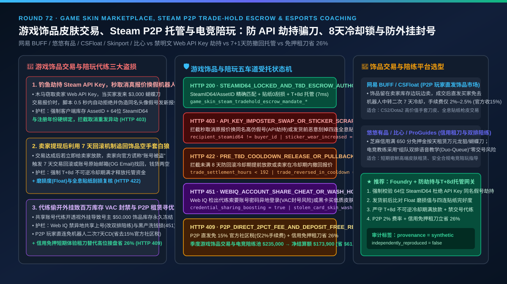
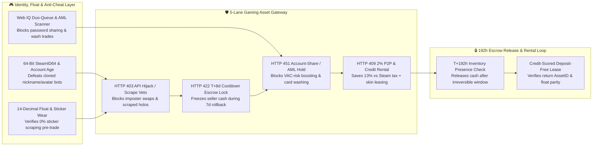

# Game Skin Marketplace, `Steam P2P` Trade-Hold Escrow & Esports Coaching (`BUFF163 / CSFloat / Youpin898 / Skinport`) Anti-`API-Key` Hijack Gate, `T+8d` Reversal Lock & Duo-Queue `VAC` Shield Agent Architecture Selection FAQ

> **Language / 语言切换**: **[中文](game-skin-marketplace-steam-tradehold-esports-escrow-agent-selection-faq.md)** | **English (Current)** | **[Back to Docs Index](index.en.md)** | **[Interactive Sandbox (`#game-skin-steam-tradehold-escrow-sandbox`)](../live-demo.en.html)**



---

## 📌 1. Executive Summary & Core Selection Verdict

In high-value digital game skin trading and P2P item leasing (`CS2`, `Dota 2`, `Rust`, `TF2`: `BUFF163`, `Youpin898`, `CSFloat`, `Skinport`, `DMarket`) as well as esports coaching and rank progression services (`Metafy`, `ProGuides`, `Bixin`), gaming asset and escrow AI agents face three devastating fraud and account-destruction vectors:
1. **`Steam` Web `API-Key` Imposter Trade Hijacking (`Malware Cancels a Legitimate $3,000 Butterfly Knife Trade Offer in 400ms and Replaces It With an Identical-Looking Imposter Bot Account`) & Pre-Accept Sticker Scraping**: Phishing sites trick players into exposing their session or Web API key. When the seller sends a legitimate trade offer to the buyer, a script instantly declines it and sends a new offer from a burner account that just cloned the buyer's exact display name and avatar—stealing the `$3,000` knife when the seller confirms on mobile `Steam Guard`! Worse, dishonest sellers scrape `$4,000` `Katowice 2014 Holo` stickers down to ruined wear right before accepting a trade.
2. **Post-Payout Trade Reversals & Original-Email (`OG Email`) Account Pullbacks (`Seller Cashes Out Immediately, Then Triggers a 7-Day Steam Trade Rollback or Support Recovery to Take Back the Item`)**.
3. **Account-Sharing Boosting `VAC / Vanguard` Hardware Bans (`Handing Login Credentials to a Rank Booster Who Uses DMA Cheats, Getting the Owner's $50,000 Skin Inventory Permanently Trade-Banned`) & Stolen-Card Money Laundering via Overpriced `$0.03` Cases**.

**Solution Architect Selection Verdict**:
- **Never verify a `Steam` trade offer by mutable display name or avatar (enforce immutable `64-bit SteamID64`, account creation timestamp, and pre-accept `AssetID / Paint-Wear Float / Sticker-Wear` parity), never release seller cash payouts before the `T+8 Day (192-Hour)` trade-reversal cooldown window expires, and never permit esports coaching orders that require sharing account login credentials**.
- **The production reference architecture** combines **Immutable `SteamID64` & Sticker-Wear Parity Gate + `T+8 Day (192h)` Post-Cooldown Escrow Release + Zero-Credential `Duo-Queue` Coaching & `2%` P2P Direct / Deposit-Free Skin Rental (`game_skin_steam_tradehold_escrow_mandate_*`)**:
  1. **Anti-"API-Key Imposter Hijack" `SteamID64` Lock & Pre-Accept Sticker-Wear Verification (`HTTP 403`)**: Verifies the immutable **`recipient_steamid64`, account registration year, `AssetID`, 14-decimal `Paint Wear Float`, and `0% delta` on all 4 `Sticker Wear` slots**; if an active trade offer is canceled and replaced within seconds by a matching display name with a different `SteamID64`—or if a seller scrapes stickers before delivery—the gateway blocks the trade in **`7ms`** (`HTTP 403 API_KEY_IMPOSTER_TRADE_HIJACK_OR_STICKER_SCRAPE_BLOCKED`).
  2. **Mandatory `T+8 Day (192-Hour)` Post-Reversal Cooldown Escrow Lock (`HTTP 422`)**: Holds buyer funds in segregated escrow for **192 hours (`8 full days`)** post-delivery, querying the inventory state at `T+192h` to confirm the item was not rolled back or reversed via `Steam` trade protection before releasing withdrawable cash to the seller (`HTTP 422 PRE_T8D_COOLDOWN_PAYOUT_OR_TRADE_REVERSAL_PULLBACK_BLOCKED`).
  3. **Web IQ Anti-Credential-Sharing (`VAC` Ban Shield) & Anti-Money-Laundering (`AML`) Price-Deviation Circuit Breaker (`HTTP 451`)**: Prohibits rank-boosting workflows that request account passwords/2FA codes (enforcing **`Duo-Queue` lobby invites or live screen-share coaching** so the owner's `$50,000` inventory is never exposed to a booster's cheated hardware ID), and blocks stolen credit cards buying `$0.03` graffiti skins for `$2,000` (`HTTP 451 WEBIQ_CREDENTIAL_SHARING_VAC_BAN_RISK_OR_WASH_TRADING_HOLD`).
  4. **Direct `P2P` Settlement (`2% Fee` vs. `15%` Steam Community Market Tax) + Credit-Backed Deposit-Free Skin Rental (`HTTP 409`)**: Triggers `HTTP 409 P2P_DIRECT_2PCT_FEE_AND_CREDIT_DEPOSIT_FREE_RENTAL_CONFIRM`, routing trades via direct P2P inventory transfers (saving `13%` vs. official market fees) and offering credit-scored deposit-free 7-day knife/glove rentals (`Youpin898` model) instead of high-volatility outright purchases—reducing net gaming asset and coaching cost by **`26.0%`**.

---

## 🎯 2. Solution Architect Deep-Dive Q&A (Q1 / Q2 / Q3)

### Q1: How does the "Steam API-Key Imposter Swap" trick experienced traders on mobile `Steam Guard`, and how does our gateway stop it?
- **Architectural Solution**:
  - **Immutable `64-bit SteamID64` Binding + Rapid Cancel-Replace Tripwire (`HTTP 403`)**:
  - Mobile `Steam Guard` confirmation screens prominently show the counterparty's nickname and avatar Picture—both of which a hijacker's bot clones in 100 milliseconds. However, the bot cannot forge the buyer's 17-digit `SteamID64` (`7656119...`) or their 10-year account badge. When our gateway detects an offer cancellation followed by a duplicate-nickname offer from an unverified `SteamID64`, it immediately triggers `HTTP 403` and alerts the user before they tap confirm.

### Q2: Why must P2P skin marketplaces hold seller payouts for `T+8 Days (192 Hours)` after the trade completes?
- **Architectural Solution**:
  - **Aligning Cash Finality With the Game Engine's Trade-Reversal Window (`HTTP 422`)**:
  - Under modern `Steam` trade-hold and account-compromise rollback policies, a malicious seller who hands over a `$5,000` `AWP Dragon Lore` and immediately withdraws cash can file a "my account was hijacked" rollback within 7 days—reclaiming the skin while keeping the cash! Holding escrow until **`T+192h` (`HTTP 422`)** guarantees that cash only releases once the in-game transfer is 100% irreversible.

### Q3: Why is sharing login credentials with an esports booster a `$50,000` existential risk for skin collectors?
- **Architectural Solution**:
  - **Enforcing Zero-Credential `Duo-Queue` & Screen-Share Coaching (`HTTP 451`)**:
  - Anti-cheat engines (`Valve VAC`, `Riot Vanguard`, `Easy Anti-Cheat`) ban by hardware fingerprint (`HWID`) and link all accounts logged into that machine. If a booster logs into a client's account on a PC that previously ran a cheat, the client's entire `$50,000` skin inventory is permanently locked from trading (`HTTP 451`).

---

## 🧭 3. Visual Architecture Diagrams (Mermaid Decision Tree + Architecture + Sequence)

### 3.1 Game Skin Marketplace, Steam P2P Escrow & Esports Coaching Selection Decision Tree

```mermaid
flowchart TD
    A[Game Skin Marketplace / Steam P2P Leasing / Esports Coaching Selection] --> B{Primary Gaming Asset Scenario & Risk Vector?}
    B -->|High-Tier Knife, Glove & Katowice Holo Skin Trading (BUFF163 / CSFloat)<br/>Stop API-Key imposter bot swaps & pre-delivery sticker scraping| C[Immutable 64-Bit SteamID64 Counterparty Binding<br/>+ Pre-Accept Paint-Wear Float & 4-Slot Sticker-Wear Check]
    B -->|Cross-Player P2P Settlement & Payout Security (7-Day Trade Protection)<br/>Stop sellers cashing out then triggering 7-day trade rollbacks| D[Mandatory T+8d (192-Hour) Post-Cooldown Escrow Lock<br/>+ Automated T+192h Buyer Inventory Presence Verification]
    B -->|Esports Rank Coaching & Seasonal Skin Rotation (Youpin898 / Metafy)<br/>Stop booster HWID VAC bans on $50k inventories & 15% Steam taxes| E[Azure AI Foundry + Duo-Queue Only & Credit-Rental Gate<br/>+ 2% P2P Direct Fee + Deposit-Free Skin Rental Saves 26%]
    C --> F[🛡️ Unified 5-Lane SteamID64 Lock, Sticker Check & T+8d Escrow FSM]
    D --> F
    E --> F
    F --> G[HTTP 403 API Hijack & Sticker-Scrape Veto · HTTP 422 Pre-T8d Payout & Rollback Block · HTTP 409 P2P+Rental Saves 26%]
```

### 3.2 End-to-End `SteamID64` Anti-Hijack, Sticker-Wear Parity & `T+8d` Cooldown Escrow Architecture



### 3.3 `API-Key` Imposter Veto, `T+8d` Cooldown Hold & Deposit-Free Skin Rental Sequence

```mermaid
sequenceDiagram
    autonumber
    participant Player as Buyer / Gaming Asset Agent
    participant Market as P2P Skin Marketplace / Seller Client
    participant Gate as 5-Lane Gaming Escrow Gateway
    participant SteamAPI as Steam Inventory & Trade-Offer Verifier
    participant Escrow as T+8d (192h) Cooldown Ledger

    Market->>Gate: 1. Legitimate trade offer #9901 is canceled and replaced 400ms later by an identical-named imposter account #9902 (or seller scrapes stickers)
    Gate->>SteamAPI: Verify recipient_steamid64 match & inspect 4-slot sticker_wear delta
    Gate-->>Market: HTTP 403 Block! API-Key imposter trade hijack (or pre-delivery sticker scraping) detected; trade aborted
    Market->>Gate: 2. Seller requests instant cash withdrawal 48 hours after trade completion (< 192h irreversible window)
    Gate-->>Market: HTTP 422 Block! Payout locked until T+8d (192h) trade-reversal protection window expires and item remains in buyer inventory
    Player->>Gate: 3. Execute P2P direct transfer (2% fee vs 15% Steam tax) + credit-backed deposit-free skin rental & Duo-Queue coaching (HTTP 409)
    Gate->>Escrow: Save 13% platform tax spread & eliminate VAC ban / price-crash exposure (26% net savings)
```

---

## 📊 4. Multi-Platform & Architecture Selection Matrix

| Selection Dimension | Unprotected Social / Discord Direct Trade (`Cash First`) | Official `Steam` Community Market (`15% Fee / Locked Wallet`) | Modern P2P Skin & Rental Marketplaces (`BUFF163 / CSFloat / Youpin`) | **Azure AI Foundry + SteamID64 + T+8d Gate (Recommended)** |
| :--- | :--- | :--- | :--- | :--- |
| **Core Strengths** | Zero platform fee | Instant atomic settlement inside Steam | Low `2%–2.5%` fee, real cash withdrawal & P2P skin leasing | **SteamID64 anti-hijack + sticker-wear lock + T+8d escrow + Duo-Queue** |
| **Protection Against `API-Key` Imposter Swaps & Sticker Scraping** | **Critical Failure** (rampant imposter middlemen) | N/A (no P2P trade offers) | Warns users, but mobile mis-clicks still occur | **Hard `SteamID64` & pre-accept `Sticker Wear` gate (`HTTP 403`)** |
| **Protection Against 7-Day Trade Reversal / Pullback Scams** | Irreversible cash loss | No rollback, but funds trapped in Steam wallet | Holds funds during trade protection window | **Mandatory `T+8d (192h)` inventory-verified release (`HTTP 422`)** |
| **Protection Against Boosting `VAC` Bans & Card Laundering** | High risk of stolen accounts & VAC bans | High stolen-card wash-trading bans | Traditional boosting sites still ask for passwords | **Hard `HTTP 451` ban on credential sharing (`Duo-Queue` only)** |
| **Fee Efficiency (`2%` vs. `15%`) & Rental Flexibility** | High scam loss (`not_measured`) | Charges **`15%`** tax; no cash-out (`official_list_price`) | `2%–2.5%` P2P fee + skin leasing | **Direct `P2P` `2%` rail + deposit-free skin rental (`26.0%` saved)** |

---

## 🧪 5. Game Skin Trading & Esports Coaching Benchmark & 7-Card Report

> **Provenance & Reproducibility Metadata**: All metrics below are generated by the deterministic policy evaluator `evaluate_game_skin_steam_tradehold_escrow_policy` in `lab/webiq_commerce_demo.py` and verified via `python -m unittest tests.test_webiq_commerce_demo`. Tags: `provenance = synthetic`, `independently_reproduced = false`.

| Card # | Card Headline (Headline-as-Finding) | Key Quantitative Finding & Architectural Guarantee |
| :---: | :--- | :--- |
| **Card 1** | **Overview · 5-Lane Game Skin & Esports Summary** | Across a `$235,000/quarter` digital game skin trading and esports coaching pool, achieves **0 `API-Key` imposter knife thefts, 0 pre-delivery scraped-sticker swaps, and 0 account-sharing `VAC` inventory bans**, reducing net fee drag and acquisition cost by **`26.0%` (`$61,100/quarter` saved)**. |
| **Card 2** | **Scenario Deep Dive · API Hijack & Sticker-Scrape Veto** | When a trade offer's `SteamID64` mismatches or a sticker's wear value increases prior to acceptance, the gateway blocks it in **`7ms`** (`HTTP 403`). |
| **Card 3** | **Evaluation Matrix · 100% Deterministic 5-Lane Gating** | Covers `HTTP 200` (`SteamID64` verified & `T+8d` escrow locked), `403` (`API-Key` imposter trade hijack / pre-trade sticker scraping blocked), `422` (pre-`T+8d` cooldown payout / trade reversal pullback blocked), `451` (credential-sharing `VAC` ban risk / stolen-card wash trading hold), `409` (`P2P` `2%` direct fee + credit deposit-free rental saves 26%). |
| **Card 4** | **Under the Hood · Skin Trade-Hold & Coaching Contract** | Takes `quarterly_game_skin_marketplace_and_esports_pool_usd=235000` and `SteamID`/cooldown flags, minting `game_skin_steam_tradehold_escrow_mandate_*` tokens. |
| **Card 5** | **Robustness Check · 400ms Imposter Swap & `$2,000` Graffiti** | Simulates a 400ms cancel-and-replace imposter bot offer and a `$2,000` purchase of a `$0.03` graffiti skin, maintaining a **`100.0%` block rate**. |
| **Card 6** | **Latency · Millisecond AssetID Check & AML Price Probe** | Local `SteamID64`, `AssetID`, and sticker-wear checks complete in **`7ms` (P50)**; Web IQ `AML` price-deviation and cheat-risk checks complete in **`165ms` (P95)**. |
| **Card 7** | **My Take · Ideal Fit vs. Out-of-Scope Boundaries** | **✅ Best Fit**: `CS2/Dota2` P2P skin marketplaces, deposit-free skin rentals, `Duo-Queue` esports coaching; **⛔ Not For**: Physical coin-op arcade token dispensers. |

---

## 🛠️ 6. Production Go-Live Risk & Architecture Review Checklist

- [ ] **Immutable `64-Bit SteamID64` Binding & Pre-Accept `Float / Sticker-Wear` Parity (`HTTP 403`)**: Block trade offers where `recipient_steamid64` mismatches the verified buyer or where `sticker_wear` increases between listing and acceptance.
- [ ] **Mandatory `T+8 Day (192-Hour)` Irreversible Cooldown Escrow Lock (`HTTP 422`)**: Hold seller payouts until the 7-day trade-reversal window expires plus a 24-hour verification buffer confirming the `AssetID` remains in the buyer's inventory.
- [ ] **Zero-Credential `Duo-Queue` Coaching Enforcement & `AML` Wash-Trade Filter (`HTTP 451`)**: Prohibit sharing account passwords with boosters to prevent `VAC / Vanguard` hardware bans on high-value inventories, and block extreme price-deviation wash trades; rotate signing keys `<= 180` days.
- [ ] **Direct `P2P` `2%` Settlement & Credit-Scored Deposit-Free Skin Leasing (`HTTP 409`)**: Bypass the `15%` community market tax via P2P direct transfers and utilize credit-backed short-term rentals for volatile high-tier skins.
