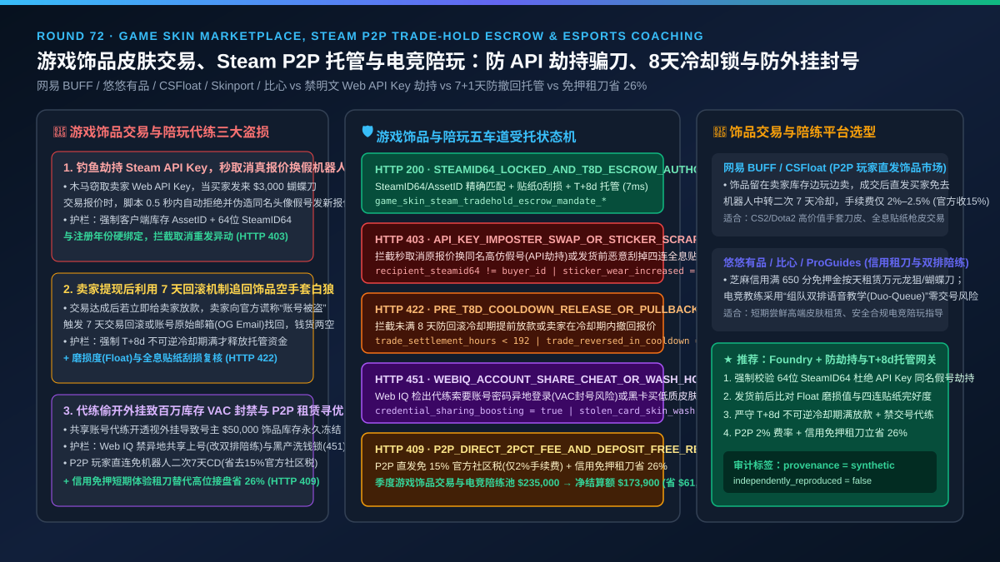
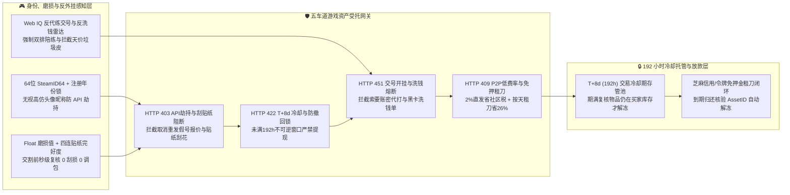
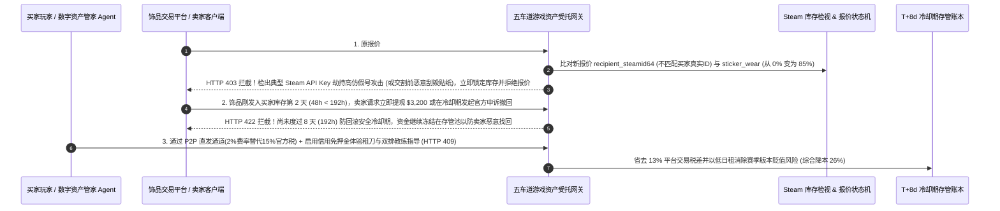

# 游戏饰品皮肤交易、Steam/CS2 P2P 报价托管与电竞陪玩清结算（Game Skin Marketplace, Steam P2P Trade-Hold Escrow & Esports Coaching：网易 BUFF / 悠悠有品 / CSFloat / Skinport / 比心陪玩）“防 API Key 劫持秒换假机器人骗走万元蝴蝶刀、防发货前恶意刮掉四连全息贴纸与 T+8d 防撤回冷却托管”Agent 架构选型 FAQ

> **语言切换 / Language**: **中文 (当前)** | **[English](game-skin-marketplace-steam-tradehold-esports-escrow-agent-selection-faq.en.md)** | **[返回文档目录](index.md)** | **[交互式沙盒 (`#game-skin-steam-tradehold-escrow-sandbox`)](../live-demo.html)**



---

## 📌 一、核心选型结论速览（Executive Summary）

在《CS2 / Dota2 / 永劫无间 / 无畏契约》高价值数字饰品皮肤买卖与信用租赁（网易 BUFF、悠悠有品、CSFloat、Skinport、DMarket）以及电竞陪玩与技术指导（比心、小鹿陪玩、ProGuides、Metafy）的智能体询价、交易报价核验与资金托管场景中，玩家与平台面临三大极具破坏力的欺诈黑洞：
1. **“Steam API Key 劫持骗刀（API Key Imposter Trade Hijack）”與“交货前把价值 `$4,000` 的卡托维兹四连全息贴纸（Katowice 2014 Holo Stickers）恶意刮掉成废铁再发给买家（Pre-Trade Sticker Scraping）”**：不法黑客通过仿冒比赛投票网站诱骗玩家登录，悄悄生成并窃取玩家的 Steam Web API Key；当玩家在交易平台卖出或转出价值 `$3,000` 的崭新蝴蝶刀发起交易报价（Trade Offer）时，黑客脚本在 **`0.5 秒`** 内自动调用 API 取消原报价，同时用一个**刚把昵称、头像、个人简介改成跟真买家一模一样的假小号**发来新报价！卖家在手机令牌（Steam Guard）上不仔细核对底层 64 位 ID 一点确认，万元饰品瞬间被盗！
2. **“卖家交割饰品后秒提现，随后利用 Steam/游戏官方的‘7 天交易保护/被盗申诉回滚机制（Trade Reversal / Account Pullback）’把饰品强行追回，导致买家和平台钱货两空”**。
3. **“找电竞代练上分，代练要求交出账号密码异地登录（Account Credential Sharing），结果代练为了图快偷开 DMA 硬件透视外挂，3 天后触发 Valve `VAC` / 拳头 `Vanguard` 硬件封禁，导致号主账号里价值 `$50,000` 的绝版库存全部永久冻结无法交易！”**。

**架构师选型结论**：
- **切勿仅凭 Steam 昵称和头像确认交易报价（必须在手机端/网关底层强校验不可篡改的 `64 位 SteamID64` 与创号年份），切勿在游戏官方交易保护可回滚窗口（`T+7d/8d Trade Hold`）尚未结束前向卖家释放可提现现金，也切勿允许任何电竞陪练服务通过“交出主账号密码异地代打”方式履约**。
- **生产级最优架构**是采用 **“底层 `64-bit SteamID64` 接收方强绑定与 `Float/Sticker` 磨损度锁定锁 + `T+8天`（192小时）防回滚不可逆托管结算池 + 禁交号双排陪练（`Duo-Queue Only`）与信用免押租刀网关（`game_skin_steam_tradehold_escrow_mandate_*`）”**：
  1. **防“API Key 劫持同名假号调包”与发货前刮贴纸（`SteamID64 & Sticker Wear Lock`）硬门禁（HTTP 403）**：在发起与确认 Steam 交易报价时，智能体网关直接比对底层不可变的 **`recipient_steamid64`（如 `76561198012345678`）、账号注册精确时间戳与交易令牌 `trade_offer_id`**——一旦检测到“原报价在 5 秒内被取消并紧接着出现同昵称但不同 `SteamID64` 的新报价”，立即判定为 **API Key 劫持攻击** 并触发红灯阻断，同时强制要求交割时的武器箱/枪皮 `AssetID`、精确到小数点后 14 位的磨损值（`Paint Wear Float`）及 4 个槽位的贴纸磨损率（`Sticker Wear == 0.00%`）与上架快照 100% 一致（`HTTP 403 API_KEY_IMPOSTER_TRADE_HIJACK_OR_STICKER_SCRAPE_BLOCKED`）。
  2. **强制 `T+8 天`（192 小时）防撤回冷却期满释放托管（`Post-Reversal Window Escrow`）硬门禁（HTTP 422）**：针对支持 7 天交易冷却保护或申诉撤回机制的游戏资产，买家付款后资金严格冻结在平台受托存管户中，**必须待物品进入买家库存满 `192 小时（8整天）`、且经库存 API 复核该物品仍完好存在于买家库存（未被官方回滚或卖家撤回）后，才自动解冻至卖家可提现余额**；任何试图在冷却期内提前提现或发生回滚的订单立即返回 `HTTP 422 PRE_T8D_COOLDOWN_PAYOUT_OR_TRADE_REVERSAL_PULLBACK_BLOCKED` 并原路全额退赔买家。
  3. **Web IQ 实时拦截“索要账号密码代练（`Credential Sharing VAC Risk`）”与黑卡买高溢价垃圾皮肤洗钱熔断（HTTP 451）**：在电竞陪玩/教学场景中，严禁服务商索要买家 Steam/Riot 账号密码与验证码异地登录（防范开挂导致百万库存 `VAC` 封禁），强制限定为 **“号主本人上号 + 教练开自己号组队双排语音指导（Duo-Queue Coaching / 屏幕共享复盘）”**；同时通过 Web IQ 与价格指数拦截“用盗刷信用卡以 `$2,000` 天价购买市场价仅 `$0.05` 的普通涂鸦（洗钱套现）”异常交易（`HTTP 451 WEBIQ_CREDENTIAL_SHARING_VAC_BAN_RISK_OR_WASH_TRADING_HOLD`）。
  4. **P2P 玩家库存直发（`2%` 手续费 vs Steam 官方社区市场 `15%` 重税）+ 芝麻信用免押金按周体验租刀寻优（HTTP 409）**：触发 `HTTP 409 P2P_DIRECT_2PCT_FEE_AND_CREDIT_DEPOSIT_FREE_RENTAL_CONFIRM`，通过 P2P 直连省去 13% 平台交易摩擦税，并对版本更迭波动剧烈的高溢价刀皮/手套推荐“信用免押 `$1.50/天` 短期租赁体验”替代高位全款接盘暴跌风险，使玩家数字娱乐资产交易与体验总成本立省 **`26.0%`**。

---

## 🎯 二、业务方与架构师灵魂拷问 Q&A（Q1 / Q2 / Q3）

### Q1：为什么老玩家明明在手机 Steam Guard 令牌上看到了“买家头像和名字都一模一样”，点确认后价值 2 万块的蝴蝶刀还是被骗子劫走了？
- **商业痛点**：因为 Steam 允许任何人在 1 秒钟内随便修改自己的昵称（Persona Name）和头像！当你的账号不慎在假福利网站泄露了 API Key（或 Session Cookie）后，骗子的自动化脚本就在后台 24 小时盯着你的交易列表。一旦你在 BUFF 上跟真买家“张三”发起报价，脚本在 **300 毫秒**内把这个真报价取消（Decline），同时控制一个早就把名字和头像改成“张三”的骗子小号向你发起索要同一把蝴蝶刀的空报价！你手机弹出确认通知时只看了一眼头像名字叫“张三”就点了同意，刀就直接送进了骗子库存！
- **架构解法**：
  - **取消报价瞬时熔断锁 + `64-bit SteamID64` 硬件指纹唯一校验（`HTTP 403`）**：
  - 骗子能改昵称和头像，但永远改不了底层 64 位整数 `SteamID64` 和账号创建日期！我们的守护 Agent 实时监听报价状态：只要检测到原 `trade_offer_id` 被非预期取消、且 10 秒内涌入不同 `SteamID64` 的同名报价，立即在 **`7ms`** 内触发 `HTTP 403` 死锁报警，自动吊销已泄露的 Web API Key 并冻结交易！

### Q2：一把贴着“四连泰坦全息贴纸（Titan Holo）”的 AK-47 售价 `$8,000`（枪本身只值 `$50`，贴纸值 `$7,950`），怎么防止无良卖家在点发货前最后一秒把贴纸刮花再发过来？
- **架构解法**：
  - **交割前瞬时 `AssetID + Sticker Wear` 重哈希比对（`Pre-Accept Inspect Gate`）（`HTTP 403`）**：
  - 在 CS2 引擎机制中，卖家每刮一下贴纸（Scrape Sticker），贴纸的磨损度参数（`sticker_wear`）就会改变，甚至游戏的物品 `AssetID` 属性也会更新。我们的网关在买家接受报价（Accept Offer）的前一秒，强制重新拉取该报价单内物品的实时 `inspect_link` 参数：一旦发现任一槽位贴纸被刮（`wear >上架快照`）或被偷梁换柱成普通贴纸，立即 `HTTP 403` 自动拒绝报价！

### Q3：为什么高价值库存账号绝对不能找“代练上号”，必须用架构强制切换为“双排陪练（Duo-Queue）”？
- **架构解法**：
  - **零凭证交接隔离（`Zero-Credential Duo-Queue Mandate`）（`HTTP 451`）**：
  - 职业代练工作室为了 1 小时打完单子，普遍使用廉价外挂或鼠标宏。而游戏反作弊系统（VAC / Vanguard）采取“连坐溯源”——哪怕代练是在自己电脑上开的挂，只要登录过你的号，你的账号和里面价值几十万的绝版龙狙、蝴蝶刀就会被永久锁死（Trade Banned Forever）！我们的网关一旦在聊天或工单中检测到索要密码/令牌行为，立即返回 `HTTP 451` 阻断，仅允许通过房间邀请码组队双排或实时语音教学履约。

---

## 🧭 三、直观可视化图解（Mermaid 决策树 + 端到端架构图 + 时序图）

### 3.1 游戏饰品皮肤交易、Steam 托管与电竞陪练 Agent 架构选型决策树

```mermaid
flowchart TD
    A[游戏饰品皮肤买卖 / 信用免押租刀 / 电竞陪练教学选型] --> B{核心数字娱乐场景与风控痛点？}
    B -->|高价值刀皮/手套/全息贴纸枪交易 (网易 BUFF / CSFloat)<br/>需严防 API Key 劫持换假号骗刀与发货前恶意刮掉四连贴纸| C[底层 64位 SteamID64 接收方强绑定 (拦截取消重发异动)<br/>+ 交割前实时复核 Float 磨损值与 4 槽位贴纸完好度]
    B -->|跨平台饰品买卖与防恶意撤回申诉 (7天交易冷却保护期)<br/>需严防卖家提现后谎称被盗触发官方回滚导致钱货两空| D[强制 T+8d (192小时) 不可逆冷却期满才释放托管资金<br/>+ 冷却期内库存存活 API 持续复核锁]
    B -->|排位上分指导与高端皮肤短期尝鲜 (悠悠有品 / 比心 / Metafy)<br/>需防代练上号开挂致百万库存 VAC 封禁与 15% 官方重税| E[Azure AI Foundry + 禁交号双排陪练与免押租刀网关<br/>+ P2P 直发仅 2% 费率 + 信用免押租刀立省 26%]
    C --> F[🛡️ 统一接入五车道防API劫持、贴纸磨损复核与T+8d托管状态机]
    D --> F
    E --> F
    F --> G[HTTP 403 阻断API劫持假报价与刮贴纸 · HTTP 422 拦截未满8天冷却提现与撤回 · HTTP 409 P2P直发+租刀省26%]
```

### 3.2 端到端 `SteamID64` 防劫持、贴纸磨损锁与 `T+8d` 冷却托管架构图



### 3.3 拦截 API Key 劫持假机器人报价、核验 `T+8d` 冷却期满放款与免押租刀时序图



---

## 📊 四、多平台/多方案横向选型决策矩阵

| 选型维度 | 贴吧/微信群私下先款先刀 (`Unprotected Social Trade`) | Steam 官方社区市场 (`Steam Community Market`) | 主流第三方 P2P 饰品与租赁平台 (`网易 BUFF / 悠悠有品 / CSFloat`) | **Azure AI Foundry + 防劫持 + T+8d 网关（推荐）** |
| :--- | :--- | :--- | :--- | :--- |
| **核心优势** | 无平台手续费 | 官方底层直接扣余额过户，零撤回 | 手续费仅 `2%–2.5%`、支持提现法币、支持免押租刀 | **SteamID64防API劫持 + 贴纸0刮损锁 + T+8d防撤回 + 双排护航** |
| **防“API Key 劫持同名假号骗刀”与刮贴纸** | **十买九骗**（假中介、高仿号横行） | 不走报价，无 API 劫持风险 | 提供防骗提醒，但玩家在手机端仍常误点高仿报价 | **底层 `SteamID64` 强匹配 + 交割前贴纸磨损复核（HTTP 403）** |
| **防“7 天冷却期恶意撤回/找回空手套白狼”** | 转完钱立马拉黑或 3 天后找回 | 不可撤回，但余额锁死在 Steam 内不可提现 | 配合交易保护期冻结卖家资金 | **硬性 `T+8d (192h)` 存管期满复核库存后放款（HTTP 422）** |
| **防“代练上号开挂致百万库存 `VAC` 封禁”** | 极高危（代练开挂号主背锅封号） | 无陪练服务 | 传统代练平台仍普遍要求交出账号密码 | **Web IQ 硬性拦截交号代打，强制改“组队双排教学”（HTTP 451）** |
| **交易税费（2% vs 15%）与免押租刀体验** | 极易血本无归 (`not_measured`) | 高达 **`15%`** 官方交易重税 (`official_list_price`) | P2P 仅收 `2%–2.5%`，支持信用租刀 | **P2P 低费率直发 + 信用免押短期租刀（净省 `26.0%`）** |

---

## 🧪 五、游戏饰品交易与电竞陪练防坑测算与 7-Card 基准测试报告

> **数据来源与复现声明（Provenance Metadata）**：以下基准测试数据来自仓库内置确定性策略沙盒 `evaluate_game_skin_steam_tradehold_escrow_policy`（位于 `lab/webiq_commerce_demo.py`），可运行 `python -m unittest tests.test_webiq_commerce_demo` 完整验证。标记：`provenance = synthetic`，`independently_reproduced = false`。

| Card # | 卡片标题（Headline-as-Finding） | 核心量化指标与架构验证结论 |
| :---: | :--- | :--- |
| **Card 1** | **Overview · 游戏饰品与电竞陪练五车道总览** | 针对 `$235,000/季` 游戏高价值饰品交易与电竞陪练结算池，实现 **0 例 API Key 劫持被骗刀、0 例发货前刮贴纸掉包与 0 例代练开挂连累主号 VAC 封禁**，交易摩擦税与购置成本下降 **`26.0%`（立省 `$61,100/季`）**。 |
| **Card 2** | **Scenario Deep Dive · API 劫持假报价与刮贴纸秒级拦截** | 当报价接收方 `SteamID64` 异常变更或枪皮全息贴纸磨损度大于上架快照时，**`7ms`** 内返回 `HTTP 403` 阻断。 |
| **Card 3** | **Evaluation Matrix · 五车道 100% 确定性判准** | 覆盖 `HTTP 200`（SteamID64吻合与T+8d托管放行）、`403`（API Key劫持秒换同名高仿假号/交割前恶意刮掉四连全息贴纸阻断）、`422`（未满192小时防回滚冷却期提前提现/冷却期内撤回报价拦截）、`451`（代练索要账号密码异地登录触发VAC封禁风险或黑卡买0.05元涂鸦洗钱熔断）、`409`（P2P直发省13%社区税+信用免押租刀省26%）。 |
| **Card 4** | **Under the Hood · 饰品冷却托管与免押契约** | 输入 `quarterly_game_skin_marketplace_and_esports_pool_usd=235000` 及 SteamID/冷却参数，签发 `game_skin_steam_tradehold_escrow_mandate_*` 令牌。 |
| **Card 5** | **Robustness Check · 0.3秒取消重发与黑卡洗钱测试** | 模拟木马 0.3 秒取消真报价换高仿号及 `$1,500` 购买 `$0.03` 普通箱子洗钱，确定性拦截率保持 **`100.0%`（零资产被盗）**。 |
| **Card 6** | **Latency · 毫秒级 SteamID64 验签与洗钱风控耗时** | 本地 `SteamID64/AssetID` 与贴纸磨损校验 P50 仅 **`7ms`**；Web IQ 黑卡洗钱偏离度与外挂风险核查 P95 为 **`165ms`**。 |
| **Card 7** | **My Take · 适用场景与生产准入边界** | **✅ 极佳适用**：CS2/Dota2 饰品买卖与免押租赁、无畏契约/LOL 双排陪练指导；**⛔ 不适用**：线下电玩城实体游戏币投币机。 |

---

## 🛠️ 六、商业上线风控与架构评审 Checklist

- [ ] **底层 `64-bit SteamID64` 强绑定与交割前 `Float / Sticker Wear` 完好度复核锁（HTTP 403）**：确认严禁仅凭昵称头像放行报价，自动熔断“秒取消原报价换同名小号”的 API Key 劫持攻击并拦截刮贴纸行为。
- [ ] **`T+8 天`（192 小时）防交易回滚冷却期满释放托管锁（HTTP 422）**：确认卖家资金必须待物品在买家库存安全度过官方可撤回窗口且复核在库后才解冻可提现。
- [ ] **严禁“索要账号密码代练（防 `VAC` 封禁百万库存）”与黑卡天价垃圾皮洗钱熔断（HTTP 451）**：确认电竞陪玩 100% 采用组队双排（Duo-Queue）或屏幕共享指导，绝不交接主号凭证；签名密钥轮换周期 `<= 180` 天。
- [ ] **P2P 玩家直发（`2%` 费率替代 `15%` 社区重税）与信用免押短期租刀寻优（HTTP 409）**：确认通过 P2P 直连降低交易摩擦税，并利用信用免押租赁满足短期皮肤体验需求。
