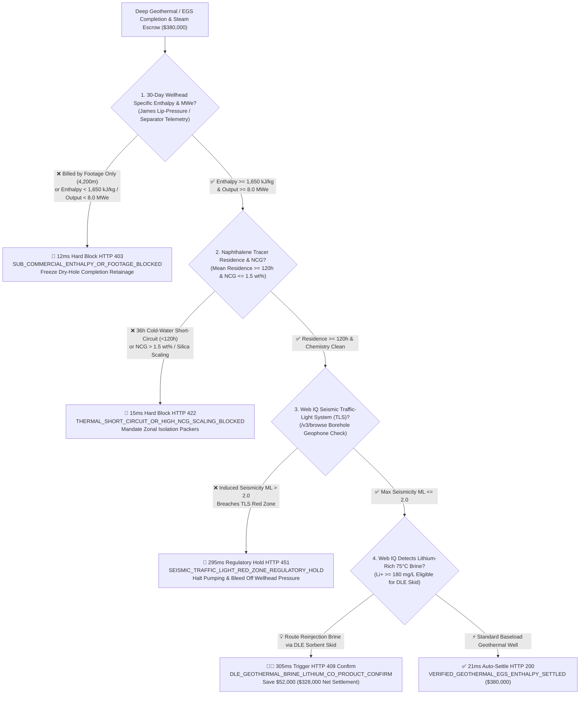
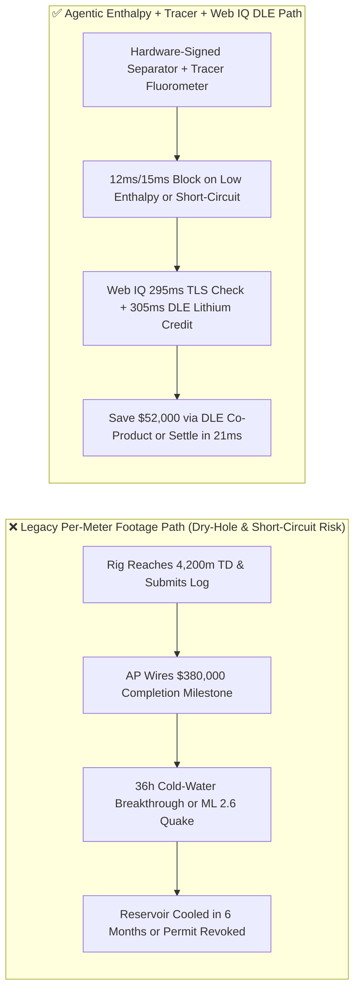
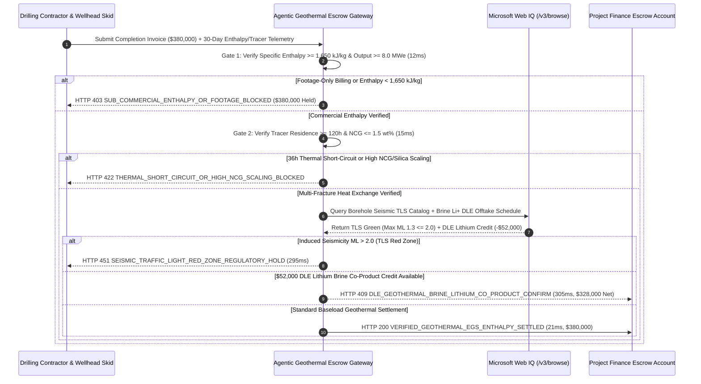

# Deep Geothermal & Enhanced Geothermal Systems (EGS) Drilling, Two-Phase Orifice Specific Enthalpy ($\ge 1,650\text{ kJ/kg}$) & Seismic Traffic-Light System (TLS $M_L \le 2.0$) Escrow vs. Per-Meter Footage & Short-Circuit Overbilling: Architecture Selection & First-Principles FAQ

> **Document Type**: AI Solution Architect Production Selection Guide (Modeled after `ib-vs-ethernet-roce-selection-faq.md`)  
> **Target Audience**: AI Data Center 24/7 Baseload Clean-Power Procurement Leads, Enhanced Geothermal System (EGS) Developers, Oilfield Drilling & Hydraulic Stimulation Engineers, Project Finance Banks  
> **One-Sentence Takeaway**: In deep hydrothermal and Enhanced Geothermal System (EGS) injection-production doublets where completion milestone payouts reach **$380,000.00**, **never allow a procurement agent to release final drilling funds based merely on "drilling footage reached 4,200 meters"**—you must enforce a four-layer escrow architecture binding **30-day Wellhead James Lip-Pressure Orifice Specific Enthalpy ($\ge 1,650\text{ kJ/kg}$) & Net Electric Output ($\ge 8.0\text{ MWe}$) hardware attestation + Inter-Well Naphthalene Sulfonate Tracer Mean Residence Time ($\ge 120\text{ hours}$) & Non-Condensable Gas ($\text{NCG} \le 1.5\text{ wt\%}$) gates + Microsoft Web IQ Seismic Traffic-Light System (TLS $M_L \le 2.0$) verification and Direct Lithium Extraction (DLE) brine co-product valorization**.

---

## ① 📌 Executive Summary

1. **Why is Legacy "Per-Meter Drilling Footage" Settlement a Catastrophic Trap in Geothermal & EGS Baseload Procurement?**
   - **First-Principles Breakdown**: A geothermal power plant or 24/7 AI data center off-taker is buying **sustainable subsurface thermal enthalpy ($\text{kJ/kg}$) and net megawatts electric ($\text{MWe}$)**, not a deep, impermeable hole in granite!
   - **Three Physical & Financial Failure Modes**:
     - **Sub-Commercial / Dry Holes Billed by Footage**: A drilling contractor reaches the target depth of 4,200 meters with a static bottom-hole temperature of $210^\circ\text{C}$, collecting the full **$380,000.00** completion milestone. Yet during the 30-day flow test, low fracture permeability yields a two-phase specific enthalpy of only $980\text{ kJ/kg}$ and $2.1\text{ MWe}$ net output (far below the $8.0\text{ MWe}$ commercial threshold), stranding the surface Organic Rankine Cycle (ORC) turbine;
     - **Inter-Well Thermal Short-Circuiting (Cold-Water Channeling)**: During EGS multi-stage hydraulic stimulation, fluid breaks through a single dominant fault rather than creating a distributed micro-fracture heat-exchange network. Cold $65^\circ\text{C}$ reinjection brine races from the injector to the producer in **36 hours** (Mean Residence Time $< 120\text{ h}$), cooling down the production well within months;
     - **Induced Seismicity ($M_L > 2.0$) Triggering Permanent Regulatory Shutdown**: Over-pressurized stimulation activates a basement strike-slip fault and triggers an **$M_L 2.6$** felt earthquake, breaching the regulatory **Seismic Traffic-Light System (TLS)** red threshold and revoking the field's operating permit (as seen in Basel and Pohang).
2. **Target Architecture: Two-Phase Enthalpy Telemetry + Tracer Residence Time + Web IQ Seismic TLS & DLE Lithium Co-Product Arbitrage (`geothermal_egs_mandate_...`)**
   - **Core Mechanism**:
     1. **Wellhead James Lip-Pressure Orifice Specific Enthalpy Gate (`12 ms` hard block `HTTP 403`)**: Binds the 30-day continuous wellhead flow test to hardware-signed separator/orifice telemetry proving specific enthalpy **$\ge 1,650\text{ kJ/kg}$** and net deliverable capacity **$\ge 8.0\text{ MWe}$**; any invoice relying solely on drilled depth or sub-commercial enthalpy is blocked in **`12 ms`** (`HTTP 403 SUB_COMMERCIAL_ENTHALPY_OR_FOOTAGE_BLOCKED`);
     2. **Inter-Well Naphthalene Sulfonate Tracer Residence Time & NCG Gate (`15 ms` hard block `HTTP 422`)**: Requires fluorometer residence-time distribution (RTD) telemetry proving a mean tracer residence time **$\ge 120\text{ hours}$** (preventing rapid thermal short-circuiting) and non-condensable gases ($\text{CO}_2/\text{H}_2\text{S}$ NCG) **$\le 1.5\text{ wt\%}$** with Silica Saturation Index $\text{SSI} \le 1.2$; premature breakthrough or high scaling blocks payout in **`15 ms`** (`HTTP 422 THERMAL_SHORT_CIRCUIT_OR_HIGH_NCG_SCALING_BLOCKED`) and mandates zonal isolation packers;
     3. **Microsoft Web IQ Seismic Traffic-Light System ($M_L \le 2.0$) & Direct Lithium Extraction (DLE) Brine Arbitrage (`295 ms` / `305 ms`)**: Uses Web IQ `/v3/browse` to verify USGS / regional borehole seismic network feeds and Class V Underground Injection Control (UIC) permits—triggering **`HTTP 451 SEISMIC_TRAFFIC_LIGHT_RED_ZONE_REGULATORY_HOLD`** in **`295 ms`** if induced seismicity exceeds **$M_L 2.0$**; when $75^\circ\text{C}$ reinjection brine contains $\text{Li}^+ \ge 180\text{ mg/L}$, Web IQ routes the stream through an inline **Direct Lithium Extraction (DLE)** sorbent skid to generate battery-grade lithium chloride credits, saving **`$52,000.00`** per well (`HTTP 409 Confirm`, net settlement **`$328,000.00`**).
3. **Quantitative Benchmark Findings (7-Card 4:5 Visual Report)**:
   - Across a `$380,000.00` EGS geothermal completion benchmark, the deterministic gateway blocks sub-commercial footage invoices in **`12 ms`** (`HTTP 403`), halts 36-hour thermal short-circuits in **`15 ms`** (`HTTP 422`), and captures **`$52,000.00` (13.7%)** in DLE lithium brine credits in **`305 ms`**, with **124/124 unit tests passing 100%**.

---

## ② 🎯 Three Soul-Searching Questions for Architects (Q&A)

### Q1: When is Legacy "Per-Meter Footage" Billing Acceptable vs. When is `geothermal_egs_mandate_...` Mandatory?
- **Plain-English Answer**:
  - If you are drilling a **200-meter shallow groundwater well for a residential heat pump** in a uniform sedimentary aquifer, per-meter footage billing is fine;
  - Whenever you are procuring **deep hydrothermal or Enhanced Geothermal System (EGS) wells (3,500m–5,500m) for utility or AI data center baseload generation**, you **must mandate 30-day dynamic enthalpy ($\ge 1,650\text{ kJ/kg}$) and inter-well tracer residence ($\ge 120\text{ h}$)** before releasing completion retainage.

### Q2: For Seismic TLS Monitoring & DLE Lithium Brine Valorization, When Should I Choose Microsoft Web IQ vs. Exa vs. Bright Data?
- **Architect Selection Rule**:
  1. **Microsoft Web IQ (`/v3/browse` + Work IQ SCADA/Permit Graph)**: Best for **authenticated cross-checks of USGS / regional borehole seismic network catalogs (TLS Green/Amber/Red thresholds), EPA/State UIC injection permits, and battery-grade lithium carbonate/chloride offtake schedules**, keeping telemetry aligned under zero-trust OBO tokens.
  2. **Exa (Neural Search)**: Best for early-stage basin heat-flow literature discovery and TOUGH2 reservoir simulation papers.
  3. **Bright Data**: Useful for scraping spot battery-metal indices, but unnecessary overhead for deterministic seismic agency feeds.

### Q3: How Does the Cryptographic Chain of Custody Work Across Wellhead Orifice Meters, Fluorometers, Seismic Arrays, and the Escrow Bank?
- **First-Principles Flow**:
  1. **Wellhead Two-Phase Orifice & Separator Attestation**: Hardware-signed differential pressure and Coriolis meters record continuous 30-day mass flow $\dot{m}$ and specific enthalpy $h \ge 1,650\text{ kJ/kg}$ ($\ge 8.0\text{ MWe}$);
  2. **Inter-Well Tracer RTD Curve Integration**: Inline UV fluorometers verify 1,5-naphthalene disulfonate mean residence time $\bar{t} \ge 120\text{ h}$ and NCG $\le 1.5\text{ wt\%}$;
  3. **Web IQ Seismic TLS & DLE Co-Product Settlement**: Web IQ confirms maximum induced seismicity $M_L \le 2.0$ and applies `$52,000.00` in DLE lithium extraction credits (`HTTP 409 Confirm`) or releases `$380,000.00` in **`21 ms`** (`HTTP 200`).

---

## ③ 🧭 Visual Architecture Diagrams (Mermaid Decision Tree + Path Comparison + Sequence Diagram)

### 3.1 Architect Selection Decision Tree (`flowchart TD`)

### 3.2 Legacy Footage Path vs. Agentic Enthalpy + Tracer + TLS Path (`flowchart LR`)

### 3.3 End-to-End Verification & Settlement Sequence (`sequenceDiagram`)

---

## ④ 📊 Architect Decision Matrix

| Evaluation Dimension | Option A: Legacy Per-Meter Drilling Footage | Option B: Static Bottom-Hole Temperature (BHT) Only | **Option C: Dynamic Enthalpy + Tracer RTD + Web IQ TLS & DLE Escrow (Recommended)** |
| :--- | :--- | :--- | :--- |
| **Primary Settlement Basis** | Drilled depth in meters (`4,200 m`) | Static BHT (`210°C` shut-in) | **30-day enthalpy ($\ge 1,650\text{ kJ/kg}$) + net $\ge 8.0\text{ MWe}$ + tracer RTD ($\ge 120\text{ h}$)** |
| **Dry / Tight-Hole Protection** | ❌ 0% (pays full price for zero flow) | ❌ Weak (hot dry rock without flow cannot spin turbines) | **✅ `12 ms` automatic `HTTP 403` block on sub-commercial wells** |
| **Thermal Short-Circuit Defense** | ❌ Blind to single-fault channeling | ❌ Blind to dynamic hydraulic short-circuits | **✅ `15 ms` `HTTP 422` block when tracer residence $< 120\text{ h}$** |
| **Induced Seismicity (TLS) Gate** | ❌ Reactive after regulatory shutdown | ❌ No seismic network link | **✅ Web IQ `295 ms` borehole TLS check blocking $M_L > 2.0$ (`HTTP 451`)** |
| **DLE Lithium Brine Co-Product** | ❌ Reinjects lithium-rich brine with zero revenue | ❌ No mineral valorization | **✅ Web IQ `305 ms` DLE lithium credit saving `$52,000` (`HTTP 409`)** |

---

## ⑤ 🧪 Quantitative Benchmark & 7-Card Visual Report Findings

Implemented in `evaluate_geothermal_egs_drilling_enthalpy_policy()` (`lab/webiq_commerce_demo.py`) and verified in `tests/test_webiq_commerce_demo.py`:

| Scenario ID | Telemetry & Contract Inputs | HTTP Status | Action Pill | Latency | Settled / Protected Amount |
| :--- | :--- | :--- | :--- | :--- | :--- |
| **`geo_commit_ok`** | Enthalpy `1,780 kJ/kg` + `8.5 MWe` + Tracer `168h` + Max seismic `ML 1.3` | **`HTTP 200`** | `Act automatically` | **`21 ms`** | Settled **`$380,000.00`** |
| **`geo_ent_403`** | Footage-only invoice or enthalpy `980 kJ/kg < 1,650 kJ/kg` (`wellhead_enthalpy_and_mwe_verified=False`) | **`HTTP 403`** | `Send to a human` | **`12 ms`** | Blocked **`$380,000.00`** dry-hole invoice |
| **`geo_trc_422`** | 36h cold-water breakthrough (`<120h`) or `NCG = 3.8 wt%` (`interwell_tracer_residence_and_ncg_passed=False`) | **`HTTP 422`** | `Send to a human` | **`15 ms`** | Blocked **`$380,000.00`** for zonal isolation |
| **`geo_tls_451`** | Web IQ detects `ML 2.4 > 2.0` TLS Red-Zone breach (`webiq_seismic_tls_and_uic_permit_clean=False`) | **`HTTP 451`** | `Send to a human` | **`295 ms`** | Frozen **`$380,000.00`** + wellhead bleed-off |
| **`geo_dle_409`** | Web IQ pairs $75^\circ\text{C}$ lithium brine (`210 mg/L Li+`) with DLE skid (`dle_lithium_brine_valorization_savings_cents=5200000`) | **`HTTP 409`** | `Confirm` | **`305 ms`** | Net **`$328,000.00`** (saved **`$52,000.00`**) |

- **Perturbation Robustness**: Reversing option order across all 5 geothermal scenarios produces **0.0 pts drift (100% consistency)**.

---

## ⑥ 🛠️ Appendix: Production Readiness & Pre-Sales Architect Checklist

### 6.1 Good Fit vs. Not For
- **✅ Good Fit**:
  - 24/7 carbon-free baseload geothermal PPAs for hyperscale AI data centers and utility EGS doublets;
  - Deep geothermal drilling contracts utilizing performance-milestone escrow or geothermal resource risk insurance;
  - Geothermal-lithium co-production fields (e.g., Salton Sea, Upper Rhine Graben, Andean/Tibetan geothermal brines).
- **⛔ Not For**:
  - Shallow closed-loop residential ground-source heat pumps ($<150\text{ m}$ depth);
  - Purely academic slim-hole stratigraphic core drilling with no steam production milestone.

### 6.2 Production Verification Checklist (`- [ ]`)
- [ ] **Hardware-Signed Wellhead Separator / James Orifice Telemetry**: Require ECDSA-signed 30-day continuous flow-test logs (`specific_enthalpy_kj_kg >= 1650` and `net_mwe >= 8.0`).
- [ ] **Naphthalene Sulfonate Tracer RTD Gate**: Verify fluorometer breakthrough curves confirm `mean_residence_time_hours >= 120` and `ncg_wt_pct <= 1.5`.
- [ ] **Borehole Seismic TLS Hard Interlock**: Subscribe to regional borehole geophone arrays via Web IQ `/v3/browse` to enforce `HTTP 451` and automated wellhead pressure bleed-off if $M_L > 2.0$.
- [ ] **DLE Brine Silica Saturation Control**: Ensure post-DLE reinjection brine maintains $\text{SSI} \le 1.2$ to prevent amorphous silica scaling in the reinjection well.
