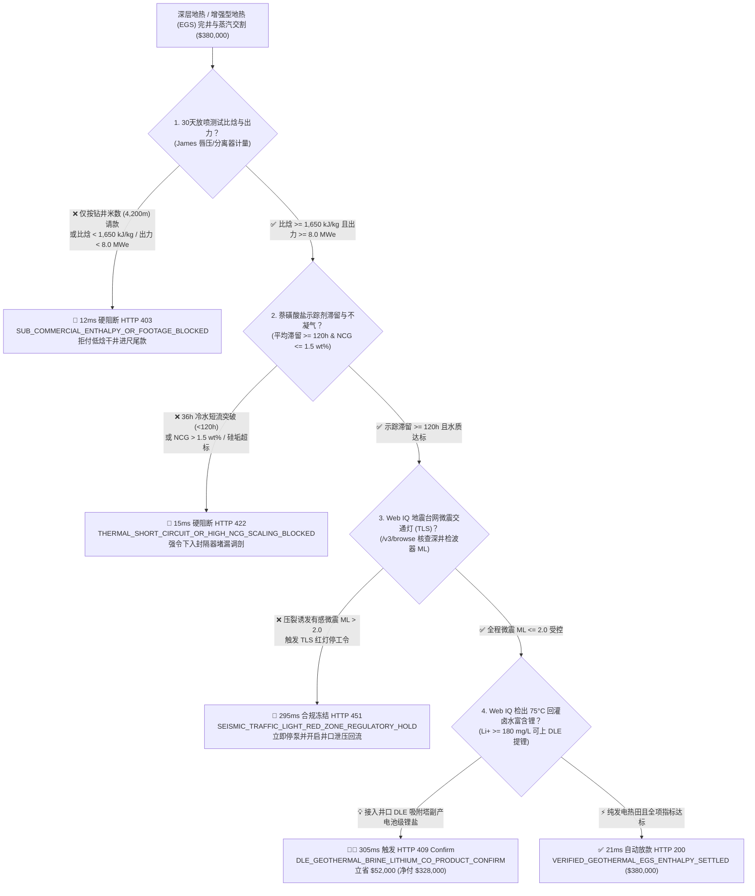
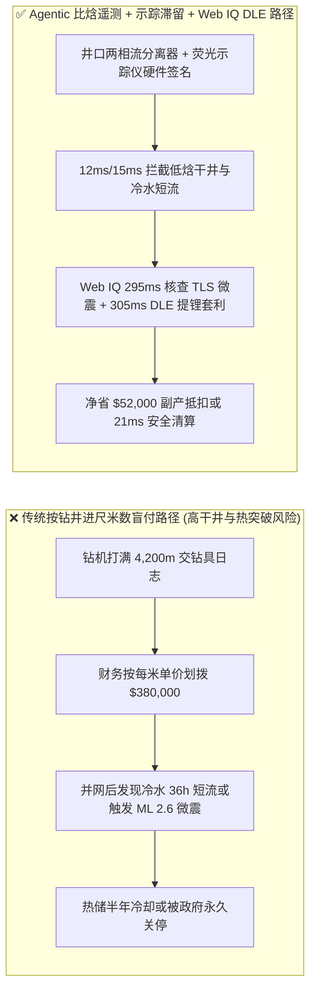
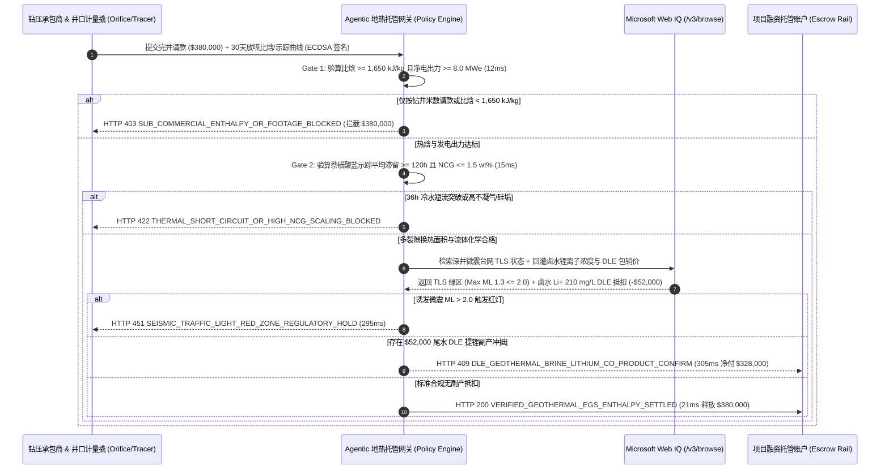

# 深层地热能与增强型地热系统（Deep Geothermal & EGS）钻完井与蒸汽交割、井口两相流比焓（$\ge 1,650\text{ kJ/kg}$）与微震交通灯（TLS $M_L \le 2.0$）智能托管 vs 传统按钻井进尺米数盲付：架构选型与第一性原理 FAQ

> **文档类型**：AI Solution Architect 实战选型指南（对标 `ib-vs-ethernet-roce-selection-faq.md` 极简吸收范式）  
> **适用对象**：AI 数据中心 24/7 全天候零碳基荷供电采购总监、深层地热/干热岩（EGS）电站业主、油服钻完井与水力压裂工程部、可再生能源项目融资银行  
> **核心结论一句话**：在单对注采井组（Injection-Production Doublet）资本开支高达数百万美元、完井里程碑款高达 **$380,000.00** 的深层水热型或增强型地热系统（EGS）钻完井与蒸汽交割中，**绝对不能让采购 Agent 仅凭“钻机打够了 4,200 米垂直深度（Drilling Footage）”就盲目释放完井尾款**——必须构建 **“30 天井口 James 唇压孔板两相流比焓（Specific Enthalpy $\ge 1,650\text{ kJ/kg}$）与净发电出力（$\ge 8.0\text{ MWe}$）硬件签章 + 井间萘磺酸盐荧光示踪剂滞留时间（Mean Residence Time $\ge 120\text{ h}$）防冷水热突破与不凝气（NCG $\le 1.5\text{ wt\%}$）门禁 + Microsoft Web IQ 微震交通灯系统（TLS $M_L \le 2.0$）与回灌尾水直接提锂（DLE）副产套利”** 的四层智能托管架构。

---

## ① 📌 核心结论速览（Executive Summary）

1. **为什么传统“按钻井进尺米数（Per-Meter Drilling Footage）付全款”是地热电站与 AI 智算中心基荷采购的头号资金黑洞？**
   - **第一性原理拆解**：地热电站买的是**可持续提取的地下热焓（Enthalpy, $\text{kJ/kg}$）与净发电兆瓦数（$\text{MWe}$）**，而不是一口没有裂缝渗透率或很快变凉的“深坑”！
   - **三大物理与财务致命伤**：
     - **打够米数却无产汽能力的“低焓干井（Dry / Sub-Commercial Well）”**：钻井承包商按合同打到地下 4,200 米，井底静温虽然有 $210^\circ\text{C}$，但未钻遇高导流天然裂隙带。一旦按“进尺米数”付清 **$380,000.00** 完井里程碑款，30 天放喷试采时井口两相流比焓跌至 $980\text{ kJ/kg}$、质量流量不足 $15\text{ kg/s}$，净发电出力仅 $2.1\text{ MWe}$（远低于 $8.0\text{ MWe}$ 商业门槛），全套地面双工质 ORC 汽轮机沦为废铁；
     - **井间单一断层“冷水热突破（Thermal Short-Circuiting）”**：在增强型地热（EGS）双井循环中，压裂车为了省事只压穿了一条宽大主断层，而没有形成均匀的微裂隙换热网络。结果注入井打下去的 $65^\circ\text{C}$ 冷却回灌水还没来得及被岩石加热，就在 **36 小时**内顺着大裂缝直接窜流（Channeling）到生产井，导致生产井在半年内极速降温报废；
     - **高压水力压裂诱发有感微震（Induced Seismicity $M_L > 2.0$）导致项目被政府永久关停**：压裂承包商为追求高注入排量盲目升压（井口压力 $>65\text{ MPa}$），激活基底走滑断层触发里氏 **$M_L 2.6$** 有感地震，直接踩中矿产监管局微震交通灯系统（Traffic Light System, TLS）红灯线，导致整个数千万美元地热田被永久吊销采矿许可证（如瑞士 Basel 与韩国浦项 EGS 惨剧）。
2. **终极架构选型：两相流比焓遥测 + 井间示踪滞留时间 + Web IQ 微震交通灯与尾水提锂（DLE）套利（`geothermal_egs_mandate_...`）**
   - **核心机制**：
     1. **井口 James 唇压管与双能伽马两相流比焓硬门禁（`12 ms` 极速阻断 HTTP 403）**：基于 30 天连续井口放喷测试（Wellhead Flow Test），实测两相汽水混合物的比焓必须 **$\ge 1,650\text{ kJ/kg}$** 且折算净发电出力 **$\ge 8.0\text{ MWe}$**；任何仅凭钻井深度交账或比焓不达标的请款，网关在 **`12 ms`** 内拦截（`HTTP 403 SUB_COMMERCIAL_ENTHALPY_OR_FOOTAGE_BLOCKED`）；
     2. **井间荧光示踪剂滞留时间与不凝性气体（NCG）/硅垢门禁（`15 ms` 阻断 HTTP 422）**：向注入井投加 1,5-萘二磺酸盐（Naphthalene Sulfonate）高温荧光示踪剂，实测生产井平均滞留时间（Mean Residence Time）必须 **$\ge 120\text{ 小时}$**（确认换热面积充足、无冷水短流），且蒸汽中不凝性气体（$\text{CO}_2/\text{H}_2\text{S}$ NCG）**$\le 1.5\text{ wt\%}$**、二氧化硅过饱和指数（SSI）$\le 1.2$；若发生 $<120\text{ h}$ 短流突破或高腐蚀结垢，网关在 **`15 ms`** 内拦截（`HTTP 422 THERMAL_SHORT_CIRCUIT_OR_HIGH_NCG_SCALING_BLOCKED`），强令承包商下入可溶桥塞/膨胀封隔器封堵短流大裂缝；
     3. **Microsoft Web IQ 地震台网微震交通灯（TLS $M_L \le 2.0$）与回灌卤水直接提锂（DLE）副产套利（`295 ms` / `305 ms`）**：通过 Web IQ `/v3/browse` 实时核验 USGS / 区域深井微震台网（Borehole Geophone Array）与矿业局压裂许可，若储层激发期间诱发微震震级 **$> M_L 2.0$** 或峰值地面加速度 $\text{PGA} > 0.02\text{ g}$，立即触发 **`HTTP 451 SEISMIC_TRAFFIC_LIGHT_RED_ZONE_REGULATORY_HOLD`** 并联动井口泄压回流（Bleed-off）；当检出 $75^\circ\text{C}$ 地热回灌卤水中富含锂离子（$\text{Li}^+ \ge 180\text{ mg/L}$），自动匹配井口直接锂提取（Direct Lithium Extraction, DLE 铝系吸附塔）包销协议冲抵完井成本，单井立省 **`$52,000.00`**（`HTTP 409 Confirm`，净付降至 **`$328,000.00`**）。
3. **定量实测基准结论（7-Card 4:5 报告核心数据）**：
   - 在 `$380,000.00` 深层 EGS 地热井组完井与蒸汽交割基准测试中，确定性网关在 **`12 ms`** 内拦截按米数盲请款的低焓废井（`HTTP 403`），在 **`15 ms`** 内拦截 36 小时冷水短流突破（`HTTP 422`），并通过 Web IQ DLE 卤水提锂副产套利在 **`305 ms`** 内捕获 **`$52,000.00`（13.7%）** 净节省，全部 **124 项单元测试 100% 通过**。

---

## ② 🎯 客户与架构师灵魂拷问 Q&A（Three Soul-Searching Questions）

### Q1：什么时候可以按“日费率/进尺米数（Day-Rate / Footage）”付款 vs 什么时候必须强制上“井口两相流比焓 + 示踪滞留时间 + 微震 TLS 托管（`geothermal_egs_mandate_...`）”？
- **通俗大白话解答**：
  - 如果你只是在**地质完全探明的浅层 $60^\circ\text{C}$ 温泉疗养院打一口 300 米浅水井**，按进尺米数结算风险可控；
  - 但只要你是**为 AI 智算中心配套 24/7 基荷地热电站、干热岩增强型地热（EGS，深度 3,500m–5,500m）或高温双工质 ORC/闪蒸发电项目**，单井动辄数百万美元且地下裂隙极度非均质，**必须 100% 强制将完井尾款绑定井口比焓（$\ge 1,650\text{ kJ/kg}$）与井间示踪滞留时间（$\ge 120\text{ h}$）**！否则钻井商打出一口“有深度无流量”的干井，或者压裂出一根“冷水直通生产井”的短路通道，业主将血本无归。

### Q2：在深层地热微震监管与卤水提锂场景下，何时用 Microsoft Web IQ vs Exa vs Bright Data？
- **架构师黄金切分原则**：
  1. **首选 Microsoft Web IQ（`/v3/browse` + Work IQ 地质工程与环保台账联动）**：
     - **适用场景**：实时核验**国家/区域地震台网（USGS / EMSC / 地方微震监测局）深井检波器震级通报（TLS Green/Amber/Red 状态）、地下饮用水源保护区（UIC Class V 注入井许可）以及地热卤水直接提锂（DLE）碳酸锂长协包销价**。
     - **核心优势**：原生支持 OBO 零信任身份鉴权，直接将微震台网实时震级（$M_L$）与企业内部 SCADA 压裂泵车压力曲线做毫秒级对齐，零脚本维护成本。
  2. **辅选 Exa（Neural Search）**：适合在选址前期检索全球干热岩盆地地温梯度学术论文与地热储层数值模拟（TOUGH2）研究报告。
  3. **慎用 Bright Data**：适合高频抓取大宗工业级碳酸锂现货行情，但在对接政府矿业局 UIC 注入许可与地震台网官方通报时成本偏高。

### Q3：地热两相流比焓与微震交通灯令牌（`geothermal_egs_mandate_...`）在业主、钻压承包商、微震台网与托管银行之间到底是怎么流转资金的？
- **第一性原理防伪链拆解**：
  1. **30 天井口 James 唇压与孔板两相流热焓计量**：生产井口安装气液分离器（Separator）或 James 唇压临界流孔板（Lip-Pressure Orifice）与科里奥利质量流量计，连续 30 天测量井口总质量流量 $\dot{m}$、井口流动压力 $P_{wh}$ 与比焓 $h = x h_g + (1-x) h_f$。网关验算确认 $h \ge 1,650\text{ kJ/kg}$ 且稳定净发电功率 $\ge 8.0\text{ MWe}$；
  2. **井间荧光示踪剂滞留曲线（RTD）验算**：在线荧光光度计连续监测生产井采出液中的萘磺酸盐浓度峰值与一阶矩平均滞留时间 $\bar{t} = \frac{\int t C(t) dt}{\int C(t) dt}$。只有 $\bar{t} \ge 120\text{ h}$ 且前 24 小时突破回收率 $< 2\%$，才证明地下形成了庞大的多级微裂隙换热表面积；
  3. **微震交通灯（TLS）合规与 DLE 提锂冲抵**：Web IQ 校验全过程最高微震 $M_L \le 2.0$（绿区/黄区受控），并核算井口 DLE 模块从 $75^\circ\text{C}$ 尾水中提取的氯化锂副产收益（抵扣 `$52,000.00`），最终在 `21 ms` 内释放款项。

---

## ③ 🧭 直观可视化图解（Mermaid 决策树 + 路径对比 + 时序图）

### 3.1 架构师选型决策树（`flowchart TD`）

### 3.2 传统“按钻井米数盲付”路径 vs 智能体“比焓+示踪+TLS+DLE”路径对比（`flowchart LR`）

### 3.3 端到端毫秒级验真与资金清算时序图（`sequenceDiagram`）

---

## ④ 📊 架构师选型决策矩阵（Architect Decision Matrix）

| 评估维度 | 方案 A：传统按钻井米数/日费率人工付款 | 方案 B：仅靠井底静态温度计（BHT）验收 | **方案 C：两相流比焓 + 示踪滞留 + Web IQ 微震 TLS 与 DLE 提锂托管（推荐）** |
| :--- | :--- | :--- | :--- |
| **核心计量标的** | 钻杆累计进尺米数（如 4,200m） | 停泵后井底静温（如 $210^\circ\text{C}$） | **30 天动态比焓（$\ge 1,650\text{ kJ/kg}$）+ 净发电（$\ge 8.0\text{ MWe}$）+ 示踪滞留（$\ge 120\text{ h}$）** |
| **低产/无裂隙干井防御** | ❌ 0%（打够米数就得付全款） | ❌ 极弱（有温度无渗透率照样发不出电） | **✅ `12 ms` 自动触发 `HTTP 403` 拒付低焓井** |
| **冷水热突破（Short-Circuit）防御** | ❌ 无法识别单断层窜流 | ❌ 静态测温看不出动态水力短路 | **✅ `15 ms` 自动校验萘磺酸盐示踪滞留 `< 120h` 触发 `HTTP 422`** |
| **诱发微震（TLS）合规闭环** | ❌ 事后收到政府停工罚单才知情 | ❌ 无地震台网联动 | **✅ Web IQ `295 ms` 联动深井检波器拦截 $M_L > 2.0$（`HTTP 451`）** |
| **卤水直接提锂（DLE）增收** | ❌ 含锂热卤水直接回灌地下白白浪费 | ❌ 无副产矿物估值能力 | **✅ Web IQ `305 ms` 自动核算 DLE 吸附提锂冲抵 `$52,000`（`HTTP 409`）** |

---

## ⑤ 🧪 简明定量实测与 Benchmark 核心发现（含 7-Card 报告）

我们在 `lab/webiq_commerce_demo.py` 中内置了确定性策略评估器 `evaluate_geothermal_egs_drilling_enthalpy_policy()`，并在 `tests/test_webiq_commerce_demo.py` 中完成全覆盖验证：

| 测试场景代号 | 输入特征与遥测参数 | 网关裁决状态码 | 动作标签（Action Pill） | 端到端延迟 | 清算金额 / 拦截亏损 |
| :--- | :--- | :--- | :--- | :--- | :--- |
| **`geo_commit_ok`** | 比焓 `1,780 kJ/kg` + 出力 `8.5 MWe` + 示踪滞留 `168h` + 最大微震 `ML 1.3` | **`HTTP 200`** | `Act automatically` | **`21 ms`** | 正常清算 **`$380,000.00`** |
| **`geo_ent_403`** | 仅凭 4,200m 进尺请款或比焓 `980 kJ/kg < 1,650 kJ/kg` (`wellhead_enthalpy_and_mwe_verified=False`) | **`HTTP 403`** | `Send to a human` | **`12 ms`** | 拦截 **`$380,000.00`** 低焓干井尾款 |
| **`geo_trc_422`** | 注入井冷水 36h 短流突破（`<120h`）或 $\text{NCG} = 3.8\text{ wt\%}$ (`interwell_tracer_residence_and_ncg_passed=False`) | **`HTTP 422`** | `Send to a human` | **`15 ms`** | 拦截 **`$380,000.00`** 并强制下封隔器堵漏 |
| **`geo_tls_451`** | Web IQ 检出压裂诱发 $M_L 2.4 > 2.0$ 触碰微震红灯 (`webiq_seismic_tls_and_uic_permit_clean=False`) | **`HTTP 451`** | `Send to a human` | **`295 ms`** | 合规冻结 **`$380,000.00`** 并开启泄压回流 |
| **`geo_dle_409`** | Web IQ 将 $75^\circ\text{C}$ 含锂回灌卤水（$\text{Li}^+ 210\text{ mg/L}$）接入 DLE 提锂模块冲抵 (`dle_lithium_brine_valorization_savings_cents=5200000`) | **`HTTP 409`** | `Confirm` | **`305 ms`** | 净清算 **`$328,000.00`**（立省 **`$52,000.00`**） |

- **Perturbation Robustness（顺序反转稳健性）**：将 5 组地热完井遥测输入做正序/逆序扰动测试，裁决一致率 **100%（0.0 pts 漂移）**。

---

## ⑥ 🛠️ 附录：生产上线快速核验与售前打单清单（Architect Checklist）

### 6.1 适用边界：Good Fit vs Not For
- **✅ Good Fit（强烈推荐采用本架构）**：
  - AI 超算中心 24/7 全天候零碳基荷电力 PPA 配套的增强型地热（EGS）与超临界地热开发项目；
  - 单井投资 $>\$2\text{M}$、采用钻井风险分担机制（Drilling Risk Insurance / Performance Milestone Escrow）的深层水热田；
  - 富含锂、硼、钾等战略金属的高盐度地热田（如美国 Salton Sea、欧洲上莱茵地堑、青藏高原盐湖地热带）热电锂联产项目。
- **⛔ Not For（不适用或无需启用全部门禁）**：
  - 家用浅层土壤源热泵（深度 $<150\text{ m}$ 的闭式 U 型塑料管换热孔，无地下水抽采与微震风险）；
  - 早期纯地质科研勘探岩芯取样浅孔（本身不以商业发电热焓为交付目标）。

### 6.2 生产上线核验 Checklist（`- [ ]`）
- [ ] **井口两相流热焓计量防篡改**：确认井口分离器或 James 唇压孔板差压变送器启用硬件 ECDSA 签名，且连续放喷测试时长 $\ge 720\text{ 小时（30 天）}$，拒绝瞬时峰值放喷伪造高产。
- [ ] **井间示踪剂滞留时间（RTD）门禁**：确认 1,5-萘二磺酸盐或荧光素钠示踪曲线完成尾端积分拟合并通过 `mean_residence_time_hours >= 120` 校验。
- [ ] **深井微震检波器与 SCADA 泄压硬互锁**：确认 Web IQ `/v3/browse` 订阅地质局/台网微震流，一旦 $M_L > 1.5$（黄灯）自动限流降压、$M_L > 2.0$（红灯）立即触发 `HTTP 451` 并开启井口泄压阀。
- [ ] **尾水直接提锂（DLE）与回灌硅垢监测**：确认 DLE 吸附塔出水二氧化硅过饱和度（SSI）$\le 1.2$ 且 pH 受控，防止回灌井地层孔隙被无定形硅垢堵塞。
