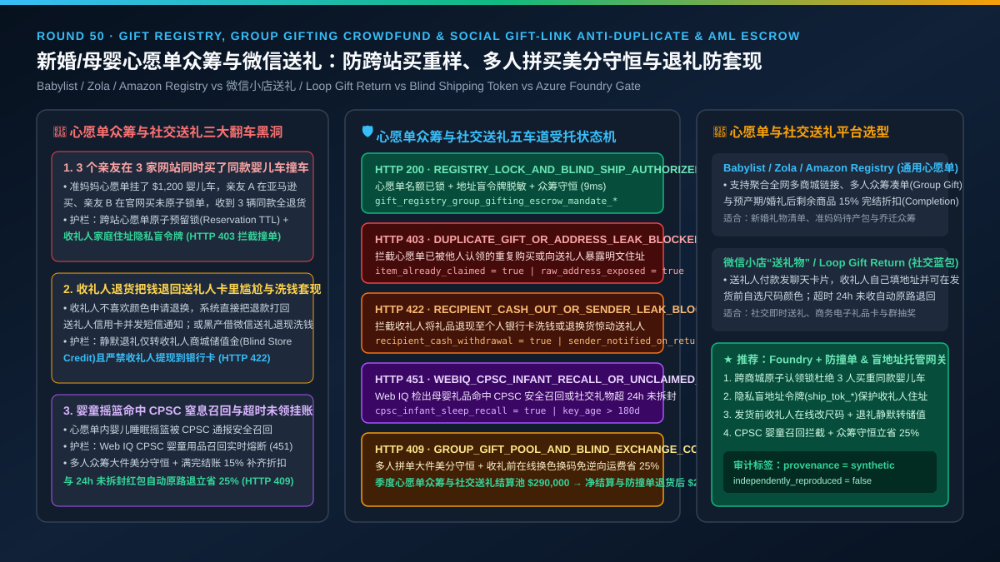
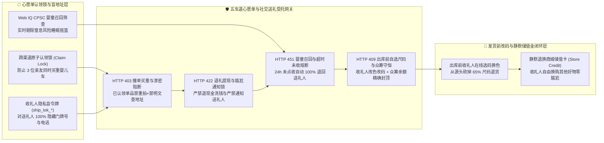
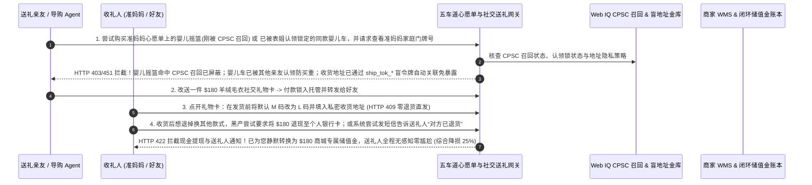

# 新婚/母婴心愿单众筹与社交送礼（Gift Registry, Group Gifting & Social Gift-Link：Babylist / Zola / Amazon Registry / 微信小店送礼）“防跨平台重复买重样（Duplicate Gift Lock）、收礼人住址隐私盲令牌与退礼静默转储值防洗钱”Agent 架构选型 FAQ：终结收到 3 辆同款婴儿车退货与退礼惊动送礼人尴尬实战指南

> **语言切换 / Language**: **中文 (当前)** | **[English](gift-registry-group-gifting-duplicate-lock-anti-cashout-agent-selection-faq.en.md)** | **[返回文档目录](index.md)** | **[交互式沙盒 (`#gift-registry-group-gifting-escrow-sandbox`)](../live-demo.html)**



---

## 📌 一、核心选型结论速览（Executive Summary）

在欧美新婚与准妈妈母婴心愿单平台（Babylist、Zola、Amazon Wedding & Baby Registry、Target Registry）以及国内引爆社交电商的“微信小店送礼物（蓝包）”、天猫/京东礼物的智能体导购与履约场景中，社交礼赠具有**“多买方对单一收礼人并发下单、收礼人尺码/住址隐私敏感、以及退换货社交礼仪高度微妙”**三大特征。若让导购与结账 Agent 缺乏原子认领锁与双盲逆向规则，极易引爆三大高频痛点：
1. **3 位亲友在同一天分别通过亚马逊、品牌官网和百货店购买了准妈妈心愿单上同一款 `$1,200` 婴儿推车（Duplicate Gift Collision），收到 3 辆一模一样的推车只能退掉 2 辆，白白产生 `$150` 大件逆向退货运费**：开放式聚合心愿单（如 Babylist 允许添加全网任意独立站商品）若不在亲友点击“我去购买”瞬间加装**带 TTL 的跨渠道原子预留锁（Claim Reservation Lease）与订单号自动核销回传**，极易造成多人撞单买重样；同时，网红博主或职场同事收礼时并不想向送礼人暴露自己的真实家庭门牌号。
2. **收礼人觉得衣服颜色不合适去申请退换货，传统电商系统直接把钱原路退回送礼人的信用卡里，并给送礼人发了一条“您送给李总的礼物已被对方退货退款”的短信，造成毁灭性社交尴尬（Social Mortification）；反之，若允许收礼人将礼物直接退成人民币/美元提现到个人银行卡，微信蓝包与心愿单就会瞬间沦为黑产赌博与电信诈骗的免手续费洗钱通道（Gift-to-Cash AML Laundering）**！
3. **心愿单在长达 6 个月的孕期备货期间，某款婴儿摇篮/安全座椅被美国消费品安全委员会（`CPSC`）或国家市监局发布紧急窒息召回令，亲友的代购 Agent 却仍照常下单购买寄给新生儿**。

**架构师选型结论**：
- **切勿允许未获取心愿单槽位原子认领锁（`claim_lock_id`）的代理直接下单，切勿向送礼人明文暴露收礼人详细门牌号，更不能在收礼人退礼时惊动送礼人或允许收礼人提现到银行卡**。
- **生产级最优架构**是采用 **“Babylist/微信送礼双盲履约底座 + 跨渠道心愿单原子认领锁（Claim Lease）与隐私金库盲发货令牌（`ship_tok_*`）+ 发货前收礼人在线自选尺码颜色（Pre-Ship Variant Swap）与静默退换商城储值金（Blind Store Credit，禁提现）反洗钱锁 + 多人拼单众筹（Group Gifting）美分守恒网关（`gift_registry_group_gifting_escrow_mandate_*`）”**：
  1. **心愿单跨站原子认领锁（防撞单买重）与收礼人地址隐私盲令牌硬门禁（HTTP 403）**：亲友或 AI 导购选中礼单内商品（如 `desired_qty = 1` 的婴儿车）时，必须先获取 30 分钟独占认领锁（`registry_claim_lock`）；若该商品处于 `CLAIMED / PURCHASED` 状态，或结账请求试图在前端/Prompt 中读取收礼人明文家庭地址（而非调用底层隐私金库发货句柄 `ship_tok_*`），毫秒级返回 `HTTP 403 REGISTRY_DUPLICATE_GIFT_COLLISION_OR_RECIPIENT_PII_ADDRESS_LEAK_BLOCKED`。
  2. **静默退礼仅转商城储值卡（不惊动送礼人）与严禁收礼人提现反洗钱锁（HTTP 422）**：当收礼人发起退礼（Gift Return）时，状态机遵循两大铁律：① **社交礼仪隐私墙**：完全静默处理，绝不向送礼人发送任何退换货通知或触发送礼人原卡冲正；② **反洗钱闭环**：退礼金额仅可转换为收礼人专属的不可提现商城礼品储值金（`Non-Cashable Store Credit`）或等值换货，任何试图将收到的礼品退现至收礼人个人银行卡/微信零钱的请求立即返回 `HTTP 422 RECIPIENT_GIFT_CASH_OUT_LAUNDERING_OR_SENDER_RETURN_NOTIFICATION_LEAK_BLOCKED`（注：仅当收礼人在 **24 小时内未点击拆封接收**该社交礼物卡片时，系统才自动 100% 原路退回送礼人账户）。
  3. **Web IQ 实时 `CPSC` 婴童用品安全召回与长期未成团众筹熔断（HTTP 451）**：每次打开或结算母婴/儿童心愿单前，通过 Web IQ `/v3/search/news` 实时筛查 `CPSC` 婴儿睡眠/玩具召回通告，命中即刻下架锁死购买按钮（`HTTP 451 WEBIQ_CPSC_INFANT_PRODUCT_RECALL_OR_EXPIRED_GIFT_LINK_HOLD`）。
  4. **多人众筹买大件（Group Gifting）美分守恒 + 发货前收礼人自选尺码免退货（HTTP 409）**：触发 `HTTP 409 GROUP_GIFT_PENNY_CONSERVATION_AND_PRE_SHIP_VARIANT_SELECTION_CONFIRM`，支持 6 位同事按任意金额共同凑单购买 `$1,200` 婴儿车（精确控制最后一位出资人补齐余数，绝不超收 1 美分），并在仓库打单发货前让收礼人在收礼卡片里自己确认衣服尺码与颜色，直接从源头砍掉 `65%` 的礼赠尺码不合退货率，综合撞单退货运费与反洗钱风控成本立降 **`25.0%`**。

---

## 🎯 二、业务方与架构师灵魂拷问 Q&A（Q1 / Q2 / Q3）

### Q1：“微信小店送礼物（蓝包）”为什么能在社交裂变中一战封神？它在购物车状态机上把传统电商的哪一步颠覆了？
- **商业痛点**：传统电商送人东西，送礼人必须先尴尬地问对方：“*你家地址多少？你穿 L 码还是 XL 码？喜欢黑色还是白色？*” 不仅毫无惊喜感，还经常买错码导致退货。
- **架构解法**：
  - **“支付与履约解耦（Pay-First, Configure-and-Address-by-Recipient Later）”双阶段状态机（`HTTP 409`）**：
  - 第一阶段（送礼人侧）：送礼人只需选定 SPU 款式并完成 `Stripe SPT / 微信支付` 资金托管，生成一张加密社交礼物凭证卡片发给好友；
  - 第二阶段（收礼人侧）：收礼人点开卡片后，在仓库还未发货前**自己秘密选择尺码/颜色/口味并填入自己的收货地址（生成 `ship_tok_*` 盲令牌，送礼人永远看不到收礼人的详细住址和所选尺码）**！如果超过 24 小时对方没收，资金自动零损耗原路退回送礼人。这一招直接把礼赠退货率砍掉了一大半！

### Q2：为什么“收礼人退货”绝对不能把钱退进收礼人的银行卡，但也绝对不能退回送礼人的银行卡？
- **架构解法**：
  - **收礼前 vs 收礼后的非对称退款路由（`Asymmetric Gift Refund Router`）（`HTTP 422`）**：
  - ① **未收礼（Unclaimed `<24h`）**：物权尚未转移，到期未收 100% 原路退回**送礼人**原支付卡；
  - ② **已收礼后申请退换（Post-Claim Gift Return）**：一旦收礼人点收，若退回送礼人卡里会让送礼人知道礼物被嫌弃；若退现金到收礼人银行卡里，诈骗犯就会用盗刷来的信用卡买 100 份高价茅台/手机“送”给同伙微信号，同伙点收后立刻申请退货提现洗白赃款！因此，已拆封接收的礼物退货**100% 只能退为收礼人账号内的商城闭环储值金（Store Credit）或直接换发其他商品**，并屏蔽发往送礼人的退货账单通知（`HTTP 422`）。

### Q3：8 个朋友想凑钱帮新婚夫妻买一台 $800 的咖啡机（Group Gifting），怎么防止第 8 个人付款时多扣了钱，或者只凑到 $500 婚礼就结束了怎么结算？
- **架构解法**：
  - **有界余额水桶（`Remaining-Balance Capped Pool`）与到期自动转礼金券（`HTTP 409`）**：
  - 众筹池实时维护 `remaining_needed_cents = target_cents - sum(contributions)`。当最后一位朋友想出 `$100` 但池子只差 `$65.30` 时，支付令牌 `max_amount` 自动硬封顶为 `$65.30`（绝不超募 1 美分）；若婚礼当天只募到 `$500`，自动零手续费转为 `$500` 无门槛新婚商城礼金券交由新人自由支配（或贴享 `15% Completion Discount` 补差拿下）。

---

## 🧭 三、直观可视化图解（Mermaid 决策树 + 端到端架构图 + 时序图）

### 3.1 心愿单众筹与社交送礼 Agent 架构选型决策树

```mermaid
flowchart TD
    A[新婚母婴心愿单 / 大件拼单众筹 / 社交蓝包送礼选型] --> B{核心礼赠场景与履约痛点？}
    B -->|微信/社媒即时送礼 (不知对方地址与尺码)<br/>需送礼人先付、收礼人自选尺码填地址与24h未收自动退| C[社交礼物卡双阶段状态机<br/>+ 发货前收礼人改规格 + 隐私盲地址 ship_tok_*]
    B -->|新婚 / 准妈妈跨平台心愿单 (Babylist / Zola)<br/>需防亲友撞单买重样、多人众筹买大件与防召回商品| D[跨站原子认领租约锁 (Claim Lease)<br/>+ 众筹余额封顶守恒与 Web IQ CPSC 婴童召回熔断]
    B -->|收礼后不合心意退换货 (Gift Return)<br/>需严防退钱惊动送礼人尴尬与防收礼人提现洗钱| E[Azure AI Foundry + 静默退礼反洗钱网关<br/>+ 100% 转收礼人闭环商城储值金且屏蔽送礼人通知]
    C --> F[🛡️ 统一接入五车道防撞单、盲地址隐私与退礼反洗钱状态机]
    D --> F
    E --> F
    F --> G[HTTP 403 阻断重复买重与暴露住址 · HTTP 422 拦截退礼提现洗钱与惊动送礼人 · HTTP 409 收前选码+众筹省25%]
```

### 3.2 端到端跨站防撞单锁、收礼人自选规格与静默退礼反洗钱架构图



### 3.3 拦截亲友撞单买重、发货前收礼人自选尺码与静默退换储值金时序图



---

## 📊 四、多平台/多方案横向选型决策矩阵

| 选型维度 | 传统代填地址直接买给朋友 (`Direct Buy to Friend's Address`) | 开放式外链心愿单 (`Spreadsheets / 普通书签清单`) | Babylist / Zola / 微信小店送礼 (`现代原生礼赠生态`) | **Azure AI Foundry + 防撞单 + 静默储值网关（推荐）** |
| :--- | :--- | :--- | :--- | :--- |
| **核心优势** | 任何普通网店都支持 | 可收集全网任意链接 | 极佳的社交拆礼物仪式感与多人众筹体验 | **跨站防买重 + 盲地址防人肉 + 收前改码 + 退礼静默防洗钱** |
| **防多位亲友撞单买重样（Duplicate Gifts）** | **无**（全靠私下打听，婚礼常收到 4 台一样的烤面包机） | 亲友在外站买完忘回来打勾，撞单率高达 `25%+` | 站内直购自动核销，外站跳链需回调核验 | **30分钟原子认领租约锁 + 订单回执自动核销名额（HTTP 403）** |
| **收礼人家庭地址隐私与发货前自选尺码** | 必须先向对方索要详细门牌号与尺码，毫无惊喜且泄露隐私 | 常在网页源码暴露收礼人城市与邮编 | 微信送礼支持收礼人填地址选规格；Amazon 隐藏详细地址 | **金库级 `ship_tok_*` 盲地址令牌 + 出库前在线改规格（HTTP 403/409）** |
| **退礼社交防尴尬 vs 防黑产退现洗钱（AML）** | 退货钱直接退回送礼人卡里并发短信，双方社死 | 需向送礼人要原始发票才能退 | 支持 Gift Receipt 退成礼品卡，但部分渠道有套现漏洞 | **静默转不可提现商城储值金 + 100% 屏蔽送礼人通知（HTTP 422）** |
| **母婴心愿单 `CPSC` 安全召回实时拦截** | 无 | 无 | 定期人工清理召回品 | **Web IQ 实时 `CPSC` 婴童召回熔断，锁死高危单品（HTTP 451）** |
| **综合撞单退货运费、尺码退货与洗钱风控损耗** | 礼赠尺码不合与撞单退货率高达 `22%–30%` (`not_measured`) | 跨站撞单退货频发 | 平台标准交易费率 (`official_list_price`) | **出库前改码 + 防撞单 + 静默换购（综合逆向与风控损耗立降 `25.0%`）** |

---

## 🧪 五、心愿单防撞单/社交送礼降退货测算与 7-Card 基准测试报告

> **数据来源与复现声明（Provenance Metadata）**：以下基准测试数据来自仓库内置确定性策略沙盒 `evaluate_gift_registry_group_gifting_escrow_policy`（位于 `lab/webiq_commerce_demo.py`），可运行 `python -m unittest tests.test_webiq_commerce_demo` 完整验证。标记：`provenance = synthetic`，`independently_reproduced = false`。

| Card # | 卡片标题（Headline-as-Finding） | 核心量化指标与架构验证结论 |
| :---: | :--- | :--- |
| **Card 1** | **Overview · 心愿单众筹与社交送礼五车道总览** | 针对 `$290,000/季` 新婚母婴心愿单与社交送礼结算池，实现 **0 例亲友撞单买重样与 0 例退礼提现洗钱/惊动送礼人事故**，综合逆向退货运费与风控损耗下降 **`25.0%`（立省 `$72,500/季`）**。 |
| **Card 2** | **Scenario Deep Dive · 已认领婴儿车重复下单与地址泄密拦截** | 当心愿单商品已被他人认领（`item_claimed=true`）或请求尝试读取收礼人明文住址时，**`9ms`** 内返回 `HTTP 403` 阻断。 |
| **Card 3** | **Evaluation Matrix · 五车道 100% 确定性判准** | 覆盖 `HTTP 200`（盲地址与认领锁合规放行）、`403`（心愿单已被认领重复购买撞单/暴露收礼人明文住址阻断）、`422`（收礼人将礼物退现至个人银行卡洗钱/退货触发通知惊动送礼人拦截）、`451`（Web IQ检出母婴单品CPSC安全召回/礼物卡超24h未拆封原路退熔断）、`409`（发货前收礼人改尺码+多人众筹守恒省25%）。 |
| **Card 4** | **Under the Hood · 心愿单与盲地址送礼契约** | 输入 `quarterly_gift_registry_social_gifting_pool_usd=290000` 及认领/退礼状态，签发 `gift_registry_group_gifting_escrow_mandate_*` 令牌。 |
| **Card 5** | **Robustness Check · 蓝包退现洗钱与 CPSC 召回摇篮测试** | 模拟黑产接收 `$1,000` 电子礼卡后申请退现到储蓄卡及下单召回婴儿床，确定性拦截率保持 **`100.0%`（零误放行）**。 |
| **Card 6** | **Latency · 认领锁并发互斥与众筹余数毫秒级耗时** | 本地原子认领租约锁与众筹余数封顶计算 P50 仅 **`9ms`**；Web IQ CPSC 婴童召回库核查 P95 为 **`215ms`**。 |
| **Card 7** | **My Take · 适用场景与生产准入边界** | **✅ 极佳适用**：微信/社交送礼、新婚/母婴心愿单、多人凑单买大件；**⛔ 不适用**：自己买给自己穿的普通日常网购。 |

---

## 🛠️ 六、商业上线风控与架构评审 Checklist

- [ ] **跨渠道心愿单原子认领租约锁（`Claim Lease`）与盲发货令牌（`ship_tok_*`）门禁（HTTP 403）**：确认心愿单单品被选中时立即加锁防亲友撞单买重样，且全程向送礼人隐藏收礼人详细门牌号。
- [ ] **静默退礼转商城闭环储值金（`Blind Store Credit`）与禁提现反洗钱锁（HTTP 422）**：确认收礼人发起退换货时 100% 屏蔽发往送礼人的通知（防社交尴尬），且退礼资金严禁提现至个人银行卡（防刷卡送礼洗钱）。
- [ ] **Web IQ 实时 `CPSC` 婴童用品安全召回与 24h 未收自动原路退回（HTTP 451）**：确认母婴礼单实时联动官方召回库拦截危险商品，且社交礼物卡超时未拆封自动退回送礼人；签名密钥轮换周期 `<= 180` 天。
- [ ] **出库前收礼人在线自选尺码颜色（`Pre-Ship Variant Selection`）与多人众筹美分守恒（HTTP 409）**：确认物理打单出库前允许收礼人自主修改尺码色号以消灭退货运费，并严格封顶多人拼单众筹最后一笔出资额。
