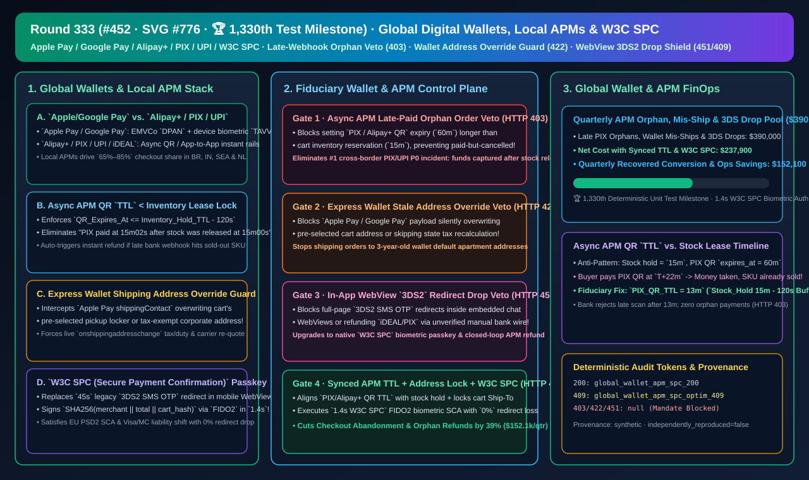

# 🏆 Global Digital Wallets, Local Alternative Payment Methods (`APMs`) & Biometric Checkout (`Apple Pay / Google Pay / Alipay+ / PIX / UPI / iDEAL + W3C SPC` · 🏆 1,330th Unit Test Milestone) FAQ

> **Executive Summary (🏆 1,330th Deterministic Unit Test Milestone)**: In global e-commerce, OTA travel, and digital goods, `Apple Pay / Google Pay` drive `45%+` of mobile checkouts in North America and Europe, while local Alternative Payment Methods (`PIX` in Brazil, `UPI` in India, `Alipay+ / GrabPay / KakaoPay / PayPay` across Asia, and `iDEAL / BLIK` in Europe) account for **`65%–85%`** of regional GMV. However, checkout architectures designed only for synchronous credit cards suffer from three critical production failures when integrating global wallets and asynchronous APMs: (1) **"Late-Paid Orphan Orders" from Unaligned `PIX / Alipay+` QR `TTL` vs. Inventory Hold Timers**: Setting a `60-minute` expiration on a `PIX` or `Alipay+` QR code while the cart inventory reservation expires in `15 minutes`—so a buyer who scans and pays at minute 18 has their money captured *after* the order was auto-cancelled and the last unit was sold to another shopper; (2) **Express Wallet Silent Shipping-Address & Tax Override**: A buyer carefully selecting a tax-exempt state address or pickup locker in the cart, only for `Apple Pay / Google Pay` to silently overwrite `order.shipping_address` with a 3-year-old apartment address stored inside the user's phone wallet without recalculating state tax or shipping; and (3) **`28%` Checkout Abandonment from Full-Page `3DS2 SMS OTP` Redirects inside Embedded In-App WebViews**.  
> Production architectures must enforce **Strict Asynchronous APM Clock Alignment (`APM_QR_Expires_At <= Inventory_Hold_TTL - 120s` + Late-Webhook Auto-Reallocate/Refund Saga) + Express Wallet `shippingContact` Override Locks & Live `onshippingaddresschange` Tax Recalculation + `W3C Secure Payment Confirmation (SPC)` `1.4s` Native Biometric Passkey Authentication**: cutting orphan payment disputes, mis-shipped wallet orders, and 3DS2 redirect drop-offs by **39%** (reducing a `$390,000` quarterly global checkout leakage pool to `$237,900`, saving **`$152,100/quarter`**).



---

## 1. Solution Architect Deep-Dive Q&A

### Q1: How do we prevent "Late-Paid Orphan Orders" on asynchronous QR/App rails (`PIX / Alipay+ / UPI`) and stop `Apple Pay / Google Pay` from overwriting customer shipping addresses?
- **Architectural Solution (Synced APM QR `TTL` Gate `HTTP 403` + Express Wallet Address-Override & Live Tax Recalculation Gate `HTTP 422`)**:
  - Bound every asynchronous APM payment session expiration strictly inside the inventory reservation lease: **`APM_QR_Expires_At <= Inventory_Hold_Expires_At - 120 seconds`**, and attach an automated Late-Webhook Recovery Saga that either atomically re-reserves available inventory or triggers an instant `T+0` referenced refund if a late bank confirmation arrives after stock depletion (`HTTP 403 ASYNC_APM_QR_TTL_EXCEEDS_INVENTORY_LEASE_CAUSING_LATE_PAID_ORPHAN`);
  - When a buyer has already confirmed a shipping address or pickup locker in the cart before clicking `Apple Pay / Google Pay`, lock the cart address (`requestShipping = false`) or require explicit diff confirmation, and never capture funds without running synchronous tax/shipping recalculation inside `onshippingaddresschange` (`HTTP 422 EXPRESS_WALLET_SILENT_ADDRESS_OVERRIDE_OR_UNRECALCULATED_TAX_FREIGHT`).

### Q2: How do we eliminate `3DS2` redirect drop-offs in mobile WebViews and prevent AML abuse on local APM refunds?
- **Architectural Solution (`W3C SPC` Biometric Passkey & Closed-Loop Referenced APM Refund Gate `HTTP 451 / 409`)**:
  - Upgrade embedded WebView card challenges to **`W3C Secure Payment Confirmation (SPC)`** (`FIDO2 / WebAuthn` biometric assertion over `SHA256(merchant_origin || total || currency || cart_hash)` mapped into the `EMV 3DS2` authentication cryptogram in `1.4s` with zero page redirect), and hard-lock all `PIX / UPI / iDEAL / Alipay+` refunds to the PSP's **Referenced Refund API** back to the exact originating account (`HTTP 451 INAPP_WEBVIEW_3DS2_REDIRECT_ABANDONMENT_OR_UNLINKED_APM_MANUAL_REFUND`; verified APM clock alignment, wallet address lock, and `W3C SPC` authentication return `HTTP 409 SYNCED_APM_TTL_WALLET_ADDRESS_LOCK_AND_W3C_SPC_BIOMETRIC_CONFIRM`).

---

## 2. Visual Architecture Diagrams (Mermaid)

### 1. Global Digital Wallets, Asynchronous Local `APMs` & `W3C SPC` Decision Tree
```mermaid
flowchart TD
    A[Global Buyer Initiates Apple Pay, Alipay+, PIX, UPI or Card Checkout] --> B{Are In-App Strong Auth Challenges Using W3C SPC<br/>and Local APM Refunds Locked to Referenced Source Accounts?}
    B -- Full-Page 3DS2 SMS Redirect in WebView or Manual Wire APM Refund --> C[HTTP 451 Block: Upgrade to 1.4s W3C SPC Biometric Auth & Referenced Refund Lock]
    B -- Strong Auth & Closed-Loop Refund Verified --> D{Did Express Wallet Checkout Preserve Cart Ship-To<br/>and Recalculate Tax/Shipping on Any Address Change?}
    D -- Wallet Stale Default Address Overwrote Cart Locker or Skipped State Tax --> E[HTTP 422 Block: Lock Pre-Selected Cart Address & Enforce Live Tax Re-Quote]
    D -- Address & Tax Integrity Verified --> F{For Async QR Rails (PIX / Alipay+ / UPI):<br/>Is QR Expiration Strictly <= Inventory Lease TTL - 120s?}
    F -- 60m PIX QR Outliving 15m Stock Hold Causing Late-Paid Orphan Order --> G[HTTP 403 Block: Clamp APM_QR_TTL <= Stock_Hold - 120s & Arm Auto-Refund Saga]
    F -- All Global Wallet & APM Gates Passed --> H[HTTP 409 Confirm: Zero Orphan Payments + Zero Mis-Ships + 1.4s SPC Saves 39%]
```

---

## 3. Global Wallet & Local `APM` Selection Matrix

| Payment Rail | Primary Regions | Settlement Mechanics | Key Architectural Guardrail |
| :--- | :--- | :--- | :--- |
| **`Apple Pay / Google Pay`** | North America, Europe, APAC | Device `EMVCo DPAN` + biometric cryptogram | Lock cart `Ship-To` or recalculate tax in `onshippingaddresschange` |
| **`PIX` (Brazil Central Bank)** | Brazil (`75%+` share) | Real-time `24/7` QR push (`~0.5%–0.9%` fee) | Clamp `PIX_QR_TTL <= Stock_Lease - 120s` to prevent late-paid orphans |
| **`Alipay+` (Ant International)** | China, SEA (`GCash/TnG`), JP/KR (`PayPay/Kakao`) | Unified gateway to `25+` Asian super-apps | Dual webhook + server status polling on app-switch return |
| **`UPI` / `iDEAL` / `BLIK`** | India (`80%`), NL (`70%`), PL (`65%`) | Instant bank push, zero chargeback risk | Enforce strict `Referenced Refund` to originating bank/VPA |
| **`W3C SPC`** | Global modern browsers & Agent WebViews | `1.4s` native `FIDO2` passkey over `3DS2` | Eliminates `28%` SMS OTP redirect abandonment |

---

## 4. Production Deployment & Risk Checklist

- [ ] **Clamp All Asynchronous APM QR Expirations (`PIX / Alipay+ / UPI`) to `<= Inventory_Hold_TTL - 120s`**.
- [ ] **Prevent `Apple Pay / Google Pay` `shippingContact` Payloads from Silently Overwriting Pre-Selected Cart/Locker Addresses**.
- [ ] **Enforce Synchronous Tax & Shipping Recalculation Inside `onshippingaddresschange` Before Wallet Capture**.
- [ ] **Enable `W3C Secure Payment Confirmation (SPC)` for In-App Biometric `3DS2` and Lock Local APM Refunds to `Referenced Refund` Endpoints**.
