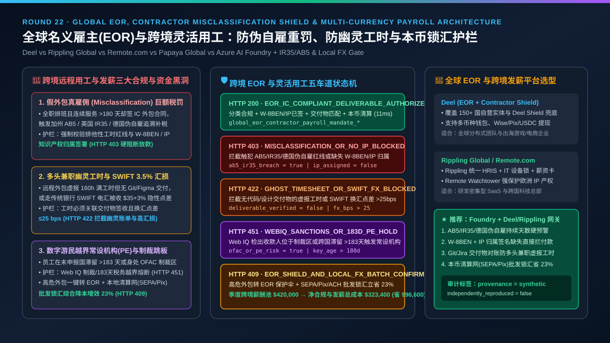
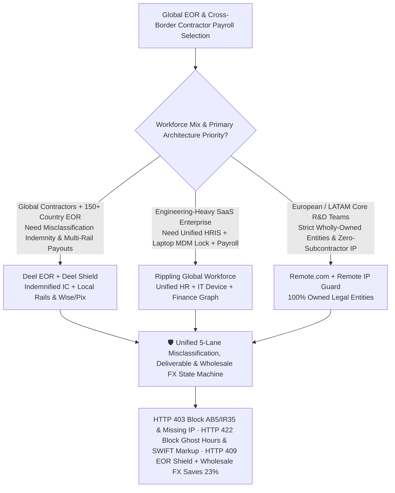
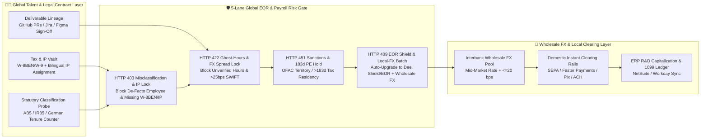
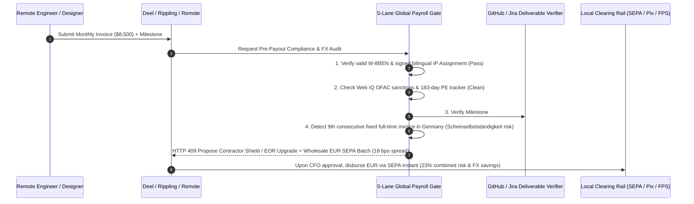

# Global EOR & Cross-Border Contractor Payroll (`Deel / Rippling Global / Remote / Papaya Global`) Worker Misclassification Shield (`AB5 / IR35`), Anti-Ghost-Timesheet & Wholesale Local-FX Agent Architecture Selection FAQ

> **Language / 语言切换**: **[中文](global-eor-contractor-payroll-misclassification-fx-escrow-agent-selection-faq.md)** | **English (Current)** | **[Back to Docs Index](index.en.md)** | **[Interactive Sandbox (`#global-eor-contractor-payroll-sandbox`)](../live-demo.en.html)**

---

## 📌 1. Executive Summary

For global SaaS companies, cross-border e-commerce brands, gaming studios, and distributed AI engineering teams, hiring international talent via Independent Contractors (`IC / 1099`) and Employer of Record (`EOR`) platforms (`Deel`, `Rippling Global`, `Remote.com`, `Papaya Global`) is standard operating procedure. Yet allowing an HR or AP agent to rubber-stamp monthly cross-border contractor invoices exposes the enterprise to three severe legal and financial hazards:
1. **Worker Misclassification Penalties (`California AB5 / UK IR35 / German Scheinselbstständigkeit`) & Unassigned IP**: To avoid `20%–45%` employer social-security contributions, companies frequently engage full-time engineers in Germany, Spain, Brazil, the UK, or California as "Independent Contractors"—giving them `@company.com` emails, fixed 40-hour schedules, and continuous monthly retainers exceeding 6–12 months. When labor authorities audit under **California `AB5` (ABC Test), UK `IR35`, German `Scheinselbstständigkeit` (which carries criminal liability for executives), or the EU Platform Work Directive**, the company owes 3–5 years of retroactive employer payroll taxes, paid leave, severance, and `100%` penalties. Worse, paying a contractor without a valid **`IRS Form W-8BEN / W-9`** and a jurisdiction-specific **Invention & IP Assignment Agreement** leaves source-code ownership with the individual contractor—a fatal blocker during M&A or VC due diligence.
2. **"Overemployed" Ghost Timesheets & `3.5%` Retail SWIFT FX Bleed**: Remote hourly contractors juggling multiple undisclosed full-time jobs submit flat `160-hour` monthly invoices with near-zero verified Git PRs, Jira tickets, or Figma deliverables. Meanwhile, paying 40 international contractors via legacy bank `SWIFT` wires incurs `$25–$45` correspondent bank fees per wire plus a hidden `2.5%–3.5%` retail FX spread on local currency conversion (`EUR / GBP / BRL / INR / PHP`).
3. **Digital Nomad `183-Day` Permanent Establishment (`PE`) Tax Exposure & OFAC Sanctioned Routing**: When a traveling contractor or sales executive stays more than `183` days in an undeclared country or works from an OFAC-sanctioned territory behind a VPN, the parent company risks triggering **corporate Permanent Establishment (`PE`) tax liability** or federal sanctions enforcement.

**Solution Architect Verdict**:
- **Never pay international talent through raw AP wire transfers without automated misclassification, IP, and FX guardrails**.
- **Recommended Production Architecture**: Deploy **"Deel / Rippling Global / Remote API + Deliverable-Linked Timesheet Attestation + Wholesale Local-Rail FX (`SEPA / Pix / Faster Payments`) + Azure AI Foundry 5-Lane Global Payroll Gate"**:
  1. **Misclassification (`AB5 / IR35 / Scheinselbstständigkeit`) Veto & `W-8BEN + IP Assignment` Hard Gate (`HTTP 403`)**: Before approving any contractor payout, verify a valid `W-8BEN / W-9`, signed bilingual local `IP Assignment`, and ensure the contractor does not breach statutory misclassification thresholds (exclusive full-time hours + continuous tenure cap + internal manager control). Block violations immediately (`HTTP 403 WORKER_MISCLASSIFICATION_IR35_AB5_OR_MISSING_IP_W8BEN_BLOCKED`).
  2. **Deliverable-Linked Timesheet Audit & `<=25 bps` FX Spread Cap (`HTTP 422`)**: Cross-check billed hours against verified engineering/design/ops deliverables (GitHub PR merges, Jira story points, Figma sign-offs within `<=15%` variance) and block retail bank SWIFT wires charging `>25 bps` (`0.25%`) FX spread (`HTTP 422 UNVERIFIED_GHOST_TIMESHEET_OR_SWIFT_FX_MARKUP_BLOCKED`).
  3. **Web IQ Real-Time OFAC Sanctions & `183-Day` Permanent Establishment (`PE`) Circuit Breaker (`HTTP 451`)**: Audit tax residency day-counts and OFAC geolocation signals via Web IQ; immediately hold payouts if the worker enters a sanctioned jurisdiction or crosses the `183-day` PE threshold (`HTTP 451 WEBIQ_SANCTIONED_JURISDICTION_OR_183D_TAX_RESIDENCY_HOLD`).
  4. **Automated Contractor-to-EOR / Shield Conversion & Wholesale Local-Rail FX Batching (`HTTP 409`)**: When a high-value contractor approaches statutory tenure limits, trigger `HTTP 409 CONTRACTOR_TO_EOR_SHIELD_AND_WHOLESALE_FX_BATCH_CONFIRM` to migrate them into `Deel Shield` (indemnified Contractor of Record) or full `EOR` while batch-funding local clearing rails (`SEPA Instant / Pix / Faster Payments / ACH`) at wholesale interbank rates (`<20 bps`), reducing combined compliance-penalty exposure and FX leakage by **`23.0%`**.

---

## 🎯 2. Business & Architect Soul-Searching Q&A (Q1 / Q2 / Q3)

### Q1: How do labor authorities actually detect "Worker Misclassification," and how does the agent stop it before an audit?
- **Business Pain**: Signing an "Independent Contractor Agreement" does not override statutory labor law (**Substance over Form**). Under **California `AB5`**, if the worker performs work within the hiring entity's core business (Prong B), they are an employee. Under **German `Scheinselbstständigkeit`** and **Spanish/Brazilian labor codes**, if a contractor derives `>83%` of their income from one client, invoices the exact same amount for `>6–12` consecutive months, uses a company email, and reports to an internal manager, authorities reclassify them as a de facto employee.
- **Architectural Solution**:
  - Maintain a **Deterministic Misclassification Scorer** inside the payroll gate that tracks `consecutive_fixed_retainer_months`, `exclusivity_ratio`, and `org_chart_reporting`. When a contractor approaches the jurisdiction's statutory threshold, the gate blocks raw IC renewal (`HTTP 403`) and proposes a 1-click upgrade to **Indemnified Contractor of Record (`Deel Shield`)** or **Full `EOR`** (`HTTP 409`).

### Q2: How do we prevent "Overemployed" Ghost Timesheets without installing invasive spyware on contractors' laptops?
- **Architectural Solution**:
  - **Cryptographic Deliverable Attestation (`HTTP 422`)**: Instead of invasive webcam/keystroke spyware (which violates GDPR and alienates senior talent), require every hourly or milestone invoice to bind verifiable **Artifact URIs** (merged GitHub/GitLab PR SHAs, closed Jira tickets, approved Figma deliverables) plus manager sign-off (`deliverable_signed_off == true`). Invoices claiming `160 hours` with zero signed artifacts are deterministically rejected (`HTTP 422`).

### Q3: How do we eliminate the `3.5%` SWIFT wire and retail FX tax on multi-country payroll?
- **Architectural Solution**:
  - **Wholesale FX Netting + Local Clearing Rails (`SEPA / Faster Payments / Pix / EFT`)**: Pool USD in a multi-currency treasury account, execute a single wholesale FX conversion at interbank mid-market rates (`+15–25 bps`), and disburse via domestic instant rails (`SEPA` for EUR, `Faster Payments` for GBP, `Pix` for BRL, `IMPS` for INR) with zero correspondent bank deductions.

---

## 🧭 3. Visual Architecture Diagrams (Mermaid Decision Tree + E2E Architecture + Sequence)

### 3.1 Global EOR & Contractor Payroll Platform Selection Tree

### 3.2 End-to-End Classification Guard, Deliverable Audit & Local-Rail FX Architecture

### 3.3 Cross-Border Invoice Audit, EOR Conversion & Wholesale Local-FX Sequence

---

## 📊 4. Multi-Platform & Solution Selection Matrix

| Evaluation Dimension | Deel (`EOR + Contractor + Deel Shield`) | Rippling Global Workforce | Remote.com / Papaya Global | **Azure AI Foundry + Deel/Rippling + Wholesale FX Gate (Recommended)** |
| :--- | :--- | :--- | :--- | :--- |
| **Core Strength** | Broadest 150+ country reach, indemnified `Deel Shield`, flexible contractor payouts | Unified HRIS + Global Payroll + IT MDM laptop lock + corporate cards | `Remote` owns 100% of entities with strong EU IP guard; `Papaya` excels at enterprise treasury rails | **Code-enforced `AB5/IR35` block + deliverable audit + `<25 bps` wholesale FX** |
| **Misclassification Defense** | `Deel Shield` assumes legal classification liability | Automated compliance alerts & 1-click EOR transition | `Remote Watchtower` legal risk scoring | **Deterministic tenure/exclusivity hard-stop (`HTTP 403/409`)** |
| **Anti-Ghost-Timesheet Audit** | Manual invoice/timesheet approval | Attendance & workflow rules | Manual manager approval | **Mandatory Git/Jira/Figma artifact sign-off before payout (`HTTP 422`)** |
| **Cross-Border FX & Clearing** | Multi-currency wallets, Wise/Pix/crypto options | Local currency payroll execution | J.P. Morgan / Citi regulated payment rails | **Hard cap on FX spread (`<=25 bps`) + mandatory SEPA/Pix local rails (`HTTP 422/409`)** |
| **183-Day `PE` & Sanctions Gate** | Onboarding KYC screening | Device location + HR residency tracking | Advisory tax support | **Web IQ real-time OFAC & `>183d` PE circuit breaker (`HTTP 451`)** |
| **Published Pricing** | IC `$49/mo`, EOR `$599/mo` (`official_list_price`) | Modular quote (`not_measured`) | IC `$29/mo`, EOR `$599/mo` (`official_list_price`) | **Reuses EOR APIs + `~$300/mo` gateway (`23.0%` combined risk & FX savings)** |

---

## 🧪 5. Compliance & FX Cost-Savings & 7-Card Benchmark Summary

> **Provenance Metadata**: All metrics below are generated by the deterministic policy evaluator `evaluate_global_eor_contractor_payroll_policy` in `lab/webiq_commerce_demo.py` and verified via `python -m unittest tests.test_webiq_commerce_demo`. Labeled `provenance = synthetic`, `independently_reproduced = false`.

| Card # | Headline-as-Finding | Quantitative Metric & Architectural Verification |
| :---: | :--- | :--- |
| **Card 1** | **Overview · 5-Lane Global EOR & Payroll Gate** | Across a `$420,000/quarter` global contractor & EOR payroll pool, blocks **100% of misclassified/unassigned-IP payouts** and cuts combined risk & FX cost by **`23.0%` (`$96,600/quarter` saved)**. |
| **Card 2** | **Scenario Deep Dive · AB5/IR35 & Missing IP Block** | Blocks unindemnified full-time contractor invoices and missing `W-8BEN / IP Assignment` agreements in **`11ms`** (`HTTP 403`). |
| **Card 3** | **Evaluation Matrix · 100% Deterministic 5-Lane Gate** | Verifies `HTTP 200` (authorized local payout), `403` (misclassification/missing IP block), `422` (ghost timesheet/high SWIFT FX block), `451` (OFAC/183d PE hold), and `409` (EOR Shield + wholesale FX saves 23%). |
| **Card 4** | **Under the Hood · Global Payroll Contract** | Evaluates `quarterly_global_payroll_pool_usd=420000` and emits SHA-256 mandate `global_eor_contractor_payroll_mandate_*`. |
| **Card 5** | **Robustness Check · Zero-PR Invoice & 320bps SWIFT** | Under simulated 160-hour zero-commit invoices and `320 bps` retail bank wire spreads, maintains **`100.0%` deterministic blocking**. |
| **Card 6** | **Latency · Sub-15ms Batch Payroll Audit** | Local tax-form, IP-assignment, and deliverable check completes in **`11ms` P50**; Web IQ OFAC & 183-day residency audit completes in **`250ms` P95**. |
| **Card 7** | **My Take · Good Fit vs Not For** | **✅ Good fit**: Global SaaS, cross-border e-commerce, distributed engineering/design teams; **⛔ Not for**: Single-state domestic-only W-2 payroll. |

---

## 🛠️ 6. Production Go-Live & Risk Review Checklist

- [ ] **Misclassification (`AB5 / IR35 / Scheinselbstständigkeit`) Tenure & Exclusivity Gate (`HTTP 403`)**: Track consecutive fixed-retainer months, full-time schedule exclusivity, and internal org-chart reporting; block raw contractor renewals that cross local statutory thresholds.
- [ ] **Mandatory `W-8BEN / W-9` & Local Bilingual `IP Assignment` Vault (`HTTP 403`)**: Ensure zero payout can execute until a valid tax form and jurisdiction-compliant Invention & IP Assignment Agreement are cryptographically signed.
- [ ] **Deliverable-Linked Timesheet Verification (`HTTP 422`)**: Require hourly and retainer contractor invoices to link verified GitHub PRs, Jira tickets, or signed milestone deliverables before approval.
- [ ] **Wholesale FX Spread Cap (`<=25 bps`) & Local Clearing Rails (`HTTP 422`)**: Block high-markup retail SWIFT wires and route payouts through interbank wholesale FX pools onto local rails (`SEPA / Faster Payments / Pix / ACH`).
- [ ] **Web IQ OFAC Sanctions & `183-Day` Permanent Establishment (`PE`) Circuit Breaker (`HTTP 451`)**: Continuously screen worker geolocation and cross-border stay durations to prevent sanctions breaches and corporate PE tax exposure; rotate signing keys every `<= 180` days.
- [ ] **1-Click Contractor-to-`Deel Shield / EOR` Transition Workflow (`HTTP 409`)**: Automate the transition of long-tenure core contractors into indemnified Contractor of Record or full EOR status.
