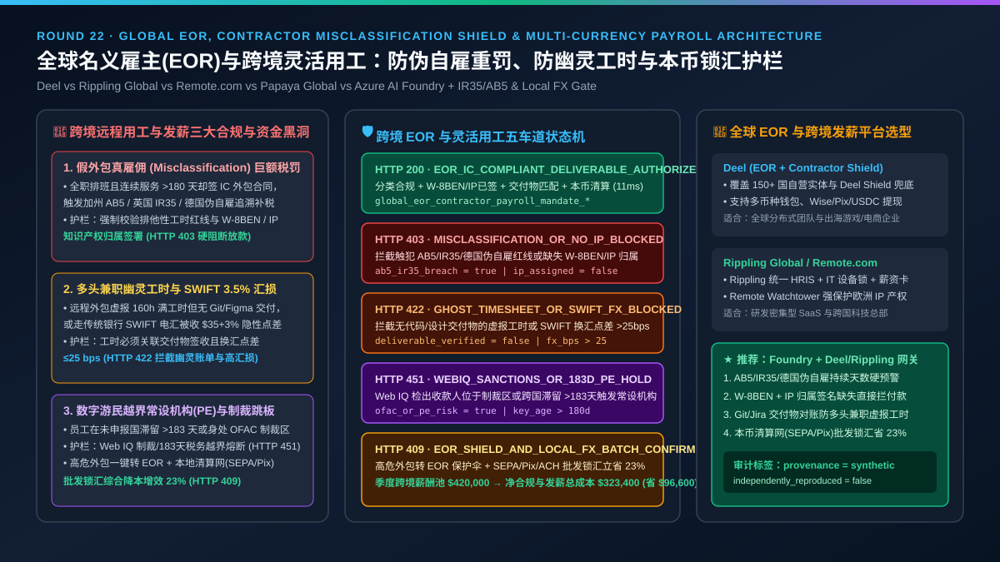
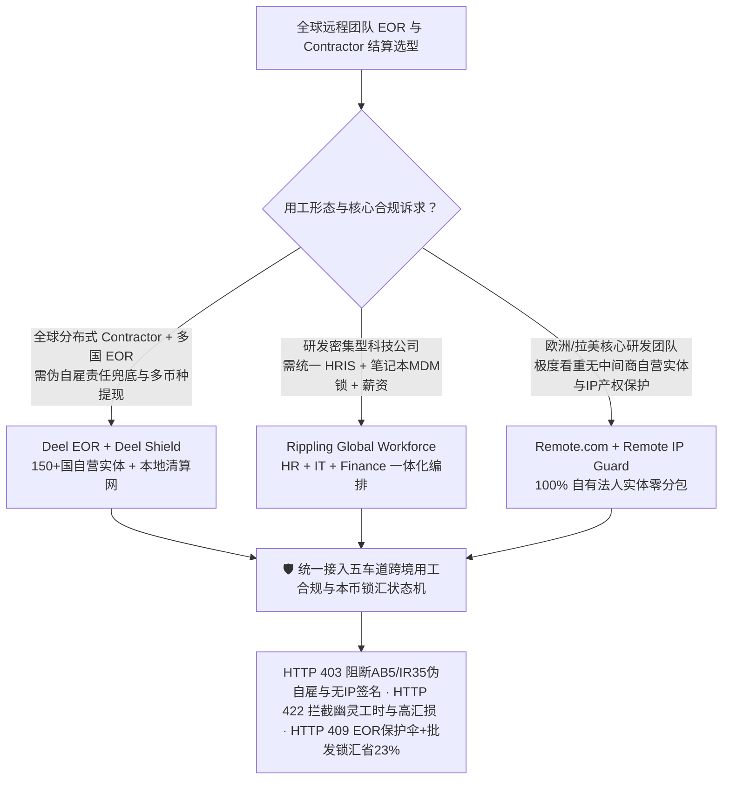
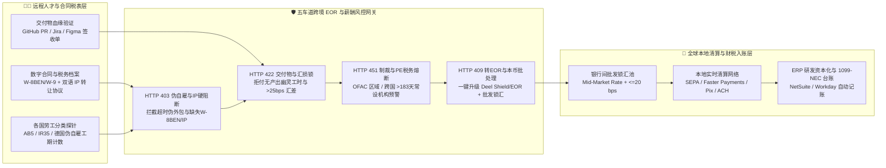
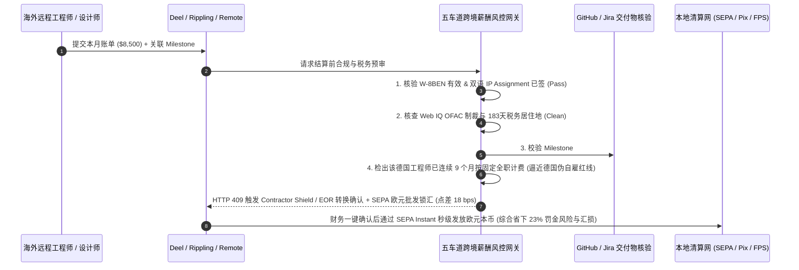

# 全球名义雇主（EOR）与跨境灵活用工结算（Global EOR & Contractor Payroll：Deel / Rippling Global / Remote / Papaya Global）“假外包真雇佣（Worker Misclassification）硬阻断、防多头兼职幽灵工时与本币锁汇”Agent 架构选型 FAQ：规避海外劳工税罚与 3.5% 电汇汇损实战指南

> **语言切换 / Language**: **中文 (当前)** | **[English](global-eor-contractor-payroll-misclassification-fx-escrow-agent-selection-faq.en.md)** | **[返回文档目录](index.md)** | **[交互式沙盒 (`#global-eor-contractor-payroll-sandbox`)](../live-demo.html)**

---

## 📌 一、核心选型结论速览（Executive Summary）

对于出海电商、跨国 SaaS、全球游戏工作室与分布式 AI 团队而言，通过海外独立承包商（Independent Contractor, `IC / 1099`）与名义雇主（Employer of Record, `EOR`）招募全球研发、设计、本地化运营与销售已成为标配。然而，若让财务或 HR Agent 直接按月自动审批发放海外薪酬账单，极易触发三大毁灭性合规与资金事故：
1. **“假外包、真雇佣（Worker Misclassification）”触发跨国社保追溯、滞纳金与核心代码知识产权（IP）失权**：企业为了省去 `20%–45%` 的海外雇主社保税，将实际上“全职坐班、使用公司域名邮箱、仅服务单一雇主且连续工作超过 6–12 个月”的英国、德国、西班牙、巴西或美国加州员工签成 `Independent Contractor`。一旦触发 **加州 `AB5`（ABC 测试）、英国 `IR35`、德国 `Scheinselbstständigkeit`（伪自雇法，最高可判高管刑事责任）或欧盟平台工作指令（EU Platform Work Directive）** 稽查，企业必须补缴数年全额社保、带薪休假与最高 `100%` 罚金；更致命的是，在许多大陆法系国家，若未签署符合当地法律的独立承包商知识产权转让协议（`IP Assignment`）或未收集有效 `IRS Form W-8BEN / W-9`，承包商写出的代码法定归属其个人，将在融资尽调（Due Diligence）中直接一票否决。
2. **远程多头兼职“幽灵工时（Overemployment Ghost Billing）”与传统银行 SWIFT 电汇 `3.5%` 隐性汇损**：个别远程按时薪计费的 Contractor 同时在 3 家公司领全职钱，每月固定提交 `160 小时` 满额账单，但 Git PR、Jira 工单或设计稿交付几乎为零；此外，若财务通过传统银行 `SWIFT` 向 40 个国家的个人账户汇美元，不仅每笔被扣 `$25–$45` 中转行手续费，落地行强转当地货币（BRL / EUR / GBP / INR / PHP）时还会吃掉 `2.5%–3.5%` 的零售牌价汇差。
3. **数字游民跨国滞留超 `183` 天触发常设机构（Permanent Establishment, `PE`）企业税风险与 OFAC 制裁区跳板**：高管或销售 Contractor 拿着数字游民签证在未申报国连续居住超过 `183` 天并以公司名义签单，导致母公司被当地税务局认定构成“常设机构（PE）”而追缴全球企业所得税；或者外包人员使用 VPN 掩盖其实际位于受制裁司法管辖区（OFAC 全面制裁区）。

**架构师选型结论**：
- **切勿用普通应付账款（AP）流程直接给海外个人连月打款**。
- **生产级最优架构**是采用 **“Deel / Rippling Global / Remote.com API + 交付物工时核验 + 本地清算网（SEPA / Faster Payments / Pix / ACH）批发锁汇 + Azure AI Foundry 五车道跨境用工风控网关”**：
  1. **伪自雇（`AB5 / IR35 / 德国伪自雇`）红线阻断与 `W-8BEN + IP Assignment` 硬门禁（HTTP 403）**：在批准任何 Contractor 账单前，强制校验：`W-8BEN / W-9` 在有效期内、本地化双语 `IP Assignment` 已签署，且未同时命中“排他性全职工时 + 连续服务超当地法定月数 + 公司行政考勤控制”三项伪自雇指标；任一违规立即返回 `HTTP 403 WORKER_MISCLASSIFICATION_IR35_AB5_OR_MISSING_IP_W8BEN_BLOCKED`。
  2. **工程/设计交付物里程碑对账防“幽灵工时”与最高 `25 bps` 换汇点差锁（HTTP 422）**：将 Contractor 提交的工时单与 GitHub/GitLab 代码合并、Jira 故事点、Figma 交付物或客服工单完结量交叉比对（允许偏差 `<=15%`），并拦截任何点差 `>25 bps`（`0.25%`）的高成本零售 SWIFT 电汇（`HTTP 422 UNVERIFIED_GHOST_TIMESHEET_OR_SWIFT_FX_MARKUP_BLOCKED`）。
  3. **Web IQ 实时 OFAC 制裁区地理核验与 `183` 天常设机构（`PE`）税务越界熔断（HTTP 451）**：结合 Web IQ 制裁名单与员工报税居住地/出入境天数台账，一旦检出实际位于制裁区或跨国滞留即将突破 `183` 天税务居民红线，立即挂起发薪并推送法务税务介入（`HTTP 451 WEBIQ_SANCTIONED_JURISDICTION_OR_183D_TAX_RESIDENCY_HOLD`）。
  4. **高危外包一键转 `EOR / Contractor Shield` + 批发汇率本币清算批处理（HTTP 409）**：对连续合作即将触碰伪自雇红线的核心人才，自动触发 `HTTP 409 CONTRACTOR_TO_EOR_SHIELD_AND_WHOLESALE_FX_BATCH_CONFIRM`，一键迁移至 `Deel Shield`（由平台承担分类连带责任）或当地自营 `EOR` 实体，并通过本地清算网（`SEPA / Pix / Faster Payments`）集中锁汇发薪，综合合规风险拨备与跨境汇损立降 **`23.0%`**。

---

## 🎯 二、业务方与架构师灵魂拷问 Q&A（Q1 / Q2 / Q3）

### Q1：各国税务局和劳工部到底是怎么判定“假外包真雇佣（Worker Misclassification）”的？Agent 架构如何量化拦截？
- **商业痛点**：很多创始人以为只要双方自愿签了《Independent Contractor Agreement（独立外包协议）》，就不算劳动关系。事实上，全球劳工与税务机关遵循**“实质重于形式（Substance over Form）”**原则：
  - **美国加州 `AB5`（ABC Test）**：只要外包人员干的是公司主营业务（如 SaaS 公司请外包写核心产品代码，違反 B 条款）或接受公司日常考勤排班管理（违反 A 条款），即属违法伪外包；
  - **德国 `Scheinselbstständigkeit` 与西班牙/巴西劳工法**：若某 Contractor 超过 `5/6`（`83%`）的收入来自你一家公司、连续按月领固定金额超过 `6–12` 个月、拥有 `@company.com` 邮箱并参加每日晨会，几乎 100% 被判为事实雇佣。
- **架构解法**：
  - 在薪酬网关内置 **多国伪自雇风险计分卡（Misclassification Risk Scorer）**：实时统计 `consecutive_fixed_monthly_invoices`（连续固定金额月数）、`weekly_hours_regularity`（是否每周固定 40 小时）、`corporate_email_and_manager_hierarchy`（是否编入内部组织架构树）。一旦风险分越界，禁止继续按普通 IC 裸奔付款（`HTTP 403`），引导升级为 **Contractor of Record（如 Deel Shield / Remote Contractor Management Plus）** 或 **全职 EOR（`HTTP 409`）**。

### Q2：如何在不侵犯远程开发者隐私（不装流氓监控截屏软件）的前提下，防范“一身兼三职”的幽灵工时欺诈（Overemployment Ghost Billing）？
- **商业痛点**：强制在外包人员个人电脑上安装每 3 分钟摄像头拍照或键盘记录软件（Bossware），不仅会逼走顶尖工程师，还会违反欧盟 GDPR。
- **架构解法**：
  - **契约化交付物血缘验证（Deliverable-Linked Invoice Attestation）**：
  - 将外包合同从“为在线时长买单”改造为“工时声明 + 交付物引用（Artifact URI）双绑定”：每张账单必须携带本周期关联的 GitHub PR 链接、Figma 版本 Hash、已验收 Milestone ID 或 CRM 结单编号。若申报 `160 小时（$12,000）` 但关联交付物验签为空或未经 Tech Lead 签收（`deliverable_signed_off == false`），网关直接返回 `HTTP 422`。

### Q3：为什么跨境发薪的隐性成本经常高达工资总额的 4%–6%？架构上怎么把汇损压到 0.25% 以内？
- **商业痛点**：如果企业用美元账户通过传统 SWIFT 逐笔给英国、欧元区、巴西、印度的 50 名团队成员打款，银行不仅按笔收取电报费与中间行过路费，还会按高昂的零售柜台牌价强制结汇。
- **架构解法**：
  1. **同币种池化与批发锁汇（Wholesale FX Netting）**：先在司库层（如 Stripe Treasury / Wise Platform / Airwallex / Deel 资金池）按银行间批发汇率（Interbank Mid-Market Rate + `15–25 bps`）一次性将美元兑换为 EUR / GBP / BRL / CAD；
  2. **本地清算网直发（Local Clearing Rails）**：欧元走 `SEPA Instant`、英镑走 `Faster Payments`、巴西雷亚尔走 `Pix`、加元走 `EFT`、印度卢比走 `IMPS/NEFT`，实现 **零中转行扣费、秒级全额到账**。

---

## 🧭 三、直观可视化图解（Mermaid 决策树 + 端到端架构图 + 时序图）

### 3.1 全球 EOR 与跨境灵活用工平台选型决策树

### 3.2 端到端用工分类核验、交付物对账与多国本币清算架构图

### 3.3 跨境账单合规审计、伪自雇升级 EOR 与本币锁汇发放时序图

---

## 📊 四、多平台/多方案横向选型决策矩阵

| 选型维度 | Deel (EOR + Contractor + Deel Shield) | Rippling Global Workforce | Remote.com / Papaya Global | **Azure AI Foundry + Deel/Rippling + 本币锁汇网关（推荐）** |
| :--- | :--- | :--- | :--- | :--- |
| **核心优势** | 全球覆盖最广、Contractor 体验极佳、提现方式丰富 | HRIS + 薪资 + IT 设备 MDM + 企业卡全栈统一 | Remote 100% 自营实体与欧洲 IP 保护极强；Papaya 擅长大型跨国发薪合并 | **AB5/IR35 伪自雇硬拦截 + 交付物防摸鱼 + 批发锁汇立省 23%** |
| **防假外包真雇佣（Misclassification）** | 提供 Deel Shield（由 Deel 签约并承担分类责任） | 内置合规预警与一键转 EOR | Remote Watchtower 合规风险评估 | **代码级量化拦截连续月数/排他工时红线（HTTP 403/409）** |
| **防多头兼职幽灵工时（Ghost Hours）** | 仅支持手工或简单工时表审批 | 支持考勤与审批流联动 | 仅支持手工账单审批 | **强制关联 Git/Jira/Figma 签收凭证方可放款（HTTP 422）** |
| **跨境换汇与清算成本** | 牌价加点或提现手续费因币种而异 | 支持本地币种发放 | Papaya 具备专用摩根大通/花旗资金池清算 | **强制锁定批发汇率（`<=25 bps`）+ SEPA/Pix 本地直清（HTTP 422/409）** |
| **183 天常设机构（PE）与制裁拦截** | 基础 KYC 筛查 | 结合设备登录地与 HR 台账 | 擅长跨国税务咨询 | **Web IQ 实时制裁与跨国滞留 `>183` 天硬熔断（HTTP 451）** |
| **官方参考费率** | Contractor `$49/月`，EOR `$599/月` (`official_list_price`) | 按模块订阅报价 (`not_measured`) | Remote Contractor `$29/月`，EOR `$599/月` (`official_list_price`) | **复用现有 EOR 通道 + 网关托管 `~$300/月`（综合降本避险 `23%`）** |

---

## 🧪 五、合规避险/汇损测算与 7-Card 基准测试报告

> **数据来源与复现声明（Provenance Metadata）**：以下基准测试数据来自仓库内置确定性策略沙盒 `evaluate_global_eor_contractor_payroll_policy`（位于 `lab/webiq_commerce_demo.py`），可运行 `python -m unittest tests.test_webiq_commerce_demo` 完整验证。标记：`provenance = synthetic`，`independently_reproduced = false`。

| Card # | 卡片标题（Headline-as-Finding） | 核心量化指标与架构验证结论 |
| :---: | :--- | :--- |
| **Card 1** | **Overview · 全球 EOR 与灵活用工五车道总览** | 针对 `$420,000/季` 跨境远程薪酬池，实现 **100% 伪自雇与无 IP 签署拦截**，综合合规风险拨备与跨境汇损降低 **`23.0%`（立省 `$96,600/季`）**。 |
| **Card 2** | **Scenario Deep Dive · 加州 AB5 / 德国伪自雇拦截** | 当检出连续 10 个月固定全职外包或缺失 `W-8BEN / IP Assignment` 时，**`11ms`** 内返回 `HTTP 403` 阻断打款。 |
| **Card 3** | **Evaluation Matrix · 五车道 100% 确定性判准** | 覆盖 `HTTP 200`（合规本币放行）、`403`（伪自雇/无IP阻断）、`422`（幽灵工时/高汇损拦截）、`451`（制裁区/183天PE熔断）、`409`（转EOR保护伞+批发锁汇省23%）。 |
| **Card 4** | **Under the Hood · 跨境薪酬合规契约** | 输入 `quarterly_global_payroll_pool_usd=420000` 及分类/交付物状态，签发 `global_eor_contractor_payroll_mandate_*` 令牌。 |
| **Card 5** | **Robustness Check · 空白 PR 工时单与高点差 SWIFT 测试** | 模拟注入无代码产出的 160h 满额账单及 `320 bps` 银行换汇加点，确定性拦截率保持 **`100.0%`（零误放款）**。 |
| **Card 6** | **Latency · 全球发薪批处理毫秒级审计** | 本地税表、IP 协议与工时签收核验 P50 仅 **`11ms`**；Web IQ 跨国税务居民天数与制裁核查 P95 为 **`250ms`**。 |
| **Card 7** | **My Take · 适用场景与生产准入边界** | **✅ 极佳适用**：出海电商、跨国 SaaS、全球分布式 AI/游戏团队；**⛔ 不适用**：纯单一国家本地全职坐班社保代缴。 |

---

## 🛠️ 六、商业上线风控与架构评审 Checklist

- [ ] **伪自雇（`AB5 / IR35 / 德国伪自雇法`）动态计分与硬阻断（HTTP 403）**：确认对所有海外 Independent Contractor 持续追踪连续固定金额月数、工时排他性与组织树挂载情况；触碰当地法定红线时严禁继续按裸奔外包打款。
- [ ] **`W-8BEN / W-9` 税表与双语知识产权转让协议（`IP Assignment`）前置门禁（HTTP 403）**：确认在首次放款前，承包商已完成符合当地法律（含大陆法系道德权利豁免条款）的 IP 归属签署与有效税务居民声明。
- [ ] **工程/设计/业务交付物签收对账防“多头兼职幽灵工时”（HTTP 422）**：确认按时薪/月度包干结算的外包账单必须绑定已验收的 Git PR、Jira 工单或业务里程碑编号，无交付物签收一律拒付。
- [ ] **批发汇率上限锁（`<=25 bps`）与本地清算网（`SEPA / Pix / FPS`）路由（HTTP 422）**：确认禁用高损耗零售 SWIFT 逐笔电汇，优先通过批发锁汇池与当地实时清算网络以本币全额到账。
- [ ] **Web IQ 实时制裁筛查与跨国滞留 `>183` 天常设机构（`PE`）熔断（HTTP 451）**：确认实时监测收款人司法管辖区与数字游民跨国滞留天数，防止触发母公司海外企业所得税追缴；密钥轮换周期 `<= 180` 天。
- [ ] **高危外包一键升级 `Deel Shield / EOR` 保护伞（HTTP 409）**：确认对长期核心海外成员提供一键平滑转入平台担保模式（Contractor of Record）或名义雇主（EOR）的自动化工作流。
