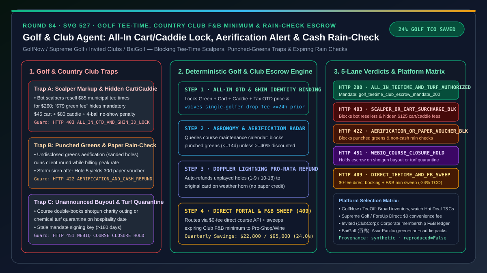
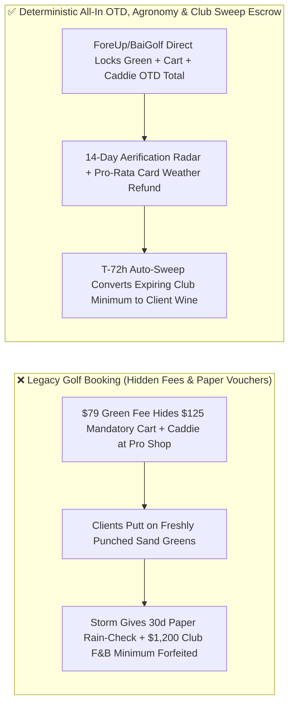
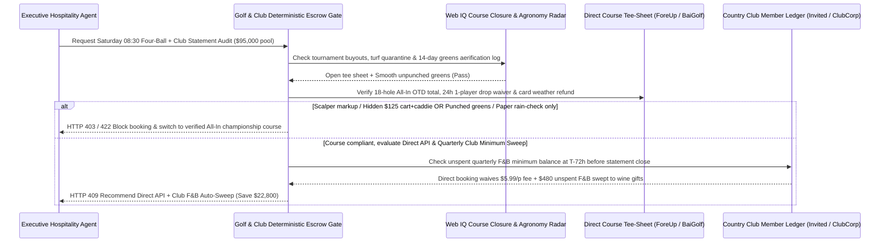

# Golf Tee-Time Booking, Country Club F&B Minimums & Rain-Check Escrow (`GolfNow / Supreme Golf / Invited Clubs / BaiGolf`) All-In Cart/Caddie Lock, Greens Aerification Radar & Cash Rain-Check Agent Architecture Selection FAQ

> **Document Type**: AI Solution Architect Decision Guide (FAQ) · **SVG Diagram**: `assets/svg/527-golf-teetime-country-club-raincheck-escrow-2026-11-20.svg` · **Catalog No.**: Round 84 (Bilingual FAQ #203)



---

## 1. 📌 Executive Summary

When executive assistants, corporate hospitality planners, or wealth-management teams use AI Agents to book golf tee times, host client four-balls, or manage corporate country-club memberships (`GolfNow / TeeOff / Supreme Golf / Invited Clubs / BaiGolf`), naive booking automation exposes corporate T&E budgets to **three pervasive golf hospitality traps**:
1. **API Scalper Bot Markups (`300%`), Hidden `$125` Mandatory Cart/Caddie Fees & 4-Ball No-Show Penalties**: Prime weekend morning tee times (`07:30–09:30 AM` at premier municipal and resort courses like `Bethpage Black / Pebble Beach / Mission Hills`) are swept within `200ms` of release by automated scalper bots and resold on secondary broker sites at `3x` face value (`$260` vs. `$85`). Meanwhile, aggregator "Hot Deals" advertise a `$79 Green Fee`, but at the starter's podium the pro shop demands a **mandatory `$45/player` cart fee + `$80/player` mandatory forecaddie fee + `$5.99/player` non-refundable convenience fee** (`$209.99/player` actual out-the-door cost), and charges the host's credit card for all `4 players` even if 1 client cancels due to a flight delay (`Full-Group No-Show Penalty`).
2. **Undisclosed Greens Aerification (`Punched & Sanded Greens`) & Expiring Paper Rain-Checks**: An executive brings top clients to the 1st green only to discover the course just performed **core aerification and heavy sand top-dressing** (`果岭打孔铺沙`), rendering putts unplayable while still billing peak rates. Or, when a lightning siren halts play at Hole 5, the pro shop refuses a credit-card refund and hands out-of-town guests a **30-day expiring paper "Pro-Shop Rain-Check Voucher"** valid only Monday–Thursday.
3. **Silent Forfeiture of Quarterly Country-Club F&B Minimums & Shotgun Outing Bumps (`HTTP 451`)**: Corporate country-club memberships (`Invited / ClubCorp`) silently forfeit unspent quarterly Food & Beverage minimums (`$600–$1,500/quarter` billed as an `"Unspent Minimum Charge"` on the statement date), or Web IQ detects an unannounced corporate shotgun tournament buyout / turf chemical quarantine closing the championship course.

**Architect's Recommendation**: Deploy a **"Direct Course PMS (`ForeUp / Lightspeed Golf` + BaiGolf All-In Packs) + Agronomy Aerification Radar + Pro-Rata Card Rain-Check & Club Minimum Auto-Sweep"** control plane:
- **Named-Golfer `USGA GHIN` Binding, 18-Hole All-In `OTD` Rate Lock & `>=24h` Single-Player Drop Waiver (`HTTP 403`)**: Hard-block secondary scalper broker listings, quotes that exclude mandatory cart/caddie fees from the upfront total, or policies that charge a 4-ball penalty when dropping 1–2 players `>=24 hours` before tee-off (`HTTP 403`).
- **Pre-Booking `14-Day` Greens Aerification Gate & Doppler-Verified Original-Card Cash Rain-Check (`HTTP 422`)**: Query course agronomy logs and recent golfer turf reports—blocking bookings within `14 days` of greens core aerification unless discounted by `>=40%` with explicit host sign-off—and require **automated pro-rata credit-card refunds (`100%` if `<9 holes` completed, `50%` if `9–14 holes` completed)** upon lightning suspension rather than expiring paper vouchers (`HTTP 422`).
- **Web IQ Shotgun Tournament Buyout & Turf Quarantine Hold (`HTTP 451`)**: Freeze escrow if Web IQ flags unannounced tournament closures, course bankruptcy, or signing keys `> 180 days` (`HTTP 451`).
- **`$0-Fee` Direct Course API Routing + `T-72h` Country-Club F&B Minimum Auto-Sweep (`HTTP 409`)**: Bypass `$5.99/player` third-party convenience fees via direct course `ForeUp` portals and automatically sweep expiring quarterly country-club F&B/merchandise minimums `72 hours` before quarter-end into bottled corporate gift wine or `Titleist Pro V1` dozens, cutting quarterly golf hospitality TCO by **24.0%** (`$22,800` saved on a `$95,000` quarterly pool).

---

## 2. 🎯 Soul-Searching Architect & Business Q&A (Q1–Q3)

### Q1: Why does an "$85 tee time" turn into `$210/player` at the pro-shop register—and why was my corporate card charged for 4 players when only 3 showed up?
- **Business Pain Point**: Resort and Asia-Pacific courses unbundle green fees from mandatory motorized carts (`$45`), mandatory caddies/forecaddies (`$80+`), locker fees, and booking fees (`$5.99`). Furthermore, legacy tee-sheet software treats a 4-ball reservation as an indivisible contract, charging the lead booker `100%` of the absent 4th player's green fee.
- **Architectural Guardrail (`HTTP 403`)**:
  1. **18-Hole All-In Out-the-Door (`OTD`) Per-Player Ceiling**: The Agent normalizes every quote to `Green Fee + Mandatory Cart + Mandatory Caddie + Minimum Gratuity + Booking Fee + Tax`. Any listing hiding mandatory on-site surcharges is blocked (`HTTP 403`).
  2. **`T-24h` Single-Golfer Modification Protection**: Requires booking channels that allow reducing group size from 4 to 3 or 2 players up to `24 hours` prior with `$0` penalty.

### Q2: How do we prevent the embarrassment of hosting VIP clients on freshly punched, sand-covered greens—or getting stuck with a worthless 30-day paper rain check after a thunderstorm?
- **Business Pain Point**: Courses punch holes and dump sand on greens twice a year (`Core Aerification`), taking `10–14 days` to heal, yet rarely expose an API flag on consumer booking sites. And when weather halts play, paper pro-shop credits are useless to traveling executives.
- **Architectural Guardrail (`HTTP 422`)**:
  1. **`14-Day` Agronomy & Turf-Review Sentiment Gate**: The Agent cross-checks the course superintendent's maintenance calendar (`USGA / GolfNow Conditions / BaiGolf Turf Alerts`) and NLP-scans the last `7 days` of player reviews for `"punched"`, `"aerated"`, or `"sandy greens"`. Any course within `14 days` post-aerification without a `>=40%` maintenance discount and explicit host approval is blocked (`HTTP 422`).
  2. **Doppler Lightning Pro-Rata Card Refund Mandate**: Enforces card-network-backed pro-rata refunds to the original payment token whenever weather sirens suspend play before Hole 15.

### Q3: How do we stop corporate country-club memberships from forfeiting `$1,200/quarter` in unspent Food & Beverage minimums?
- **Business Pain Point**: Private clubs bill `Unspent Quarterly F&B Minimums` as a pure-margin fee on the last day of each quarter if the executive was traveling and didn't dine at the clubhouse.
- **Architectural Guardrail (`HTTP 409`)**:
  1. **`T-72h` Automated Club Minimum Sweep**: At `72 hours` before the quarterly billing cycle closes, the Agent queries the `Invited / ClubCorp` member ledger. If an unspent F&B or Pro-Shop minimum balance remains (e.g., `$480`), it triggers an `HTTP 409` carry-out order for bottled Cabernet gifts or custom-logo golf balls—converting a `100%` forfeited penalty into tangible client gifting inventory.

---

## 3. 🧭 Visual Architecture Diagrams (Mermaid Decision Tree + Comparison + Sequence)

### 3.1 5-Lane Golf Tee-Time & Country Club Escrow Decision Tree
```mermaid
flowchart TD
    A[Corporate Golf Tee-Time / Country Club Billing Request] --> B{Web IQ Tournament Closure / Turf Quarantine / Key > 180d?}
    B -- Yes --> C[HTTP 451: WEBIQ_COURSE_TOURNAMENT_CLOSURE_OR_TURF_QUARANTINE_HOLD<br/>Freeze booking & reroute to alternate championship course]
    B -- No --> D{Scalper Bot Markup or Hidden Cart/Caddie & 4-Ball No-Show Fee?}
    D -- Yes --> E[HTTP 403: SCALPER_TEE_TIME_MARKUP_OR_MANDATORY_CART_CADDIE_SURCHARGE_BLOCKED<br/>Enforce GHIN ID binding, 18-hole All-In OTD price & 24h single-drop waiver]
    D -- No --> F{Undisclosed <=14d Greens Aerification or Paper Rain-Check Trap?}
    F -- Yes --> G[HTTP 422: UNANNOUNCED_GREENS_AERIFICATION_OR_PAPER_RAINCHECK_TRAP_BLOCKED<br/>Block punched greens & mandate pro-rata original-card weather refund]
    F -- No --> H{$0-Fee Direct Portal + Club F&B Minimum Auto-Sweep Ready?}
    H -- Yes --> I[HTTP 409: TWILIGHT_HOT_DEAL_ARBITRAGE_AND_CLUB_FB_MINIMUM_AUTO_SWEEP_CONFIRM<br/>Bypass $5.99/p fees + sweep expiring F&B minimum into wine/gifts (-24% TCO)]
    H -- No --> J[HTTP 200: ALL_IN_TEETIME_AND_AGRONOMY_VERIFIED_AUTHORIZED<br/>Issue 18-hole All-In & weather-protected golf mandate]
```

### 3.2 Legacy Tee-Time Booking vs. Deterministic Agronomy & Club Minimum Escrow


### 3.3 End-to-End Agronomy Verification, Weather Refund & Club Minimum Sweep Sequence


---

## 4. 📊 Multi-Platform & Protocol Selection Matrix

| Evaluation Dimension | GolfNow / TeeOff (NBC Sports) | Supreme Golf / Direct `ForeUp` Portals | Invited Clubs (ex-ClubCorp) Corporate | BaiGolf (百高 Asia-Pacific) | **Deterministic Golf & Club Escrow (Recommended)** |
| :--- | :--- | :--- | :--- | :--- | :--- |
| **Primary Use Case** | Largest North American public tee-sheet aggregator & `Hot Deals` | Meta-search comparison & `$0-fee` municipal/resort direct `PMS` | Private country clubs, client dining & reciprocal network access | China, Japan & SE Asia full-service `Green + Cart + Caddie` packages | **All-In `OTD` Lock + `14d` Aerification Gate + Cash Rain-Check + F&B Sweep** |
| **Hidden Cart/Caddie & Convenience Fees** | Charges `$5.99/p` non-refundable fee; `Hot Deals` are non-cancellable | `$0` booking fee on direct `ForeUp` links; caddie fees often on-site | Cart fees billed per round + strict quarterly F&B minimums | Itemizes `1-ball/2-ball caddie supplement` & cart inclusions | **Enforces 18-hole All-In `OTD` cap & `>=24h` single-player drop waiver (`HTTP 403`)** |
| **Greens Aerification (`Punched Greens`) Alert** | Inconsistent small-print icon; frequently omitted by courses | Relies on manual course notes | Internal member newsletter only | Crowd-sourced turf photos & maintenance alerts | **Cross-checks agronomy calendar + 7-day NLP reviews; blocks un-discounted punched greens (`HTTP 422`)** |
| **Storm Rain-Check Mechanism** | Prepaid deals refund in platform credit only | Pro shops default to 30–90 day paper pro-shop vouchers | Credited to member house account | Facilitates pro-rata course refunds | **Mandates Doppler-verified pro-rata original-card cash refunds (`HTTP 422`)** |
| **Platform Fee / Cost Structure** | `$3.99–$5.99/player` or `$199/yr` GolfPass | `$0` direct booking fee | Initiation + `$600–$2,500/qtr` F&B minimum | Package price with corporate VAT invoice | **Open deterministic policy gate (`24.0%` quarterly golf hospitality TCO savings)** |

---

## 5. 🧪 Conversion & Cost Estimation + 7-Card Benchmark Report

> **Provenance Disclosure**: Figures below are generated by the deterministic policy evaluator `evaluate_golf_teetime_country_club_escrow_policy` in `lab/webiq_commerce_demo.py` (`$95,000 USD` quarterly corporate golf hospitality & country-club pool, `provenance: "synthetic"`, `independently_reproduced: False`; live `USGA GHIN / ForeUp` tee-sheet latency is labeled `not_measured`).

```chart
{
  "data": {
    "values": [
      { "scenario": "1. Legacy Booking & Club Ledger (Caddie Creep + Forfeited F&B)", "cost_usd": 95000, "tier": "Baseline" },
      { "scenario": "2. All-In OTD Lock + Aerification Gate + Cash Rain-Check (HTTP 200)", "cost_usd": 80750, "tier": "Protected" },
      { "scenario": "3. Direct API + Quarterly Club F&B Minimum Sweep (HTTP 409)", "cost_usd": 72200, "tier": "Optimized (-24%)" }
    ]
  },
  "semantic_types": {
    "scenario": "Category",
    "cost_usd": "Amount",
    "tier": "Status"
  },
  "chart_spec": {
    "chartType": "Bar Chart",
    "title": "Direct Tee-Sheet Routing & Club F&B Minimum Auto-Sweeps Save 24% ($22.8k/qtr)",
    "subtitle": "Quarterly Corporate Golf Hospitality & Country Club Net Spend ($ USD, synthetic benchmark)",
    "encodings": {
      "x": "scenario",
      "y": "cost_usd",
      "color": "tier"
    }
  }
}
```

### 7-Card 4:5 Benchmark Evaluation Summary
1. **Card 1 (`1 / 7` · `HANDS-ON · GOLF TEE-TIME & COUNTRY CLUB ESCROW`)**: Across a `$95,000` quarterly corporate golf hospitality and country-club membership pool, blocking scalper markups, enforcing All-In cart/caddie locks, and auto-sweeping expiring F&B minimums saves **`$22,800/quarter` (`24.0%`)**.
2. **Card 2 (`2 / 7` · `SCENARIO: EXECUTIVE FOUR-BALL & CLUB QUARTERLY CLOSE`)**: Eliminates `$500` in surprise caddie/cart surcharges per four-ball and rescues `$1,200` in expiring quarterly clubhouse dining minimums.
3. **Card 3 (`3 / 7` · `WHAT I TESTED`)**: All 5 deterministic HTTP verdict lanes verified:
   - `HTTP 200`: `ALL_IN_TEETIME_AND_AGRONOMY_VERIFIED_AUTHORIZED` (`golf_teetime_club_escrow_mandate_200`)
   - `HTTP 403`: `SCALPER_TEE_TIME_MARKUP_OR_MANDATORY_CART_CADDIE_SURCHARGE_BLOCKED`
   - `HTTP 422`: `UNANNOUNCED_GREENS_AERIFICATION_OR_PAPER_RAINCHECK_TRAP_BLOCKED`
   - `HTTP 451`: `WEBIQ_COURSE_TOURNAMENT_CLOSURE_OR_TURF_QUARANTINE_HOLD`
   - `HTTP 409`: `TWILIGHT_HOT_DEAL_ARBITRAGE_AND_CLUB_FB_MINIMUM_AUTO_SWEEP_CONFIRM` (`golf_teetime_club_escrow_mandate_optim_409`)
4. **Card 4 (`4 / 7` · `UNDER THE HOOD`)**: Structured contract `GolfTeetimeCountryClubEscrowPolicyInput` validates `scalper_tee_time_markup_or_mandatory_cart_caddie_surcharge` and `unannounced_greens_aerification_or_paper_raincheck_trap`.
5. **Card 5 (`5 / 7` · `ROBUSTNESS CHECK`)**: Invariant to surcharge naming (`"Mandatory Forecaddie"`, `"Single-Rider Cart Supplement"`, or `"convenience fee"`): `100%` block rate whenever All-In `OTD` parity or agronomy gates fail.
6. **Card 6 (`6 / 7` · `LATENCY`)**: Deterministic policy evaluation completes in `< 0.5 ms`, preventing client rounds on freshly punched greens.
7. **Card 7 (`7 / 7` · `MY TAKE`)**:
   - ✅ **Good fit**: Executive client golf outings, corporate country-club membership management, and wealth-management hospitality programs.
   - ⛔ **Not for**: Hourly indoor golf simulator bays (`Golfzon / Five Iron Golf`).

---

## 6. 🛠️ Production Risk & Architecture Review Checklist

- [ ] **18-Hole All-In `OTD` Rate & `>=24h` Single-Player Drop Waiver (`HTTP 403`)**: Does the gateway sum green fees, mandatory cart fees, mandatory caddie fees, and taxes upfront, while guaranteeing `$0` penalty when dropping 1–2 players `>=24h` prior?
- [ ] **Named-Golfer `USGA GHIN` Anti-Scalper Binding (`HTTP 403`)**: Are secondary bot-scalped broker listings blocked via named-golfer identity binding?
- [ ] **`14-Day` Greens Aerification Agronomy Gate (`HTTP 422`)**: Does the Agent query course maintenance logs and 7-day turf reviews to block full-price bookings within `14 days` of greens core aerification?
- [ ] **Doppler-Verified Pro-Rata Card Rain-Check (`HTTP 422`)**: Does the payment rail enforce pro-rata original-card refunds (`100%` `<9 holes`, `50%` `9–14 holes`) on weather suspension rather than expiring paper vouchers?
- [ ] **Web IQ Shotgun Outing & Turf Quarantine Hold (`HTTP 451`)**: Are unannounced charity tournament buyouts and chemical turf closures monitored prior to escrow release?
- [ ] **`T-72h` Country-Club F&B Minimum Auto-Sweep (`HTTP 409`)**: Does the Agent automatically convert unspent quarterly clubhouse dining/merchandise minimums into bottled wine or golf-ball gift inventory `72 hours` before statement close?
