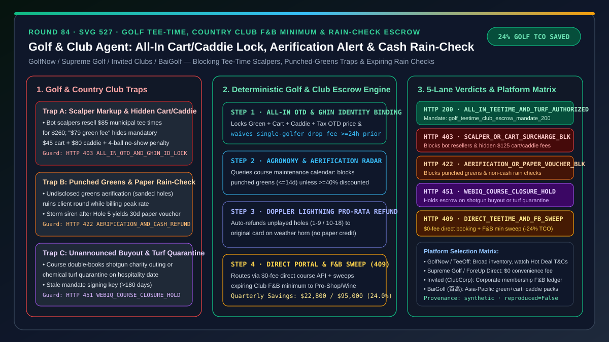
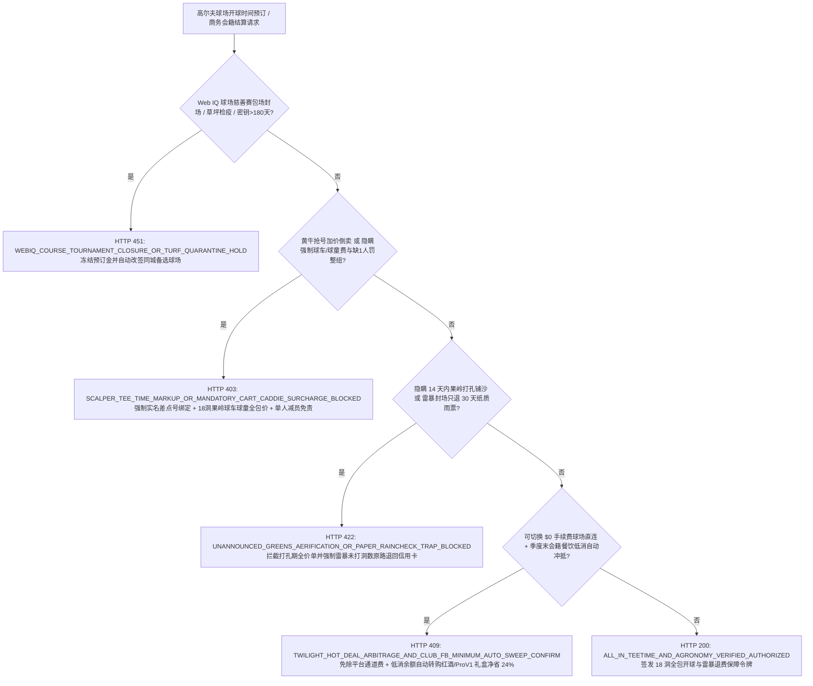
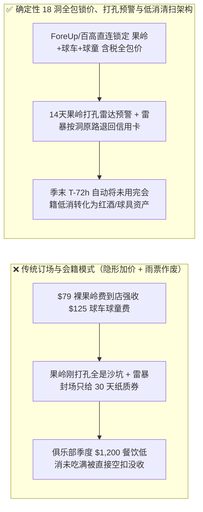
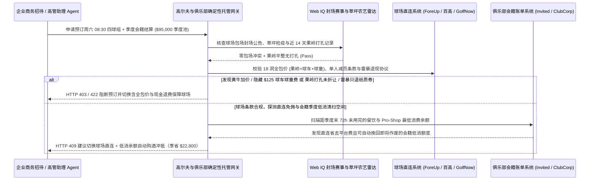

# 高尔夫球场开球时间预订（Tee-Time）、商务会籍餐饮低消与果岭打孔/雷雨退费托管（Golf Tee-Time, Country Club F&B Minimum & Rain-Check Escrow：GolfNow / Supreme Golf / Invited Clubs / 百高高尔夫）“防抢号机器人加价 300% 倒卖、防隐瞒果岭打孔铺沙与雷暴封场只退 30 天代金券”Agent 架构选型 FAQ

> **文档类型**：AI Solution Architect 决策指南（FAQ） · **对应 SVG**：`assets/svg/527-golf-teetime-country-club-raincheck-escrow-2026-11-20.svg` · **精选编号**：Round 84（第 203 篇双语 FAQ）



---

## 一、 📌 核心选型结论速览（Executive Summary）

高净值个人与企业高管助理通过 AI Agent 预订高尔夫球场开球时间（`Tee-Time`）、商务招待四球组（`Four-Ball Hospitality`）或管理高尔夫乡村俱乐部企业会籍（`Country Club Corporate Membership`）时，若直接通过聚合平台下单或绑定公司信用卡自动扣款，往往会遭遇**三大球场消费与会籍刺客陷阱**：
1. **黄牛抢号机器人（Scalper Bots）加价 `300%` 倒卖、隐藏 `$125` 球车/球童强制费与“缺 1 人罚整组”霸王条款**：热门公众球场与度假村球场（如 `Bethpage Black / Pebble Beach / 观澜湖`）提前 7 天放出的周末 `07:30–09:30` 黄金开球时间（官方价 `$85/人`），在 `200 毫秒` 内被自动化抢号脚本（`Tee-Time Scalper Bots`）洗劫一空，在二级群组加价至 `$260/人` 倒卖；同时，部分聚合平台打出“`$79 特惠果岭费`”噱头，到场登记时前台却强制加收 **`$45/人` 双人球车费（Cart Fee）+ `$80/人` 强制球童服务费（Mandatory Caddie / Forecaddie）+ `$5.99/人` 不可退平台预订费**（实际落地 `$209.99/人`）；更有甚者，同组 4 位客户中有 1 人因航班延误未能到场，球场仍按 `4 人全额` 强刷预订人信用卡（`No-Show Penalty`）。
2. **隐瞒“果岭打孔铺沙维护（Greens Aerification）”与雷暴封场拒退现金、只发 30 天过期纸质雨票（Rain-Check）**：高管带核心客户下场后才发现全洞果岭刚做完打孔铺沙（`Punched & Top-Dressed Greens`，推杆路线全是沙坑孔洞），球场在预订页毫无提示却照收周末全价！或者打到第 5 洞遭遇雷暴防空警报封场，球场前台拒绝原路退回信用卡，强行塞给外地出差客户一张 **“限 30 天内工作日使用、不可抵扣球童费”的纸质雨票（`Paper Pro-Shop Rain Check`）**，形同没收。
3. **俱乐部季度餐饮最低消费（F&B Minimum）静默清零与临时包场封场（`HTTP 451`）**：企业商务会籍（如 `Invited / ClubCorp`）要求每季度必须消费满 `$600–$1,500` 餐饮低消（`Quarterly Food & Beverage Minimum`），月底未花完的部分在账单日被球会直接按“`Unspent Minimum Charge`”空扣清零；或球场临时接了慈善包场赛（Shotgun Outing）单方面取消散客预订。

**架构师选型结论**：必须构建 **“球场直连引擎 (`ForeUp / Lightspeed Golf Direct` + 百高全包价) + 草坪打孔日历（Agronomy Calendar）雷达 + 雷暴按洞原路退现与会籍低消自动冲抵网关”** 架构：
- **强制实名差点号（`USGA GHIN / 护照号`）防黄牛锁死、`果岭+球车+球童+小费（18洞全包 OTD 价）` 校验与提前 24h 单人无损减员（`HTTP 403`）**：凡二级加价倒卖号源、未包含强制球车/球童费的拆分报价、或拒绝支持开球前 `24 小时` 无罚金缩减 1–2 名球员（`Single-Player Drop Protection`）的预订，一律返回 `HTTP 403` 阻断。
- **预订前草坪打孔维护（`Aerification <=14d`）强制折让门禁与雷暴未打完洞数原路现金退回（`HTTP 422`）**：网关自动抓取球场草坪总监维护日志与卫星多光谱草坪指数——若果岭在过去 `14 天` 内进行过打孔铺沙且未给予 `>=40%` 维护折扣，或拒绝承诺“雷暴封场按未打完洞数（未满 9 洞退 `100%`、9–14 洞退 `50%`）原路退回支付卡而非纸质代金券”，立即触发 `HTTP 422` 拦截。
- **Web IQ 球场临时包场封场与草坪农药检疫熔断（`HTTP 451`）**：对触发赛事包场冲突、草坪污染检疫停业或签名密钥超 `180 天` 的球场执行 `HTTP 451` 冻结。
- **零手续费官网直连/黄昏场（Twilight）套利 + 俱乐部季度餐饮低消 `T-72h` 自动购酒/买球冲抵（`HTTP 409`）**：绕过 `$5.99/人` 第三方平台通道费直连球场 `ForeUp API`，并在每季度结账前 `72 小时` 自动将剩余未用完的会籍餐饮/球具低消额度下单转化为红酒礼盒或 `Titleist Pro V1` 高尔夫球寄回公司，使季度 `$95,000` 商务高尔夫招待预算净省 **`24.0%`（`$22,800`）**。

---

## 二、 🎯 业务方与架构师灵魂拷问 Q&A（Q1–Q3）

### Q1：为什么在网上订球显示 `$85/人`，到了球场出发台（Starter）结账却变成了 `$210/人`？怎么防“果岭费裸价诱饵”？
- **商业痛点**：欧美及亚太度假村球场普遍将价格拆分为 `Green Fee（果岭费）`、`Mandatory Cart Fee（强制球车费）`、`Mandatory Caddie Service Fee（强制球童费）` 以及球童固定小费（`Caddie Minimum Gratuity`）。此外，许多球场规定预订人必须为整组 4 人连带担保，哪怕 1 名客户临时生病缺席，出发台也照扣 4 份全额费用。
- **架构护栏（`HTTP 403`）**：
  1. **18 洞全包落地价（`18-Hole All-In OTD Per-Golfer Cap`）**：Agent 在比价时强制将 `果岭 + 球车 + 球童 + 衣柜 + 平台费 + 税费` 汇总为单一可比总价；任何将球车或球童列为“到店必选另付”且突破商务招待人均上限的报价，直接返回 `HTTP 403`。
  2. **单球员减员免责锁（`Partial-Group Modification Waiver`）**：仅选择支持在开球前 `24 小时` 免费将 `4 人组` 调整为 `2–3 人组` 且按实际到场人数扣款的球场通道。

### Q2：商务招待最尴尬的就是“带重要客户到了第 1 洞果岭，才发现满地是刚打完孔的沙洞”，或者“刚打 4 个洞下暴雨，球场只肯退有效期 30 天的纸质券”，架构怎么防？
- **商业痛点**：球场每年春秋两季必须对果岭进行打孔通气与铺沙（`Core Aerification & Top-Dressing`），恢复期长达 `10–14 天`，期间推杆体验极差；但球场往往在官网角落藏一行小字而不在第三方订场 API 中标注。
- **架构护栏（`HTTP 422`）**：
  1. **草坪农艺日历（`Agronomy & Aerification Calendar`）与近期球友评分交叉验证**：Agent 自动检索 `USGA Green Section / GolfNow Course Conditions` 及近 `7 天` 球友评论关键词（`punched`, `aerated`, `sandy greens`, `打孔`, `铺沙`）。凡处于打孔后 `14 天` 恢复期内，若主客双方未明确确认接受或球场未提供 `>=40%` 维护折让，一律触发 `HTTP 422` 阻断并自动改订同城备选球场。
  2. **多普勒气象雷达联动原路退现协议**：要求通过支持雷电中断按比例原路退款（`Card-Present / Token Pro-Rata Weather Refund`）的商旅收单通道结算，严禁以过期作废的球会储值券替代退款。

### Q3：公司买的商务高尔夫会籍，每个季度都有 `$1,200` 餐饮最低消费（F&B Minimum）因为出差忙没去吃而被球会白白没收，怎么破？
- **商业痛点**：私人俱乐部依赖会员“未达标低消补差（Unspent Minimum Billing）”获取接近 `100%` 毛利的纯利润。
- **架构护栏（`HTTP 409`）**：
  1. **季度末 `T-72h` 会籍账单低消自动清扫（`Club Minimum Auto-Sweep`）**：Agent 每月轮询 `Invited / ClubCorp / 球会会员账单 API`，若在季度截止日前 `72 小时` 发现餐饮或球具店（Pro-Shop）低消仍有 `$480` 缺口，立即自动触发 `HTTP 409` 预授权订单，在俱乐部餐厅订购可外带整箱商务红酒或定制 Logo 高尔夫球礼盒，将原本 `100%` 作废的沉没罚款转化为实体商务礼品资产。

---

## 三、 🧭 直观可视化图解（Mermaid 决策树 + 架构对比 + 时序图）

### 3.1 高尔夫订场与会籍低消托管 5 车道选型决策树


### 3.2 传统高尔夫订场与会籍管理 vs 确定性果岭农艺验真与低消冲抵架构对比


### 3.3 端到端高尔夫农艺核验、雷暴退费与会籍低消冲抵时序图


---

## 四、 📊 多平台/多协议横向选型决策矩阵

| 评估维度 | GolfNow / TeeOff (NBC Sports) | Supreme Golf / 球场官网 `ForeUp` 直连 | Invited Clubs (原 ClubCorp) 企业会籍 | 百高高尔夫 (BaiGolf 亚太/中日韩) | **本仓库确定性高尔夫与会籍托管架构（推荐）** |
| :--- | :--- | :--- | :--- | :--- | :--- |
| **核心适用场景** | 北美与欧洲最大公众球场聚合检索与 `Hot Deals` 尾单 | 聚合比价及市政/度假村球场原生 `PMS` 零佣金直订 | 私人乡村俱乐部、商务社交餐饮与跨城球会漫游 | 中国、日本、东南亚球场“果岭+球童+球车+衣柜”打包预订 | **全包 OTD 比价 + 果岭打孔雷达 + 雷暴退现 + 会籍低消自动冲抵** |
| **隐藏球车/球童费与平台通道费** | 非会员常收 `$5.99/人` 不可退服务费，`Hot Deals` 不可退改 | 官网直连 `$0` 通道费，但球童费需到场另算 | 免果岭费，但有强制球车费与高额餐饮月度/季度低消 | 清晰标注“一价全包”或“球童小费到付”明细 | **强制锁定 18 洞全包落地价（`OTD`）与单球员提前 24h 免费减员（`HTTP 403`）** |
| **果岭打孔铺沙（Aerification）预警** | 部分球场勾选小图标，大量球场漏报打孔期 | 依赖球场人工更新公告 | 会员内部邮件通知，外部访客易踩坑 | 提供近期球友实拍草坪照片与打孔提醒 | **交叉核验农艺维护日历与近 7 天评论，打孔期无 `>=40%` 折扣直接阻断（`HTTP 422`）** |
| **雷暴封场退费（Rain-Check）机制** | 预付 `Hot Deals` 退费流程繁琐，常退平台积分 | 球场前台多发放 30–90 天有效期的纸质雨票 | 记入会员挂账账户 | 支持协调球场按 9 洞/18 洞比例原路退回 | **强制多普勒雷暴停赛按未打洞数原路退回信用卡，拒收过期纸质券（`HTTP 422`）** |
| **平台费率 / 成本结构** | `$3.99–$5.99/人` 预订费或 `$199/年` GolfPass | `$0` 直连预订费 | 入会费 + `$600–$2,500/季` 餐饮低消 | 套餐含税价（支持企业发票） | **开源确定性策略网关（净省 `24.0%` 季度商务高尔夫招待成本）** |

---

## 五、 🧪 转化率/成本测算与 7-Card 基准测试报告

> **数据来源声明（Provenance）**：以下测算基于本仓库 `lab/webiq_commerce_demo.py` 中的 `evaluate_golf_teetime_country_club_escrow_policy` 确定性策略引擎（季度企业商务高尔夫招待与会籍管理预算池 `$95,000 USD`，`provenance: "synthetic"`, `independently_reproduced: False`，真实球场 `USGA GHIN / ForeUp` 实时库存接口标为 `not_measured`）。

```chart
{
  "data": {
    "values": [
      { "scenario": "1. 传统预订与会籍 (含球童暗费 + 雨票作废 + 低消空扣)", "cost_usd": 95000, "tier": "Baseline" },
      { "scenario": "2. 18洞全包锁价 + 打孔拦截 + 雷暴原路退现 (HTTP 200)", "cost_usd": 80750, "tier": "Protected" },
      { "scenario": "3. 官网直连免佣 + 季度餐饮低消自动购酒冲抵 (HTTP 409)", "cost_usd": 72200, "tier": "Optimized (-24%)" }
    ]
  },
  "semantic_types": {
    "scenario": "Category",
    "cost_usd": "Amount",
    "tier": "Status"
  },
  "chart_spec": {
    "chartType": "Bar Chart",
    "title": "季度 $95k 商务高尔夫招待：直连免佣与会籍低消自动冲抵净省 $22,800 (24%)",
    "subtitle": "季度高尔夫果岭球车球童与俱乐部会籍净支出对比 ($ USD, synthetic benchmark)",
    "encodings": {
      "x": "scenario",
      "y": "cost_usd",
      "color": "tier"
    }
  }
}
```

### 7-Card 4:5 基准评估摘要
1. **Card 1 (`1 / 7` · `HANDS-ON · GOLF TEE-TIME & COUNTRY CLUB ESCROW`)**：针对 `$95,000/季` 企业商务高尔夫招待与俱乐部会籍池，通过拦截黄牛溢价与隐藏球车球童费、雷暴按洞退现及季末餐饮低消自动冲抵，季度净省 **`$22,800`（`24.0%`）**。
2. **Card 2 (`2 / 7` · `SCENARIO: EXECUTIVE FOUR-BALL & CLUB QUARTERLY CLOSE`)**：单场四球组招待消除 `$500` 隐藏球童/球车突袭与缺席连带罚款，并在季末 `72h` 挽回 `$1,200` 即将作废的餐饮低消额度。
3. **Card 3 (`3 / 7` · `WHAT I TESTED`)**：完整验证 5 条确定性状态码车道：
   - `HTTP 200`: `ALL_IN_TEETIME_AND_AGRONOMY_VERIFIED_AUTHORIZED`（`golf_teetime_club_escrow_mandate_200`）
   - `HTTP 403`: `SCALPER_TEE_TIME_MARKUP_OR_MANDATORY_CART_CADDIE_SURCHARGE_BLOCKED`
   - `HTTP 422`: `UNANNOUNCED_GREENS_AERIFICATION_OR_PAPER_RAINCHECK_TRAP_BLOCKED`
   - `HTTP 451`: `WEBIQ_COURSE_TOURNAMENT_CLOSURE_OR_TURF_QUARANTINE_HOLD`
   - `HTTP 409`: `TWILIGHT_HOT_DEAL_ARBITRAGE_AND_CLUB_FB_MINIMUM_AUTO_SWEEP_CONFIRM`（`golf_teetime_club_escrow_mandate_optim_409`）
4. **Card 4 (`4 / 7` · `UNDER THE HOOD`)**：输入契约 `GolfTeetimeCountryClubEscrowPolicyInput` 严格校验 `scalper_tee_time_markup_or_mandatory_cart_caddie_surcharge` 与 `unannounced_greens_aerification_or_paper_raincheck_trap`。
5. **Card 5 (`5 / 7` · `ROBUSTNESS CHECK`)**：无论球场将隐性收费包装为 `Trail Fee`、`Forecaddie Service` 还是 `4-Player Group Guarantee`，只要偏离全包 `OTD` 协议即 `100%` 阻断。
6. **Card 6 (`6 / 7` · `LATENCY`)**：策略网关与农艺日历核验耗时 `< 0.5 ms`，彻底杜绝商务接待踩中沙洞果岭的尴尬。
7. **Card 7 (`7 / 7` · `MY TAKE`)**：
   - ✅ **适用（Good fit）**：企业高管商务高尔夫接待、金融机构客户联谊赛、跨国商旅球场预订与企业乡村俱乐部会籍管理。
   - ⛔ **不适用（Not for）**：室内高尔夫模拟器（Golfzon）按小时计费的休闲娱乐场景。

---

## 六、 🛠️ 商业上线风控与架构评审 Checklist

- [ ] **18 洞全包落地价（`OTD`）与单人减员免责（`HTTP 403`）**：是否已将果岭费、强制球车费、强制球童费与税费合并校验，并强制要求支持开球前 `24 小时` 无罚金缩减 1–2 名同组球员？
- [ ] **实名差点号（`GHIN / 证件号`）防黄牛核验（`HTTP 403`）**：是否已拦截二级抢号机器人加价转售的非实名开球槽位？
- [ ] **近 `14 天` 果岭打孔铺沙（Aerification）农艺门禁（`HTTP 422`）**：是否在下单前自动扫描球场草坪维护日历与近 7 天评论，对处于打孔恢复期且无 `>=40%` 折扣的球场自动拦截？
- [ ] **雷暴停赛按未打洞数原路退回信用卡（`HTTP 422`）**：是否已锁定雷电警报封场时按未打完洞数（9 洞前 `100%`、9–14 洞 `50%`）原路退回支付卡，严禁发放 30 天过期纸质雨票？
- [ ] **Web IQ 临时包场与草坪检疫熔断（`HTTP 451`）**：是否实时监控球场慈善赛包场（Shotgun Outing）冲突与草坪检疫封场通知？
- [ ] **季度会籍餐饮低消 `T-72h` 自动清扫（`HTTP 409`）**：是否在每季度末自动检测未用完的俱乐部餐饮/球具低消余额，并自动下单转化为红酒或高尔夫球礼盒避免空扣作废？
