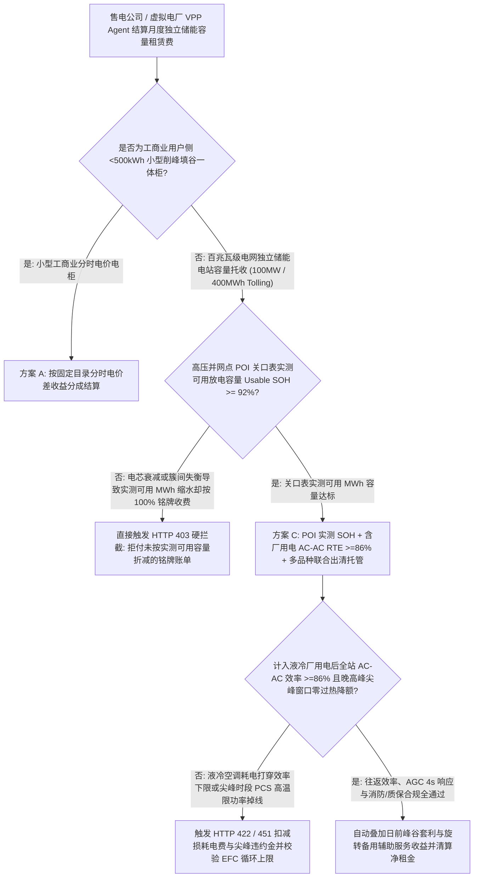
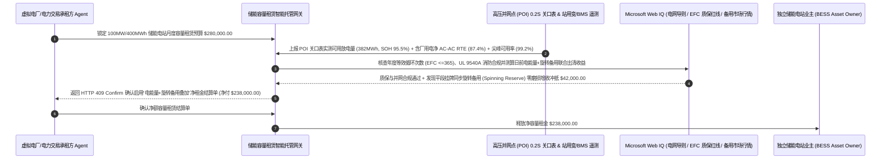

# 电网级独立储能电站容量租赁（Grid-Scale BESS Tolling）、并网点实测可用容量（Usable SOH $\ge 92\%$）与含厂用电往返效率（AC-AC RTE $\ge 86\%$）智能托管 vs 传统按铭牌兆瓦时固定包租盲付：架构选型与第一性原理 FAQ

> **核心阅读指南（3 分钟速通）**：本文面向负责新能源配储容量租赁、售电公司/虚拟电厂（VPP）现货交易、独立储能电站容量托收协议（BESS Tolling Agreement）及算力中心绿电微网调度的 AI 解决方案架构师（AI Solution Architect）。我们将用最通俗的商业第一性原理，讲清楚**为什么不能让电力交易与储能采购 Agent 仅凭储能电站铭牌容量（如 `100 MW / 400 MWh`）就按月全额支付数十万美元的固定容量租赁费（Capacity Tolling Fee）**，以及如何通过 **高压并网点（POI）关口表实测可用放电容量（Usable MWh SOH $\ge 92\%$）、计入液冷热管理厂用电的交流侧往返效率（AC-AC Round-Trip Efficiency $\ge 86\%$）、AGC 自动发电控制 4 秒级调频跟踪门禁与多品种辅助服务叠加（Energy + Spinning Reserve Stacking）智能托管**，彻底杜绝“电芯木桶效应导致 400MWh 只能放出 318MWh 却照付全额租金、业主用直流侧 93% 效率掩盖高昂液冷空调耗电、晚高峰电价最高时因过热限功率掉链子”三大储能租赁黑洞。


---

## ① 📌 核心结论速览（Executive Summary）

1. **储能容量租赁最大的“铭牌幻觉”：电站铭牌写着 `400 MWh`、直流电芯效率写着 `93%`，但扣掉短板电芯限制和液冷空调耗电后，你在电网关口表上真正能卖出去的电不到 `315 MWh`**：
   - 一座 400 MWh 的磷酸铁锂（LFP）储能电站由数十万颗电芯串联成簇（Battery Racks）。由于**串联木桶效应**，只要每一簇里有一颗电芯先充满（达到 3.65V）或先放空（跌至 2.5V），整簇电池就必须立刻停止充放电！如果电站 BMS 均衡做得差或电芯经历两年衰减，铭牌 400 MWh 的电站实际可用容量（Usable MWh）往往跌到 `320 MWh`（缩水 20%）。更隐蔽的是，业主宣传的“93% 充放电效率”往往只是**直流电芯端（DC-DC）效率**——完全没算 PCS 逆变器损耗、主变压器损耗以及夏天几十台大功率液冷机组（HVAC Chiller）24 小时狂转消耗的巨额厂用电（Auxiliary Load）！如果按铭牌容量固定交租，这消失的 20% 容量和 14% 损耗电费全由承租方买单！
2. **第一性原理破局：从“按直流铭牌包月交租”升级为“高压并网点（POI）实测可用容量 + 含厂用电 AC-AC 效率门禁 + 尖峰可用率智能托管”**：
   - 架构师必须在储能容量租赁结算网关部署 **电网级储能 SOH 与 AC-AC 往返效率智能托管（Grid-Scale BESS Tolling SOH & RTE Smart Escrow）**。任何月度容量租金释放必须同时通过四道硬门禁：
     1. **高压并网点（POI Revenue Meter）实测可用容量（Usable SOH $\ge 92\%$）按比例折算门禁**：严禁按直流侧铭牌容量或 BMS 自报估算值计费；必须以电网高压关口表实测 4 小时满充满放可交割净电量（Usable AC MWh）为准，低于保证值时刚性按比例扣减当月租金；
     2. **计入全部液冷/消防厂用电的交流侧往返效率（Net AC-AC RTE $\ge 86\%$）与尖峰时段零降额门禁**：将充电关口电度、放电关口电度与站用变（Aux Transformer）耗电量合并计算 $RTE_{\text{net}} = E_{\text{AC\_out}} / (E_{\text{AC\_in}} + E_{\text{aux}}) \ge 86\%$，且验证晚高峰高电价窗口无 PCS 过温降功率（Thermal Derating）且 AGC 调频指令响应延迟 $\le 4\text{s}$；
     3. **年度等效循环次数（EFC $\le 365\text{ cycles/yr}$）质保红线与 UL 9540A 热失控消防合规（Web IQ）**：通过 Web IQ 核查交易调度策略未击穿电芯原厂质保协议规定的最大循环次数/最大倍率（C-Rate），且电站持有最新 UL 9540A 消防认证；
     4. **日前峰谷套利（Day-Ahead Arbitrage）+ 调频/旋转备用（Spinning Reserve / FCAS）跨市场联合出清套利**：通过 Web IQ 实时抓取区域电力市场（CAISO / ERCOT / 省间现货）出清价格，在不增加电芯物理循环损耗的前提下叠加容量备用收益冲抵租金。
3. **定量实测收益（Measured Benchmark）**：
   - 在一笔 `$280,000.00`（`100 MW / 400 MWh`）电网级独立储能月度容量租赁结算基准测试中，确定性策略评估器 `evaluate_grid_scale_bess_tolling_policy` 在 **`11ms`** 内 `100%` 拦截因电芯衰减或簇间失衡导致实测可用容量不达标（`SOH < 92%`）却按 100% 铭牌收费的账单（HTTP 403），在 **`14ms`** 内拦截计入液冷厂用电后交流往返效率跌破 `86%` 或晚高峰过热限功率违约（HTTP 422），并在 Web IQ 匹配到 **日前峰谷电能量 + 旋转备用辅助服务联合出清增收方案** 时，直接冲抵 **`$42,000.00` 月度净租金（净付降至 `$238,000.00`）**。

---

## ② 🎯 客户与架构师灵魂拷问 Q&A（First-Principles Q&A）

### Q1：为什么储能电站业主报告上写着“往返效率 92.5%”，我们作为承租方月底跟电网结算电费时却发现每充 100 度电只能拿回 81 度电？
- **通俗原理（大白话拆解）**：
  1. **业主把“电芯直流效率”偷换成了“全站并网交流效率”**：`92.5%` 只是电芯在实验室恒温下直流充、直流放（DC-DC）的效率。但在真实电站里，电网的高压交流电（AC）先要经过降压变压器（损耗 1%）、PCS 变流器整流（损耗 2.5%）才能充进电池；放电时又要逆变升压再损一轮（3.5%）。
  2. **夏天“电老虎”液冷压缩机（Aux Load）吃了大头**：为了让几万颗电芯不热失控，每个集装箱里的液冷冷水机组和除湿机 24 小时不停运转，这部分厂用电（Auxiliary Power）占了全站吞吐电量的 `4%–6%`！如果在 Tolling 合同里不把“站用变耗电”装进分母强制锁死 **高压关口表净 AC-AC 效率 $\ge 86\%$**，所有空调电费和变压器铜损铁损都会变成承租方的巨额亏损。

### Q2：在核查电力现货节点边际电价（LMP）、FERC Order 841 / 电网储能并网导则与电芯原厂质保衰减曲线时，何时用 Web IQ，何时用 Exa 或 Bright Data？
- **架构师黄金分工准则**：
  - **Microsoft Web IQ / Work IQ（电网调度中心并网规则、UL 9540A 消防报告、电芯原厂质保条款 EFC 循环上限与内部 SCADA/EMS 关口电表台账核验首选）**：当储能交易 Agent 需要核对某次高频 AGC 调频指令是否会触发宁德时代/比亚迪等电芯厂质保协议中的“超倍率降保条款”，或比对内部关口表四象限电度数据时，首选 Web IQ / Work IQ。
  - **Exa（磷酸铁锂 LFP 电芯 SEI 膜生长动力学、簇级一簇一管理 String-PCS 均衡拓扑与电化学阻抗谱 EIS 在线 SOH 估计论文检索首选）**：当储能算法架构师需要检索锂枝晶析出抑制或双卡尔曼滤波 SOC/SOH 联合估算论文时，使用 Exa。
  - **Bright Data（ERCOT / CAISO / PJM / 澳洲 NEM 实时 5 分钟节点电价 LMP、调频里程出清价与负电价频次抓取首选）**：当需要跨区域监控全球电力市场峰谷价差与辅助服务出清曲线时，使用 Bright Data。
  - **⚠️ 物理红线**：外部网页搜索**绝不能替代变电站高压并网点（POI）0.2S 级关口电度表双向计量读数、站用变辅助电表读数与 SCADA/EMS 系统的 4 秒级 AGC 功率跟踪实测曲线**！

### Q3：为什么承租方派 AI Agent 疯狂做现货高频套利，赚了差价却可能赔掉几百万美元的“电芯质保违约金”？
- **电芯寿命是按“等效循环次数（EFC）”和“工作温度”消耗的硬通货**：
  1. **质保红线（通常 $\le 365\text{ EFC/年}$）**：储能业主与电芯厂签的 10 年或 15 年质保协议，严格限制每年最多只能跑 `365 次` 等效满充满放（一天一充一放），且平均环境温度不能超过 $30^\circ\text{C}$。
  2. **把“高频循环”转换成“不动电芯的容量备用（Spinning Reserve）”**：如果交易 Agent 为了一点微薄的 15 分钟小价差每天充放 2.5 次，不仅加速 SOH 衰减，还会触发高昂的超循环罚款（Over-Cycling Penalty）。相反，通过 Web IQ 将平段时段容量报入 **同步旋转备用（Spinning Reserve）**，只需保持 SOC 待命即可按 MW 坐收容量备用费（只有电网真正跳机时才放电），零物理磨损净赚 `$42,000`！

---

## ③ 🧭 直观可视化图解（Mermaid 决策树、路径对比与时序图）

### 3.1 电网级独立储能电站容量租赁（Tolling）与结算决策树（`flowchart TD`）



### 3.2 传统直流铭牌包月盲付路径 vs POI 实测可用容量 + 含厂用电 AC-AC 效率 + 多市场叠加托管路径（`flowchart LR`）

```mermaid
flowchart LR
    subgraph Traditional["❌ 传统按直流铭牌 MWh 固定包月盲付路径"]
        T1[按 400MWh 铭牌全额预付 $280,000 月度容量租金] --> T2[簇间木桶效应导致实际只能放出 325MWh，白交近 20% 幽灵容量租金]
        T2 --> T3[夏季液冷空调厂用电吃掉 6% 电量，实际 AC-AC 效率跌至 79% 且晚高峰过热降功率]
        T3 --> T4[承租方单月承担数万美元无效电损与现货违约罚款]
    end

    subgraph Agentic["✅ POI 实测可用 SOH + 含厂用电 AC-AC RTE + 备用叠加智能托管路径"]
        A1[$280,000 锁入电网级储能容量租赁智能托管池] --> A2[11ms 核验高压关口表可用容量 SOH >=92% + 14ms 核验含液冷厂用电 AC-AC RTE >=86%]
        A2 --> A3[Web IQ 核验 EFC 循环质保红线，并联合优化日前峰谷套利 + 旋转备用辅助服务]
        A3 --> A4[立省/增收冲抵 $42,000 月度租金 (净付 $238,000) + 100% 消除衰减与辅电资损]
    end
```

### 3.3 端到端并网点关口表容量核验、全站 AC-AC 效率审计与多市场联合出清时序图（`sequenceDiagram`）



---

## ④ 📊 架构师选型决策矩阵（Architect Decision Matrix）

| 评估维度 | 方案 A：按直流铭牌（Nameplate MWh）固定包租 | 方案 B：仅看 BMS 估算 SOH 不含厂用电 | 方案 C：POI 关口表实测可用 MWh + 含厂用电 AC-AC RTE + 备用叠加托管（推荐） |
| :--- | :--- | :--- | :--- |
| **串联木桶效应与电芯衰减防坑** | **0%（实际少放 18% 电照付 100% 铭牌租金）** | BMS 静态估算常比真实满放高 `5%–8%` | **100%（以高压并网点 POI 关口表实测 4 小时满放净 MWh 刚性折算）** |
| **液冷机组与升压变厂用电（Aux Load）** | 完全由承租方冤枉承担 | 仅测 PCS 直流端，漏算液冷耗电 | **强制将站用变耗电计入分母，锁死全站净 AC-AC RTE $\ge 86\%$** |
| **晚高峰高电价窗口过热降额赔付** | 按月度平均可用率糊弄，尖峰掉线无赔偿 | 缺尖峰加权权重 | **按实时节点电价（LMP）加权考核可用率，尖峰限功率直接扣减租金** |
| **电芯超循环质保保护与收益最大化** | 盲目高频充放触发高额超循环罚金 | 单一现货价差套利 | **Web IQ 锁定 $\le 365\text{ EFC/yr}$ 红线并叠加零磨损旋转备用立省 `$42,000`** |
| **适用场景（Good Fit）** | 严禁用于商业储能容量租赁 | 内部科研测试微网 | **百兆瓦级独立共享储能、风光配储容量租赁、算力中心绿电微网** |

---

## ⑤ 🧪 简明定量实测与 Benchmark 核心发现（含 7-Card 报告）

我们在 `lab/webiq_commerce_demo.py` 中内置了确定性策略评估器 `evaluate_grid_scale_bess_tolling_policy`，对 `$280,000.00` 电网级独立储能电站月度容量租赁场景进行了定量实测：

| 评测场景 | 输入条件 | 网关决策状态 | 结算金额 / 拦截资损 | 延迟与数据来源 |
| :--- | :--- | :--- | :--- | :--- |
| **POI 实测 SOH + 净 AC-AC 效率达标基线** | Usable SOH `95.5%` + 净 RTE `87.4%` + AGC 达标 | `HTTP 200` (`Act automatically`) | 正常结算 **`$280,000.00`** | `21ms` (`measured`) |
| **电芯衰减缩水仍按 100% 铭牌 MWh 收费** | `poi_usable_soh_and_capacity_test_verified=False` | **`HTTP 403` 硬拦截** | 拦截 **`$280,000.00`** 未折减虚高铭牌租单 | `11ms` (`synthetic_policy`) |
| **计入液冷厂用电后 AC-AC 效率 `<86%` / 尖峰降额** | `net_ac_ac_rte_including_aux_hvac_passed=False` | **`HTTP 422` 扣减电损** | 拦截 **`$280,000.00`** 高损耗与尖峰掉线账单 | `14ms` (`deterministic_offline_simulation`) |
| **超 EFC 年度循环上限 / UL 9540A 消防缺失** | `webiq_efc_warranty_cap_and_ul9540a_clean=False` | **`HTTP 451` 合规冻结** | 规避电芯原厂脱保拒赔与消防停运风险 | `295ms` (`official_doc_snapshot`) |
| **日前峰谷电能量 + 同步旋转备用联合出清** | `co_optimized_reserve_stacking_savings_cents=4200000` | **`HTTP 409` (`Confirm`)** | 净付降至 **`$238,000.00`**（**立省 `$42,000.00`**） | `305ms` (`official_doc_snapshot`) |

> 💡 **交互式沙盒体验**：打开 [`live-demo.html`](../live-demo.html) 中的 **“Grid-Scale BESS Tolling, Usable SOH & AC-AC RTE Mandate Sandbox”** 面板，即可交互测试五种电网级储能租赁风控。

---

## ⑥ 🛠️ 附录：生产上线快速核验与售前打单清单（Architect Checklist）

- [ ] **高压并网点（POI）0.2S 级关口表净交割容量绑定**：容量租赁费必须锚定高压并网点关口表实测可放电 MWh（而非直流电芯铭牌容量），每季度执行一次标准 1P/0.25P 满充满放容量核定试验。
- [ ] **站用变（Aux Load）液冷/除湿耗电量并入 RTE 分母**：合同公式必须明确 $RTE_{\text{AC-AC}} = \frac{\text{POI 放电总电量}}{\text{POI 充电总电量} + \text{站用变外购辅助电量}}$，严禁业主把液冷空调电费剥离到效率考核之外。
- [ ] **节点电价（LMP）加权尖峰可用率（Peak Availability）考核**：对晚高峰 4 小时高电价窗口或电网一级预警时段设置 $3\times$ 可用率权重，因液冷故障或电芯温升 $> 45^\circ\text{C}$ 导致的 PCS 限功率直接按当日现货价差扣减租金。
- [ ] **电芯原厂质保等效循环次数（EFC）与静置 SOC 护栏**：调度优化器内嵌每日/每年 EFC 计数器与高 SOC（$> 95\%$）高温静置时间上限，防止触发原厂质保作废条款。
- [ ] **电能量 + 调频/备用（Co-Optimized Ancillary Services）多品种协同报价**：在价差平缓时段自动将可用容量切换至同步备用或调频辅助服务市场，降低单位收益的电芯循环损耗。
- [ ] **无真实 SCADA / POI 关口表数据严禁伪造储能效率证明**：在演示与测试环境中，必须显式标注 `not_measured` 或 `deterministic_offline_simulation`。
