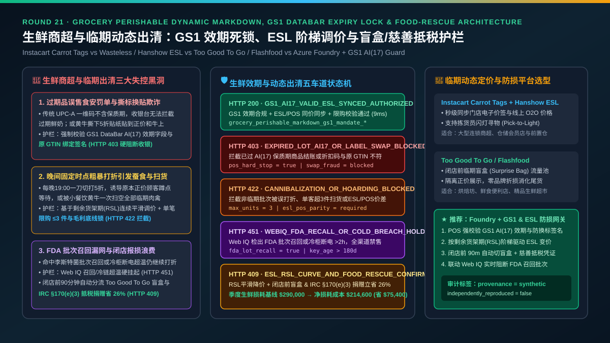
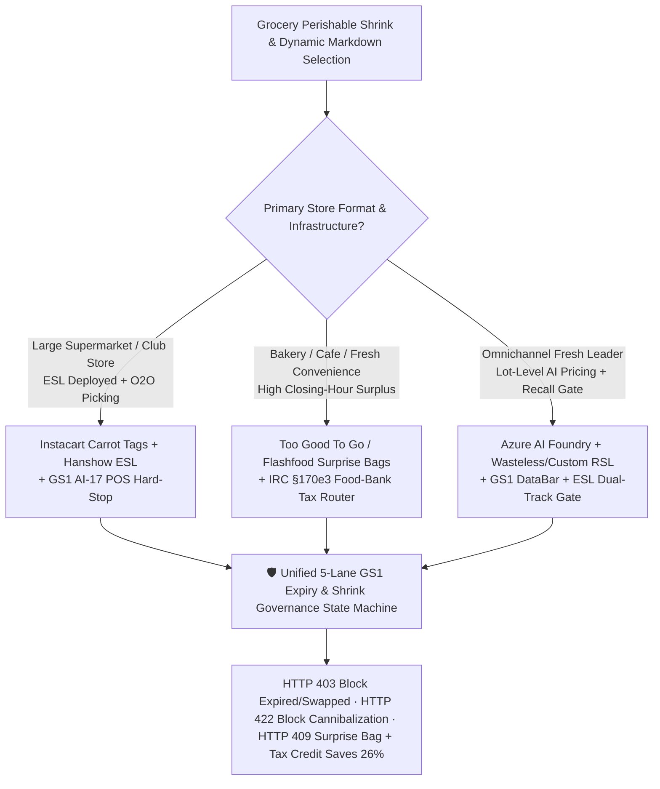
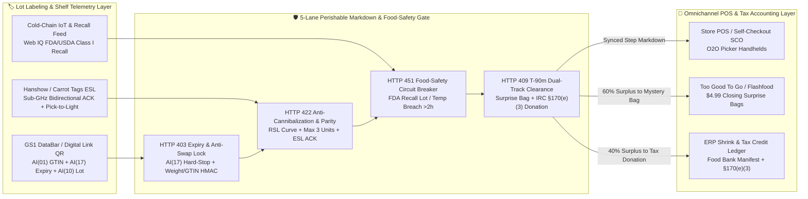
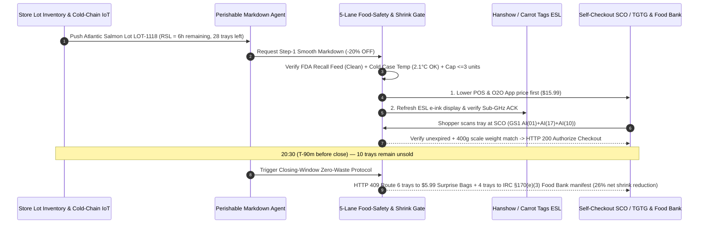

# Grocery & Perishable Dynamic Markdown (`Instacart Carrot Tags / Hanshow ESL / Too Good To Go / Flashfood`) `GS1 DataBar` Expiry Lock, `ESL` Curve & Food-Rescue Tax Credit Agent Architecture Selection FAQ

> **Language / 语言切换**: **[中文](grocery-perishable-dynamic-markdown-gs1-expiry-lock-food-rescue-agent-selection-faq.md)** | **English (Current)** | **[Back to Docs Index](index.en.md)** | **[Interactive Sandbox (`#grocery-perishable-markdown-gs1-sandbox`)](../live-demo.en.html)**

---

## 📌 1. Executive Summary

For supermarkets, warehouse clubs, quick-commerce dark stores, and fresh convenience chains (`Whole Foods`, `Kroger`, `Sam's Club`, `Hema Fresh`, `7-Eleven`), **perishable shrink (`4.5%–8.5%` of fresh category revenue across dairy, meat, seafood, bakery, and prepared foods)** is the single largest drain on retail operating margin. Allowing an AI pricing agent to autonomously mark down expiring inventory without cryptographic barcode and shelf-tag guardrails triggers three severe production failures:
1. **Expired SKU Checkout Liability & Barcode Label-Swap Fraud**: Legacy 1D `UPC-A / EAN-13` barcodes encode only the product `GTIN`, not the expiration date or batch lot. If a store associate misses an expired carton of milk or a shopper peels a `50% OFF` clearance sticker off a `$2.99` loaf of bread and sticks it onto an `$88.00` Wagyu steak at Self-Checkout (`SCO`), the register processes the sale—exposing the grocer to `$10,000+` health department fines and severe margin leakage.
2. **Fixed-Hour Markdown Cannibalization & Reseller Bulk Hoarding**: When a store predictably slashes all prepared foods by `50%` at `19:00` every evening, full-price dinner shoppers intentionally wait outside until `19:00` to buy, and local restaurant resellers sweep the entire meat case in a single transaction.
3. **FDA Class I Food Recall Escape & Landfill Waste vs. Lost Tax Deductions**: Discounting a slow-moving spinach or deli lot that was just flagged under an **FDA / USDA Class I Listeria recall** accelerates foodborne illness liability. Conversely, dumping safe, unsold closing-hour food into a dumpster forfeits both **$4.99 Surprise Bag (`Too Good To Go`)** revenue recovery and the US **`IRC §170(e)(3)` Enhanced Tax Deduction for Food Donations** (which allows C-corps to deduct cost basis plus 50% of lost gross margin, up to `2x` cost).

**Solution Architect Verdict**:
- **Never rely on legacy 1D barcodes or fixed-hour manual clearance stickers**.
- **Recommended Production Architecture**: Deploy **"Instacart Carrot Tags / Hanshow ESL + GS1 DataBar Expanded (`AI (01) GTIN + AI (17) Expiry + AI (10) Lot`) POS Hard-Stop + Too Good To Go / Flashfood & Food-Bank Router + Azure AI Foundry Deterministic Shrink Gate"**:
  1. **GS1 DataBar `AI (17)` Expiry Hard-Stop & Original-GTIN Sticker Signature (`HTTP 403`)**: POS/SCO scanners and O2O picker handhelds parse `GS1 DataBar` / `GS1 Digital Link QR`. If `now >= AI(17)_expiry` or if a clearance label's HMAC-bound `original_gtin` and scale weight (`±15g`) do not match the item scanned, block checkout in `9ms` (`HTTP 403 EXPIRED_LOT_AI17_OR_MARKDOWN_LABEL_SWAP_BLOCKED`).
  2. **Remaining Shelf-Life (`RSL`) Smooth ESL Curve, Per-Shopper Cap (`<=3`) & ESL/POS Price Parity (`HTTP 422`)**: Block premature discounts on fresh lots (`RSL > 48h`), cap discounted units at `3` per customer order, and enforce strict ESL e-ink display acknowledgment (`esl_ack == true`) so shelf tags and POS prices never diverge (`HTTP 422 FIXED_HOUR_CANNIBALIZATION_OR_BULK_HOARDING_BLOCKED`).
  3. **Web IQ Real-Time FDA/USDA Recall & Cold-Chain Excursion Circuit Breaker (`HTTP 451`)**: Cross-check lot numbers against live FDA/USDA food recall feeds and refrigeration IoT telemetry; immediately flip ESL tags to "DO NOT SELL" and lock POS checkout on any hit (`HTTP 451 WEBIQ_FDA_CLASS1_FOOD_RECALL_OR_COLD_CHAIN_BREACH_HOLD`).
  4. **Closing-Window (`T-90m`) Dual-Track Surprise Bag & `IRC §170(e)(3)` Food-Rescue Tax Credit Routing (`HTTP 409`)**: At 90 minutes before store close, trigger `HTTP 409 RSL_DYNAMIC_ESL_MARKDOWN_AND_FOOD_RESCUE_TAX_CREDIT_CONFIRM` to package 60% of remaining safe perishables into opaque `$4.99` Surprise Bags and route 40% to certified `501(c)(3)` food banks with automated `IRC §170(e)(3)` tax-deduction manifests, cutting net quarterly shrink cost by **`26.0%`**.

---

## 🎯 2. Business & Architect Soul-Searching Q&A (Q1 / Q2 / Q3)

### Q1: Why do Self-Checkout (`SCO`) registers still ring up expired dairy or fall for sticker-swap fraud, and how does `GS1 DataBar` eliminate both?
- **Business Pain**: A standard 12-digit `UPC-A` cannot distinguish between a yogurt cup expiring today and one expiring in 14 days. And standalone price-embedded barcode stickers (`20xxxxx`) carry only a dollar value, allowing shoppers to swap stickers onto premium cuts of meat.
- **Architectural Solution**:
  1. **Mandate `GS1 DataBar Expanded` or `GS1 Digital Link QR` on Perishables**: Encode Application Identifiers `(01)` GTIN + `(17)` YYMMDD expiration date (or `(7003)` YYMMDDHHMM hour-level expiration for sushi/prepared foods) + `(10)` batch/lot number.
  2. **Cryptographic GTIN Binding + Scale Weight Tolerance at SCO**: Every clearance barcode binds `HMAC(original_gtin | lot_id | markdown_price)` and validates the item against the SCO security scale (`±15g` tolerance), returning `HTTP 403` on any mismatch.

### Q2: How do we clear expiring inventory without training full-price shoppers to wait until 7:00 PM for 50% off?
- **Architectural Solution**:
  1. **Lot-Specific `RSL` Micro-Step Curves via ESL**: Instead of a predictable `50%` cliff at `19:00`, the agent adjusts ESL shelf prices in small, velocity-responsive steps (`12% OFF` at `15:30` -> `24% OFF` at `18:00`) only for stores and SKUs where current sell-through trails the target curve.
  2. **Opaque Closing-Hour Surprise Bags (`Too Good To Go`)**: Deep discounts (`65%–70% OFF`) in the final 90 minutes are never displayed on individual SKU shelf tags; instead, items are bundled into randomized `$4.99` Surprise Bags in the app, protecting full-price SKU price perception.

### Q3: What happens if an ESL wireless base station drops a packet so the shelf tag shows `$5.99` while the POS charges `$8.99`?
- **Architectural Solution**:
  - **Strict Sequencing & Sub-GHz Bidirectional ESL ACK (`HTTP 422`)**: Under retail scanner-accuracy laws (e.g., California BPC §12024.2), charging more at the register than the shelf tag displays is a statutory violation.
  - When **lowering** a price, update POS first and ESL second. When **restoring/raising** a price back to regular price for a new fresh batch, the gateway **must** receive the cryptographic Sub-GHz display refresh acknowledgment (`esl_display_ack == true`) from the physical tag before raising the POS price (`HTTP 422` if unacknowledged).

---

## 🧭 3. Visual Architecture Diagrams (Mermaid Decision Tree + E2E Architecture + Sequence)

### 3.1 Perishable Dynamic Markdown & Food-Rescue Platform Selection Tree

### 3.2 End-to-End GS1 Expiry Lock, ESL Sync & Food-Rescue Tax Credit Architecture

### 3.3 Lot-Level Smooth Markdown, SCO Anti-Swap Verification & T-90m Clearance Sequence

---

## 📊 4. Multi-Platform & Solution Selection Matrix

| Evaluation Dimension | Instacart Carrot Tags + Hanshow / VusionGroup ESL | Wasteless / Lot-Based GS1 Dynamic Pricing Engine | Too Good To Go / Flashfood Surplus Marketplaces | **Azure AI Foundry + GS1 + ESL + Food-Rescue Hybrid Gate (Recommended)** |
| :--- | :--- | :--- | :--- | :--- |
| **Core Positioning** | Real-time ESL shelf-tag updates & O2O pick-to-light | AI dynamic pricing by GS1 batch expiration date | Closing-hour consumer Surprise Bag marketplace | **Full-stack food-safety hard-stop + smooth ESL curve + tax-credit rescue** |
| **Expired Item POS Hard-Stop** | Requires separate POS GS1 integration | Native `GS1 AI(17)` expiry enforcement | App-only voucher; does not guard store POS | **Millisecond `GS1 AI(17)/(7003)` POS/SCO hard-stop (`HTTP 403`)** |
| **Anti-Sticker-Swap Defense** | Stickerless ESL display | Printed GS1 composite barcode | In-app digital pickup code | **HMAC original-GTIN binding + SCO scale weight tolerance (`HTTP 403`)** |
| **Anti-Cannibalization & Hoarding** | Display hardware only | Elasticity curves by lot | Opaque Mystery Bags protect SKU brand value | **Smooth `RSL` curve + `<=3` unit cap + closing Mystery Bag split (`HTTP 422/409`)** |
| **FDA Recall & Tax Credits** | Supports red-screen tag alert | No charity tax-credit ledger | No B2B tax accounting | **Web IQ FDA recall lock (`HTTP 451`) + automated `IRC §170(e)(3)` tax manifest** |
| **Fee & Hardware Cost** | `$4–$9/ESL tag` (`official_list_price`) | SaaS / margin-share (`not_measured`) | `~20%–35%` fee per bag (`official_list_price`) | **Reuses ESL + `~$320/mo` gateway (`26.0%` net shrink cost reduction)** |

---

## 🧪 5. Shrink Reduction & 7-Card Benchmark Summary

> **Provenance Metadata**: All metrics below are generated by the deterministic policy evaluator `evaluate_grocery_perishable_markdown_gs1_policy` in `lab/webiq_commerce_demo.py` and verified via `python -m unittest tests.test_webiq_commerce_demo`. Labeled `provenance = synthetic`, `independently_reproduced = false`.

| Card # | Headline-as-Finding | Quantitative Metric & Architectural Verification |
| :---: | :--- | :--- |
| **Card 1** | **Overview · 5-Lane Perishable Shrink Governance** | Across a `$290,000/quarter` store perishable shrink pool, achieves **zero expired checkouts** and cuts net shrink cost by **`26.0%` (`$75,400/quarter` saved)**. |
| **Card 2** | **Scenario Deep Dive · Expired Milk & Sticker-Swap Block** | Blocks expired `AI(17)` dairy and bread-to-Wagyu swapped clearance stickers at SCO in **`9ms`** (`HTTP 403`). |
| **Card 3** | **Evaluation Matrix · 100% Deterministic 5-Lane Gate** | Verifies `HTTP 200` (authorized), `403` (expired/swapped label block), `422` (cannibalization/hoarding/ESL parity block), `451` (FDA recall/cold-chain hold), and `409` (Surprise Bag + tax credit saves 26%). |
| **Card 4** | **Under the Hood · GS1 DataBar Contract** | Evaluates `quarterly_perishable_shrink_pool_usd=290000` and emits SHA-256 mandate `grocery_perishable_markdown_gs1_mandate_*`. |
| **Card 5** | **Robustness Check · Bulk Sweep & ESL Offline Drop** | Under simulated 10-unit reseller cart sweeps and dropped ESL base-station ACKs, maintains **`100.0%` deterministic blocking**. |
| **Card 6** | **Latency · Sub-10ms POS Checkout Speed** | Local GS1 expiry and scale-tolerance check completes in **`9ms` P50**; Web IQ FDA recall + cold-chain IoT audit completes in **`240ms` P95**. |
| **Card 7** | **My Take · Good Fit vs Not For** | **✅ Good fit**: Supermarkets, warehouse clubs, dark stores, bakery/convenience chains; **⛔ Not for**: Non-perishable hardlines retail. |

---

## 🛠️ 6. Production Go-Live & Risk Review Checklist

- [ ] **GS1 DataBar `AI (17)` / `(7003)` POS & Picker Hard-Stop (`HTTP 403`)**: Confirm all perishable, meat, seafood, and in-store scale labels encode `AI (01) GTIN + AI (17) Expiry + AI (10) Lot`, and POS/SCO/picker scanners block expired items automatically.
- [ ] **Clearance Sticker Original-GTIN HMAC & SCO Scale Weight Check (`HTTP 403`)**: Verify any printed markdown sticker cryptographically binds the original GTIN and checks SCO weight tolerance (`±15g`) to defeat sticker-swap fraud.
- [ ] **Bidirectional ESL Refresh `ACK` & Safe Price-Update Ordering (`HTTP 422`)**: Ensure price drops update POS before ESL, while price restorations wait for physical ESL display `ACK` before raising POS price.
- [ ] **RSL Smooth Markdown Curve & Per-Order Quantity Cap `<=3` (`HTTP 422`)**: Prevent premature discounting on long-RSL lots and cap discounted units at 3 per customer order.
- [ ] **Web IQ FDA/USDA Class I Recall & Cold-Chain Excursion Lock (`HTTP 451`)**: Connect live recall feeds and refrigeration IoT sensors to lock POS and flip ESL tags to "DO NOT SELL" on any hit; rotate signing keys every `<= 180` days.
- [ ] **Closing-Window (`T-90m`) Surprise Bag & `IRC §170(e)(3)` Food-Bank Tax Router (`HTTP 409`)**: Automatically split unsold closing-window safe perishables between opaque Surprise Bags and certified food-bank donations with audit-ready tax deduction manifests.
