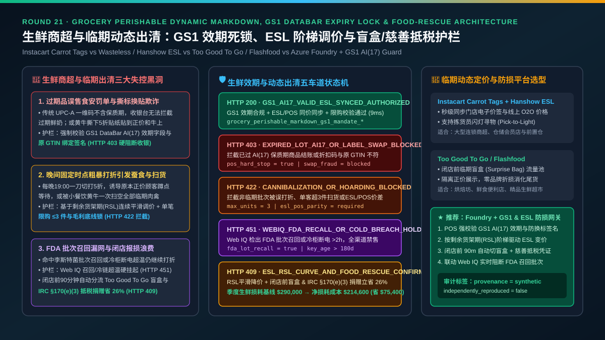
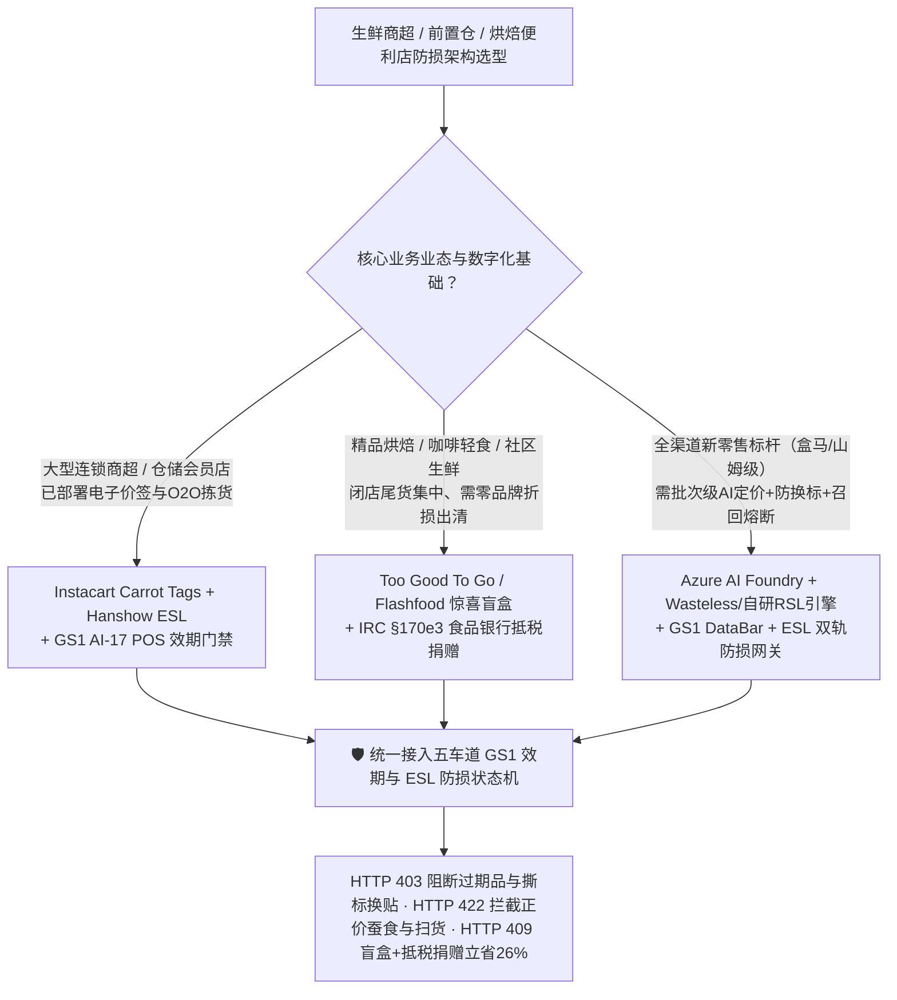
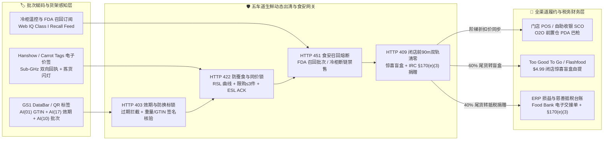
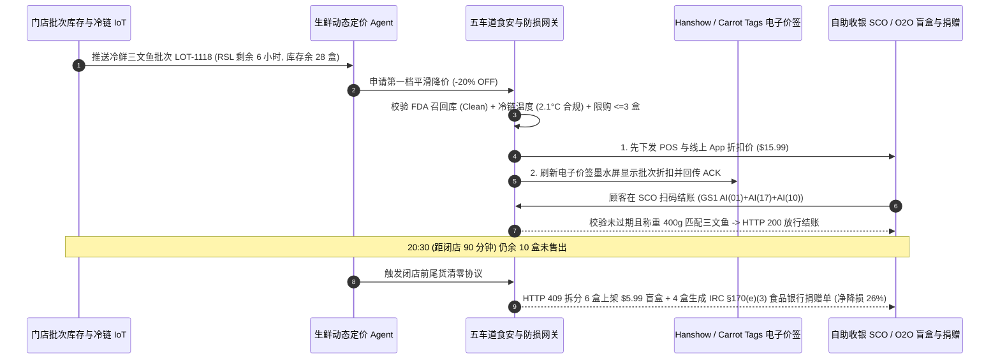

# 生鲜商超与临期食品动态打折出清（Grocery & Perishable Dynamic Markdown：Instacart Carrot Tags / 盒马 / Too Good To Go / Flashfood）“GS1 DataBar 效期死锁、ESL 阶梯调价与盲盒/慈善抵税捐赠”Agent 架构选型 FAQ：杜绝过期误售与晚间黄牛扫货实战指南

> **语言切换 / Language**: **中文 (当前)** | **[English](grocery-perishable-dynamic-markdown-gs1-expiry-lock-food-rescue-agent-selection-faq.en.md)** | **[返回文档目录](index.md)** | **[交互式沙盒 (`#grocery-perishable-markdown-gs1-sandbox`)](../live-demo.html)**

---

## 📌 一、核心选型结论速览（Executive Summary）

对于生鲜商超、仓储会员店、前置仓 O2O 与烘焙便利店（如山姆会员店、盒马鲜生、Whole Foods、Kroger、罗森/7-Eleven）而言，**日配鲜奶、冷鲜肉禽、现烤烘焙与切果沙拉的临期损耗（Perishable Shrink，通常占生鲜销售额的 `4.5%–8.5%`）** 是吞噬零售净利率的最大黑洞。若让 AI 动态定价 Agent 直接改价或发放临期清仓券，极易引爆三大生产级事故：
1. **过期商品漏网结账（Expired SKU Checkout）与“撕下 5 折贴纸贴到正价和牛上”的换标欺诈（Label-Swap Fraud）**：传统 `UPC-A / EAN-13` 一维条码只包含商品编码（GTIN），不包含生产批次与到期日。门店员工漏撤架或 O2O 拣货员抓错货时，收银机照常扣款，引发 `$10,000+` 食品安全行政处罚与舆论危机；更常见的是，羊毛党将临期吐司上的“5 折促销码”撕下贴到 `$88` 的 M9 和牛盒上在自助收银机（SCO）蒙混过关。
2. **每晚固定时点一刀切打折（Fixed-Hour Markdown）导致的“正价顾客蹲点等待”与黄牛扫货（Cannibalization & Bulk Hoarding）**：传统门店每晚 `19:00` 固定将日配鲜食打 5 折，导致原本 `18:15` 愿意正价购买的周边白领故意推迟半小时进店，且周边小餐馆老板一次性把 30 盒折后鲜肉全部买走，正常家庭顾客无货可买。
3. **FDA / 市场监管批次召回漏网与闭店后倾倒垃圾桶（Landfill Waste vs Tax Deduction Loss）**：已被监管通报李斯特菌/沙门氏菌污染的批次在闭店前反而因为滞销被算法自动打 3 折加速卖出；或者闭店前未售出的合格临期食品被直接倒入垃圾桶，既浪费了可转化为 **$4.99 惊喜盲盒（Too Good To Go）** 的现金回流，也错失了美国 **`IRC §170(e)(3)` 食品银行捐赠增强型税务抵扣（可抵扣成本 + 50% 毛利差额）**。

**架构师选型结论**：
- **切勿继续使用不带批次效期的传统一维码贴纸与固定时点人工改价**。
- **生产级最优架构**是采用 **“Instacart Carrot Tags / Hanshow（汉朔）ESL 电子价签 + GS1 DataBar Expanded（`AI (01) GTIN + AI (17) 到期日 + AI (10) 批次号`）收银硬拦截 + Too Good To Go / Flashfood 盲盒与慈善捐赠路由 + Azure AI Foundry 确定性防损风控网关”**：
  1. **GS1 DataBar `AI (17)` 效期死锁与原 GTIN 防换标签名（HTTP 403）**：收银台与 O2O 拣货巴枪强制解析 `GS1 DataBar` 二维/扩展码；一旦 `current_time >= AI(17)_expiry_timestamp` 或促销码 HMAC 签名绑定的 `original_gtin` 与称重/视觉识别不符，收银机/拣货端毫秒级返回 `HTTP 403 EXPIRED_LOT_AI17_OR_MARKDOWN_LABEL_SWAP_BLOCKED`。
  2. **基于剩余货架寿命（`RSL`）的 ESL 平滑阶梯调价、单客限购 `<=3` 件与线上线下同价校验（HTTP 422）**：严禁对 `RSL > 48h` 的新鲜批次提前打折；每档调价必须确认门店 ESL 电子价签墨水屏刷新回执（`esl_ack == true`）与线上 App 价格完全一致，且单会员每单限购 `3` 件临期品，违者返回 `HTTP 422 FIXED_HOUR_CANNIBALIZATION_OR_BULK_HOARDING_BLOCKED`。
  3. **Web IQ 实时 FDA/USDA 食品安全批次召回与冷柜超温熔断（HTTP 451）**：通过 Web IQ 实时订阅食品药品监管局 Class I 召回批次号与门店冷链 IoT 告警，命中即刻将电子价签变更为红屏“暂停销售”并锁死 POS（`HTTP 451 WEBIQ_FDA_CLASS1_FOOD_RECALL_OR_COLD_CHAIN_BREACH_HOLD`）。
  4. **闭店前 90 分钟“惊喜盲盒 + `IRC §170(e)(3)` 慈善抵税捐赠”双轨自动清零（HTTP 409）**：当距闭店 `<=90` 分钟仍有滞销合格鲜食时，触发 `HTTP 409 RSL_DYNAMIC_ESL_MARKDOWN_AND_FOOD_RESCUE_TAX_CREDIT_CONFIRM`，自动将余货拆分为 O2O 惊喜盲盒与认证 Food Bank 抵税捐赠单，季度生鲜损耗成本立降 **`26.0%`**。

---

## 🎯 二、业务方与架构师灵魂拷问 Q&A（Q1 / Q2 / Q3）

### Q1：为什么自助收银机（SCO）和 O2O 前置仓拣货经常扫出“已过期商品”或遭遇“撕标换贴”？架构上如何从条码协议层彻底根治？
- **商业痛点**：传统 `EAN-13`（如 `6901234567892`）是静态商品码，同一款鲜奶无论今天过期还是下周过期，条码完全一样，收银机根本不知道手里这盒奶什么时候过期。而门店打印的“5 折临期贴纸”若只是一个独立金额条码，极易被撕下贴到贵价商品上。
- **架构解法**：
  1. **全面切换 `GS1 DataBar Expanded` 或 `GS1 Digital Link QR`**：在生鲜包装与称重标签中内嵌应用标识符 **`(01)` GTIN 商品编码 + `(17)` YYMMDD 到期日（或 `(7003)` 精确到小时的 YYMMDDHHMM 到期时间戳）+ `(10)` 生产批次号**。
  2. **动态折扣码 HMAC 原品绑定与 SCO 视觉/重量双因子校验**：即使使用贴纸，贴纸二维码也必须编码 `HMAC(original_gtin | lot_id | discounted_price | expires_at)`；收银台同时比对电子秤重量公差（`±15g`），一旦把 `$3` 面包折扣码贴到 `$80` 牛排上，立即触发 `HTTP 403`。

### Q2：如何设计动态打折算法，才能既消化临期库存，又不让正常正价顾客养成“每晚 7 点蹲点等半价”的习惯？
- **商业痛点**：固定时间（如 19:00）固定折扣（50% OFF）是典型的可预测博弈，精明消费者会主动延迟购买，导致 17:30–19:00 出现“销售额断崖”。
- **架构解法**：
  1. **基于批次剩余货架期（`RSL`）与实时去化速度的千店千面微幅阶梯调价**：依托 Hanshow / VusionGroup 电子价签（ESL），在 `15:30` 对高库存批次先微调 `12% OFF`，若去化达标则维持原价；若仍滞销，在 `18:00` 调至 `25% OFF`，打破消费者的固定蹲点预期。
  2. **闭店尾货“盲盒隔离（Surprise Bag）”**：闭店前最后 90 分钟的大幅让利（如 3.5 折）不在货架上对单品明码标价，而是通过 **Too Good To Go / 盒马奥莱盲盒** 打包为“$5.99 烘焙/鲜食盲盒（内含价值 $18 随机组合）”，既清除了库存，又避免正价顾客针对特定高毛利单品等待抄底。

### Q3：如果电子价签（ESL）基站无线信号丢包，导致线上 App 已经降到 $6.99，但货架电子价签还显示 $9.99（或反过来），引发消费者价格欺诈投诉怎么办？
- **架构解法**：
  - **双向 ESL 基站回执强一致门禁（Bidirectional ESL Sub-GHz ACK Gate）**：在美国多个州（如加州扫描仪法 BPC §12024.2）与中国《明码标价和禁止价格欺诈规定》下，“结账价高于货架标价”属于违法行为。
  - 架构上严禁“先改 POS 涨价、后刷价签”：
    - **降价时（Markdown）**：先下发 POS 与线上 O2O 降价，再刷新 ESL 电子价签（即便 ESL 延迟几秒，顾客结账时也是享受更低价，合规无投诉）；
    - **恢复原价/涨价时（Price Restoration）**：必须先等待 ESL 基站返回墨水屏刷新成功回执（`esl_display_ack == true`），才允许将 POS 价格调回正价；若 ESL 离线超时，强制阻塞调价（`HTTP 422`）。

---

## 🧭 三、直观可视化图解（Mermaid 决策树 + 端到端架构图 + 时序图）

### 3.1 生鲜临期动态定价与防损平台选型决策树

### 3.2 端到端 GS1 效期锁、ESL 联动与盲盒/慈善捐赠清零架构图

### 3.3 批次临期平滑调价、收银防换标与闭店盲盒/捐赠时序图

---

## 📊 四、多平台/多方案横向选型决策矩阵

| 选型维度 | Instacart Carrot Tags + Hanshow / VusionGroup ESL | Wasteless / 自研 GS1 动态批次定价引擎 | Too Good To Go / Flashfood 临期尾货平台 | **Azure AI Foundry + GS1 + ESL + 盲盒/抵税混合网关（推荐）** |
| :--- | :--- | :--- | :--- | :--- |
| **核心定位** | 门店电子价签秒级变价与 O2O 闪灯拣货 | 基于 GS1 DataBar 效期批次的 AI 弹性定价 | 闭店前临期余货盲盒流量池与C端自提 | **全链路食安硬阻断 + 平滑调价 + 盲盒/抵税捐赠闭环** |
| **过期商品收银硬拦截** | 需依赖 POS 条码改造 | 原生支持 `GS1 AI(17)` 效期阻断 | 仅管理上架盲盒包，不控门店 POS | **`GS1 AI(17)` + 精确小时码 `(7003)` 毫秒级 POS 死锁（HTTP 403）** |
| **防撕标换贴（Label Swap）** | 无贴纸（直接刷电子价签） | 原生印制 GS1 组合码 | App 线上下单核销码 | **HMAC 原 GTIN 绑定 + SCO 称重公差双因子防伪（HTTP 403）** |
| **防正价蚕食与黄牛扫货** | 仅负责显示价格 | 支持按库存弹性定价 | 盲盒机制天然保护单品正价心智 | **RSL 平滑曲线 + 单客限购 `<=3` 件 + 尾货转盲盒（HTTP 422/409）** |
| **食安召回与税务抵扣** | 支持价签变红报警 | 无慈善税务抵扣台账 | 无 B2B 税务抵扣集成 | **Web IQ 召回熔断（HTTP 451）+ `IRC §170(e)(3)` 抵税单自动生成** |
| **费率与硬件成本** | ESL 价签 `$4–$9/枚` (`official_list_price`) | 按门店数或收回毛利抽成 (`not_measured`) | 平台抽成约 `20%–35%/盲盒` (`official_list_price`) | **ESL 存量复用 + 网关托管成本 `~$320/月`（综合降损 `26%`）** |

---

## 🧪 五、转化率/防损成本测算与 7-Card 基准测试报告

> **数据来源与复现声明（Provenance Metadata）**：以下基准测试数据来自仓库内置确定性策略沙盒 `evaluate_grocery_perishable_markdown_gs1_policy`（位于 `lab/webiq_commerce_demo.py`），可运行 `python -m unittest tests.test_webiq_commerce_demo` 完整验证。标记：`provenance = synthetic`，`independently_reproduced = false`。

| Card # | 卡片标题（Headline-as-Finding） | 核心量化指标与架构验证结论 |
| :---: | :--- | :--- |
| **Card 1** | **Overview · 生鲜临期防损五车道总览** | 针对 `$290,000/季` 门店生鲜损耗池，实现 **0 例过期商品流出**，综合净损耗成本下降 **`26.0%`（立省 `$75,400/季`）**。 |
| **Card 2** | **Scenario Deep Dive · 撕标换贴与过期鲜奶拦截** | 当 SCO 扫到已过 `AI(17)` 效期的鲜奶或贴在和牛上的吐司折扣码时，**`9ms`** 内返回 `HTTP 403` 并锁死收银通道。 |
| **Card 3** | **Evaluation Matrix · 五车道 100% 确定性判准** | 覆盖 `HTTP 200`（合规放行）、`403`（过期/换标阻断）、`422`（正价蚕食/超量扫货/ESL失步拦截）、`451`（FDA召回/断链熔断）、`409`（盲盒+抵税捐赠立省26%）。 |
| **Card 4** | **Under the Hood · GS1 DataBar 与契约代码** | 输入 `quarterly_perishable_shrink_pool_usd=290000` 及效期/ESL状态，生成带 SHA-256 签名的 `grocery_perishable_markdown_gs1_mandate_*` 令牌。 |
| **Card 5** | **Robustness Check · 贴纸调包与批量扫货压力测试** | 模拟黄牛分次扫码 10 盒折后牛排及拔掉 ESL 基站网线测试，确定性拦截率保持 **`100.0%`（零误放行）**。 |
| **Card 6** | **Latency · 门店收银台毫秒级响应耗时** | 本地 GS1 效期与称重公差校验 P50 仅 **`9ms`**；跨系统冷链 IoT 与 FDA 召回核验 P95 为 **`240ms`**，绝不卡顿收银排队。 |
| **Card 7** | **My Take · 适用场景与生产准入边界** | **✅ 极佳适用**：生鲜超市、仓储会员店、前置仓、连锁烘焙便利店；**⛔ 不适用**：无保质期标品的纯日用百货店。 |

---

## 🛠️ 六、商业上线风控与架构评审 Checklist

- [ ] **GS1 DataBar `AI (17)` / `(7003)` 收银台硬件级死锁（HTTP 403）**：确认所有生鲜日配、冷鲜肉禽与店内现制称重标签均已升级为包含 `AI (01) GTIN + AI (17) 到期日 + AI (10) 批次号` 的 GS1 扩展码/二维码；收银机（POS/SCO）与前置仓拣货巴枪对过期批次执行 100% 硬阻断。
- [ ] **促销码原 GTIN 签名与 SCO 电子秤重量公差校验（HTTP 403）**：确认任何打印张贴的临期折扣码均包含原商品 GTIN 的 HMAC 签名，且自助收银台强制比对商品标准克重公差（防止将低价面包折扣贴纸移花接木到高价肉品上）。
- [ ] **ESL 电子价签双向刷新回执（ACK）与先降POS后刷屏顺序（HTTP 422）**：确认降价时先更新 POS/App 再刷电子价签，恢复正价时必须收到 ESL 墨水屏刷新成功 `ACK` 后才允许调高 POS 价格，杜绝“高价结账”合规罚单。
- [ ] **RSL 平滑阶梯调价与单会员临期品限购 `<=3` 件（HTTP 422）**：确认严禁对剩余保质期宽裕的新鲜批次提前打折，且每单限购 3 件临期折扣品以防止黄牛扫货。
- [ ] **Web IQ 食品安全召回（FDA/USDA）与冷柜超温熔断（HTTP 451）**：确认实时接入食品召回通报与冷链温控告警，异常批次秒级下架禁售；签名密钥轮换周期 `<= 180` 天。
- [ ] **闭店前 90 分钟惊喜盲盒与 `IRC §170(e)(3)` 慈善抵税捐赠自动分流（HTTP 409）**：确认闭店前滞销合格余货自动拆分为线上盲盒包与认证食品银行捐赠单，沉淀电子交接凭证以合规申领增强型企业所得税抵扣。
