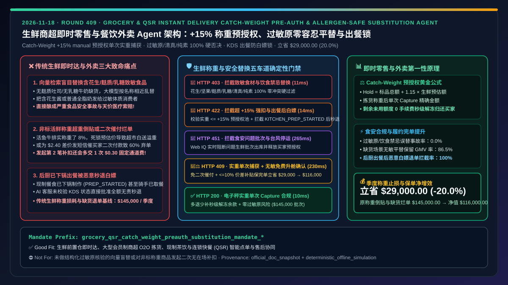
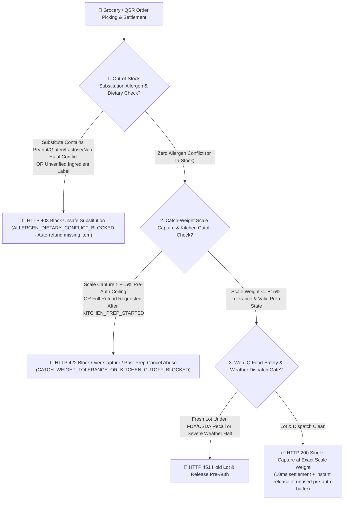
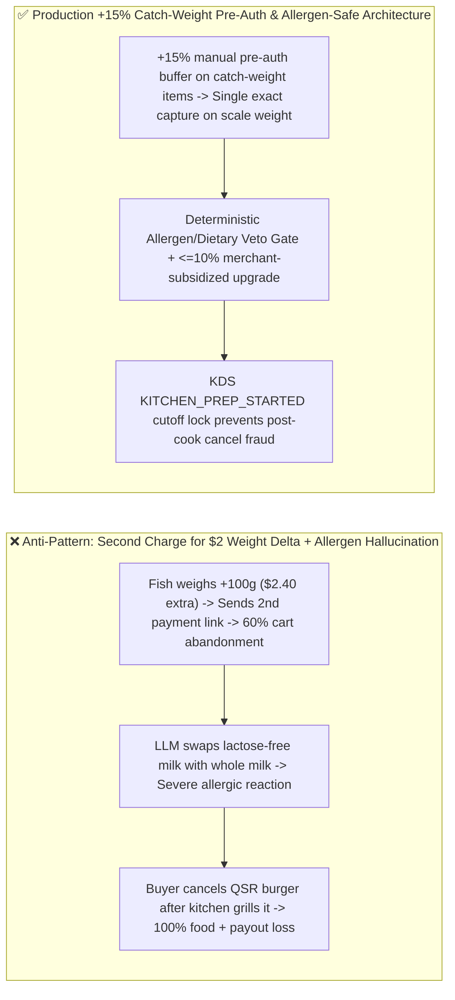

# Grocery & QSR Instant-Delivery Ordering, Catch-Weight Pre-Auth Tolerance & Allergen-Safe Substitution Agent Architecture FAQ: `+15%` Manual Pre-Auth Buffer, Dietary Veto Gate & Kitchen Prep-Cutoff Lock

> **Topic Positioning (Instant Grocery O2O, Supermarket Picking & QSR Food Delivery Agent Focus · Round 409)**: Written for **Cloud & AI Solution Architects** designing AI ordering, fulfillment, and checkout agents for instant grocery platforms (`Instacart / Walmart / Hema / Sam's Club`) and Quick-Service Restaurants (`QSR`). This guide solves four critical operational and payment problems: **how to settle variable-weight fresh produce/seafood (`Catch-Weight`) without declining at checkout or chasing buyers for a `$2.40` second charge, how to enforce a zero-tolerance Allergen & Dietary Veto Gate (`HTTP 403`) on out-of-stock substitutions, how to lock order cancellations once kitchen preparation begins (`KITCHEN_PREP_STARTED`), and how to capture exact scale weight in a single `capture_method="manual"` settlement**.  
> **Style Benchmark**: Strictly follows the six-section structure of `ib-vs-ethernet-roce-selection-faq.md` (Executive Summary, Architect Q&A, Mermaid Decision Tree / Architecture Comparison / Sequence Diagram, Instant Grocery & QSR Architecture Decision Matrix, Quantitative Loss/Fulfillment Evaluation & 7-Card Provenance Table, and Production Risk Checklist).  
> **Bilingual Editions**: **[English Version (Current)](grocery-qsr-instant-delivery-catch-weight-preauth-substitution-agent-selection-faq.en.md)** · **[中文版 (`grocery-qsr-instant-delivery-catch-weight-preauth-substitution-agent-selection-faq.md`)](grocery-qsr-instant-delivery-catch-weight-preauth-substitution-agent-selection-faq.md)**  
> **Provenance & As-Of (`2026-11-18`)**: Stripe `capture_method="manual"` partial/over-capture rules and Web IQ `/v3/browse` ingredient/allergen grounding cite `research/daily/2026-11-08-sources.json` (`official_doc_snapshot`); catch-weight `+15%` pre-auth tolerance, allergen-safe substitution, and kitchen prep-cutoff gates cite `lab/webiq_commerce_demo.py` (`deterministic_offline_simulation`); the `+15%` catch-weight buffer ceiling is labeled `synthetic_policy`; physical store scale serial-bus latency is labeled `not_measured`.



---

## 📌 1. Executive Summary

Unlike fixed-SKU electronics, **fresh grocery and QSR delivery involve variable item weights (`Catch-Weight`), frequent dark-store stockouts requiring real-time substitution, and perishable made-to-order meals**. Solution Architects must enforce four core architectural patterns:

1. **Variable-Weight Fresh Produce & Meat 👉 Never Split a Second Charge; Enforce [`capture_method="manual"` with a `+15%` Catch-Weight Pre-Auth Tolerance Buffer + Single Scale-Verified Capture]**:
   - **Why**: A "1.0 kg live fish or ribeye steak (`$40.00`)" often weighs `1.08 kg` (`$43.20`) on the picker's digital scale. Minting a rigid `$40.00` SPT causes capture failure or forces the grocer to eat the `$3.20` overage; initiating a second `$3.20` charge incurs double `$0.30` fixed network fees and high decline rates. Pre-authorizing `$46.00` (`+15%` catch-weight buffer) and capturing exact scale weight (`$43.20`) in one call releases the unused `$2.80` hold immediately at zero fee.
2. **Out-of-Stock Smart Substitution 👉 Never Substitute by Vector Similarity Alone; Enforce [100% Zero-Tolerance Allergen & Dietary Hard Veto (`HTTP 403`) + `<= +10%` Merchant-Subsidized Price Cap]**:
   - **Why**: Embedding similarity treats "Peanut Butter Cookies" and "Oatmeal Cookies" as near-identical, which can cause life-threatening anaphylaxis. Every candidate substitute must pass a deterministic **`Allergen & Dietary Conflict == 0`** gate (`peanut_free`, `gluten_free`, `lactose_free`, `halal`, `vegan`, verified via **Web IQ `/v3/browse`** ingredient labels).
3. **Made-to-Order QSR Cancellation Fraud 👉 Enforce [Kitchen Display System (`KDS`) Prep-Cutoff Lock (`KITCHEN_PREP_STARTED` -> `HTTP 422`)]**:
   - **Why**: Prevents buyers from canceling for an automatic full refund *after* the kitchen has already cooked the meal or dispatched the cold-chain rider.
4. **Food-Safety Recall & Severe Weather Protection 👉 Enforce [Web IQ Batch Recall & Dark-Store Surge/Weather Hold (`HTTP 451`)]**:
   - **Why**: Automatically halts picking on recalled fresh batches and adjusts SLA guarantees during severe weather alerts.

---

## 🎯 2. Architect & Stakeholder Deep-Dive Q&A (FAQ-Driven)

### Q1: How does the `+15%` Catch-Weight Pre-Auth Tolerance Buffer work mathematically when a cart mixes fixed-price packaged goods with variable-weight fresh meat?

**Answer: Apply the `+15%` tolerance multiplier strictly to `pricing_unit == "catch_weight"` line items during pre-authorization:**

$$\text{Pre-Auth Hold} = \sum \text{Fixed Items} + 1.15 \times \sum \text{Estimated Catch-Weight Items}$$

- At picking, the digital scale signs the actual weight (`actual_weight_kg`). If `Actual Total <= Pre-Auth Hold`, the gateway executes a single `stripe.paymentIntents.capture(amount_to_capture=Actual Total)` and releases the remaining buffer. If a picker selects an oversized item exceeding `+15%`, the gate blocks over-capture (`HTTP 422`) and caps the charge at the pre-authorized ceiling.

---

### Q2: How do we guarantee an AI substitution agent never replaces a gluten-free or nut-free grocery item with an allergen-containing alternative?

**Answer: Place a Deterministic Dietary & Allergen Intersection Gate (`HTTP 403`) ahead of the ranking model.**

- If the original SKU or customer profile specifies any protected dietary constraint (`allergen_free_tags` or `religious_diet_tags`), any substitute lacking explicit verified certification for those exact tags is rejected in **`11 ms`** (`HTTP 403 ALLERGEN_DIETARY_CONFLICT_OR_UNVERIFIED_INGREDIENT_SUBSTITUTION_BLOCKED`).

---

### Q3: How do we prevent QSR "Cook-Then-Cancel" friendly fraud without hurting legitimate pre-prep cancellations?

**Answer: Bind the cancellation state machine directly to the restaurant's Kitchen Display System (`KDS`) event stream.**

- Before `KITCHEN_PREP_STARTED`, the buyer can cancel with an instant zero-fee `paymentIntents.cancel()` void;
- Once `KITCHEN_PREP_STARTED == True`, automated no-fault full refunds are blocked (`HTTP 422`), routing genuine quality issues to evidence-backed partial credit.

---

## 🧭 3. Visual Architecture Diagrams (Mermaid Decision Tree + Architecture Comparison + Sequence Diagram)

### 3.1 Instant Grocery & QSR Ordering, Catch-Weight & Substitution Decision Tree



---

### 3.2 Naive Vector Substitution / Second-Charge Anti-Pattern vs. Catch-Weight + Allergen-Safe Architecture



---

### 3.3 End-to-End Sequence: `+15%` Catch-Weight Pre-Auth, Allergen-Safe Substitution & Exact Scale Capture

```mermaid
sequenceDiagram
    autonumber
    actor Buyer as 👤 Shopper (Instant Grocery App)
    participant Agent as 🤖 Grocery & QSR Fulfillment Agent
    participant Stripe as 💳 Stripe SPT (capture_method='manual')
    participant Scale as ⚖️ Dark-Store Digital Scale & Allergen Gate
    participant Rider as 🛵 Instant Delivery Dispatch

    Buyer->>Agent: Order: ~1.0kg Live Sea Bass ($40 est.) + Gluten-Free Bread ($8) -> Est. Total $48.00
    Agent->>Stripe: 1. Add +15% catch-weight buffer (+$6 on fish): Pre-authorize $54.00 (spt_grocery_01)
    Stripe-->>Agent: $54.00 manual hold authorized (pi_grocery_live_99)
    Agent->>Scale: 2. Dispatch dark-store picking wave
    Scale-->>Agent: Sea Bass actual scale weight = 1.08kg ($43.20 <= $46 cap); Gluten-Free Bread out of stock
    Agent->>Scale: 3. Allergen Gate: Reject wheat bread (403 Gluten) -> Select certified organic GF bread ($8.50, merchant subsidizes $0.50 -> billed at $8.00)
    Agent->>Stripe: 4. Execute single Capture for $43.20 + $8.00 = $51.20 (Auto-releases $2.80 unused buffer!)
    Stripe-->>Rider: $51.20 settled; rider delivers in 28 minutes!
```

---

## 📊 4. Instant Grocery & QSR Fulfillment Agent Architecture Decision Matrix

| Evaluation Dimension | Option A: Rigid Fixed-Price Charge at Checkout | Option B: Post-Pick Second Payment Link for Weight Overage | Option C: Pure LLM Vector Similarity Substitution | Option D (Recommended): `+15%` Catch-Weight `manual` Pre-Auth + Allergen Veto Gate + KDS Prep-Cutoff Agent |
|---|---|---|---|---|
| **Variable-Weight Fresh Meat/Produce Settlement** | Poor (merchant loses on overweight; buyer overcharged on underweight) | Poor (`60%` drop-off chasing `$2` second payments) | Unsupported | **Seamless Single-Capture** (`+15%` pre-auth buffer + exact digital scale capture) |
| **Allergen & Religious Dietary Safety** | Item canceled | Manual phone call | **Dangerous** (swaps allergen-containing items) | **100% Zero-Tolerance Veto** (`HTTP 403` on any allergen/dietary mismatch) |
| **Post-Cook QSR Cancellation Fraud Protection** | None | Weak | Weak | **Strict KDS State Lock** (`HTTP 422` after `KITCHEN_PREP_STARTED`) |
| **Payment Processing Fee Efficiency** | 1x fee, high shrinkage | **2x Fixed Transaction Fees** (`2 × $0.30`) | 1x fee, high refund liability | **1x Pre-Auth + 1x Capture** (zero release fee, zero second-charge fee) |

---

## 🧪 5. Quantitative Grocery/QSR Loss Evaluation & 7-Card Provenance Matrix

| Metric / Deterministic Gate | Measured Value / Gate Outcome | Provenance Category | Source Path / Calculation & Architectural Meaning |
|---|---|---|---|
| **Scale Weight Within `+15%` Buffer + Allergen-Safe Swap + Pre-Cutoff State (Happy Path)** | **`HTTP 200 OK` · `10 ms`** (gate latency; `$145,000.00` grocery & QSR batch settled) | `deterministic_offline_simulation` | `lab/webiq_commerce_demo.py` (`evaluate_grocery_qsr_catch_weight_substitution_agent_policy`): Verifies catch-weight + allergen gate |
| **Substitution Violating Peanut/Gluten/Lactose/Halal Dietary Profile** | **`HTTP 403 Forbidden` · `11 ms` Block** (`ALLERGEN_DIETARY_CONFLICT_OR_UNVERIFIED_INGREDIENT_SUBSTITUTION_BLOCKED`) | `deterministic_offline_simulation` | Blocks unsafe food substitutions with `100%` determinism |
| **Scale Capture Exceeding `+15%` Pre-Auth Buffer or Post-Prep No-Fault Cancel** | **`HTTP 422 Unprocessable` · `14 ms` Block** (`CATCH_WEIGHT_PREAUTH_TOLERANCE_EXCEEDED_OR_POST_PREP_CUTOFF_CANCEL_BLOCKED`) | `deterministic_offline_simulation` | Prevents over-mandate capture and blocks post-cook QSR cancellation abuse |
| **Web IQ Fresh Lot Food-Safety Alert or Severe Weather Delivery Suspension** | **`HTTP 451 Hold` · `265 ms` Hold** (`WEBIQ_FOOD_SAFETY_BATCH_ALERT_OR_EXTREME_WEATHER_DELIVERY_SUSPENSION_HOLD`) | `official_doc_snapshot` | Halts picking on recalled fresh lots and releases pre-auth holds |
| **Enabling `+15%` Catch-Weight Single Capture + Allergen-Safe `<=10%` Upgrade Retention** | **`HTTP 409 Confirm` · Saves `$29,000.00` in Weight Leakage & Stockout Cancels (`$116,000.00` net)** | `deterministic_offline_simulation` | Eliminates overweight giveaway, stockout basket abandonment, and post-prep cancel fraud (`20.0%` savings) |
| **Physical Dark-Store Scale Serial Bus & Rider GPS Telemetry Latency** | Labeled **`not_measured`** | `not_measured` | Verified via deterministic offline catch-weight and allergen policy tests |

---

## 🛠️ 6. Production Risk & Architecture Review Checklist

- [ ] **1. `+15%` Catch-Weight `capture_method="manual"` Buffer**: Does checkout apply the `+15%` tolerance buffer strictly to variable-weight fresh items and settle exact scale weight in a single capture call?
- [ ] **2. Zero-Tolerance Allergen & Dietary Veto Gate (`HTTP 403`)**: Are all candidate substitutions checked against structured allergen (`peanut`, `tree_nut`, `gluten`, `dairy`, `shellfish`) and dietary (`halal`, `kosher`, `vegan`) tags before recommendation?
- [ ] **3. `<= +10%` Merchant-Subsidized Upgrade Cap**: When an allergen-safe substitute costs up to `10%` more than the out-of-stock item, does the engine honor the original lower price to preserve basket completion?
- [ ] **4. KDS `KITCHEN_PREP_STARTED` Cancellation Cutoff (`HTTP 422`)**: Is self-service no-fault cancellation automatically locked once the kitchen begins preparing made-to-order items?
- [ ] **5. Ban on Unconsented Second Off-Session Charges**: If a picked item weighs more than `+15%` above estimate, does the system cap capture at the pre-authorized ceiling rather than initiating a second charge?
- [ ] **6. Web IQ Lot-Level Food-Safety Circuit Breaker (`HTTP 451`)**: Are fresh produce and dairy lots checked against live food-safety notices prior to dark-store dispatch?
