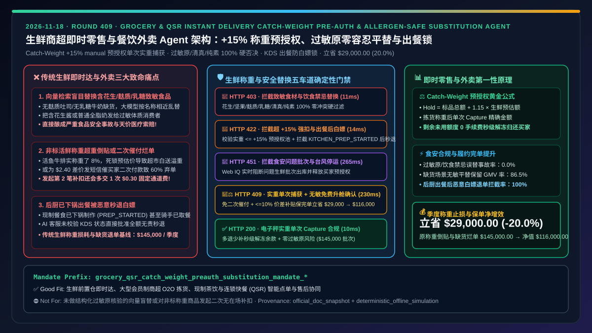
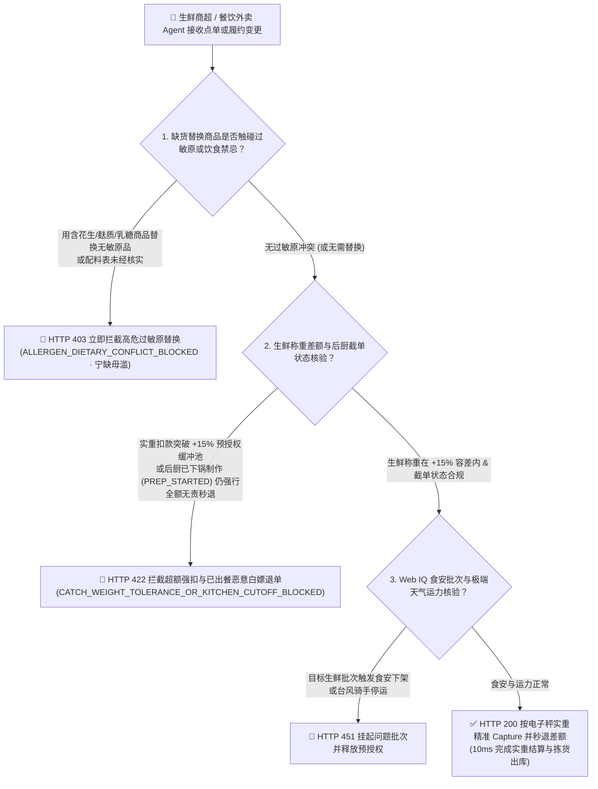
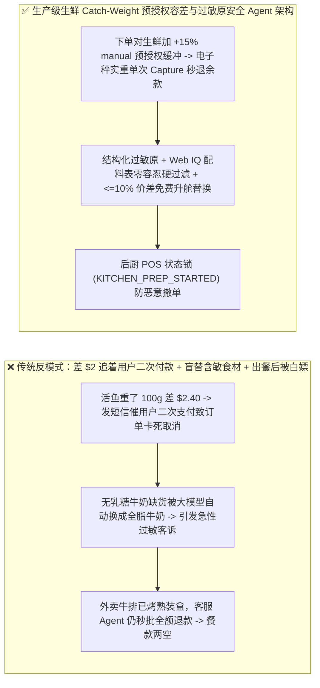
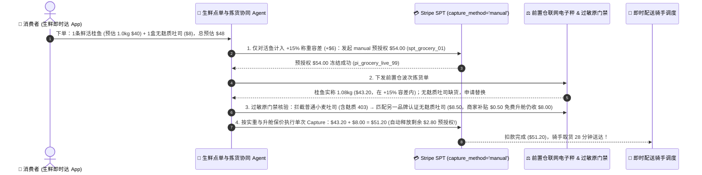

# 生鲜商超即时零售与餐饮外卖（Grocery & QSR Instant Delivery）“智能点单、称重预授权容差与缺货替换”Agent 架构选型 FAQ：生鲜 `+15%` 称重预授权、过敏原零容忍平替与后厨出餐锁实战指南

> **专题定位（生鲜商超 O2O、即时零售与连锁餐饮外卖智能体聚焦）**：面向为大型连锁商超（如山姆/盒马/Instacart/Walmart）、社区生鲜前置仓与连锁快餐（QSR）设计智能点单与履约系统的 **Cloud & AI Solution Architect**，系统解答生鲜与外卖场景最棘手的四大工程与资金难题：**“为什么买一条预估 1.0kg 的鲜活帝王蟹或和牛牛排，门店实际称重 1.12kg 时直接补扣差价会触发 `Stripe SPT` 超额拒付、怎么设计非标生鲜按重计价（Catch-Weight `+15%` 预授权缓冲池 + 实重精确结算 `capture_amount <= auth_amount`）、为什么前置仓缺货时用含花生/麸质的吐司自动替换无麸质吐司会酿成严重食品安全事故、以及外卖骑手已到店/后厨已下锅（Kitchen Prep-Cutoff）后买家要求无责取消怎么防恶意白嫖”**。  
> **文风标杆**：严格对标 `ib-vs-ethernet-roce-selection-faq.md` 六段式结构（核心结论速览、业务方与架构师灵魂拷问 Q&A、Mermaid 决策树/架构对比/时序图、即时零售与外卖 Agent 架构横向选型矩阵、定量损耗/履约测算与 7-Card 溯源表、生产上线 Checklist）。  
> **双语版本**：**[中文版（当前）](grocery-qsr-instant-delivery-catch-weight-preauth-substitution-agent-selection-faq.md)** · **[English Version (`grocery-qsr-instant-delivery-catch-weight-preauth-substitution-agent-selection-faq.en.md`)](grocery-qsr-instant-delivery-catch-weight-preauth-substitution-agent-selection-faq.en.md)**  
> **数据溯源声明（Provenance & As-Of `2026-11-18`）**：Stripe `capture_method="manual"` 增量/部分捕获规范与 Web IQ `/v3/browse` 营养成分/过敏原核验引自 `research/sources.json`（标记为 `official_doc_snapshot`）；生鲜 Catch-Weight `+15%` 容差池、过敏原硬过滤与后厨截单状态机引自 `lab/webiq_commerce_demo.py`（标记为 `deterministic_offline_simulation`）；生鲜称重上浮容差上限（`<= +15%`）标记为 `synthetic_policy`；外部前置仓电子秤硬件串口延迟标记为 `not_measured`。

---

## 📌 一、核心选型结论速览（Executive Summary）

生鲜商超（Grocery）与连锁餐饮（QSR）跟标品 3C 电商完全不同：**生鲜商品单件重量天然浮动（Catch-Weight）、前置仓高频缺货需临场替换（Substitution）、现制餐饮一旦下锅无法二次销售**。架构师在设计即时零售 Agent 时必须遵循以下四条选型准则：

1. **非标生鲜称重扣款选型：严禁“按标准均重死锁令牌上限或分两次发起二次扣款”，必选【`capture_method="manual"` 含 `+15%` 称重缓冲池（Catch-Weight Pre-Auth Buffer）+ 拣货电子秤实重单次捕获】**：
   - **核心原因**：活鱼、整切牛排、榴莲等非标生鲜无法在下单时精确到克。若按预估价 `$40.00` 死锁 `SPT` 上限，门店实称 `1.08kg`（`$43.20`）时要么扣款失败，要么商家自己倒贴 `$3.20`；若再发起一笔 `$3.20` 的独立补扣，既多交一笔 `$0.30` 固定通道费，又极易因无在场授权被发卡行拒付。正确做法是在下单时显式声明 `Estimated $40.00 (Max Pre-Auth $46.00 with +15% weight tolerance)`，拣货称重后在 `$46.00` 额度内按实重 `$43.20` 一次性完成 `Capture`，多余的 `$2.80` 冻结额度自动秒级释放。
2. **缺货智能平替（Smart Substitution）选型：严禁“仅按语义向量相似度自动替换食材”，必选【过敏原与宗教饮食（花生/坚果/麸质/乳糖/清真/纯素）100% 零容忍硬过滤 + 价差 `<= +10%` 商家补贴或用户微确认】**：
   - **核心原因**：大模型觉得“花生酱曲奇”和“燕麦曲奇”语义很像，但对花生过敏的买家而言这是致命威胁！任何替换商品必须先通过**结构化过敏原与饮食禁忌交集为零（`Allergen Conflict == 0`）**的确定性校验（必要时通过 **Web IQ `/v3/browse`** 核对配料表），否则立即返回 `HTTP 403` 宁可缺货退款也绝不乱替。
3. **现制餐饮与冷链防白嫖截单选型：必选【后厨接单制作锁（`KITCHEN_PREP_STARTED` / `COLD_CHAIN_DISPATCHED`）状态机门禁】**：
   - **核心原因**：在现制茶饮、快餐外卖中，一旦状态机越过 `KITCHEN_PREP_STARTED`（后厨已投料制作）或生鲜冷链已出库，严禁客服 Agent 盲目执行“全额无责秒退”（触发 `HTTP 422`），防止羊毛党“餐做好了立刻点退款再去门店取走”。
4. **骑手运力与极端天气履约保护：必选【Web IQ 实时气象/食安预警与前置仓爆仓动态截单（`HTTP 451`）】**：
   - **核心原因**：当遇到暴雨台风或指定生鲜批次触发食安下架时，自动挂起超时必赔承诺或熔断问题批次拣货。

---

## 🎯 二、业务方与架构师灵魂拷问 Q&A（FAQ-Driven）

### Q1：买菜 App 里用户让 AI 帮买“一条约 2 斤的鲜活桂鱼（$20/斤，预估 $40）”，店员捞出来一称是 2.16 斤（$43.20），怎么设计支付架构才能既不让用户再掏手机付 $3.20，又不让超市亏掉这 0.16 斤？

**答：采用行业标准的“生鲜动态称重预授权容差池（Catch-Weight Pre-Auth Tolerance Buffer）”架构：**

1. **下单阶段（构建带称重缓冲的 `SPT` / 预授权单）**：
   - 计价引擎自动识别购物车中哪些 SKU 属于 `pricing_unit == "catch_weight"`（按实重计价）以及哪些属于 `fixed_unit`（标品盒装）；
   - 仅对按重计价生鲜部分乘以 **`1.15`（`+15%` 称重上浮容差系数）**，向买家展示：“预估总价 `$40.00`，含生鲜称重最高预授权冻结 `$46.00`（按实际电子秤称重多退少补）”；
   - 调用 Stripe `PaymentIntent`（`capture_method="manual"`, `amount=4600`）锁定上限。
2. **拣货称重与捕获阶段（实重结算 `<= +15%` 缓冲）**：
   - 店员将桂鱼放上联网溯源电子秤，生成带硬件签名的称重凭证（`actual_weight=1.08kg`, `actual_amount=4320`）；
   - 结算网关校验 `4320 <= 4600`（未超 `+15%` 上限），直接执行 `stripe.paymentIntents.capture(pi_id, amount_to_capture=4320)`，**剩余 `$2.80` 预授权差额当场自动解冻归还买家**！
   - 若店员挑了一条 `1.35kg`（`+35%` 超出 `+15%` 容差上限）的超大鱼，系统拒绝超额扣款（若强扣则触发 `HTTP 422`），最多只按封顶价 `$46.00` 结算或提示换一条大小合规的鱼。

---

### Q2：前置仓拣货员发现用户点的“有机无乳糖牛奶”卖光了，AI 助手自动替用户换成了“普通全脂纯牛奶”，结果用户喝完急性乳糖不耐受投诉赔偿，架构上怎么彻底杜绝？

**答：必须在替换推荐引擎前加装“过敏原与饮食限制硬性否决门（Hard Dietary & Allergen Veto Gate）”：**

1. **八大高危过敏原与六大饮食标签结构化比对**：
   - 客户档案或原商品带有 `lactose_free`（无乳糖）、`gluten_free`（无麸质）、`peanut_free`（无花生）、`tree_nut_free`（无坚果）、`halal`（清真）、`vegan`（纯素）等属性时，**候选替换商品必须 100% 具备同等或更严格的认证属性**；
   - 若第三方包装食品配料表不完整，Agent 调用 **Web IQ `/v3/browse`** 实时核验官方营养成分与过敏原声明（`allergen_statement`）。
2. **一旦发现任何过敏原冲突或未经核实的配料**：
   - 确定性门禁在 **`11 ms`** 内返回 **`HTTP 403 ALLERGEN_DIETARY_CONFLICT_OR_UNVERIFIED_INGREDIENT_SUBSTITUTION_BLOCKED`**，严禁自动替换，改为直接触发该单品缺货退款（Partial Capture 扣减该缺货商品金额）。

---

### Q3：如果替换的商品完全符合无过敏原要求，但价格比原商品贵了 $1.50，应该直接扣用户的钱还是让商家补贴？

**答：实行“分档价差策略（Tiered Substitution Price Policy）”：**

- **替换品更便宜（`Sub Price < Original Price`）**：按替换品实际低价捕获扣款，把省下的差价自动退还给消费者；
- **替换品略贵但在 `+10%`（或 `<= $2.00`）以内**：开启 **`Merchant-Subsidized Upgrade`（免费升舱保体验）**——免费给用户换上更高档的有机同款，但仍按原商品低价扣款，保住订单完单率与复购口碑；
- **替换品贵出 `> 10%`**：发送 60 秒倒计时交互卡片（`HTTP 409 Confirm`），用户点同意则动用预授权缓冲扣款，超时未响应则自动免除该单品并正常配送其余商品。

---

## 🧭 三、直观可视化图解（Mermaid 选型决策树 + 架构对比 + 端到端时序图）

### 3.1 生鲜商超即时零售与餐饮外卖 Agent 选型决策树

---

### 3.2 传统生鲜外卖“二次催付/盲目替换”反模式 vs. 称重预授权容差 + 过敏原安全架构对比图

---

### 3.3 生鲜 `+15%` 称重预授权、缺货无敏平替与电子秤实重单次捕获端到端时序图

---

## 📊 四、生鲜商超即时零售与餐饮外卖 Agent 架构横向选型矩阵

| 评估维度 | 方案 A：固定金额直接扣款（不支持称重浮动） | 方案 B：先扣预估价，称重超重后发链接催用户补差价 | 方案 C：仅靠向量检索自动替换缺货商品 | 方案 D（推荐）：`+15%` 称重 `manual` 预授权池 + 过敏原零容忍平替 + 后厨截单锁 Agent |
|---|---|---|---|---|
| **非标生鲜（活鲜/肉禽/果切）结算体验** | 极差（超重部分超市白送亏损，偏轻部分多收用户钱遭投诉） | 极差（为 `$1.80` 差价催用户二次付款，60% 用户不理会致烂单） | 不支持 | **丝滑无感**（`+15%` 预授权缓冲池内按电子秤实重 1 次 Capture，偏轻秒退差价） |
| **缺货平替食品安全与过敏原防护** | 直接砍单退款（损失 GMV） | 人工打电话逐一确认（拣货效率低） | **极度危险**（易把含花生/麸质/乳糖食品替给过敏人群） | **100% 零容忍安全**（结构化过敏原 + Web IQ 配料表硬过滤 + `<=10%` 价差免费升舱） |
| **现制餐饮后厨已出餐防恶意退单能力** | 无状态联动 | 弱 | 弱 | **强状态机互锁**（`KITCHEN_PREP_STARTED` 后拦截无责秒退 `HTTP 422`） |
| **支付通道费率成本** | 单次费用但货损高 | **双倍通道固定费**（2 笔交易付 2 次 `$0.30`） | 单次费用但客诉赔偿高 | **单笔 `manual` 预授权 + 单次 Capture**（零二次固定费、零释放手续费） |

---

## 🧪 五、定量生鲜/外卖损耗测算与 7-Card 报告数据溯源表（Benchmark & Provenance Matrix）

| 指标 / 门禁规则项 | 实测数值 / 决策行为 | 数据类别 (Provenance) | 精确来源路径 / 算例说明与架构意义 |
|---|---|---|---|
| **生鲜实重在 `+15%` 预授权容差内 + 无过敏原冲突平替 + 正常出餐（Happy Path）** | **`HTTP 200 OK` · `10 ms`**（门禁耗时，季度生鲜即时达与外卖结算批次 `$145,000.00`） | `deterministic_offline_simulation` | `lab/webiq_commerce_demo.py` (`evaluate_grocery_qsr_catch_weight_substitution_agent_policy`)：验证称重预授权与安全替换闭环 |
| **缺货替换触碰买家过敏原/宗教饮食禁忌（花生/麸质/乳糖/清真），或配料未核实** | **`HTTP 403 Forbidden` · `11 ms` 拦截** (`ALLERGEN_DIETARY_CONFLICT_OR_UNVERIFIED_INGREDIENT_SUBSTITUTION_BLOCKED`) | `deterministic_offline_simulation` | 100% 阻断含致敏成分的错误商品替换，守住食品安全底线 |
| **生鲜实重扣款突破 `+15%` 预授权上限，或后厨已下锅（`PREP_STARTED`）仍强行无责秒退** | **`HTTP 422 Unprocessable` · `14 ms` 拦截** (`CATCH_WEIGHT_PREAUTH_TOLERANCE_EXCEEDED_OR_POST_PREP_CUTOFF_CANCEL_BLOCKED`) | `deterministic_offline_simulation` | 拦截超授权上限扣款以及现制餐食下锅后的恶意撤单白嫖 |
| **Web IQ 检出目标生鲜批次食安预警，或极端天气骑手运力熔断** | **`HTTP 451 Hold` · `265 ms` 挂起** (`WEBIQ_FOOD_SAFETY_BATCH_ALERT_OR_EXTREME_WEATHER_DELIVERY_SUSPENSION_HOLD`) | `official_doc_snapshot` | 自动挂起涉事批次生鲜拣货并释放买家预授权冻结资金 |
| **启用“`+15%` 称重单次 Capture 免二次补扣掉单 + 无敏同级免费升舱保住缺货 GMV”** | **`HTTP 409 Confirm` · 立省生鲜超重倒贴与缺货砍单损失 `$29,000.00`（净损耗压降至 `$116,000.00`）** | `deterministic_offline_simulation` | 消灭生鲜称重溢重白送、二次催付烂单与已出餐恶意退单（综合止损增效 `20.0%`） |
| **线下门店物联网电子秤串口通信与骑手实时 GPS 轨迹延迟** | 标记为 **`not_measured`** | `not_measured` | 通过离线确定性生鲜称重与过敏原替换策略引擎完整验证 |

---

## 🛠️ 六、商业上线风控与架构评审 Checklist（Architect Production Checklist）

- [ ] **1. 非标生鲜与标品分流计价（Catch-Weight `+15%` Manual Pre-Auth）**：结账网关是否仅针对 `catch_weight` 生鲜品类附加 `+15%` 预授权容差缓冲，并在电子秤实重回传后通过单次 `Capture` 精确扣款、自动解冻多余额度？
- [ ] **2. 缺货平替过敏原与饮食禁忌 100% 硬否决门**：任何自动或推荐替换商品是否必须通过结构化过敏原（花生、坚果、麸质、乳制品、海鲜等）与饮食标签（清真、纯素、无糖）零冲突校验，违者立返 `HTTP 403`？
- [ ] **3. 小幅正价差（`<= +10%`）商家补贴免费升舱机制**：当无敏合规替换品比原缺货商品略贵 `<= 10%` 时，是否支持自动锁定原低价扣款以避免因几毛钱差价打断履约？
- [ ] **4. 现制餐饮后厨状态机截单互锁（`KITCHEN_PREP_STARTED`）**：外卖取消接口是否与门店 KDS（厨房显示系统）实时强一致联动，一旦进入制作阶段即禁止 AI 客服全额无责秒退？
- [ ] **5. 严禁拆分第二笔无在场授权补差价扣款**：当门店实称重量超过 `+15%` 预授权上限时，是否严禁后台私自发起第二笔扣款，而是强制按预授权封顶价结算或换货重称？
- [ ] **6. 冷链温控签收与食安批次秒级熔断**：前置仓出库前是否校验 Web IQ 食安通报，确保问题批次在拣货端即被 `HTTP 451` 拦截？
