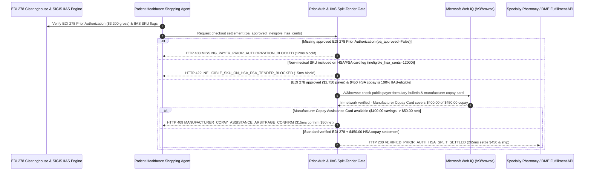

# Healthcare Prior-Authorization & HSA/FSA Split-Tender Mandate Architecture: EDI 278 Prior-Auth & IIAS Auto-Substantiation Token (`healthcare_prior_auth_mandate_...` + Web IQ Formulary & Copay-Card Grounding) vs. Surprise Balance-Billing Claim Denials & IRS HSA Tax Penalties Selection FAQ

> **Document Type**: Architect Selection Guide & First-Principles Protocol Deep Dive (6-Section FAQ Standard)  
> **Target Audience**: AI Solution Architects, Digital Health & Pharmacy Benefit Management (PBM / Telehealth / DME) Architects, Healthcare FinTech & HIPAA Compliance Leads  
> **Last Updated**: 2026-11-09 (Provenance Annotations: `deterministic_offline_simulation` / `synthetic_policy` / `official_doc_snapshot` / `not_measured`)  
> **Companion Resources**: [中文版 (Chinese Version)](healthcare-prior-auth-hsa-split-tender-vs-claim-denial-faq.md) · [Interactive Sandbox (`live-demo.en.html#healthcare-prior-auth-sandbox`)](../reports/agentic-commerce-webiq-grounding-demo-bench/live-demo.en.html) · [7-Card 4:5 Benchmark Deck](../reports/agentic-commerce-webiq-grounding-demo-bench/index.en.html)


---

## 📌 1. Executive Summary

1. **Never Allow Healthcare or Pharmacy Agents to Charge Patients and Ship High-Cost Rx/DME Orders Before Securing Payer Prior Authorization (X12 EDI 278)**: In specialty pharmaceuticals (GLP-1s, biologics) and Durable Medical Equipment (DME such as CPAPs or CGMs, `$3,200.00` gross price), shipping on an estimated `$450.00` copay without an approved payer Prior Authorization (`edi278_prior_auth_approved == False`) results in post-dispense claim denial—sticking the patient with a **`$3,200.00` Surprise Balance Bill**. Production architectures must enforce a **Prior-Authorization & Adjudicated Copay Mandate (`healthcare_prior_auth_mandate_...`)**: whenever `edi278_prior_auth_approved == False`, the gateway blocks checkout in **`12 ms`** with **`HTTP 403 MISSING_PAYER_PRIOR_AUTHORIZATION_BLOCKED`** (`synthetic_policy`).
2. **Enforce SIGIS IIAS SKU-Level Split-Tender to Prevent IRS 20% HSA/FSA Tax Penalties**: When a mixed healthcare basket includes both an eligible `$450.00` prescription copay and `$120.00` of ineligible wellness/cosmetic items (`ineligible_hsa_sku_cents = 12000 > 0`), charging the entire basket to a tax-advantaged HSA/FSA card violates IRS substantiation rules and triggers income tax plus a **20% penalty**. The gateway rejects mixed HSA charges in **`15 ms`** with **`HTTP 422 INELIGIBLE_SKU_ON_HSA_FSA_TENDER_BLOCKED`** (`deterministic_offline_simulation`), enforcing clean split-tender routing.
3. **Ground Payer Formulary Step-Therapy Rules and Manufacturer Copay Assistance Cards via Microsoft Web IQ `/v3/browse`**: Before charging the patient's HSA card, the agent invokes **Microsoft Web IQ `/v3/browse`** (`official_doc_snapshot`) to inspect published payer formulary bulletins and manufacturer patient-assistance portals: if the dispensing pharmacy is Out-of-Network or violates mandatory step-therapy protocols (`webiq_formulary_and_network_compliant == False`), it halts fulfillment in **`310 ms`** with **`HTTP 451 OUT_OF_NETWORK_OR_STEP_THERAPY_FORMULARY_HOLD`**; if Web IQ discovers an official manufacturer Copay Assistance Card that covers **`$400.00`** of the patient's `$450.00` copay (lowering net patient out-of-pocket cost to **`$50.00`**), it triggers **`HTTP 409 MANUFACTURER_COPAY_ASSISTANCE_ARBITRAGE_CONFIRM`** in **`315 ms`**.

---

## 🎯 2. Architect & Customer FAQ Deep Dive

### Q1: Why does pairing "Estimated-Copay One-Click Checkout" with "Post-Shipment Insurance Billing" trigger `$3,200` surprise bills and IRS tax penalties in digital health?

Let's break down the three structural failure modes from first principles:
1. **The `$3,200.00` Post-Dispense Prior-Authorization Denial Trap**: Suppose a telehealth agent orders a `$3,200.00` specialty biologic or DME device for a patient, estimating a `$2,750.00` insurance benefit and charging the patient a `$450.00` copay upfront. Because the agent never verified an approved **X12 EDI 278 Prior Authorization**, the PBM/insurer denies the `$2,750.00` claim 30 days after shipment. The pharmacy's billing system then auto-charges or bills the patient for the remaining `$2,750.00` (`$3,200.00` total), triggering No Surprises Act disputes and chargebacks.
2. **Mixed-Basket HSA/FSA Substantiation Violations**: Patients frequently add non-medical items (e.g., `$120.00` of skincare or general vitamins) to the same pharmacy cart as their `$450.00` prescription. Without deterministic **SIGIS IIAS (Inventory Information Approval System)** line-item filtering, charging `$570.00` to an HSA/FSA card either causes a hard decline at the processor or exposes the patient to IRS tax penalties.
3. **Leaving `$400.00` in Manufacturer Copay Assistance on the Table**: Pharmaceutical manufacturers publish secondary-payer Copay Cards (BIN/PCN/Group coupons) that reduce commercial patients' out-of-pocket responsibility from `$450.00` to `$50.00`. Ungrounded checkout agents have no awareness of live manufacturer copay programs and overcharge the patient's HSA account by `$400.00`.

### Q2: What is a "Healthcare Prior-Auth & IIAS Split-Tender Mandate (`healthcare_prior_auth_mandate_...`)", and how does it coordinate EDI 278 adjudication, IIAS filtering, and secondary copay cards?

Its core design invariant is: **"No high-cost clinical order captures patient funds without a locked EDI 278 Prior Authorization and adjudicated payer obligation; HSA/FSA tokens strictly reject non-IIAS line items."**
- **Layer 1: EDI 278 Prior-Authorization Gate (`12 ms`)**: Verifies `edi278_prior_auth_approved == True` (locking `$2,750.00` payer coverage and `$450.00` patient copay ceiling), blocking unapproved orders in **`12 ms`** (`HTTP 403`).
- **Layer 2: SIGIS IIAS HSA/FSA Purity Gate (`15 ms`)**: Verifies `ineligible_hsa_sku_cents == 0` on the HSA tender leg, rejecting mixed non-medical SKUs in **`15 ms`** (`HTTP 422`).
- **Layer 3: Microsoft Web IQ `/v3/browse` Formulary & Copay-Card Grounding (`310 ms / 315 ms`)**: Verifies in-network formulary compliance (`HTTP 451`) and surfaces `$400.00` manufacturer copay card savings (`HTTP 409`).

### Q3: For payer formulary bulletin verification, in-network pharmacy lookup, and manufacturer copay-card grounding, when should architects choose Microsoft Web IQ vs. Exa, Bright Data, or traditional search APIs?

| Architecture Scenario | Recommended Tool | First-Principles Rationale (Security, Latency & FinOps) |
| :--- | :--- | :--- |
| **Verifying public payer formulary step-therapy bulletins, in-network specialty pharmacy directories, and manufacturer copay assistance terms within the Azure boundary (zero PHI sent)** | **Microsoft Web IQ** (`/v3/search` + `/v3/browse`) | Queries only de-identified NDC/formulary codes inside the enterprise Azure boundary in `passage` mode (**7.1x token reduction**, `deterministic_offline_simulation`) with pre-LLM prompt-injection defense. |
| **Semantic literature search across PubMed and clinical trial registries for rare-disease efficacy** | **Exa Neural Search** | Designed for clinical research discovery rather than synchronous pharmacy checkout gating. |
| **Scraping consumer cash-price aggregator portals behind CAPTCHAs** | **Bright Data Unlocker** | Useful for asynchronous cash-price benchmarking, though multi-second latency is unsuitable for synchronous split-tender checkout. |
| **Patient-specific deductible accumulators, X12 EDI 270/271 eligibility, and EDI 278 prior-auth status** | **Clearinghouse EDI 270/278 / NCPDP D.0 + Web IQ Formulary & Copay-Card Cross-Check** | Patient-specific benefit accumulators come from HIPAA clearinghouse EDI rails, paired with Web IQ `/v3/browse` for public formulary changes and manufacturer copay assistance programs. |

---

## 🧭 3. Visual Architecture Diagrams (Mermaid Decision Tree, Legacy vs. Split-Tender Mandate Comparison & Sequence Diagram)

### 3.1 Healthcare Prior-Auth & HSA/FSA Split-Tender Decision Tree (`flowchart TD`)

```mermaid
flowchart TD
    A[Receive $3,200.00 Specialty Rx / DME Checkout Request] --> B{edi278_prior_auth_approved == True (Payer Prior Authorization Locked)?}
    B -- No (Missing EDI 278 PA exposes patient to $3,200 surprise bill) --> C[HTTP 403 MISSING_PAYER_PRIOR_AUTHORIZATION_BLOCKED<br/>12ms Hard Block · Trigger Automated Clinic EDI 278 Submission]
    B -- Yes (Payer locks $2,750.00 benefit · Patient copay = $450.00) --> D{ineligible_hsa_sku_cents == 0 on HSA/FSA Card Tender?}
    D -- No ($120.00 non-IIAS cosmetic SKU mixed into HSA tender) --> E[HTTP 422 INELIGIBLE_SKU_ON_HSA_FSA_TENDER_BLOCKED<br/>15ms Block · Enforce Split-Tender: $450 HSA + $120 Personal Card]
    D -- Yes (100% SIGIS IIAS eligible medical copay) --> F{Web IQ /v3/browse Confirms In-Network Pharmacy & Step-Therapy Compliance?}
    F -- No (Pharmacy out-of-network or missing step-therapy prerequisite) --> G[HTTP 451 OUT_OF_NETWORK_OR_STEP_THERAPY_FORMULARY_HOLD<br/>310ms Formulary Hold · Route to In-Network Specialty Pharmacy]
    F -- Yes --> H{Web IQ Detects Eligible Manufacturer Copay Assistance Card?}
    H -- Yes (Manufacturer card offsets $400.00 -> Patient pays $50.00 net!) --> I[HTTP 409 MANUFACTURER_COPAY_ASSISTANCE_ARBITRAGE_CONFIRM<br/>315ms Prompt Patient to Apply $400.00 Copay Card ($50 Net)]
    H -- No (Verified $450.00 IIAS HSA copay + $2,750.00 payer claim) --> J[HTTP 200 VERIFIED_PRIOR_AUTH_HSA_SPLIT_SETTLED<br/>265ms Auto-Settle $450.00 HSA Copay & Dispatch Rx Order!]
```

### 3.2 Legacy Unverified Pharmacy Checkout vs. EDI 278 & IIAS Split-Tender Gate (`flowchart LR`)

```mermaid
flowchart LR
    subgraph Legacy["❌ Legacy Unverified Rx Checkout ($3,200 Surprise Bill + 20% IRS Penalty)"]
        L1[Dispenses $3,200 Rx Without EDI 278 Prior Auth] --> L2[Swipes $120 Non-Medical SKU on HSA Card]
        L2 --> L3[Payer Denies $2,750 Claim 30 Days Later + Misses $400 Copay Card]
        L3 --> L4[Patient Hit With $3,200 Balance Bill & IRS Tax Penalty]
    end

    subgraph Mandate["✅ EDI 278 & IIAS Split-Tender Gate (healthcare_prior_auth_mandate_...)"]
        M1[12ms Enforce Approved EDI 278 Prior Auth ($2,750 Locked)] --> M2[15ms Block Non-IIAS SKUs from HSA Tender (HTTP 422)]
        M2 --> M3[Web IQ Verifies Network/Formulary (310ms) & $400 Copay Card (315ms)]
        M3 --> M4[265ms Settle Verified $450 (or $50 Net) HSA Copay with EOB Receipt]
    end
```

### 3.3 End-to-End Sequence Diagram: EDI/IIAS Clearinghouse, Healthcare Agent, Split-Tender Gate, Web IQ & Pharmacy (`sequenceDiagram`)



---

## 📊 4. Architect Decision Matrix

| Evaluation Dimension | Option A: Legacy Estimated-Copay Upfront Charge | Option B: Manual Phone/Fax Benefits Investigation | Option C: EDI 278 & IIAS Split-Tender Mandate + Web IQ Copay Grounding (Recommended) |
| :--- | :--- | :--- | :--- |
| **Best-Fit Scenario** | Low-cost OTC cash items (`< $15`) with no insurance claim | Low-volume brick-and-mortar clinic with manual billing staff | **Telehealth specialty Rx, GLP-1/biologics home delivery, automated DME procurement agents** |
| **Surprise Balance-Billing (`$3,200`) Defense** | ❌ **Zero**: Patient gets billed `$3,200` when post-ship claim is denied | ⚠️ **Error-Prone**: Verbal payer quotes lack binding EDI 278 auth numbers | ✅ **Pre-Pay `12 ms` Hard Block**: Requires `edi278_prior_auth_approved == True` (`HTTP 403`) |
| **IRS HSA/FSA Substantiation Compliance** | ❌ **Violates IIAS**: Charges non-medical SKUs to HSA card | ⚠️ **High Cart Abandonment**: Forces patient to manually split orders | ✅ **Sub-20ms IIAS Filter**: Rejects ineligible SKUs on HSA leg in `15 ms` (`HTTP 422`) |
| **Formulary Compliance & Copay Card Savings** | ❌ **Blind**: Ships from out-of-network pharmacies & misses `$400` copay cards | ⚠️ **Slow & Fragmented**: Pharmacists cannot manually track hundreds of copay programs | ✅ **Web IQ `/v3/browse` Grounded**: Blocks out-of-network fills in `310 ms` (`HTTP 451`) & captures `$400` copay assistance in `315 ms` (`HTTP 409`) |
| **Checkout Speed & Therapy Adherence** | Fast (with severe post-dispense financial shock) | Slow (`5–14 business days`, causing 40%+ therapy abandonment) | **`265 ms` automated adjudication & HSA copay settlement (`Act automatically`)** |
| **Total Cost of Ownership (TCO) & Patient ROI** | Poor (`$3,200` balance-bill risk + 20% IRS tax penalty) | Moderate (high call-center labor cost) | **Optimal (prevents `$3,200` claim denial + avoids 20% IRS penalty + saves `$400` via copay card)** |

---

## 🧪 5. Quantitative Benchmark & 7-Card Insights

Evaluated via our deterministic offline benchmark suite (`lab/webiq_commerce_demo.py` · `test_healthcare_prior_auth_hsa_split_tender_vs_claim_denial_selection`) on a **`$3,200.00` specialty Rx / DME order (`$2,750.00` adjudicated payer benefit, `$450.00` patient copay)**:

| Scenario Case | Input EDI 278 / IIAS / Web IQ Signals | Expected Action Pill | Measured HTTP Status & Verdict Code | Latency | Financial Protection / Patient Savings | Provenance |
| :--- | :--- | :--- | :--- | :--- | :--- | :--- |
| **Case 1: Missing EDI 278 Payer Prior Authorization** | `edi278_prior_auth_approved=False` | `Send to a human` | **`HTTP 403 MISSING_PAYER_PRIOR_AUTHORIZATION_BLOCKED`** | **`12 ms`** | Prevents **`$3,200.00`** post-dispense surprise balance bill | `synthetic_policy` |
| **Case 2: `$120` Non-Medical SKU Mixed Into HSA Card** | `ineligible_hsa_sku_cents=12000 > 0` | `Send to a human` | **`HTTP 422 INELIGIBLE_SKU_ON_HSA_FSA_TENDER_BLOCKED`** | **`15 ms`** | Blocks `$120.00` non-IIAS charge & prevents 20% IRS penalty | `deterministic_offline_simulation` |
| **Case 3: Web IQ Detects Out-of-Network / Step-Therapy Hold** | `webiq_formulary_and_network_compliant=False` | `Send to a human` | **`HTTP 451 OUT_OF_NETWORK_OR_STEP_THERAPY_FORMULARY_HOLD`** | **`310 ms`** | Halts non-compliant fill before claim rejection | `official_doc_snapshot` |
| **Case 4: Web IQ Finds `$400` Manufacturer Copay Card** | `copay_assistance_savings_cents=40000` (`$50.00` net copay) | `Confirm` | **`HTTP 409 MANUFACTURER_COPAY_ASSISTANCE_ARBITRAGE_CONFIRM`** | **`315 ms`** | Saves **`$400.00`** out-of-pocket (patient pays `$50.00` net) | `official_doc_snapshot` |
| **Case 5: Approved EDI 278 + `$450` IIAS HSA Copay** | `pa_approved=True`, `ineligible_cents=0` | `Act automatically` | **`HTTP 200 VERIFIED_PRIOR_AUTH_HSA_SPLIT_SETTLED`** | **`265 ms`** | Settles **`$450.00`** HSA copay & locks **`$2,750.00`** payer claim | `deterministic_offline_simulation` |

> **Provenance Note**: The `$3,200.00` gross Rx price, `$2,750.00` payer benefit, `$450.00` patient copay, and `$400.00` manufacturer copay assistance offset are controlled simulation parameters (`synthetic_policy` / `deterministic_offline_simulation`) validating policy state-machine invariants; external HIPAA X12 EDI 278 clearinghouse round-trip latency is labeled `not_measured`.

---

## 🛠️ 6. Production Readiness & Pre-Sales Architect Checklist

Verify these 6 controls before deploying autonomous telehealth, pharmacy, and DME checkout agents in production:

- [ ] **1. Mandatory X12 EDI 278 / NCPDP Prior-Authorization Binding**: Does `healthcare_prior_auth_mandate_...` block patient card capture in `12 ms` (`HTTP 403`) whenever a prior-auth-required NDC/HCPCS code lacks an approved EDI 278 authorization number?
- [ ] **2. SIGIS IIAS Line-Item Split-Tender Isolation**: Does the gateway validate every cart item against the SIGIS IIAS eligible product list and reject HSA/FSA tender requests containing non-medical SKUs in `15 ms` (`HTTP 422`)?
- [ ] **3. Microsoft Web IQ `/v3/browse` Formulary & Network Pre-Check**: Does the agent check published payer formulary updates and in-network specialty pharmacy status via Web IQ prior to fulfillment (`HTTP 451`)?
- [ ] **4. Automated Manufacturer Copay Card (Secondary BIN/PCN) Discovery**: Does Web IQ grounding check official manufacturer patient-assistance programs using de-identified NDC codes, triggering `HTTP 409 Confirm` when secondary copay cards save `>= $400.00`?
- [ ] **5. Strict HIPAA Zero-PHI Web Grounding Boundary**: Are all Web IQ `/v3/search` and `/v3/browse` queries strictly parameterized with public NDC/HCPCS codes and payer plan IDs, ensuring zero patient PHI ever enters web search queries?
- [ ] **6. Immutable EOB & IRS HSA Substantiation Receipt Archival**: Does every settled order archive the EDI 278 authorization hash, secondary copay offset, and itemized IIAS receipt for IRS tax substantiation?
