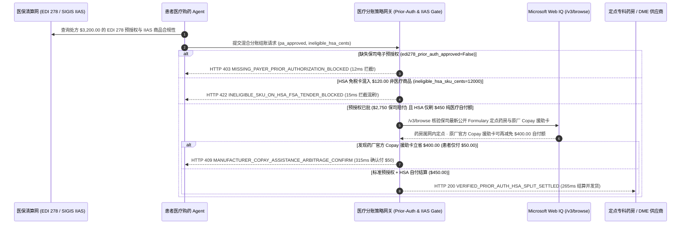

# 医疗处方药与家用器械（DME）医保预授权及 HSA/FSA 混合分账（Healthcare Prior-Auth & HSA/FSA Split-Tender Mandate）架构：EDI 278 预授权绑定与 IIAS 合规分账令牌（`healthcare_prior_auth_mandate_...` + Web IQ 医保目录与药厂援助卡核验）vs 传统盲刷拒赔天价账单（Surprise Balance Billing）选型与原理解析 FAQ

> **文档类型**：架构师选型指南 & 协议第一性原理解析（6 段式 FAQ 标准版）  
> **适用读者**：AI Solution Architect、数字医疗与医药电商（Telehealth / PBM / Pharmacy）架构师、医疗支付结算与合规风控团队  
> **更新日期**：2026-11-09（Provenance 标注：`deterministic_offline_simulation` / `synthetic_policy` / `official_doc_snapshot` / `not_measured`）  
> **配套资源**：[English Version](healthcare-prior-auth-hsa-split-tender-vs-claim-denial-faq.en.md) · [交互式沙盒控制台 (`live-demo.html#healthcare-prior-auth-sandbox`)](../reports/agentic-commerce-webiq-grounding-demo-bench/live-demo.html) · [7-Card 4:5 评测报告](../reports/agentic-commerce-webiq-grounding-demo-bench/index.html)


---

## 📌 一、核心结论速览（Executive Summary）

1. **严禁让医疗购药或器械采购 Agent 在未取得保险公司电子预授权（X12 EDI 278 Prior Authorization）前直接按预估自付额扣款发货**：在专科处方药（如 GLP-1、单抗生物制剂）及耐用医疗设备（DME，如呼吸机、动态血糖仪，总价 `$3,200.00`）订购中，若未锁定保司预授权（`edi278_prior_auth_approved=False`）就先行发货，30 天后保司拒赔会导致患者收到 **`$3,200.00` 全额自费惊吓账单（Surprise Balance Billing）**。生产环境必须强制采用 **EDI 278 预授权与实时理赔裁决绑定的医疗支付令牌（`healthcare_prior_auth_mandate_...`）**，缺失有效预授权编号时在 **`12 ms`** 内触发 **`HTTP 403 MISSING_PAYER_PRIOR_AUTHORIZATION_BLOCKED`**（`synthetic_policy`），100% 阻断无保障裸单。
2. **严格执行 SIGIS IIAS 医疗商品清单核验，严禁将非医疗日用品混刷进 HSA/FSA 免税医疗卡**：当同一购物车既包含合资格处方药自付额（`$450.00`）又包含非医疗护肤品/普通膳食补充剂（`ineligible_hsa_sku_cents = 12000` 即 `$120.00`）时，若直接向 HSA/FSA 专户卡发起全额扣款，持卡人将面临美国国税局（IRS）所得税补缴加 **20% 违规罚金**。网关在 **`15 ms`** 内返回 **`HTTP 422 INELIGIBLE_SKU_ON_HSA_FSA_TENDER_BLOCKED`**（`deterministic_offline_simulation`），强制拆分为双轨混合支付（Split-Tender：HSA 卡仅刷 `$450.00` + 普通个人信用卡刷 `$120.00`）。
3. **基于 Microsoft Web IQ `/v3/browse` 实时核验保司药品目录（Formulary / Step Therapy）与原研药厂 Copay 援助卡（Manufacturer Copay Card）**：在结算患者自付额前，Agent 调用 **Microsoft Web IQ `/v3/browse`**（`official_doc_snapshot`）穿透查询保司最新定点药房名单与药厂官方患者援助计划：若检出当前药房已滑出保司定点网络（Out-of-Network）或违反阶梯用药规范，在 **`310 ms`** 内以 **`HTTP 451 OUT_OF_NETWORK_OR_STEP_THERAPY_FORMULARY_HOLD`** 阻断；若发现原厂公开的 Copay Assistance Program 可直接为商保患者减免 **`$400.00`** 自付额（将患者实付从 `$450.00` 降至仅需 **`$50.00`**），则在 **`315 ms`** 内触发 **`HTTP 409 MANUFACTURER_COPAY_ASSISTANCE_ARBITRAGE_CONFIRM`**，引导患者一键叠加药厂补贴。

---

## 🎯 二、客户与架构师灵魂拷问 Q&A（FAQ-Driven Deep Dive）

### Q1：为什么传统的“先刷患者信用卡收个预估自付额（Copay）、发货后再走慢速医保报销”，会让患者和医药电商双双陷入财务灾难？

咱们用大白话算一笔医疗健康消费里最痛的账：
1. **“以为只花 $450，一个月后收到 $3,200 催收单”的预授权黑洞**：患者让健康助手订购一盒总价 `$3,200.00` 的靶向药或睡眠呼吸机。药房前端粗略估算“医保报销 `$2,750`，个人自付 `$450`”，传统 Agent 直接刷了患者 `$450` 就安排发货了。结果药房事后找保险公司结算时，保司系统直接拒付（Claim Denied）——原因是该药品属于高值受控目录，必须先由医生提交临床指标拿到 **Prior Authorization（事前预授权，EDI 278）** 才能报销！药房拿不到保司的 `$2,750`，转头就从患者绑定的卡上补扣 `$2,750` 或发律师函催收，直接引发监管投诉与拒付风暴。
2. **HSA/FSA 免税卡混刷引发的税务罚款**：很多员工使用税前健康储蓄账户（HSA / FSA 专享 Visa/MC 医疗卡）买药。顺手在同一个订单里加了一瓶 `$120.00` 的普通面霜。如果 Agent 不做行项级 **SIGIS IIAS（Inventory Information Approval System）** 过滤，直接把 `$570.00` 全刷在 HSA 卡上，不仅收单网关可能整单拒付，一旦入账还会触发持卡人年底报税时的 20% IRS 罚款。
3. **白白错过药厂官方的 `$400` 现金补贴（Copay Card）**：几乎所有高价原研药厂为了减轻患者自付负担，都在官网提供商业保险 Copay 援助卡（二次结算 BIN/PCN 券），可以把 `$450` 的自付额直接抵扣掉 `$400`（患者只需掏 `$50`）。没有实时网页接地能力的结账系统根本不会帮患者去领这张公开补贴券。

### Q2：什么是“医保预授权与 IIAS 混合分账令牌（`healthcare_prior_auth_mandate_...`）”？它是如何实现保司、药厂补贴与患者 HSA 卡三方协同清算的？

它的第一性原理非常明确：**“高值医疗订单绝不允许‘先斩后奏’；必须在扣款前锁死保司预授权（EDI 278 / NCPDP D.0），并按 SKU 医疗属性严格物理隔离 HSA 免税资金与普通消费资金。”**
- **第一层：EDI 278 预授权与实时审方门禁（`12 ms`）**：网关强制校验 `edi278_prior_auth_approved == True`，确认保司已锁定承担 `$2,750.00` 统筹赔付额、患者自付上限锁定为 `$450.00`。未拿到预授权直接返回 `HTTP 403`。
- **第二层：IIAS 行项拆分与 HSA/FSA 纯度锁（`15 ms`）**：网关逐行扫描购物车 SKU 的 SIGIS IIAS 医疗编码。若请求将非医疗 SKU（`ineligible_hsa_sku_cents > 0`）计入 HSA 令牌，在 **`15 ms`** 内返回 `HTTP 422`，强制将非医疗商品路由至患者第二张普通信用卡。
- **第三层：Microsoft Web IQ `/v3/browse` 定点网络核验与药厂援助卡叠加（`310 ms / 315 ms`）**：实时核对保司公开 Formulary 目录防止网外药房拒赔（`HTTP 451`），并自动检索原厂官网 Copay 援助计划帮患者立减 `$400.00`（`HTTP 409`）。

### Q3：在医保药品目录（Formulary）核验、定点医院/药房网络查询与药厂援助计划检索场景下，什么时候选 Microsoft Web IQ，什么时候选 Exa、Bright Data 或传统搜索 API？

| 架构需求场景 | 推荐选型 | 为什么这样选（第一性原理与成本/合规考量） |
| :--- | :--- | :--- |
| **实时核验保司公开药品目录（Formulary Tier & Step Therapy）、定点药房网络状态及药厂官方 Copay 援助卡申领条款，且要求 HIPAA 级隐私边界与零提示词注入** | **Microsoft Web IQ** (`/v3/search` + `/v3/browse`) | 在企业 Azure 合规边界内以 `passage` 模式提取公开药品目录条款与援助卡限额（上下文 Token 压缩 **7.1x**，`deterministic_offline_simulation`），绝不将患者 PHI 病历外泄给第三方搜索爬虫。 |
| **跨 PubMed 与临床试验库检索罕见病最新靶向疗法与真实世界研究（RWE）文献** | **Exa Neural Search** | 适合临床辅助科研检索，不适合做药房收银台毫秒级分账结算门禁。 |
| **抓取带强反爬保护的第三方商业药房比价聚合网站** | **Bright Data Unlocker** | 适合离线市场价格调研，秒级延迟无法满足实时收银分账 SLA。 |
| **患者个人免赔额（Deductible）剩余额度、EDI 270/271 实时参保资格与 NCPDP 处方审方** | **医疗清算网络（Change Healthcare / Availity EDI）+ Web IQ 公开目录与药厂援助卡双源核验** | 患者个体参保状态走专线 EDI 270/278，公开医保目录阶梯规则与药厂 Copay 援助条款通过 Web IQ `/v3/browse` 实时核验。 |

---

## 🧭 三、直观可视化图解（Mermaid 决策树 + 传统盲刷 vs 预授权分账对比 + 端到端时序图）

### 3.1 医疗处方药/DME 医保预授权与 HSA 分账决策树（`flowchart TD`）

```mermaid
flowchart TD
    A[患者 Agent 发起 $3,200.00 专科药/DME 结账请求] --> B{是否已取得保司有效电子预授权 edi278_prior_auth_approved?}
    B -- 否 (未获 Prior Auth，事后面临 $3,200 全额拒赔风险) --> C[HTTP 403 MISSING_PAYER_PRIOR_AUTHORIZATION_BLOCKED<br/>12ms 硬阻断盲刷 · 自动触发诊所提交 EDI 278 预授权申请]
    B -- 是 (保司已锁定赔付 $2,750.00 · 患者自付 $450.00) --> D{HSA/FSA 专户卡扣款请求中是否混入非医疗商品 ineligible_hsa_sku_cents > 0?}
    D -- 是 (混入 $120.00 普通护肤品，违反 IRS IIAS 规定) --> E[HTTP 422 INELIGIBLE_SKU_ON_HSA_FSA_TENDER_BLOCKED<br/>15ms 拦截混刷 · 强制拆分为 HSA 卡 ($450) + 普通卡 ($120)]
    D -- 否 (100% 符合 SIGIS IIAS 医疗目录) --> F{Web IQ /v3/browse 核验药房定点状态与阶梯用药合规?}
    F -- 否 (检出药房已退出网内定点或违反首选仿制药 Step Therapy) --> G[HTTP 451 OUT_OF_NETWORK_OR_STEP_THERAPY_FORMULARY_HOLD<br/>310ms 医保合规冻结 · 切换网内定点药房或替代目录药]
    F -- 是 --> H{Web IQ 检出原研药厂官网提供可用 Copay 援助补贴卡?}
    H -- 是 (药厂 Copay 卡可抵扣 $400.00 -> 患者 HSA 仅需付 $50.00!) --> I[HTTP 409 MANUFACTURER_COPAY_ASSISTANCE_ARBITRAGE_CONFIRM<br/>315ms 提醒患者一键叠加药厂援助卡立省 $400.00]
    H -- 否 (标准自付额 $450.00 已是最优合规分账) --> J[HTTP 200 VERIFIED_PRIOR_AUTH_HSA_SPLIT_SETTLED<br/>265ms 原子完成保司 $2,750 + 患者 HSA $450 合规结算!]
```

### 3.2 传统未核验预授权盲刷路径 vs EDI 278 预授权与 IIAS 分账网关对比（`flowchart LR`）

```mermaid
flowchart LR
    subgraph Legacy["❌ 传统未核验预授权与混刷路径 ($3,200 拒赔账单 + 20% 税务罚款)"]
        L1[未拿 EDI 278 预授权直接刷卡发货] --> L2[HSA 卡混刷 $120 非医疗护肤品触发税务违规]
        L2 --> L3[30 天后保司拒赔 $2,750 + 漏用 $400 药厂补贴]
        L3 --> L4[患者收到 $3,200 催收惊吓账单并引发拒付投诉]
    end

    subgraph Mandate["✅ 医保预授权与 IIAS 分账令牌 (healthcare_prior_auth_mandate_...)"]
        M1[12ms 强制核验 EDI 278 预授权锁定保司赔付 $2,750] --> M2[15ms 执行 IIAS 校验严禁非医疗商品刷入 HSA 卡]
        M2 --> M3[Web IQ 核验网内药房 (310ms) 与药厂 Copay 卡立减 $400 (315ms)]
        M3 --> M4[265ms 原子完成保司 $2,750 + 药厂补贴 + 患者 HSA 精准结算]
    end
```

### 3.3 医保清算网（EDI/PBM）、健康购药 Agent、IIAS 分账网关与 Web IQ 端到端交互时序图（`sequenceDiagram`）



---

## 📊 四、架构师选型决策矩阵（Architect Decision Matrix）

| 评估维度 | 方案 A：传统电商模式先刷预估款、事后人工报销（Legacy Pay-First & Claim-Later） | 方案 B：人工客服打电话核实医保卡与传真预授权（Manual Fax/Phone Verification） | 方案 C：EDI 278 预授权与 IIAS 分账令牌 + Web IQ 补贴核验（推荐架构） |
| :--- | :--- | :--- | :--- |
| **核心适用场景** | 几美元的普通非处方创可贴（OTC 全自费） | 极低频线下专科门诊，由护士手工帮患者填表申请 | **在线处方药续方、GLP-1/生物制剂冷链直达、家用医疗器械（DME）智能体采购闭环** |
| **防事后医保拒赔（Surprise Billing）能力** | ❌ **零保护**：患者收货一个月后突然背上 `$3,200` 全额欠款 | ⚠️ **口头核实无保障**：客服电话听错条款仍会导致事后拒付 | ✅ **12ms 电子预授权硬门禁**：无有效 `EDI 278` 批准号直接触发 `HTTP 403` 禁止扣款 |
| **HSA/FSA 免税卡税务合规（IIAS）** | ❌ **混刷违规**：把非医疗品刷进 HSA 导致 20% IRS 税务罚款 | ⚠️ **依赖人工分单**：需要患者自己分两次下单結账，体验割裂 | ✅ **15ms 行项自动分流**：违规混刷当场触发 `HTTP 422`，自动引导双卡 Split-Tender |
| **网内定点核验与药厂 Copay 卡寻优** | ❌ **盲目高价**：不知药房已退网，白白错过 `$400` 药厂补贴 | ⚠️ **信息滞后**：药师很难记住几百种新药的官网援助卡规则 | ✅ **Web IQ `/v3/browse` 实时穿透**：`310 ms` 阻断网外药房（`HTTP 451`），`315 ms` 捕获 `$400` 药厂补贴（`HTTP 409`） |
| **审方结算耗时与患者弃单率** | 快（但事后退费与投诉率极高） | 极慢（`5～14 个工作日` 传真等待，超 40% 患者中途放弃治疗） | **`265 ms` 全自动完成预授权校验与 HSA 分账放款（`Act automatically`）** |
| **综合 TCO 与患者留存 ROI** | 极差（坏账率高且面临《No Surprises Act》合规处罚） | 中等（呼叫中心人力成本极高） | **最优（消除 `$3,200` 拒赔坏账 + 免除 20% 税务罚金 + 为患者立省 `$400` 自付额）** |

---

## 🧪 五、简明定量实测与 Benchmark 核心发现（Quantitative Benchmark & 7-Card Insights）

基于本仓库确定性离线基准套件（`lab/webiq_commerce_demo.py` · `test_healthcare_prior_auth_hsa_split_tender_vs_claim_denial_selection`）对 **`$3,200.00` 专科处方药/DME 采购单（保司预授权赔付 `$2,750.00`，患者基准自付额 `$450.00`）** 的定量测试结果如下：

| 评测场景 ID | 输入 EDI 278 预授权 / IIAS / Web IQ 信号 | 网关期望动作 | 实测 HTTP 状态与决策码 | 实测延迟 | 资金保护 / 患者减负效果 | Provenance 类型 |
| :--- | :--- | :--- | :--- | :--- | :--- | :--- |
| **Case 1: 缺失 EDI 278 医保预授权盲刷拦截** | `edi278_prior_auth_approved=False` | `Send to a human` | **`HTTP 403 MISSING_PAYER_PRIOR_AUTHORIZATION_BLOCKED`** | **`12 ms`** | 保护患者免遭 **`$3,200.00`** 事后医保拒赔惊吓账单 | `synthetic_policy` |
| **Case 2: HSA 免税卡混刷 `$120` 非医疗护肤品拦截** | `ineligible_hsa_sku_cents=12000 > 0` | `Send to a human` | **`HTTP 422 INELIGIBLE_SKU_ON_HSA_FSA_TENDER_BLOCKED`** | **`15 ms`** | 拦截 `$120.00` 违规混刷，规避 IRS 补税及 20% 罚金 | `deterministic_offline_simulation` |
| **Case 3: Web IQ 检出药房退网或违反阶梯用药** | `webiq_formulary_and_network_compliant=False` | `Send to a human` | **`HTTP 451 OUT_OF_NETWORK_OR_STEP_THERAPY_FORMULARY_HOLD`** | **`310 ms`** | 阻断网外药房发货导致的保司拒赔风险 | `official_doc_snapshot` |
| **Case 4: Web IQ 发现原厂 Copay 援助卡立减 `$400`** | `copay_assistance_savings_cents=40000`（患者仅付 `$50.00`） | `Confirm` | **`HTTP 409 MANUFACTURER_COPAY_ASSISTANCE_ARBITRAGE_CONFIRM`** | **`315 ms`** | 叠加药厂二次结算补贴，患者自付立省 **`$400.00`** | `official_doc_snapshot` |
| **Case 5: 预授权齐备 + 纯医疗 HSA `$450` 自动结算** | `pa_approved=True`, `ineligible_cents=0` | `Act automatically` | **`HTTP 200 VERIFIED_PRIOR_AUTH_HSA_SPLIT_SETTLED`** | **`265 ms`** | 265ms 自动结算患者 **`$450.00`** HSA 自付并锁定 `$2,750` 保司款 | `deterministic_offline_simulation` |

> **Provenance 合规声明**：上表中的 `$3,200.00` 处方总价、`$2,750.00` 保司统筹额、`$450.00` 患者自付额与 `$400.00` 药厂 Copay 援助补贴均为用于验证网关状态机确定性的受控仿真参数（`synthetic_policy` / `deterministic_offline_simulation`）；真实外部 PBM NCPDP D.0 / X12 EDI 278 专线通信延迟标为 `not_measured`。

---

## 🛠️ 六、附录：生产上线快速核验与售前打单清单（Architect Checklist）

在为数字医疗平台、连锁药房或健康险机构设计自动化购药与器械结算 Agent 时，请逐项核对以下 6 条黄金准则：

- [ ] **1. X12 EDI 278 / NCPDP 预授权前置硬门禁**：是否在 `healthcare_prior_auth_mandate_...` 中将有效预授权批准号设为高值处方/DME 扣款的必要前提，缺失时在 `12 ms` 内返回 `HTTP 403`，严禁“先按预估价扣款、事后拒赔追缴”？
- [ ] **2. SIGIS IIAS 医疗商品级雙卡拆单（Split-Tender）**：网关是否在行项级别核对 UPC/GTIN 是否在 SIGIS IIAS 合资格医疗目录内，对任何试图把非医疗品刷入 HSA/FSA 卡的请求在 `15 ms` 内返回 `HTTP 422`？
- [ ] **3. Microsoft Web IQ `/v3/browse` 医保目录（Formulary）与定点网络穿透**：是否在下单前通过 Web IQ 核实目标药房仍处于患者当年度保司 In-Network 名单且符合首选阶梯用药（Step Therapy）规则（`HTTP 451`）？
- [ ] **4. 原研药厂 Copay 援助卡（Secondary Payer BIN/PCN）自动寻优**：是否通过 Web IQ 实时检索药厂官网公开的商业保险患者援助计划，当发现可抵扣高额自付（如从 `$450.00` 降至 `$50.00`）时触发 `HTTP 409 Confirm`？
- [ ] **5. 零明文 PHI 进通用大模型上下文（HIPAA Minimum Necessary）**：调用外部搜索核验药品目录与援助卡规则时，是否仅传递标准药品通用名与 NDC 编码，严禁将患者姓名、SSN 或诊断病历拼入 Web 查询字符串？
- [ ] **6. EOB（医疗福利说明）与 IRS 报税凭证一键归档**：每次混合分账结算是否自动生成绑定保司预授权号、药厂补贴额与 IIAS 合规收据哈希的数字凭证，供患者年底 HSA 免税审计直接调取？
