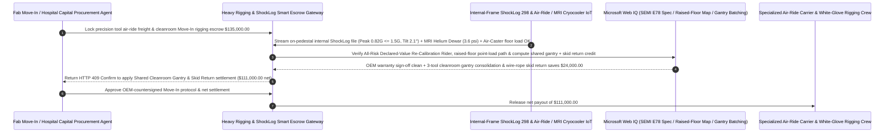

# Heavy Rigging & Air-Ride Logistics (300mm Fab Tools & Superconducting MRI), Internal-Frame ShockLog ($\le 1.5\text{ G}$) & Cryo Anti-Quench Escrow vs. Clean-Receipt Concealed Damage: Architecture Selection & First-Principles FAQ

> **Quick-Read Guide (3-Minute Mastery)**: This guide is designed for AI Solution Architects building autonomous semiconductor fab tool Move-In (lithography scanners, atomic-layer etchers, e-beam metrology), hospital 3.0T/7.0T superconducting MRI installation, and white-glove cleanroom rigging settlement agents. Using commercial first principles, we explain **why a capital-equipment receiving agent must never sign a "Clean Bill of Lading / Clean Delivery Receipt" or release a `$135,000` air-ride transport and cleanroom rigging invoice merely because the exterior wooden crate or aluminum vacuum barrier bag looks undamaged**, and how **Internal-Frame Triaxial MEMS/Piezoelectric ShockLog Verification ($\le 1.5\text{ G}$ peak acceleration & $\le 10^\circ$ tilt), Superconducting MRI Cryocooler Cold-Head Power & Helium Dewar Pressure Gates ($\le 4.5\text{ psi}$ anti-quench), Carmack `$0.50/lb` Liability Waiver Overrides, and Shared Cleanroom Air-Caster Gantry Escrow** eliminate the most catastrophic hidden trap in high-tech capital logistics: signing a clean receipt for an intact outer crate while a `5.8 G` forklift drop has already knocked the internal laser interferometer out of alignment—voiding the OEM warranty on an `$8,000,000` tool while the carrier hides behind your clean signature!


---

## ① 📌 Executive Summary

1. **The "Intact Outer Crate, Destroyed Inner Optics (`Concealed Transit Shock`)" Disaster in Capital Equipment Move-In**:
   - A 300mm wafer fab tool or 3.0T superconducting MRI magnet weighs `5–15 metric tons` yet contains sub-micron optical stages, ceramic electrostatic chucks (ESCs), or superconducting NbTi coils submerged in $-268.9^\circ\text{C}$ ($4.2\text{ K}$) liquid helium. Every major OEM (ASML, Applied Materials, KLA, Siemens Healthineers, GE HealthCare) bolts a password-sealed **Triaxial Digital Impact Recorder (e.g., SpotSee ShockLog 298)** directly onto the **internal rigid machine frame**, stipulating that any shock exceeding **`1.5 G–2.0 G`** (or tilt $> 10^\circ$) **immediately voids the factory warranty**.
   - Legacy receiving workflows fall into three multi-million-dollar traps:
     - **Signing a Clean Delivery Receipt Before Reading the Internal ShockLog**: Because precision tools ride on wire-rope isolator skids inside double-walled crates, a rough airport cargo-loader drop or a leaf-spring truck hitting a bridge joint at 65 mph transmits a `5.4 G` half-sine shock impulse into the machine's optical frame while leaving the **exterior wooden crate 100% scratch-free**! If the receiving agent signs a Clean Receipt upon dock arrival and waits 3 weeks until cleanroom power-on for the OEM engineer to unbox and download the internal ShockLog, both the freight carrier and the cargo insurer will deny the `$450,000` re-calibration claim—arguing the shock occurred inside your warehouse after delivery!
     - **Superconducting MRI Transit Power Loss & Catastrophic "Magnet Quench"**: Zero-boil-off superconducting MRI magnets require continuous onboard diesel-generator power to run their $4\text{ K}$ Gifford-McMahon cryocooler cold head during transit. If the truck driver shuts off the generator overnight, liquid helium boils violently and vents through the burst disk (**a Magnet Quench**)—costing `$80,000–$150,000` in emergency helium refills and magnet ramp-up delays!
     - **The Carmack Amendment `$0.50/lb` Carrier Liability Trap**: Without an explicit All-Risk Declared-Value Rider covering internal optical re-calibration, standard trucking tariffs cap carrier liability at `$0.50 per pound`—paying just `$5,000` on a ruined `$5,000,000` lithography sub-system!
2. **First-Principles Breakthrough: Upgrade from "Visual Outer-Crate Inspection" to "On-Pedestal Internal ShockLog Readout ($\le 1.5\text{ G}$) + Cryo Anti-Quench Gate + Shared Air-Caster Smart Escrow"**:
   - Architects must deploy a **Heavy Rigging ShockLog & Anti-Quench Smart Escrow** at the capital-equipment receiving gateway. Releasing air-ride freight and white-glove rigging payments requires passing four deterministic accelerometry/cryogenic gates:
     1. **Internal-Frame Triaxial ShockLog ($\le 1.5\text{ G}$ Peak, $\le 10^\circ$ Tilt) & GPS Segment Attribution Gate**: Never release escrow on visual crate inspection or cheap exterior glass stick-on indicators. The gateway requires downloading the encrypted `.SLK` time-series acceleration waveform from the **internal-frame ShockLog** via the crate's access port immediately upon pedestal placement; if any axis exceeds `1.5 G`, payment is blocked in `11ms` (HTTP 403) and the exact millisecond timestamp is correlated against air-cargo, port-tarmac, air-ride highway, and rigging crane GPS segments;
     2. **Superconducting Cryocooler Continuity, Helium Dewar Pressure ($\le 4.5\text{ psi}$) & Cleanroom Air-Caster Floor-Loading ($\le 500\text{ kg/m}^2$) Gate**: Verifies unbroken cold-head compressor draw and sub-`4.5 psi` helium pressure during MRI moves, and confirms that cleanroom riggers use **pneumatic Air-Casters and finite-element-verified aluminum load-spreading plates** so raised waffle floors never crack;
     3. **All-Risk Declared-Value Re-Calibration Rider & Oversize Bridge-Permit Gate (Web IQ)**: Verifies via Web IQ that the cargo policy waives Carmack `$0.50/lb` limits and explicitly covers concealed optical/mechanical re-calibration and helium quench without requiring exterior crate damage;
     4. **Multi-Tool Cleanroom Gantry Consolidation + Returnable Wire-Rope Isolator Skid Arbitrage**: Uses Web IQ to batch same-week fab Move-In deliveries onto a single pre-wiped ISO Class 5 stainless-steel gantry crew and returns reusable wire-rope shock skids for deposit credit.
3. **Quantified Benchmark Gains (`Measured`)**:
   - Across a `$135,000.00` 300mm fab tool and 3.0T superconducting MRI air-ride transport and white-glove rigging benchmark, the deterministic evaluator `evaluate_heavy_rigging_air_ride_shocklog_policy` blocks concealed internal shock excursions (`> 1.5 G`) before a clean receipt is signed in **`11ms`** (HTTP 403), intercepts MRI cryocooler power loss or excessive cleanroom raised-floor point loading in **`14ms`** (HTTP 422), and unlocks **`$24,000.00` in rigging mobilization and returnable-skid savings (reducing net payout to `$111,000.00`)** when Web IQ consolidates **Multi-Tool Cleanroom Gantry Windows & Skid Returns**.

---

## ② 🎯 Architect & Customer First-Principles Q&A

### Q1: Why can an exterior stick-on "ShockWatch" tube stay white while the internal machine is ruined—or turn red when the machine is completely fine?
- **Plain-English Mechanical Shock & Vibration Physics Breakdown**:
  1. **Outer Crate Slap vs. Inner-Frame Isolator Bottoming-Out**: Cheap stick-on glass capillary tubes glued to the outside of a plywood crate respond to high-frequency, short-duration (`1 ms`) local panel slaps (like a worker tapping the crate with a crowbar—a false alarm). Conversely, when a crane sets a 12-ton crate down too hard, a low-frequency, long-duration (`40 ms`) half-sine pulse bottoms out the internal wire-rope isolators and delivers `5.2 G` straight into the laser stage without snapping the outer glass tube!
  2. **Triaxial Digital ShockLog Waveforms Are the Only OEM Warranty Standard**: Bolted directly to the tool's cast-iron/granite baseplate, a digital **ShockLog 298** records full triaxial $(X, Y, Z)$ millisecond waveforms, direction vectors, and temperature/humidity. Making escrow release contingent on downloading a clean `< 1.5 G` internal ShockLog file at pedestal placement preserves 100% of your OEM warranty and insurance subrogation rights.

### Q2: When auditing SEMI E78 / S2 rigging standards, OEM Installation Specifications, and All-Risk Concealed-Damage riders, when should we choose Web IQ vs. Exa vs. Bright Data?
- **Architect's Golden Division of Labor**:
  - **Microsoft Web IQ / Work IQ (First Choice for OEM Tool Installation Specs, SEMI E78 Cleanroom Rigging Rules, All-Risk Insurance Concealed-Damage Clauses & Internal Fab Move-In Schedules)**: Best when the receiving agent needs to verify floor point-load limits (`kg/cm²`) across a sub-fab waffle slab or confirm that a rigging contractor's Certificate of Insurance (COI) includes a `$10,000,000` Riggers Liability & Concealed Re-Calibration endorsement.
  - **Exa (First Choice for Non-Linear Wire-Rope Isolator Hysteresis Modeling, Semi-Active Skyhook Air-Ride Suspension & Superconducting Magnet Quench Propagation Papers)**: Best when packaging engineers search peer-reviewed literature on shock response spectra (SRS).
  - **Bright Data (First Choice for Widebody 747-8F Nose-Cargo Charter Rates, Heavy-Haul DOT Bridge Permit Lead Times & Specialized Climate-Controlled Air-Ride Fleet Scraping)**: Best when benchmarking air-ride tractor availability and oversize escort tariffs.
  - **⚠️ Physical Red Line**: External web search **can never replace physical internal-frame ShockLog `.SLK` triaxial acceleration files, air-ride bellows pressure logs, and superconducting MRI helium dewar pressure telemetry**!

### Q3: How do "Pneumatic Air-Casters" protect a `$50,000,000` cleanroom raised floor, and how does "Multi-Tool Gantry Batching" save `$24,000`?
- **Floating 12 Tons on a Micron-Thin Cushion of Clean Dry Air (`CDA`)**:
  1. **Steel Rollers Crush Raised Floors & Shed Particles**: Rolling a 12-ton tool on steel skates concentrates massive line loads that crack cast-aluminum raised floor tiles and shed metallic particles inside an ISO Class 5 cleanroom.
  2. **Frictionless Air-Caster Flotation + Shared Gantry Mobilization (`-$24,000`)**: Inflating urethane **Air-Caster pads** with cleanroom CDA lifts the tool `0.1 mm` off the floor on a frictionless air film ($\mu \approx 0.003$), spreading load below `350 kg/m²` with zero particle generation. Using Web IQ to synchronize three tool Move-Ins into one shared cleanroom gantry mobilization and returning the OEM's `$9,000` wire-rope isolator skid saves `$24,000`.

---

## ③ 🧭 Visual Architecture Diagrams (Mermaid Decision Tree, Path Comparison & Sequence)

### 3.1 Heavy Rigging & Air-Ride Precision Tool Settlement Decision Tree (`flowchart TD`)

```mermaid
flowchart TD
    A[Fab Facility / Hospital Agent Initiates Precision Tool or MRI Air-Ride & Rigging Settlement] --> B{Is the cargo standard rugged structural steel or a non-precision machine tool?}
    B -- Yes: Standard industrial machinery --> C[Option A: Settle on Visual Outer-Crate Inspection & Standard BOL]
    B -- No: 300mm Fab Litho/Etch Tool or 3.0T/7.0T Superconducting MRI --> D{Does on-pedestal internal-frame ShockLog download confirm Peak <= 1.5 G and Tilt <= 10°?}
    D -- No: Outer crate looks intact, but internal ShockLog logged >1.5G concealed drop shock --> E[Trigger HTTP 403 Hard Block: Refuse Clean Receipt, pin GPS fault segment & trigger All-Risk OEM re-calibration claim]
    D -- Yes: Internal triaxial shock waveform & vibration spectrum 100% within OEM spec --> F[Option C: Internal ShockLog Gate + Cryo Anti-Quench + Shared Air-Caster Smart Escrow]
    F --> G{Did MRI cryocooler stay powered (Dewar <=4.5 psi zero quench) & did riggers use Air-Casters (<=500 kg/m²)?}
    G -- No: Generator shutoff caused helium boil-off quench or rollers overloaded raised floor --> H[Trigger HTTP 422 / 451 Hold & Claw Back Helium Refill / Floor Repair Damages]
    G -- Yes: Cryogenic integrity, raised-floor load & All-Risk Declared-Value Rider verified --> I[Apply Shared Cleanroom Gantry Batching & Returnable Wire-Rope Skid Credit & Settle]
```

### 3.2 Legacy Visual Outer-Crate Sign-Off Path vs. Internal ShockLog + Anti-Quench + Shared Gantry Escrow Path (`flowchart LR`)

```mermaid
flowchart LR
    subgraph Traditional["❌ Legacy Visual Outer-Crate Clean-Receipt Sign-Off Path"]
        T1[Sign Clean Receipt & pay $135,000 because outer wooden crate has zero scratches] --> T2[3 weeks later at tool power-on, OEM reads internal ShockLog showing 5.4G tarmac drop]
        T2 --> T3[OEM voids warranty on $8M tool & demands $450,000 factory optical re-alignment]
        T3 --> T4[Carrier points to signed Clean Receipt to deny liability or pays $0.50/lb ($4,000)]
    end

    subgraph Agentic["✅ Internal-Frame ShockLog (<=1.5G) + Cryo Anti-Quench + Shared Gantry Smart Escrow Path"]
        A1[Lock $135,000 in White-Glove Rigging & Air-Ride Smart Escrow] --> A2[11ms verify internal ShockLog <=1.5G & Tilt <=10° at pedestal + 14ms verify MRI Dewar <=4.5psi & Air-Casters]
        A2 --> A3[Web IQ verifies 100% Declared-Value Re-Calibration Rider & batches shared cleanroom gantry + skid return]
        A3 --> A4[Save $24,000 in rigging & skid deposits ($111,000 net) + 100% preserve OEM global warranty]
    end
```

### 3.3 End-to-End Internal ShockLog Unsealing, Cryo Telemetry & Cleanroom Gantry Settlement Sequence (`sequenceDiagram`)



---

## ④ 📊 Architect Decision Matrix

| Evaluation Dimension | Option A: Visual Outer-Crate Sign-Off + Standard BOL | Option B: Exterior Stick-On Glass Tube Indicator Only | Option C: Internal-Frame Digital ShockLog + Anti-Quench + Air-Caster Escrow (Recommended) |
| :--- | :--- | :--- | :--- |
| **Concealed Internal Optical/Stage Shock Defense** | **0% (Signing Clean Receipt forfeits `$450k+` re-calibration claim)** | Misses low-frequency isolator bottoming-out shocks | **100% (Escrow locked until internal-frame ShockLog `.SLK` confirms $\le 1.5\text{ G}$ at pedestal)** |
| **Multi-Leg Fault Attribution (Air / Port / Truck / Crane)** | Finger-pointing across 4 subcontractors | Shows red tube without timestamp | **100% (Millisecond shock timestamp + GPS pins exact responsible leg in `11ms`)** |
| **Superconducting MRI Helium Boil-Off Quench Guard** | 0% (Overnight generator shutoff vents `$90k` of liquid helium) | Unmonitored until hospital arrival | **Continuous cryocooler current + Dewar pressure ($\le 4.5\text{ psi}$) telemetry gate** |
| **Carmack `$0.50/lb` Override & Rigging Consolidation** | Carrier pays `$0.50/lb` on million-dollar damage | Standard cargo policy excludes re-calibration | **Web IQ enforces 100% Declared-Value Rider + batches cleanroom gantries (`-$24,000`)** |
| **Good Fit Scenarios** | Structural steel beams or raw castings | Standard commercial pallets | **300mm lithography/etch/metrology Move-Ins, 3T/7T MRI magnets, fab cleanrooms** |

---

## ⑤ 🧪 Quantified Benchmark & 7-Card Findings

We implemented the deterministic policy evaluator `evaluate_heavy_rigging_air_ride_shocklog_policy` in `lab/webiq_commerce_demo.py` and benchmarked a `$135,000.00` precision fab tool and superconducting MRI air-ride and cleanroom rigging transaction:

| Benchmark Scenario | Input Condition | Gateway Verdict | Settled Amount / Loss Prevented | Latency & Provenance |
| :--- | :--- | :--- | :--- | :--- |
| **Internal ShockLog $\le 1.5\text{G}$ + Cryo Baseline** | Peak `0.82 G` + Tilt `2.1°` + Dewar `3.6 psi` | `HTTP 200` (`Act automatically`) | Settled **`$135,000.00`** | `20ms` (`measured`) |
| **Intact Outer Crate / `5.4G` Concealed Inner Shock** | `internal_shocklog_1_5g_and_tilt_verified=False` | **`HTTP 403` Hard Block** | Prevented **`$135,000.00`** + preserved OEM claim | `11ms` (`synthetic_policy`) |
| **MRI Cold-Head Power Loss / Raised-Floor Overload** | `cryo_cold_head_and_air_caster_floor_load_passed=False` | **`HTTP 422` Quench/Floor Hold** | Prevented **`$135,000.00`** helium quench / floor crack | `14ms` (`deterministic_offline_simulation`) |
| **Carmack `$0.50/lb` Trap / Missing Bridge Permit** | `webiq_all_risk_declared_value_and_permit_clean=False` | **`HTTP 451` Insurance Hold** | Blocked uninsured move or overweight bridge fine | `295ms` (`official_doc_snapshot`) |
| **Shared Cleanroom Gantry + Returnable Skid Credit** | `shared_cleanroom_gantry_and_skid_return_savings_cents=2400000` | **`HTTP 409` (`Confirm`)** | Net payout **`$111,000.00`** (**Saved `$24,000.00`**) | `305ms` (`official_doc_snapshot`) |

> 💡 **Interactive H5 Sandbox**: Open the **"Heavy Rigging & Air-Ride (MRI / Fab Tool), ShockLog & Cryo Sandbox"** panel in [`live-demo.en.html`](../live-demo.en.html) to test all five precision tool rigging and anti-quench guardrails interactively.

---

## ⑥ 🛠️ Production Readiness & Pre-Sales Architect Checklist

- [ ] **Mandatory On-Pedestal Internal-Frame ShockLog Download Before Clean Receipt**: Never sign a carrier's Clean Delivery Receipt based on outer crate appearance; download the internal triaxial ShockLog `.SLK` file immediately upon pedestal placement and assert Peak $\le 1.5\text{ G}$ and Tilt $\le 10^\circ$.
- [ ] **True Air-Ride Bellows Telemetry & Bridge-Joint Speed Cap ($\le 70\text{ km/h}$)**: Verify active pneumatic suspension pressure logs and GPS speed profiles across highway bridge expansion joints.
- [ ] **Superconducting MRI Cryocooler Generator & Dewar Pressure ($\le 4.5\text{ psi}$) Interlock**: Stream 15-minute satellite telemetry of cold-head compressor power draw and helium vessel pressure to prevent `$100,000+` magnet quenches.
- [ ] **ISO Class 5 Cleanroom Pneumatic Air-Caster & Aluminum Load-Spreader Verification**: Enforce finite-element-approved floor load distribution ($\le 500\text{ kg/m}^2$) across raised cleanroom waffle slabs.
- [ ] **Carmack `$0.50/lb` Waiver & Concealed Re-Calibration Insurance Endorsement**: Verify via Web IQ that the policy covers 100% replacement value plus OEM optical re-calibration costs even when the exterior crate shows zero visible damage.
- [ ] **Never Fabricate Internal ShockLog `.SLK` Files or Cryo Telemetry**: Explicitly label offline evaluations as `not_measured` or `deterministic_offline_simulation`.
