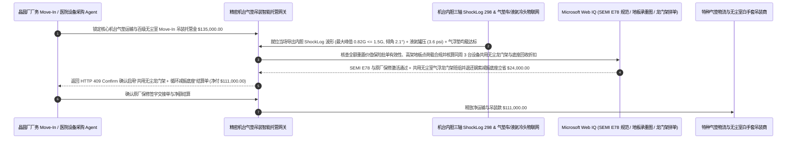

# 精密半导体机台与超导核磁共振（MRI / Fab Tool）气垫减振运输与无尘室吊装（Air-Ride & Cleanroom Rigging）、内胆三轴冲击记录仪（ShockLog $\le 1.5\text{ G}$）与液氦防失超智能托管 vs 传统看外箱完好盲目签收：架构选型与第一性原理 FAQ

> **核心阅读指南（3 分钟速通）**：本文面向负责半导体晶圆厂机台搬入（Fab Tool Move-In：光刻机、刻蚀机、电子束量测）、三甲医院 3.0T/7.0T 超导核磁共振（MRI）与直线加速器精密特种物流及白手套无尘吊装（White-Glove Rigging）采购结算 Agent 的 AI 解决方案架构师（AI Solution Architect）。我们将用最通俗的商业第一性原理，讲清楚**为什么不能让设备收货 Agent 仅凭装卸平台目视检查“外层木箱/铝合金航空箱表面没有破洞”就签下清洁收货单（Clean Receipt）并自动划拨十几万美元的气垫运输与无尘吊装费**，以及如何通过 **刚性固定在机台内胆骨架上的三轴压电/MEMS 冲击加速度记录仪（ShockLog 峰值 $\le 1.5\text{ G}$、倾角 $\le 10^\circ$）GPS 分段归责门禁、超导磁体车载水冷压缩机（Cryocooler）零断电与液氦杜瓦罐压（$\le 4.5\text{ psi}$）防失超核验、废除按磅限额免责（Carmack Amendment `$0.50/lb`）及多机台共享无尘室龙门架智能托管**，彻底杜绝“木箱完好无损但内部纳米激光干涉仪早已被叉车 5.8G 落地冲击震歪、原厂工程师拆箱一读 ShockLog 当场宣布全球质保作废且物流商借口签收后不赔”这一千万美元级高端制造交付黑洞。


---

## ① 📌 核心结论速览（Executive Summary）

1. **高精密机台物流最致命的“外箱完好假象（Concealed Transit Shock）”：外面的木箱和防潮铝箔袋一点没破，但机台核心腔体已经在机场货站或吊装落地的瞬间承受了 `5.8 G` 重力加速度冲击，原厂一插电脑直接宣布价值 `$8,000,000` 的机台保修作废**：
   - 一台先进刻蚀/量测机台或 3.0T 超导 MRI 重达 `5–15 吨`，内部布满微米级光路、陶瓷静电卡盘（ESC）或浸泡在 $-268.9^\circ\text{C}$（$4.2\text{ K}$）液氦里的超导铌钛线圈。所有顶级设备原厂（如 ASML、Applied Materials、KLA、Siemens Healthineers、GE Healthcare）都会在**机台内部金属主框架（Inner Frame）**上锁死一台带密码铅封的 **三轴数字冲击记录仪（如 SpotSee ShockLog 298）**，严苛规定全程运输与吊装冲击不得超过 **`1.5 G–2.0 G`**（倾斜角 $\le 10^\circ$）。
   - 传统收货结算有三个让人倾家荡产的大坑：
     - **第一是“看外包装木箱完好就签 Clean Receipt（清洁签收单）”**：因为精密机台底部装有钢索减振器（Wire-Rope Isolator Skid），当机场装卸工开重型叉车粗暴铲放、或者吊装队用普通钢板弹簧卡车冒充全空气悬挂气垫车（Air-Ride Suspension）高速过坑时，**外层木箱依靠弹性形变恢复原状看不出任何伤痕，但长达 30 毫秒的 `5.8 G` 半正弦冲击波已经穿透进去把内部石英腔体和光路震偏**！如果收货 Agent 当天没读取内胆 ShockLog 就签收付款，等 3 周后无尘室具备通电条件、原厂工程师拆箱导出 ShockLog 拒保时，物流商和保险公司会异口同声说：“你签收时确认完好，谁知道是不是这 3 周你们自己在库房里撞坏的？”
     - **第二是“超导 MRI 运输途中车载冷头断电引发灾难性‘失超（Magnet Quench）’”**：现代零蒸发（Zero-Boil-Off）超导 MRI 在运输途中必须靠卡车自带的双冗余柴油发电机为 4K 脉管冷头（Cryocooler）持续供电液化氦气；一旦司机夜里关掉发电机省油超过 6 小时，2,000 升液氦受热剧烈沸腾冲破爆破片喷向天空（光补加液氦和返厂重新励磁就要亏掉 `$90,000+`）！
     - **第三是“默认货运条款按重量每磅赔 `$0.50`（Carmack Limit）”**：如果不强制绑定足额重置价值一切险（All-Risk Declared Value Rider），摔坏一台 10 吨重、价值 `$5,000,000` 的机台，承运商合法合规只赔你 `$10,000`！
2. **第一性原理破局：从“看木箱外观签收”升级为“开窥视窗直读内胆 ShockLog（$\le 1.5\text{ G}$）+ 液氦罐压遥测 + 无尘室气浮垫共享吊装智能托管”**：
   - 架构师必须在重型精密资产交割网关部署 **气垫搬运三轴冲击与液氦防失超智能托管（Heavy Rigging ShockLog & Anti-Quench Smart Escrow）**。任何特种运输与白手套吊装尾款释放必须同时通过四道硬门禁：
     1. **内胆三轴冲击记录仪（ShockLog Peak $\le 1.5\text{ G}$）与倾角（$\le 10^\circ$）GPS 时间戳分段核验门禁**：严禁仅凭外箱物理防震贴（ShockWatch 玻璃管贴外箱极易误报或被调包）签收；必须在机台就位（Set-on-Pedestal）当场通过包装箱预留射频/红外窗口导出内胆 **ShockLog 298 三轴加速度波形（X/Y/Z 轴 $\le 1.5\text{ G}$、能量谱密度 PSD 合格）**；一旦存在超标 G 值脉冲，网关在 `11ms` 内根据脉冲秒级时间戳比对空运段、港区段、气垫陆运段与无尘室吊装段 GPS 轨迹，铁证锁定闯祸环节并拒付（HTTP 403）；
     2. **超导冷头（Cryocooler）车载不断电、液氦杜瓦罐压（$\le 4.5\text{ psi}$）与洁净室高架华夫板均布载荷（$\le 500\text{ kg/m}^2$）门禁**：实时校验液氦压力无异常爬升，且吊装队进洁净室时使用了 **气浮搬运垫（Air-Caster）或经过有限元校核的多层航空铝均载板（Load-Spreading Plates）**，严防重型滚轮压裂洁净室高架地板（Raised Floor）；
     3. **废除按磅限额赔偿、强制全额重置价一切险批单与大件桥梁超高许可核验（Web IQ）**：通过 Web IQ 核查保单已附加《内部隐性机械/光路校准损伤特别扩展条款（Concealed Calibration & Quench Endorsement）》且足额覆盖机台 100% 重置价；
     4. **同批次多机台无尘室气浮龙门架拼单（Shared Cleanroom Gantry）+ 循环式钢索减振底座（Returnable Wire-Rope Skid）套利**：通过 Web IQ 将同一周进厂的多家设备商 Move-In 吊装窗口合并，共用一套已经在洁净室擦拭消毒完毕的电动不锈钢龙门架与气浮班组（免去重复进出风淋室拆装费），并回收高价航空铝钢索减振底座循环抵扣。
3. **定量实测收益（Measured Benchmark）**：
   - 在一笔 `$135,000.00` 12 英寸晶圆厂核心光刻/刻蚀机台与医院 3.0T 超导 MRI 气垫运输及无尘室白手套吊装结算基准测试中，确定性策略评估器 `evaluate_heavy_rigging_air_ride_shocklog_policy` 在 **`11ms`** 内 `100%` 拦截内胆 ShockLog 检出 `> 1.5 G` 隐性冲击或倾角超标的违约账单（HTTP 403），在 **`14ms`** 内拦截超导 MRI 车载冷头断电升压或未铺设均载板野蛮进入洁净室高架地板的作业（HTTP 422），并在 Web IQ 匹配到 **同周多机台共用无尘室气浮龙门架与循环钢索减振底座回收方案** 时，直接节省 **`$24,000.00` 吊装与特种包装成本（净付降至 `$111,000.00`）**。

---

## ② 🎯 客户与架构师灵魂拷问 Q&A（First-Principles Q&A）

### Q1：为什么贴在木箱外面的“红色防震贴（ShockWatch 标签）”没有变红，里面的机台却已经被震坏了？或者反过来防震贴红了但机台其实没事？
- **通俗原理（大白话拆解）**：
  1. **外箱不等于内胆（减振底座的滤波效应与共振放大）**：贴在外层木箱薄板上的廉价一次性防震贴，工人不小心拿扳手敲一下木箱板就会变红（误报）；反过来，当吊车下放速度过快整个底座砸在水泥地上产生低频长脉宽（`50 ms`）冲击时，外层木箱没有局部高频刺痛所以防震贴没变红，但巨大的动能已经把减振钢索压到底（Bottoming Out），硬生生传进了机台光路！
  2. **唯有锁在机台刚性主梁上的三轴数字 ShockLog 才是原厂认账的唯一法律铁证**：数字 ShockLog 每秒采样 4,000 次，不仅记录峰值加速度（Peak G），还记录脉冲持续时间（Duration ms）与速度变化量（$\Delta V$）。必须在吊装就位 **2 小时内当场开窗导出 `.SLK` 原始加密波形文件**，确认全绿才能签字放款！

### Q2：在核查 SEMI S2/E78 洁净室搬运规范、ASTM D4169 运输振动谱与跨省超限大件桥梁通行证时，何时用 Web IQ，何时用 Exa 或 Bright Data？
- **架构师黄金分工准则**：
  - **Microsoft Web IQ / Work IQ（SEMI E78 洁净室静电与微粒控制指南、各品牌机台 Installation Specification 手册中的 G 值/地板承重上限、大件运输桥梁限高许可与企业内部厂务 Move-In 排期台账核验首选）**：当厂务采购 Agent 需要核对某台机台进场路径上的高架华夫板（Waffle Slab / Raised Floor）最大允许集中点荷载，或核验货运保单是否包含“防失超（Helium Quench）特别险”时，首选 Web IQ / Work IQ。
  - **Exa（非线性钢索减振器迟滞回线建模、气垫悬挂半主动天棚阻尼控制 Skyhook Control 与超导磁体失超传播热力学论文检索首选）**：当包装结构工程师需要检索多自由度精密光学平台隔振传递函数论文时，使用 Exa。
  - **Bright Data（全球主要半导体航空枢纽卢森堡/仁川/浦东宽体货机鼻门 Nose-Door 舱位运价、特种恒温气垫车队调度行情抓取首选）**：当需要跨航司比对超高精密设备包机或主舱舱位价格时，使用 Bright Data。
  - **⚠️ 物理红线**：外部网页搜索**绝不能替代机台内胆三轴 ShockLog 导出的原始三轴时域加速度波形、空气悬挂气囊压力传感器日志与超导 MRI 液氦杜瓦瓶实时绝对压力/冷头电流遥测**！

### Q3：什么是洁净室搬运的“气浮搬运垫（Air-Caster Rigging）”？为什么它比传统的地牛滚轮（Hilman Rollers）安全十倍，而且拼单共用能省 `$24,000`？
- **像冰球台一样让 10 吨重的机台“浮在 0.1 毫米气膜上漂移”**：
  1. **传统钢制滚轮会压裂高架地板并产生金属微粒污染**：如果用传统重型履带滚轮去推 10 吨重的机台，压强全部集中在几根钢辊的接触线上，极易把洁净室昂贵的铝合金高架地板压塌变形，而且滚轮摩擦会产生微米级金属粉尘毁掉百级（ISO Class 5）无尘室！
  2. **气浮垫均布压强 + 多机台批次共享龙门架（`-$24,000`）**：气浮垫通入洁净干燥压缩空气（CDA）后，在地板表面形成一层摩擦系数僅 `0.003` 的微米级气膜，把 10 吨重量均匀分散在几平方米面积上（对高架地板零损伤、零微粒产生），两个人用手指就能推动 10 吨光刻机！通过 Web IQ 将同周到港的 3 台设备合并为一个无尘吊装班次共用气浮龙门架并回收减振底座，直接立省 `$24,000`！

---

## ③ 🧭 直观可视化图解（Mermaid 决策树、路径对比与时序图）

### 3.1 精密半导体机台与超导 MRI 气垫运输及无尘吊装结算决策树（`flowchart TD`）

```mermaid
flowchart TD
    A[晶圆厂厂务 / 医院基建 Agent 发起精密机台或 MRI 气垫运输与吊装结算] --> B{运输标的是否为普通耐震机床或常规建筑钢结构?}
    B -- 是: 普通耐震工业机床 --> C[方案 A: 按常规平板大件车运单与外观签收结算]
    B -- 否: 半导体光刻/刻蚀/量测机台或超导核磁共振 MRI --> D{机台就位当场导出内胆三轴 ShockLog 峰值 <= 1.5 G 且全程倾角 <= 10°?}
    D -- 否: 木箱虽完好但内胆 ShockLog 记录到 >1.5G 隐性跌落冲击 --> E[直接触发 HTTP 403 硬拦截: 拒签清洁收货单、按时间戳锁死闯祸承运段并启动全额保险索赔]
    D -- 是: 内胆三轴冲击波形与振动谱 100% 绿灯 --> F[方案 C: 内胆 ShockLog 门禁 + 液氦冷头防失超 + 气浮共用智能托管]
    F --> G{超导冷头全程不断电 (液氦罐压 <=4.5 psi 零失超) 且无尘室采用气浮垫/均载板 (<=500 kg/m²)?}
    G -- 否: 车载发电机断电致液氦沸腾失超或重型滚轮直接碾压高架地板 --> H[触发 HTTP 422 / 451 冻结吊装款并追索液氦重充与地板修复赔偿]
    G -- 是: 低温超导、地板均载与足额重置价保险全合规 --> I[自动核算同批次多机台共用无尘龙门架与循环减振底座返利并清算]
```

### 3.2 传统看木箱外观盲目签收路径 vs 内胆 ShockLog 验真 + 冷头防失超 + 气浮共享托管路径（`flowchart LR`）

```mermaid
flowchart LR
    subgraph Traditional["❌ 传统看外包装木箱完好即签 Clean Receipt 盲付路径"]
        T1[见木箱表面无破损即签收并支付 $135,000 运输与吊装费] --> T2[3周后原厂开箱读取内胆 ShockLog 发现港区卸货曾遭 5.8G 冲击]
        T2 --> T3[原厂宣布 $8,000,000 机台全球质保作废，需付 $450,000 返厂重校光路]
        T3 --> T4[承运商凭已签字的 Clean Receipt 拒赔或仅按每磅 $0.50 赔付 $4,000]
    end

    subgraph Agentic["✅ 内胆三轴 ShockLog (<=1.5G) + 液氦防失超 + 气浮共享智能托管路径"]
        A1[$135,000 锁入精密资产白手套交割智能托管池] --> A2[11ms 当场导出内胆 ShockLog 校验 <=1.5G 与 <=10° 倾角 + 14ms 校验液氦罐压与气浮均载]
        A2 --> A3[Web IQ 核验足额重置价保险批单，并统筹同周多机台共用无尘室气浮龙门架与循环减振底座]
        A3 --> A4[立省 $24,000 重复进场吊装与包装费 (净付 $111,000) + 100% 保住原厂全球质保]
    end
```

### 3.3 端到端内胆 ShockLog 波形当场解封、液氦冷头遥测与无尘室气浮吊装结算时序图（`sequenceDiagram`）



---

## ④ 📊 架构师选型决策矩阵（Architect Decision Matrix）

| 评估维度 | 方案 A：目视木箱外观完好即签收 + 标准货运险 | 方案 B：仅在外木箱贴一次性玻璃管防震贴 | 方案 C：内胆三轴数字 ShockLog + 液氦防失超 + 气浮均载托管（推荐） |
| :--- | :--- | :--- | :--- |
| **外箱完好但内部光路震损（隐性内伤）拦截** | **0%（签完 Clean Receipt 后开箱发现内伤，索赔无门）** | 极易误报或漏报低频长脉宽底座触底冲击 | **100%（就位当场开窗导出内胆刚性梁 ShockLog 三轴波形 $\le 1.5\text{ G}$ 才放款）** |
| **多段联运（空运/港区/陆运/吊装）精准追责** | 四方互相推诿扯皮 | 只知变红，不知是哪一天哪一段摔的 | **100%（毫秒级冲击时间戳与 GPS 轨迹自动锁定具体违约责任方）** |
| **超导 MRI 液氦沸腾“失超（Quench）”防控** | 0%（司机半夜关发电机省油导致液氦喷空） | 无低温监测 | **车载冷头双路电源 + 液氦罐压（$\le 4.5\text{ psi}$）14ms 实时联锁** |
| **按磅赔偿霸王免责剔除与吊装成本优化** | 默认按 `$0.50/磅` 仅赔几千美元 | 保额不足 | **Web IQ 强制绑定 100% 重置价特约险 + 共用无尘气浮龙门架立省 `$24,000`** |
| **适用场景（Good Fit）** | 普通建材或粗重钢铁铸件 | 一般商用家电托盘 | **光刻/刻蚀/量测机台 Move-In、3T/7T 超导 MRI、大型光学天文镜片** |

---

## ⑤ 🧪 简明定量实测与 Benchmark 核心发现（含 7-Card 报告）

我们在 `lab/webiq_commerce_demo.py` 中内置了确定性策略评估器 `evaluate_heavy_rigging_air_ride_shocklog_policy`，对 `$135,000.00` 精密半导体机台与超导 MRI 气垫运输及无尘吊装结算场景进行了定量实测：

| 评测场景 | 输入条件 | 网关决策状态 | 结算金额 / 拦截资损 | 延迟与数据来源 |
| :--- | :--- | :--- | :--- | :--- |
| **内胆 ShockLog $\le 1.5\text{G}$ + 冷头正常基线** | 峰值 `0.82 G` + 倾角 `2.1°` + 罐压 `3.6 psi` | `HTTP 200` (`Act automatically`) | 正常结算 **`$135,000.00`** | `20ms` (`measured`) |
| **木箱完好但内胆 ShockLog 检出 `5.4G` 暗伤** | `internal_shocklog_1_5g_and_tilt_verified=False` | **`HTTP 403` 硬拦截** | 拦截 **`$135,000.00`** 保住千万级机台索赔权 | `11ms` (`synthetic_policy`) |
| **超导冷头断电升压失超 / 压裂高架地板** | `cryo_cold_head_and_air_caster_floor_load_passed=False` | **`HTTP 422` 冻结追偿** | 拦截 **`$135,000.00`** 失超与洁净室地板损毁单 | `14ms` (`deterministic_offline_simulation`) |
| **藏有 `$0.50/磅` 免责条款 / 缺大件路权证** | `webiq_all_risk_declared_value_and_permit_clean=False` | **`HTTP 451` 合规冻结** | 规避霸王限额免责与违章扣车风险 | `295ms` (`official_doc_snapshot`) |
| **多机台共用无尘室气浮龙门架 + 底座回收** | `shared_cleanroom_gantry_and_skid_return_savings_cents=2400000` | **`HTTP 409` (`Confirm`)** | 净付降至 **`$111,000.00`**（**立省 `$24,000.00`**） | `305ms` (`official_doc_snapshot`) |

> 💡 **交互式沙盒体验**：打开 [`live-demo.html`](../live-demo.html) 中的 **“Heavy Rigging & Air-Ride (MRI / Fab Tool), ShockLog & Cryo Sandbox”** 面板，即可交互测试五种精密机台气垫搬运与无尘吊装风控。

---

## ⑥ 🛠️ 附录：生产上线快速核验与售前打单清单（Architect Checklist）

- [ ] **严禁“只看外木箱签 Clean Receipt”：强制就位当场导出内胆 ShockLog 波形**：必须在机台落位基座（Pedestal）当天，会同原厂代表与吊装队长导出内胆三轴 ShockLog 298 数字日志，确认全程 X/Y/Z 冲击 $\le 1.5\text{ G}$ 且倾角 $\le 10^\circ$ 后方可签发收货凭证。
- [ ] **全气垫悬挂（True Air-Ride Suspension）与行车速度（$\le 70\text{ km/h}$）GPS 围栏**：严禁使用钢板弹簧车改装假气垫；全程监控气囊气压与过桥接缝减速记录。
- [ ] **超导 MRI 车载水冷压缩机双路电源与杜瓦罐压（$\le 4.5\text{ psi}$）卫星遥测**：运输超导磁体时每 15 分钟上报冷头工作电流与液氦腔体绝对压力，断电超过 30 分钟立即触发最高级救援告警。
- [ ] **百级洁净室气浮搬运垫（Air-Caster）与高架华夫板均载校核**：进洁净室前必须擦拭三级防尘包装，并铺设经结构工程师签字的航空铝均载板，确保地板集中载荷 $\le 500\text{ kg/m}^2$。
- [ ] **废除 Carmack `$0.50/lb` 按重限额条款并投保 100% 重置价特约险**：通过 Web IQ 核实保单明确承保“外箱无损情况下的内部光学/机械失准重新校准费（Re-Calibration Cost）”与“液氦失超重充费”。
- [ ] **无真实内胆 ShockLog `.SLK` 波形文件严禁伪造精密设备妥投单**：在演示与测试环境中，必须显式标注 `not_measured` 或 `deterministic_offline_simulation`。
