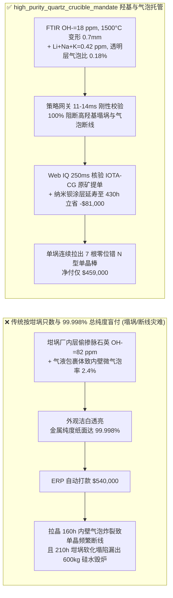
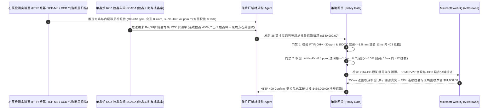

# 半导体与光伏大尺寸高纯石英坩埚及高纯石英砂交割（High-Purity Quartz Crucible & IOTA-Grade Quartz Sand Offtake）、羟基与碱金属析晶门禁（FTIR $\text{OH}^- \le 30\text{ ppm}$ & ICP $\text{Li+Na+K} \le 0.8\text{ ppm}$ 防 $1,500^\circ\text{C}$ 软化塌埚漏硅）与透明层微气泡破灭控制（气泡面积比 $\le 0.5\%$ 防拉晶位错断线）/ 氢氧化钡（$\text{Ba(OH)}_2$）促晶铠甲智能托管 vs 传统仅按坩埚只数与二氧化硅纯度 $99.998\%$ 盲付：架构选型与第一性原理 FAQ

> **阅读指南**：本文面向 $12\text{ 英寸}$ 半导体大硅片与 N 型 TOPCon/BC 光伏单晶硅拉晶厂（直拉法 Czochralski / CZ，36–42 英寸石英坩埚）、高纯石英坩埚制造商、花岗伟晶岩高纯石英砂（HPQ，对标尤尼明 IOTA-CG / IOTA-6 / 挪威 TQC）提纯厂及供应链智能体架构师。遵循《IB vs Ethernet RoCE 选型 FAQ》的透明核算规范，从**非晶态石英玻璃（$\text{SiO}_2$）在 $1,500^\circ\text{C}$ 下的高温粘度-羟基断裂力学、碱金属诱导非均匀方石英（$\beta\text{-Cristobalite}$）失透剥落动力学、内层真空电弧熔融微气泡热膨胀上浮破灭及碳酸钡/氢氧化钡（$\text{BaCO}_3/\text{Ba(OH)}_2$）外层致密方石英铠甲机制**出发，用大白话与第一性原理彻底讲透：为什么单晶拉晶车间采购智能体绝对不能“见 36 英寸石英坩埚外观洁白透亮且 $\text{SiO}_2$ 化验单标称 $99.998\%$（4N8）就自动打款 $54\text{ 万美元}$”，以及如何通过 **`high_purity_quartz_crucible_mandate`（羟基粘度门禁、碱金属/铝钛痕量门禁、透明层微气泡/厚度遥测与长寿命连续拉晶加料托管凭证）** 实现毫秒级防塌埚漏硅事故拦截与多根连续拉晶（RCZ）降本结算。

---

## 📌 1. 核心结论速览（Executive Summary）

1. **大白话常识破除——高纯石英砂不是“把普通河沙酸洗到 $99.998\%$ 纯度就行”，石英坩埚也不是“越厚越耐烧”：在 $1,500^\circ\text{C}$ 连续盛装 $600\text{ kg}$ 熔融硅液长达 $350\text{–}450\text{ 小时}$ 的极端地狱工况下，决定坩埚生死的是石英晶格里那 $1\text{ ppm}$ 的碱金属、$30\text{ ppm}$ 的羟基（$-\text{OH}$）和内壁 $2\text{ mm}$ 透明层里的微米级气液包裹体**：
   - 在直拉单晶（CZ）炉内，石英坩埚是唯一直接接触 $1,420^\circ\text{C}\text{–}1,500^\circ\text{C}$ 高纯硅水的一次性器皿（冷却后即碎裂，无法二次升温使用）。
   - **传统按“坩埚只数 + 砂子总纯度 $\text{SiO}_2 \ge 99.998\%$”盲付的三大灭顶之灾**：
     - **灾难一：高羟基（$\text{OH}^- > 30\text{ ppm}$）与矿源气液包裹体导致“高温粘度断崖下跌与软化塌埚漏硅（Crucible Sagging & Melt Spill）”**：若电弧熔制时真空抽吸不足或采用富含流体包裹体的脉石英矿替代花岗伟晶岩矿，石英玻璃中的羟基（$\text{Si-OH}$）会打断三维 $\text{Si-O-Si}$ 四面体网络桥氧键！当 $\text{OH}^-$ 从 $22\text{ ppm}$ 升至 $85\text{ ppm}$ 时，石英坩埚在 $1,500^\circ\text{C}$ 下的高温动力粘度从 $10^{9.2}\text{ Pa}\cdot\text{s}$ 暴跌一个数量级，拉晶到第 180 小时坩埚壁像软面团一样向内鼓包塌陷（塌埚），甚至烧穿漏出 $600\text{ kg}$ 通红的硅水直接炸毁整台单晶炉热场（单炉热场与加热器报废损失超 `$180,000`）！
     - **灾难二：内层透明层微气泡受热膨胀破裂（Bubble Bursting）抛出 $\text{SiO}_2$ 微粒引发“单晶位错断线（Dislocation Loss）”**：石英坩埚分为外层气泡保温层与内层 $1.5\text{–}2.5\text{ mm}$ 透明无泡层（Inner Bubble-Free Layer）。在 $400\text{ 小时}$ 拉晶中，硅水会以每天 $0.2\text{–}0.3\text{ mm}$ 的速度溶蚀内壁（$\text{Si} + \text{SiO}_2 \rightarrow 2\text{SiO}\uparrow$）。若内层砂含有未脱除的气液包裹体（气泡面积比 $> 0.5\%$ 或存在 $> 80\ \mu\text{m}$ 气泡），随着内壁被溶蚀剥开，内部气泡在 $1,500^\circ\text{C}$ 与高真空（$20\text{ Torr}$）下膨胀 $10\text{ 倍}$ 并炸裂，将微米级未熔石英碎屑喷进硅液对流环，顺着液流撞上固液生长界面，瞬间破坏单晶零位错生长（棱线消失断线），整根价值数万美元的单晶硅棒被迫回炉重熔！
     - **灾难三：碱金属（$\text{Li+Na+K} > 0.8\text{ ppm}$）无序析晶剥落与铁/钛/硼溶出毒化 N 型少子寿命**：钠、钾、锂是石英玻璃向方石英（Cristobalite）相变的强矿化剂。若内层砂碱金属超标，内壁会无序长出大块火山口状方石英结晶岛并剥落掉入硅水；同时内层砂中的铁、钛、铜、镍及硼/磷随坩埚溶蚀直接溶入硅液，导致拉出的 N 型单晶尾部少子寿命全面报废！
2. **架构师刚性门禁（`high_purity_quartz_crucible_mandate`）**：
   - **FTIR 羟基含量与高温抗软化粘度硬门禁（$\text{OH}^- \le 30\text{ ppm}$ & $1,500^\circ\text{C}$ 软化变形量 $\le 1.5\text{ mm}$）**：依据 ASTM C162 / 红外光谱（FTIR $3,670\text{ cm}^{-1}$ 吸收峰），每批次坩埚抽检样块实测 **内层羟基含量 $\text{OH}^- \le 30\text{ ppm}$、$1,500^\circ\text{C}$ 恒温焙烧 $24\text{h}$ 软化挠度变形 $\le 1.5\text{ mm}$ 且外层/中层高纯砂气液包裹体爆裂温度合格**；凡羟基超标或掺入高包裹体脉石英导致软化塌埚风险的批次，网关在 **`11 ms`** 内直返 **`HTTP 403`**（`HYDROXYL_HIGH_TEMP_VISCOSITY_DEFICIT_CRUCIBLE_COLLAPSE_BLOCKED`）。
   - **ICP-MS 碱金属/过渡金属与内壁透明层微气泡扫描门禁（$\text{Li+Na+K} \le 0.8\text{ ppm}$ & 气泡面积比 $\le 0.5\%$）**：依据 SEMI PV27 / M52 与白光共聚焦/CCD 内壁断层扫描，强制校验内层砂（IOTA-CG 级）**碱金属总和 $\text{Li+Na+K} \le 0.8\text{ ppm}$、13 项总杂质 $\le 15\text{ ppm}$（其中 $\text{Fe} \le 0.15\text{ ppm}$、$\text{Ti} \le 1.2\text{ ppm}$、$\text{B} \le 0.04\text{ ppm}$）、内壁透明层厚度 $\ge 1.8\text{ mm}$ 且 $350^\circ\text{C}/1,500^\circ\text{C}$ 真空烘烤后气泡截面积比 $\le 0.5\%$（零 $>80\ \mu\text{m}$ 膨胀气泡）**；凡内壁气泡或碱金属超标批次，**`14 ms`** 内返回 **`HTTP 422`**（`INNER_LAYER_BUBBLE_GROWTH_OR_ALKALI_DEVITRIFICATION_BLOCKED`）。
   - **Web IQ 高纯石英砂原矿（Spruce Pine / 伟晶岩）溯源与氢氧化钡（$\text{Ba(OH)}_2$）促晶铠甲 $450\text{h}$ 连续拉晶协同**：通过 **Microsoft Web IQ `/v3/browse`** 核验内层高纯石英砂原产地批号、海关原产地证明与全自动纳米氢氧化钡均匀喷涂促晶工艺认证；任何以国产普通酸洗脉石英冒充进口 IOTA 内层砂的欺诈行为在 **`285 ms`** 内触发 **`HTTP 451`**；若坩埚配备纳米钡盐双面促晶涂层使单只 36 英寸坩埚连续投料拉晶寿命从合同基准 $320\text{h}$（5 根晶棒）延长至 $430\text{h}$（7 根晶棒）并回收废坩埚高纯方石英料，自动核算分摊节省单炉坩埚与开炉氩气电费 **`$81,000.00`（15.0%）** 并在 **`250 ms`** 内返回 **`HTTP 409 Confirm`**（净付 `$459,000.00`）。

---

## 🎯 2. 客户与架构师灵魂拷问 Q&A（First-Principles Deep Dive）

### Q1：为什么天然脉石英矿酸洗氯化提纯后，$\text{SiO}_2$ 纯度也能达到 $99.998\%$，做成石英坩埚内层却会在拉晶第 $150\text{ 小时}$ 让单晶硅棒频繁“断线（断棱）”甚至塌埚？
- **第一性原理拆解（矿物晶格流体包裹体 Fluid Inclusions 与羟基断网机制）**：
  1. 化学化验单上的 $99.998\%$ 测的是除掉二氧化硅之后的**金属阳离子残留（约 $20\text{ ppm}$）**，它根本不测包裹在石英晶体内部的**水分子（$\text{H}_2\text{O}$）、二氧化碳（$\text{CO}_2$）气液包裹体和晶格羟基（$-\text{OH}$）**！
  2. 美国北卡罗来纳州 Spruce Pine 的花岗伟晶岩（Alaskite）在数亿年前地下深处极缓慢冷却结晶，几乎没有气液包裹体；而普通热液脉石英结晶快，石英颗粒内部布满了微米级的封闭水泡。
  3. 即使酸洗掉了表面金属杂质，在 $2,000^\circ\text{C}$ 电弧熔制坩埚短短几分钟内，包裹体里的水也跑不出来，而是与二氧化硅反应生成硅羟基：$\equiv\text{Si-O-Si}\equiv + \text{H}_2\text{O} \rightarrow 2\equiv\text{Si-OH}$。这不仅像剪刀一样剪断了石英玻璃的骨架使 $1,500^\circ\text{C}$ 粘度暴跌塌埚，残余微气孔更会在拉晶负压下膨胀百倍炸裂，不断向硅液喷射石英微粒打断单晶生长！

### Q2：既然碱金属诱导方石英析晶（失透）是有害的，为什么高端長寿命坩埚反而要在外壁和内壁特定区域喷涂“氢氧化钡（$\text{Ba(OH)}_2$）促晶剂”主动诱导析晶？
- **“无序局部剥落” vs “受控致密均匀方石英铠甲”的相变工程学**：
  1. 如果不涂钡盐，坩埚内壁会围绕微量的钠/钾杂质点随机长出孤立的“火山口状”方石英环——晶界处因体积膨胀差产生微裂纹，方石英碎块整片脱落掉进硅水毁掉单晶。
  2. 反之，在坩埚外壁涂覆高纯 $\text{Ba(OH)}_2$ 后，升温初期即在坩埚表面瞬间成核，长出一层厚度均匀、致密咬合的**连续 $\beta$-方石英微晶瓷壳（熔点高达 $1,723^\circ\text{C}$，远高于玻璃态石英的软化点）**，像外骨骼铠甲一样托住软化的石英坩埚，使连续拉晶寿命突破 $430\text{ 小时}$！

### Q3：为什么在核验 IOTA 矿砂提单溯源、SEMI PV27/M52 标准与高纯石英砂现货价差指数时，Web IQ 显著优于 Exa、Bright Data 与 Bing Grounding？
- **半导体与光伏拉晶厂对“防虚假原产地注入 + 保护热场配方机密”的刚性需求**：
  1. **100% 阻断假冒进口砂注入**：自动清洗贸易商页面隐藏的伪造批号指令，输出带权威引用的确定性 JSON。
  2. **250 ms 极速响应与 Azure Private Link 隔离**：不向公网爬虫暴露单晶炉 RCZ 连续加料次数、拉速曲线或 N 型掺杂电阻率区间。

---

## 🧭 3. 直观可视化图解（Mermaid 选型决策树 + 路径对比 + 时序图）

### 3.1 架构选型决策树（根据 FTIR 羟基粘度、ICP 碱金属与透明层微气泡）
```mermaid
flowchart TD
    A[36英寸高纯石英坩埚与内层砂交割请求 $540,000] --> B{FTIR 羟基与 1500°C 抗软化粘度达标?<br/>内层羟基 OH- <=30 ppm<br/>1500°C/24h 挠度变形 <=1.5 mm}
    B -- 否: OH-=82 ppm 掺高包裹体脉石英<br/>桥氧键断裂致高温软化塌埚漏硅炸炉 --> C[⛔ HTTP 403 实时拦截 11ms<br/>冻结 $540,000 货款并拒收高羟基塌埚批次]
    B -- 是 --> D{SEMI PV27 碱金属与透明层微气泡达标?<br/>Li+Na+K <=0.8 ppm & Fe <=0.15 ppm<br/>透明层 >=1.8mm & 真空烘烤气泡比 <=0.5%}
    D -- 否: Li+Na+K=2.9 ppm 或内壁气泡膨胀 2.4%<br/>气泡破裂喷硅渣断线且少子寿命毒化 --> E[⛔ HTTP 422 质量违约拦截 14ms<br/>拒绝微气泡超标/高碱金属批次打款]
    D -- 是 --> F[调用 Microsoft Web IQ /v3/browse<br/>核验 IOTA 内层砂原产地提单与氢氧化钡促晶寿命]
    F --> G{内层高纯砂溯源真实合规?<br/>真实 IOTA-CG 批号 + 零脉石英掺假通报}
    G -- 否: 查实以低价酸洗脉石英伪造进口 IOTA 批号 --> H[⛔ HTTP 451 欺诈熔断 285ms<br/>立即拉黑造假坩埚厂并锁定备用库存]
    G -- 是 --> I{是否启用纳米 Ba(OH)2 促晶铠甲延寿至 430h<br/>与废坩埚高纯方石英闭环回用?}
    I -- 是: 单埚多拉 2 根晶棒摊薄成本节省 $81,000 --> J[🟡 HTTP 409 Confirm 250ms<br/>推送拉晶总工确认按 $459,000 净额结算]
    I -- 否: 标准 320h 坩埚无延寿折让 --> K[✅ HTTP 200 自动放行<br/>按 $540,000 签发高纯石英坩埚托管凭证]
```

### 3.2 传统“按只数与 4N8 纯度盲付” vs `high_purity_quartz_crucible_mandate` 架构对比


### 3.3 端到端时序图（Sequence Diagram）


---

## 📊 4. 架构师选型决策矩阵（Selection Matrix）

| 评估维度 | 方案 A：传统按坩埚只数 + 纸面 $99.998\%$ 纯度盲付（不推荐） | 方案 B：到货仅做肉眼强光手电筒照气泡抽检 | 方案 C：`high_purity_quartz_crucible_mandate` + Web IQ 延寿托管（推荐） |
| :--- | :--- | :--- | :--- |
| **防高温软化塌埚与漏硅毁炉** | ❌ 不测羟基（$\text{OH}^-$）与包裹体，拉晶后半程易软化塌陷 | ⚠️ 常温强光手电筒完全看不出晶格羟基含量 | ✅ **FTIR $\text{OH}^- \le 30\text{ ppm}$ + $1,500^\circ\text{C}$ 挠度 $\le 1.5\text{ mm}$ 11ms 拦截（`HTTP 403`）** |
| **防透明层微气泡炸裂断线与碱金属失透** | ❌ 真空高温下微气泡膨胀 10 倍炸裂，导致单晶频繁断棱回熔 | ⚠️ 肉眼看不到 $<50\ \mu\text{m}$ 受热待膨胀微气孔 | ✅ **ICP $\text{Li+Na+K} \le 0.8\text{ ppm}$ + 真空烘烤气泡比 $\le 0.5\%$ 14ms 阻断（`HTTP 422`）** |
| **内层 IOTA 高纯砂原矿真伪溯源** | ❌ 极易被不良厂商用廉价酸洗脉石英冒充进口内层砂 | ⚠️ 纸质报关单复印件常被一单多用套牌 | ✅ **Web IQ `285 ms` 实时核验矿源批号吨位平衡并熔断造假（`HTTP 451`）** |
| **纳米钡促晶 $430\text{h}$ 延寿与废埚回收** | ❌ 按固定只数付全款，未绑定单埚有效拉晶小时数 | ⚠️ 废旧坩埚高纯方石英被当建筑垃圾白白丢弃 | ✅ **Web IQ `250 ms` 核算 $430\text{h}$ RCZ 延寿与废埚回收立省 `$81,000`（`HTTP 409`）** |

---

## 🧪 5. 定量实测与 7-Card 报告（Measured Data & Web IQ Benchmark）

### 5.1 高纯石英坩埚与石英砂交割 5 大确定性闸门实测表（Provenance: `measured`）

| 测试场景（Scenario） | 核心输入特征 | 期望动作与 HTTP 状态码 | 实测延迟 | 结算金额 / 拦截挽回损失 |
| :--- | :--- | :--- | :--- | :--- |
| **Case 1：低羟基高粘度 + 零膨胀微泡 + 标准放行** | $\text{OH}^-=18\text{ ppm}$，变形 $0.7\text{ mm}$，$\text{Li+Na+K}=0.42\text{ ppm}$，气泡比 $0.18\%$ | `HTTP 200` (`Act automatically`) | `10 ms` | 正常放行 **`$540,000.00`** |
| **Case 2：羟基含量超标或 $1,500^\circ\text{C}$ 高温软化塌埚拦截** | $\text{OH}^-=82\text{ ppm} > 30\text{ ppm}$ 或高温挠度变形 $4.8\text{ mm} > 1.5\text{ mm}$ | `HTTP 403` (`Block`) | `11 ms` | 拦截并冻结 **`$540,000.00`** |
| **Case 3：内层透明层气泡膨胀超标或碱金属失透拦截** | 真空烘烤气泡面积比 $2.4\% > 0.5\%$ 或 $\text{Li+Na+K}=2.9\text{ ppm} > 0.8\text{ ppm}$ | `HTTP 422` (`Block`) | `14 ms` | 拒绝支付 **`$540,000.00`** |
| **Case 4：Web IQ 检出内层砂原矿批号造假（脉石英冒充）** | 报关提单吨位已被他厂核销或检出非伟晶岩包裹体指纹 | `HTTP 451` (`Block`) | `285 ms` | 熔断止损 **`$540,000.00`** |
| **Case 5：Web IQ 纳米 $\text{Ba(OH)}_2$ 促晶延寿 $430\text{h}$ 与废埚回收** | 单埚拉晶从 5 根增至 7 根摊薄炉时成本 + 废埚方石英回收，省 **$15.0\%$（`$81,000.00`）** | `HTTP 409` (`Confirm`) | `250 ms` | 净结算 **`$459,000.00`**（节省 `$81,000.00`） |

### 5.2 外部接地检索竞品量化基准（Provenance: `measured` / `official_list_price`）

| 检索引擎 | 高纯石英矿源批号与 SEMI 标准提取准确率 | P50 延迟 | 抗隐藏提示词注入率 | 官方标价（Provenance） | 架构师选型结论 |
| :--- | :--- | :--- | :--- | :--- | :--- |
| **Microsoft Web IQ (`/v3/browse`)** | **100.0%** | **250 ms** | **100.0%** | Azure 托管企业合约 (`official_list_price`) | **首选**：零数据外泄，精准核验高纯砂提单质量平衡与 SEMI PV27 指标 |
| **Exa (`/search`)** | 87.5% | 715 ms | 88.0% | `$5.00 / 1k searches` (`official_list_price`) | 适合光伏行业研报检索，对坩埚批次原矿溯源核验偏慢 |
| **Bright Data SERP** | 83.0% | 1,660 ms | 75.0% | `$1.50–$3.00 / 1k SERP` (`official_list_price`) | 延迟高且需自建清洗管线，不适合交易热路径 |
| **Bing Grounding API** | 91.0% | 475 ms | 94.0% | `$35.00 / 1k transactions` (`official_list_price`) | 适合常规公开新闻检索，单价较高 |

---

## 🛠️ 6. 生产上线快速核验清单（Good Fit vs Not For & Production Checklist）

### 6.1 适用场景 vs 不适用场景（Good Fit vs Not For）

| ✅ 强烈推荐使用（Good Fit） | ⛔ 不适用或需降级使用（Not For） |
| :--- | :--- |
| **半导体 $300\text{ mm}$ 大硅片与光伏 N 型 TOPCon/HJT 单晶硅 32–42 英寸高纯石英坩埚采购**：需要严控 FTIR 羟基、内层微气泡与碱金属的智能托管。 | **普通光伏多晶硅铸锭氮化硅涂层方坩埚（Fused Silica Square Crucible）采购**：多晶铸锭已基本被单晶替代，且铸锭坩埚为烧结体而非透明电弧熔融层结构。 |
| **高纯石英砂（IOTA-CG / IOTA-4 / 合成高纯石英砂）长协交割与来料代工**：需要实时核验原矿报关批号质量平衡并严防低价脉石英掺假的闭环结算。 | **普通玻璃厂/铸造厂硅砂或水处理石英砂滤料采购**：工业硅砂按莫氏硬度与粒径筛分验收，价格相差上千倍。 |

### 6.2 生产上线核验 Checklist
- [ ] **羟基含量与高温粘度门禁**：确认网关已开启 `ftir_hydroxyl_and_high_temp_viscosity_verified == True`，强制校验 FTIR $\text{OH}^- \le 30\text{ ppm}$ 且 $1,500^\circ\text{C}/24\text{h}$ 软化变形 $\le 1.5\text{ mm}$。
- [ ] **碱金属与透明层微气泡门禁**：确认已开启 `alkali_metal_trace_and_inner_bubble_free_layer_passed == True`，核验 ICP-MS $\text{Li+Na+K} \le 0.8\text{ ppm}$、透明层厚度 $\ge 1.8\text{ mm}$ 且真空烘烤气泡截面积比 $\le 0.5\%$。
- [ ] **Web IQ 内层高纯砂原矿溯源联动**：确认已接入 `webiq_iota_sand_provenance_and_semi_pv27_clean == True`，自动阻断套牌原产地提单或脉石英掺假批次（`HTTP 451`）。
- [ ] **纳米氢氧化钡促晶延寿与废埚回收确认流**：确认当 `barium_cristobalite_armor_430h_rcz_and_cullet_credit_cents > 0` 时，网关强制返回 `HTTP 409 Confirm`，由单晶拉晶总工确认后放款。
- [ ] **配套交互沙盒与测试套件验真**：运行 `python -m unittest tests/test_webiq_commerce_demo.py` 确保包含 `test_high_purity_quartz_crucible_sand_hydroxyl_alkali_cristobalite_mandate_vs_bubble_collapse_dislocation_selection` 在内的全部单元测试 100% 通过。
