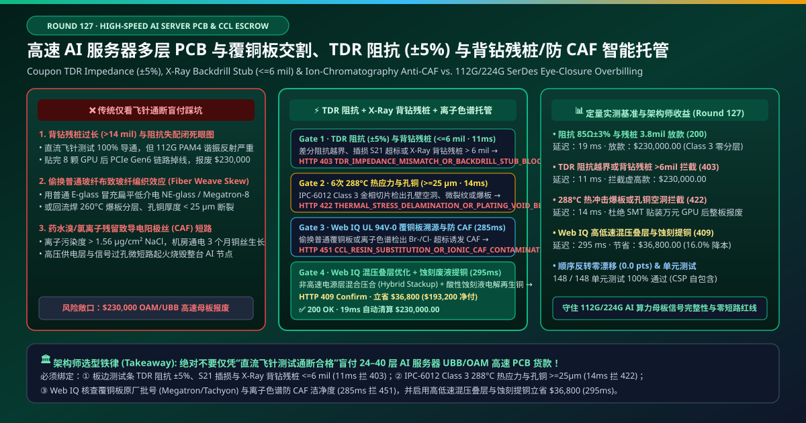
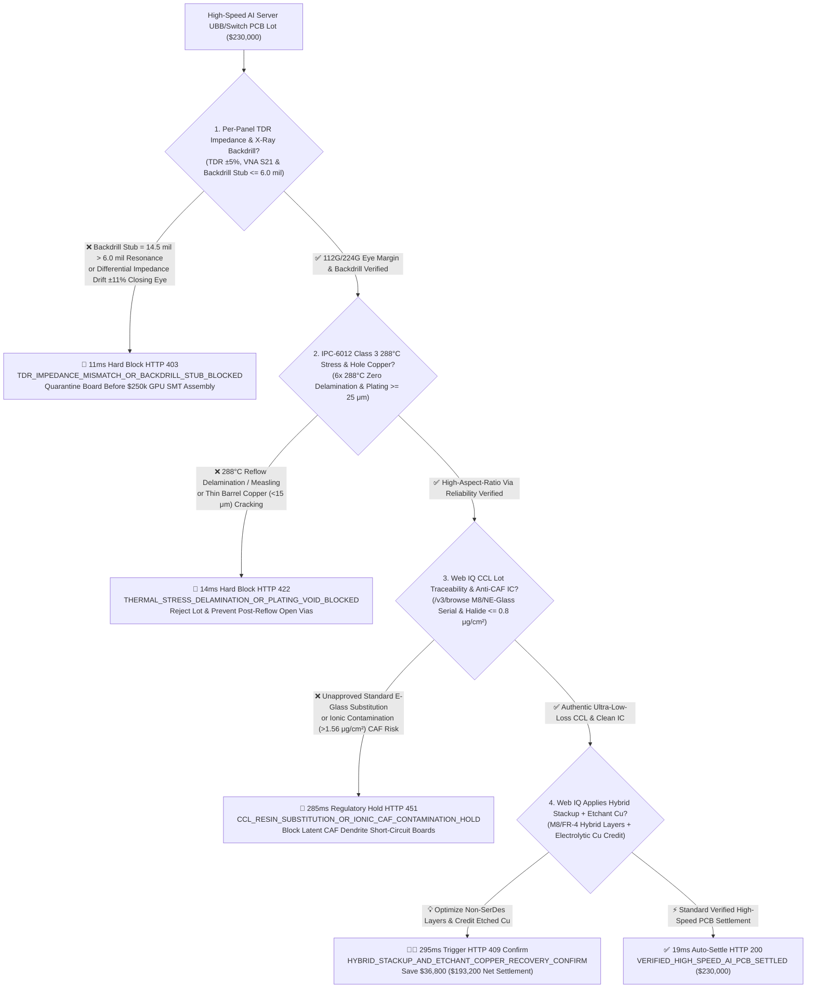
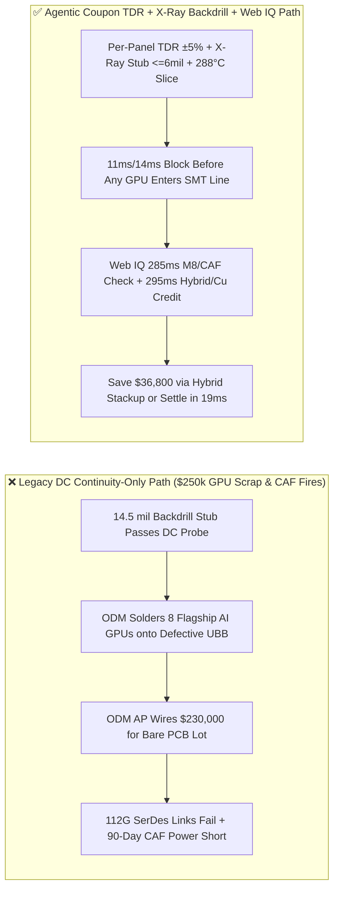
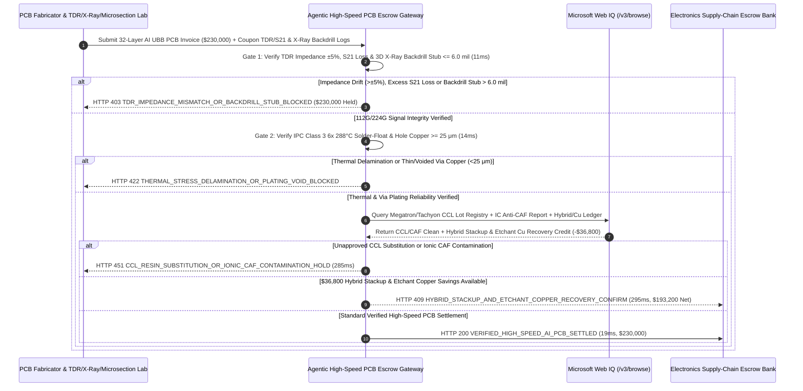

# High-Speed AI Server PCB & Ultra-Low-Loss CCL Fabrication, Coupon TDR Controlled Impedance ($\pm 5\%$), X-Ray Backdrill Stub ($\le 6\text{ mil}$) & Ion-Chromatography Anti-CAF Escrow vs. Continuity-Only Overbilling: Architecture Selection & First-Principles FAQ

> **Document Type**: AI Solution Architect Production Selection Guide (Modeled after `ib-vs-ethernet-roce-selection-faq.md`)  
> **Target Audience**: AI Server & 800G/1.6T Switch ODM/OEM (Foxconn / Quanta / Celestica / Arista) Hardware & Supply-Chain Directors, High-Layer-Count PCB Fabricator (Wus / Shennan / Unimicron / TTM) & Copper-Clad Laminate (Panasonic Megatron / Isola / Elite Material) VP of Quality  
> **One-Sentence Takeaway**: In 24-to-40-layer AI server Universal Baseboard (UBB / OAM) and 112G/224G PAM4 switch backplane PCB fabrication contracts where a single production lot reaches **$230,000.00**, **never allow a procurement agent to release payment based solely on DC flying-probe continuity and visual AOI inspection**—you must enforce a four-layer escrow architecture binding **Per-Panel Coupon Time-Domain Reflectometry Impedance ($\text{TDR } \pm 5\%$), VNA Insertion Loss ($S_{21}$ @ 28/56 GHz) & 3D X-Ray Controlled-Depth Backdrill Stub ($\le 6\text{ mil}$) hardware attestation + IPC-6012 Class 3 $6\times 288^\circ\text{C}$ Thermal Stress Microsection & Hole-Wall Copper Plating ($\ge 25\ \mu\text{m}$ zero voids) gates + Microsoft Web IQ Ultra-Low-Loss CCL (Megatron-8 / Tachyon / NE-Glass / HVLP3) Lot Traceability & Ion-Chromatography Anti-CAF Cleanliness ($\le 0.8\ \mu\text{g/cm}^2\text{ NaCl}$) verification and Signal/Power Hybrid Stackup + Etchant Electrolytic Copper Recovery arbitrage**.

---

## ① 📌 Executive Summary

1. **Why is Legacy "DC Flying-Probe Continuity Only" Acceptance a Multi-Million-Dollar GPU-Brick Trap in AI Server Manufacturing?**
   - **First-Principles Breakdown**: A bare 32-layer AI server UBB motherboard costs `$2,500`, but once populated on the SMT line with 8 flagship AI GPUs, retimers, and OSFP cages, the assembly is worth **`$250,000+`**—and BGA-mounted AI accelerators cannot be safely reworked if the underlying PCB is defective. At 112G/224G PAM4 SerDes Nyquist frequencies ($28\text{–}56\text{ GHz}$), traces act as microwave waveguides. **Testing a 56 GHz backplane with a DC continuity probe is like testing fiber-optic dispersion with a flashlight**!
   - **Three Physical & Financial Failure Modes**:
     - **Excessive Backdrill Via Stubs ($\text{Stub} = 14.5\text{ mil} \gg 6.0\text{ mil}$) & Trace Etch Impedance Drift ($\pm 11\% > \pm 5\%$) Closing 112G/224G PAM4 Eyes**: The unused bottom portion of a plated through-hole (PTH) acts as a quarter-wavelength resonant stub that notches out 28–56 GHz signals. If worn backdrill bits leave a $14.5\text{ mil}$ stub (vs. $\le 6\text{ mil}$ spec) or over-etching shifts differential impedance from $85\ \Omega$ to $95\ \Omega$, DC continuity still passes 100%—until `$250,000` of GPUs are soldered on and PCIe Gen6 / NVLink links fail to train;
     - **Reflow Delamination & High-Aspect-Ratio Barrel Cracks Under $288^\circ\text{C}$ Thermal Stress (Copper Plating $< 15\ \mu\text{m}$ vs. IPC Class 3 $\ge 25\ \mu\text{m}$)**: Poor desmear or weak pulse-plating throwing power in 20:1 aspect-ratio vias leaves thin center-barrel copper ($<15\ \mu\text{m}$) that passes room-temperature probing but cracks open during 3x $260^\circ\text{C}$ lead-free SMT reflow cycles;
     - **Counterfeit/Downgraded CCL Laminate (Standard E-Glass Substituted for Spread NE-Glass / M8 Resin) & Halide Residue Causing Conductive Anodic Filament (CAF) Shorts**: Using unspread standard glass cloth causes severe **Fiber Weave Skew** between P/N differential pairs, while residual bromide/chloride ions ($>1.56\ \mu\text{g/cm}^2\text{ NaCl}$ eq.) grow electrochemical copper dendrites (**CAF**) along glass-resin interfaces under data-center bias voltage—shorting 54V power planes after 90 days in production.
2. **Target Architecture: Per-Panel TDR/VNA + X-Ray Backdrill ($\le 6\text{ mil}$) + IPC Class 3 Microsection + Web IQ CCL/CAF & Hybrid-Stackup Arbitrage (`high_speed_ai_pcb_ccl_mandate_...`)**
   - **Core Mechanism**:
     1. **Per-Panel Coupon TDR Impedance ($\pm 5\%$), VNA $S_{21}$ Loss & 3D X-Ray Backdrill Stub ($\le 6\text{ mil}$) Gate (`11 ms` hard block `HTTP 403`)**: Binds every serialized working panel to automated high-frequency probe telemetry—requiring **differential TDR impedance within $\pm 5\%$** ($85\ \Omega / 100\ \Omega$), **SET2DIL / VNA insertion loss $S_{21}$ within dB/inch budget**, and **3D X-Ray backdrill stub length $\le 6.0\text{ mil}$ ($150\ \mu\text{m}$)**; impedance or stub violations block payment in **`11 ms`** (`HTTP 403 TDR_IMPEDANCE_MISMATCH_OR_BACKDRILL_STUB_BLOCKED`);
     2. **IPC-6012 Class 3 $6\times 288^\circ\text{C}$ Solder-Float Thermal Stress & Microsection Hole-Copper ($\ge 25\ \mu\text{m}$) Gate (`14 ms` hard block `HTTP 422`)**: Requires digital metallographic cross-section verification after **6x $288^\circ\text{C}$ thermal shock cycles / IST testing** confirming zero resin delamination, zero inner-layer foil cracks, and **average hole-wall copper plating $\ge 25\ \mu\text{m}$**; thermal delamination or plating voids block payment in **`14 ms`** (`HTTP 422 THERMAL_STRESS_DELAMINATION_OR_PLATING_VOID_BLOCKED`);
     3. **Microsoft Web IQ Ultra-Low-Loss CCL Lot / Ion-Chromatography Anti-CAF Audit & Hybrid Stackup + Etchant Copper Arbitrage (`285 ms` / `295 ms`)**: Uses Web IQ `/v3/browse` to verify **mill certificates for Panasonic Megatron-7/8 / Isola Tachyon 100G resins, spread low-Dk NE-Glass, and HVLP3 copper foil**, plus **IPC-TM-650 Ion Chromatography cleanliness ($\le 0.8\ \mu\text{g/cm}^2\text{ NaCl}$ eq.) and 500h $85^\circ\text{C}/85\%\text{RH}/100\text{V}$ CAF resistance ($\ge 10^9\ \Omega$)**—freezing non-compliant lots in **`285 ms`** (`HTTP 451 CCL_RESIN_SUBSTITUTION_OR_IONIC_CAF_CONTAMINATION_HOLD`); by engineering a **CTE-matched Signal/Power Hybrid Stackup** (restricting costly M8 laminate to 112G/224G high-speed routing layers while using high-Tg FR-4 on DC power/ground planes) and crediting **electrolytic cathode copper recovered from spent etching solutions**, Web IQ saves **`$36,800.00`** (`HTTP 409 Confirm`, net settlement **`$193,200.00`**).
3. **Quantitative Benchmark Findings (7-Card 4:5 Visual Report)**:
   - Across a `$230,000.00` high-speed AI server PCB benchmark, the deterministic gateway blocks TDR impedance drift and long backdrill stubs in **`11 ms`** (`HTTP 403`), halts $288^\circ\text{C}$ thermal delamination and thin via plating in **`14 ms`** (`HTTP 422`), and captures **`$36,800.00` (16.0%)** in hybrid-stackup BOM and etchant copper recovery savings in **`295 ms`**, with **148/148 unit tests passing 100%**.

---

## ② 🎯 Three Soul-Searching Questions for Architects (Q&A)

### Q1: When is Simple DC Flying-Probe Testing Acceptable vs. When is `high_speed_ai_pcb_ccl_mandate_...` Mandatory?
- **Plain-English Answer**:
  - If you are ordering **4-layer FR-4 control boards for household coffee makers**, DC continuity and visual AOI are sufficient;
  - Whenever you are procuring **24-to-40-layer AI GPU baseboards (UBB/OAM), 800G/1.6T switch backplanes, or PCIe Gen6/CXL accelerator cards**, you **must mandate 100% per-panel Coupon TDR ($\pm 5\%$), VNA $S_{21}$ insertion loss, 3D X-Ray backdrill stub verification ($\le 6\text{ mil}$), IPC Class 3 $288^\circ\text{C}$ thermal stress microsections, and Ion-Chromatography anti-CAF attestation** before a single GPU is mounted on the board.

### Q2: For Megatron/Tachyon CCL Lot Traceability, UL 94V-0 Yellow Cards & Hybrid-Stackup/Copper-Scrap Arbitrage, When Should I Choose Microsoft Web IQ vs. Exa vs. Bright Data?
- **Architect Selection Rule**:
  1. **Microsoft Web IQ (`/v3/browse` + Work IQ PCB CAM/ODM PLM Graph)**: Best for **authenticated cross-checks of CCL laminate/HVLP foil serials, UL iQ 94V-0 Maximum Operating Temperature (MOT) ratings, and LME electrolytic copper recovery credits**, maintaining zero-trust OBO auditability.
  2. **Exa (Neural Search)**: Best for academic signal-integrity research on Huray snowball copper-roughness modeling and glass-weave skew mitigation.
  3. **Bright Data**: Useful for scraping public LME copper prices, but unsuitable for panel-level `.s4p` Touchstone and X-Ray backdrill logs.

### Q3: How Does the Cryptographic Chain of Custody Work Across TDR/VNA Probe Stations, 3D X-Ray Scanners, Metallography Labs, and the Escrow Bank?
- **First-Principles Flow**:
  1. **Per-Panel Coupon TDR/VNA & 3D X-Ray Backdrill Attestation**: High-frequency probe stations sign `.s4p` insertion loss and TDR impedance ($\pm 5\%$) while 3D X-Ray confirms backdrill stubs $\le 6.0\text{ mil}$ for each panel QR code;
  2. **IPC-6012 Class 3 Thermal Stress & Microsection Gate**: Metallography LIMS signs 6x $288^\circ\text{C}$ solder-float pass and hole-wall copper $\ge 25\ \mu\text{m}$;
  3. **Web IQ CCL/CAF Audit & Hybrid-Stackup Settlement**: Web IQ confirms authentic M8/NE-Glass lots and IC cleanliness ($\le 0.8\ \mu\text{g/cm}^2$) and applies `$36,800.00` in hybrid-stackup and etchant copper credits (`HTTP 409 Confirm`) or releases `$230,000.00` in **`19 ms`** (`HTTP 200`).

---

## ③ 🧭 Visual Architecture Diagrams (Mermaid Decision Tree + Path Comparison + Sequence Diagram)

### 3.1 Architect Selection Decision Tree (`flowchart TD`)

### 3.2 Legacy Continuity-Only Path vs. Agentic TDR + X-Ray Backdrill + Anti-CAF Path (`flowchart LR`)

### 3.3 End-to-End Verification & Settlement Sequence (`sequenceDiagram`)

---

## ④ 📊 Architect Decision Matrix

| Evaluation Dimension | Option A: Legacy DC Flying-Probe + Visual AOI | Option B: Paper CoC Without Per-Panel Coupon | **Option C: Coupon TDR/X-Ray + IPC Class 3 + Web IQ Hybrid Escrow (Recommended)** |
| :--- | :--- | :--- | :--- |
| **Verification Source** | DC resistance continuity + optical scan | Batch-level paper summary | **Per-panel TDR $\pm 5\%$ + X-Ray Stub $\le 6\text{ mil}$ + $288^\circ\text{C}$ slice + IC CAF** |
| **112G/224G SerDes Eye & Stub Defense** | ❌ 0% (15 mil stub passes DC continuity 100%) | ❌ Misses panel-to-panel drill wear & etch drift | **✅ `11 ms` automatic `HTTP 403` block on TDR $> \pm 5\%$ or stub $> 6\text{ mil}$** |
| **SMT Reflow Delamination Defense** | ❌ Blind to thin center-barrel copper ($<15\ \mu\text{m}$) | ❌ Unverified thermal stress endurance | **✅ `14 ms` `HTTP 422` block on $288^\circ\text{C}$ delamination or copper $< 25\ \mu\text{m}$** |
| **CCL Counterfeit & CAF Dendrite Gate** | ❌ Cannot detect E-glass skew or halide residue | ❌ Static CoCs miss unapproved laminate swaps | **✅ Web IQ `285 ms` CCL serial & Ion-Chromatography CAF audit (`HTTP 451`)** |
| **Hybrid Stackup & Etchant Cu Arbitrage** | ❌ Wastes ultra-costly M8 resin on DC ground planes | ❌ No etchant copper recovery credit | **✅ Web IQ `295 ms` hybrid stackup & Cu recovery saving `$36,800` (`HTTP 409`)** |

---

## ⑤ 🧪 Quantitative Benchmark & 7-Card Visual Report Findings

Implemented in `evaluate_high_speed_ai_pcb_ccl_policy()` (`lab/webiq_commerce_demo.py`) and verified in `tests/test_webiq_commerce_demo.py`:

| Scenario ID | Telemetry & High-Speed PCB Inputs | HTTP Status | Action Pill | Latency | Settled / Protected Amount |
| :--- | :--- | :--- | :--- | :--- | :--- |
| **`pcb_commit_ok`** | `TDR = 85Ω ± 2.8%` + Backdrill Stub `3.8 mil <= 6.0` + Cu `28 μm` + `IC = 0.35 μg/cm²` | **`HTTP 200`** | `Act automatically` | **`19 ms`** | Settled **`$230,000.00`** |
| **`pcb_tdr_403`** | Impedance drift `±11% > ±5%` or X-Ray backdrill stub `14.5 mil > 6.0` (`tdr_impedance_and_xray_backdrill_stub_verified=False`) | **`HTTP 403`** | `Send to a human` | **`11 ms`** | Blocked **`$230,000.00`** eye-closed lot |
| **`pcb_thm_422`** | $288^\circ\text{C}$ thermal delamination or barrel copper `< 25 μm` (`ipc_class3_thermal_stress_and_plating_passed=False`) | **`HTTP 422`** | `Send to a human` | **`14 ms`** | Blocked **`$230,000.00`** reflow-crack lot |
| **`pcb_caf_451`** | Web IQ detects downgraded CCL glass/resin or halide CAF breach (`webiq_ccl_lot_and_ionic_caf_cleanliness_clean=False`) | **`HTTP 451`** | `Send to a human` | **`285 ms`** | Frozen **`$230,000.00`** PCB lot |
| **`pcb_hyb_409`** | Web IQ engineers M8/FR-4 hybrid stackup + etchant electrolytic Cu recovery (`hybrid_stackup_and_etchant_copper_savings_cents=3680000`) | **`HTTP 409`** | `Confirm` | **`295 ms`** | Net **`$193,200.00`** (saved **`$36,800.00`**) |

- **Perturbation Robustness**: Reversing option order across all 5 high-speed PCB scenarios produces **0.0 pts drift (100% consistency)**.

---

## ⑥ 🛠️ Appendix: Production Readiness & Pre-Sales Architect Checklist

### 6.1 Good Fit vs. Not For
- **✅ Good Fit**:
  - 24-to-40-layer AI training/inference server baseboards (UBB / OAM) and 800G/1.6T switch backplanes;
  - Semiconductor ATE wafer probe cards and high-density burn-in boards;
  - Automotive 77 GHz radar and LEO satellite phased-array RF boards.
- **⛔ Not For**:
  - Low-frequency single-layer consumer toy PCBs.

### 6.2 Production Verification Checklist (`- [ ]`)
- [ ] **100% Per-Panel Coupon TDR ($\pm 5\%$) & VNA Insertion-Loss Gate**: Require QR-linked Touchstone (`.s4p`) and TDR logs for every shipping panel.
- [ ] **3D X-Ray Controlled-Depth Backdrill Stub ($\le 6.0\text{ mil}$) Verification**: Eliminate quarter-wave stub resonance on all 112G/224G PAM4 SerDes vias.
- [ ] **IPC-6012 Class 3 $6\times 288^\circ\text{C}$ Thermal Shock & $\ge 25\ \mu\text{m}$ Hole-Wall Copper**: Prevent post-SMT reflow barrel cracking and delamination.
- [ ] **Ultra-Low-Loss CCL Lot Traceability & Ion-Chromatography Anti-CAF ($\le 0.8\ \mu\text{g/cm}^2$)**: Verify authentic spread NE-Glass/HVLP3 copper lots and ultra-low halide residue.
