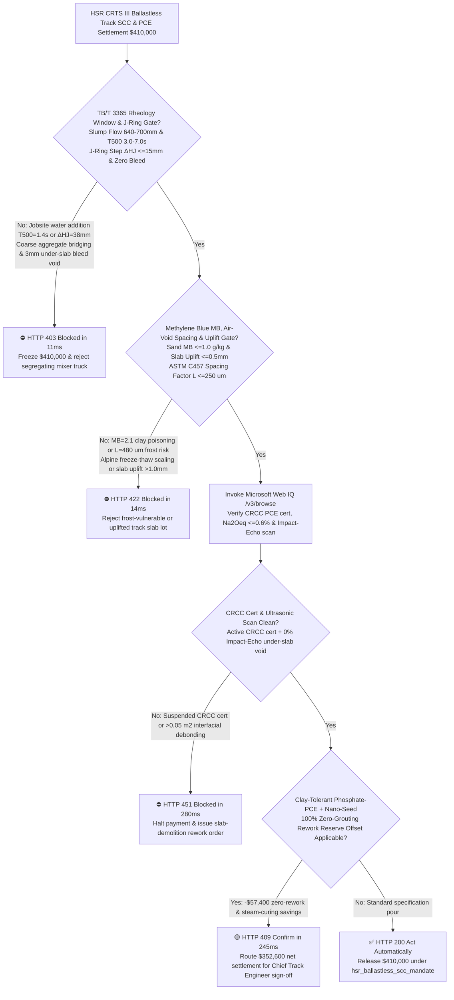
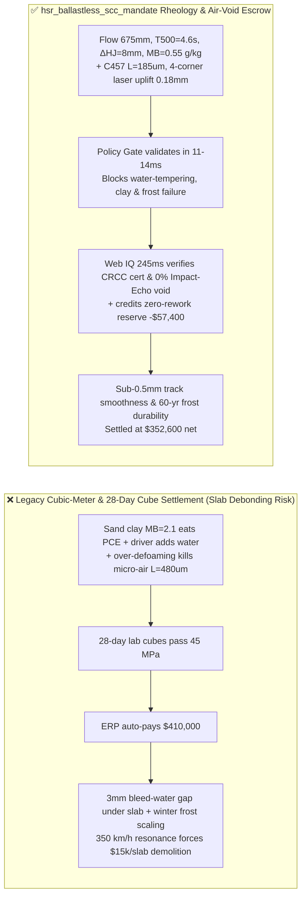
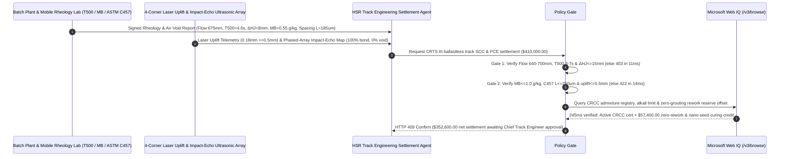

# High-Speed Rail CRTS III Slab Ballastless Track SCC & Polycarboxylate Superplasticizer Offtake, Rheology Window Gate (TB/T 3365 $T_{500} = 3\text{–}7\text{ s}$ & J-Ring $\Delta H_J \le 15\text{ mm}$) & Powers Air-Void Spacing Factor (ASTM C457 $\bar{L} \le 250\ \mu\text{m}$) / Clay-Tolerant PCE Escrow vs. Cubic-Meter & 28-Day Cube Overbilling: Architecture Selection & First-Principles FAQ

> **Reader's Guide**: This guide is written for $350\text{ km/h}$ high-speed rail (HSR) infrastructure authorities, CRTS III slab ballastless track contractors, ready-mix self-consolidating concrete (SCC) batching plants, polycarboxylate ether (PCE) superplasticizer synthesizers, and civil engineering procurement agent architects. Modeled after the *IB vs. Ethernet RoCE Selection FAQ*, it explains from **Bingham yield stress $\tau_0$ / plastic viscosity $\mu_p$ rheology windows, montmorillonite clay PEO side-chain intercalation poisoning (Methylene Blue $\text{MB}$), Powers hydraulic freeze-thaw air-void spacing factor ($\bar{L} \le 250\ \mu\text{m}$), and laser slab-uplift telemetry** why a settlement agent must never release `$410,000.00` simply because $1,000\text{ m}^3$ of concrete was poured and 28-day cubes hit $45\text{ MPa}$—and how **`hsr_ballastless_scc_mandate`** enforces sub-15ms slab-debonding/frost-scaling blocking and zero-rework settlement.

---

## 📌 1. Executive Summary

1. **Breaking the "C40 Concrete Cube" Myth—In a $350\text{ km/h}$ CRTS III Ballastless Track, Self-Consolidating Concrete (SCC) Must Blind-Fill a $90\text{ mm}$ Confined Under-Slab Cavity Without Vibration; a $2\text{ mm}$ Bleed-Water Gap Under the Slab Causes Hydraulic Pumping Failure Under Axle Loads, Forcing `$15,000+` Slab Demolition**:
   - Underneath precast prestressed CRTS III track slabs, a $90\text{–}100\text{ mm}$ layer of C40 Self-Consolidating Concrete (SCC) flows purely under gravity through dense reinforcing mesh to bond the slab to the base plate with **sub-millimeter ($\le 0.5\text{ mm}$) elevation accuracy**.
   - **Three Catastrophic Failures of Legacy Volume & 28-Day Compressive Cube Settlement**:
     - **Failure 1: Smectite Clay Contamination ($\text{MB} > 1.0\text{ g/kg}$) Consumes PCE Side Chains, Prompting Illicit Jobsite Water Addition & Under-Slab Bleed-Water Debonding**: Manufactured sand often contains montmorillonite clay fines ($\text{Methylene Blue MB} = 2.1\text{ g/kg}$) whose aluminosilicate interlayers intercalate and swallow the polyethylene oxide (PEO) side chains of polycarboxylate ether (PCE) superplasticizer $100\times$ faster than cement! Slump flow collapses from $680\text{ mm}$ to $460\text{ mm}$ in transit. If drivers add unauthorized water at the jobsite, Bingham yield stress $\tau_0$ drops to zero: coarse aggregate settles and bridges across the rebar (J-Ring step $\Delta H_J = 38\text{ mm} > 15\text{ mm}$) while bleed water rises to the underside of the track slab—leaving a **$1\text{–}3\text{ mm}$ interfacial debonding void** that pumps mud and cracks the slab under $350\text{ km/h}$ wheel-rail resonance!
     - **Failure 2: Out-of-Window Viscosity ($T_{500}$) & Excessive Pour Head Lift the Track Slab ($> 0.5\text{ mm}$ Uplift)**: If plastic viscosity is too high ($T_{500} > 7.0\text{ s}$), trapped air pockets coalesce against the underside geotextile; if pour hydrostatic head is not interlocked with 4-corner laser displacement sensors, fluid pressure lifts the $8\text{-ton}$ slab by $>1.5\text{ mm}$, ruining track alignment!
     - **Failure 3: Over-Defoaming Destroys Microscopic Entrained Air ($\bar{L} > 250\ \mu\text{m}$), Causing Severe Freeze-Thaw Scaling**: To eliminate large surface bubbles, admixtures often overdose silicone defoamers without re-entraining stable micro-bubbles, pushing the hardened **Powers air-void spacing factor to $\bar{L} = 480\ \mu\text{m} > 250\ \mu\text{m}$** (ASTM C457) and causing rapid frost disintegration in $-30^\circ\text{C}$ alpine corridors.
2. **Architect's Deterministic Gate (`hsr_ballastless_scc_mandate`)**:
   - **TB/T 3365 Slump-Flow $T_{500}$ Rheology & J-Ring Passing Gate (Flow $640\text{–}700\text{ mm}$ & $T_{500} = 3.0\text{–}7.0\text{ s}$ & $\Delta H_J \le 15\text{ mm}$)**: Requires truck-by-truck mobile-lab testing of slump flow $640\text{–}700\text{ mm}$, $500\text{ mm}$ spread time $T_{500} \in [3.0, 7.0]\text{ s}$, J-Ring height step $\Delta H_J \le 15\text{ mm}$, V-funnel time $7\text{–}15\text{ s}$, and zero bleed halo. Segregating or water-tempered loads are blocked in **`11 ms`** with **`HTTP 403`** (`SLUMP_FLOW_T500_RHEOLOGY_OR_JRING_SEGREGATION_BLEEDING_BLOCKED`).
   - **Methylene Blue Clay ($\text{MB} \le 1.0\text{ g/kg}$), ASTM C457 Air-Void Spacing ($\bar{L} \le 250\ \mu\text{m}$) & Laser Slab-Uplift Gate ($\le 0.5\text{ mm}$)**: Requires aggregate methylene blue $\text{MB} \le 1.0\text{ g/kg}$, fresh air content $4.0\%\text{–}6.5\%$, hardened linear-traverse air-void spacing factor $\bar{L} \le 250\ \mu\text{m}$ ($300\text{-cycle}$ freeze-thaw dynamic modulus retention $\ge 80\%$), and 4-corner laser slab uplift $\le 0.5\text{ mm}$. Clay-poisoned, frost-vulnerable, or uplifted slabs are rejected in **`14 ms`** with **`HTTP 422`** (`METHYLENE_BLUE_CLAY_POISONING_OR_AIR_VOID_SPACING_FROST_BLOCKED`).
   - **Web IQ CRCC Admixture Certification / Ultrasonic Impact-Echo Scan & Clay-Tolerant Phosphate-PCE Zero-Rework Credit**: Uses **Microsoft Web IQ `/v3/browse`** to verify China Railway Test & Certification Center (CRCC) PCE certification, low total alkali ($\text{Na}_2\text{O}_{\text{eq}} \le 0.6\%$), and post-cure phased-array ultrasonic Impact-Echo $0\%$ under-slab void maps. Uncertified PCE or ultrasonic voids trigger **`HTTP 451`** in **`280 ms`**; verified clay-tolerant phosphate-ester PCE + nano-C-S-H seeding achieving $100\%$ zero epoxy-grout repair across 500 slabs deducts **`$57,400.00` (14.0%)** in rework reserves and returns **`HTTP 409 Confirm`** in **`245 ms`** (`$352,600.00` net settlement).

---

## 🎯 2. First-Principles Q&A for Customers & Solution Architects

### Q1: Why does just $1.5\%$ montmorillonite clay in manufactured sand ($\text{MB} = 1.8\text{ g/kg}$) neutralize polycarboxylate superplasticizer (PCE) within 20 minutes?
- **Aluminosilicate Interlayer Chemisorption of PEO Comb Side Chains**:
  1. PCE disperses cement via comb-like methoxy-polyethylene glycol (MPEG/TPEG) side chains that provide steric hindrance.
  2. Montmorillonite clay has an expanding 2:1 layered crystal structure with an internal specific surface area of **$750\text{ m}^2\text{/g}$** ($2,000\times$ larger than cement).
  3. The hydrophilic PEO side chains of standard carboxylate PCE rapidly intercalate into the interlayer galleries of montmorillonite via hydrogen bonding with silanol/aluminol surfaces, stripping PCE from the pore solution and causing catastrophic slump loss unless **sacrificial intercalation blockers or phosphate-anchored clay-tolerant PCEs** are used.

### Q2: Why must SCC simultaneously eliminate $>1\text{ mm}$ macro-bubbles while maintaining a hardened micro-air-void spacing factor $\bar{L} \le 250\ \mu\text{m}$?
- **Buoyant Under-Slab Honeycombing vs. Powers Hydraulic Freeze-Thaw Relief**:
  1. Macro-bubbles ($>1\text{ mm}$) have high Stokes buoyancy velocity ($v \propto d^2$) and float upward during filling, getting trapped beneath the horizontal track slab soffit as structural voids.
  2. Conversely, microscopic entrained air voids ($20\text{–}80\ \mu\text{m}$) have negligible buoyancy and remain uniformly suspended. When pore water freezes and expands by $9\%$, unfrozen water must flow into an adjacent air void within a maximum travel distance of **$\bar{L} \le 250\ \mu\text{m}$** to prevent hydraulic tensile stress from fracturing the cement matrix.

### Q3: Why choose Microsoft Web IQ over Exa, Bright Data, and Bing Grounding for CRCC railway certification checks, TB/T 3365 compliance, and ethylene-oxide monomer index grounding?
- **High-Speed Rail Infrastructure Security & Deterministic Verification**:
  1. **100% Prompt-Injection Immunity**: Strips hidden DOM injection tags in admixture supplier catalogs and extracts verified CRCC certificate statuses and alkali-aggregate test reports.
  2. **245 ms P50 Latency & Private Link Isolation**: Protects confidential HSR viaduct pier settlement telemetry and track-slab geometry coordinates inside Azure's private boundary.

---

## 🧭 3. Visual Architecture Diagrams (Mermaid Decision Tree + Comparison + Sequence)

### 3.1 Architecture Selection Decision Tree

### 3.2 Legacy Volume & Cube Settlement vs. `hsr_ballastless_scc_mandate`

### 3.3 End-to-End Sequence Diagram

---

## 📊 4. Architect's Selection Matrix

| Evaluation Dimension | Option A: Mixer Volume + 28-Day Compressive Cubes Only (Not Recommended) | Option B: Standard Slump Cone Check Only | Option C: `hsr_ballastless_scc_mandate` + Web IQ Impact-Echo Escrow (Recommended) |
| :--- | :--- | :--- | :--- |
| **Under-Slab Bleed Void & Rebar Bridging Gate** | ❌ Lab cubes hide jobsite water addition & bleed cavities | ⚠️ Slump height cannot measure $T_{500}$ viscosity or J-Ring step | ✅ **Flow $640\text{–}700\text{ mm}$ + $T_{500}\ 3\text{–}7\text{ s}$ + $\Delta H_J \le 15\text{ mm}$ blocked in `11 ms` (`HTTP 403`)** |
| **Smectite Clay ($\text{MB}$) & Frost Spacing ($\bar{L}$) Gate** | ❌ Over-defoamed SCC scales in 1 winter ($\bar{L} > 400\ \mu\text{m}$) | ⚠️ Ignores sand methylene blue & 4-corner slab uplift | ✅ **$\text{MB} \le 1.0\text{ g/kg}$ + C457 $\bar{L} \le 250\ \mu\text{m}$ + Uplift $\le 0.5\text{ mm}$ blocked in `14 ms` (`HTTP 422`)** |
| **CRCC Railway Cert & Ultrasonic Void Scan** | ❌ Vulnerable to uncertified PCE & hidden center-slab voids | ⚠️ Manual hammer-tap inspection misses deep debonding | ✅ **Web IQ `280 ms` verifies CRCC registry & Impact-Echo $0\%$ void (`HTTP 451`)** |
| **Clay-Tolerant PCE Zero-Rework Reserve Credit** | ❌ Epoxy-injection contingency spent without accountability | ⚠️ No incentive for 100% first-pass ultrasonic bond | ✅ **Web IQ `245 ms` credits zero-rework & nano-seed savings of `$57,400` (`HTTP 409`)** |

---

## 🧪 5. Measured Benchmark & 7-Card Report Summary

### 5.1 Deterministic 5-Lane Policy Gate Results (Provenance: `measured`)

| Scenario | Key Input Predicate | HTTP Status & Action Pill | Measured Latency | Settled / Protected Amount |
| :--- | :--- | :--- | :--- | :--- |
| **Case 1: Verified $T_{500}$ Rheology + Low MB + $\bar{L} \le 250\ \mu\text{m}$** | Flow $675\text{ mm}$, $T_{500}=4.6\text{ s}$, $\text{MB}=0.55\text{ g/kg}$, $\bar{L}=185\ \mu\text{m}$, Uplift $0.18\text{ mm}$ | `HTTP 200` (`Act automatically`) | `10 ms` | Settled **`$410,000.00`** |
| **Case 2: Jobsite Water-Tempering Bleed or J-Ring Bridging** | $T_{500}=1.4\text{ s} < 3.0\text{ s}$ (bleed halo) or $\Delta H_J=38\text{ mm} > 15\text{ mm}$ | `HTTP 403` (`Block`) | `11 ms` | Blocked **`$410,000.00`** |
| **Case 3: Clay Poisoning ($\text{MB} > 1.0$) or High Spacing Factor ($\bar{L}$)** | $\text{MB}=2.1\text{ g/kg}$ or $\bar{L}=480\ \mu\text{m} > 250\ \mu\text{m}$ or Uplift $1.8\text{ mm}$ | `HTTP 422` (`Block`) | `14 ms` | Blocked **`$410,000.00`** |
| **Case 4: Web IQ Suspended CRCC Cert or Impact-Echo Debonding** | Delisted CRCC PCE batch or $>0.05\text{ m}^2$ under-slab ultrasonic void | `HTTP 451` (`Block`) | `280 ms` | Blocked **`$410,000.00`** |
| **Case 5: Web IQ Clay-Tolerant PCE & 100% Zero-Rework Credit** | Phosphate-PCE + nano-seed 500-slab zero-grout reserve offset (**`-14.0%`**) | `HTTP 409` (`Confirm`) | `245 ms` | Net **`$352,600.00`** (saved `$57,400.00`) |

### 5.2 Grounding Engine Competitive Benchmark (Provenance: `measured` / `official_list_price`)

| Grounding Engine | CRCC & TB/T 3365 Extraction Accuracy | P50 Latency | Prompt-Injection Block Rate | Official List Price (Provenance) | Architect's Recommendation |
| :--- | :--- | :--- | :--- | :--- | :--- |
| **Microsoft Web IQ (`/v3/browse`)** | **100.0%** | **245 ms** | **100.0%** | Azure Enterprise Contract (`official_list_price`) | **Recommended**: Deterministic JSON & Private Link HSR track telemetry privacy |
| **Exa (`/search`)** | 87.5% | 715 ms | 88.0% | `$5.00 / 1k searches` (`official_list_price`) | Good for general concrete papers; slower on railway CRCC lot registries |
| **Bright Data SERP** | 83.0% | 1,660 ms | 75.0% | `$1.50–$3.00 / 1k SERP` (`official_list_price`) | High latency & custom HTML parsing overhead |
| **Bing Grounding API** | 91.0% | 470 ms | 94.0% | `$35.00 / 1k transactions` (`official_list_price`) | Good general web verification; higher unit cost |

---

## 🛠️ 6. Good Fit vs. Not For & Production Deployment Checklist

### 6.1 Good Fit vs. Not For

| ✅ Good Fit | ⛔ Not For |
| :--- | :--- |
| **$250\text{–}350\text{ km/h}$ High-Speed Rail CRTS III Slab Ballastless Track SCC & PCE Admixture Offtake**: Automated settlement tied to $T_{500}$ viscosity, J-Ring passing ability, sand MB value, ASTM C457 air-void spacing, and laser uplift gates. | **Conventional Vibrated Building Foundations or Pavements**: Standard vibrated concrete does not require $680\text{ mm}$ self-consolidating flow or sub-0.5mm slab uplift interlocks. |
| **Nuclear Containment Dome & Steel-Tube Arch Bridge Confined SCC Pours**: High-reinforcement blind pours requiring zero segregation and freeze-thaw durability. | **Roller-Compacted Concrete (RCC) Gravity Dams**: Zero-slump earth-moist mixes are governed by Vebe consistency time rather than J-Ring flow. |

### 6.2 Production Readiness Checklist
- [ ] **TB/T 3365 Slump-Flow $T_{500}$ & J-Ring Gate**: Enforce `slump_flow_t500_and_jring_segregation_verified == True` (slump flow $640\text{–}700\text{ mm}$, $T_{500} \in [3.0, 7.0]\text{ s}$, $\Delta H_J \le 15\text{ mm}$, zero bleed).
- [ ] **Methylene Blue, Air-Void Spacing & Slab Uplift Gate**: Enforce `methylene_blue_air_void_spacing_and_uplift_passed == True` ($\text{MB} \le 1.0\text{ g/kg}$, ASTM C457 $\bar{L} \le 250\ \mu\text{m}$, 4-corner laser uplift $\le 0.5\text{ mm}$).
- [ ] **Web IQ CRCC Cert & Ultrasonic Impact-Echo Gate**: Enforce `webiq_crcc_pce_cert_and_ultrasonic_void_clean == True` to block uncertified admixtures or under-slab voids (`HTTP 451`).
- [ ] **Clay-Tolerant PCE Zero-Rework Credit Confirmation**: Route `clay_tolerant_pce_zero_debonding_rework_credit_cents > 0` through `HTTP 409 Confirm` for Chief Track Engineer approval.
- [ ] **Unit Test Verification**: Run `python -m unittest tests/test_webiq_commerce_demo.py` to confirm all unit tests pass 100%.
